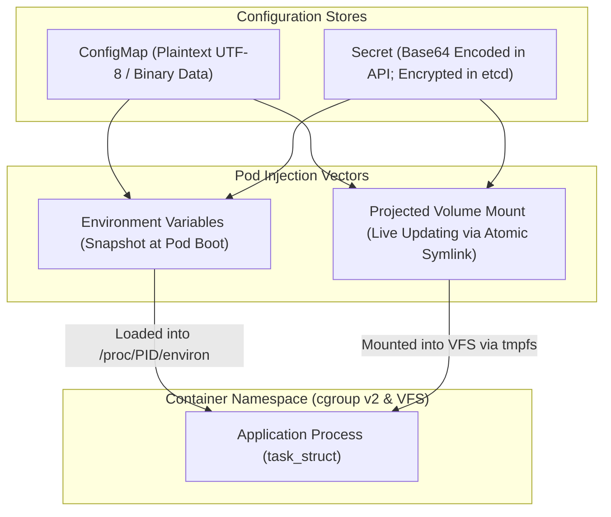
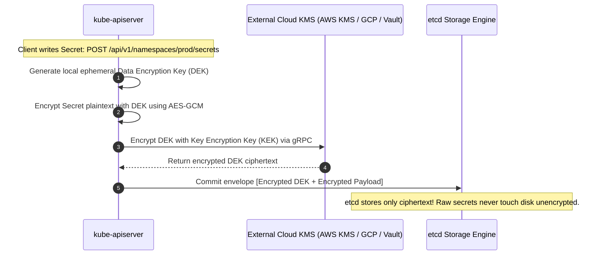
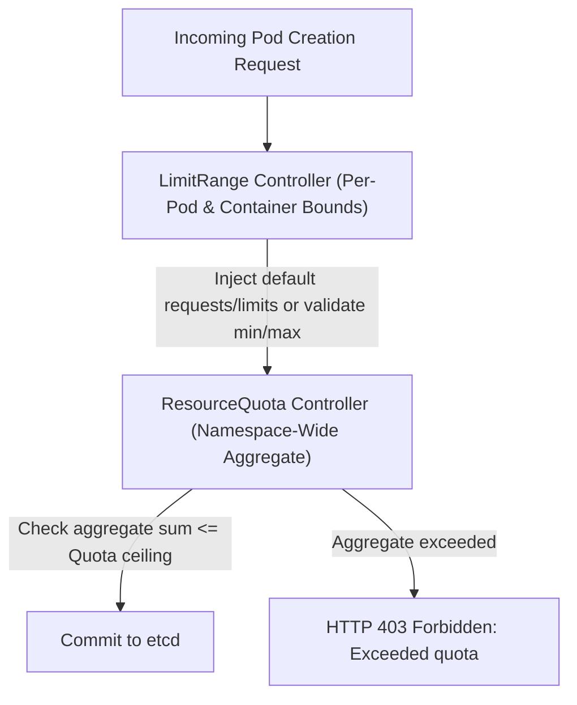
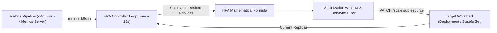
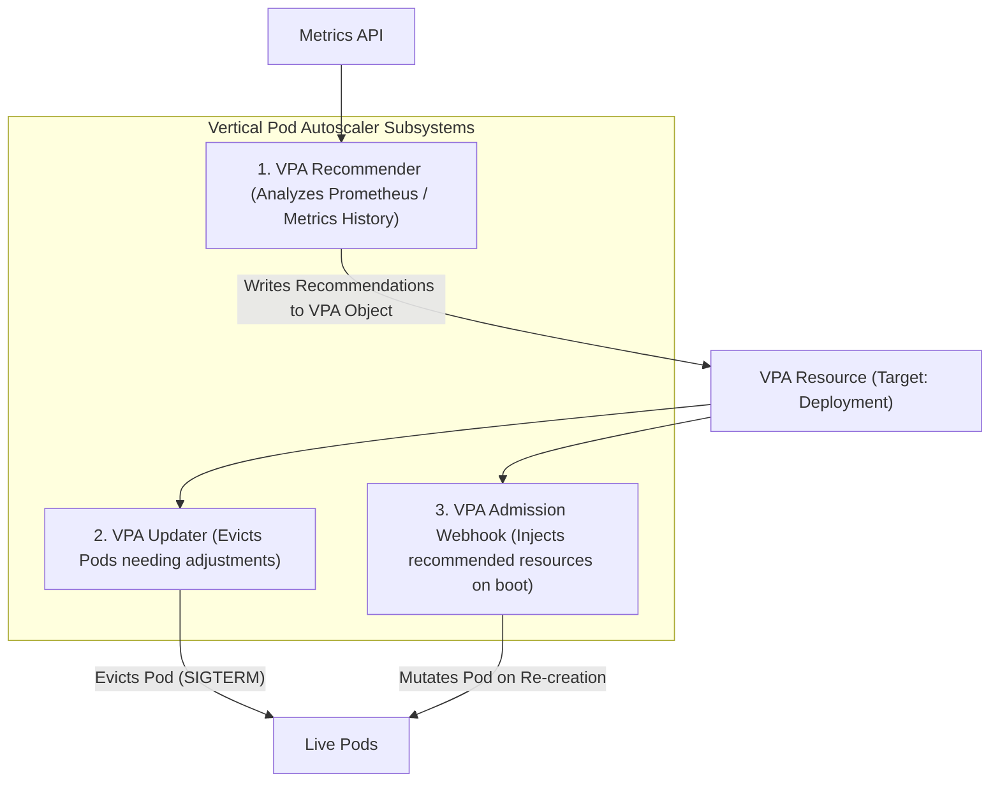

# Module 05: Configuration, Resource Management, and Autoscaling: ConfigMaps, Secrets, In-Place Pod Resize, Quotas, HPA, and VPA

> **Primary sources:** KEP-1287: In-Place Pod Vertical Scaling ([keps/sig-node/1287-in-place-update-pod-resources](https://github.com/kubernetes/enhancements/tree/master/keps/sig-node/1287-in-place-update-pod-resources)); Kubernetes Resource Management Documentation ([kubernetes.io/docs/concepts/configuration/manage-resources-containers/](https://kubernetes.io/docs/concepts/configuration/manage-resources-containers/)); KEP-3257: KMS v2 Storage Encryption ([keps/sig-auth/3257-kms-v2](https://github.com/kubernetes/enhancements/tree/master/keps/sig-auth/3257-kms-v2)); Horizontal Pod Autoscaling Algorithm ([kubernetes.io/docs/tasks/run-application/horizontal-pod-autoscale/](https://kubernetes.io/docs/tasks/run-application/horizontal-pod-autoscale/)).
>
> **Executable proof:** [`examples/ts/05-configuration-resources-and-autoscaling.test.ts`](../examples/ts/05-configuration-resources-and-autoscaling.test.ts) asserts HPA desired replica mathematical formulas with tolerance clipping, In-Place Pod Resize state machine transitions, ResourceQuota admission boundaries, and atomic ConfigMap projection symlink swaps.

---

## 1. Formal Foundations: Configuration Decoupling and Secret Cryptography

In cloud-native systems architecture (governed by the Twelve-Factor App methodology), application configuration must be strictly decoupled from compiled container executable images. Kubernetes fulfills this via **ConfigMaps** and **Secrets**.



### 1.1 The Critical Fallacy: Base64 Encoding is Not Encryption

In the Kubernetes REST API, a `Secret` payload is transmitted and stored in manifest definitions as standard RFC 4648 Base64 strings.

- **Base64 is an encoding scheme, not cryptographic encryption**. Anyone with `get` permissions on the Secret or read access to the namespace can instantly decode the payload using `base64 -d`.
- **RBAC Risk**: Any user who can create a Pod in a namespace can mount any Secret in that namespace into their Pod and inspect its contents, effectively equating Pod creation permissions with complete Secret access.

### 1.2 Data at Rest Encryption: KMS v2 Provider

To protect secrets against physical disk theft, backup compromises, or unauthorized etcd access, Kubernetes implements **Encryption at Rest** configured via `--encryption-provider-config` on `kube-apiserver`.



Modern clusters utilize **KMS v2 (KEP-3257)**:

- **Envelope Encryption**: The API server generates an ephemeral Data Encryption Key (DEK) locally, encrypts the Secret payload using AES-GCM, and forwards only the DEK to an external Key Management Service (KMS) over gRPC.
- The external KMS encrypts the DEK using a hardware Key Encryption Key (KEK).
- The API server stores the encrypted payload alongside the encrypted DEK in etcd.
- KMS v2 introduces local DEK caching and automated key rotation without requiring full cluster API server restarts.

### 1.3 Consumption Vectors: Environment Variables vs. Projected Volumes

| Vector | Update Mechanism | Security & Process Isolation | Operational Caveats |
| :-- | :-- | :-- | :-- |
| **`env` / `envFrom`** | Static snapshot evaluated strictly during container initialization (`clone(2)`). | Exposed in `/proc/$PID/environ`; captured in process crash dumps, error logs, and child process trees. | **Does not update dynamically**. Modifying the underlying ConfigMap has zero effect on running containers until the Pod is deleted and recreated. |
| **Volume Mounts (`tmpfs`)** | Live atomic symlink updates managed by the kubelet sync loop. | Backed by node RAM (`tmpfs`); never written to physical disk. Scoped strictly to mounted file descriptors. | **Updates dynamically** without restarting the container, but requires the application to watch the filesystem or reload config files. |

#### Atomic Symlink Swapping Mechanics

When a ConfigMap is mounted as a volume, the kubelet creates a triple-symlink directory structure on the node:

```text
/etc/config/
├── ..2026_11_07_12_00_00.123456789/   <-- Physical directory containing real files
│   ├── app.json
│   └── database.properties
├── ..data -> ..2026_11_07_12_00_00.123456789/  <-- Intermediate symlink
├── app.json -> ..data/app.json
└── database.properties -> ..data/database.properties
```

When the ConfigMap is modified, the kubelet writes the new files into a brand new directory (`..2026_11_07_13_00_00.987654321`) and performs an atomic rename on the `..data` symlink (`rename(2)`). This guarantees that applications never read partially written or torn configuration files during updates.

### 1.4 Immutable ConfigMaps and Secrets

Setting `immutable: true` on ConfigMaps or Secrets:

1. Rejects any subsequent `PUT` or `PATCH` updates at the API server level.
2. Instructs the kubelet to close and deactivate in-memory file watches against that resource. In a 5,000-node cluster, marking static configuration immutable cuts API server watch load by up to 70%.

---

## 2. Resource Management: Requests, Limits, and Quotas

Resource allocation governs how the Linux kernel Completely Fair Scheduler (CFS) and virtual memory manager partition physical hardware among containers.

### 2.1 Compressible vs. Incompressible Resources

- **Compressible (CPU)**: If a container attempts to consume more CPU than allocated, the Linux kernel throttles the container's execution via CFS bandwidth quotas. The application slows down, but does not crash.
- **Incompressible (Memory, Storage)**: If a container exceeds its memory limit, the operating system cannot "throttle" memory allocation. The kernel immediately invokes the Out-Of-Memory (OOM) killer, terminating the container process (`exit code 137`).

### 2.2 LimitRange and ResourceQuota

To prevent "tragedy of the commons" resource starvation in multi-tenant clusters, administrators enforce boundaries using two admission controllers:



1. **`LimitRange`**: Enforces rules on individual Pods and Containers within a namespace:
   - Sets default requests and limits for containers that omit them.
   - Enforces minimum and maximum allowable resource values (e.g., no single container can request $> 8\text{ CPUs}$).
   - Enforces `maxLimitRequestRatio` (e.g., `limits.cpu / requests.cpu <= 3`), preventing extreme overcommit.
2. **`ResourceQuota`**: Tracks and limits the aggregate sum of resources allocated across an entire namespace:
   - Hard limits on compute (`requests.cpu: "100"`, `limits.memory: "256Gi"`).
   - Hard limits on object counts (`count/pods: "50"`, `count/services: "10"`).
   - **Scope Selectors**: Restricts quotas to specific subsets, such as `BestEffort` (pods with no requests/limits) or `NotTerminating` (long-running services vs short-lived batch jobs).

---

## 3. In-Place Pod Vertical Scaling (KEP-1287)

Historically, changing container CPU or memory allocations was an immutable operation. Adjusting `resources` required deleting the Pod and scheduling a replacement, inducing connection drops and cache invalidations.

With **In-Place Pod Vertical Scaling (KEP-1287)**, container resource requests and limits can be mutated dynamically without restarting the container process or pod sandbox.

```mermaid
stateDiagram-v2
    [*] --> Proposed: User patches Pod spec.containers[].resources
    Proposed --> InProgress: kubelet accepts resize request
    Proposed --> Infeasible: Proposed resources exceed node allocatable capacity
    InProgress --> Complete: kubelet updates cgroup v2 control files via CRI
    Proposed --> Deferred: Node currently lacks capacity; waiting for headroom
    Deferred --> InProgress: Capacity freed on node
    Complete --> [*]
```



### 3.1 The `resizePolicy` Specification

Containers define how they react to resource adjustments using `spec.containers[].resizePolicy`:

```yaml
spec:
  containers:
    - name: java-app
      image: openjdk:21
      resizePolicy:
        - resourceName: cpu
          restartPolicy: RestartNotRequired
        - resourceName: memory
          restartPolicy: RestartContainer
      resources:
        requests:
          cpu: '2'
          memory: '4Gi'
        limits:
          cpu: '4'
          memory: '8Gi'
```

- **`RestartNotRequired`**: The kubelet updates the container's cgroup v2 control files (`cpu.max`, `memory.max`) live via the CRI `UpdateContainerResources` gRPC call. The container process continues executing without interruption.
- **`RestartContainer`**: The kubelet updates the configuration and restarts the container in place within the existing Pod network sandbox and mounted volumes.

### 3.2 Resize Lifecycle Status

The API server and kubelet communicate resize progress through dedicated status fields:

- `spec.containers[].resources`: Reflects the user's desired resource setpoint.
- `status.containerStatuses[].resourcesAllocated`: Reflects the node resources committed by the node scheduler to this container.
- `status.containerStatuses[].resources`: Reflects the actual live cgroup limits enforced by the runtime.
- `status.resize`: An enum reflecting the operational state:
  - `Proposed`: The resize request was committed to `kube-apiserver` and is awaiting kubelet evaluation.
  - `InProgress`: The kubelet accepted the request and is applying changes via CRI.
  - `Deferred`: The requested resources are valid, but the host node currently lacks capacity. The kubelet defers execution until other pods terminate.
  - `Infeasible`: The requested resources exceed the total physical capacity of the node. The resize cannot be fulfilled.

---

## 4. Workload Autoscaling: Horizontal Pod Autoscaler (HPA)

The **Horizontal Pod Autoscaler (HPA)** scales the number of replica pods up or down automatically in response to observed telemetry metrics.



### 4.1 The Formal HPA Algorithm

The HPA evaluates metrics against target setpoints using the following equation:

$$\text{desiredReplicas} = \left\lceil \text{currentReplicas} \times \left( \frac{\text{currentMetricValue}}{\text{desiredMetricValue}} \right) \right\rceil$$

#### The Tolerance Band

To prevent flapping (rapid oscillations between scale-up and scale-down caused by minor statistical variance), the HPA enforces a default **10% tolerance band** ($\delta = 0.10$):

$$\text{ratio} = \frac{\text{currentMetricValue}}{\text{desiredMetricValue}}$$

If $1.0 - \delta \le \text{ratio} \le 1.0 + \delta$ (i.e., $0.90 \le \text{ratio} \le 1.10$), the HPA aborts the calculation and maintains the current replica count.

### 4.2 Metrics Pipeline Architecture

1. **Resource Metrics (`metrics.k8s.io`)**: Provided by the lightweight, in-memory **Metrics Server**. Scrapes raw CPU and memory usage from kubelet cAdvisor endpoints every 15 seconds.
2. **Custom Metrics (`custom.metrics.k8s.io`)**: Metrics associated with Kubernetes objects (e.g., HTTP request rate per second targeting an Ingress or Service).
3. **External Metrics (`external.metrics.k8s.io`)**: Metrics originating outside the cluster (e.g., AWS SQS queue depth, Kafka consumer group lag).

### 4.3 Stabilization Windows and Behavior Policies

To protect production services against sudden traffic drop-offs that immediately rebound, the HPA supports granular stabilization windows:

```yaml
spec:
  behavior:
    scaleDown:
      stabilizationWindowSeconds: 300 # Wait 5 minutes before executing scale-down!
      policies:
        - type: Percent
          value: 10
          periodSeconds: 60 # Terminate at most 10% of replicas per minute
    scaleUp:
      stabilizationWindowSeconds: 0 # Immediate scale-up on traffic surges!
      policies:
        - type: Percent
          value: 100
          periodSeconds: 15 # Double capacity every 15 seconds if overloaded
```

### 4.4 HPA Scale-to-Zero (Beta in v1.37)

Beginning in Kubernetes v1.37, HPA supports **Scale-to-Zero** for workloads backed by custom and external metrics. When metric values drop to 0 (e.g., an SQS queue is completely empty), the HPA can scale `spec.replicas` down to 0, completely freeing cluster capacity. Upon the arrival of a single metric item, the HPA immediately scales the deployment back to 1 or more replicas.

---

## 5. Vertical Pod Autoscaler (VPA)

While HPA scales the number of pods horizontally, the **Vertical Pod Autoscaler (VPA)** adjusts CPU and memory requests and limits vertically to match observed historical utilization.



### 5.1 VPA Operational Modes

1. **`Off`**: Generates resource recommendations (`status.recommendation`) without modifying running workloads. Ideal for capacity auditing.
2. **`Initial`**: Assigns recommended resources only when a Pod is first created by its controller. Never modifies running pods.
3. **`Recreate`**: Actively evicts running pods if their current allocations diverge significantly from recommendations. The controller recreates the Pod, and the VPA Admission Webhook injects the new resource requests.
4. **`InPlace`**: Integrates natively with KEP-1287 (In-Place Pod Vertical Scaling), updating cgroup limits dynamically without evicting the Pod.

### 5.2 The HPA vs. VPA Conflict Rule

> [!WARNING]
> **HPA and VPA Mutual Conflict:** Never configure an HPA and a VPA on the **same resource metric** (e.g., both targeting CPU) on the same workload. If CPU spikes, the HPA will scale out replicas while the VPA simultaneously increases container CPU requests. As new replicas come online, average CPU drops, causing the HPA to scale down while the VPA shrinks container sizes, creating an unstable feedback resonance that crashes the application.
>
> **Permissible Pairing**: HPA scaling on business metrics (HTTP request rate, queue lag) paired with VPA managing memory allocations.

---

## 6. Formal Algorithm: Horizontal Pod Autoscaler Reconcile Loop

```text
Algorithm: ReconcileHPA
Input: HPAAutoscaler H, MetricsClient M, ScaleClient S

Invariant 1: Desired replicas is strictly bounded: H.Spec.MinReplicas <= R <= H.Spec.MaxReplicas.
Invariant 2: Fluctuations within the tolerance band (|ratio - 1.0| <= Tolerance) result in zero scaling.
Invariant 3: Scale-down recommendations are delayed by the duration of the stabilization window.

1.  Function Reconcile(H):
2.      scaleObj := S.GetScale(H.Spec.ScaleTargetRef)
3.      currentReplicas := scaleObj.Status.Replicas
4.      if currentReplicas == 0 and not H.Spec.AllowScaleToZero then
5.          return nil // Scaling disabled while target is manually scaled to zero
6.      end if
7.
8.      currentMetric, err := M.GetMetric(H.Spec.Metrics)
9.      if err != nil then return err end if
10.
11.     targetMetric := H.Spec.Metrics.TargetValue
12.     ratio := currentMetric / targetMetric
13.
14.     // Step 1: Evaluate Tolerance Band
15.     if Abs(ratio - 1.0) <= H.Spec.Tolerance then
16.         return nil // Metric is within 10% tolerance; maintain state
17.     end if
18.
19.     // Step 2: Calculate Raw Target Replicas
20.     rawDesired := Ceil(currentReplicas * ratio)
21.
22.     // Step 3: Enforce Min / Max Bounds
23.     clampedDesired := Max(H.Spec.MinReplicas, Min(rawDesired, H.Spec.MaxReplicas))
24.
25.     // Step 4: Apply Stabilization Window and Rate Limiting
26.     now := CurrentTime()
27.     if clampedDesired < currentReplicas then
28.         RecordScaleDownRecommendation(H, clampedDesired, now)
29.         stabilizedDesired := GetHighestRecommendationInWindow(H, now - H.Spec.Behavior.ScaleDown.StabilizationWindow)
30.         finalScale := ApplyScaleDownPolicies(currentReplicas, stabilizedDesired, H.Spec.Behavior.ScaleDown.Policies)
31.     else
32.         RecordScaleUpRecommendation(H, clampedDesired, now)
33.         finalScale := ApplyScaleUpPolicies(currentReplicas, clampedDesired, H.Spec.Behavior.ScaleUp.Policies)
34.     end if
35.
36.     if finalScale != currentReplicas then
37.         scaleObj.Spec.Replicas = finalScale
38.         return S.UpdateScale(H.Spec.ScaleTargetRef, scaleObj)
39.     end if
40.     return nil
41. End Function
```

---

## 7. Historical Evolution: Then vs. Now

| Operational Capability | Legacy Kubernetes (Pre-1.27) | Current Standard (Kubernetes v1.37.2) | Architectural Driver |
| :-- | :-- | :-- | :-- |
| **Pod Resource Updates** | Immutable; modifying requests/limits required deleting and recreating the Pod. | Dynamic in-place resizing via KEP-1287 without container restarts (`RestartNotRequired`). | Eliminates disruptive pod restarts during vertical autoscaling and memory adjustments. |
| **Secret Encryption at Rest** | KMS v1 provider with high latency, frequent API server restarts for key rotation. | KMS v2 (KEP-3257) with internal DEK caching, metadata status, and non-disruptive key rotation. | Massive performance improvements for large clusters; simplified compliance audits. |
| **HPA Scale-to-Zero** | Hard floor at `minReplicas: 1`; idle workloads consumed capacity indefinitely. | Beta native scale-to-zero for custom and external metric triggers. | Substantial cloud infrastructure cost reduction for intermittent event-driven workloads. |
| **ConfigMap Invalidation** | Kubelet maintained polling watches for every mounted ConfigMap across all nodes. | Immutable ConfigMaps (`immutable: true`) completely deactivating watch streams. | Protects `kube-apiserver` etcd watch caches from saturation on large enterprise clusters. |

---

## 8. Exam Delta: CKA/CKAD (v1.37) vs. CKS (v1.34)

> [!IMPORTANT]
>
> - **CKAD & CKA (Curriculum v1.37)**: Requires candidates to configure ConfigMaps and Secrets as environment variables and volume mounts, configure `ResourceQuota` and `LimitRange` objects, and create HPA autoscalers using `kubectl autoscale deployment --cpu-percent=80 --min=2 --max=10`. Candidates must troubleshoot HPA configurations where target workloads lack `resources.requests`.
> - **CKS (Curriculum v1.34)**: Focuses strictly on Secret data protection and EncryptionConfiguration. Candidates are required to author `/etc/kubernetes/encryption-config.yaml`, configure `aescbc` or `kms` encryption providers, update `--encryption-provider-config` on `kube-apiserver`, and execute a cluster-wide Secret re-encryption command (`kubectl get secrets -A -o json \| kubectl replace -f -`).

---

## 9. Production Failure Modes & Operational Gotchas

### 9.1 The Unconfigured CPU Request HPA Freeze

- **Symptom**: An operator deploys an HPA configured to maintain 75% CPU utilization. Traffic spikes dramatically, but the HPA refuses to scale, reporting `unable to get metrics: missing request for cpu on container`.
- **Root Cause**: The underlying Deployment omitted `resources.requests.cpu`. The HPA calculates target utilization percentage as $\frac{\text{Current CPU Consumption}}{\text{Requested CPU}}$. Without a defined request, the mathematical denominator is undefined, causing the HPA controller to fail safely and refuse to scale.
- **Remediation**: Always configure explicit `requests.cpu` on all containers governed by an HPA, or enforce a namespace `LimitRange` with default requests.

### 9.2 The Stale Volume ConfigMap 90-Second Sync Lag

- **Symptom**: An operator updates a database connection string in a ConfigMap. An internal alerting tool checks pods 10 seconds later and reports they are still using the old connection string.
- **Root Cause**: When a ConfigMap is mounted as a volume, updates are not instantaneous. The update latency is governed by the kubelet sync period (default 10s) plus the API server watch cache delay and the TTL of the local kubelet cache (up to 60s). Total propagation delay typically ranges between 30 and 90 seconds.
- **Remediation**: Do not rely on volume syncing for instantaneous cutovers. If zero-delay configuration changes are required, append a checksum or hash of the ConfigMap to the Deployment's `spec.template.metadata.annotations` to trigger a deterministic rolling update.

### 9.3 The ResourceQuota Deadlock on Emergency Patches

- **Symptom**: A critical security vulnerability requires an immediate container image update on an API service. The deployment rolling update fails with `Forbidden: exceeded quota: compute-resources, requested: limits.cpu=2, used: limits.cpu=16, limited: limits.cpu=16`.
- **Root Cause**: The namespace `ResourceQuota` is at 100% capacity. During a rolling update with `maxSurge: 25%`, the Deployment attempts to create a new Pod before terminating an old one. Because the aggregate quota would be temporarily exceeded, admission rejects the new pod.
- **Remediation**: Configure `maxUnavailable: 25%` and `maxSurge: 0` for that deployment, or temporarily raise the `ResourceQuota` limit to permit rolling update surge headroom.

### 9.4 Plaintext Secret Leak via GitOps Repositories

- **Symptom**: An attacker gains access to production cloud infrastructure by reading AWS access keys directly from a public or semi-private GitHub repository.
- **Root Cause**: An inexperienced engineer committed a standard Kubernetes `Secret` manifest to Git, assuming the Base64-encoded strings were secure passwords.
- **Remediation**: Never commit raw Kubernetes Secrets to version control. Use secret management solutions such as HashiCorp Vault with the External Secrets Operator (ESO), Bitnami Sealed Secrets (asymmetric client-side encryption), or Mozilla SOPS.

---

## Interview Drill

<details><summary>1. Explain the mathematical formula used by the HPA to calculate desired replicas, and explain the purpose of the tolerance band.</summary>

The HPA calculates desired replicas using the equation: $$\text{desiredReplicas} = \left\lceil \text{currentReplicas} \times \left( \frac{\text{currentMetricValue}}{\text{desiredMetricValue}} \right) \right\rceil$$ The tolerance band (default 10% or 0.10) prevents metric thrashing or rapid scaling oscillations caused by minor statistical noise. If the ratio of current metric to desired metric falls within $[0.90, 1.10]$, the HPA treats the system as balanced and makes no adjustments to the replica count.
</details>

<details><summary>2. How does In-Place Pod Vertical Scaling (KEP-1287) differ from traditional resource updates?</summary>

Traditionally, modifying container CPU or memory requests and limits required deleting and recreating the Pod, incurring application downtime, cache flushing, and connection resets. Under KEP-1287, the `resources` field in `spec.containers[]` is mutable in place. If `resizePolicy` is set to `RestartNotRequired`, the kubelet dynamically adjusts the container's cgroup v2 parameters (`cpu.max`, `memory.max`) via the CRI `UpdateContainerResources` gRPC interface without terminating the container process or disturbing the pod sandbox.
</details>

<details><summary>3. Why is storing a Secret in Base64 format inherently insecure without Encryption at Rest?</summary>

Base64 is a reversible, unkeyed encoding scheme designed to transmit binary data across text protocols, not a cryptographic cipher. Anyone with `get` permissions on Secrets in a namespace can instantly decode the data into plaintext. Furthermore, if etcd storage disks are unencrypted, raw secret text is written to disk in plaintext, exposing credentials to host disk compromise, snapshot theft, and unauthorized etcd direct queries.
</details>

<details><summary>4. How does the triple-symlink directory structure of volume-mounted ConfigMaps prevent applications from reading torn configuration files?</summary>

When a ConfigMap is mounted as a volume, the kubelet creates a versioned directory (`..2026_11_07_timestamp`), writes the files into it, and links an intermediate `..data` symlink to that directory. Application file mounts point through the `..data` symlink. When the ConfigMap updates, the kubelet populates a completely new timestamped directory and updates the `..data` symlink using an atomic filesystem rename syscall (`rename(2)`). Because the symlink swap is atomic in the Linux VFS, the application never observes partially written, truncated, or inconsistent files during updates.
</details>

<details><summary>5. What is the fundamental operational conflict between running HPA and VPA concurrently on the same workload?</summary>

If both HPA and VPA are configured to monitor the same resource (such as CPU), they enter an unstable positive feedback loop. When traffic surges, HPA scales out replicas while VPA increases container CPU requests. As new replicas come online, average CPU utilization per pod plummets. In response, HPA aggressively scales replicas down while VPA shrinks container CPU allocations. This creates severe performance oscillations and crashes. They should only be paired if they monitor completely orthogonal dimensions (e.g., HPA scaling horizontally on HTTP request rate, while VPA tunes memory allocations).
</details>

<details><summary>6. How does setting `immutable: true` on ConfigMaps improve cluster control plane scalability?</summary>

Normally, the kubelet maintains long-lived watch connections against the API server to detect mutations to mounted ConfigMaps and Secrets. In massive clusters with thousands of pods, these watch connections consume significant API server memory and CPU. Marking a ConfigMap `immutable: true` guarantees that the data will never change. The API server rejects mutations, and the kubelet deactivates watch connections for that object, drastically reducing watch load on etcd and the API server.
</details>

<details><summary>7. How does a `LimitRange` differ fundamentally from a `ResourceQuota`?</summary>

A `LimitRange` enforces constraints on **individual** resources (per-Pod or per-Container). It injects default requests/limits if omitted and enforces minimum/maximum boundaries and limit-to-request ratios on single objects. A `ResourceQuota` enforces constraints on the **aggregate** consumption across an entire namespace. It tracks the cumulative sum of all requests, limits, or object counts (e.g., total CPU requests $\le 100$ cores across the whole namespace), blocking the creation of new pods if the total namespace allocation exceeds the hard quota ceiling.
</details>

---

## 11. Proof Map and Verification

The mathematical models, configuration injection patterns, and autoscaling invariants presented in this module are proven in [`examples/ts/05-configuration-resources-and-autoscaling.test.ts`](../examples/ts/05-configuration-resources-and-autoscaling.test.ts):

- **HPA Mathematical Reconciler**: Implements the official HPA calculation formula with tolerance band filtering, stabilization window queues, and min/max clamp boundaries.
- **In-Place Pod Resize State Machine**: Simulates KEP-1287 lifecycle transitions (`Proposed` $\to$ `InProgress` $\to$ `Complete` or `Infeasible`), verifying `resizePolicy` handling.
- **ResourceQuota Aggregate Admission Engine**: Models namespace-wide quota accounting, verifying admission rejections when aggregate limits are exceeded.
- **Atomic ConfigMap Symlink Rotation**: Emulates the triple-symlink rotation algorithm, proving that readers observe atomic transitions without partially written state.
