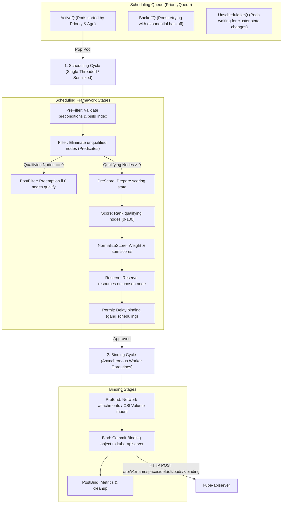
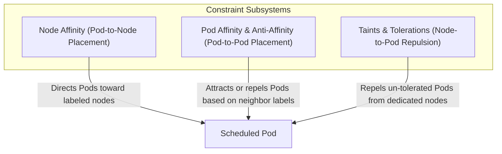
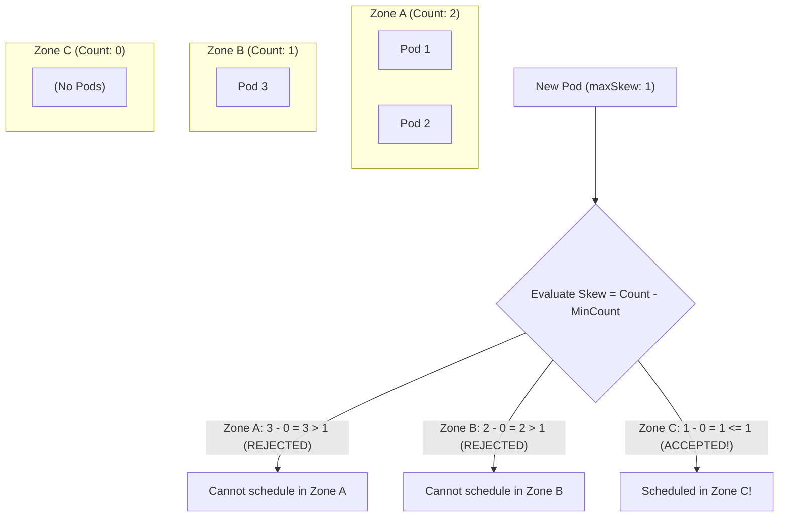

# Module 06: Scheduling Architecture: Filter/Score Pipeline, Affinity, Taints, Topology Spread, Preemption, PDBs, and DRA

> **Primary sources:** Kubernetes Scheduling Framework Design ([kubernetes/enhancements/keps/sig-scheduling/624-scheduling-framework](https://github.com/kubernetes/enhancements/tree/master/keps/sig-scheduling/624-scheduling-framework)); KEP-892: Pod Topology Spread Constraints ([keps/sig-scheduling/892-pod-topology-spread-constraints](https://github.com/kubernetes/enhancements/tree/master/keps/sig-scheduling/892-pod-topology-spread-constraints)); KEP-3063: Dynamic Resource Allocation (DRA) ([keps/sig-node/3063-dynamic-resource-allocation](https://github.com/kubernetes/enhancements/tree/master/keps/sig-node/3063-dynamic-resource-allocation)); Pod Priority and Preemption ([kubernetes.io/docs/concepts/scheduling-eviction/pod-priority-preemption/](https://kubernetes.io/docs/concepts/scheduling-eviction/pod-priority-preemption/)).
>
> **Executable proof:** [`examples/ts/06-scheduling-and-topology.test.ts`](../examples/ts/06-scheduling-and-topology.test.ts) asserts Scheduling Framework Filter/Score pipelines, Pod Topology Spread skew calculations, Preemption victim selection algorithms, and PodDisruptionBudget eviction gates.

---

## 1. Formal Foundations: The Scheduling Problem in Distributed Systems

In distributed systems theory, scheduling is an instance of the multi-dimensional vector bin packing problem (an NP-hard combinatorial optimization problem). Given a set of $M$ heterogeneous worker nodes with residual resource vectors $\mathbf{R}_j = \langle \text{cpu}_j, \text{mem}_j, \text{disk}_j, \dots \rangle$ and a stream of incoming pods with resource demand vectors $\mathbf{D}_i = \langle \text{req-cpu}_i, \text{req-mem}_i, \dots \rangle$ and placement constraint predicates $\mathbf{C}_i$, the objective of the scheduler is to find an assignment function $f: \text{Pod}_i \to \text{Node}_j$ that satisfies all hard constraints while optimizing cluster-wide objective metrics (fault domain dispersion, power efficiency, cache locality, and balanced allocation).



---

## 2. The Kubernetes Scheduling Framework Architecture

The modern Kubernetes scheduler (`kube-scheduler`) is built on the **Scheduling Framework** (KEP-624). The framework decouples scheduling logic into a collection of compiled-in plugins that hook into two distinct operational cycles:

### 2.1 The Two Operational Cycles

1. **The Scheduling Cycle (Synchronous & Serialized)**:
   - Evaluates a single Pod against all candidate nodes in the cluster.
   - Executes sequentially one pod at a time. This serialization guarantees that two concurrent scheduling decisions do not overcommit the same node's physical resources.
   - Nodes that pass all **Filter** plugins are ranked by **Score** plugins. The node with the highest cumulative weighted score is selected.
   - Executes the **Reserve** stage, which optimistically decrements the chosen node's available memory/CPU in local scheduler memory before writing to etcd.
2. **The Binding Cycle (Asynchronous & Parallel)**:
   - Once a node is reserved, the Pod moves to the Binding Cycle.
   - Runs in an independent, asynchronous goroutine, freeing the Scheduling Cycle immediately to begin processing the next Pod in `ActiveQ`.
   - The **Bind** plugin sends an HTTP `POST` to `kube-apiserver` creating a `v1.Binding` object (`target: {name: "node-42"}`).
   - Once the API server commits the binding to etcd, the node's local `kubelet` detects the assignment via its watch stream and begins container initialization.

### 2.2 Extension Points and Plugin Matrix

| Extension Point | Cycle | Execution Semantics | Core Responsibility |
| :-- | :-- | :-- | :-- |
| **`PreFilter`** | Scheduling | Sequential | Pre-computes pod requirements; verifies global cluster prerequisites. |
| **`Filter`** | Scheduling | Parallel per Node | Eliminates nodes that cannot run the Pod (e.g., insufficient CPU/RAM, port collisions). |
| **`PostFilter`** | Scheduling | Sequential | Executed **only if 0 nodes qualify** in Filter; triggers **Preemption** of lower-priority pods. |
| **`PreScore`** | Scheduling | Sequential | Builds shared indices used by scoring plugins. |
| **`Score`** | Scheduling | Parallel per Node | Returns an integer $[0, 100]$ ranking the desirability of each qualifying node. |
| **`NormalizeScore`** | Scheduling | Sequential | Modifies scores across all nodes to ensure uniform distribution prior to weighting. |
| **`Reserve`** | Scheduling | Sequential | Locks node capacity in local scheduler cache; unreserved via `Unreserve` on failure. |
| **`Permit`** | Scheduling | Goroutine wait | Pauses binding up to a timeout to facilitate co-scheduling or gang scheduling. |
| **`PreBind`** | Binding | Asynchronous | Performs pre-binding actions (e.g., dynamic network or storage attachments). |
| **`Bind`** | Binding | Asynchronous | Commits `v1.Binding` manifest to `kube-apiserver`. |
| **`PostBind`** | Binding | Asynchronous | Emits telemetry metrics and cleans up local allocations. |

### 2.3 Scheduler Profiles

Kubernetes supports multiple scheduler profiles in a single binary:

```yaml
apiVersion: kubescheduler.config.k8s.io/v1
kind: KubeSchedulerConfiguration
profiles:
  - schedulerName: default-scheduler
    plugins:
      score:
        disabled:
          - name: NodeResourcesBalancedAllocation
  - schedulerName: batch-scheduler
    plugins:
      filter:
        enabled:
          - name: CoschedulingFilter
```

Workloads select their custom profile by specifying `spec.schedulerName: batch-scheduler`.

---

## 3. Filtering and Scoring Mechanics

The selection of a node proceeds through two mathematical phases: set reduction (filtering) followed by weighted vector dot product (scoring).

### 3.1 Filtering (Predicates)

Let $N$ be the set of all active nodes in the cluster. Each enabled Filter plugin $p \in P_{\text{filter}}$ evaluates a boolean predicate $\text{Fit}_p(Pod, n)$. The qualifying candidate set $N_{\text{feasible}}$ is the intersection of all satisfying nodes:

$$N_{\text{feasible}} = \left\{ n \in N \;\middle|\; \forall p \in P_{\text{filter}}: \text{Fit}_p(Pod, n) = \text{true} \right\}$$

- **`NodeResourcesFit`**: Verifies that $\text{Allocatable}(n) - \text{Requested}(n) \ge \text{Pod.Requests}$.
- **`NodeName`**: Matches `spec.nodeName` directly.
- **`NodePorts`**: Checks for conflicts on host ports (`spec.containers[].ports[].hostPort`).
- **`TaintToleration`**: Ensures the Pod possesses matching tolerations for all taints present on node $n$.
- **`NodeAffinity`**: Evaluates hard node selector constraints (`requiredDuringSchedulingIgnoredDuringExecution`).

### 3.2 Scoring (Priorities)

Every scoring plugin $s \in P_{\text{score}}$ evaluates candidate node $n \in N_{\text{feasible}}$ and returns a normalized integer score in the range $[0, 100]$. Each plugin is configured with an integer multiplier $\text{Weight}_s \ge 1$.

The total score for node $n$ is computed as the weighted sum:

$$\text{FinalScore}(n) = \sum_{s \in P_{\text{score}}} \left( \text{Weight}_s \times \text{Score}_s(Pod, n) \right)$$

The scheduler selects the node with $\max_{n \in N_{\text{feasible}}} \text{FinalScore}(n)$. If multiple nodes share the highest score, one is selected at random via round-robin tie-breaking.

#### Common Scoring Plugins

- **`NodeResourcesBalancedAllocation`**: Scores nodes based on resource balance, aiming to optimize CPU and memory utilization proportionally to prevent stranded resources: $$\text{Score} = 100 - \left| \frac{\text{RequestedCPU}}{\text{CapacityCPU}} - \frac{\text{RequestedMem}}{\text{CapacityMem}} \right| \times 100$$
- **`ImageLocality`**: Awards higher scores to nodes that have already pulled the required container images, minimizing pod startup latency.

---

## 4. Advanced Placement Constraints

Kubernetes decouples scheduling constraints across three dimensions: Node Affinity, Pod Affinity/Anti-Affinity, and Taints/Tolerations.



### 4.1 Node Affinity

Node Affinity restricts which nodes can accept a Pod based on node labels:

- **`requiredDuringSchedulingIgnoredDuringExecution` (Hard Constraint)**: The Pod **cannot** be scheduled unless the node satisfies the match expressions. If labels change later while running, the pod continues executing (`IgnoredDuringExecution`).
- **`preferredDuringSchedulingIgnoredDuringExecution` (Soft Constraint)**: The scheduler awards preference points (weight $1$ to $100$) to matching nodes, but schedules the Pod on alternative nodes if preferred nodes are full.

### 4.2 Pod Affinity and Anti-Affinity

Pod Affinity places pods relative to **other pods** based on labels present on running workloads within a shared **Topology Domain**:

```yaml
spec:
  affinity:
    podAntiAffinity:
      requiredDuringSchedulingIgnoredDuringExecution:
        - labelSelector:
            matchLabels:
              app.kubernetes.io/name: redis-cache
          topologyKey: kubernetes.io/hostname
```

- **`topologyKey`**: The node label that defines the failure domain boundary:
  - `kubernetes.io/hostname`: Machine-level failure domain (no two redis pods on the same physical host).
  - `topology.kubernetes.io/zone`: Availability zone domain (no two redis pods in the same AWS/GCP zone).

### 4.3 Taints and Tolerations

While Affinity attracts pods to nodes, **Taints** allow a node to **repel** a set of pods:

- A Taint consists of `key=value:effect`.
- A Pod will not be scheduled on a tainted node unless it declares a matching **Toleration**.

#### The Three Taint Effects

1. **`NoSchedule`**: Hard constraint. The scheduler will not place the pod on the node unless tolerated. Running pods on the node are unaffected.
2. **`PreferNoSchedule`**: Soft constraint. The scheduler attempts to avoid placing the pod on the node, but will do so if no other nodes are available.
3. **`NoExecute`**: Eviction constraint. If a node is tainted with `NoExecute` (e.g., `node.kubernetes.io/unreachable:NoExecute`), any running pod lacking a matching toleration is **immediately evicted**. Pods can configure `tolerationSeconds` (e.g., 300s) to delay eviction during transient network partitions.

---

## 5. Pod Topology Spread Constraints (KEP-892)

While PodAntiAffinity enforces binary colocation rules, **Pod Topology Spread Constraints** provide mathematical control over how evenly pods are distributed across failure domains (regions, zones, racks).



### 5.1 The Mathematical Skew Formula

Let $T$ be the set of topology domains matching `topologyKey` (e.g., availability zones). Let $C(t)$ be the number of matching pods running in domain $t \in T$. When evaluating whether a new pod can be placed into domain $z \in T$:

$$\text{Skew}(z) = \left( C(z) + 1 \right) - \min_{t \in T} C(t)$$

The placement is valid if and only if:

$$\text{Skew}(z) \le \text{maxSkew}$$

### 5.2 Syntax and Configuration

```yaml
spec:
  topologySpreadConstraints:
    - maxSkew: 1
      topologyKey: topology.kubernetes.io/zone
      whenUnsatisfiable: DoNotSchedule # Hard constraint (Filter stage)
      labelSelector:
        matchLabels:
          app: payment-api
      matchLabelKeys:
        - pod-template-hash # KEP-3022: Scopes calculation to the new revision during rolling updates!
```

- **`maxSkew`**: The maximum allowable difference in pod counts between any two topology domains.
- **`whenUnsatisfiable`**:
  - `DoNotSchedule`: Hard filter constraint. If placing the pod breaches `maxSkew`, the node is eliminated.
  - `ScheduleAnyway`: Soft scoring constraint. The scheduler prioritizes nodes that minimize skew.
- **`matchLabelKeys` (KEP-3022)**: Solves the rolling update problem by including dynamic keys like `pod-template-hash`, preventing terminating old pods from skewing the distribution of new pods.

---

## 6. Priority, Preemption, and PodDisruptionBudgets

When cluster resources are exhausted, Kubernetes relies on **Priority** and **Preemption** to ensure mission-critical workloads run.

### 6.1 PriorityClass

A `PriorityClass` defines an integer priority value ranging from $-2,147,483,648$ to $1,000,000,000$:

```yaml
apiVersion: scheduling.k8s.io/v1
kind: PriorityClass
metadata:
  name: critical-tier
value: 1000000000
globalDefault: false
preemptionPolicy: PreemptLowerPriority # Or 'Never'
```

- When pods are enqueued in `ActiveQ`, they are sorted in descending order of `spec.priority`.
- `preemptionPolicy: Never`: Enqueues the pod ahead of lower-priority pods, but will **never evict** running workloads. It waits for natural cluster capacity.

### 6.2 Preemption Algorithm (PostFilter)

When a high-priority pod fails to pass the `Filter` stage on any node:

1. The scheduler invokes `PostFilter`.
2. It iterates through all nodes, evaluating lower-priority pods as potential eviction victims.
3. **Victim Minimization**: It finds the node where evicting the smallest number of low-priority pods clears sufficient CPU and memory to satisfy the incoming pod.
4. **PDB Protection**: The scheduler actively avoids evicting pods if doing so would violate their `PodDisruptionBudget`. If no other choice exists, it may violate PDBs as a last resort.
5. The scheduler stamps `deletionTimestamp` on the victim pods and reserves the node for the incoming high-priority pod.

### 6.3 PodDisruptionBudgets (PDBs)

A `PodDisruptionBudget` protects applications during voluntary disruptions (e.g., `kubectl drain`, node auto-upgrades):

```yaml
apiVersion: policy/v1
kind: PodDisruptionBudget
metadata:
  name: api-pdb
spec:
  minAvailable: 2 # Or maxUnavailable: 1 (or percentages: "80%")
  selector:
    matchLabels:
      app: payment-api
```

- **Eviction API**: When an administrator or cluster autoscaler drains a node, it does not issue `DELETE /pods/xyz`. It issues a `POST /api/v1/namespaces/prod/pods/xyz/eviction`.
- The API server queries the PDB controller. If evicting the pod causes available replicas to drop below `minAvailable`, the eviction request is **rejected** with HTTP 429 Too Many Requests. The drain operation waits and retries.

---

## 7. Dynamic Resource Allocation (DRA)

Modern hardware workloads (AI/ML GPUs, FPGAs, DPUs, network acceleration devices) require complex configuration beyond simple integer counts (`nvidia.com/gpu: 2`).

**Dynamic Resource Allocation (DRA)** (KEP-3063, entering standard GA adoption) replaces the legacy Device Plugin framework:

- Uses `ResourceClaim` and `ResourceClaimTemplate` objects.
- Enables arbitrary hardware parameter requests: GPU memory slice sizes, NUMA node affinities, PCIe interconnect topologies, and network fabric bindings.
- Evaluated directly within the Scheduling Framework via structured DRA plugins, matching hardware claims to physical node topologies before the container is scheduled.

---

## 8. Formal Algorithm: Scheduling Framework Filter, Score, and Bind

```text
Algorithm: SchedulingFrameworkRun
Input: Pod P, ListOfNodes AllNodes, PluginRegistry Plugins

Invariant 1: Serialized execution during Filter, Score, and Reserve; asynchronous goroutines for Bind.
Invariant 2: A node is feasible if and only if it satisfies 100% of enabled Filter plugins.
Invariant 3: Reserve stage atomically updates in-memory node capacity before the binding cycle starts.

1.  Function ScheduleOne(P):
2.      // Step 1: PreFilter
3.      status := Plugins.RunPreFilter(P)
4.      if not status.IsSuccess() then return Reject(status) end if
5.
6.      // Step 2: Filter (Parallel Set Intersection)
7.      feasibleNodes := List()
8.      for each node in AllNodes parallel do:
9.          fits := true
10.         for each plugin in Plugins.FilterPlugins do:
11.             if not plugin.Filter(P, node) then
12.                 fits = false
13.                 break
14.             end if
15.         end for
16.         if fits then feasibleNodes.Append(node) end if
17.     end for
18.
19.     // Step 3: PostFilter / Preemption if no nodes qualify
20.     if Length(feasibleNodes) == 0 then
21.         victimNode, victims := Plugins.RunPostFilterPreemption(P, AllNodes)
22.         if victimNode != nil then
23.             EvictVictims(victims)
24.             feasibleNodes.Append(victimNode)
25.         else
26.             return MarkUnschedulable(P)
27.         end if
28.     end if
29.
30.     // Step 4: PreScore & Score
31.     Plugins.RunPreScore(P, feasibleNodes)
32.     nodeScores := Map()
33.     for each node in feasibleNodes parallel do:
34.         totalScore := 0
35.         for each plugin in Plugins.ScorePlugins do:
36.             score := plugin.Score(P, node)
37.             totalScore += score * plugin.Weight
38.         end for
39.         nodeScores[node] = totalScore
40.     end for
41.
42.     // Step 5: Select Best Node (ArgMax with Random Tie-Break)
43.     bestNode := SelectArgMax(nodeScores)
44.
45.     // Step 6: Reserve (Atomic In-Memory Commit)
46.     Plugins.RunReserve(P, bestNode)
47.
48.     // Step 7: Dispatch Asynchronous Binding Cycle
49.     go StartBindingCycle(P, bestNode)
50.     return nil
51. End Function

52. Function StartBindingCycle(P, bestNode):
53.     Plugins.RunPermit(P, bestNode)
54.     Plugins.RunPreBind(P, bestNode)
55.     err := APIServerClient.CreateBinding(P.Namespace, P.Name, bestNode.Name)
56.     if err != nil then
57.         Plugins.RunUnreserve(P, bestNode)
58.     else
59.         Plugins.RunPostBind(P, bestNode)
60.     end if
61. End Function
```

---

## 9. Historical Evolution: Then vs. Now

| Scheduling Dimension | Legacy Architecture (Pre-1.22) | Current Standard (Kubernetes v1.37.2) | Architectural Driver |
| :-- | :-- | :-- | :-- |
| **Scheduler Engine** | Monolithic internal `predicates` and `priorities` hardcoded in Go routines. | Composable Scheduling Framework (KEP-624) with multi-profile pipelines. | Allows custom scheduler plugin compilation without maintaining forked scheduler trees. |
| **Hardware Devices** | Device Plugins with scalar integer requests (`nvidia.com/gpu: 1`). | Dynamic Resource Allocation (DRA) with structured hardware claims. | Complex accelerators require fine-grained memory, bus interconnect, and NUMA modeling. |
| **Zone Balancing** | Heavy, binary `podAntiAffinity` causing unschedulable bottlenecks. | Pod Topology Spread Constraints with `maxSkew` and `matchLabelKeys`. | Enables graceful, proportional workload spreading without artificial cluster deadlocks. |
| **Preemption Control** | Binary: always preempt lower-priority pods. | Granular `preemptionPolicy: Never` and `PreemptLowerPriority`. | High-priority batch workloads can yield to running tasks while retaining queue precedence. |

---

## 10. Exam Delta: CKA/CKAD/CKS (v1.37)

> [!IMPORTANT]
> **Certification Delta & Workload Placement:**
>
> - **CKA & CKAD (Curriculum v1.37)**: Requires mastery of manual node assignment (`spec.nodeName`), node selectors (`nodeSelector`), node affinity (`requiredDuringScheduling...`), taints and tolerations (`kubectl taint nodes node1 key=value:NoSchedule`), and authoring `PodDisruptionBudget` manifests. Troubleshooting scenarios require diagnosing unschedulable `Pending` pods by inspecting filter failures in `kubectl describe pod`.
> - **CKS (Curriculum v1.37)**: Focuses on node isolation security. Candidates are tested on using taints and tolerations to isolate untrusted user workloads onto dedicated, hardened nodes (e.g., `sandbox=true:NoSchedule`). CKS tests verifying that master/control-plane nodes retain the standard `node-role.kubernetes.io/control-plane:NoSchedule` taint to prevent regular workloads from co-locating with sensitive control plane binaries.

---

## 11. Production Failure Modes & Operational Gotchas

### 11.1 The PDB Upgrade Deadlock (`minAvailable: 100%`)

- **Symptom**: During a cluster upgrade, an automated pipeline runs `kubectl drain node-3`. The command hangs indefinitely, and the node upgrade freezes.
- **Root Cause**: A deployment with 3 replicas has a PDB declaring `minAvailable: 3` (or `maxUnavailable: 0`). When `kubectl drain` attempts to evict one replica via the Eviction API, the PDB controller checks the budget: evicting 1 pod would leave 2 available, violating `minAvailable: 3`. The eviction is rejected with HTTP 429.
- **Remediation**: Never configure `minAvailable` equal to total replicas on small deployments. Configure `maxUnavailable: 1` or set `minAvailable: 1` on a 3-replica deployment so node maintenance can safely cycle pods.

### 11.2 The Binary Anti-Affinity Hard Lock

- **Symptom**: An operator scales a Deployment from 3 to 6 replicas. The 3 new pods remain permanently stuck in `Pending` status with `0/5 nodes are available: 5 node(s) had pod anti-affinity rules`.
- **Root Cause**: The manifest declared `podAntiAffinity` with `requiredDuringSchedulingIgnoredDuringExecution` using `topologyKey: kubernetes.io/hostname`. Because the cluster only has 3 worker nodes, and 3 pods are already running (one per node), the hard filter plugin eliminates 100% of candidate nodes for the new pods.
- **Remediation**: Use `preferredDuringScheduling` instead of `required` for pod anti-affinity, or transition to **Pod Topology Spread Constraints** with `whenUnsatisfiable: ScheduleAnyway`.

### 11.3 Taint `NoExecute` Eviction Storm During Network Partition

- **Symptom**: A top-of-rack switch experiences a 15-second packet loss hiccup. Suddenly, dozens of pods running on healthy physical nodes are forcefully terminated and rescheduled across the cluster, overloading remaining nodes.
- **Root Cause**: When the node controller lost heartbeats for 40 seconds, it applied `node.kubernetes.io/unreachable:NoExecute`. Workloads without explicit tolerations were evicted immediately.
- **Remediation**: Configure `tolerationSeconds` on workloads:
  ```yaml
  tolerations:
    - key: 'node.kubernetes.io/unreachable'
      operator: 'Exists'
      effect: 'NoExecute'
      tolerationSeconds: 300 # Wait 5 minutes before evicting!
  ```

### 11.4 Preemption Cascading Wave

- **Symptom**: Deploying a high-priority machine learning job causes half the microservices in a staging namespace to disappear, triggering service outages across multiple teams.
- **Root Cause**: The cluster lacked sufficient headroom. The ML job had `PriorityClass: 1000000` with `preemptionPolicy: PreemptLowerPriority`. The scheduler's `PostFilter` systematically evicted dozens of lower-priority pods to free memory. Those evicted pods then attempted to reschedule, preempting even lower-priority pods in a cascading wave.
- **Remediation**: Configure `preemptionPolicy: Never` on batch training jobs that can afford to wait in the queue without killing active workloads. Enforce namespace `ResourceQuotas` with priority class scopes to prevent high-priority jobs from starving shared clusters.

---

## Interview Drill

<details><summary>1. Walk through the difference between the Scheduling Cycle and the Binding Cycle in the Scheduling Framework.</summary>

The Scheduling Cycle is synchronous and strictly serialized. It evaluates one pod at a time across all nodes, running `PreFilter`, `Filter`, `PostFilter`, `PreScore`, `Score`, and `Reserve` plugins. The serialization ensures that two concurrent scheduling passes do not reserve the same physical resources on a node. Once the node is selected and resources are reserved in local memory, the Pod transitions to the Binding Cycle. The Binding Cycle runs asynchronously in an independent background goroutine, executing `Permit`, `PreBind`, `Bind` (sending the HTTP Binding request to the API server), and `PostBind`. This separation keeps the scheduling cycle running at maximum throughput without blocking on network I/O to etcd.
</details>

<details><summary>2. How does Pod Topology Spread Constraint calculation differ from standard PodAntiAffinity?</summary>

PodAntiAffinity is a blunt, binary constraint: it places at most one pod matching a label per topology domain (such as host or zone). Pod Topology Spread Constraints enforce a proportional mathematical distribution. It calculates the skew: $$\text{Skew}(z) = \left( C(z) + 1 \right) - \min_{t \in T} C(t)$$ and allows multiple pods per domain as long as the difference between the most populated domain and the least populated domain does not exceed `maxSkew`. This allows graceful, even scaling across multiple availability zones or racks without artificial cluster capacity locks.
</details>

<details><summary>3. What is the difference between `NoSchedule`, `PreferNoSchedule`, and `NoExecute` taint effects?</summary>

- `NoSchedule`: Hard scheduling filter. The scheduler will not place new pods on the node unless they possess a matching toleration. Pods already running on the node remain unaffected.
- `PreferNoSchedule`: Soft scheduling score. The scheduler attempts to avoid placing pods on the node, but will do so if no alternative capacity exists.
- `NoExecute`: Hard execution filter and eviction trigger. If applied to a node, any running pod lacking a matching toleration is evicted immediately. If a toleration defines `tolerationSeconds`, the pod is permitted to remain running on the node until the timer expires.

</details>

<details><summary>4. How does `kubectl drain` interact with PodDisruptionBudgets (PDBs), and what causes drain commands to hang?</summary>

`kubectl drain` does not issue hard `DELETE` calls against pods. Instead, it submits requests to the Pod Eviction subresource (`POST /api/v1/namespaces/prod/pods/name/eviction`). The API server evaluates active PDBs matching the pod's labels. If evicting the pod would cause healthy replica counts to drop below the PDB's `minAvailable` (or exceed `maxUnavailable`), the API server rejects the eviction with HTTP 429 Too Many Requests. The drain command retries periodically and hangs indefinitely until new pods become ready elsewhere in the cluster to satisfy the budget.
</details>

<details><summary>5. What is the role of `matchLabelKeys` in Pod Topology Spread Constraints during rolling updates?</summary>

During a Deployment rolling update, pods from both the old ReplicaSet and the new ReplicaSet run concurrently. If a topology constraint evaluates only generic labels (`app: web`), the presence of terminating old pods can falsely inflate the count in a zone, causing the scheduler to skew new pods away from that zone. `matchLabelKeys: ["pod-template-hash"]` directs the scheduler to evaluate topology counts strictly among pods sharing the same dynamic template hash, calculating skew exclusively within the incoming deployment revision.
</details>

<details><summary>6. How does the scheduler handle preemption when multiple low-priority pods are available as victims?</summary>

During `PostFilter`, the scheduler evaluates nodes where evicting lower-priority pods clears enough resources for the high-priority pod. It applies heuristic optimizations:

1. It selects the node that requires evicting the minimum number of pods.
2. It prefers evicting pods with the lowest possible priority values.
3. It respects PodDisruptionBudgets wherever possible, avoiding violating PDBs unless no other combination of nodes and victims can satisfy the incoming workload.
4. Once selected, victim pods receive a `deletionTimestamp` to initiate graceful termination, and the node is reserved.

</details>

<details><summary>7. Why is Dynamic Resource Allocation (DRA) replacing the legacy Device Plugin framework?</summary>

The legacy Device Plugin framework only supported scalar integer resource counting (`vendor.com/gpu: 2`). Modern accelerators (such as NVIDIA H100s, Google TPUs, and network DPUs) require complex multi-dimensional configuration: specifying GPU memory slices, NVLink interconnect topologies, PCIe bus placement, and sharing policies. DRA uses structured `ResourceClaim` and `DeviceClass` objects, allowing workloads to request specific hardware topologies that the scheduler evaluates holistically alongside CPU and memory placement.
</details>

---

## 13. Proof Map and Verification

The scheduling algorithms, topology skew computations, and preemption flows described in this module are formally proven in [`examples/ts/06-scheduling-and-topology.test.ts`](../examples/ts/06-scheduling-and-topology.test.ts):

- **Filter & Score Pipeline Simulation**: Implements the `SchedulingFrameworkRun` algorithm, asserting node exclusion via hard predicates and ranking via weighted scoring plugins.
- **Topology Spread Skew Calculator**: Computes mathematical skew across multiple availability zones, asserting placement boundaries for `maxSkew` under `DoNotSchedule` and `ScheduleAnyway`.
- **Preemption & Victim Selection**: Emulates the `PostFilter` preemption algorithm, verifying victim minimization and PDB protection logic.
- **PDB Eviction Controller**: Simulates the API server Eviction subresource, proving that eviction requests are rejected with HTTP 429 when `minAvailable` thresholds are breached.
