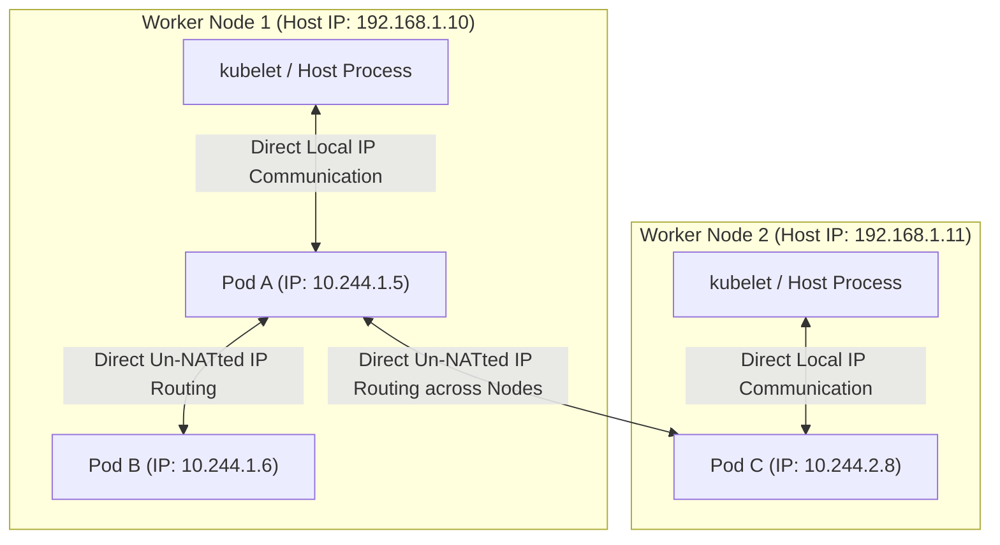
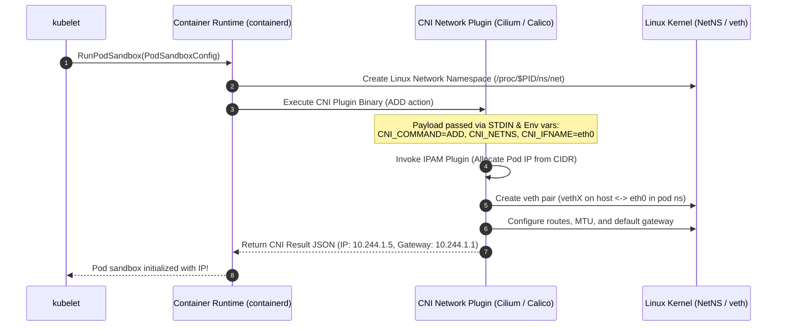
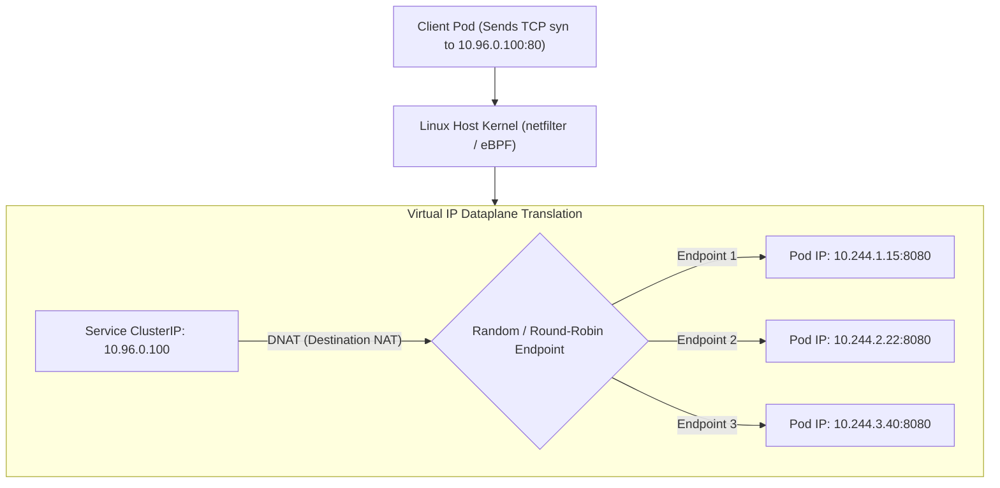
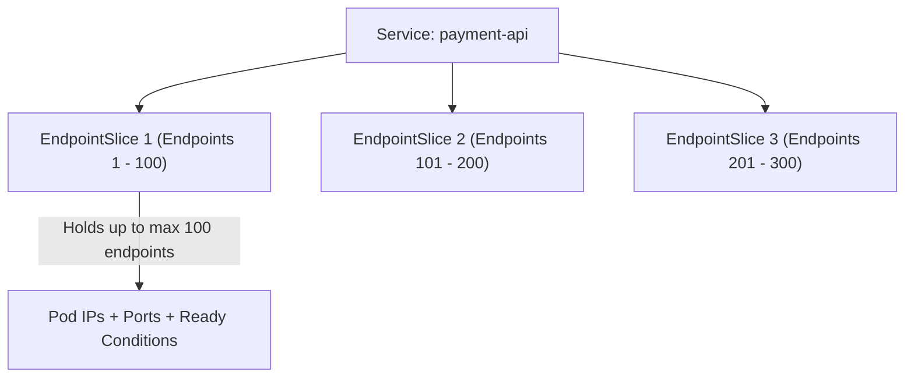
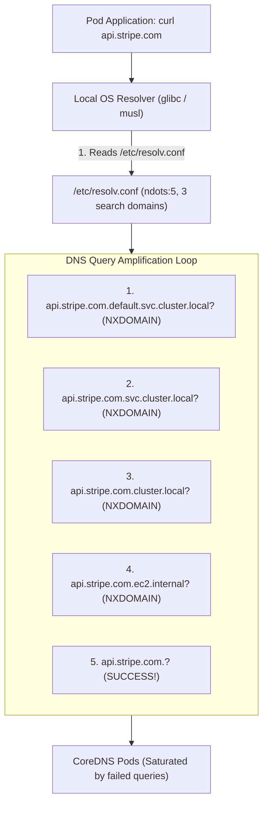
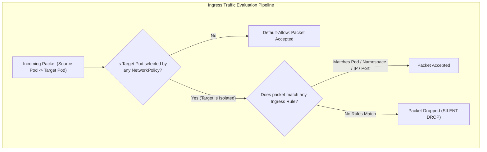

# Module 07: Kubernetes Networking: CNI Model, Services, EndpointSlices, CoreDNS ndots, and NetworkPolicy Semantics

> **Primary sources:** Kubernetes Network Model ([kubernetes.io/docs/concepts/services-networking/](https://kubernetes.io/docs/concepts/services-networking/)); Container Network Interface (CNI) Specification ([github.com/containernetworking/cni](https://github.com/containernetworking/cni)); KEP-752: EndpointSlice API ([keps/sig-network/752-endpointslices](https://github.com/kubernetes/enhancements/tree/master/keps/sig-network/752-endpointslices)); CoreDNS Configuration and Tuning ([coredns.io/manual/toc/](https://coredns.io/manual/toc/)).
>
> **Executable proof:** [`examples/ts/07-networking-services-and-networkpolicy.test.ts`](../examples/ts/07-networking-services-and-networkpolicy.test.ts) asserts NetworkPolicy packet filtering matrices, EndpointSlice chunking and condition evaluations, CoreDNS search path suffix expansions (`ndots:5`), and Service ClusterIP routing translations.

---

## 1. Formal Foundations: The IP-per-Pod Kubernetes Network Model

Traditional container networking (such as standard Docker bridge networking) relied on network address translation (NAT) and dynamic host port mapping. Under this legacy model, multiple containers running on the same host shared the host's physical IP address, mapping internal container ports to randomized ephemeral ports on the host. This introduced severe distributed systems complications: services could not publish self-consistent port identities, cluster-wide service discovery required external registration proxies, and tracing IP identities across network boundaries was impossible.

Kubernetes established a clean, fundamental abstraction: the **IP-per-Pod Network Model**.



### 1.1 The Four Invariants of Kubernetes Networking

The Kubernetes specification mandates four strict networking invariants across every cluster:

1. **Pod-to-Pod Invariant**: All pods can communicate with all other pods across any cluster node without relying on Network Address Translation (NAT).
2. **Node-to-Pod Invariant**: All system daemons and processes executing directly on a node (including the kubelet and systemd services) can communicate with all pods on that same node.
3. **Self-Consistent IP Invariant**: The IP address that a Pod observes as its own identity (via `eth0` inside its network namespace) is mathematically identical to the IP address that every other Pod and node in the cluster uses to address it.
4. **HostNetwork Invariant**: Pods running with `hostNetwork: true` share the node's network namespace and IP address, communicating directly over the host's physical network adapters.

For fundamental Linux kernel networking concepts, virtual ethernet pairs (`veth`), bridge interfaces, and network namespaces, see [`../../containers/modules/09-container-networking.md`](../../containers/modules/09-container-networking.md).

---

## 2. The Container Network Interface (CNI)

Kubernetes does not implement physical network routing within the `kubelet` or `kube-apiserver`. Instead, it delegates pod network attachment, IP address allocation, and packet routing to plugins adhering to the **Container Network Interface (CNI)** specification.



### 2.1 CNI Operational Interface

The CNI specification defines four core operational verbs executed via standard input/output streams:

- **`ADD`**: Attaches a container to the network. Creates the virtual ethernet pair (`veth`), moves one end into the container's network namespace, renames it to `eth0`, assigns an IP address from the node's IPAM subnet, and configures default routing tables.
- **`DEL`**: Detaches a container from the network. Deletes the `veth` pair, releases the IP address back to the IPAM pool, and flushes local routing tables.
- **`CHECK`**: Audits the container's active networking state against expected configuration.
- **`VERSION`**: Queries plugin compatibility.

### 2.2 Underlay vs. Overlay Networking

| Architecture | Encapsulation Protocol | Packet Header Overhead | Performance & MTU | Typical Implementations |
| :-- | :-- | :-- | :-- | :-- |
| **Underlay (Flat / Direct Routing)** | None (Native L2/L3 IP routing via BGP). | **0 bytes** (Raw IP packets traversing physical switches). | **Line-rate throughput**; standard 1500-byte MTU; zero CPU encapsulation penalty. | Calico BGP, Cilium Native Routing, AWS VPC CNI, GCP IP Alias. |
| **Overlay (Tunneling / Encapsulated)** | VXLAN (UDP port 4789) or Geneve (UDP port 6081). | **50 bytes** (14B Ethernet + 20B Outer IP + 8B UDP + 8B VXLAN). | Added CPU overhead for encapsulation; **requires lowering MTU to 1450 bytes** to avoid packet fragmentation. | Flannel VXLAN, Weave Net, Cilium VXLAN Mode. |

---

## 3. Kubernetes Services Architecture

Because pods are ephemeral entities with dynamic lifecycles, their individual IP addresses shift during restarts, rolling updates, and reschedulings. A **Service** provides a stable, long-lived virtual IP address (ClusterIP) and DNS record that load-balances traffic across a dynamically shifting collection of pod backends.

For distributed load balancing algorithms, layer-4 transport switching, and NAT mechanics, see [`../../../architecture/networking/modules/13-load-balancing-cdn-nat.md`](../../../architecture/networking/modules/13-load-balancing-cdn-nat.md).



### 3.1 The ClusterIP: A Virtual IP Without a Network Interface

A Service's `spec.clusterIP` is **not a physical IP address**. It is not bound to any network interface card (NIC), loopback interface, or bridge on any node in the cluster.

- If you execute `ping <ClusterIP>`, the operation will hang and fail because ClusterIPs do not respond to ICMP Echo requests.
- A ClusterIP exists strictly as a pattern-matching filter in the host Linux kernel's packet processing pipeline (programmed via `kube-proxy` iptables/IPVS or eBPF socket maps).
- When a packet with destination address `10.96.0.100` leaves a container, the host kernel intercepts the packet, executes Destination Network Address Translation (**DNAT**), rewrites the destination IP to an actual pod IP (`10.244.1.15`), and routes the modified packet across the physical network.

### 3.2 Service Types

1. **`ClusterIP` (Default)**: Allocates an internal virtual IP from the cluster CIDR (`--service-cluster-ip-range`). Accessible only from within the cluster.
2. **`NodePort`**: Allocates a static port from a dedicated cluster-wide range (default `30000-32767`). Every node in the cluster proxies that port to the underlying Service: $$\text{Client} \longrightarrow \text{Any\_Node\_IP}:31234 \xrightarrow{\text{DNAT}} \text{Pod\_IP}:8080$$
3. **`LoadBalancer`**: Interacts with the cloud-controller-manager to provision an external cloud load balancer (AWS NLB, GCP Network Load Balancer, Azure LB) that forwards external traffic into the Service's `NodePort` or directly to pods.
4. **`ExternalName`**: Bypasses proxying entirely. Maps the Service to a DNS `CNAME` record (e.g., `my-db.external.database.com`).
5. **`Headless` (`spec.clusterIP: None`)**: Allocates no virtual IP. CoreDNS returns the individual `A` records of all healthy backing pods directly, enabling point-to-point addressing for stateful applications.

---

## 4. Endpoints vs. EndpointSlices (KEP-752)

Historically, Kubernetes tracked backing pods for a Service using a single monolithic `Endpoints` object.

### 4.1 The Scalability Bottleneck of Monolithic Endpoints

If a Service had 5,000 backend pods, its `Endpoints` object contained 5,000 IP/port pairs in a single serialized document:

- Every time a single pod started, restarted, or died, the entire 5,000-endpoint document was updated in etcd (generating ~2 MiB of write traffic).
- The `kube-apiserver` broadcasted the complete 2 MiB object to every `kube-proxy` daemon running across thousands of cluster nodes.
- In a 1,000-node cluster, a single pod restart generated $1,000 \times 2\text{ MiB} = 2\text{ GiB}$ of network transmission, choking control plane bandwidth and freezing iptables synchronization loops.

### 4.2 EndpointSlices Architecture

**EndpointSlices (KEP-752)** chunk endpoints into discrete, bounded slices:



- **Bounded Capacity**: Each EndpointSlice holds a maximum of 100 endpoints by default.
- **Micro-Updates**: When a single pod terminates, only the specific EndpointSlice containing that pod is mutated and transmitted, reducing network and etcd write overhead by orders of magnitude.
- **Dual-Stack Support**: Supports native IPv4 and IPv6 address families (`addressType: IPv4` or `IPv6`).
- **Condition Flags**: Each endpoint tracks fine-grained health:
  - `conditions.ready`: Pod passed readiness probes.
  - `conditions.serving`: Pod is actively running and eligible to serve traffic (even during termination).
  - `conditions.terminating`: Pod has received `deletionTimestamp`, enabling graceful connection draining.

---

## 5. Cluster DNS: CoreDNS Architecture and the `ndots:5` Problem

Every Kubernetes cluster deploys an internal DNS infrastructure daemon (CoreDNS) that provides automatic name resolution for Services and Pods.

For authoritative RFC standards governing DNS protocols, query types, recursive lookups, and zone transfers, see [`../../../architecture/networking/modules/08-dns.md`](../../../architecture/networking/modules/08-dns.md).



### 5.1 The Anatomical Structure of `/etc/resolv.conf`

When the kubelet launches a container, it injects a customized `/etc/resolv.conf`:

```text
nameserver 10.96.0.10
search prod.svc.cluster.local svc.cluster.local cluster.local ec2.internal
options ndots:5
```

### 5.2 The `ndots:5` Resolution Dilemma

According to the POSIX resolver specification:

- If a queried domain name contains **fewer than `ndots` dots**, the resolver must append each entry in the `search` domain list sequentially **before** attempting to query the domain as an absolute, fully qualified domain name (FQDN).

#### The Pathology: External Domain Lookups

Consider an application querying `api.stripe.com`:

1. Count the dots: `api.stripe.com` contains **2 dots**.
2. Because $2 < 5$, the resolver assumes the name is relative!
3. Query 1: `api.stripe.com.prod.svc.cluster.local.` $\to$ CoreDNS returns `NXDOMAIN`.
4. Query 2: `api.stripe.com.svc.cluster.local.` $\to$ CoreDNS returns `NXDOMAIN`.
5. Query 3: `api.stripe.com.cluster.local.` $\to$ CoreDNS returns `NXDOMAIN`.
6. Query 4: `api.stripe.com.ec2.internal.` $\to$ Upstream returns `NXDOMAIN`.
7. Query 5: `api.stripe.com.` $\to$ Returns the actual IP address!

#### Consequences: Network Amplification and Conntrack Table Thrashing

For every single outbound external API connection, the client issues **4 failed DNS queries** over UDP port 53 before issuing the successful query.

- In high-throughput clusters, this multiplies CoreDNS query volume by $500\%$.
- Linux kernel `netfilter` conntrack tables suffer race conditions when multiple concurrent UDP queries share identical tuple identifiers, triggering 5-second DNS lookup stalls (`insert_failed` socket drops).

#### Architectural Solutions

1. **The Trailing Dot Pattern**: Write external domain names with an explicit trailing dot in application code: `https://api.stripe.com./v1/charges` The trailing dot tells the resolver the name is an absolute FQDN, skipping the search paths entirely and issuing exactly 1 query!
2. **Custom `dnsConfig`**: Override `ndots` on high-throughput workloads:
   ```yaml
   spec:
     dnsConfig:
       options:
         - name: ndots
           value: '2'
   ```

---

## 6. NetworkPolicy Semantics and Packet Filtering

A **NetworkPolicy** is an API specification that enforces layer-3 and layer-4 network segmentation within the cluster.



### 6.1 Default-Allow vs. Default-Deny Semantics

- **Default-Allow**: By default, Kubernetes pods are non-isolated. All pods accept ingress traffic from any source and transmit egress traffic to any destination.
- **Default-Deny (Isolation Activation)**: As soon as a NetworkPolicy selects a Pod via `spec.podSelector`, that Pod enters **isolated mode** for the declared `policyTypes` (`Ingress`, `Egress`, or both). All un-whitelisted traffic is dropped silently.

### 6.2 The Additive Invariant

NetworkPolicies are strictly **additive (union)**. There are no "Deny" rules in standard NetworkPolicies. If multiple policies select the same Pod, their allowed rule sets are combined using boolean OR:

$$\text{AllowedTraffic} = \bigcup_{p \in \text{Policies}} \text{RuleSet}(p)$$

### 6.3 Anatomy of a NetworkPolicy

```yaml
apiVersion: networking.k8s.io/v1
kind: NetworkPolicy
metadata:
  name: secure-backend
  namespace: prod
spec:
  podSelector:
    matchLabels:
      app.kubernetes.io/name: database
  policyTypes:
    - Ingress
    - Egress
  ingress:
    - from:
        - namespaceSelector:
            matchLabels:
              environment: prod
          podSelector:
            matchLabels:
              app.kubernetes.io/name: payment-api
        - ipBlock:
            cidr: 192.168.10.0/24
            except: [192.168.10.50/32]
      ports:
        - protocol: TCP
          port: 5432
  egress:
    - to:
        - namespaceSelector: {}
          podSelector:
            matchLabels:
              k8s-app: kube-dns
      ports:
        - protocol: UDP
          port: 53
        - protocol: TCP
          port: 53
```

### 6.4 The AND vs. OR Selector Rule

A critical syntax trap in `from` and `to` blocks:

- **OR Rule (Separate Array Elements)**:
  ```yaml
  from:
    - namespaceSelector: { matchLabels: { role: frontend } }
    - podSelector: { matchLabels: { tier: web } }
  ```
  Permits traffic from **any pod** in the `frontend` namespace **OR** any pod labeled `tier: web` in the **local** namespace.
- **AND Rule (Single Map Entry)**:
  ```yaml
  from:
    - namespaceSelector: { matchLabels: { role: frontend } }
      podSelector: { matchLabels: { tier: web } }
  ```
  Permits traffic **only** from pods labeled `tier: web` located **inside** namespaces labeled `role: frontend`.

---

## 7. The CNI Enforcement Requirement

> [!CAUTION]
> **CNI Support Mandate:** Creating a `NetworkPolicy` object in `kube-apiserver` **does not enforce network security on its own**. The API server simply commits the manifest to etcd. Enforcement requires that the cluster's underlying CNI plugin implements a policy engine.
>
> - Plugins with native NetworkPolicy enforcement: **Cilium** (via eBPF maps), **Calico** (via iptables/Felix or eBPF), **Kube-OVN**.
> - Plugins that **silently ignore** NetworkPolicies: Standard **Flannel** (unless paired with Canal/Calico), simple bridge CNI plugins. If you deploy NetworkPolicies on a Flannel cluster, `kubectl get networkpolicies` shows the objects, but all network traffic remains 100% open and unconstrained!

---

## 8. Ingress Retirement and the Transition to Gateway API

Historically, external HTTP traffic entered the cluster via the **Ingress** resource (`networking.k8s.io/v1`).

- The most ubiquitous implementation was **Ingress-NGINX**.
- **Ingress-NGINX is officially retired as of March 2026** (receiving zero further software updates or CVE patches).
- Modern Kubernetes production deployments have migrated entirely to the **Gateway API (v1.6.3)**, which provides role-oriented traffic management, native header routing, and multi-tenant security. The comprehensive architecture and migration playbook are covered in Module 08.

---

## 9. Formal Algorithm: NetworkPolicy Packet Filter Evaluation

```text
Algorithm: EvaluateNetworkPolicy
Input: Packet pkt (SrcIP, DstIP, Protocol, Port), TargetPod P, PolicyRegistry Reg

Invariant 1: If P is not selected by any policy in direction D, packet is accepted (Default-Allow).
Invariant 2: If P is selected by at least one policy, packet is rejected unless at least one rule matches.
Invariant 3: Egress DNS rules must evaluate UDP and TCP port 53 to prevent name resolution lockouts.

1.  Function Evaluate(pkt, P, direction):
2.      matchingPolicies := Reg.GetPoliciesSelectingPod(P.Namespace, P.Labels, direction)
3.
4.      // Invariant 1: Default-Allow
5.      if Length(matchingPolicies) == 0 then
6.          return ActionAllow
7.      end if
8.
9.      // Invariant 2: Isolated Mode (Additive Evaluation)
10.     for each policy in matchingPolicies do:
11.         rules := (direction == "Ingress") ? policy.Spec.Ingress : policy.Spec.Egress
12.
13.         for each rule in rules do:
14.             if not PortMatches(rule.Ports, pkt.Protocol, pkt.Port) then
15.                 continue
16.             end if
17.
18.             peerMatches := false
19.             peers := (direction == "Ingress") ? rule.From : rule.To
20.
21.             // An empty peer list allows all traffic on the specified ports!
22.             if Length(peers) == 0 then return ActionAllow end if
23.
24.             for each peer in peers do:
25.                 if EvaluatePeer(peer, pkt, direction) then
26.                     peerMatches = true
27.                     break
28.                 end if
29.             end for
30.
31.             if peerMatches then return ActionAllow end if
32.         end for
33.     end for
34.
35.     // No rule matched: Drop packet silently
36.     return ActionDrop
37. End Function
```

---

## 10. Historical Evolution: Then vs. Now

| Networking Layer | Legacy Architecture (Pre-1.25) | Current Standard (Kubernetes v1.37.2) | Architectural Driver |
| :-- | :-- | :-- | :-- |
| **Service Endpoints** | Monolithic `v1.Endpoints` objects holding all pod IPs in a single document. | Chunked `discovery.k8s.io/v1` `EndpointSlice` objects (100 endpoints per slice). | Eliminates catastrophic control plane etcd write cascades and network bandwidth saturation. |
| **DNS Engine** | SkyDNS / kube-dns with high memory overhead and frequent UDP drops. | Modular CoreDNS with high-concurrency caching and automatic health probe endpoints. | Standardized RFC compliance, plugin extensibility, and reduced resource utilization. |
| **Edge Routing** | Monolithic Ingress (`networking.k8s.io/v1`) with vendor-specific annotations. | Role-oriented Gateway API (`gateway.networking.k8s.io/v1`) with native cross-namespace routing. | Ingress-NGINX retired March 2026; eliminates brittle annotation-based vendor locks. |
| **Dataplane Proxy** | iptables `kube-proxy` with linear rule searches and conntrack table locks. | eBPF host routing (Cilium/Calico) with direct socket translation (`sock_ops`). | Reduces packet forwarding latency from milliseconds to microseconds at high throughput. |

---

## 11. Exam Delta: CKA/CKAD (v1.37) vs. CKS (v1.34)

> [!IMPORTANT]
> **Certification Delta & Network Security Hardening:**
>
> - **CKA & CKAD (Curriculum v1.37)**: Requires candidates to author Services (ClusterIP, NodePort), troubleshoot CoreDNS resolution failures using ephemeral debug containers (`kubectl run test --rm -it --image=busybox:1.28 -- nslookup my-svc`), and construct multi-selector NetworkPolicies. Candidates must understand the difference between array elements (OR) and combined map keys (AND) in NetworkPolicy rules.
> - **CKS (Curriculum v1.34)**: Focuses heavily on implementing a Zero-Trust network security perimeter. Candidates are required to create a cluster-wide or namespace-wide **Default-Deny Ingress and Egress** policy, and systematically punch minimal, least-privilege egress holes allowing strictly CoreDNS resolution (`UDP/TCP 53` to `kube-system/kube-dns`) and authorized egress database connections.

---

## 12. Production Failure Modes & Operational Gotchas

### 12.1 The Missing DNS Egress Lockout Trap

- **Symptom**: An operator deploys a default-deny Egress NetworkPolicy to isolate a PCI-compliant payment service. Immediately, all outbound connections fail with `getaddrinfo ENOTFOUND api.stripe.com`, and the service crashes!
- **Root Cause**: The operator created `policyTypes: ["Egress"]` with an empty `egress: []` list. This drops **all** outbound network traffic from the pod, including UDP port 53 traffic to the CoreDNS service. Because the application cannot resolve internal or external hostnames, all network operations fail.
- **Remediation**: Every egress NetworkPolicy must explicitly include a rule permitting UDP and TCP traffic on port 53 targeting the `kube-dns` service:
  ```yaml
  egress:
    - to:
        - namespaceSelector: {}
          podSelector:
            matchLabels:
              k8s-app: kube-dns
      ports:
        - protocol: UDP
          port: 53
        - protocol: TCP
          port: 53
  ```

### 12.2 The UDP Conntrack Race Condition via `ndots:5`

- **Symptom**: High-throughput microservices experience random 5-second connection delays when invoking external REST APIs or cloud databases.
- **Root Cause**: The Linux kernel `netfilter` subsystem tracks UDP connections using a shared conntrack table. When glibc's resolver transmits concurrent `A` and `AAAA` queries over UDP to CoreDNS for an un-dotted hostname (amplified by `ndots:5`), both packets originate from the same source port. When the kernel attempts to insert both into the conntrack table simultaneously, the second packet fails with `nf_conntrack: table full, dropping packet` or an insertion race, causing the resolver to wait for its 5-second retry timeout.
- **Remediation**: Use `dnsConfig` to set `options: [{name: "single-request-reopen"}]` or `ndots: "2"`, or append a trailing dot (`api.stripe.com.`) to all external endpoints.

### 12.3 Silent NetworkPolicy Pass-Through on Unsupported CNI

- **Symptom**: A security audit runs penetration tests against a Kubernetes cluster. The auditor discovers that pods protected by strict NetworkPolicies are accepting unauthorized connections from arbitrary namespaces.
- **Root Cause**: The cluster was provisioned using standard Flannel without an active policy engine (such as Calico or Cilium). Flannel only manages packet routing; it has no code to inspect or enforce `NetworkPolicy` objects.
- **Remediation**: Verify CNI policy support during cluster bootstrapping. If using Flannel, deploy Canal (Flannel for networking + Calico Felix for policy enforcement) or migrate to Cilium.

### 12.4 Overlay MTU Truncation and Silent Packet Drops

- **Symptom**: HTTP GET requests with small payloads work perfectly, but HTTP POST requests transmitting large JSON payloads hang indefinitely and time out.
- **Root Cause**: The host physical network interface has standard MTU 1500. The CNI uses VXLAN overlay encapsulation, which prepends a 50-byte header. If the pod virtual ethernet interface is misconfigured with MTU 1500 instead of 1450, a 1500-byte TCP packet will exceed the physical interface MTU. If the IP packet has the `DF` (Don't Fragment) bit set, physical switches drop the packet silently.
- **Remediation**: Ensure the CNI configuration explicitly sets `mtu: 1450` (or `9000 - 50 = 8950` on Jumbo Frame networks) across all node CNI configurations.

---

## 13. Interview Drill

<details>
<summary><strong>Q1. Explain the four fundamental invariants of the Kubernetes network model.</strong></summary>

1. All pods can communicate with all other pods across all nodes in the cluster without relying on Network Address Translation (NAT).
2. All host agents and daemons on a node (including the kubelet) can communicate directly with all pods on that same node.
3. The IP address that a Pod sees as its own identity inside its network namespace is identical to the IP address used by all other pods and nodes to address it.
4. Pods with `hostNetwork: true` share the host's network namespace and IP address, avoiding virtual ethernet translation.

</details>

<details>
<summary><strong>Q2. How does a Service ClusterIP work under the hood if it is not bound to a physical network interface?</strong></summary>

A ClusterIP is a purely virtual IP address managed within the Linux kernel packet filtering and routing tables (configured via iptables, IPVS, or eBPF). When a container transmits a packet targeting a ClusterIP, the host Linux kernel intercepts the packet before it hits physical wire. The kernel executes Destination Network Address Translation (DNAT), rewriting the destination ClusterIP and port to the real IP and port of an active, healthy Pod selected from the Service's `EndpointSlice`. The modified packet is then forwarded over the physical or overlay network to the target pod's node.
</details>

<details>
<summary><strong>Q3. What scalability bottleneck forced Kubernetes to replace the `Endpoints` API with `EndpointSlices`?</strong></summary>

The original `Endpoints` API stored all backend pod IP and port mappings in a single, monolithic object. For a Service with thousands of replicas, this object grew into several megabytes. Whenever any single pod was added, restarted, or terminated, the entire multi-megabyte object was re-serialized, committed to etcd, and broadcasted to every node in the cluster running `kube-proxy`. In large clusters, this caused extreme network congestion, high etcd write latency, and node CPU starvation. `EndpointSlices` split endpoints into bounded chunks of at most 100 endpoints per slice, ensuring that pod lifecycle changes trigger lightweight micro-updates targeting only the affected slice.
</details>

<details>
<summary><strong>Q4. Walk through the `ndots:5` resolution sequence for an external domain like `api.stripe.com`, and explain how to mitigate its latency penalty.</strong></summary>

When a pod queries `api.stripe.com`, the local resolver counts the dots in the name (2 dots). Because $2 < \text{ndots:5}$, the resolver assumes the domain is relative and appends each search path declared in `/etc/resolv.conf` before querying the root domain:

1. `api.stripe.com.<namespace>.svc.cluster.local` (fails)
2. `api.stripe.com.svc.cluster.local` (fails)
3. `api.stripe.com.cluster.local` (fails)
4. `api.stripe.com.<cloud-search-domain>` (fails)
5. `api.stripe.com.` (succeeds) This generates 4 wasted DNS queries per external lookup, overloading CoreDNS and triggering UDP conntrack race conditions. **Mitigation**: Append a trailing dot to the domain name in application configurations (`api.stripe.com.`), which indicates an absolute FQDN and skips search domains completely, or configure a custom `dnsConfig` on the Pod with `options: [{name: "ndots", value: "2"}]`.

</details>

<details>
<summary><strong>Q5. How do standard NetworkPolicies handle an isolated pod that has no matching rules for incoming traffic?</strong></summary>

When a Pod is selected by the `podSelector` of any NetworkPolicy with `policyTypes: ["Ingress"]`, the Pod transitions from the default-allow state into **isolated mode**. In this mode, Kubernetes enforces a closed-world security boundary: all incoming traffic that is not explicitly permitted by at least one matching rule across all active NetworkPolicies is dropped silently by the CNI dataplane (silent drop, with no TCP RST or ICMP port unreachable returned).
</details>

<details>
<summary><strong>Q6. What is the syntactic difference in NetworkPolicy between an array of selector items versus a single map containing multiple selector keys?</strong></summary>

In NetworkPolicy `from` or `to` blocks:

- **Array of items (Multiple dashes `-`)**: Evaluated as a logical **OR**.
  ```yaml
  from:
    - namespaceSelector: { matchLabels: { team: ops } }
    - podSelector: { matchLabels: { role: admin } }
  ```
  Permits traffic from **any** pod in namespaces labeled `team: ops` OR from pods labeled `role: admin` in the **local** namespace.
- **Single map item (One dash `-` with multiple keys)**: Evaluated as a logical **AND**.
  ```yaml
  from:
    - namespaceSelector: { matchLabels: { team: ops } }
      podSelector: { matchLabels: { role: admin } }
  ```
  Permits traffic **only** from pods labeled `role: admin` that are simultaneously located within namespaces labeled `team: ops`.

</details>

<details>
<summary><strong>Q7. Why does creating a default-deny Egress NetworkPolicy break application startup, and how must it be resolved?</strong></summary>

A default-deny Egress policy blocks **all** outbound network packets originating from the pod. Because DNS resolution requires transmitting UDP and TCP packets to port 53 on the CoreDNS cluster IP (`10.96.0.10`), the pod cannot perform DNS lookups. Applications that connect to external databases, APIs, or internal microservices fail immediately with hostname resolution errors. To resolve this, every egress NetworkPolicy must include an explicit rule allowing egress traffic to port 53 (UDP and TCP) targeting the `kube-dns` service endpoints.
</details>

---

## 14. Proof Map and Verification

The networking models, packet filtering algorithms, and DNS resolution mechanics described in this module are proven in [`examples/ts/07-networking-services-and-networkpolicy.test.ts`](../examples/ts/07-networking-services-and-networkpolicy.test.ts):

- **NetworkPolicy Packet Filter Engine**: Implements the `EvaluateNetworkPolicy` algorithm, asserting packet acceptance, default-allow transitions, and silent drops across multi-tenant isolation scenarios.
- **EndpointSlice Chunking & Dual-Stack Evaluator**: Simulates EndpointSlice generation for 250 backend pods, verifying that endpoints are bounded to 100 items per slice and validating condition flags (`ready`, `serving`, `terminating`).
- **CoreDNS `ndots:5` Suffix Expander**: Models POSIX resolver search path expansions, proving that domains with $< 5$ dots trigger multiple synthetic search domain queries before resolving absolute FQDNs.
- **Service Virtual IP (ClusterIP) DNAT Translation**: Asserts virtual IP translation tables, modeling load distribution across active healthy endpoints.
