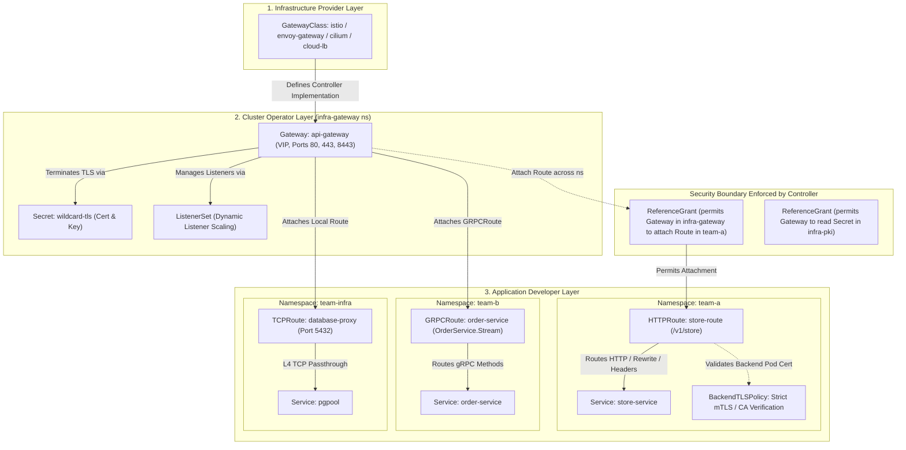
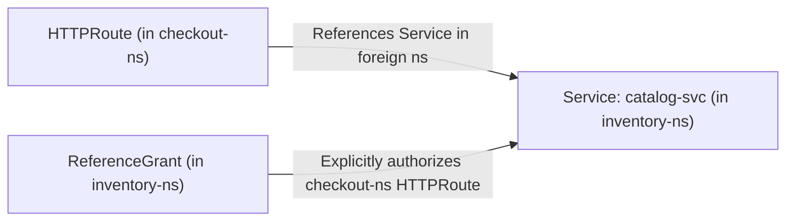

# Module 08: Gateway API v1.6 and Traffic Management: Role-Oriented Routing, TLS/TCPRoute, ReferenceGrant, and Ingress-NGINX Retirement

> **Primary sources:** Kubernetes Gateway API Specification ([v1.6.3](https://gateway-api.sigs.k8s.io/)); Kubernetes Official Blog ([Gateway API v1.5 Release](https://kubernetes.io/blog/2026/04/21/gateway-api-v1-5/), [Gateway API v1.6 Release](https://kubernetes.io/zh-cn/blog/2026/08/03/gateway-api-v1-6-release/), [Ingress-NGINX Retirement Statement](https://kubernetes.io/blog/2026/01/29/ingress-nginx-statement/)); CNCF Curriculum ([CKA v1.37](https://github.com/cncf/curriculum), [CKAD v1.37](https://github.com/cncf/curriculum)); `ingress2gateway` Project Documentation ([Kubernetes SIGs](https://github.com/kubernetes-sigs/ingress2gateway)).
>
> **Executable proof:** [`examples/ts/08-gateway-api-and-ingress-migration.test.ts`](../examples/ts/08-gateway-api-and-ingress-migration.test.ts) asserts Gateway API data models, Route precedence evaluation algorithms, cross-namespace ReferenceGrant validation, and Ingress translation ASTs.

---

## 1. Formal Foundations: The Ingress Abstraction Breakdown

The original Kubernetes `Ingress` resource (introduced in Kubernetes v1.1 and promoted to `networking.k8s.io/v1` in v1.19) was designed around a simplistic premise: mapping external HTTP request hosts and paths to internal cluster `ClusterIP` Services. Over a decade of enterprise scale, this monolithic abstraction exhibited four fatal architectural deficiencies:

1. **Role Collapsing (Monolithic Ownership)**: A single `Ingress` manifest merges cluster-wide infrastructure concerns (IP addresses, TLS termination certificates, load balancer hardware algorithms, TLS cipher suites) with application routing concerns (URI paths, rewrite rules, header modifications). In multi-tenant organizations, cluster infrastructure operators were forced to grant application developers write permissions to shared Ingress manifests or create fragmented, colliding resources in application namespaces.
2. **Annotation Sprawl and Controller Lock-In**: Because the Ingress specification standardized only basic path prefix matching and hostnames, advanced ingress controllers (Ingress-NGINX, Traefik, HAProxy, Emissary) relied on proprietary annotations (e.g., `nginx.ingress.kubernetes.io/rewrite-target`, `nginx.ingress.kubernetes.io/backend-protocol`). An Ingress manifest configured for one controller could not be executed on another without catastrophic silent routing errors.
3. **Flat Single-Namespace Trust Boundary**: Ingress cannot securely reference resources across namespace boundaries. An Ingress in namespace `team-a` cannot safely route traffic to a Service in namespace `team-b`, nor can it share a wildcard TLS certificate stored in an infrastructure namespace like `cert-manager` without creating insecure duplicate Secret copies or utilizing insecure controller-specific flags.
4. **Protocol Limitation**: Ingress was exclusively bound to HTTP/1.1 and HTTP/2. Supporting Layer 4 protocols (TCP, UDP), raw TLS passthrough (SNI routing without decryption), and modern Layer 7 protocols like gRPC required proprietary Custom Resource Definitions (CRDs) or out-of-band proxy configurations.

The **Kubernetes Gateway API** (`gateway.networking.k8s.io`) formally replaces Ingress. It decomposes ingress traffic management into a decoupled, expressive, role-oriented resource model backed by native CRDs with continuous cross-namespace security enforcement and standard conformance testing.



---

## 2. The Role-Oriented API Model

The Gateway API strictly partitions configuration according to organizational boundaries, enabling enterprise least-privilege operations:

| Persona / Role | Kubernetes Persona | API Resources Owned | Primary Responsibilities |
| :-- | :-- | :-- | :-- |
| **Infrastructure Provider** | Cloud vendor, Platform tooling lead | `GatewayClass` (Cluster-scoped) | Defines the controller implementation, capabilities, and backend proxy engines (e.g., Envoy, Cilium eBPF, F5, AWS VPC Lattice). |
| **Cluster Operator** | Platform Engineer, SRE, SecOps | `Gateway`, `ListenerSet`, `ReferenceGrant` | Provisions physical/virtual load balancers, reserves IP addresses, binds network ports (80, 443), attaches TLS certificates, and grants cross-namespace routing policies. |
| **Application Developer** | Service Developer, Product Engineer | `HTTPRoute`, `GRPCRoute`, `TLSRoute`, `TCPRoute`, `UDPRoute`, `BackendTLSPolicy` | Declares routing rules, path prefixes, header manipulations, traffic splitting, retry policies, and backend backend TLS requirements. |

### 2.1 GatewayClass

A `GatewayClass` is a cluster-scoped resource that defines the underlying controller machinery:

```yaml
apiVersion: gateway.networking.k8s.io/v1
kind: GatewayClass
metadata:
  name: envoy-gateway
spec:
  controllerName: gateway.envoyproxy.io/gatewayclass-controller
  description: 'Standard production Envoy Gateway cluster ingress'
```

When an operator provisions a `Gateway` referencing this `GatewayClass`, the corresponding controller watches the declaration, provisions the physical data plane (e.g., deploying Envoy Pods and a cloud `LoadBalancer` Service), and updates the `status` block with the provisioned external IP.

### 2.2 Gateway and Dynamic Listener Management

The `Gateway` resource defines the entry point for network traffic:

```yaml
apiVersion: gateway.networking.k8s.io/v1
kind: Gateway
metadata:
  name: external-gateway
  namespace: gateway-infra
spec:
  gatewayClassName: envoy-gateway
  listeners:
    - name: http
      protocol: HTTP
      port: 80
      allowedRoutes:
        namespaces:
          from: Same
    - name: https-wildcard
      protocol: HTTPS
      port: 443
      hostname: '*.example.com'
      tls:
        mode: Terminate
        certificateRefs:
          - kind: Secret
            name: wildcard-example-com-tls
      allowedRoutes:
        namespaces:
          from: Selector
          selector:
            matchLabels:
              gateway-access: 'enabled'
```

### 2.3 ListenerSet (`v1.5+` Standard)

In large-scale enterprise clusters, managing dozens of listeners inside a single `Gateway` YAML file caused merge conflicts and large manifest updates. Gateway API v1.5 promoted `ListenerSet` to the Standard channel. A `ListenerSet` allows operators and teams to dynamically attach additional listeners to an existing parent `Gateway` out-of-band without mutating the root `Gateway` resource:

```yaml
apiVersion: gateway.networking.k8s.io/v1
kind: ListenerSet
metadata:
  name: payment-listeners
  namespace: gateway-infra
spec:
  parentRef:
    name: external-gateway
  listeners:
    - name: https-payment
      protocol: HTTPS
      port: 8443
      hostname: 'payments.example.com'
      tls:
        mode: Terminate
        certificateRefs:
          - name: payment-tls-cert
      allowedRoutes:
        namespaces:
          from: Selector
          selector:
            matchLabels:
              team: payments
```

---

## 3. L7 & L4 Routing: HTTPRoute, GRPCRoute, TLSRoute, TCPRoute, and UDPRoute

Gateway API provides protocol-native route objects rather than overloading HTTP constructs with annotations.

### 3.1 HTTPRoute: Advanced Traffic Management

`HTTPRoute` supports path-based routing, header matching, query parameter evaluation, traffic splitting (canary releases), URL rewrites, and header modifications natively:

```yaml
apiVersion: gateway.networking.k8s.io/v1
kind: HTTPRoute
metadata:
  name: api-service-route
  namespace: services
spec:
  parentRefs:
    - name: external-gateway
      namespace: gateway-infra
      sectionName: https-wildcard
  hostnames:
    - 'api.example.com'
  rules:
    - matches:
        - path:
            type: PathPrefix
            value: /v2/users
          headers:
            - type: Exact
              name: X-Internal-Tier
              value: enterprise
      filters:
        - type: URLRewrite
          urlRewrite:
            path:
              type: ReplacePrefixMatch
              replacePrefixMatch: /internal/v2/users
        - type: RequestHeaderModifier
          requestHeaderModifier:
            add:
              - name: X-Forwarded-Client-Id
                value: gateway-authenticated
            remove:
              - 'X-Debug-Header'
      backendRefs:
        - name: user-service-v2
          port: 8080
          weight: 90
        - name: user-service-canary
          port: 8080
          weight: 10
```

### 3.2 GRPCRoute (`v1` Standard)

`GRPCRoute` is tailored specifically for gRPC services, matching on service names, RPC methods, and gRPC metadata:

```yaml
apiVersion: gateway.networking.k8s.io/v1
kind: GRPCRoute
metadata:
  name: payment-grpc-route
  namespace: payment-system
spec:
  parentRefs:
    - name: external-gateway
      namespace: gateway-infra
  hostnames:
    - 'grpc.example.com'
  rules:
    - matches:
        - method:
            service: payment.v1.PaymentService
            method: ProcessTransaction
      backendRefs:
        - name: payment-processor
          port: 9000
```

### 3.3 TLSRoute, TCPRoute, and UDPRoute (`v1.6` Standard Graduation)

Gateway API v1.5 graduated `TLSRoute` to Standard, and Gateway API v1.6 graduated `TCPRoute` and `UDPRoute` to Standard `v1`.

- **`TLSRoute`**: Performs Layer 4 SNI-based routing without decrypting the TLS payload (`tls.mode: Passthrough`). The backend service receives the raw, encrypted TLS handshake and performs end-to-end mTLS termination.
- **`TCPRoute` & `UDPRoute`**: Routes raw TCP or UDP byte streams on dedicated ports (e.g., exposing PostgreSQL databases, Redis clusters, DNS resolvers, or game servers).

```yaml
apiVersion: gateway.networking.k8s.io/v1
kind: TCPRoute
metadata:
  name: postgres-traffic
  namespace: database-infra
spec:
  parentRefs:
    - name: external-gateway
      namespace: gateway-infra
      sectionName: postgres-listener
  rules:
    - backendRefs:
        - name: postgres-primary
          port: 5432
```

---

## 4. Cross-Namespace Security: ReferenceGrant

In standard Kubernetes, cross-namespace object references present a catastrophic privilege escalation vulnerability. If a developer in `dev-team` could attach an `HTTPRoute` to an external `Gateway` in `gateway-infra` or bind a certificate `Secret` from `kube-system`, rogue developers could expose internal services or hijack production domains.

Gateway API solves this via **`ReferenceGrant`** (`gateway.networking.k8s.io/v1beta1`, Standard in v1.5+). A `ReferenceGrant` is an explicit, cryptographically verifiable trust assertion created by the owner of a resource, granting permissions to a specific foreign namespace to reference it.

### 4.1 Permitting Route Attachment Across Namespaces

If `Gateway` in `gateway-infra` wants to attach an `HTTPRoute` located in `checkout-ns`, `checkout-ns` must permit the Gateway, or the Gateway must permit routes from `checkout-ns`.

When a route in `checkout-ns` references a backend Service in `inventory-ns`:



Manifest placed in `inventory-ns`:

```yaml
apiVersion: gateway.networking.k8s.io/v1beta1
kind: ReferenceGrant
metadata:
  name: allow-checkout-routes
  namespace: inventory-ns
spec:
  from:
    - group: gateway.networking.k8s.io
      kind: HTTPRoute
      namespace: checkout-ns
  to:
    - group: ''
      kind: Service
      name: catalog-svc
```

> [!CAUTION]
> Without this `ReferenceGrant`, the Gateway API controller strictly refuses to program the proxy route. It marks the `HTTPRoute` status condition `ResolvedRefs: False` with reason `RefNotPermitted`. Traffic destined for `/catalog` receives an immediate `500 Internal Server Error` or `404 Not Found`.

### 4.2 Permitting Gateway to Reference TLS Secrets

If the `Gateway` in `gateway-infra` references a TLS Secret stored in `security-pki`:

```yaml
apiVersion: gateway.networking.k8s.io/v1beta1
kind: ReferenceGrant
metadata:
  name: allow-gateway-tls-access
  namespace: security-pki
spec:
  from:
    - group: gateway.networking.k8s.io
      kind: Gateway
      namespace: gateway-infra
  to:
    - group: ''
      kind: Secret
      name: enterprise-wildcard-cert
```

---

## 5. BackendTLSPolicy: Zero-Trust Gateway-to-Backend mTLS

Terminating TLS at the ingress edge and forwarding unencrypted plain HTTP over the cluster pod network violates Zero-Trust architecture. `BackendTLSPolicy` (Standard in Gateway API v1.5/v1.6) specifies client TLS validation policies from the Gateway data plane proxy directly to the backend pods:

```yaml
apiVersion: gateway.networking.k8s.io/v1alpha3
kind: BackendTLSPolicy
metadata:
  name: secure-backend-tls
  namespace: services
spec:
  targetRefs:
    - group: ''
      kind: Service
      name: user-service-v2
  validation:
    caCertificateRefs:
      - group: ''
        kind: ConfigMap
        name: internal-ca-bundle
    hostname: 'user-service.internal.cluster.local'
```

When configured, the Gateway proxy establishes an authenticated TLS connection to the pod IP endpoints, verifying that the serving certificate presented by the pod was signed by `internal-ca-bundle` and contains `user-service.internal.cluster.local` in its Subject Alternative Names (SANs).

---

## 6. The Retirement of Ingress-NGINX (March 2026)

On January 29, 2026, the Kubernetes project published the formal retirement announcement for `kubernetes/ingress-nginx`:

> [!WARNING]
> Effective **March 31, 2026**, the `ingress-nginx` project is officially retired. No further bug fixes, vulnerability patches, or feature releases will be issued. Clusters still operating `ingress-nginx` in production are directly exposed to unpatched CVEs and remote code execution vulnerabilities in unmaintained Lua and OpenResty dependencies.

### 6.1 Then vs. Now: Architectural Comparison

| Architectural Dimension | Ingress-NGINX (Retired March 2026) | Gateway API v1.6 Standard (Current) |
| :-- | :-- | :-- |
| **API Specification** | Monolithic `networking.k8s.io/v1` `Ingress` | Role-partitioned: `GatewayClass`, `Gateway`, `Route`, `ReferenceGrant` |
| **Maintenance & Security** | Project retired; zero security patches; high CVE risk | Actively maintained by SIG-Network; formal Conformance Suite |
| **Configuration Model** | Untyped string annotations (`nginx.ingress.kubernetes.io/*`) | Strictly typed CRD schemas with OpenAPI & CEL validation |
| **Multi-Tenancy** | Single namespace boundary; high privilege escalation risk | Native cross-namespace RBAC controlled via `ReferenceGrant` |
| **Protocol Support** | HTTP/1.1, HTTP/2 via annotations; TCP/UDP via ConfigMaps | Protocol-native CRDs: `HTTPRoute`, `GRPCRoute`, `TLSRoute`, `TCPRoute`, `UDPRoute` |
| **TLS Validation to Backend** | Fragmented annotations (`backend-protocol: "HTTPS"`) | Native `BackendTLSPolicy` verifying internal CA & SANs |
| **Traffic Splitting (Canary)** | Unofficial annotations (`canary-by-header`, `canary-weight`) | Native `weight: N` inside `backendRefs` with deterministic splitting |
| **Extensibility Model** | Custom Lua plugins injected into NGINX worker processes | Native Extension Filters, Wasm plugins, Envoy Filter Chains |
| **Port & Listener Scaling** | Fixed ports per controller Deployment | Dynamic horizontal listener scaling via `ListenerSet` (`v1.5+`) |

### 6.2 Migration Mechanics with `ingress2gateway`

To execute an automated migration from `ingress-nginx` to Gateway API, use the CNCF SIG-Network tool `ingress2gateway`. The utility parses existing Ingress manifests, decodes controller-specific annotations, and generates compliant Gateway API manifests:

```bash
# Install ingress2gateway via pinned mise or official binary
ingress2gateway print --input-file ingress-nginx-bundle.yaml \
  --providers ingress-nginx \
  --output gateway-api-resources.yaml
```

The migration engine maps annotations directly to native filters:

```text
nginx.ingress.kubernetes.io/rewrite-target: /$2       ==>  HTTPRoute.spec.rules[].filters[URLRewrite]
nginx.ingress.kubernetes.io/service-upstream: "true"  ==>  HTTPRoute.spec.rules[].backendRefs (native pod IP targeting)
nginx.ingress.kubernetes.io/configuration-snippet     ==>  Refactored into explicit HeaderModifiers or EnvoyFilters
```

---

## 7. Mathematical Model: Route Precedence & Matching Mechanics

When an incoming HTTP request arrives at a Gateway proxy, multiple routing rules across multiple `HTTPRoute` resources may theoretically match the request. The Gateway API specification establishes an exact, deterministic mathematical precedence order to eliminate non-deterministic routing behavior.

### 7.1 Formal Precedence Order

Given two competing rules $R_1$ and $R_2$, $R_1$ takes precedence over $R_2$ if and only if:

1. **Hostname Specificity**: An exact hostname match (e.g., `api.example.com`) beats a wildcard match (e.g., `*.example.com`), which beats no hostname match (`*`).
2. **Path Match Specificity**:
   - `Exact` match beats `PathPrefix` match.
   - For `PathPrefix` matches, the longer string length takes precedence (longest prefix match).
3. **Header Match Count**: The rule specifying a larger number of matched headers takes precedence over a rule with fewer matched headers.
4. **Query Parameter Match Count**: The rule specifying a larger number of query parameter matches takes precedence.
5. **Deterministic Tie-Breaking**: If all match criteria are identical, the rule with the earliest creation timestamp (`metadata.creationTimestamp`) wins. If timestamps are identical, lexicographical comparison of `namespace/name` breaks the tie.

### 7.2 Route Evaluation Algorithm

```text
Algorithm: GatewayAPI_Route_Match(Request req, Set<HTTPRoute> routes)
Input: Incoming HTTP request req (host, path, headers, queryParams)
Output: Target BackendRef or Error 404

Invariant 1: All candidate rules considered must have parent Gateway and Listener in Accepted state.
Invariant 2: Path match evaluation must preserve UTF-8 normalized byte-level prefix equality.

1:  candidates ← ∅
2:  for each route in routes do
3:      if not HostnameMatches(req.host, route.spec.hostnames) then
4:          continue
5:      end if
6:      for each rule in route.spec.rules do
7:          for each match in rule.matches do
8:              if MatchCriteriaSatisfied(req, match) then
9:                  candidates ← candidates ∪ {(route, rule, match)}
10:             end if
11:         end for
12:     end for
13: end for
14:
15: if candidates = ∅ then
16:     return Response(404, "Not Found")
17: end if
18:
19: // Sort candidates by Gateway API v1.6 Precedence Tuple:
20: // (HostnameType, PathType, PathLength, HeaderCount, QueryParamCount, CreationTime, ResourceKey)
21: sortedCandidates ← Sort(candidates, PrecedenceComparator)
22: winningMatch ← sortedCandidates[0]
23:
24: return ExecuteFiltersAndDispatch(req, winningMatch.rule)
```

---

## 8. Exam Delta: CKA / CKAD v1.37 vs. CKS v1.34

Candidates preparing for certification exams must note the significant syllabus divergence across versions:

> [!NOTE]
> **CKA / CKAD (Curriculum v1.37)**:
>
> - Gateway API is a mandatory tested objective under **Services and Networking** (20% weight in CKA, 20% in CKAD).
> - You are expected to configure `Gateway`, `HTTPRoute`, path-based routing, canary backend traffic splitting (`weight`), and cross-namespace `ReferenceGrant`.
> - Ingress-NGINX specific questions are deprecated; questions present Gateway API resources or basic `networking.k8s.io/v1` Ingress without proprietary annotations.
>
> **CKS (Certified Kubernetes Security Specialist, Curriculum v1.34)**:
>
> - The CKS curriculum remains anchored to Kubernetes **v1.34**.
> - CKS tests Ingress network security primarily via `NetworkPolicy` restrictions (isolating ingress controller pods), TLS secret management, and Pod Security Standards applied to proxy daemons.
> - While CKS does not yet grade Gateway API `ReferenceGrant` mechanics in its practical scoring scripts, understanding `ReferenceGrant` is essential for securing multi-tenant clusters in modern production environments.

---

## 9. Production Failure Modes & Operational Gotchas

### 9.1 Silent Routing Blackhole: Missing ReferenceGrant

**Mechanism**: A developer creates an `HTTPRoute` in namespace `team-frontend` that targets `backendRefs` pointing to Service `auth-service` in namespace `team-backend`. If no `ReferenceGrant` exists in `team-backend` permitting this binding, the Gateway controller rejects the reference. **Symptom**: `curl` commands to the public route receive HTTP `500` or `404`. No error appears in the application pods. **Triage**:

```bash
kubectl describe httproute frontend-route -n team-frontend
# Look for Status.Parents[].Conditions:
# Type: ResolvedRefs
# Status: False
# Reason: RefNotPermitted
# Message: Reference to Service "auth-service" in namespace "team-backend" not permitted by any ReferenceGrant
```

### 9.2 Port and Protocol Collision Across Listeners

**Mechanism**: A cluster operator declares two listeners on the same `Gateway` with port 443, but forgets to specify explicit `hostname` constraints or uses conflicting protocols (`HTTPS` vs `TLS`). **Symptom**: The Gateway controller sets `Programmed: False` on the Gateway resource. The underlying Envoy or cloud load balancer fails to bind or repeatedly crashes during configuration synchronization. **Prevention**: Always specify unique hostnames (`hostname: "app1.example.com"` vs `hostname: "app2.example.com"`) for SNI multiplexing on shared TLS ports.

### 9.3 Ingress-NGINX Migration: Lua Configuration Snippets

**Mechanism**: Legacy Ingress manifests using `nginx.ingress.kubernetes.io/configuration-snippet` inject raw NGINX C/Lua directives (such as custom rate limiting, header tampering, or auth subrequests). **Symptom**: `ingress2gateway` skips these snippets with a warning, leaving the generated `HTTPRoute` missing critical authentication or security filtering. **Resolution**: Translate configuration snippets into native Envoy Filters, Gateway API Extension Filters, or standalone sidecars (such as OAuth2-Proxy).

### 9.4 Controller Status Divergence: Accepted vs. Programmed

**Mechanism**: Gateway API decouples semantic validation from physical data plane provisioning.

- `Accepted: True`: The Gateway resource is syntactically valid and recognized by the controller.
- `Programmed: True`: The controller has successfully provisioned the underlying infrastructure (cloud load balancer, IP address allocation, Envoy listener synchronization). **Gotcha**: Automated CI/CD pipelines checking only `Accepted: True` may prematurely route production DNS traffic to an unallocated or unprovisioned external IP address. Always assert `Programmed: True` before updating DNS A/AAAA records.

---

## 10. Concrete Manifest Reference: Production Multi-Tenant Ingress

The following unified manifest demonstrates a complete, production-grade Gateway API deployment featuring dynamic listener routing, secure cross-namespace service references, and backend TLS verification:

```yaml
# 1. Gateway provisioned in the central infra namespace
apiVersion: gateway.networking.k8s.io/v1
kind: Gateway
metadata:
  name: prod-edge-gateway
  namespace: ingress-gateway
spec:
  gatewayClassName: envoy-gateway
  listeners:
    - name: https-api
      protocol: HTTPS
      port: 443
      hostname: 'api.company.com'
      tls:
        mode: Terminate
        certificateRefs:
          - group: ''
            kind: Secret
            name: api-company-cert
      allowedRoutes:
        namespaces:
          from: Selector
          selector:
            matchLabels:
              routing-tier: 'edge'
---
# 2. ReferenceGrant in payment-system namespace authorizing ingress-gateway
apiVersion: gateway.networking.k8s.io/v1beta1
kind: ReferenceGrant
metadata:
  name: allow-edge-gateway-to-payments
  namespace: payment-system
spec:
  from:
    - group: gateway.networking.k8s.io
      kind: HTTPRoute
      namespace: ingress-gateway
  to:
    - group: ''
      kind: Service
      name: payment-engine
---
# 3. HTTPRoute in payment-system namespace
apiVersion: gateway.networking.k8s.io/v1
kind: HTTPRoute
metadata:
  name: payment-api-route
  namespace: payment-system
spec:
  parentRefs:
    - group: gateway.networking.k8s.io
      kind: Gateway
      name: prod-edge-gateway
      namespace: ingress-gateway
      sectionName: https-api
  hostnames:
    - 'api.company.com'
  rules:
    - matches:
        - path:
            type: PathPrefix
            value: /v1/payments
      filters:
        - type: RequestHeaderModifier
          requestHeaderModifier:
            set:
              - name: X-Gateway-Origin
                value: 'prod-edge-gateway'
      backendRefs:
        - name: payment-engine
          port: 8443
```

---

## 11. Interview Drill

<details>
<summary><strong>Q1. Why does Gateway API split traffic management into three distinct resource categories (GatewayClass, Gateway, Route), whereas Ingress combined them into one?</strong></summary>

Gateway API uses a role-oriented design that reflects real-world enterprise organizational hierarchies:

1. **Infrastructure Providers** manage `GatewayClass`, defining the implementation engine (Envoy, Cilium, cloud LB) without exposing underlying VM or proxy configs to users.
2. **Cluster Operators / SREs** manage `Gateway` resources, controlling network interfaces, VIPs, ports, and TLS termination certificates. They dictate which namespaces are permitted to attach routes.
3. **Application Teams** manage `HTTPRoute`, `GRPCRoute`, etc., controlling paths, rewrites, and canary splits within their bounded namespaces without requiring administrative cluster privileges or risking cross-tenant configuration pollution.

In contrast, the legacy `Ingress` resource forced cluster operators to grant developers edit access to the same monolithic YAML file, leading to constant merge conflicts, security vulnerabilities, and vendor-specific annotation bloat.
</details>

<details>
<summary><strong>Q2. What security risk does `ReferenceGrant` solve, and how does it function when an HTTPRoute targets a Service in another namespace?</strong></summary>

In Kubernetes, allowing resources in one namespace to arbitrarily reference resources in another namespace introduces a major cross-tenant authorization vulnerability. For example, a malicious tenant could point an ingress route at an internal administrative service in another namespace or attach to a corporate wildcard TLS secret.

`ReferenceGrant` enforces a bi-directional trust handshake. When an `HTTPRoute` in `namespace-a` specifies a `backendRef` located in `namespace-b`, the Gateway controller checks for an existing `ReferenceGrant` inside `namespace-b`. That grant must explicitly state that `HTTPRoute` resources from `namespace-a` are authorized to bind to target `Service` objects in `namespace-b`. If the grant is missing or misconfigured, the controller refuses to program the route and marks the condition `ResolvedRefs: False` with reason `RefNotPermitted`.
</details>

<details>
<summary><strong>Q3. Explain the difference between `tls.mode: Terminate` and `tls.mode: Passthrough` in Gateway API, and identify which route object must be used for Passthrough.</strong></summary>

- **`tls.mode: Terminate`**: The Gateway proxy decrypts the incoming TLS handshake at the edge listener using a referenced `Secret` containing the private key and certificate. The proxy can inspect, manipulate (rewrite, add headers), and route the Layer 7 HTTP/gRPC request. For this mode, `HTTPRoute` or `GRPCRoute` is used.
- **`tls.mode: Passthrough`**: The Gateway proxy does NOT decrypt the TLS connection. Instead, it inspects the TLS ClientHello Server Name Indication (SNI) header at Layer 4 and forwards the raw encrypted TLS byte stream directly to the backend pod. The backend pod terminates the TLS connection. For this mode, `TLSRoute` must be used.

</details>

<details>
<summary><strong>Q4. How does Gateway API resolve path matching conflicts between two rules with overlapping prefixes, such as `/users` and `/users/profile`?</strong></summary>

Gateway API eliminates controller-specific arbitrary matching behavior by establishing a strict, deterministic precedence specification:

1. Exact matches always beat prefix matches.
2. For `PathPrefix` matches, the rule with the longest path prefix string length takes precedence (longest prefix match wins). Thus, a request to `/users/profile/avatar` will deterministically match `/users/profile` over `/users`.
3. If path match criteria are identical, header match count takes precedence (more matched headers beat fewer).
4. If still tied, query parameter count takes precedence.
5. If completely identical, the older resource (earliest `creationTimestamp`) wins, followed by lexicographical tie-breaking on `namespace/name`.

</details>

<details>
<summary><strong>Q5. What was the driving rationale behind the official retirement of Ingress-NGINX in March 2026?</strong></summary>

Ingress-NGINX was built as an early reference controller over a decade ago, relying on complex Lua scripts injected into OpenResty/NGINX worker configurations. Over time, several architectural flaws proved unsustainable:

1. **Security Vulnerabilities**: Complex regex-based annotations and arbitrary Lua code execution snippets caused repeated critical CVEs, allowing tenant container escapes or root proxy takeover.
2. **Monolithic Complexity**: A single syntax error in one tenant's annotation could crash the NGINX master process or prevent reload across all tenants.
3. **Standardization**: Gateway API achieved full GA and standard adoption, providing a vastly superior, secure, typed, multi-tenant abstraction supported by modern, memory-safe, or battle-tested data planes (Envoy, Cilium eBPF).

</details>

<details>
<summary><strong>Q6. How does `BackendTLSPolicy` enforce Zero-Trust networking between the Gateway edge proxy and backend pods?</strong></summary>

Historically, traffic between an ingress controller and backend pods travelled unencrypted (`HTTP`), exposing sensitive plaintext payloads to any compromised process or packet sniffer on the cluster pod network.

`BackendTLSPolicy` instructs the Gateway proxy to establish an encrypted TLS tunnel to the backend pod endpoints. It specifies:

1. `caCertificateRefs`: A ConfigMap containing the internal corporate root or intermediate Certificate Authority bundle.
2. `hostname`: The expected SAN hostname inside the certificate presented by the pod. During the TLS handshake, the Gateway proxy verifies that the pod's certificate is valid, not expired, and signed by the designated internal CA.

</details>

<details>
<summary><strong>Q7. What is `ListenerSet` (graduated to Standard in Gateway API v1.5), and what operational challenge does it resolve?</strong></summary>

In large multi-tenant clusters, a central `Gateway` resource could accumulate dozens or hundreds of listeners (different ports, SNI hostnames, and TLS certs). Having all listeners in a single monolithic `Gateway` manifest created constant Git merge conflicts across platform teams, reached etcd object size limits, and made atomic updates hazardous.

`ListenerSet` decouples listener definitions from the root `Gateway`. It allows independent teams to declare and attach listener sets targeting a parent Gateway from separate YAML files or separate namespaces, enabling horizontal, decentralized listener scaling.
</details>

<details>
<summary><strong>Q8. In the CKA v1.37 exam, how would you configure a canary release distributing 80% traffic to `service-v1` and 20% traffic to `service-v2` using Gateway API?</strong></summary>

In an `HTTPRoute` manifest, define a single rule matching the desired hostname/path, and provide multiple entries under the `backendRefs` array with proportional `weight` values:

```yaml
rules:
  - matches:
      - path:
          type: PathPrefix
          value: /
    backendRefs:
      - name: service-v1
        port: 8080
        weight: 80
      - name: service-v2
        port: 8080
        weight: 20
```

The Gateway API controller programs the underlying proxy to divide incoming connection requests across the endpoints of both services using a 4:1 weighted distribution.
</details>

---

## 12. Proof Map and Verification

The formal claims, precedence algorithms, and schema definitions presented in this module are verified by automated tests in [`examples/ts/08-gateway-api-and-ingress-migration.test.ts`](../examples/ts/08-gateway-api-and-ingress-migration.test.ts):

- **Route Precedence & Longest Prefix Verification**: Test suite evaluates competing route matches against the Gateway API formal specification to assert deterministic winner selection.
- **ReferenceGrant Validation**: Asserts that cross-namespace backend references fail with `RefNotPermitted` when `ReferenceGrant` is missing, and pass when validly declared.
- **Ingress-to-Gateway Translation AST**: Tests automated AST transformation of legacy Ingress annotations (`rewrite-target`, `ssl-redirect`) into valid Gateway API `HTTPRoute` filters.
- **Listener Multiplexing**: Validates port and hostname conflict detection rules across co-located listeners.
