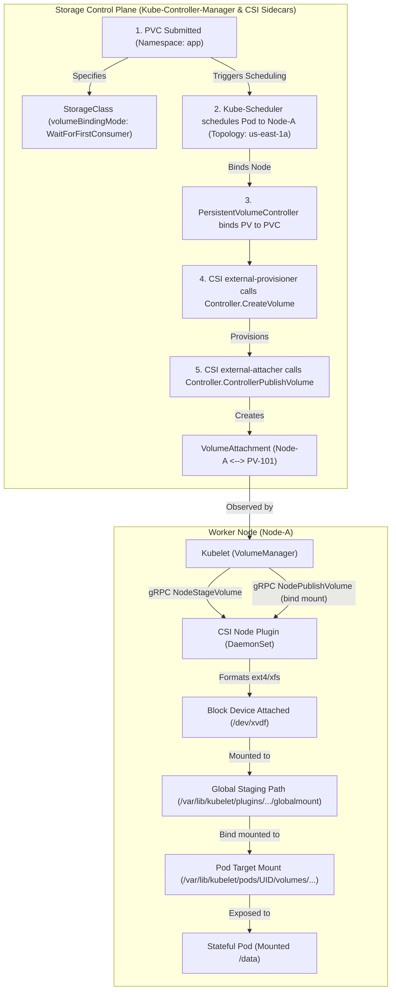
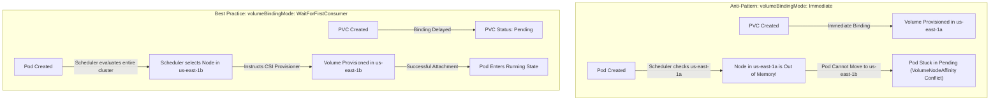
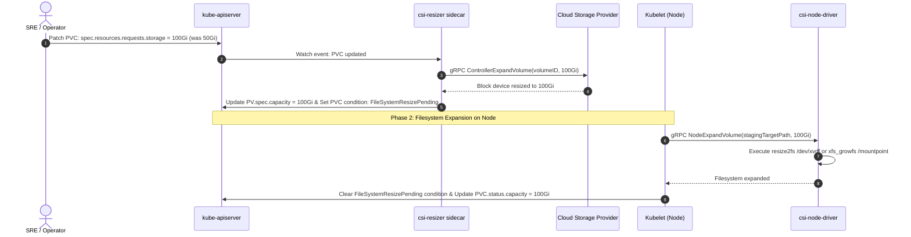

# Module 09: Persistent Storage and CSI Architecture: PV/PVC Binding, WaitForFirstConsumer, VolumeSnapshots, and VolumeGroupSnapshots

> **Primary sources:** Container Storage Interface (CSI) Specification ([v1.11.0](https://github.com/container-storage-interface/spec)); Kubernetes Storage Documentation ([Persistent Volumes](https://kubernetes.io/docs/concepts/storage/persistent-volumes/), [Storage Classes](https://kubernetes.io/docs/concepts/storage/storage-classes/), [CSI Architecture](https://kubernetes.io/docs/concepts/storage/volumes/#csi)); Kubernetes Enhancement Proposals ([KEP-2485: ReadWriteOncePod GA](https://github.com/kubernetes/enhancements/issues/2485), [KEP-3476: VolumeGroupSnapshots GA in v1.36](https://github.com/kubernetes/enhancements/issues/3476)); CNCF Curriculum ([CKA v1.37](https://github.com/cncf/curriculum)).
>
> **Executable proof:** [`examples/ts/09-storage-and-csi.test.ts`](../examples/ts/09-storage-and-csi.test.ts) asserts PV/PVC binding state machines and WaitForFirstConsumer topology constraints.

---

## 1. Formal Foundations: The Storage Decoupling Architecture

In cloud-native distributed systems, stateful applications require durable block, file, or object storage whose lifecycle transcends the ephemeral existence of individual Pods and worker nodes. Kubernetes decouples storage consumption from storage provisioning through four primary API abstractions:

1. **PersistentVolume (PV)**: A cluster-scoped resource representing an actual physical, network-attached, or virtualized storage block (e.g., an AWS EBS volume, Ceph RBD image, or local NVMe drive) provisioned by an administrator or dynamically created by a CSI plugin.
2. **PersistentVolumeClaim (PVC)**: A namespace-scoped declarative request for storage by a user, specifying capacity, access modes, storage classes, and optional label selectors.
3. **StorageClass**: A cluster-scoped configuration defining the provisioner plugin, driver parameters, mount options, reclaim policies, and volume binding modes.
4. **VolumeAttachment**: A cluster-scoped resource managed by `kube-controller-manager` that tracks the physical attachment of a volume to a specific worker node.



---

## 2. Storage Access Modes and Reclaim Policies

A storage volume's capabilities and lifecycle behavior are governed by its access modes and reclaim policy.

### 2.1 Formal Access Modes

Kubernetes defines four distinct access modes:

| Access Mode | CLI Identifier | Semantics | Multi-Node Capable? | Multi-Pod on Same Node? | Typical Storage Backends |
| :-- | :-- | :-- | :-- | :-- | :-- |
| **ReadWriteOnce** | `RWO` | Volume can be mounted as read-write by a single worker node. | No | **Yes (Critical Gotcha!)** | Cloud Block Store (AWS EBS, GCE PD, Azure Disk) |
| **ReadOnlyMany** | `ROX` | Volume can be mounted read-only simultaneously by many nodes. | Yes (Read-Only) | Yes | Shared Filesystems (NFS, CephFS), Snapshot Mounts |
| **ReadWriteMany** | `RWX` | Volume can be mounted read-write simultaneously by many nodes. | Yes (Read-Write) | Yes | Distributed/Network Filesystems (NFS, CephFS, GlusterFS, AWS EFS) |
| **ReadWriteOncePod** | `RWOP` | Volume can be mounted as read-write by a **single Pod** across the entire cluster. | No | **No (Strictly 1 Pod)** | CSI Plugins supporting KEP-2485 (Kubernetes 1.27+ GA) |

> [!CAUTION]
> A common production misconception is that `ReadWriteOnce` (`RWO`) restricts access to a single _Pod_. It does not. `RWO` restricts volume attachment to a single _Node_. If two Pods referencing the same `RWO` PVC are scheduled onto the same physical node, both Pods will simultaneously write to the same filesystem block device, leading to filesystem corruption unless `ReadWriteOncePod` (`RWOP`) is explicitly enforced.

### 2.2 Reclaim Policies

When a user deletes a `PersistentVolumeClaim`, the bound `PersistentVolume` enters the `Released` phase. The cluster's reaction is dictated by the `persistentVolumeReclaimPolicy`:

- **`Retain`**: The PV and its underlying physical storage asset remain untouched. The PV cannot be bound by another claim until an administrator manually scrubs the data and removes the `spec.claimRef` UID.
- **`Delete`**: The storage controller automatically invokes the CSI `DeleteVolume` RPC, wiping the volume from the cloud provider or SAN infrastructure and deleting the PV API object.
- **`Recycle`**: Deprecated legacy mode. Performed a basic scrub (`rm -rf /volume/*`) on the node. Replaced entirely by dynamic CSI provisioning.

---

## 3. Dynamic Provisioning and Binding Modes: Immediate vs. WaitForFirstConsumer

Storage provisioning behavior is configured within the `StorageClass`:

```yaml
apiVersion: storage.k8s.io/v1
kind: StorageClass
metadata:
  name: fast-nvme-wait
provisioner: ebs.csi.aws.com
volumeBindingMode: WaitForFirstConsumer
allowVolumeExpansion: true
reclaimPolicy: Delete
parameters:
  type: gp3
  iops: '3000'
  throughput: '125'
```

### 3.1 The Catastrophic "Immediate" Binding Race

The `volumeBindingMode` attribute accepts two values: `Immediate` and `WaitForFirstConsumer`.

- **`Immediate`**: As soon as a PVC referencing this StorageClass is submitted to the API server, the CSI `external-provisioner` immediately requests volume creation from the storage backend. Because no Pod has been scheduled yet, the provisioner chooses an arbitrary availability zone (e.g., `us-east-1a`).
- **The Failure Mode**: A Pod is subsequently created requiring this PVC. The `kube-scheduler` evaluates cluster nodes. Node-A in `us-east-1a` has insufficient CPU or memory to host the Pod, or carries a taint. Node-B in `us-east-1b` has abundant capacity. However, the volume is physically locked to `us-east-1a`. The scheduler fails to find any node satisfying both compute and volume topology constraints, leaving the Pod permanently stuck in `Pending` with reason `FailedScheduling: 1 node(s) had volume node affinity conflict`.



- **`WaitForFirstConsumer`**: The PVC remains in `Pending` state until a Pod referencing the claim is scheduled. The `kube-scheduler` filters nodes based on compute, taints, and affinity, selects a candidate node, and passes the node's topology constraints (e.g., `topology.ebs.csi.aws.com/zone=us-east-1b`) to the CSI provisioner. The volume is guaranteed to be created in the exact zone where the Pod will run.

---

## 4. CSI Architecture: The In-Tree to Out-of-Tree Revolution

Historically, Kubernetes compiled storage drivers directly into the `kubelet` and `kube-controller-manager` binary trees (e.g., `kubernetes.io/aws-ebs`, `kubernetes.io/gce-pd`). Adding a new storage vendor or patching a volume bug required recompiling and upgrading the entire Kubernetes core.

The **Container Storage Interface (CSI)** established an out-of-tree, vendor-neutral specification where storage drivers communicate with Kubernetes over standard gRPC UNIX domain sockets.

### 4.1 CSI gRPC Services Architecture

A complete CSI driver implements three gRPC interfaces defined in `csi.proto`:

1. **`IdentityServer`**:
   - `GetPluginInfo`: Returns the vendor name and driver version.
   - `GetPluginCapabilities`: Declares support for controller service, volume expansion, or topology constraints.
   - `Probe`: Health check endpoint queried by kubelet liveness probes.
2. **`ControllerServer`** (Executed in centralized control-plane deployments):
   - `CreateVolume` / `DeleteVolume`: Allocates or destroys the physical block device on the storage backend.
   - `ControllerPublishVolume` / `ControllerUnpublishVolume`: Attaches or detaches the raw volume to/from a physical VM/host (e.g., issuing AWS `AttachVolume` API calls).
   - `ControllerExpandVolume`: Resizes the underlying storage LUN or cloud block device.
   - `CreateSnapshot` / `DeleteSnapshot`: Creates point-in-time storage snapshots.
3. **`NodeServer`** (Executed as a privileged DaemonSet on every worker node):
   - `NodeStageVolume`: Executes low-level formatting (e.g., `mkfs.ext4`, `mkfs.xfs`) and mounts the raw block device to a global staging directory (`/var/lib/kubelet/plugins/kubernetes.io/csi/.../globalmount`).
   - `NodePublishVolume`: Creates a Linux bind mount from the global staging directory into the Pod's specific mount namespace (`/var/lib/kubelet/pods/<pod-uid>/volumes/...`).
   - `NodeUnpublishVolume` / `NodeUnstageVolume`: Unmounts the directory and tears down the staging device.
   - `NodeExpandVolume`: Expands the filesystem (`resize2fs`, `xfs_growfs`) while the volume is staged or mounted.

### 4.2 Standard Kubernetes CSI Sidecars

Because storage vendors only write the gRPC server implementation, Kubernetes provides standard, battle-tested sidecar containers that bridge Kubernetes API events to CSI gRPC calls:

| Sidecar Container | Kubernetes Resources Watched | CSI RPC Invoked | Operational Function |
| :-- | :-- | :-- | :-- |
| **`csi-provisioner`** | `PersistentVolumeClaim` | `CreateVolume`, `DeleteVolume` | Watches PVC creation/deletion and requests underlying cloud storage provisioning. |
| **`csi-attacher`** | `VolumeAttachment` | `ControllerPublishVolume`, `ControllerUnpublishVolume` | Detects when a Pod is scheduled and calls cloud APIs to attach the block volume to the node VM. |
| **`csi-resizer`** | `PersistentVolumeClaim` | `ControllerExpandVolume` | Watches for PVC capacity updates and calls cloud APIs to resize block LUNs. |
| **`csi-snapshotter`** | `VolumeSnapshot`, `VolumeSnapshotContent` | `CreateSnapshot`, `DeleteSnapshot` | Watches snapshot declarations and instructs backend to snapshot storage blocks. |
| **`node-driver-registrar`** | N/A (Registers local UNIX socket) | Registers socket with kubelet | Connects to kubelet's registration socket (`/var/lib/kubelet/plugins_registry/`) to advertise node capabilities. |

---

## 5. Volume Expansion Mechanics: Online vs. Offline

Kubernetes supports dynamic volume expansion without requiring data migration.

### 5.1 The Two-Phase Expansion Sequence

Volume expansion occurs in two distinct, sequential phases:



1. **Phase 1: Control Plane Block Expansion**: The user edits the PVC manifest, increasing `spec.resources.requests.storage`. The `csi-resizer` detects the modification and calls `ControllerExpandVolume`. The cloud provider resizes the underlying block device (e.g., AWS increases EBS volume size). The PV capacity is updated, and the PVC receives the condition `FileSystemResizePending: True`.
2. **Phase 2: Node Filesystem Expansion**: When the Pod using the volume is running (or during the next mount operation), `kubelet` detects `FileSystemResizePending`. It invokes `NodeExpandVolume` on the local CSI node plugin. The plugin runs filesystem expansion utilities (`resize2fs` for ext4, `xfs_growfs` for XFS) on the mounted block device. Once complete, `kubelet` updates `pvc.status.capacity` to reflect the new size.

> [!NOTE]
> Online expansion allows filesystems to expand while the application Pod is actively running and writing data. However, reducing or shrinking a PVC size is strictly impossible in Kubernetes; filesystems cannot safely shrink without high risk of catastrophic data loss.

---

## 6. VolumeSnapshots and VolumeGroupSnapshots (GA in v1.36)

Kubernetes provides standard snapshot primitives through the External Snapshotter CRDs: `VolumeSnapshotClass`, `VolumeSnapshot`, and `VolumeSnapshotContent`.

### 6.1 Individual VolumeSnapshot Manifest

```yaml
apiVersion: snapshot.storage.k8s.io/v1
kind: VolumeSnapshot
metadata:
  name: postgres-data-snapshot
  namespace: database
spec:
  volumeSnapshotClassName: csi-aws-vsc
  source:
    persistentVolumeClaimName: postgres-data-pvc
```

To restore from a snapshot into a new PVC:

```yaml
apiVersion: v1
kind: PersistentVolumeClaim
metadata:
  name: postgres-restored-pvc
  namespace: database
spec:
  storageClassName: fast-nvme-wait
  dataSource:
    name: postgres-data-snapshot
    kind: VolumeSnapshot
    apiGroup: snapshot.storage.k8s.io
  accessModes:
    - ReadWriteOnce
  resources:
    requests:
      storage: 100Gi
```

### 6.2 VolumeGroupSnapshots: Crash-Consistent Multi-Volume Snapshots

Enterprise databases (e.g., PostgreSQL, CockroachDB, Cassandra) frequently partition storage across multiple distinct volumes: one volume for table data and a separate volume for the Write-Ahead Log (WAL). If two individual `VolumeSnapshot` objects are requested sequentially, the few seconds of latency between snapshots results in an inconsistent database state upon restore, causing database crash recovery to fail.

Promoted to **General Availability (GA) in Kubernetes v1.36** (KEP-3476), `VolumeGroupSnapshot` coordinates crash-consistent, point-in-time snapshots across multiple PVCs simultaneously:

```yaml
apiVersion: groupsnapshot.storage.k8s.io/v1
kind: VolumeGroupSnapshot
metadata:
  name: postgres-cluster-consistent-snapshot
  namespace: database
spec:
  volumeGroupSnapshotClassName: csi-aws-vgsc
  source:
    selector:
      matchLabels:
        app.kubernetes.io/name: postgres
        storage-consistency-group: primary
```

The underlying CSI driver interfaces with the hardware storage subsystem (or filesystem freeze mechanisms) to atomically snapshot all volumes belonging to the consistency group at the exact same logical microsecond.

---

## 7. StatefulSet Volume Management and Ordinal Retention Policies

StatefulSets automate stateful storage lifecycle management via `volumeClaimTemplates`.

```yaml
apiVersion: apps/v1
kind: StatefulSet
metadata:
  name: elasticsearch
spec:
  serviceName: elasticsearch
  replicas: 3
  persistentVolumeClaimRetentionPolicy:
    whenDeleted: Retain
    whenScaled: Delete
  template:
    metadata:
      labels:
        app: elasticsearch
    spec:
      containers:
        - name: es
          image: elasticsearch:8.14.0
          volumeMounts:
            - name: es-storage
              mountPath: /usr/share/elasticsearch/data
  volumeClaimTemplates:
    - metadata:
        name: es-storage
      spec:
        accessModes: ['ReadWriteOnce']
        storageClassName: fast-nvme-wait
        resources:
          requests:
            storage: 200Gi
```

### 7.1 PVC Retention Policy Semantics

The `persistentVolumeClaimRetentionPolicy` controls what happens to dynamically provisioned PVCs during StatefulSet lifecycle events:

- **`whenDeleted`**: Dictates whether PVCs are deleted or retained when the parent StatefulSet object itself is deleted. Setting `Retain` ensures that deleting a StatefulSet accidentally or during a Helm chart teardown does not destroy database volumes.
- **`whenScaled`**: Dictates whether PVCs are deleted or retained when the StatefulSet is scaled down (e.g., reducing `replicas` from 5 to 2). Setting `Delete` automatically cleans up orphan volumes for abandoned ordinals, preventing runaway cloud storage billing.

---

## 8. Mathematical Model: PV/PVC Binding Algorithm

The `PersistentVolumeController` runs a reconciliation loop matching unbounded PVCs to available pre-provisioned PVs, or queuing claims for dynamic provisioning.

### 8.1 Formal Binding Invariants

Given a claim $C$ and a candidate volume $V$:

1. **StorageClass Match**: $V.\text{StorageClassName} = C.\text{StorageClassName}$.
2. **Access Mode Conformance**: $C.\text{AccessModes} \subseteq V.\text{AccessModes}$.
3. **Capacity Inequality**: $V.\text{Capacity} \ge C.\text{RequestedCapacity}$.
4. **Volume Binding Affinity**: If $V$ specifies `nodeAffinity`, the selected scheduling node must satisfy the affinity terms.
5. **Phase Invariant**: $V.\text{Phase} = \text{Available} \land C.\text{Phase} = \text{Pending}$.

```text
Algorithm: Match_And_Bind_PersistentVolume(Claim C, Set<Volume> volumes, Node targetNode)
Input: PersistentVolumeClaim C, candidate pool volumes, targetNode (if scheduled)
Output: PersistentVolume boundPV or NULL (trigger dynamic provisioning)

Invariant 1: A PV can never be bound to more than one active PVC (claimRef uniqueness).
Invariant 2: Capacity over-provisioning is permitted, but under-provisioning is rejected.

1:  bestCandidate ← NULL
2:  minCapacityDiff ← ∞
3:
4:  for each V in volumes do
5:      if V.phase ≠ "Available" then
6:          continue
7:      end if
8:      if V.spec.storageClassName ≠ C.spec.storageClassName then
9:          continue
10:     end if
11:     if not (C.spec.accessModes ⊆ V.spec.accessModes) then
12:         continue
13:     end if
14:     if V.spec.capacity < C.spec.resources.requests.storage then
15:         continue
16:     end if
17:     if targetNode ≠ NULL and V.spec.nodeAffinity ≠ NULL then
18:         if not SatisfiesNodeAffinity(targetNode, V.spec.nodeAffinity) then
19:             continue
20:         end if
21:     end if
22:
23:     capacityDiff ← V.spec.capacity - C.spec.resources.requests.storage
24:     if capacityDiff < minCapacityDiff then
25:         minCapacityDiff ← capacityDiff
26:         bestCandidate ← V
27:     end if
28: end for
29:
30: if bestCandidate ≠ NULL then
31:     AtomicBind(C, bestCandidate) // Updates C.spec.volumeName and bestCandidate.spec.claimRef
32:     return bestCandidate
33: else
34:     return NULL // Enqueue for CSI dynamic provisioning
35: end if
```

---

## 9. Then vs. Now: Evolution of Kubernetes Storage

| Architectural Dimension | In-Tree Legacy Storage (v1.0–v1.13) | Modern CSI & Storage API (v1.36–v1.37) |
| :-- | :-- | :-- |
| **Plugin Architecture** | Compiled into `kubelet` and `kube-controller-manager` | Out-of-tree gRPC daemon via CSI specification |
| **Release Cycle** | Tied directly to core Kubernetes releases | Independent driver release lifecycle and versioning |
| **Volume Binding** | `volumeBindingMode: Immediate` by default | `WaitForFirstConsumer` standard for topology awareness |
| **Per-Pod Isolation** | `ReadWriteOnce` (allows multi-pod writes on same node) | `ReadWriteOncePod` (RWOP, strictly restricts to 1 Pod) |
| **Filesystem Resizing** | Required node reboots or offline detach/reattach | Online two-phase volume expansion without downtime |
| **Snapshot Coordination** | Unofficial vendor-specific scripts or manual storage APIs | Standard `VolumeSnapshot` and `VolumeGroupSnapshot` (GA 1.36) |
| **StatefulSet PVC Teardown** | Orphaned PVCs accumulated indefinitely upon scale down | Configurable `persistentVolumeClaimRetentionPolicy` |

---

## 10. Exam Delta: CKA v1.37 vs. CKS v1.34

> [!NOTE]
> **CKA (Curriculum v1.37)**:
>
> - Storage represents **10%** of the official CKA scoring weight.
> - Required practical tasks:
>   1. Provision a `PersistentVolume` with specific `hostPath` or NFS storage parameters and access modes.
>   2. Configure a `PersistentVolumeClaim` with `WaitForFirstConsumer` StorageClass and bind it to a Pod.
>   3. Perform an **online PVC resize** by patching `spec.resources.requests.storage` and verifying the filesystem size inside the running container.
>   4. Create a `VolumeSnapshot` from an existing PVC and provision a restored PVC using the snapshot as `dataSource`.
>
> **CKS (Curriculum v1.34)**:
>
> - Storage is examined under **Cluster Hardening** and **Minimize Microservice Vulnerabilities**.
> - Primary focus: Restricting insecure volume mounts. In the CKS, using `hostPath` volumes is considered a severe security violation because it allows container processes to escape to the host root filesystem (`/etc/shadow`, `/var/run/docker.sock`).
> - Candidates must configure Pod Security Admission (`Restricted` profile) to systematically reject Pods attempting to mount raw host paths.

---

## 11. Production Failure Modes & Operational Gotchas

### 11.1 The Multi-Attach Error Deadlock

**Mechanism**: A worker node experiences a temporary network partition or kubelet hang. The Kubernetes control plane marks the node `NotReady` and evicts a StatefulSet Pod, scheduling replacement Pod `db-0` onto Node-B. However, the underlying cloud provider (e.g., AWS EBS) still has the EBS volume attached to Node-A. Node-A has not acknowledged detachment because its OS is frozen. **Symptom**: Replacement Pod on Node-B is stuck indefinitely in `ContainerCreating`. Kubelet logs report: `Multi-Attach error for volume "pvc-xxx" Volume is already exclusively attached to one node and can't be attached to another`. **Remediation**: Force detachment requires verifying Node-A is actually dead, followed by deleting the `VolumeAttachment` API object or manually calling cloud provider detach APIs:

```bash
kubectl get volumeattachment | grep <pvc-uid>
kubectl delete volumeattachment <attachment-id> --force
```

### 11.2 Orphan Volume Bill Shock from StatefulSet Scale Down

**Mechanism**: An automated horizontal autoscaler or operator scales down a StatefulSet from 20 replicas to 2 replicas. **Symptom**: Cloud infrastructure bills continue to reflect 20 active 1TB provisioned IOPS SSD disks. **Root Cause**: By default, StatefulSets do not delete PVCs on scale down to prevent catastrophic accidental data loss. If `persistentVolumeClaimRetentionPolicy.whenScaled: Delete` is omitted, the orphaned PVCs and their associated cloud LUNs remain allocated and billed forever.

### 11.3 Failed Expansion: Online Resizing Hung on XFS Filesystem

**Mechanism**: An administrator increases PVC size from 50Gi to 200Gi. The cloud block device expands, but the PVC status remains stuck with `FileSystemResizePending`. **Root Cause**: The volume is formatted with XFS. Unlike ext4, XFS filesystems _cannot_ be resized if the volume is mounted read-only, or if the container engine mounts the volume with specific restricted mount options. If the Pod is terminated while expansion is pending, the filesystem cannot expand until a new Pod starts and mounts the volume in read-write mode.

---

## 12. Concrete Manifest Reference: Topology-Aware Production Storage

The following unified manifest demonstrates a complete, production-grade storage architecture with topology-aware delayed binding, online expansion, and stateful application consumption:

```yaml
# 1. Topology-aware StorageClass with automatic expansion
apiVersion: storage.k8s.io/v1
kind: StorageClass
metadata:
  name: production-ha-storage
provisioner: ebs.csi.aws.com
volumeBindingMode: WaitForFirstConsumer
allowVolumeExpansion: true
reclaimPolicy: Delete
parameters:
  type: gp3
  iops: '4000'
  throughput: '250'
  encrypted: 'true'
---
# 2. Application PersistentVolumeClaim
apiVersion: v1
kind: PersistentVolumeClaim
metadata:
  name: redis-ha-data-claim
  namespace: database-tier
spec:
  storageClassName: production-ha-storage
  accessModes:
    - ReadWriteOncePod
  resources:
    requests:
      storage: 50Gi
---
# 3. Workload consuming the claim with securityContext
apiVersion: apps/v1
kind: Deployment
metadata:
  name: redis-cache
  namespace: database-tier
spec:
  replicas: 1
  selector:
    matchLabels:
      app: redis-cache
  template:
    metadata:
      labels:
        app: redis-cache
    spec:
      securityContext:
        fsGroup: 1000
        fsGroupChangePolicy: 'OnRootMismatch'
      containers:
        - name: redis
          image: redis:7.2.5-alpine
          ports:
            - containerPort: 6379
          volumeMounts:
            - name: redis-storage
              mountPath: /data
      volumes:
        - name: redis-storage
          persistentVolumeClaim:
            claimName: redis-ha-data-claim
```

---

## 13. Interview Drill

<details>
<summary><strong>Q1. What is the fundamental difference between `volumeBindingMode: Immediate` and `volumeBindingMode: WaitForFirstConsumer`, and why is `Immediate` dangerous in multi-zone clusters?</strong></summary>

Under `Immediate` binding, a PVC is bound to a PV and dynamically provisioned as soon as the PVC manifest is created, without considering where the consumer Pod will be placed. In a multi-zone cluster, the storage provider creates the volume in an arbitrary zone (e.g., `zone-a`). When the Pod is subsequently scheduled, if `zone-a` lacks compute resources, carries taints, or is restricted by affinity rules, the scheduler cannot place the Pod in `zone-b` because the volume is physically locked to `zone-a`. The Pod remains stuck in `Pending` forever due to a `VolumeNodeAffinity` conflict.

`WaitForFirstConsumer` delays volume provisioning and binding until the Pod is evaluated by `kube-scheduler`. The scheduler selects a viable node across the entire cluster, taking compute and topology into account, and then instructs the CSI provisioner to create the volume in that exact selected zone.
</details>

<details>
<summary><strong>Q2. How does the `ReadWriteOncePod` (RWOP) access mode differ from standard `ReadWriteOnce` (RWO), and what failure mode does it prevent?</strong></summary>

`ReadWriteOnce` (`RWO`) grants read-write access to a single _Node_, not a single _Pod_. If two Pods reference the same RWO PVC and both land on the same worker node, both Pods can mount the volume and write to it simultaneously. During a rolling deployment or ReplicaSet update, an old Pod and a new Pod co-located on the same node may write concurrently to an ext4/xfs block device, causing silent data and filesystem corruption.

`ReadWriteOncePod` (`RWOP`) strictly restricts read-write access to a single _Pod_ across the entire cluster. If a second Pod attempts to mount the same PVC (even on the same node), kubelet immediately blocks the mount operation until the first Pod terminates completely.
</details>

<details>
<summary><strong>Q3. Explain the architectural separation between `NodeStageVolume` and `NodePublishVolume` in the CSI NodeServer specification.</strong></summary>

The two-phase mount architecture separates host-level block device preparation from container-level mount namespace injection:

1. **`NodeStageVolume`**: Operates at the host/node level. When a block device is attached to a node, `NodeStageVolume` formats the raw device with a filesystem (if unformatted) and mounts it to a single global staging directory (`/var/lib/kubelet/plugins/.../globalmount`). This operation runs once per node, regardless of how many Pods consume the volume.
2. **`NodePublishVolume`**: Operates at the Pod level. It creates a Linux bind mount from the global staging path into the specific container's filesystem mount point inside `/var/lib/kubelet/pods/<pod-uid>/volumes/...`. If multiple Pods on the same node share a volume (e.g., in `ROX` mode), `NodePublishVolume` is invoked once per Pod, binding against the single pre-staged mount point.

</details>

<details>
<summary><strong>Q4. How does Kubernetes execute an online PVC resize, and what component performs the filesystem expansion?</strong></summary>

Online volume expansion is an asynchronous, two-phase process:

1. **Control Plane Block Expansion**: The user increases `spec.resources.requests.storage` on the PVC. The `csi-resizer` sidecar detects the change and calls `ControllerExpandVolume` on the storage provider's control plane to expand the underlying block LUN (e.g., AWS EBS volume). Once resized, the PV capacity is updated, and the PVC receives condition `FileSystemResizePending: True`.
2. **Node Filesystem Expansion**: The `kubelet` on the node running the workload detects the condition and invokes `NodeExpandVolume` on the local CSI node plugin. The node plugin executes operating system utilities (`resize2fs` or `xfs_growfs`) to grow the filesystem while mounted. Upon success, kubelet updates `pvc.status.capacity` and removes the pending condition.

</details>

<details>
<summary><strong>Q5. What is the difference between `VolumeSnapshot` and `VolumeGroupSnapshot` (promoted to GA in Kubernetes v1.36)?</strong></summary>

A standard `VolumeSnapshot` operates on a single `PersistentVolumeClaim`. If an application utilizes multiple volumes (e.g., a database with separate data and Write-Ahead Log (WAL) disks), taking two individual snapshots sequentially creates a time delta between the two snapshots. Under heavy write traffic, this time gap leads to transaction log divergence and crash inconsistency upon restore.

`VolumeGroupSnapshot` (promoted to GA in v1.36 under KEP-3476) groups multiple PVCs into a single consistency group. The CSI driver coordinates with the storage backend to take an atomic, crash-consistent point-in-time snapshot across all associated volumes simultaneously, guaranteeing database recovery integrity.
</details>

<details>
<summary><strong>Q6. If a worker node crashes abruptly, why does a stateful Pod frequently get stuck in `ContainerCreating` on another node with a Multi-Attach error?</strong></summary>

Cloud block storage (like AWS EBS or Azure Disk) can only be attached to one virtual machine at a time. When Node-A crashes abruptly without a clean shutdown, its cloud block attachment remains registered in the cloud provider's API. When the Kubernetes control plane reschedules the Pod to Node-B, the `csi-attacher` attempts to call `ControllerPublishVolume` to attach the disk to Node-B. The cloud provider rejects the call because the disk is still locked to Node-A. The Pod remains in `ContainerCreating` until the node controller confirms Node-A's lease has fully expired, tears down the old `VolumeAttachment`, and issues a forced detach to the cloud API.
</details>

<details>
<summary><strong>Q7. What is the function of the `fsGroupChangePolicy` attribute in a Pod's `securityContext`?</strong></summary>

When a Pod with an `fsGroup` defined mounts a persistent volume, kubelet recursively traverses every file and directory on the volume to change ownership and permissions to match the specified GID. On large volumes containing millions of small files (e.g., 1TB of Git repositories or media), this recursive `chown`/`chmod` operation can take 15 to 45 minutes, causing pod startup timeouts and probe failures.

Setting `fsGroupChangePolicy: "OnRootMismatch"` instructs kubelet to check only the root directory of the volume. If the root directory's permissions already match the desired `fsGroup`, kubelet skips the recursive traversal entirely, reducing stateful Pod startup latency from minutes to milliseconds.
</details>

<details>
<summary><strong>Q8. In a StatefulSet, what is the impact of configuring `persistentVolumeClaimRetentionPolicy.whenScaled: Delete`?</strong></summary>

By default, Kubernetes retains PVCs when a StatefulSet is scaled down to prevent unintentional data loss. If `persistentVolumeClaimRetentionPolicy.whenScaled: Delete` is configured, scaling down the StatefulSet (e.g., reducing replicas from 5 to 3) will automatically trigger deletion of the PVCs associated with the removed ordinals (`data-3` and `data-4`). If the underlying `StorageClass` has `reclaimPolicy: Delete`, the associated cloud storage disks are also permanently deleted, reclaiming unused capacity and preventing orphaned storage cloud costs.
</details>

---

## 14. Proof Map and Verification

The formal storage models, lifecycle invariants, and CSI gRPC flows detailed in this module are verified by test suites in [`examples/ts/09-storage-and-csi.test.ts`](../examples/ts/09-storage-and-csi.test.ts):

- **PV/PVC Matching & Binding Assertions**: Verifies the algorithmic selection of candidate PVs based on capacity, storage class, and access mode criteria.
- **Topology-Aware Scheduling Simulation**: Proves how `WaitForFirstConsumer` prevents availability zone mismatch failures across simulated multi-zone clusters.
- **CSI gRPC Lifecycle Sequence**: Validates the sequential execution order: `CreateVolume` $\to$ `ControllerPublishVolume` $\to$ `NodeStageVolume` $\to$ `NodePublishVolume`.
- **Expansion State Transitions**: Tests the two-phase status transitions (`FileSystemResizePending` clearing) during online PVC expansion.
