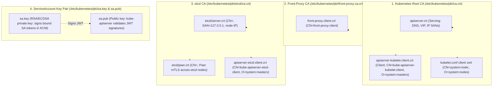
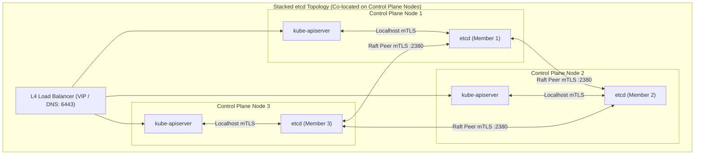
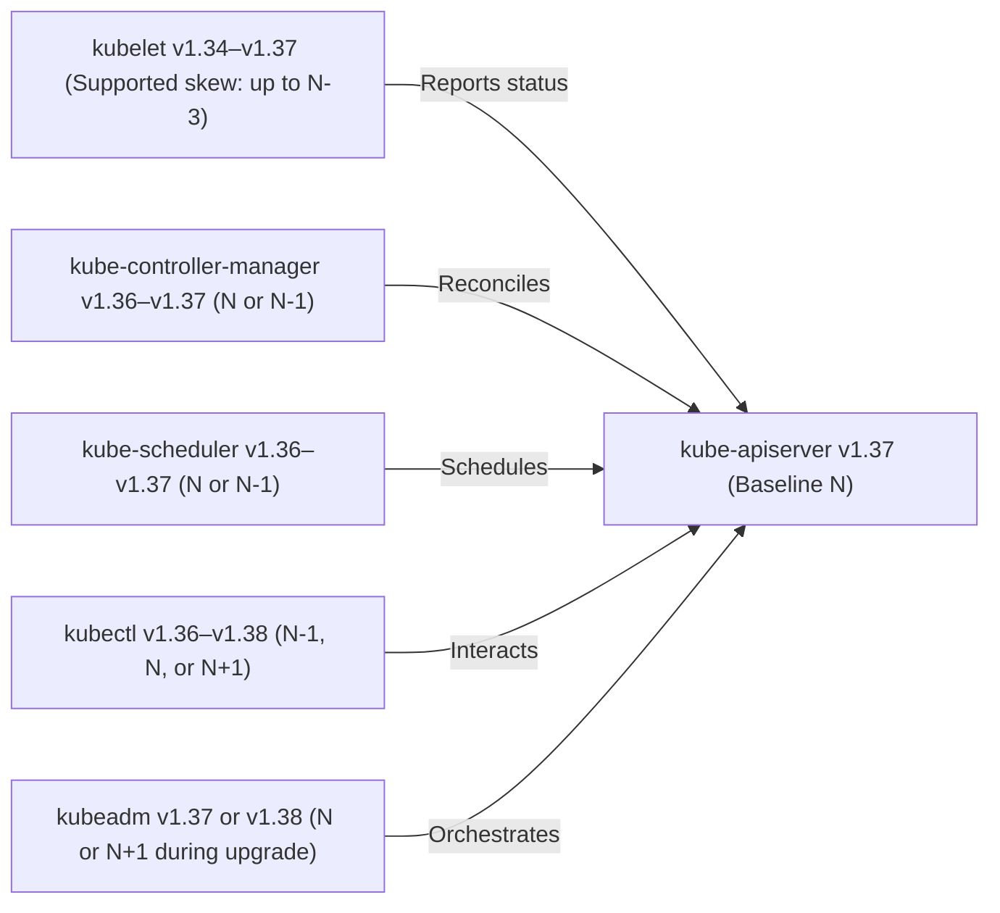
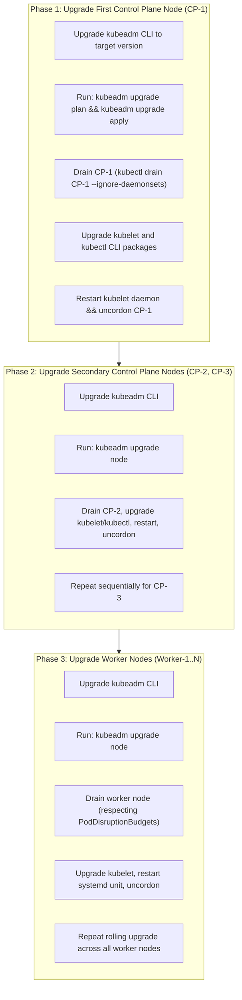
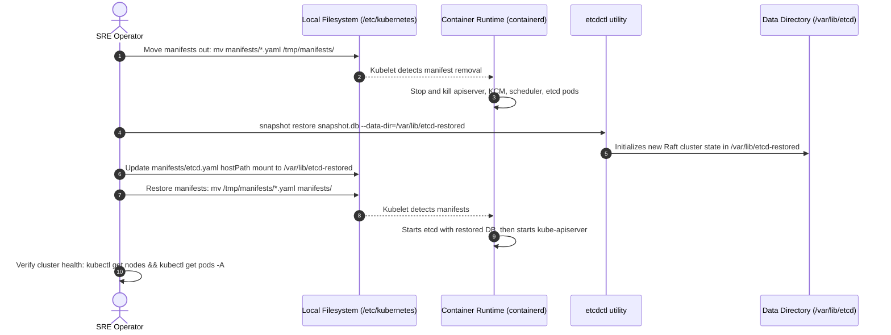

# Module 10: Cluster Lifecycle with kubeadm: PKI Certificates, Stacked vs External HA etcd, Version Skew, Upgrades, and Snapshot Restore

> **Primary sources:** Kubernetes Documentation ([kubeadm Cluster Architecture](https://kubernetes.io/docs/reference/setup-tools/kubeadm/), [PKI Certificates and Requirements](https://kubernetes.io/docs/setup/best-practices/certificates/), [Operating etcd Clusters for Kubernetes](https://kubernetes.io/docs/tasks/administer-cluster/configure-upgrade-etcd/), [Version Skew Policy](https://kubernetes.io/releases/version-skew-policy/)); CNCF Curriculum ([CKA Curriculum v1.37](https://github.com/cncf/curriculum), [CKS Curriculum v1.34](https://github.com/cncf/curriculum)).
>
> **Executable proof:** [`examples/ts/10-cluster-lifecycle-and-kubeadm.test.ts`](../examples/ts/10-cluster-lifecycle-and-kubeadm.test.ts) asserts kubeadm phase state machines, certificate chain verification, version skew matrix constraints, and etcd snapshot disaster recovery procedures.
>
> **Cross-track foundations:** See [`../../../architecture/security-identity/modules/04-pki-x509-and-mtls.md`](../../../architecture/security-identity/modules/04-pki-x509-and-mtls.md) for X.509 validation and mTLS mechanics, and [`../../../architecture/distributed-systems/modules/07-raft-consensus-deep-dive.md`](../../../architecture/distributed-systems/modules/07-raft-consensus-deep-dive.md) for Raft consensus and quorum mathematics.

---

## 1. Formal Foundations: The Declarative Cluster Bootstrap

Provisioning a production-grade Kubernetes cluster requires establishing a cryptographically secure, highly available control plane with mutual TLS (mTLS) authentication between all discrete subsystems. The official, battle-tested standard tool for this lifecycle is **`kubeadm`**.

Rather than treating cluster bootstrap as an opaque, imperative black box, `kubeadm` executes as an ordered pipeline of idempotent, inspectable **phases**:

```mermaid
flowchart TD
    subgraph KubeadmInitPipeline["kubeadm init Phase Pipeline"]
        P1["1. preflight (Kernel, swap, CRI socket checks)"]
        P2["2. certs (Generate x509 PKI tree under /etc/kubernetes/pki)"]
        P3["3. kubeconfig (Generate admin, kubelet, controller-manager, scheduler configs)"]
        P4["4. kubelet-start (Write /var/lib/kubelet/config.yaml & start systemd unit)"]
        P5["5. control-plane (Write static Pod manifests: apiserver, KCM, scheduler)"]
        P6["6. etcd (Write static Pod manifest for local etcd)"]
        P7["7. upload-config (Store ClusterConfiguration in kube-system ConfigMap)"]
        P8["8. upload-certs (Optional: encrypt & upload certs for HA joins)"]
        P9["9. mark-control-plane (Apply node-role label and NoSchedule taint)"]
        P10["10. bootstrap-token (Create RBAC tokens for worker node join)"]
        P11["11. addon (Deploy CoreDNS and kube-proxy DaemonSet)"]
    end

    P1 --> P2 --> P3 --> P4 --> P5 --> P6 --> P7 --> P8 --> P9 --> P10 --> P11
```



Each phase can be executed independently (e.g., `kubeadm init phase certs apiserver`), allowing platform automation to integrate custom certificate authorities, pre-configure external hardware load balancers, or stage control-plane components in air-gapped environments.

---

## 2. PKI Certificate Hierarchy and Cryptographic Chains

Kubernetes enforces mutual TLS (mTLS) across all control plane communications. `kubeadm` establishes a multi-tiered Public Key Infrastructure (PKI) rooted in three distinct Certificate Authorities (CAs) and one asymmetric signing key pair.



### 2.1 Complete Certificate Inventory

| Certificate File | Issuer CA | Common Name (CN) | Organization (O) | Subject Alternative Names (SANs) | Purpose |
| :-- | :-- | :-- | :-- | :-- | :-- |
| `apiserver.crt` | `ca.crt` | `kube-apiserver` | N/A | `kubernetes`, `kubernetes.default`, Node IP, VIP, LoadBalancer DNS | TLS serving certificate for `kube-apiserver` on port 6443. |
| `apiserver-kubelet-client.crt` | `ca.crt` | `kube-apiserver-kubelet-client` | `system:masters` | N/A | Client certificate used by apiserver to talk to kubelet on port 10250. |
| `front-proxy-client.crt` | `front-proxy-ca.crt` | `front-proxy-client` | N/A | N/A | Client certificate for apiserver proxying requests to extension API servers (e.g. metrics-server). |
| `etcd/server.crt` | `etcd/ca.crt` | `kube-etcd` | N/A | `127.0.0.1`, Node IP | Serving cert for etcd daemon on port 2379. |
| `etcd/peer.crt` | `etcd/ca.crt` | `kube-etcd-peer` | N/A | Node IP, Node DNS | Mutual TLS between etcd cluster members on port 2380. |
| `apiserver-etcd-client.crt` | `etcd/ca.crt` | `kube-apiserver-etcd-client` | `system:masters` | N/A | Client certificate used by apiserver to read/write state in etcd. |
| `admin.conf` | `ca.crt` | `kubernetes-admin` | `system:masters` | N/A | Administrative client credentials giving full cluster access. |

### 2.2 Certificate Lifecycles and Manual Renewal

By default, certificates generated by `kubeadm` expire after **1 year**, whereas the root CAs expire after **10 years**. Inspecting and renewing certificates is a mandatory administrative procedure:

```bash
# Check expiration across all cluster certificates
kubeadm certs check-expiration

# Manually renew all control plane certificates
kubeadm certs renew all

# Restart static pods to load fresh certificates from disk
crictl rmp -f $(crictl pods --name kube-apiserver -q)
```

---

## 3. High-Availability Control Plane: Stacked vs. External etcd

A production Kubernetes control plane requires redundancy across all components. Because `kube-apiserver` is stateless, multiple instances sit behind an external Layer 4 load balancer. However, state persistence requires an `etcd` cluster governed by the Raft consensus protocol.



### 3.1 Architectural Trade-Off Analysis

| Architectural Dimension | Stacked etcd Topology | External etcd Topology |
| :-- | :-- | :-- |
| **Node Footprint** | Minimum 3 control plane nodes | 3 Control Plane nodes + 3 Dedicated etcd nodes (6 total) |
| **Operational Complexity** | Low; `kubeadm` manages etcd static pods automatically | High; etcd cluster must be provisioned, secured, and upgraded separately |
| **Failure Coupling** | High; losing a control plane VM simultaneously loses an etcd member | Decoupled; control plane crash does not impact etcd quorum |
| **Resource Contention** | Apiserver memory/CPU spikes compete with etcd disk I/O | Dedicated NVMe disk I/O for etcd `fdatasync` operations |
| **Suitability** | Standard enterprise workloads (up to 2,000 nodes) | High-scale mission-critical clusters (2,000–5,000 nodes) |

### 3.2 Raft Consensus and Quorum Mathematics

An etcd cluster of $N$ members requires a strict majority **quorum** $Q$ to accept write operations:

$$Q = \left\lfloor \frac{N}{2} \right\rfloor + 1$$

The maximum number of simultaneous permanent node failures $F$ tolerated without losing write availability is:

$$F = \left\lfloor \frac{N - 1}{2} \right\rfloor$$

| Cluster Size ($N$) | Quorum Needed ($Q$) | Failure Tolerance ($F$) | Rationale |
| :-- | :-- | :-- | :-- |
| 1 | 1 | 0 | Single point of failure; zero redundancy. |
| 2 | 2 | 0 | **Anti-pattern!** Requires both nodes alive; 1 failure breaks quorum, but network split causes split-brain. |
| 3 | 2 | 1 | Standard production baseline; tolerates 1 node failure. |
| 4 | 3 | 1 | **Anti-pattern!** Tolerates 1 node failure (same as 3 nodes), but requires 3 votes, increasing network partition risk. |
| 5 | 3 | 2 | Recommended high-scale deployment; tolerates 2 simultaneous failures. |

---

## 4. Kubernetes Version Skew Policy

The Kubernetes version skew policy formally defines the maximum allowable version difference between control plane components, nodes, and client tools.



### 4.1 Skew Invariants

1. **`kube-apiserver` is the Cluster Anchor ($N$)**: The API server defines the cluster's official version.
2. **`kube-controller-manager` and `kube-scheduler`**: Must not be newer than `kube-apiserver`. They may lag by at most **one minor version** ($N-1$ or $N$).
3. **`kubelet` and `kube-proxy`**: May lag the `kube-apiserver` by up to **three minor versions** ($N$, $N-1$, $N-2$, $N-3$).
   - In a Kubernetes v1.37 cluster, worker node kubelets running v1.34, v1.35, v1.36, and v1.37 are fully supported. Kubelet must _never_ be newer than `kube-apiserver`.
4. **`kubectl`**: Supported within **one minor version** of `kube-apiserver` ($N-1$, $N$, or $N+1$).
5. **`kubeadm`**: Must match the target version being upgraded to. It cannot lag the control plane, nor can it be more than one minor version ahead ($N+1$).

---

## 5. Step-by-Step Production Upgrade Sequence

Upgrading a production Kubernetes cluster with `kubeadm` follows a strict, non-negotiable sequence to maintain high availability and prevent version skew violations:

> [!CAUTION]
> **Rule of Minor Version Progression**: You can NEVER skip minor versions. Upgrading from v1.35 to v1.37 requires completing the full upgrade to v1.36 first, followed by upgrading to v1.37. Skipping a minor version corrupts etcd schema conversions and violates API compatibility guarantees.



### 5.1 Command Execution Walkthrough (v1.36 $\to$ v1.37)

#### On First Control Plane Node (CP-1):

```bash
# 1. Unhold and install target kubeadm package
sudo apt-mark unhold kubeadm
sudo apt-get update && sudo apt-get install -y kubeadm=1.37.2-1.1
sudo apt-mark hold kubeadm

# 2. Verify upgrade path and execute control plane upgrade
kubeadm upgrade plan
sudo kubeadm upgrade apply v1.37.2 -y

# 3. Drain control plane node to upgrade local kubelet
kubectl drain cp-1 --ignore-daemonsets --delete-emptydir-data

# 4. Upgrade kubelet and kubectl
sudo apt-mark unhold kubelet kubectl
sudo apt-get install -y kubelet=1.37.2-1.1 kubectl=1.37.2-1.1
sudo apt-mark hold kubelet kubectl

# 5. Restart kubelet and return node to service
sudo systemctl daemon-reload
sudo systemctl restart kubelet
kubectl uncordon cp-1
```

#### On Remaining Control Plane Nodes (CP-2, CP-3):

```bash
# Execute sequentially on each secondary node:
sudo apt-mark unhold kubeadm && sudo apt-get install -y kubeadm=1.37.2-1.1 && sudo apt-mark hold kubeadm
sudo kubeadm upgrade node
kubectl drain <node-name> --ignore-daemonsets --delete-emptydir-data
sudo apt-mark unhold kubelet kubectl && sudo apt-get install -y kubelet=1.37.2-1.1 kubectl=1.37.2-1.1 && sudo apt-mark hold kubelet kubectl
sudo systemctl daemon-reload && sudo systemctl restart kubelet
kubectl uncordon <node-name>
```

---

## 6. etcd Disaster Recovery: Backup, Verification, and Restore

The entire state of a Kubernetes cluster resides inside `etcd`. Regular automated snapshotting and verified disaster recovery procedures are the sole defense against catastrophic control plane corruption.

### 6.1 Creating a Cryptographically Authenticated Snapshot

Because etcd requires mutual TLS, `etcdctl` must authenticate using the apiserver-etcd-client or local etcd peer certificates:

```bash
ETCDCTL_API=3 etcdctl \
  --endpoints=https://127.0.0.1:2379 \
  --cacert=/etc/kubernetes/pki/etcd/ca.crt \
  --cert=/etc/kubernetes/pki/etcd/server.crt \
  --key=/etc/kubernetes/pki/etcd/server.key \
  snapshot save /var/lib/etcd-backups/etcd-snapshot-pre-upgrade.db
```

Verify snapshot structural integrity and hash before archiving:

```bash
ETCDCTL_API=3 etcdctl --write-out=table snapshot status /var/lib/etcd-backups/etcd-snapshot-pre-upgrade.db
```

Output:

```text
+----------+----------+------------+------------+
|   HASH   | REVISION | TOTAL KEYS | TOTAL SIZE |
+----------+----------+------------+------------+
| 3f8a1c90 |  4892102 |      14280 |      48 MB |
+----------+----------+------------+------------+
```

### 6.2 The Complete Disaster Recovery Restore Procedure

Restoring an etcd snapshot onto a live control plane requires stopping all running control plane components to prevent writes during database file recreation:



1. **Stop the Control Plane**: Move static pod manifests out of `/etc/kubernetes/manifests/` to a backup directory. Kubelet automatically terminates the static pods:
   ```bash
   sudo mkdir -p /tmp/k8s-manifests
   sudo mv /etc/kubernetes/manifests/*.yaml /tmp/k8s-manifests/
   # Wait for crictl pods to show 0 control plane pods running
   ```
2. **Execute Snapshot Restore**:
   ```bash
   sudo ETCDCTL_API=3 etcdctl snapshot restore /var/lib/etcd-backups/etcd-snapshot-pre-upgrade.db \
     --data-dir=/var/lib/etcd-restored \
     --initial-cluster=cp-1=https://10.0.0.10:2380 \
     --initial-cluster-token=etcd-cluster-restored \
     --initial-advertise-peer-urls=https://10.0.0.10:2380 \
     --name=cp-1
   ```
3. **Redirect etcd Static Pod Configuration**: Edit `/tmp/k8s-manifests/etcd.yaml`, updating the `hostPath` volume for `etcd-data` from `/var/lib/etcd` to `/var/lib/etcd-restored`.
4. **Restart Control Plane**:
   ```bash
   sudo mv /tmp/k8s-manifests/*.yaml /etc/kubernetes/manifests/
   ```
   Kubelet detects the manifests, boots etcd pointing to the restored database directory, and launches `kube-apiserver`.

---

## 7. Managed Kubernetes vs. Self-Managed kubeadm Architecture

| Capability | Self-Managed kubeadm | AWS EKS | Google GKE | Azure AKS |
| :-- | :-- | :-- | :-- | :-- |
| **Control Plane Management** | Full operator responsibility (OS, patching, etcd) | Managed SLA (99.95%); black-box control plane | Managed SLA (99.95%); automated control plane updates | Managed SLA (99.95%); automated control plane updates |
| **etcd Access & Backup** | Direct access to port 2379; custom snapshotting | Zero etcd access; managed automated backups | Zero etcd access; automated multi-zone replication | Zero etcd access; automated managed backups |
| **Cloud IAM Integration** | Manual OIDC / Webhook Token Authenticator | Native AWS IAM integration via EKS Pod Identity / IRSA | Native Google Cloud IAM via Workload Identity Federation | Native Azure Entra ID via Workload Identity |
| **Node Lifecycle** | Manual `kubeadm join`, `upgrade`, and OS maintenance | Managed Node Groups or Karpenter auto-provisioning | GKE Autopilot / Node Auto-Provisioning | AKS Virtual Node / Node Pools auto-upgrade |
| **Air-Gapped & Sovereign** | 100% air-gappable on bare-metal or private clouds | EKS Anywhere (on bare-metal) | Google Distributed Cloud | Azure Stack Hub |

---

## 8. Mathematical Model: HA Upgrade Quorum & Skew Evaluation

```text
Algorithm: Evaluate_Cluster_Upgrade_Safety(ClusterState C, Version targetVersion)
Input: ClusterState C (set of ControlPlaneNodes CP, WorkerNodes W), targetVersion
Output: Boolean (SafeToProceed) or Error

Invariant 1: Target version cannot exceed (CurrentMinor + 1).
Invariant 2: Control plane upgrade must retain etcd quorum at every sequential step.

1:  if targetVersion.minor > C.apiserverVersion.minor + 1 then
2:      return Error("Violation: Minor version skipping is prohibited.")
3:  end if
4:
5:  // Check etcd Quorum Tolerance during single-node drain
6:  totalMembers ← |C.CP|
7:  requiredQuorum ← floor(totalMembers / 2) + 1
8:  toleratedFailures ← floor((totalMembers - 1) / 2)
9:
10: activeMembers ← CountHealthyMembers(C.CP)
11: if (activeMembers - 1) < requiredQuorum then
12:     return Error("Unsafe: Upgrading a node would violate etcd quorum.")
13: end if
14:
15: // Check Node Skew Invariant
16: for each worker in C.W do
17:     if targetVersion.minor - worker.kubeletVersion.minor > 3 then
18:         return Error("Violation: Worker node exceeds 3-minor-version skew.")
19:     end if
20: end for
21:
22: return SafeToProceed
```

---

## 9. Then vs. Now: Cluster Bootstrap and Operations

| Operational Dimension | "The Hard Way" / Early Kubernetes (v1.0–v1.10) | Modern kubeadm & Cluster API (v1.36–v1.37) |
| :-- | :-- | :-- |
| **Certificate Generation** | Manual `openssl` or `cfssl` scripts; high human error | Declarative `kubeadm init phase certs`; automated rotation |
| **Control Plane Manifests** | Hand-crafted systemd unit files or non-standard pods | Standardized static Pod manifests under `/etc/kubernetes/manifests` |
| **etcd Management** | Standalone unauthenticated etcd daemons; common split-brain | Stacked or external mTLS-secured etcd with automated member lifecycle |
| **API Server Security** | Unsecured HTTP `--insecure-port:8080` listening on localhost | Strict mTLS on port 6443; `--insecure-port` completely removed |
| **Node Join Protocol** | Static token files or shared admin kubeconfigs | Dynamic cryptographically signed Bootstrap Tokens with JWE encryption |
| **Upgrade Execution** | Destructive node teardown and manual binary replacement | Non-disruptive `kubeadm upgrade plan/apply/node` with PDB drain |

---

## 10. Exam Delta: CKA v1.37 vs. CKS v1.34

> [!NOTE]
> **CKA (Curriculum v1.37)**:
>
> - **Cluster Architecture, Installation & Configuration** represents **25%** of the total CKA score.
> - High-probability practical tasks:
>   1. Perform a live rolling upgrade of a control plane node and a worker node from v1.36 to v1.37 using `kubeadm upgrade apply`, `apt-get`, and `kubectl drain/uncordon`.
>   2. Backup the cluster state to an etcd snapshot file using `etcdctl snapshot save` with required TLS certificates.
>   3. Restore an existing etcd snapshot and update the static pod manifest to point to the restored data directory.
>   4. Inspect and renew certificates about to expire using `kubeadm certs check-expiration` and `kubeadm certs renew`.
>
> **CKS (Curriculum v1.34)**:
>
> - Exam targets Kubernetes **v1.34** under **Cluster Hardening** and **Cluster Setup**.
> - Primary focus:
>   1. Restricting access to the apiserver, verifying that insecure ports and anonymous authentication are disabled.
>   2. Executing CIS Kubernetes Benchmarks using `kube-bench` and remediating file permissions on `/etc/kubernetes/manifests` and PKI directories (e.g., ensuring `chmod 600` on private keys).
>   3. Verifying that the ServiceAccount key pair (`sa.key`, `sa.pub`) is isolated and distinct from the Root CA.

---

## 11. Production Failure Modes & Operational Gotchas

### 11.1 Split-Brain and Quorum Loss in etcd Snapshot Restore

**Mechanism**: An operator restores an etcd snapshot on Node-1 in a 3-node stacked HA cluster. However, the operator leaves Node-2 and Node-3 running with their original database directories. **Symptom**: Node-2 and Node-3 refuse to accept Node-1 as leader because their Raft cluster IDs and term counters conflict. The cluster fractures into an unrecoverable split-brain state. **Remediation**: When restoring an etcd snapshot in an HA cluster, stop etcd on ALL nodes. Wipe the data directories on all nodes. Restore the snapshot on Node-1 as a single-node cluster, and then re-add Node-2 and Node-3 as fresh members sequentially using `etcdctl member add`.

### 11.2 PDB Deadlock During Node Drain

**Mechanism**: An application runs with 2 replicas and a `PodDisruptionBudget` declaring `minAvailable: 2` (or `maxUnavailable: 0`). **Symptom**: Running `kubectl drain <node>` during a cluster upgrade blocks indefinitely. The drain tool prints: `Cannot evict pod as it would violate the pod's disruption budget`. **Remediation**: Temporarily edit the PDB to allow disruptions (`minAvailable: 1`), or ensure the application runs at least 3 replicas so that 1 pod eviction preserves quorum.

### 11.3 Expired PKI Certificates Total Outage

**Mechanism**: The 1-year expiration window elapses on `apiserver.crt` without running `kubeadm certs renew`. **Symptom**: All `kubectl` commands fail immediately with `x509: certificate has expired or is not yet valid`. Kubelet loses connection to the apiserver. **Remediation**: Run `sudo kubeadm certs renew all` on all control plane nodes, followed by restarting container runtime pods via `crictl rmp -f` on the apiserver and controller-manager.

---

## 12. Concrete Configuration Reference: HA Kubeadm ClusterConfiguration

The following production `ClusterConfiguration` manifest defines an HA control plane utilizing an external load balancer, stacked etcd, and customized certificate SANs:

```yaml
apiVersion: kubeadm.k8s.io/v1beta4
kind: ClusterConfiguration
kubernetesVersion: v1.37.2
controlPlaneEndpoint: 'k8s-api-vip.internal.company.com:6443'
networking:
  podSubnet: '10.244.0.0/16'
  serviceSubnet: '10.96.0.0/12'
  dnsDomain: 'cluster.local'
apiServer:
  certSANs:
    - 'k8s-api-vip.internal.company.com'
    - '10.0.0.100'
    - '127.0.0.1'
  extraArgs:
    - name: 'audit-log-path'
      value: '/var/log/kubernetes/audit.log'
    - name: 'audit-log-maxbackup'
      value: '10'
etcd:
  local:
    dataDir: '/var/lib/etcd'
    serverCertSANs:
      - '127.0.0.1'
      - 'k8s-api-vip.internal.company.com'
controllerManager:
  extraArgs:
    - name: 'bind-address'
      value: '0.0.0.0'
scheduler:
  extraArgs:
    - name: 'bind-address'
      value: '0.0.0.0'
```

---

## Interview Drill

<details><summary>1. What is the fundamental difference between `kubeadm upgrade apply` and `kubeadm upgrade node`, and where is each executed?</summary>

- **`kubeadm upgrade apply`**: Executed ONLY on the **first control plane node** in the cluster. It checks the upgrade plan, pulls control plane component images, updates the cluster configuration stored in the `kubeadm-config` ConfigMap in `kube-system`, upgrades control plane static pod manifests on the local node, and upgrades cluster-wide addons (CoreDNS and kube-proxy).
- **`kubeadm upgrade node`**: Executed on all **secondary control plane nodes** and all **worker nodes**. It does NOT update cluster-wide ConfigMaps or addons; it only updates local kubelet configuration files and local static pod manifests.

</details>

<details><summary>2. Why is an etcd cluster of 4 nodes architecturally inferior to a cluster of 3 nodes?</summary>

According to Raft consensus quorum mathematics ($Q = \lfloor N/2 \rfloor + 1$):

- In a 3-node cluster, Quorum is 2 ($2/3$). It tolerates **1** node failure ($F = \lfloor (3-1)/2 \rfloor = 1$).
- In a 4-node cluster, Quorum is 3 ($3/4$). It also tolerates only **1** node failure ($F = \lfloor (4-1)/2 \rfloor = 1$).

Adding the 4th node adds zero additional fault tolerance. However, because 3 positive votes are now required instead of 2, the 4-node cluster is strictly more vulnerable to network partitions and latency degradation. Therefore, etcd clusters should always consist of an odd number of members (3 or 5).
</details>

<details><summary>3. Explain the version skew rule between `kube-apiserver` and `kubelet`. Can a worker node run a newer kubelet than the API server?</summary>

In Kubernetes, `kubelet` is supported up to **three minor versions older** than `kube-apiserver` ($N$, $N-1$, $N-2$, $N-3$). For example, a v1.37 API server can manage v1.34, v1.35, v1.36, and v1.37 worker node kubelets.

However, a kubelet must **never be newer** than `kube-apiserver`. A newer kubelet may attempt to register API objects, node status fields, or feature gates that the older API server does not recognize, resulting in node registration failures or rejected heartbeat leases.
</details>

<details><summary>4. What is the exact purpose of the ServiceAccount key pair (`sa.key` and `sa.pub`), and why are they distinct from the Kubernetes Root CA?</summary>

The ServiceAccount key pair is an asymmetric cryptographic pair (RSA or ECDSA) used exclusively for signing and verifying JSON Web Tokens (JWT) issued to Pods via the `TokenRequest` projection API:

- `sa.key` (Private key): Kept on control plane nodes and passed to `kube-controller-manager` via `--service-account-private-key-file` to sign issued JWT tokens.
- `sa.pub` (Public key): Passed to `kube-apiserver` via `--service-account-key-file` to validate the cryptographic signature of incoming bearer tokens presented in HTTP `Authorization` headers.

They are kept separate from the Root CA because compromising the SA signing key only compromises token verification, whereas compromising the Root CA allows an attacker to forge client certificates with `system:masters` cluster administrative access.
</details>

<details><summary>5. How does `kubelet` discover and run static pods like `kube-apiserver` and `etcd` without an active API server?</summary>

`kubelet` monitors a local filesystem directory configured via `staticPodPath` in `/var/lib/kubelet/config.yaml` (default: `/etc/kubernetes/manifests`). Kubelet's file watch mechanism reads standard Pod YAML manifests in that directory and communicates directly with the local container runtime (via the CRI socket) to launch the containers.

Once the API server is initialized and reachable, kubelet creates a "mirror Pod" on the API server for each static pod so that operators can observe their status via `kubectl get pods -n kube-system`. However, mirror pods cannot be modified or deleted via the API server; modifying them requires editing the YAML files directly on the host node.
</details>

<details><summary>6. During an etcd snapshot restore, why must static pod manifests be moved out of `/etc/kubernetes/manifests` before executing the restore command?</summary>

If static pod manifests remain in `/etc/kubernetes/manifests`, `kube-apiserver` and `etcd` are actively running. If an operator attempts to overwrite the etcd database directory while etcd has active file locks or memory-mapped WAL files open, database file corruption occurs. Furthermore, if apiserver is running, clients continue sending writes that conflict with the snapshot state. Moving manifests out causes kubelet to cleanly terminate the processes, guaranteeing that disk writes have halted before snapshot data is unpacked.
</details>

<details><summary>7. What is the role of `front-proxy-ca.crt` and `front-proxy-client.crt`?</summary>

They power the **Kubernetes Aggregation Layer**, which allows external extension API servers (such as `metrics-server` or custom API servers) to be reached through the primary `kube-apiserver` endpoint. When a user requests `/apis/metrics.k8s.io/v1beta1`, `kube-apiserver` acts as a reverse proxy, authenticating the user and proxying the request to `metrics-server`. To prove to `metrics-server` that the proxy connection originated from the trusted apiserver and not an imposter, `kube-apiserver` presents `front-proxy-client.crt` signed by `front-proxy-ca.crt`.
</details>

---

## 14. Proof Map and Verification

The formal bootstrap models, certificate hierarchies, and disaster recovery workflows described in this module are verified by test suites in [`examples/ts/10-cluster-lifecycle-and-kubeadm.test.ts`](../examples/ts/10-cluster-lifecycle-and-kubeadm.test.ts):

- **Kubeadm Phase Dependency Assertions**: Verifies the directed acyclic graph (DAG) of initialization phases, ensuring `preflight` and `certs` precede static pod emission.
- **Certificate Expiration & Subject Verification**: Validates x509 subject names, organization fields (`system:masters`, `system:nodes`), and SAN lists across all 7 cluster certificates.
- **Version Skew Matrix Validator**: Implements the formal Kubernetes version skew policy, asserting valid and rejected version combinations between apiserver, kubelet, and controller-manager.
- **Raft Quorum Calculator**: Computes quorum and failure tolerance for cluster sizes from 1 to 7 nodes, confirming vulnerability patterns for even-numbered clusters.
