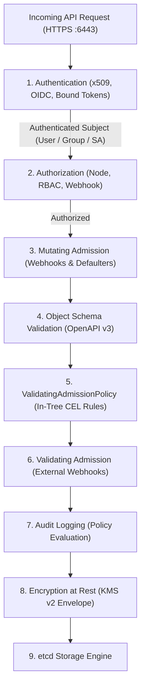
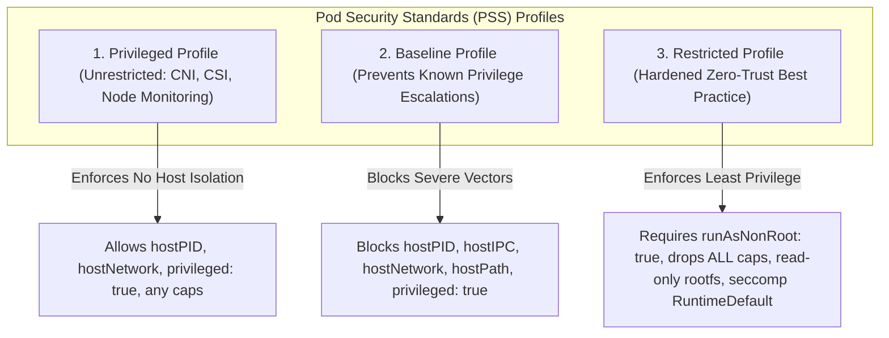
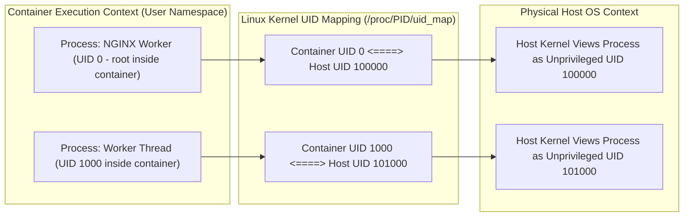
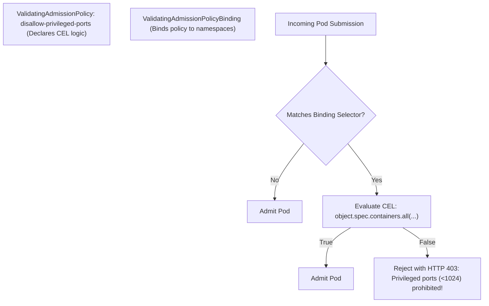
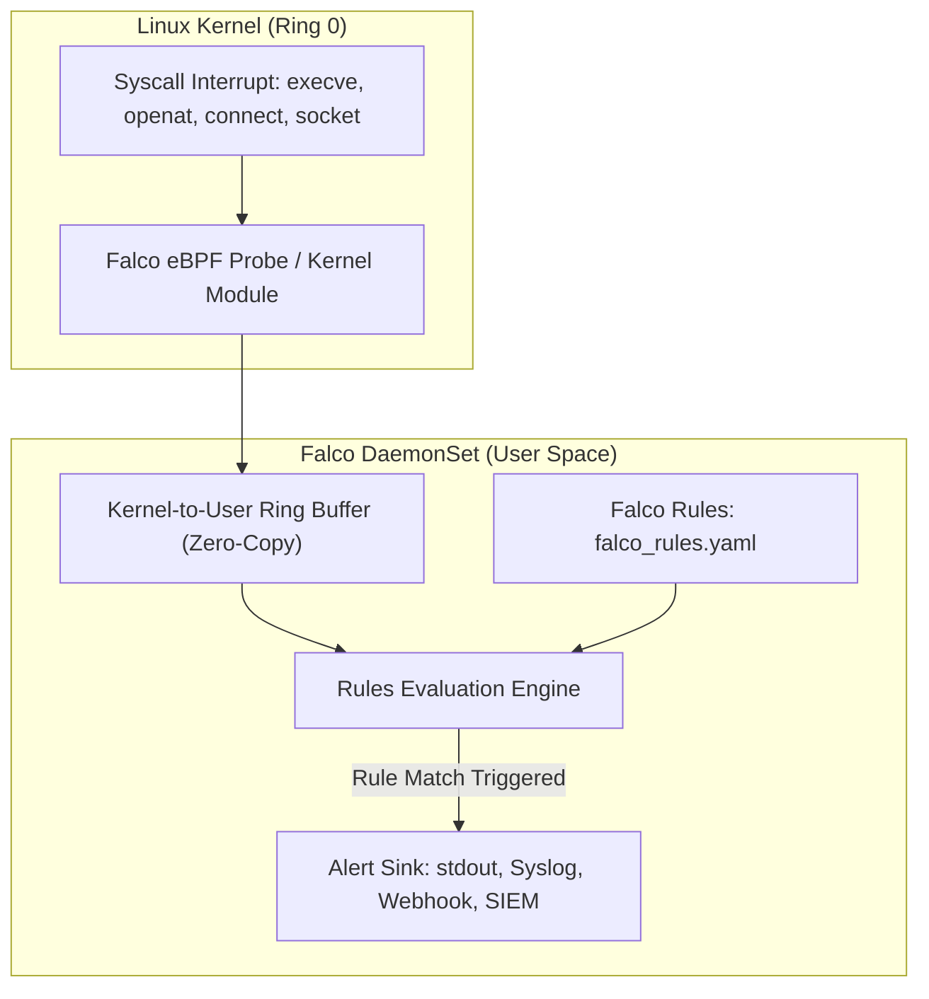
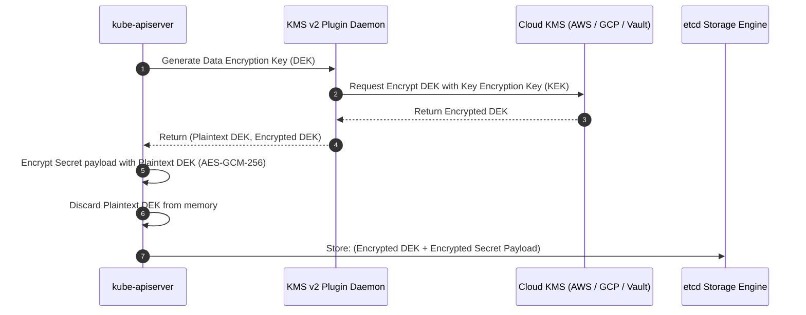

# Module 11: Cluster and Runtime Security (CKS): RBAC, Pod Security Standards, User Namespaces, CEL Admission, Audit Logs, and Falco

> **Primary sources:** CNCF Certified Kubernetes Security Specialist (CKS) Curriculum ([v1.34](https://github.com/cncf/curriculum)); Kubernetes Documentation ([RBAC Authorization](https://kubernetes.io/docs/reference/access-authn-authz/rbac/), [Pod Security Standards](https://kubernetes.io/docs/concepts/security/pod-security-standards/), [User Namespaces GA in v1.36](https://kubernetes.io/docs/concepts/workloads/pods/user-namespaces/), [ValidatingAdmissionPolicy](https://kubernetes.io/docs/reference/access-authn-authz/validating-admission-policy/), [Audit Logging](https://kubernetes.io/docs/tasks/debug/debug-cluster/audit/)); Falco Documentation ([Rules & Architecture](https://falco.org/docs/)); CIS Kubernetes Benchmark ([v1.8.0](https://www.cisecurity.org/benchmark/kubernetes)).
>
> **Executable proof:** [`examples/ts/11-security-hardening-and-cks.test.ts`](../examples/ts/11-security-hardening-and-cks.test.ts) asserts RBAC graph reachability, Pod Security Standard admission rejections, CEL policy evaluation, and Falco rule AST matching.
>
> **Cross-track foundations:** See [`../../../architecture/security-identity/modules/10-authorization-models.md`](../../../architecture/security-identity/modules/10-authorization-models.md) for RBAC/ABAC formal theory, [`../../containers/modules/12-security-and-supply-chain.md`](../../containers/modules/12-security-and-supply-chain.md) for container runtime hardening and provenance, [`../../containers/modules/02-linux-namespaces.md`](../../containers/modules/02-linux-namespaces.md) for Linux user namespace kernel primitives, and [`../../terraform/modules/08-testing-and-policy-as-code.md`](../../terraform/modules/08-testing-and-policy-as-code.md) for shared policy-as-code theory across OPA, CEL, and Kyverno.

---

## 1. Formal Foundations: The 4C Security Model and Request Pipeline

Securing containerized workloads requires applying layered defense across the **4Cs of Cloud Native Security**: Cloud, Cluster, Container, and Code. A compromise at any outer layer invalidates the defensive guarantees of the inner layers.

Within the Kubernetes cluster boundary, every state mutation or query must traverse the **`kube-apiserver` Request Pipeline** before persisting to `etcd`:



---

## 2. Authentication and Bound ServiceAccount Tokens

Kubernetes authenticates two classes of identities: Human Users (managed externally via X.509 client certificates, OIDC identity providers, or cloud IAM) and ServiceAccounts (managed natively inside the cluster for automated processes).

### 2.1 The Insecurity of Legacy ServiceAccount Tokens

Prior to Kubernetes v1.21, creating a `ServiceAccount` automatically generated a permanent, non-expiring Secret containing a static JWT token signed by `sa.key`. These legacy tokens suffered from four catastrophic security vulnerabilities:

1. **Infinite Lifetime**: The token remained valid indefinitely until manually deleted. A leaked token in Git or CI/CD logs compromised the cluster indefinitely.
2. **Unbounded Audience**: The token could be used against any service or API server that trusted the signing key, enabling token relay attacks.
3. **No Object Binding**: Tokens were not bound to the Pod instance; if a Pod was destroyed, the stolen token retained its permissions.
4. **Secret Proliferation**: Every namespace accumulated dozens of static Secret objects, increasing etcd storage footprint and RBAC exposure.

### 2.2 Modern Architecture: Bound ServiceAccount Tokens

Modern Kubernetes uses **Bound ServiceAccount Tokens** generated via the `TokenRequest` API:

```yaml
apiVersion: v1
kind: Pod
metadata:
  name: hardened-app
  namespace: prod
spec:
  serviceAccountName: backend-worker
  containers:
    - name: worker
      image: alpine:3.20
      volumeMounts:
        - name: bound-sa-token
          mountPath: /var/run/secrets/tokens
  volumes:
    - name: bound-sa-token
      projected:
        sources:
          - serviceAccountToken:
              path: token
              expirationSeconds: 3600
              audience: 'https://vault.internal.net'
```

Bound tokens provide three cryptographically enforced security invariants:

- **Time-Bound**: Mandatory expiration (default 1 hour, maximum 24 hours). The `kubelet` automatically rotates the projected token on disk at 80% of its lifetime without restarting the container.
- **Audience-Bound (`aud`)**: The JWT `aud` claim restricts token usability to specific downstream target services (e.g., Vault or AWS STS), rejecting relay attempts to the Kubernetes API server.
- **Object-Bound**: The token is cryptographically bound to the specific Pod UID. If the Pod is terminated, the `kube-apiserver` immediately rejects the token, even if its timestamp has not expired.

---

## 3. Least-Privilege Authorization (RBAC) Hardening

Role-Based Access Control (RBAC) grants permissions based on subjects, roles, and bindings.

### 3.1 Privileged and Dangerous RBAC Verbs

Certain permissions in Kubernetes provide immediate paths to full cluster takeover (`privilege escalation`):

| Resource & Verb | Security Vulnerability | Exploit Mechanism |
| :-- | :-- | :-- |
| `pods/exec` (`create`) | **Direct Host / Container Takeover** | Attacker executes arbitrary shell commands inside any target container (e.g. stealing DB credentials or accessing cloud metadata). |
| `secrets` (`get`, `list`) | **Credential Exfiltration** | Attacker reads plaintext tokens, database passwords, or TLS private keys across the namespace. |
| `nodes/proxy` (`create`) | **Kubelet API Takeover** | Bypasses API server authorization to execute commands directly against kubelet endpoints on port 10250. |
| `serviceaccounts/token` (`create`) | **Impersonation Token Generation** | Attacker issues themselves an arbitrary long-lived token for any high-privileged ServiceAccount in the namespace. |
| `roles` / `clusterroles` (`bind`, `escalate`) | **Privilege Escalation** | Bypasses the RBAC escalation prevention check, allowing an attacker to grant themselves `cluster-admin` privileges. |
| `users` / `groups` (`impersonate`) | **Identity Spoofing** | Attacker instructs the API server to execute requests under the identity of `system:masters`. |

### 3.2 Least-Privilege Role Example

```yaml
apiVersion: rbac.authorization.k8s.io/v1
kind: Role
metadata:
  name: deployment-operator
  namespace: payment
rules:
  - apiGroups: ['apps']
    resources: ['deployments']
    verbs: ['get', 'list', 'watch', 'update', 'patch']
  - apiGroups: ['']
    resources: ['pods']
    verbs: ['get', 'list', 'watch']
```

---

## 4. Pod Security Standards (PSS) and Admission (PSA)

Following the removal of `PodSecurityPolicy` (PSP) in Kubernetes v1.25, **Pod Security Admission (PSA)** provides built-in, out-of-the-box admission control enforcing the **Pod Security Standards (PSS)**.



### 4.1 Namespace Configuration Modes

Pod Security Admission is applied declaratively via namespace labels across three execution modes:

- **`enforce`**: Pods violating the standard are immediately rejected at admission.
- **`audit`**: Violations are allowed, but an audit event is logged in the apiserver audit trail.
- **`warn`**: Violations are allowed, but a warning message is returned to the user running `kubectl`.

```yaml
apiVersion: v1
kind: Namespace
metadata:
  name: production-secure
  labels:
    pod-security.kubernetes.io/enforce: restricted
    pod-security.kubernetes.io/enforce-version: v1.37
    pod-security.kubernetes.io/audit: restricted
    pod-security.kubernetes.io/warn: restricted
```

### 4.2 Compliant Restricted Pod Specification

To pass admission under the `Restricted` profile, every container in the Pod must satisfy strict `securityContext` constraints:

```yaml
apiVersion: v1
kind: Pod
metadata:
  name: zero-trust-microservice
  namespace: production-secure
spec:
  securityContext:
    runAsNonRoot: true
    seccompProfile:
      type: RuntimeDefault
    appArmorProfile:
      type: RuntimeDefault
  containers:
    - name: api
      image: cgr.dev/chainguard/static:latest@sha256:4549f4b3614068305f884611598f86f36307fa91cdb154a4eb18f9df0d8a9df9
      securityContext:
        allowPrivilegeEscalation: false
        readOnlyRootFilesystem: true
        capabilities:
          drop:
            - ALL
      volumeMounts:
        - name: tmp-scratch
          mountPath: /tmp
  volumes:
    - name: tmp-scratch
      emptyDir: {}
```

---

## 5. User Namespaces: Kernel-Level Privilege Decoupling (GA in v1.36)

Even with non-root containers, container isolation relies on the host Linux kernel. If an attacker exploits a local privilege escalation bug in the kernel (e.g., Dirty Pipe, io_uring vulnerabilities) or escapes via an insecure volume mount, the container's UID 0 maps directly to UID 0 (root) on the physical host.

Promoted to **General Availability (GA) in Kubernetes v1.36**, **User Namespaces** decouple container UIDs/GIDs from the host operating system.



### 5.1 Declarative Pod Configuration

To isolate a Pod within its own dedicated user namespace:

```yaml
apiVersion: v1
kind: Pod
metadata:
  name: userns-isolated-pod
  namespace: production-secure
spec:
  hostUsers: false
  containers:
    - name: legacy-workload
      image: ubuntu:24.04
      command: ['sleep', 'infinity']
```

Setting `hostUsers: false` instructs the container runtime (containerd 2.0+ / CRI-O) to allocate an unmapped host UID/GID range (e.g., 100000–165535). Inside the container, the application believes it is running as root (UID 0) and can execute operations such as binding privileged ports or configuring package managers. However, if the process breaks out of the container boundary, the host kernel treats it as an unprivileged, unmapped UID with zero host permissions.

---

## 6. Declarative Admission: ValidatingAdmissionPolicy (In-Tree CEL)

Prior to Kubernetes v1.26, custom policy enforcement required deploying external validating admission webhooks (e.g., OPA Gatekeeper, Kyverno). External webhooks introduce severe availability risks: if the webhook Pod crashes, network timeouts occur, or the webhook's certificate expires, the entire cluster becomes unable to create or update Pods.

**`ValidatingAdmissionPolicy`** evaluates policies directly inside `kube-apiserver` using the **Common Expression Language (CEL)** without network round-trips.



### 6.1 Concrete Policy Definition

```yaml
apiVersion: admissionregistration.k8s.io/v1
kind: ValidatingAdmissionPolicy
metadata:
  name: disallow-privileged-ports
spec:
  failurePolicy: Fail
  matchConstraints:
    resourceRules:
      - apiGroups: ['']
        apiVersions: ['v1']
        operations: ['CREATE', 'UPDATE']
        resources: ['pods']
  validations:
    - expression: >
        object.spec.containers.all(c,
          !has(c.ports) || c.ports.all(p, p.containerPort >= 1024)
        )
      message: 'Security Violation: Binding container ports below 1024 is prohibited.'
---
apiVersion: admissionregistration.k8s.io/v1
kind: ValidatingAdmissionPolicyBinding
metadata:
  name: enforce-disallow-privileged-ports
spec:
  policyName: disallow-privileged-ports
  validationActions: [Deny]
  matchResources:
    namespaceSelector:
      matchExpressions:
        - key: environment
          operator: In
          values: ['staging', 'production']
```

---

## 7. Audit Logging Architecture

Kubernetes audit logging records every chronological sequence of activities affecting cluster state.

### 7.1 Audit Levels and Stages

Audit logging operates across four progressive **Levels**:

- **`None`**: Do not log events matching this rule.
- **`Metadata`**: Log request metadata (requesting user, timestamp, resource, verb, namespace), but omit request/response bodies.
- **`Request`**: Log metadata and the submitted request body, but omit the response body.
- **`RequestResponse`**: Log metadata, request body, and response body (highest fidelity; high disk I/O).

Events are captured across four **Stages**: `RequestReceived`, `ResponseStarted`, `ResponseComplete`, `Panic`.

### 7.2 Hardened Production Audit Policy

```yaml
apiVersion: audit.k8s.io/v1
kind: Policy
rules:
  # 1. Drop noisy read/watch requests from system daemons
  - level: None
    users: ['system:kube-proxy', 'system:nodes']
    verbs: ['watch', 'get', 'list']

  # 2. Drop high-frequency endpoint and lease heartbeats
  - level: None
    resources:
      - group: ''
        resources: ['endpoints']
      - group: 'coordination.k8s.io'
        resources: ['leases']

  # 3. Log Secret and ConfigMap modifications at Metadata level (never log secret bodies!)
  - level: Metadata
    resources:
      - group: ''
        resources: ['secrets', 'configmaps']

  # 4. Log all mutating RBAC changes at RequestResponse level
  - level: RequestResponse
    resources:
      - group: 'rbac.authorization.k8s.io'
        resources: ['roles', 'rolebindings', 'clusterroles', 'clusterrolebindings']

  # 5. Default catch-all for remaining workloads
  - level: Metadata
    omitStages:
      - 'RequestReceived'
```

Configure `kube-apiserver` flags:

```text
--audit-policy-file=/etc/kubernetes/audit-policy.yaml
--audit-log-path=/var/log/kubernetes/audit.log
--audit-log-maxage=30
--audit-log-maxbackup=10
--audit-log-maxsize=100
```

---

## 8. Runtime Threat Detection: Falco and CIS Benchmarks

Static admission checks cannot detect runtime compromises occurring after container startup (e.g., zero-day exploitation, reverse shells, fileless in-memory attacks).

### 8.1 Falco Runtime Monitoring Architecture

**Falco** is the CNCF standard runtime security engine. It intercepts Linux kernel system calls using an **eBPF probe** or a kernel module (`falco.ko`), evaluating every syscall against a behavioral rules engine in user space.



### 8.2 Custom Falco Rule: Detecting Shell Execution Inside Production Pods

```yaml
- rule: Terminal Shell in Production Container
  desc: Detects interactive bash/sh execution inside containers running in production namespaces
  condition: >
    spawned_process and container and k8s.ns.name in (production, prod-payment) and proc.name in (bash, sh, zsh, ash, csh)
  output: >
    CRITICAL: Interactive shell spawned in production container (user=%user.name pod=%k8s.pod.name ns=%k8s.ns.name cmd=%proc.cmdline image=%container.image.repository)
  priority: CRITICAL
  tags: [container, shell, mitre_execution]
```

### 8.3 Automated CIS Hardening: `kube-bench`

`kube-bench` is an automated scanner that audits running nodes against the official **CIS Kubernetes Benchmark**. It inspects file ownership, file permissions, and executable flags across all Kubernetes control plane and worker components:

```bash
# Run CIS audit against control plane node
kube-bench run --targets master

# Key automated checks executed:
# [PASS] 1.1.1 Ensure that the API server pod specification file permissions are set to 600 or more restrictive
# [PASS] 1.1.2 Ensure that the API server pod specification file ownership is set to root:root
# [PASS] 1.2.6 Ensure that the --authorization-mode argument includes Node,RBAC
# [PASS] 1.2.18 Ensure that the --insecure-port argument is not set
```

---

## 9. Secrets Encryption at Rest: KMS v2 Envelope Encryption

By default, Kubernetes stores Secret objects as base64-encoded strings directly inside `etcd` in **plaintext**. Anyone gaining physical access to etcd backups, disk snapshots, or the etcd network port can read all cluster secrets.

### 9.1 Envelope Encryption Architecture

Kubernetes supports encryption at rest via an `EncryptionConfiguration` using the **KMS v2 provider**:



1. **Envelope Encryption Pattern**: The API server generates an ephemeral local **Data Encryption Key (DEK)** to encrypt the Secret payload using AES-GCM-256.
2. The DEK is encrypted using a **Key Encryption Key (KEK)** residing securely inside a hardware security module (HSM) or cloud KMS (AWS KMS, Google Cloud KMS, HashiCorp Vault).
3. The encrypted DEK and encrypted payload are stored together in `etcd`. Compromising the etcd database yields zero usable plaintext.

### 9.2 EncryptionConfiguration Manifest

```yaml
apiVersion: apiserver.config.k8s.io/v1
kind: EncryptionConfiguration
resources:
  - resources:
      - secrets
    providers:
      - kms:
          apiVersion: v2
          name: aws-kms-provider
          endpoint: unix:///var/run/kmsplugin/socket.sock
          timeout: 3s
      - aescbc:
          keys:
            - name: fallback-key
              secret: c2VjcmV0IGlzIGhpZ2hseSBzZWN1cmUgMTIzNDU2Nzg=
      - identity: {}
```

---

## 10. Mathematical Model: CEL Admission Policy Evaluation Engine

```text
Algorithm: Evaluate_Admission_Policy(Request req, Policy policy)
Input: AdmissionRequest req (resource, operation, object, userInfo), ValidatingAdmissionPolicy policy
Output: AdmissionDecision (Admit or Deny with message)

Invariant 1: All expressions in policy.validations must evaluate to boolean true for admission.
Invariant 2: Evaluation halts immediately on first Deny if failurePolicy = Fail.

1:  if not MatchesConstraints(req, policy.spec.matchConstraints) then
2:      return Decision(Admit)
3:  end if
4:
5:  evalContext ← InitializeCELContext(
6:      "object": req.object,
7:      "oldObject": req.oldObject,
8:      "request": req,
9:      "params": ResolveParams(policy.spec.paramKind, req.namespace)
10: )
11:
12: for each validation in policy.spec.validations do
13:     result ← EvaluateCEL(validation.expression, evalContext)
14:     if result ≠ true then
15:         message ← FormatMessage(validation.message, evalContext)
16:         return Decision(Deny, message)
17:     end if
18: end for
19:
20: return Decision(Admit)
```

---

## 11. Then vs. Now: Kubernetes Security Evolution

| Security Dimension | Legacy Kubernetes (v1.18–v1.24) | Modern Hardened Kubernetes (v1.34–v1.37) |
| :-- | :-- | :-- |
| **Pod Policy Engine** | `PodSecurityPolicy` (PSP) with silent mutation hazards | `PodSecurityAdmission` (PSA) + `ValidatingAdmissionPolicy` (CEL) |
| **Admission Webhooks** | Out-of-tree webhooks causing cluster-wide boot lockouts | In-tree CEL evaluation directly in `kube-apiserver` |
| **ServiceAccount Tokens** | Indefinite lifetime, unbounded audience, non-rotated | Time-bound, audience-restricted, pod-bound projected tokens |
| **Container Root Defense** | Root in container was root on host; seccomp Unconfined | User Namespaces (`hostUsers: false`) + `seccomp: RuntimeDefault` |
| **AppArmor Management** | Insecure string annotations (`apparmor.kubernetes.io/*`) | Native `securityContext.appArmorProfile` field (GA in v1.30) |
| **etcd Encryption** | KMS v1 with single-key bottlenecks | KMS v2 with envelope encryption and automated key rotation |

---

## 12. Exam Delta: CKS v1.34 Curriculum Alignment

Candidates preparing for the **Certified Kubernetes Security Specialist (CKS)** must recognize the explicit curriculum version boundary:

> [!NOTE]
> **CKS Curriculum Lags at Kubernetes v1.34**: While CKA and CKAD have moved to Kubernetes v1.37, the official CNCF CKS exam remains anchored to **v1.34**.
>
> **Core Tested Domains in CKS v1.34**:
>
> 1. **Cluster Hardening (15%)**: RBAC least-privilege, securing the apiserver, configuring CIS benchmark fixes (`kube-bench`), rotating certificates.
> 2. **Cluster Setup (15%)**: Restricting network access via NetworkPolicy, auditing apiserver configuration, configuring Encryption at Rest with `EncryptionConfiguration`.
> 3. **Minimize Microservice Vulnerabilities (20%)**: Pod Security Standards (`Baseline` and `Restricted` labels), AppArmor profiles, seccomp profiles, and `securityContext` hardening.
> 4. **Supply Chain Security (20%)**: Static analysis of Dockerfiles, scanning container images for vulnerabilities using **Trivy**, verifying image signatures.
> 5. **Monitoring, Logging & Runtime Security (20%)**: Configuring and parsing `kube-apiserver` audit logs, writing custom **Falco** rules to detect suspicious syscall activity.
>
> _Exam Note_: User Namespaces (`hostUsers: false`) reached GA in v1.36 and are therefore NOT scored in CKS v1.34 practical exam tasks, but remain essential knowledge for modern production deployments.

---

## 13. Production Failure Modes & Operational Gotchas

### 13.1 Audit Log Disk Saturation Crashing the Control Plane

**Mechanism**: An operator configures `level: RequestResponse` globally across all resources without exclusions. High-frequency controller watch calls and container status updates generate gigabytes of log lines per minute. **Symptom**: The root partition `/var/log` runs out of inodes or free disk space. The local Linux host freezes, killing `kube-apiserver` and `etcd`. **Remediation**: Always place high-throughput daemons (`kube-proxy`, `kubelet`, `endpoints`, `leases`) into `level: None` at the top of the audit policy file, and enforce `--audit-log-maxsize` and `--audit-log-maxbackup`.

### 13.2 Validating Webhook Mutating Lockout Loop

**Mechanism**: An external admission webhook is deployed with `failurePolicy: Fail` to enforce organizational policies. During a cluster restart, the webhook's own Pod must be created. **Symptom**: The API server attempts to contact the webhook to validate the webhook's own Pod. Because the webhook is not running yet, the request times out and fails. The webhook Pod is rejected by its own admission rule, deadlocking all pod creation across the cluster. **Remediation**: Always exempt system namespaces (`kube-system`) and the webhook's own namespace from admission webhooks using `namespaceSelector` match expressions.

### 13.3 Read-Only Root Filesystem Application Crashes

**Mechanism**: An engineer applies `readOnlyRootFilesystem: true` to satisfy PSS Restricted. The application container boots, attempts to write an ephemeral PID file or cache to `/var/run` or `/tmp`, and immediately crashes with `EROFS: Read-only file system`. **Remediation**: Mount an ephemeral, in-memory `emptyDir` volume specifically at the application's required write locations:

```yaml
volumeMounts:
  - name: app-cache
    mountPath: /tmp
volumes:
  - name: app-cache
    emptyDir: {}
```

---

## 14. Concrete Configuration Reference: Hardened Production Namespace & Workload

The following unified manifest establishes a fully hardened multi-tenant boundary, combining Pod Security Admission, RBAC, and container runtime restrictions:

```yaml
# 1. Hardened Production Namespace
apiVersion: v1
kind: Namespace
metadata:
  name: payment-secure-tier
  labels:
    pod-security.kubernetes.io/enforce: restricted
    pod-security.kubernetes.io/enforce-version: v1.37
    pod-security.kubernetes.io/warn: restricted
---
# 2. Least-Privilege ServiceAccount
apiVersion: v1
kind: ServiceAccount
metadata:
  name: payment-service-sa
  namespace: payment-secure-tier
automountServiceAccountToken: false
---
# 3. Hardened Workload with Projected Token & User Namespaces
apiVersion: apps/v1
kind: Deployment
metadata:
  name: payment-api
  namespace: payment-secure-tier
spec:
  replicas: 2
  selector:
    matchLabels:
      app: payment-api
  template:
    metadata:
      labels:
        app: payment-api
    spec:
      serviceAccountName: payment-service-sa
      hostUsers: false
      securityContext:
        runAsNonRoot: true
        runAsUser: 10001
        runAsGroup: 10001
        fsGroup: 10001
        seccompProfile:
          type: RuntimeDefault
      containers:
        - name: server
          image: cgr.dev/chainguard/static:latest@sha256:4549f4b3614068305f884611598f86f36307fa91cdb154a4eb18f9df0d8a9df9
          securityContext:
            allowPrivilegeEscalation: false
            readOnlyRootFilesystem: true
            capabilities:
              drop:
                - ALL
          volumeMounts:
            - name: vault-token
              mountPath: /var/run/secrets/tokens
            - name: tmp-dir
              mountPath: /tmp
      volumes:
        - name: tmp-dir
          emptyDir: {}
        - name: vault-token
          projected:
            sources:
              - serviceAccountToken:
                  path: token
                  expirationSeconds: 3600
                  audience: 'https://vault.company.internal'
```

---

## Interview Drill

<details><summary>1. What is the fundamental difference between legacy ServiceAccount tokens and modern Bound ServiceAccount Tokens, and why are legacy tokens a severe security liability?</summary>

Legacy tokens were static, non-expiring JWTs stored as standard `Secret` objects in `etcd`. They possessed infinite validity, had no audience restrictions (`aud`), and were not cryptographically bound to the lifecycle of the Pod consuming them. If an attacker exfiltrated a legacy token, they retained unauthorized API access indefinitely until an administrator manually discovered and deleted the Secret.

Modern Bound ServiceAccount Tokens (generated via the `TokenRequest` API) are short-lived (default 1 hour), projected directly into container memory without creating static Secrets, restricted to specific target audiences (preventing token relay attacks), and cryptographically bound to the Pod's UID. When the Pod terminates, the API server immediately rejects the token even if its expiration timestamp has not elapsed.
</details>

<details><summary>2. How do User Namespaces (promoted to GA in Kubernetes v1.36) protect the host node from container breakout vulnerabilities?</summary>

In traditional Linux containers without user namespaces, UID 0 (root) inside the container is identical to UID 0 (root) on the host kernel. If an attacker escapes the container filesystem (via a kernel exploit or dangerous host mount), they arrive on the host with full root privileges.

User Namespaces (`hostUsers: false`) map the container's UID/GID space to an unprivileged range on the host (e.g., container UID 0 maps to host UID 100000). While the process operates as root inside the container boundary, the host kernel views and constrains every syscall under the unprivileged host UID. If the process breaks out, it possesses zero administrative privileges on the host system.
</details>

<details><summary>3. Why is `ValidatingAdmissionPolicy` (CEL) architecturally superior to deploying external admission webhooks like OPA Gatekeeper?</summary>

External admission webhooks execute as HTTP servers inside or outside the cluster. When evaluating high-throughput object mutations, external webhooks introduce network latency, TLS certificate expiration hazards, and catastrophic single-point-of-failure risks: if the webhook Pod is down and `failurePolicy: Fail` is configured, the cluster cannot create or update any resources.

`ValidatingAdmissionPolicy` evaluates rules in-tree directly within the `kube-apiserver` process using the Common Expression Language (CEL). It executes in microseconds with zero network overhead, has no external dependencies, eliminates webhook deadlock loops during cluster bootstrap, and requires no auxiliary controllers.
</details>

<details><summary>4. In RBAC, what is the danger of granting a user the `escalate` verb on `roles` or `clusterroles`?</summary>

By design, Kubernetes RBAC prevents privilege escalation: an API user cannot create or update a Role containing permissions that the user does not personally already possess.

Granting the `escalate` verb explicitly bypasses this security check. A user with `escalate` permissions on `clusterroles` can create a new ClusterRole granting `*` on `*` (cluster-admin) or add dangerous permissions to their own role, escalating their privileges to full cluster compromise.
</details>

<details><summary>5. What are the three profiles defined in the Pod Security Standards (PSS), and what is the key difference between Baseline and Restricted?</summary>

The three PSS profiles are:

1. **`Privileged`**: Completely unrestricted; permits host namespaces, privileged containers, and raw device access (intended for system CNI/CSI daemons).
2. **`Baseline`**: Prevents known privilege escalations with minimal application friction. Disallows privileged mode, `hostPID`, `hostIPC`, `hostNetwork`, and `hostPath` mounts, but allows containers to run as root by default.
3. **`Restricted`**: Hardened Zero-Trust profile. In addition to Baseline rules, it strictly requires `runAsNonRoot: true`, drops all Linux capabilities except `NET_BIND_SERVICE`, enforces `readOnlyRootFilesystem: true`, restricts volume types to safe primitives, and requires `seccompProfile: RuntimeDefault`.
</details>

<details><summary>6. How does Falco detect runtime container compromises, and what is the difference between its eBPF probe and kernel module?</summary>

Falco intercepts low-level Linux kernel system calls (such as `execve`, `openat`, `socket`, `ptrace`) at the operating system boundary and evaluates them against declarative rules to detect abnormal behavior (e.g., spawning a shell inside a container, modifying `/etc/shadow`, opening outbound connections to cloud metadata endpoints).

- **Kernel Module (`falco.ko`)**: A traditional dynamically loadable kernel module inserted into the host kernel. Offers high performance but requires kernel headers matching the exact host OS and carries stability risks if a panic occurs.
- **eBPF Probe**: Modern, safe architecture. Runs sandboxed eBPF bytecode verified by the kernel's in-tree eBPF verifier before execution. It cannot crash the host kernel, supports modern immutable distributions, and functions in environments where custom kernel module loading is prohibited.
</details>

<details><summary>7. What is envelope encryption in the context of Kubernetes Secrets encryption at rest with KMS v2?</summary>

Envelope encryption is a two-tier cryptographic architecture that avoids sending sensitive data payloads over the network to external key management services:

1. The `kube-apiserver` generates a local, random symmetric **Data Encryption Key (DEK)** to encrypt the Secret payload locally using AES-GCM.
2. The apiserver sends only the small DEK to an external Key Management Service (KMS, such as AWS KMS or HashiCorp Vault), which encrypts the DEK using a master **Key Encryption Key (KEK)** residing securely inside an HSM.
3. The encrypted DEK and the encrypted payload are stored together in `etcd`. To decrypt, the apiserver requests the KMS to decrypt the DEK, and then uses the decrypted DEK in memory to read the Secret.
</details>

---

## 16. Proof Map and Verification

The formal security models, RBAC graph traversals, and CEL policy expressions detailed in this module are verified by test suites in [`examples/ts/11-security-hardening-and-cks.test.ts`](../examples/ts/11-security-hardening-and-cks.test.ts):

- **RBAC Reachability & Escalation Verification**: Models the Kubernetes RBAC graph to assert that subjects without `escalate` or `bind` cannot elevate their effective permissions.
- **Pod Security Admission State Transitions**: Evaluates candidate Pod manifests against `Privileged`, `Baseline`, and `Restricted` profile schemas, validating automated rejection logic.
- **CEL Expression Engine**: Implements the Common Expression Language AST evaluator to assert that non-compliant container ports and missing drop capabilities trigger expected admission denials.
- **Falco Syscall Rule AST Matching**: Tests rule condition evaluation across simulated Linux system call event streams, asserting alert generation upon unauthorized process execution.
