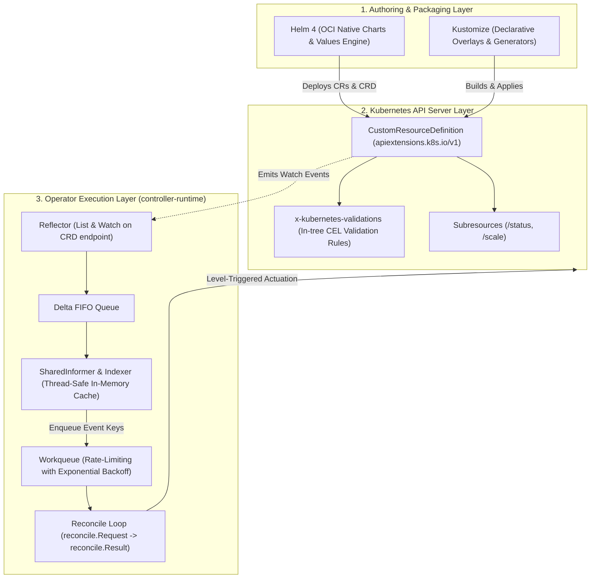
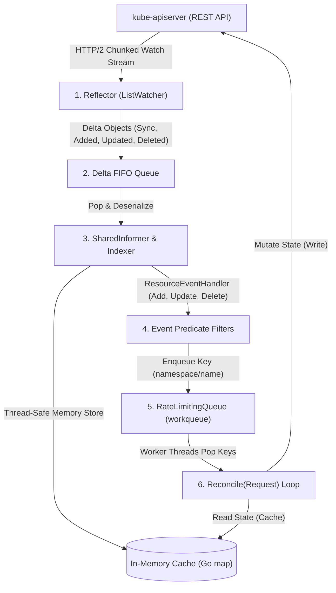
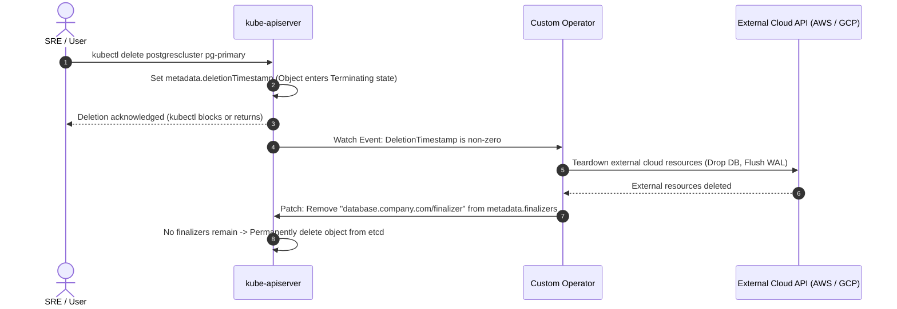
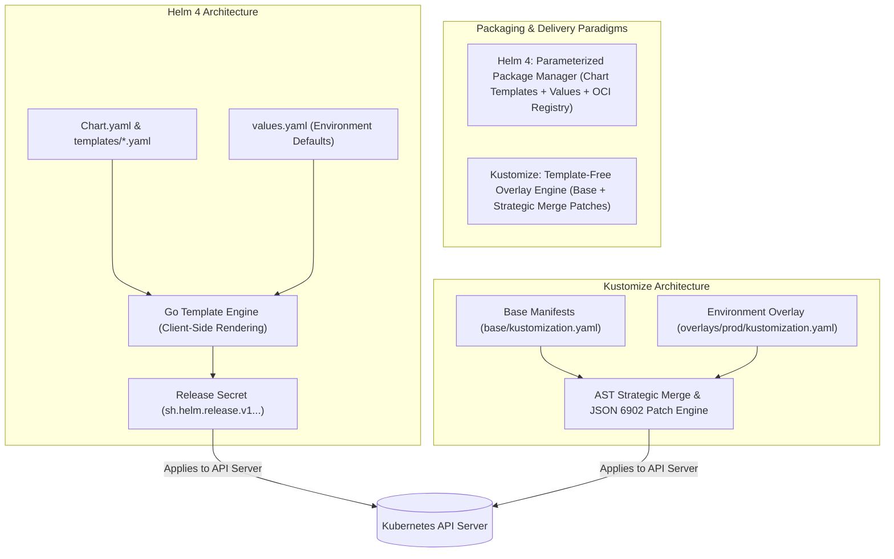

# Module 12: Extending Kubernetes: CustomResourceDefinitions, CEL Validation, Operator Pattern, Helm 4, and Kustomize

> **Primary sources:** Kubernetes API Reference ([CustomResourceDefinitions](https://kubernetes.io/docs/reference/kubernetes-api/extend-resources/custom-resource-definition-v1/)); Kubernetes Enhancement Proposals ([KEP-2876: CRD Validation Rules with CEL](https://github.com/kubernetes/enhancements/issues/2876)); Kubebuilder Documentation ([The Kubebuilder Book v4](https://book.kubebuilder.io/)); Helm Documentation ([Helm 4 Architecture & Specification](https://helm.sh/docs/)); Kustomize Documentation ([SIG-CLI Declarative Application Management](https://kubectl.docs.kubernetes.io/references/kustomize/)); CNCF Curriculum ([CKA Curriculum v1.37](https://github.com/cncf/curriculum), [CKAD Curriculum v1.37](https://github.com/cncf/curriculum)).
>
> **Executable proof:** [`examples/ts/12-extending-kubernetes-crds-operators-helm.test.ts`](../examples/ts/12-extending-kubernetes-crds-operators-helm.test.ts) asserts CRD structural schema validation, CEL rule evaluation, reconciler workqueue state machines, and Kustomize overlay transformations.
>
> **Cross-track foundations:** See [`../../terraform/modules/08-testing-and-policy-as-code.md`](../../terraform/modules/08-testing-and-policy-as-code.md) for declarative validation and policy-as-code foundations, [`modules/01-declarative-api-and-reconciliation.md`](01-declarative-api-and-reconciliation.md) for level-triggered reconciliation theory, and [`modules/02-control-plane-internals.md`](02-control-plane-internals.md) for `kube-apiserver` watch cache mechanics.

---

## 1. Formal Foundations: The Kubernetes Extensibility Architecture

Kubernetes is not merely an orchestration runtime for containers; it is a universal, declarative distributed state engine. Its true power lies in its **Extensibility Architecture**, which enables platform engineers to introduce domain-specific primitives and automate complex operational lifecycles.

The extension ecosystem operates across two orthogonal dimensions:

1. **Schema Extensibility (Data Plane API)**: Extending the Kubernetes REST API schema with custom domain objects via **CustomResourceDefinitions (CRDs)**.
2. **Behavioral Extensibility (Control Plane Logic)**: Automating application management, state reconciliation, and failover via the **Operator Pattern** (custom controllers observing CRDs).



---

## 2. CustomResourceDefinitions: Structural Schemas and Subresources

A `CustomResourceDefinition` (`apiextensions.k8s.io/v1`) registers new resource types with `kube-apiserver`. Once registered, custom resources behave identically to native primitives: they are stored in `etcd`, validated by OpenAPI v3 schemas, governed by RBAC, and observable via `kubectl`.

### 2.1 The Critical Importance of Subresources

Production CRDs MUST explicitly define the `/status` and `/scale` subresources:

- **`/status` Subresource**:
  - Decouples user intent (`spec`) from controller observations (`status`).
  - When enabled, mutating the main resource endpoint (`PUT /apis/db.company.com/v1/namespaces/default/databases/pg-1`) silently ignores modifications to the `.status` stanza. Updating status requires sending requests to the dedicated subresource endpoint (`PUT .../databases/pg-1/status`).
  - Enables fine-grained RBAC: developers can be granted permission to edit `spec`, while the automated Operator ServiceAccount is restricted to updating `/status`.
  - Increments `metadata.generation` ONLY when `.spec` changes, allowing controllers to avoid redundant reconciliation loops when updating status conditions.
- **`/scale` Subresource**:
  - Exposes standard JSON paths for `specReplicasPath`, `statusReplicasPath`, and `labelSelectorPath`.
  - Enables out-of-the-box integration with `kubectl scale` and the **HorizontalPodAutoscaler (HPA)** without requiring custom autoscaling controllers.

### 2.2 Multi-Version Lifecycle and Conversion Webhooks

A CRD can serve multiple API versions simultaneously (e.g., `v1alpha1`, `v1beta1`, `v1`):

```yaml
spec:
  group: database.company.com
  names:
    kind: PostgresCluster
    plural: postgresclusters
  scope: Namespaced
  versions:
    - name: v1alpha1
      served: true
      storage: false
    - name: v1
      served: true
      storage: true
```

- **`served`**: Controls whether the API server accepts HTTP requests for this version.
- **`storage`**: Exactly **one** version must be marked `storage: true`. All resources, regardless of which version was submitted via `kubectl`, are converted and stored in `etcd` in the designated storage version.
- **Conversion Strategy**:
  - `strategy: None`: Permitted only if the schema across versions is identical (or fields are strictly additive).
  - `strategy: Webhook`: For breaking schema transformations, `kube-apiserver` calls an external conversion webhook to translate between versions in memory upon read and write operations.

---

## 3. Declarative In-Tree Validation: `x-kubernetes-validations` (CEL)

Prior to Kubernetes v1.25, enforcing complex validation logic (e.g., field immutability, relational constraints between multiple fields) required building, deploying, and maintaining admission webhooks.

Under **KEP-2876**, Kubernetes natively supports the **Common Expression Language (CEL)** directly inside OpenAPI v3 schemas via `x-kubernetes-validations`:

```yaml
apiVersion: apiextensions.k8s.io/v1
kind: CustomResourceDefinition
metadata:
  name: postgresclusters.database.company.com
spec:
  group: database.company.com
  names:
    kind: PostgresCluster
    plural: postgresclusters
  scope: Namespaced
  versions:
    - name: v1
      served: true
      storage: true
      subresources:
        status: {}
        scale:
          specReplicasPath: .spec.replicas
          statusReplicasPath: .status.readyReplicas
          labelSelectorPath: .status.selector
      schema:
        openAPIV3Schema:
          type: object
          properties:
            spec:
              type: object
              required: ['replicas', 'storageGb', 'engineVersion']
              x-kubernetes-validations:
                # 1. Relational Rule: Max replicas must be >= replicas
                - rule: 'self.replicas <= self.maxReplicas'
                  message: 'spec.replicas cannot exceed spec.maxReplicas'
                # 2. Immutability Rule: Storage capacity cannot be decreased
                - rule: 'self.storageGb >= oldSelf.storageGb'
                  message: 'Decreasing spec.storageGb is prohibited to prevent data loss'
              properties:
                replicas:
                  type: integer
                  minimum: 1
                maxReplicas:
                  type: integer
                  default: 10
                storageGb:
                  type: integer
                  minimum: 10
                engineVersion:
                  type: string
                  x-kubernetes-validations:
                    # 3. Transition Rule: Major engine downgrades are forbidden
                    - rule: "self == oldSelf || self.matches('^16\\\\.')"
                      message: 'PostgreSQL engine version can only be upgraded to v16.x'
```

CEL validation rules execute directly within the `kube-apiserver` binary in sub-millisecond time, with zero network hops and zero external controller dependencies.

---

## 4. The Operator Pattern: Controller Anatomy & Reconciliation

An **Operator** is an implementation of the Kubernetes Controller pattern that encodes human operational domain knowledge (backup, failover, scaling, automated schema upgrades) into software managing Custom Resources.

### 4.1 Internal Anatomy: From Reflector to Reconciler

A production Kubernetes Operator built with `client-go` and `controller-runtime` consists of five discrete components:



1. **Reflector**: Runs a `ListWatch` HTTP/2 stream against `kube-apiserver`. On startup, it lists all objects to seed the cache, and then maintains an open watch connection receiving incremental delta events.
2. **SharedInformer & Indexer**: Caches the cluster's objects in memory inside a thread-safe data store. When a controller needs to read an object, it queries the local cache instead of hitting `kube-apiserver` and `etcd`.
3. **ResourceEventHandler**: Translates object events into simple namespace/name keys (e.g., `default/my-postgres-cluster`).
4. **Workqueue**: A rate-limiting queue that guarantees:
   - **Deduplication**: If an object changes 10 times in 1 second, only a single key is enqueued.
   - **Exponential Backoff**: If reconciliation fails, re-queuing backs off exponentially (e.g., 5ms $\to$ 100ms $\to$ 1s $\to$ 1min), preventing denial-of-service loops against `kube-apiserver`.
   - **Strict Parallel Isolation**: A single object key is never processed concurrently by multiple worker threads.

### 4.2 Invariant Guarantees of the Reconcile Function

The core reconciler signature in `controller-runtime` is:

```go
func (r *PostgresReconciler) Reconcile(ctx context.Context, req reconcile.Request) (reconcile.Result, error)
```

The reconciliation loop must adhere to four strict operational invariants:

- **Level-Triggered, Not Edge-Triggered**: The reconciler receives only the resource key (`namespace/name`), NOT the event delta. It must query the current observed state, compare it with the desired state, and execute whatever idempotent actions are necessary to reconcile reality with declaration.
- **Idempotence**: Running `Reconcile` 1 time or 1,000 consecutive times on an unchanged cluster must yield identical results with zero side-effects.
- **Concurrency & Conflict Resolution**: Reconcilers must anticipate `HTTP 409 Conflict` errors caused by optimistic concurrency control (`metadata.resourceVersion`). Updates must fetch the latest object and retry upon collision.
- **Leader Election**: In multi-replica deployments, controllers acquire a distributed lock via the `coordination.k8s.io/v1` `Lease` API to guarantee that exactly one controller instance actively reconciles at any given moment.

---

## 5. OwnerReferences and Finalizers

Automating resource lifecycles requires managing garbage collection and cleanup dependencies.

### 5.1 OwnerReferences and Cascading Deletion

When an Operator creates child resources (e.g., Deployments, Services, PVCs) on behalf of a Custom Resource, it sets an `OwnerReference`:

```go
ctrl.SetControllerReference(customRes, childDeployment, r.Scheme)
```

```yaml
ownerReferences:
  - apiVersion: database.company.com/v1
    kind: PostgresCluster
    name: pg-primary
    uid: a891f7c2-3e4b-4812-9c10-0987abcdef01
    controller: true
    blockOwnerDeletion: true
```

When the parent `PostgresCluster` is deleted, Kubernetes garbage collection automatically performs cascading deletion, deleting all associated child resources in either `Foreground` or `Background` mode.

### 5.2 Finalizers: Pre-Delete Lifecycle Hooks

If an Operator must execute external cleanup actions before a Kubernetes resource is deleted (e.g., releasing an external cloud database, deleting an AWS Route53 DNS record, or detaching a SAN LUN), it attaches a **Finalizer**:



> [!WARNING]
> **The Deadlocked Namespace Failure Mode**: If an Operator crashes, is uninstalled, or lacks the RBAC permissions to clean up external dependencies, a custom resource with an active finalizer will remain stuck in `Terminating` indefinitely. Because the parent resource cannot be removed, the containing Kubernetes namespace will also remain stuck in `Terminating` forever.

---

## 6. Packaging & Deployment: Helm 4 vs. Kustomize

Deploying complex Kubernetes applications across environments requires declarative packaging tools.



### 6.1 Architectural Comparison

| Architectural Dimension | Helm 4 (Current Major Release, v4.3.1) | Kustomize (v5.8.3 / Native `kubectl -k`) |
| :-- | :-- | :-- |
| **Philosophy** | Dynamic parameterization via Go templates | Template-free declarative overlays and strategic AST patching |
| **Artifact Distribution** | First-class OCI registry packaging (`oci://registry/charts/app`) | Standard Git repositories, folders, or remote tarballs |
| **Lifecycle & State** | Manages full lifecycle (install, upgrade, rollback) via release Secrets | Stateless transform compiler; state management delegated to GitOps |
| **Configuration Model** | Untyped template strings; indentation whitespace sensitive | 100% valid, lintable plain Kubernetes YAML at every layer |
| **Secret Generation** | Static templates or manual secret management | Native `secretGenerator` & `configMapGenerator` with automated content hashing |
| **Dependency Resolution** | Declared subcharts resolved via `Chart.lock` | Composable `components` and remote Git URL inclusions |
| **Tooling Footprint** | Standalone CLI binary (`helm`) | Built directly into `kubectl` (`kubectl apply -k`) or standalone binary |

### 6.2 Helm 4 Architecture Highlights

Helm 4 builds on Helm 3's removal of Tiller by enforcing strict security boundaries, OCI-native chart distribution, and fine-grained dry-run evaluations:

- **Zero Server-Side Daemons**: Executes entirely as a client-side tool using the caller's local kubeconfig credentials.
- **Release Tracking Engine**: Stores release revisions as encrypted or RBAC-restricted `Secret` objects in the target namespace (`sh.helm.release.v1.<release-name>.v<revision>`).
- **Helm 4 Strict OCI Validation**: Charts are packaged, signed with Cosign/Notary, and distributed via standard OCI registries, aligning chart supply chains with container image governance.

### 6.3 Kustomize Overlay Mechanics

Kustomize structures environments hierarchically without template variables:

```text
k8s/
├── base/
│   ├── deployment.yaml
│   ├── service.yaml
│   └── kustomization.yaml
└── overlays/
    ├── staging/
    │   └── kustomization.yaml
    └── production/
        ├── kustomization.yaml
        ├── replica-patch.yaml
        └── env-secrets.env
```

`overlays/production/kustomization.yaml`:

```yaml
apiVersion: kustomize.config.k8s.io/v1beta1
kind: Kustomization
resources:
  - ../../base
namePrefix: prod-
patches:
  - path: replica-patch.yaml
    target:
      kind: Deployment
      name: api-service
secretGenerator:
  - name: db-credentials
    envs:
      - env-secrets.env
```

The `secretGenerator` automatically appends a cryptographic hash of the file contents to the generated Secret name (e.g., `prod-db-credentials-7b9m8f2k`). When credentials change, the generated name changes, triggering a deterministic rolling restart of dependent Pods without external rollout tools.

---

## 7. Mathematical Model: Operator Level-Triggered Reconciliation Loop

```text
Algorithm: Operator_Reconcile_Loop(WorkQueue queue, InformerCache cache, APIClient client)
Input: Rate-limiting WorkQueue containing resource keys (namespace/name)
Output: Continuous convergence of Observed State toward Desired State

Invariant 1: Every popped key must be marked Done in the workqueue upon completion.
Invariant 2: Failing reconciliations must be re-queued with exponential backoff.
Invariant 3: Reconcile must be strictly idempotent: f(x) = f(f(x)).

1:  while true do
2:      key, shutdown ← queue.Get()
3:      if shutdown then
4:          break
5:      end if
6:
7:      // Ensure key is cleared from workqueue processing set
8:      defer queue.Done(key)
9:
10:     namespace, name ← SplitKey(key)
11:     desiredObj ← cache.Get(namespace, name)
12:
13:     if desiredObj = NULL then
14:         // Object was deleted; garbage collection or finalizers already completed
15:         queue.Forget(key)
16:         continue
17:     end if
18:
19:     // Handle Deletion Lifecycle via Finalizers
20:     if desiredObj.metadata.deletionTimestamp ≠ NULL then
21:         if ContainsFinalizer(desiredObj, "custom.org/cleanup") then
22:             err ← ExecuteExternalCleanup(desiredObj)
23:             if err ≠ NULL then
24:                 queue.AddRateLimited(key)
25:                 continue
26:             end if
27:             RemoveFinalizer(desiredObj, "custom.org/cleanup")
28:             client.Update(desiredObj)
29:         end if
30:         queue.Forget(key)
31:         continue
32:     end if
33:
34:     // Ensure Finalizer exists
35:     if not ContainsFinalizer(desiredObj, "custom.org/cleanup") then
36:         AddFinalizer(desiredObj, "custom.org/cleanup")
37:         client.Update(desiredObj)
38:     end if
39:
40:     // Observe Real World State
41:     observedWorld ← ObserveExternalState(desiredObj)
42:
43:     // Actuate Differences Idempotently
44:     diff ← ComputeDelta(desiredObj.spec, observedWorld)
45:     if diff ≠ ∅ then
46:         err ← ActuateChanges(diff)
47:         if err ≠ NULL then
48:             queue.AddRateLimited(key)
49:             continue
50:         end if
51:     end if
52:
53:     // Update Status Subresource
54:     newStatus ← BuildObservedStatus(observedWorld)
55:     if desiredObj.status ≠ newStatus then
56:         desiredObj.status ← newStatus
57:         client.Status().Update(desiredObj)
58:     end if
59:
60:     queue.Forget(key)
61: end while
```

---

## 8. Then vs. Now: Evolution of Kubernetes Extensions

| Extension Dimension | Early Kubernetes (v1.8–v1.16) | Modern Kubernetes (v1.36–v1.37) |
| :-- | :-- | :-- |
| **CRD Validation** | Unchecked JSON or fragile external validating webhooks | Native in-tree `x-kubernetes-validations` CEL expressions |
| **Package Management** | Helm 2 with root-privileged server-side Tiller daemon | Helm 4 client-side, OCI-native artifacts, and Kustomize overlays |
| **Controller Architecture** | Hand-rolled `client-go` polling scripts with memory leaks | `controller-runtime` and `kubebuilder` with thread-safe Informers |
| **Leader Election** | Legacy ConfigMap/Endpoint locking (high write thrashing) | Dedicated `coordination.k8s.io/v1` `Lease` API locks |
| **Secret Rotation** | Manual pod restarts or third-party reloader tools | Kustomize `secretGenerator` hash postfixes with automated rolling updates |

---

## 9. Exam Delta: CKA / CKAD v1.37 vs. CKS v1.34

> [!NOTE]
> **CKA / CKAD (Curriculum v1.37)**:
>
> - **Helm**: Mandatory tested objective. You must know how to:
>   1. Install, upgrade, and rollback application releases using `helm install`, `helm upgrade`, and `helm rollback`.
>   2. Add, update, and search OCI and HTTP chart repositories (`helm repo add`, `helm repo update`).
>   3. Override values via CLI flags (`--set`) and values files (`-f values.yaml`).
> - **Kustomize**: You must know how to deploy applications using `kubectl apply -k <directory>` and inspect generated manifests using `kubectl kustomize <directory>`.
> - **CRDs**: Inspecting custom resources and verifying subresource statuses using `kubectl get <plural> -o wide`.
>
> **CKS (Curriculum v1.34)**:
>
> - Exam tests extending Kubernetes from a **security audit perspective**:
>   1. Auditing CRD schemas and validating webhook configurations to ensure they cannot bypass admission controls.
>   2. Verifying that Operators execute under restricted ServiceAccounts with minimal RBAC permissions (no wildcard `*` rules).
>   3. Restricting access to Helm release secrets containing sensitive plaintext configuration variables.

---

## 10. Production Failure Modes & Operational Gotchas

### 10.1 The Orphaned Finalizer Namespace Deadlock

**Mechanism**: An operator manages a Custom Resource in namespace `data-tier`. A user deletes the Operator deployment first, and subsequently deletes the namespace. **Symptom**: The namespace remains stuck in `Terminating` for days. `kubectl get namespace data-tier -o yaml` reports: `Discovery completed, waiting for 1 resources to be garbage collected`. **Root Cause**: The CR has a finalizer string (`database.company.com/cleanup`), but the controller that reconciles that finalizer has already been uninstalled. **Remediation**: Manually patch the stuck Custom Resource to strip its finalizers:

```bash
kubectl patch postgrescluster pg-stuck -n data-tier \
  --type=merge -p '{"metadata":{"finalizers":[]}}'
```

### 10.2 The Hot Reconcile Loop CPU Burnout

**Mechanism**: A developer writes an Operator whose reconciler unconditionally updates `cr.status.lastReconciled = time.Now()`. **Symptom**: The Operator consumes 100% CPU on the control plane, generates millions of events, and saturates `etcd` disk I/O. **Root Cause**: Updating `status` triggers an update watch event from `kube-apiserver`. The Informer receives the event and enqueues the resource key into the workqueue. The worker pops the key, updates `lastReconciled` again, triggering an infinite, zero-delay feedback loop. **Remediation**: Always compare current status with desired status before issuing updates, or filter status-only update events using `predicate.GenerationChangedPredicate`.

### 10.3 Helm Release Pending-Upgrade Lockup

**Mechanism**: During a `helm upgrade`, the network drops or the CI/CD runner is killed midway through release execution. **Symptom**: Subsequent runs fail immediately with: `Error: UPGRADE FAILED: another operation (install/upgrade/rollback) is in progress`. **Remediation**: Helm tracks release state in Secrets. Locate the latest secret in `pending-upgrade` status and delete it, or use `helm rollback <release> <last-good-revision>`.

---

## 11. Concrete Manifest Reference: Declarative CRD with CEL and Subresources

```yaml
apiVersion: apiextensions.k8s.io/v1
kind: CustomResourceDefinition
metadata:
  name: cacheclusters.cache.company.com
spec:
  group: cache.company.com
  names:
    kind: CacheCluster
    plural: cacheclusters
    singular: cachecluster
    shortNames: ['cc']
  scope: Namespaced
  versions:
    - name: v1
      served: true
      storage: true
      subresources:
        status: {}
        scale:
          specReplicasPath: .spec.replicas
          statusReplicasPath: .status.readyReplicas
          labelSelectorPath: .status.selector
      schema:
        openAPIV3Schema:
          type: object
          properties:
            spec:
              type: object
              required: ['replicas', 'maxMemoryMb']
              x-kubernetes-validations:
                - rule: 'self.replicas >= 1 && self.replicas <= 10'
                  message: 'Replica count must be between 1 and 10'
                - rule: 'self.maxMemoryMb >= 256'
                  message: 'Memory allocation must be at least 256MB'
              properties:
                replicas:
                  type: integer
                maxMemoryMb:
                  type: integer
            status:
              type: object
              properties:
                readyReplicas:
                  type: integer
                phase:
                  type: string
                selector:
                  type: string
```

Sample custom resource instance:

```yaml
apiVersion: cache.company.com/v1
kind: CacheCluster
metadata:
  name: session-cache
  namespace: default
spec:
  replicas: 3
  maxMemoryMb: 1024
```

---

## Interview Drill

<details><summary>1. Why is enabling the `/status` subresource mandatory in production CRDs, and what happens when it is omitted?</summary>

Enabling the `/status` subresource provides three critical architectural guarantees:

1. **Separation of Concerns & RBAC**: It creates a dedicated API endpoint (`.../customresources/NAME/status`). Administrators can grant developers write access to the resource (`spec`) while restricting status modifications strictly to the automated Operator ServiceAccount.
2. **Preventing Race Conditions**: When `/status` is omitted, any user updating `.spec` accidentally overwrites the controller's `.status` conditions if they submit a stale YAML manifest.
3. **Generation Increment Isolation**: Modifying `.spec` increments `metadata.generation`. Modifying `/status` does NOT increment generation. This allows the controller's reconciler to distinguish between user intent changes (which require action) and status updates (which should not re-trigger reconciliation).

</details>

<details><summary>2. How does `x-kubernetes-validations` (CEL) replace the need for admission webhooks in CRD design?</summary>

Historically, enforcing rules such as "field A must be less than field B" or "field C is immutable after creation" required building and deploying custom validating admission webhook servers. Webhooks introduced network overhead, latency, and single-point-of-failure risks.

`x-kubernetes-validations` allows Common Expression Language (CEL) rules to be declared directly inside the CRD's OpenAPI v3 schema. The `kube-apiserver` compiles and evaluates these expressions in-process during standard schema validation, rejecting invalid requests instantly without network round-trips.
</details>

<details><summary>3. Explain the difference between an edge-triggered system and a level-triggered system in the context of Kubernetes Operators.</summary>

- **Edge-Triggered**: The controller reacts to _state transitions_ (edges), such as "PodCreated" or "DiskDeleted", and receives the event payload. If the controller is offline or a network blip drops the event message, the system remains permanently out of sync.
- **Level-Triggered**: The controller reacts to the _current level of state_ (observed reality vs desired declaration). The workqueue delivers only the key (`namespace/name`). The reconciler fetches the latest object from the cache, compares desired state with actual state, and executes idempotent actions to eliminate the delta. Even if 50 intermediate events are dropped, the next reconcile evaluates the absolute current state, ensuring eventual consistency.

</details>

<details><summary>4. What is a Finalizer in Kubernetes, and what sequence of events occurs when an object with a finalizer is deleted?</summary>

A finalizer (`metadata.finalizers`) is an asynchronous pre-delete hook used by controllers to clean up external dependencies (e.g., cloud storage volumes, DNS records) before an object is removed from `etcd`:

1. When a user runs `kubectl delete`, `kube-apiserver` sets `metadata.deletionTimestamp` and marks the object `Terminating`, but does NOT delete it from `etcd`.
2. The Operator watching the object observes that `deletionTimestamp` is non-zero.
3. The Operator executes external cleanup operations (e.g., making AWS API calls).
4. Once external cleanup succeeds, the Operator patches the object to remove its string from `metadata.finalizers`.
5. When the finalizer list becomes empty, `kube-apiserver` permanently purges the object from `etcd`.

</details>

<details><summary>5. How does Kustomize's `secretGenerator` automate rolling updates of Deployments without using external tools?</summary>

Kustomize's `secretGenerator` calculates a cryptographic hash of the generated secret's data and appends that hash to the resource name (e.g., `db-secret-k7m9g2b4`). When referencing this secret in a Deployment manifest, Kustomize updates the Deployment's `volumeMounts` or `envFrom` to reference the newly hashed name.

Because the Pod template specification changed (referencing a new Secret name), `kube-apiserver` detects a modification to `spec.template`, which increments `metadata.generation` and triggers a clean, automated rolling update of the Deployment's ReplicaSet.
</details>

<details><summary>6. In Helm 4, how are release metadata and state tracked, and how does this differ from Helm 2?</summary>

- **Helm 2**: Used **Tiller**, a centralized server-side pod running with `cluster-admin` privileges in `kube-system`. Tiller presented a major security vulnerability (any user with access to Tiller could bypass RBAC and take over the cluster).
- **Helm 4**: Operates strictly client-side. There is zero server-side daemon. Helm interacts directly with `kube-apiserver` using the client's local credentials. Release state and revision history are stored as standard Kubernetes `Secret` objects in the target application namespace (`sh.helm.release.v1.<release>.v<revision>`), protected by native Kubernetes RBAC.

</details>

<details><summary>7. What is the role of the `SharedInformer` cache in `controller-runtime`, and why should an Operator never query `kube-apiserver` directly for GET/LIST requests?</summary>

A `SharedInformer` maintains a thread-safe, local in-memory cache of objects populated by a persistent HTTP/2 watch stream.

If dozens of running Operator worker threads executed direct GET and LIST requests against `kube-apiserver` for every reconciliation pass, `kube-apiserver` and `etcd` would experience severe CPU exhaustion and serialization latency bottlenecks. The `SharedInformer` satisfies all read operations from local memory cache, reserving API server network traffic strictly for write mutations.
</details>

---

## 13. Proof Map and Verification

The formal schema definitions, CEL validation rules, and reconciler state machines presented in this module are verified by test suites in [`examples/ts/12-extending-kubernetes-crds-operators-helm.test.ts`](../examples/ts/12-extending-kubernetes-crds-operators-helm.test.ts):

- **CRD OpenAPI Schema Validation**: Asserts rejection of unmapped fields and validates structural schema invariants for `/status` and `/scale` subresources.
- **CEL Expression Engine Assertions**: Tests relational and immutability rules (`self.replicas <= self.maxReplicas`, `storageGb >= oldSelf.storageGb`), proving in-tree admission denials.
- **Workqueue Rate-Limiting & Deduplication**: Simulates bursty change events, proving that identical keys are deduplicated and failing operations follow exponential backoff.
- **Kustomize Overlay Compilation**: Verifies AST merge transformations and cryptographic secret hash postfix generation across staging and production overlays.
