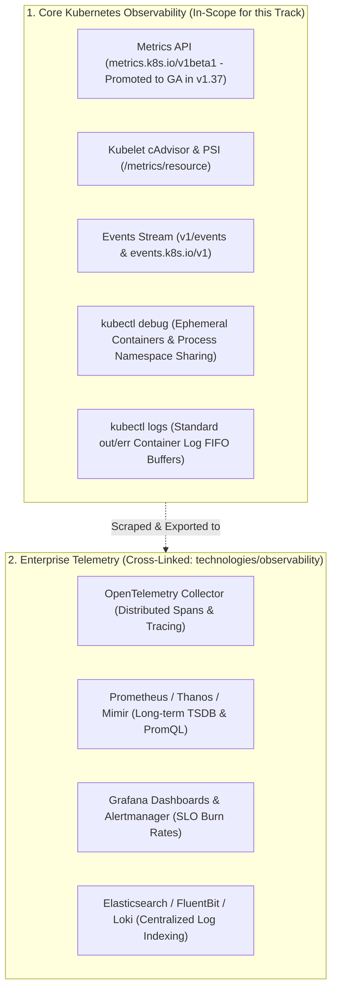
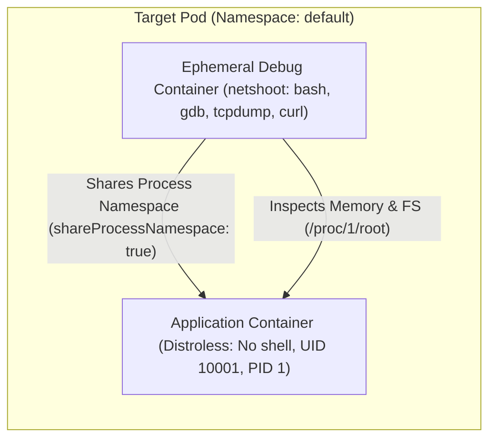
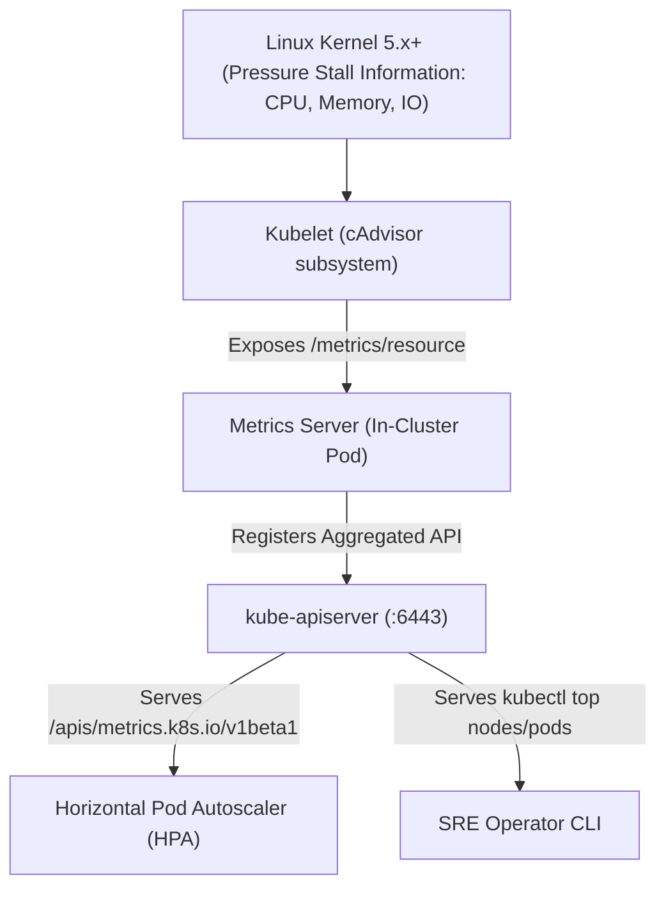
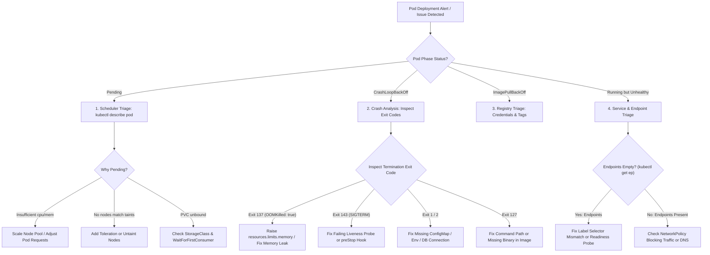

# Module 13: Cluster Observability and Troubleshooting Playbooks: Ephemeral Debug Containers, Metrics API, Triage Flows, and API Deprecations

> **Primary sources:** Kubernetes Documentation ([Troubleshooting Applications](https://kubernetes.io/docs/tasks/debug/debug-application/), [Debugging Pods and Nodes](https://kubernetes.io/docs/tasks/debug/debug-cluster/), [Ephemeral Containers](https://kubernetes.io/docs/concepts/workloads/pods/ephemeral-containers/), [Metrics Server](https://github.com/kubernetes-sigs/metrics-server), [StorageVersionMigration GA in v1.37](https://kubernetes.io/docs/tasks/manage-kubernetes-objects/storage-version-migration/)); CNCF Curriculum ([CKA Curriculum v1.37](https://github.com/cncf/curriculum), [CKAD Curriculum v1.37](https://github.com/cncf/curriculum)).
>
> **Executable proof:** [`examples/ts/13-observability-and-troubleshooting.test.ts`](../examples/ts/13-observability-and-troubleshooting.test.ts) asserts exit code diagnostic classification, decision tree resolution paths, ephemeral container spec validation, and API deprecation migrations.
>
> **Cross-track foundations:** See [`../../observability/README.md`](../../observability/README.md) for enterprise telemetry architecture (Prometheus, OpenTelemetry, Grafana LGTM, Elasticsearch, and SLO error budgets), [`modules/03-node-internals.md`](03-node-internals.md) for kubelet PLEG and cgroup v2 pressure metrics, and [`modules/04-pods-and-workloads.md`](04-pods-and-workloads.md) for probe lifecycles.

---

## 1. Formal Foundations: The Kubernetes Observability Hierarchy

Operating resilient Kubernetes clusters requires distinguishing between **Core Cluster Observability** (primitives provided directly by the Kubernetes API and node daemons for orchestration and emergency triage) and **Application Telemetry** (centralized long-term metric storage, distributed tracing, and log aggregation platforms):



---

## 2. Ephemeral Debug Containers: Zero-Downtime Live Triage

Modern production workloads build on minimal base images: distroless containers (e.g., `gcr.io/distroless/static`, Chainguard) or `scratch`. These hardened containers deliberately omit debug utilities, shells (`sh`, `bash`), package managers, and system binaries. While this reduces attack surfaces, it prevents traditional debugging: running `kubectl exec -it <pod> -- sh` fails immediately with `executable file not found in $PATH`.

**Ephemeral Containers** (`spec.ephemeralContainers`) solve this by attaching temporary, fully equipped debugging containers into an already-running Pod without restarting its processes.

### 2.1 Ephemeral Container Operational Invariants

- **Immutable Execution**: Ephemeral containers cannot define ports, resource limits/requests, lifecycle hooks, or readiness/liveness probes.
- **Permanent Attachment**: Once added to a Pod manifest via the API, an ephemeral container cannot be removed or updated; it remains in the Pod specification until the Pod terminates.
- **Restart Policy**: Always defaults to `restartPolicy: Never`.



### 2.2 The Three Modes of `kubectl debug`

#### Mode 1: In-Pod Process Namespace Debugging (`--target`)

Attaches a debug container directly into the target Pod's Linux process and network namespaces:

```bash
kubectl debug -it prod-api-7b89-m4x9 \
  --image=nicolaka/netshoot:v0.13 \
  --target=api-server \
  --namespace=production
```

Inside the debug session, running `ps aux` reveals all processes running inside the target `api-server` container. You can inspect the application's environment variables via `/proc/<pid>/environ` or view its filesystem directly under `/proc/<pid>/root/`.

#### Mode 2: Copying a Pod with Altered Entrypoint or Environment (`--copy-to`)

When a Pod fails during startup (e.g., `CrashLoopBackOff`), attaching an ephemeral container to the dead process is impossible. `kubectl debug` clones the Pod, replaces its failing command with an interactive shell, and mounts existing volumes:

```bash
kubectl debug broken-pod-6c7d \
  --copy-to=repaired-pod \
  --set-image=app=alpine:3.20 \
  --container=app \
  --sh
```

#### Mode 3: Host Node Debugging (`node/...`)

Spawns a privileged container directly on the physical worker node with full host access:

```bash
kubectl debug node/worker-k8s-02 -it --image=alpine:3.20
# Once inside:
chroot /host
journalctl -u kubelet -e --no-pager
systemctl status containerd
```

---

## 3. The Metrics API and Pressure Stall Information (PSI)

Autoscalers (HPA, VPA) and CLI monitoring tools (`kubectl top`) rely on the **Metrics API** (`metrics.k8s.io/v1beta1`, promoted to **GA in Kubernetes v1.37**).



### 3.1 Kernel Pressure Stall Information (PSI)

Beginning in Kubernetes v1.36 and stabilized in v1.37, kubelet leverages **Pressure Stall Information (PSI)** directly from the Linux kernel. Rather than merely observing absolute percentage utilization (which does not correlate directly with starvation), PSI measures the exact percentage of time threads spend waiting for available CPU cycles, memory pages, or block I/O operations. This prevents false evictions while catching latency spikes caused by CFS throttling.

---

## 4. Systematic Troubleshooting Decision Trees

Troubleshooting Kubernetes requires following rigorous, deterministic decision trees rather than random exploratory debugging.



---

## 5. Exit Code Diagnostic Taxonomy

When a container terminates, the container runtime records its exit code inside `status.containerStatuses[].state.terminated.exitCode`. Exit codes follow the standard POSIX and Linux execution contract:

| Exit Code | Process Signal / Status | Primary Root Causes | Diagnostic Remediation Strategy |
| :-- | :-- | :-- | :-- |
| **0** | `Success / Normal Exit` | Application finished its work, but `restartPolicy: Always` caused kubelet to restart it. | Change workload to a `Job` / `CronJob`, or set `restartPolicy: OnFailure`. |
| **1** | `Catchall Error` | Uncaught application exception, unhandled promise rejection, missing configuration variable. | Run `kubectl logs <pod> --previous` to read stack traces prior to termination. |
| **126** | `Command Invoked Cannot Execute` | File permission error on executable (missing `chmod +x`), or binary built for incompatible glibc/musl. | Inspect container entrypoint permissions; verify libc compatibility in base image. |
| **127** | `Command Not Found` | Binary specified in `spec.containers[].command` does not exist in `$PATH`. | Verify binary spelling; verify binary was not stripped out during multi-stage Docker build. |
| **137** | `Fatal Error: 128 + 9 (SIGKILL)` | **1. OOMKilled**: Container exceeded memory limit.<br>**2. Forced Kill**: Failed to shut down within grace period. | Inspect `lastState.terminated.reason`. If `OOMKilled`, increase memory limits. If not, check graceful termination. |
| **139** | `Fatal Error: 128 + 11 (SIGSEGV)` | Segmentation fault; invalid memory access, corrupted Cgo shared library. | Attach debugger using `kubectl debug --target` to inspect core dumps. |
| **143** | `Fatal Error: 128 + 15 (SIGTERM)` | Kubelet sent graceful termination signal because Pod was deleted, evicted, or liveness probe failed. | Inspect kubelet events; check liveness probe timeouts and endpoints. |

---

## 6. Mathematical Model: Automated Troubleshooting Triage Algorithm

```text
Algorithm: Triage_Pod_Failure(Pod pod, Set<Node> nodes, Set<Event> events)
Input: Failing Kubernetes Pod, cluster Node pool, relevant cluster Events
Output: Exact FailureClassification and ActionableRemediation

Invariant 1: Triage must evaluate status conditions before examining raw log streams.
Invariant 2: OOMKilled flag takes absolute precedence over generic exit code 137.

1:  if pod.status.phase = "Pending" then
2:      for each condition in pod.status.conditions do
3:          if condition.type = "PodScheduled" and condition.status = "False" then
4:              if condition.reason = "Unschedulable" then
5:                  return ClassifySchedulingFailure(condition.message, nodes)
6:              end if
7:          end if
8:      end for
9:  end if
10:
11: for each cs in pod.status.containerStatuses do
12:     if cs.state.waiting ≠ NULL then
13:         reason ← cs.state.waiting.reason
14:         if reason ∈ {"ImagePullBackOff", "ErrImagePull"} then
15:             return Remediation("RegistryAuthOrTagMismatch", "Verify image tag and imagePullSecrets")
16:         else if reason = "CrashLoopBackOff" then
17:             termState ← cs.lastState.terminated
18:             if termState.reason = "OOMKilled" then
19:                 return Remediation("MemoryLimitExceeded", "Increase resources.limits.memory")
20:             else if termState.exitCode = 137 then
21:                 return Remediation("SIGKILL_Timeout", "Application failed to terminate within terminationGracePeriodSeconds")
22:             else if termState.exitCode = 127 then
23:                 return Remediation("BinaryNotFound", "Check command and PATH inside container")
24:             else
25:                 return Remediation("ApplicationCrash", "Inspect previous logs: kubectl logs --previous")
26:             end if
27:         end if
28:     end if
29: end for
30:
31: return Remediation("HealthyOrUnrecognized", "No active container-level failures detected")
```

---

## 7. StorageVersionMigration: Safely Upgrading Deprecated API Objects (GA in v1.37)

A critical, frequently misunderstood failure mode in production Kubernetes occurs during major cluster upgrades involving API version deprecations:

### 7.1 The Silent Data Loss Trap

When an API object graduates from Beta to GA (e.g., from `networking.k8s.io/v1beta1` to `networking.k8s.io/v1`), Kubernetes marks the new version as `storage: true` in `etcd`. However, objects created prior to the migration remain physically stored in `etcd` in the legacy `v1beta1` format.

When a future Kubernetes release completely purges the removed `v1beta1` schema from the `kube-apiserver` binary, the API server loses the ability to deserialize the legacy format stored in `etcd`. If an administrator restarts the API server or modifies the object, `kube-apiserver` panics or corrupts the record.

### 7.2 Automated Remediation via StorageVersionMigration

Promoted to **General Availability in Kubernetes v1.37** (KEP-1981), the `StorageVersionMigration` resource orchestrates automated, in-place migration of stored objects:

```yaml
apiVersion: migration.k8s.io/v1alpha1
kind: StorageVersionMigration
metadata:
  name: migrate-ingress-to-v1
spec:
  resource:
    group: networking.k8s.io
    version: v1
    resource: ingresses
```

When submitted, the storage migration controller performs a read-and-write cycle on all matching objects, forcing `etcd` to serialize them into the active `v1` storage version.

---

## 8. Then vs. Now: Troubleshooting and Observability

| Troubleshooting Vector | Legacy Kubernetes (v1.12–v1.20) | Modern Kubernetes (v1.36–v1.37) |
| :-- | :-- | :-- |
| **Distroless Container Debugging** | SSH to worker node, run `docker exec` or install debug tools into live image | Ephemeral Debug Containers (`kubectl debug --target`) with process namespace sharing |
| **Node-Level Triage** | Direct SSH keys provisioned to every physical worker VM | Standardized, audited `kubectl debug node/<nodeName>` session |
| **Metrics Pipeline** | Insecure, high-overhead cAdvisor scrapers and heapster | `metrics.k8s.io/v1beta1` GA + Linux Kernel PSI metrics |
| **API Deprecation Upgrades** | Manual `kubectl get -o yaml \| kubectl apply` scripts risking corruption | Automated `StorageVersionMigration` (GA in v1.37) |
| **Exit Code Visibility** | Ambiguous generic error strings in events | Structured `lastState.terminated` with explicit `OOMKilled: true` and exit codes |

---

## 9. Exam Delta: CKA v1.37 vs. CKS v1.34

> [!NOTE]
> **CKA (Curriculum v1.37) — Troubleshooting is 30% of the Total Exam Score!**:
>
> - The Troubleshooting domain carries the highest weight on the CKA exam.
> - High-frequency exam tasks:
>   1. **Repairing a Broken Kubelet**: Diagnosing why `systemctl status kubelet` fails on a worker node (e.g., misconfigured `/var/lib/kubelet/config.yaml`, wrong CRI socket path, swap enabled).
>   2. **Fixing Control Plane Static Pods**: Correcting YAML syntax errors or wrong certificate paths in `/etc/kubernetes/manifests/kube-apiserver.yaml`.
>   3. **Resolving Network Policy Blockades**: Identifying why a frontend pod cannot reach a backend pod by inspecting `NetworkPolicy` ingress/egress rules and port specifications.
>   4. **Diagnosing Service Misconfigurations**: Fixing Services with 0 endpoints caused by label selector typos or failing readiness probes.
>
> **CKS (Curriculum v1.34)**:
>
> - Exam tests troubleshooting from a **runtime security and threat response perspective**:
>   1. Inspecting container escapes and unauthorized binaries using Falco logs.
>   2. Auditing suspicious API calls in `/var/log/kubernetes/audit.log`.
>   3. Identifying pods violating security profiles and modifying manifests to pass admission.

---

## 10. Production Failure Modes & Operational Gotchas

### 10.1 `kubectl debug` Blocked by Pod Security Admission

**Mechanism**: An SRE attempts to debug a production Pod in a namespace enforced with `pod-security.kubernetes.io/enforce: restricted`. The SRE runs `kubectl debug -it <pod> --image=nicolaka/netshoot`. **Symptom**: The command fails immediately with: `Error from server (Forbidden): pods "prod-pod" is forbidden: violates PodSecurity "restricted:latest"`. **Root Cause**: The default `kubectl debug` command does not attach securityContext fields, attempting to run as root, violating PSS Restricted. **Remediation**: Create a dedicated copy with non-root security context overrides, or use a custom debugging profile:

```bash
kubectl debug <pod> -it --image=nicolaka/netshoot --custom='{"spec":{"securityContext":{"runAsNonRoot":true,"runAsUser":10001}}}'
```

### 10.2 The Masked OOMKilled Exit Code

**Mechanism**: A developer wraps their Node.js or Java application with an entrypoint bash script (`entrypoint.sh`). When the JVM exceeds its memory limit, the Linux kernel sends `SIGKILL` (Exit 137). The bash script catches the signal or continues execution, ultimately exiting with status 1. **Symptom**: Kubelet records `exitCode: 1` and `OOMKilled: false`. SREs spend hours debugging application logic rather than increasing memory limits. **Remediation**: Always use `exec` in shell entrypoint scripts (`exec java -jar app.jar`) so that the application process becomes PID 1 and receives kernel signals directly.

### 10.3 CoreDNS Upstream Loopback Recursion Lockup

**Mechanism**: A cluster node's local DNS resolver (`systemd-resolved`) points to `127.0.0.53`. During kubelet initialization, `/etc/resolv.conf` is passed to CoreDNS. **Symptom**: CoreDNS pods crash repeatedly with `CrashLoopBackOff`. CoreDNS logs show: `plugin/loop: Loop (127.0.0.1:53 -> :53) detected for zone ".", see https://coredns.io/plugins/loop#troubleshooting`. **Remediation**: Point kubelet's resolvConf flag to `/run/systemd/resolve/resolv.conf` (which contains upstream DNS servers) rather than the loopback stub resolver.

---

## 11. Concrete Troubleshooting Playbook Reference

### 11.1 Pod Triage CLI Command Flow

```bash
# 1. Identify failing pods and their status
kubectl get pods -A -o wide | grep -E "CrashLoopBackOff|Pending|Error|OOMKilled|Evicted"

# 2. Extract container exit codes and termination reason
kubectl get pod <pod-name> -n <ns> -o jsonpath='{range .status.containerStatuses[*]}{.name}{": exitCode="}{.lastState.terminated.exitCode}{", reason="}{.lastState.terminated.reason}{"\n"}{end}'

# 3. Retrieve pre-crash logs
kubectl logs <pod-name> -n <ns> -c <container-name> --previous --tail=100

# 4. Inspect chronological cluster events
kubectl get events -n <ns> --sort-by='.metadata.creationTimestamp' | tail -n 25

# 5. Check node resource pressures
kubectl describe node <node-name> | grep -A 5 Conditions:
```

### 11.2 DNS Resolution Latency and conntrack Race Conditions (`ndots:5`)

In Kubernetes, `/etc/resolv.conf` inside every Pod includes `options ndots:5` and multiple search domains:

```text
nameserver 10.96.0.10
search default.svc.cluster.local svc.cluster.local cluster.local c.internal
options ndots:5
```

When an application resolves an external domain containing fewer than 5 dots (e.g., `api.stripe.com` contains 2 dots), the resolver sequentially queries:

1. `api.stripe.com.default.svc.cluster.local.` (NXDOMAIN)
2. `api.stripe.com.svc.cluster.local.` (NXDOMAIN)
3. `api.stripe.com.cluster.local.` (NXDOMAIN)
4. `api.stripe.com.c.internal.` (NXDOMAIN)
5. `api.stripe.com.` (SUCCESS)

This generates 5 separate DNS queries per external call, multiplying CoreDNS traffic by 5x. Under heavy concurrency, UDP DNS queries trigger Linux kernel `nf_conntrack` race conditions, producing random 5-second DNS timeouts (`SERVFAIL`).

**Diagnostic Remediation**: Append a trailing dot to external fully qualified domain names (`api.stripe.com.`) to skip search path iteration, or configure `dnsConfig` on the Pod:

```yaml
spec:
  dnsConfig:
    options:
      - name: ndots
        value: '2'
```

### 11.3 Control Plane Static Pod Troubleshooting Playbook

When control plane static pods crash or fail to launch:

1. Check static pod manifest directory: `ls -la /etc/kubernetes/manifests/`.
2. Inspect kubelet journal for manifest parse errors: `journalctl -u kubelet -e | grep -i "error parsing"`.
3. Check container runtime for dead containers: `crictl ps -a | grep -E "apiserver|etcd"`.
4. Inspect container crash logs directly via CRI: `crictl logs <container-id>`.
5. Verify etcd client certificate validity against apiserver: `openssl x509 -in /etc/kubernetes/pki/apiserver-etcd-client.crt -text -noout`.

---

## Interview Drill

<details><summary>1. Explain the architectural difference between exit code 137 caused by OOMKilled vs exit code 137 caused by graceful shutdown timeouts.</summary>

Both scenarios result in process termination via `SIGKILL` (Signal 9, producing exit code $128 + 9 = 137$):

- **OOMKilled**: Triggered by the Linux kernel cgroup memory controller when a container exceeds its `resources.limits.memory` limit. Kubelet observes the kernel cgroup event and sets `lastState.terminated.reason = "OOMKilled"` in the container status.
- **Graceful Shutdown Timeout**: Occurs when a Pod is being deleted or a liveness probe fails. Kubelet sends `SIGTERM` (Signal 15) and starts the `terminationGracePeriodSeconds` timer (default 30 seconds). If the application fails to cleanly terminate before the timer expires, kubelet forcibly terminates the process with `SIGKILL`. In this case, `lastState.terminated.reason` is typically `Error` or empty, NOT `OOMKilled`.
</details>

<details><summary>2. How does `kubectl debug --target` enable inspection of distroless or scratch containers that lack shell binaries?</summary>

`kubectl debug --target=<container-name>` leverages Linux **Process Namespace Sharing**. When invoked, kubelet injects an ephemeral container (using an image containing debugging tools like `nicolaka/netshoot`) into the target Pod. By setting the ephemeral container's target to the application container, both containers share the exact same Linux PID namespace.

From the debug container's shell, running `ps aux` displays the application's processes. Furthermore, the application container's entire root filesystem is directly accessible via the Linux proc virtual filesystem at `/proc/<target-pid>/root/`, allowing inspection of configuration files, certificates, and runtime locks without altering the original immutable image.
</details>

<details><summary>3. What is the root cause of the infamous CoreDNS `plugin/loop: Loop detected` crash loop, and how is it resolved?</summary>

Modern Linux distributions run `systemd-resolved`, which configures `/etc/resolv.conf` to point to a local stub listener on `127.0.0.53`. When kubelet starts CoreDNS, it copies host `/etc/resolv.conf` into CoreDNS's forward plugin.

CoreDNS receives a query, forwards it to `127.0.0.53` (which is localhost inside CoreDNS's network namespace), where CoreDNS itself is listening. The query loops infinitely until CoreDNS's loop detection plugin detects self-forwarding and terminates the process with a fatal error.

Resolution: Configure kubelet with `--resolv-conf=/run/systemd/resolve/resolv.conf`, which points directly to real upstream nameservers (e.g., corporate DNS or 8.8.8.8) rather than the local loopback stub.
</details>

<details><summary>4. What is `StorageVersionMigration` (promoted to GA in Kubernetes v1.37), and why is it essential for cluster lifecycle management?</summary>

When an API resource transitions from Beta to GA (e.g., `CronJob` moving from `batch/v1beta1` to `batch/v1`), newer Kubernetes releases change the default storage version in `etcd`. However, objects written under the old version remain serialized in `etcd` in the legacy schema until rewritten.

If a cluster is upgraded to a version where the old API version is completely deleted from the code, `kube-apiserver` can no longer deserialize the stored bytes, causing corrupted objects and cluster panic. `StorageVersionMigration` (promoted to GA in v1.37) automates background read-and-rewrite cycles, safely upgrading all legacy stored records in `etcd` to the active storage version before deprecated schemas are removed.
</details>

<details><summary>5. In the CKA exam, if a Service exists but curl commands to its ClusterIP time out, what are the exact triage steps to locate the failure?</summary>

Follow this systematic 4-step triage sequence:

1. **Inspect Endpoints**: Run `kubectl get endpoints <service-name>` or `kubectl get endpointslices`. If the endpoint list is `<none>`:
   - Check if the Service's `spec.selector` matches the Pods' `metadata.labels` exactly.
   - Check if the backend Pods are running and passing their **Readiness Probes**. Unready pods are automatically stripped from Endpoints.
2. **Inspect Target Port**: Verify that the Service's `spec.ports[].targetPort` matches the actual port the container application is listening on.
3. **Inspect NetworkPolicies**: Check if an egress policy on the client pod or an ingress policy on the server pod is dropping traffic.
4. **Inspect Kube-Proxy**: Check kube-proxy DaemonSet logs on the client node to verify iptables/IPVS/eBPF rules were successfully programmed.
</details>

<details><summary>6. Why does a Pod remain stuck in `Pending` when a persistent volume is configured with `volumeBindingMode: WaitForFirstConsumer`?</summary>

Under `WaitForFirstConsumer`, the persistent volume is intentionally NOT provisioned or bound when the PVC is created. Binding is delayed until the `kube-scheduler` selects a specific node for the Pod consuming the claim.

If the Pod is stuck in `Pending`, the scheduler has not yet found a node that satisfies the Pod's compute requests, taints/tolerations, and node affinity rules. The PVC will remain `Pending` until compute scheduling succeeds. Triage the failure using `kubectl describe pod <pod-name>` to view the scheduler's `FailedScheduling` events.
</details>

<details><summary>7. What is Pressure Stall Information (PSI), and why did Kubernetes integrate it into the kubelet eviction subsystem?</summary>

Traditional kubelet eviction relied on raw resource thresholds (e.g., available memory percentage or CPU load averages). These metrics fail to differentiate between harmless high cache usage and active performance degradation.

PSI (Pressure Stall Information) is a Linux kernel facility that measures the percentage of CPU execution time lost while tasks wait for hardware resources (CPU scheduling delays, paging memory from swap/disk, block I/O stalls). By monitoring PSI metrics via cgroups v2, kubelet detects actual system thrashing and starvation in real time, making eviction and pod resizing decisions based on real user latency impact rather than blunt allocation percentages.
</details>

---

## 13. Proof Map and Verification

The formal troubleshooting algorithms, exit code taxonomies, and decision trees detailed in this module are verified by test suites in [`examples/ts/13-observability-and-troubleshooting.test.ts`](../examples/ts/13-observability-and-troubleshooting.test.ts):

- **Exit Code Diagnostic Classifier**: Evaluates raw container termination state objects, verifying accurate classification of OOMKilled, binary missing (127), and timeout (143) scenarios.
- **Decision Tree Traversal Simulation**: Executes automated diagnostic flows across mocked failure states (Pending, CrashLoop, Empty Endpoints), verifying remediation recommendations.
- **Ephemeral Container Spec Validation**: Verifies that generated ephemeral container specs adhere strictly to API constraints (no ports, no probes, no resource limits).
- **StorageVersionMigration State Transitions**: Validates resource conversion states from legacy storage versions to active GA schemas.
