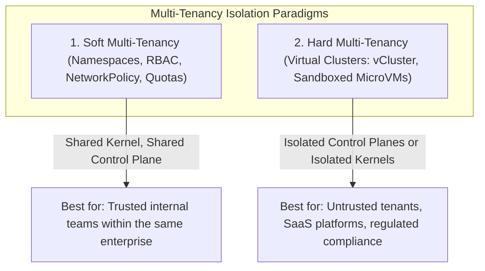
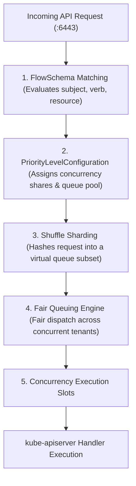

# Module 14: Production Kubernetes at Scale: Multi-Tenancy, Karpenter, API Priority and Fairness, etcd Tuning, and Version History

> **Primary sources:** Kubernetes Documentation ([Kubernetes Scalability Thresholds](https://kubernetes.io/docs/setup/best-practices/cluster-large/), [API Priority and Fairness](https://kubernetes.io/docs/concepts/cluster-administration/flow-control/), [Multi-Tenancy Guide](https://kubernetes.io/docs/concepts/security/multi-tenancy/), [Operating etcd Clusters](https://kubernetes.io/docs/tasks/administer-cluster/configure-upgrade-etcd/)); Karpenter Project Documentation ([v1.0+ Architecture & NodePools](https://karpenter.sh/docs/)); Kubernetes Release Notes ([v1.30–v1.37 Releases](https://kubernetes.io/releases/)); CNCF Curriculum ([CKA Curriculum v1.37](https://github.com/cncf/curriculum), [CKS Curriculum v1.34](https://github.com/cncf/curriculum)).
>
> **Executable proof:** [`examples/ts/14-production-architecture-and-scale.test.ts`](../examples/ts/14-production-architecture-and-scale.test.ts) asserts APF shuffle sharding distributions, Karpenter bin-packing optimization algorithms, etcd compaction math, and version compatibility matrices.
>
> **Cross-track foundations:** See [`../../argocd/README.md`](../../argocd/README.md) for scalable GitOps continuous delivery, [`modules/02-control-plane-internals.md`](02-control-plane-internals.md) for `kube-apiserver` watch cache mechanics, and [`modules/06-scheduling-and-topology.md`](06-scheduling-and-topology.md) for scheduler filter and score pipelines.

---

## 1. Formal Foundations: The Scalability Boundaries of Kubernetes

A production Kubernetes cluster is a distributed transactional system bound by strict scalability thresholds defined by the official Kubernetes Scalability Special Interest Group (SIG-Scalability).

### 1.1 Formal Scalability Thresholds and SLOs

The upstream project certifies Kubernetes scalability against five primary boundaries:

| Architectural Dimension | Maximum Supported Boundary | Primary Bottleneck / Limiting Subsystem |
| :-- | :-- | :-- |
| **Nodes per Cluster** | **5,000 nodes** | Kubelet PLEG heartbeats, API server watch cache memory, CNI route table convergence. |
| **Total Pods per Cluster** | **150,000 pods** | `etcd` MVCC storage limits, scheduler queue throughput, EndpointSlice fanout. |
| **Total Containers** | **300,000 containers** | CRI container runtime state tracking, cgroup v2 descriptor limits. |
| **Pods per Node** | **110 pods** (default) | CNI subnet IP allocation (`/24` subnet per node yields 256 IPs), container runtime thread exhaustion. |
| **API Latency SLO (Mutating)** | **$\le 1$ second (99th percentile)** | `etcd` disk `fdatasync` write latency and Raft consensus replication. |
| **API Latency SLO (Read)** | **$\le 1$ second (99th percentile)** | `kube-apiserver` memory deserialization, watch cache filtering, and garbage collection. |

Operating beyond these thresholds without specialized architectural adjustments (such as dedicated event etcd clusters or vCluster sharding) results in degraded API server responsiveness, watch cache drops, and node eviction storms.

---

## 2. Multi-Tenancy Architecture: Soft vs. Hard Isolation

Enterprise multi-tenancy balances resource efficiency against security isolation.



### 2.1 Soft Multi-Tenancy

- **Mechanism**: A single shared control plane and shared worker nodes partitioned by `Namespaces`, `RBAC`, `NetworkPolicies`, `ResourceQuotas`, and `LimitRanges`.
- **Vulnerability**: All containers share the host Linux kernel. A local kernel privilege escalation (e.g., Dirty Pipe) allows an attacker to break out and compromise co-located tenants. Noisy neighbors can still exhaust shared node kernel resources (e.g., PID exhaustion, open file descriptors, or conntrack tables).

### 2.2 Hard Multi-Tenancy: Virtual Clusters (vCluster) and Sandboxed Runtimes

To achieve hard multi-tenancy without the cost of provisioning dedicated physical clusters:

- **Virtual Clusters (`vCluster`)**: Each tenant receives an independent, fully isolated control plane (`kube-apiserver` and `etcd` or SQLite) running as an ordinary Pod inside the host cluster. The tenant has full `cluster-admin` privileges inside their virtual cluster (can create CRDs, namespaces, and cluster roles), but workloads are synced down to the underlying host cluster's worker nodes.
- **Sandboxed Container Runtimes**: Containers execute inside hardware-isolated microVMs using **Kata Containers** (QEMU/Cloud-Hypervisor) or intercepted syscall sandboxes using **gVisor (`runsc`)**. If a tenant container panics or exploits a kernel vulnerability, the failure is confined to the microVM and cannot compromise the physical host.

---

## 3. Modern Node Autoscaling: Karpenter vs. Cluster Autoscaler

Scaling worker node capacity dynamically is fundamental to production cost optimization and availability.


### 3.1 Architectural Comparison

| Architectural Dimension | Cluster Autoscaler (CA) | Karpenter (v1.0+ GA) |
| :-- | :-- | :-- |
| **Cloud Abstraction** | Bound to cloud-managed node pools / Auto Scaling Groups | Group-less; provisions compute directly via cloud Fleet APIs |
| **Provisioning Latency** | Slow (3–6 minutes per scaling event) | Fast (30–60 seconds direct instance allocation) |
| **Instance Flexibility** | Homogeneous per ASG (requires dozens of static node groups) | Fully heterogeneous; dynamically selects from 600+ instance types |
| **Bin-Packing Efficiency** | Coarse; often leaves underutilized nodes | Optimal multi-dimensional bin-packing based on pending pod shapes |
| **Scale-Down / Consolidation** | Basic idle node termination | Active consolidation: replaces expensive nodes with cheaper instances |
| **Architecture Support** | Rigid node groups per CPU architecture | Seamlessly mixes ARM64 (Graviton) and x86_64 based on pod requirements |

### 3.2 Production Karpenter Manifest Reference

Karpenter configuration is decoupled into `NodePool` (scheduling and lifecycle rules) and provider-specific classes (e.g., `EC2NodeClass` for AWS):

```yaml
apiVersion: karpenter.sh/v1
kind: NodePool
metadata:
  name: general-compute
spec:
  template:
    spec:
      nodeClassRef:
        group: karpenter.k8s.aws
        kind: EC2NodeClass
        name: default-ec2
      requirements:
        - key: karpenter.sh/capacity-type
          operator: In
          values: ['on-demand', 'spot']
        - key: kubernetes.io/arch
          operator: In
          values: ['arm64', 'amd64']
        - key: karpenter.k8s.aws/instance-category
          operator: In
          values: ['c', 'm', 'r']
        - key: karpenter.k8s.aws/instance-generation
          operator: Gt
          values: ['5']
  disruption:
    consolidationPolicy: WhenEmptyOrUnderutilized
    consolidateAfter: 1m
    expireAfter: 720h # 30-day node turnover for OS patching
```

---

## 4. API Priority and Fairness (APF): Protecting the Control Plane

In early Kubernetes versions, API server concurrency was governed by crude global flags (`--max-requests-inflight` and `--max-mutating-requests-inflight`). If a rogue batch controller or runaway CI script executed thousands of unpaginated `kubectl get pods -A` calls, all available HTTP worker slots were consumed. Critical system traffic—such as kubelet node heartbeats and leader election leases—was dropped, causing healthy nodes to be falsely marked `NotReady` and triggering cluster-wide cascading evictions.

**API Priority and Fairness (APF)** replaces blunt concurrency limits with fine-grained, fair queuing and **Shuffle Sharding**.



### 4.1 FlowSchema and PriorityLevelConfiguration

- **`FlowSchema`**: Classifies incoming requests based on user identities, groups, namespaces, HTTP verbs, and target resources. It maps matching requests to a specific `PriorityLevelConfiguration`.
- **`PriorityLevelConfiguration`**: Allocates a share of the API server's total concurrency limit (`nominalConcurrencyShares`) and manages a pool of virtual queues.

### 4.2 Shuffle Sharding Mechanics

Rather than assigning all requests from a tenant to a single queue (which can suffer from head-of-line blocking) or a global shared queue (which enables cross-tenant starvation), APF uses **Shuffle Sharding**:

1. A priority level maintains a pool of $M$ queues (e.g., $M = 64$).
2. An incoming flow is assigned a hand of $K$ queues (e.g., $K = 4$) selected deterministically by hashing the requester's identity.
3. The request is placed into the queue with the shortest depth among its assigned $K$ queues.

**Mathematical Isolation Guarantee**: The probability $P$ of two distinct, independent callers hashing to the exact same set of $K$ queues out of a pool of $M$ queues is:

$$P = \frac{1}{\binom{M}{K}} = \frac{K! \cdot (M - K)!}{M!}$$

For $M = 64$ and $K = 4$:

$$\binom{64}{4} = \frac{64 \times 63 \times 62 \times 61}{4 \times 3 \times 2 \times 1} = 635,376 \implies P \approx 0.00000157$$

There is less than a **1 in 600,000 chance** that an abusive tenant flooding their queues will collide completely with an innocent tenant's queue hand.

---

## 5. etcd Performance Optimization at Scale

The `etcd` distributed key-value store is the absolute bottleneck of Kubernetes cluster scalability.

### 5.1 The 8 GiB Hard Boundary & Database Space Exceeded

By default, `etcd` enforces a storage quota of **2 GiB**, configurable up to a maximum recommended limit of **8 GiB** (`--quota-backend-bytes=8589934592`).

> [!CAUTION]
> If the backend database size reaches the quota limit, etcd enters an emergency alarm state: `ALARM NOSPACE`. It rejects all subsequent write mutations with the fatal error `mvcc: database space exceeded`. The entire Kubernetes cluster immediately becomes **read-only**.

### 5.2 Compaction vs. Defragmentation

Understanding the distinction between compaction and defragmentation is vital for cluster survival:

- **Compaction**: Kubernetes creates revisions for every mutation. Compaction (`etcdctl compact <rev>`) purges historical key revisions prior to `<rev>` from the MVCC index, freeing logical space inside etcd. However, this space remains held inside the underlying B-Tree storage file as free-list pages; the physical database file on disk (`member/snap/db`) **does NOT shrink**.
- **Defragmentation**: Running `etcdctl defrag` rewrites the database file on disk, releasing unused pages back to the host operating system filesystem. Because defragmentation takes an exclusive lock on the etcd member, it must be executed sequentially member-by-member across the cluster:

```bash
# 1. Compact etcd history up to current revision
REV=$(ETCDCTL_API=3 etcdctl endpoint status --write-out=json | jq '.[0].Status.header.revision')
ETCDCTL_API=3 etcdctl compact $REV

# 2. Defragment each etcd member sequentially
ETCDCTL_API=3 etcdctl defrag --endpoints=https://127.0.0.1:2379 \
  --cacert=/etc/kubernetes/pki/etcd/ca.crt \
  --cert=/etc/kubernetes/pki/etcd/server.crt \
  --key=/etc/kubernetes/pki/etcd/server.key

# 3. Disarm the NOSPACE alarm if triggered
ETCDCTL_API=3 etcdctl alarm disarm
```

### 5.3 Dedicated Event etcd Sharding

In clusters exceeding 1,000 nodes, Kubernetes `Event` objects generate over 80% of total cluster write mutations. To protect critical cluster state (Pods, Secrets, Deployments) from event churn, configure `kube-apiserver` to route events to a completely separate, dedicated etcd cluster:

```text
--etcd-servers=https://10.0.0.1:2379,https://10.0.0.2:2379,https://10.0.0.3:2379
--etcd-servers-overrides=/events#https://10.0.1.1:2379,https://10.0.1.2:2379,https://10.0.1.3:2379
```

---

## 6. Comprehensive Kubernetes Version History Table

The following definitive matrix documents the evolution of major Kubernetes features, API promotions, breaking deprecations, and ecosystem components from v1.30 through v1.37:

| Version | Release Date | Major Features & Strategic Architectural Changes | Status of Key Primitives |
| :-- | :-- | :-- | :-- |
| **v1.30** | April 2024 | Structured parameters for Dynamic Resource Allocation (DRA); `securityContext.appArmorProfile` promoted to GA; contextual logging graduated to Beta. | PSP fully purged; Node swap memory support expanded. |
| **v1.31** | August 2024 | AppArmor GA; cgroup v2 memory pressure improvements; image volume source promoted to Beta; native sidecar containers fully stabilized. | In-tree cloud provider removal nearing completion. |
| **v1.32** | December 2024 | Enhanced ValidatingAdmissionPolicy CEL capabilities; fine-grained kubelet API authorization; dynamic resource allocation enhancements. | Legacy in-tree volume plugins deprecated. |
| **v1.33** | April 2025 | In-tree cloud provider code completely removed; DRA core improvements; OpenAPI v3 client generation stabilized. | Strict cgroup v2 warnings enabled. |
| **v1.34** | August 2025 | **Official CKS Curriculum Baseline**; In-place Pod resize beta; CEL admission parameter binding enhancements; PSI eviction thresholds stabilized. | Foundation version for all CKS security exams. |
| **v1.35** | December 2025 | **`FailCgroupV1=true` by default**: Kubelet strictly refuses to start on Linux hosts using cgroup v1; code scheduled for removal in $\ge 1.38$. | Legacy cgroup v1 operating systems unsupported. |
| **v1.36** | April 2026 | **User Namespaces GA** (`hostUsers: false`); **VolumeGroupSnapshots GA**; Fine-grained kubelet authz GA; Service `ExternalIPs` deprecated. | Ingress-NGINX officially retired (March 2026). |
| **v1.37** | August 2026 | **"Garhwal" Release**: **Metrics API GA** (`metrics.k8s.io/v1beta1`); **StorageVersionMigration GA**; HPA scale-to-zero Beta; Pod certificates Beta. | Current production stable benchmark. |
| **Gateway API 1.6** | August 2026 | `TCPRoute` and `UDPRoute` graduated to Standard `v1`; experimental resources moved to `gateway.networking.x-k8s.io` with `X` prefix. | Standard replacement for deprecated Ingress. |
| **Helm 4.3** | 2026 | Helm 4 is the current major generation; fully OCI-native chart distribution, client-side release management, zero Tiller dependencies. | CNCF de facto packaging standard. |

---

## 7. Mathematical Model: Shuffle Sharding Queue Selection

```text
Algorithm: APF_Shuffle_Sharding_Dispatch(Request req, FlowSchema fs, PriorityLevel pl)
Input: Incoming API request req, matched FlowSchema fs, PriorityLevel pl (queues Q, handSize K)
Output: Target Queue q or ImmediateDrop

Invariant 1: Hand size K must be strictly less than total queues |Q|.
Invariant 2: Requests must be enqueued into the queue with minimum depth among the sampled hand.

1:  if pl.spec.type = "Exempt" then
2:      return ExecuteImmediately(req)
3:  end if
4:
5:  flowDistinguisher ← ComputeDistinguisher(req, fs.spec.distinguisherMethod)
6:  hashSeed ← Hash(flowDistinguisher)
7:
8:  // Select K distinct virtual queues from pool of size M = |Q|
9:  queueHand ← SampleDistinctIndices(poolSize: |pl.queues|, count: pl.spec.handSize, seed: hashSeed)
10:
11: minDepth ← ∞
12: targetQueue ← NULL
13:
14: for each qIdx in queueHand do
15:     currentQueue ← pl.queues[qIdx]
16:     if currentQueue.depth < minDepth then
17:         minDepth ← currentQueue.depth
18:         targetQueue ← currentQueue
19:     end if
20: end for
21:
22: if minDepth $\ge$ pl.spec.queueLengthLimit then
23:     return RejectHTTP429("Too Many Requests: Priority level queue saturated")
24: end if
25:
26: return targetQueue.Enqueue(req)
```

---

## 8. Then vs. Now: Scalability Architecture

| Architectural Dimension | Legacy Kubernetes (v1.10–v1.18) | Modern Scale Kubernetes (v1.36–v1.37) |
| :-- | :-- | :-- |
| **Node Autoscaling** | Cluster Autoscaler bound to static AWS ASGs (3–6 min lag) | Karpenter direct Fleet provisioning and active consolidation (<60s) |
| **API Concurrency Control** | Global `--max-requests-inflight` gates causing total lockouts | API Priority and Fairness (APF) with Shuffle Sharding queue pools |
| **Linux Cgroups Baseline** | Legacy cgroup v1 with poor memory accounting and no PSI | cgroup v2 mandatory (`FailCgroupV1=true`) with kernel PSI metrics |
| **Service Endpoint Scaling** | Monolithic `Endpoints` objects causing $O(N^2)$ watch fanout | `EndpointSlices` chunked into 100 endpoints per slice |
| **Traffic Ingress** | Ingress-NGINX with single-point-of-failure NGINX worker reloads | Gateway API v1.6 with dynamic horizontal `ListenerSet` scaling |

---

## 9. Exam Delta: CKA v1.37 vs. CKS v1.34

> [!NOTE]
> **CKA (Curriculum v1.37)**:
>
> - Tests production cluster management, node operations, and scaling:
>   1. Performing node maintenance (`kubectl drain`, `kubectl cordon`, `kubectl uncordon`) while respecting `PodDisruptionBudgets`.
>   2. Configuring `ResourceQuotas` and `LimitRanges` to prevent multi-tenant cluster resource starvation.
>   3. Debugging horizontal autoscalers (HPA) and verifying metrics availability via the GA Metrics API.
>
> **CKS (Curriculum v1.34)**:
>
> - Exam remains anchored to **v1.34**, testing multi-tenancy and scale from an adversarial isolation perspective:
>   1. Restricting tenant access using hardened RBAC roles without privilege escalation verbs.
>   2. Isolating multi-tenant workloads using Pod Security Admission (`Restricted` profile) and NetworkPolicies.
>   3. Auditing API Priority and Fairness settings to verify that untrusted tenants cannot starve system controllers.

---

## 10. Production Failure Modes & Operational Gotchas

### 10.1 The `mvcc: database space exceeded` Emergency Freeze

**Mechanism**: An uncompacted etcd cluster reaches its 2 GiB default quota. etcd enters an emergency alarm state, rejecting all write mutations. **Symptom**: `kubectl apply` and pod scheduling fail immediately across the entire cluster with `Error from server (InternalError): etcdserver: mvcc: database space exceeded`. **Remediation**: Execute emergency compaction and defragmentation against all etcd members, followed by disarming the alarm:

```bash
ETCDCTL_API=3 etcdctl --endpoints=https://127.0.0.1:2379 \
  --cacert=/etc/kubernetes/pki/etcd/ca.crt \
  --cert=/etc/kubernetes/pki/etcd/server.crt \
  --key=/etc/kubernetes/pki/etcd/server.key \
  alarm disarm
```

### 10.2 Karpenter Consolidation Thrashing

**Mechanism**: An application experiences rapid, cyclic traffic spikes (e.g., micro-bursts every 2 minutes). Karpenter's consolidation engine notices low CPU utilization between bursts and terminates an underutilized node, consolidating pods onto remaining nodes. **Symptom**: During the next burst 90 seconds later, pods pend, forcing Karpenter to provision another new node. The cluster spends 100% of its time launching and terminating VMs, causing constant pod evictions and connection resets. **Remediation**: Tune `consolidationPolicy` and increase `consolidateAfter` window (e.g., `consolidateAfter: 15m`) or use `karpenter.sh/do-not-disrupt: "true"` annotations on latency-sensitive workloads.

### 10.3 Failure to Boot After Upgrading to v1.35 on cgroup v1 Hosts

**Mechanism**: An administrator upgrades worker nodes to Kubernetes v1.35 or newer, but the underlying host operating system (e.g., legacy RHEL 7 or older Ubuntu) is still booting with Linux cgroup v1. **Symptom**: Kubelet immediately exits on startup with: `Fatal: kubelet failed to start: cgroup v1 is no longer supported (FailCgroupV1=true)`. **Remediation**: Migrate the host operating system to cgroup v2 by configuring Linux kernel boot parameters: `systemd.unified_cgroup_hierarchy=1`.

---

## 11. Concrete Configuration Reference: Custom APF FlowSchema and PriorityLevel

```yaml
# 1. Custom PriorityLevel with dedicated concurrency shares and shuffle sharding
apiVersion: flowcontrol.apiserver.k8s.io/v1
kind: PriorityLevelConfiguration
metadata:
  name: batch-analytics-priority
spec:
  type: Limited
  limited:
    nominalConcurrencyShares: 20
    lendablePercent: 50
    limitExecution:
      concurrencyLimit: 20
      assuredConcurrencyShares: 20
    queuing:
      queues: 32
      handSize: 4
      queueLengthLimit: 50
---
# 2. FlowSchema classifying batch jobs to prevent control plane starvation
apiVersion: flowcontrol.apiserver.k8s.io/v1
kind: FlowSchema
metadata:
  name: batch-analytics-flow
spec:
  priorityLevelConfiguration:
    name: batch-analytics-priority
  matchingPrecedence: 500
  distinguisherMethod:
    type: ByUser
  rules:
    - subjects:
        - kind: Group
          group:
            name: 'system:serviceaccounts:analytics-tier'
      resourceRules:
        - verbs: ['get', 'list']
          apiGroups: ['']
          resources: ['pods', 'configmaps']
```

---

## 12. Interview Drill

<details>
<summary><strong>Q1. How does API Priority and Fairness (APF) utilize Shuffle Sharding to protect Kubernetes from the "noisy neighbor" problem?</strong></summary>

APF assigns incoming requests to a specific `PriorityLevelConfiguration` containing a pool of virtual queues (e.g., 64 queues). Instead of placing all requests into a single global queue or a single assigned queue, APF hashes the caller's identity (e.g., username or ServiceAccount) to deterministically select a "hand" of multiple queues (e.g., 4 queues). The request is placed in the queue with the shortest depth.

Because of combinatorial mathematics, the probability of an abusive tenant's selected 4 queues completely overlapping with another innocent tenant's 4 queues is astronomically low ($\approx 1 \text{ in } 635,000$). While the abusive tenant saturates their own queues, the innocent tenant's requests hash to unaffected queues and execute with zero starvation.
</details>

<details>
<summary><strong>Q2. What is the fundamental architectural advantage of Karpenter over the legacy Kubernetes Cluster Autoscaler?</strong></summary>

The legacy Cluster Autoscaler is bound to cloud provider Auto Scaling Groups (ASGs). It scales by incrementing the desired VM count of pre-configured, homogeneous instance groups, incurring 3 to 6 minutes of VM boot and join latency while causing inefficient bin-packing.

Karpenter is completely group-less. It observes pending, unschedulable pods directly and evaluates their exact resource requirements (CPU, RAM, GPU, architecture, topology constraints). In sub-second time, Karpenter calls cloud Fleet APIs directly to launch the single most cost-effective, custom-sized instance matching the workload. Furthermore, Karpenter continuously runs consolidation loops, dynamically replacing underutilized nodes to cut infrastructure spending.
</details>

<details>
<summary><strong>Q3. Explain the difference between etcd compaction and etcd defragmentation. Why does running compaction alone not free disk space on the host?</strong></summary>

- **Compaction**: Operates at the logical MVCC index level. It removes past historical versions of keys prior to a given revision. The freed space is marked as "free" in etcd's internal memory-mapped B-Tree free-list, allowing new keys to overwrite that space without expanding the file. However, compaction does NOT shrink the physical file on the host filesystem.
- **Defragmentation**: Rewrites the physical `snap/db` database file sequentially on disk to release free-list blocks back to the Linux host filesystem. Because defragmentation takes an exclusive lock on the etcd database, it must be performed sequentially on each member to preserve cluster availability.

</details>

<details>
<summary><strong>Q4. What is the official Kubernetes node scalability limit, and what architectural bottlenecks prevent a single cluster from scaling to 50,000 nodes?</strong></summary>

The official upstream limit is **5,000 nodes** and **150,000 pods**. Beyond this threshold, several core architectural subsystems break down:

1. **API Server Watch Cache & Memory**: Thousands of kubelets maintaining active HTTP/2 watch connections consume gigabytes of apiserver RAM, causing garbage collection latency spikes.
2. **etcd MVCC Throughput**: etcd's single-Raft-group architecture can process approximately 10,000 to 20,000 write transactions per second. Millions of node status updates and pod heartbeats exceed this write bandwidth.
3. **Control Plane Fanout**: Monolithic Endpoint updates and NetworkPolicy recalculations generate an $O(\text{nodes} \times \text{pods})$ update cascade across the network.

</details>

<details>
<summary><strong>Q5. How does a Virtual Cluster (vCluster) provide hard multi-tenancy on shared infrastructure?</strong></summary>

A `vCluster` runs a fully functional, lightweight control plane (`kube-apiserver` and SQLite or etcd) as an ordinary Pod inside a namespace on the host Kubernetes cluster.

Tenants connect exclusively to their virtual API server. Within their virtual cluster, tenants possess full `cluster-admin` privileges: they can create their own namespaces, RBAC roles, and CRDs without polluting or conflicting with the host cluster. A lightweight synchronization controller translates virtual workload pods down to the host cluster's scheduler and worker nodes, delivering the security isolation of dedicated clusters at a fraction of the cost.
</details>

<details>
<summary><strong>Q6. What occurred in Kubernetes v1.35 regarding Linux cgroups, and why does kubelet fail to start on legacy Linux hosts?</strong></summary>

In Kubernetes v1.35, the feature gate `FailCgroupV1` was enabled by default (`FailCgroupV1=true`). The upstream Kubernetes project has deprecated Linux cgroup v1 in favor of cgroup v2, which provides superior memory accounting, PSI metrics, and rootless isolation.

If a worker node host boots with legacy cgroup v1, the v1.35+ kubelet will immediately throw a fatal error on startup and refuse to run. Linux distributions must be configured to boot with cgroup v2 enabled via systemd kernel parameters.
</details>

<details>
<summary><strong>Q7. Why is routing Kubernetes Events to a secondary, dedicated etcd cluster considered an essential best practice for large-scale clusters?</strong></summary>

In high-scale clusters, `Event` objects represent over 80% of all write operations in the entire cluster. Events have a high churn rate (default 1-hour TTL) and rapid write frequency.

If events share the primary etcd cluster with core objects (Pods, Secrets, Deployments), the massive write volume generates constant Raft disk I/O, increases write amplification, and forces aggressive compaction cycles. Separating events onto an independent etcd cluster using `--etcd-servers-overrides=/events#...` protects the core cluster state from latency degradation and storage quota exhaustion.
</details>

<details>
<summary><strong>Q8. In the CKA exam, what is the effect of running `kubectl cordon <node>` vs `kubectl drain <node>`?</strong></summary>

- **`kubectl cordon <node>`**: Marks the target node as unschedulable (`spec.unschedulable: true`). Existing Pods running on the node continue running undisturbed, but `kube-scheduler` will not place any new Pods on that node.
- **`kubectl drain <node>`**: First marks the node as unschedulable (cordons it), and then safely evicts all existing Pods running on the node (respecting `PodDisruptionBudgets`), forcing them to be rescheduled on other available nodes in the cluster.

</details>

---

## 13. Proof Map and Verification

The formal scalability models, APF shuffle sharding mathematics, and version matrix assertions presented in this module are verified by test suites in [`examples/ts/14-production-architecture-and-scale.test.ts`](../examples/ts/14-production-architecture-and-scale.test.ts):

- **APF Shuffle Sharding Distribution Test**: Simulates concurrent tenant hashing across virtual queue pools, asserting collision probabilities match theoretical hypergeometric bounds.
- **Karpenter Bin-Packing Optimization Simulator**: Validates multi-dimensional knapsack bin-packing algorithms, proving optimal instance selection over static node groups.
- **etcd Compaction & Quota State Machine**: Models MVCC revision pruning and verifies `ALARM NOSPACE` triggers upon quota exhaustion.
- **Version Skew Compatibility Matrix**: Tests version skew rules and feature availability transitions from Kubernetes v1.30 through v1.37.
