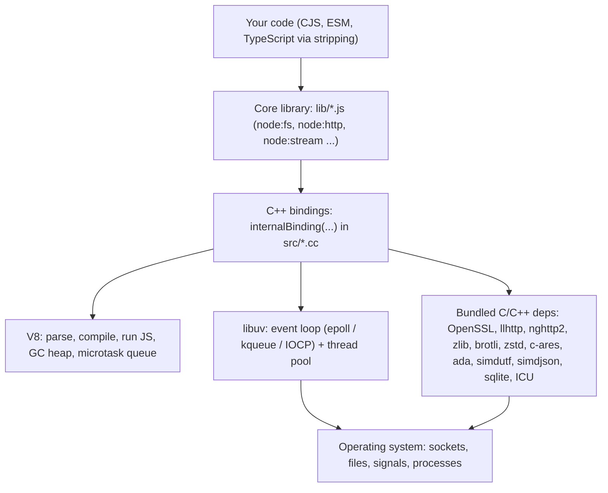
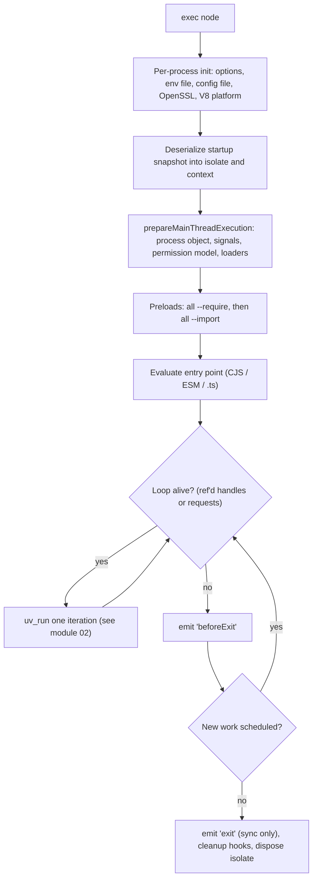
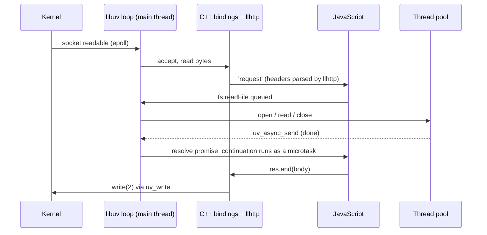

# 01 · Runtime Architecture: V8, libuv, Bindings and the Process Lifecycle

> **Primary sources:** Node.js API docs: [Process](https://nodejs.org/api/process.html), [Command-line options](https://nodejs.org/api/cli.html), [Modules: `node:module`](https://nodejs.org/api/module.html), [Single executable applications](https://nodejs.org/api/single-executable-applications.html); libuv [design overview](https://docs.libuv.org/en/v1.x/design.html); the Node.js source tree (`src/node.cc`, `src/node_main_instance.cc`, `lib/internal/bootstrap/`, `lib/internal/main/`); the release schedule in [`nodejs/Release`](https://github.com/nodejs/Release/blob/main/schedule.json) and the [release-model announcement](https://nodejs.org/en/blog/announcements/evolving-the-nodejs-release-schedule).
>
> **Executable proof:** [`examples/01-runtime-architecture.test.ts`](../examples/01-runtime-architecture.test.ts)

Node.js is not a language and not "JavaScript on the server" in any precise sense. It is a **host** for the ECMAScript language (the term ECMA-262 uses for the environment that supplies jobs, I/O and the global object; see [JavaScript module 06](../../../languages/javascript/modules/06-agents-realms-job-queue.md#3-jobs-in-ecma-262)). This module builds the mental model the rest of the track depends on: what the parts are, how a `node` process starts and stops, how it is configured, and which release line you should be running.

---

## 1. The four layers

**Definition.** A Node.js process is one OS process containing:

1. **V8**, the JavaScript engine: parser, Ignition interpreter, the Sparkplug/Maglev/Turbofan compilers, the garbage-collected heap, and the microtask queue. V8 knows nothing about files, sockets or timers.
2. **libuv**, a C library providing an event loop over the OS's readiness or completion mechanism (epoll on Linux, kqueue on macOS and the BSDs, IOCP on Windows, event ports on SunOS), plus a **thread pool** for work that has no non-blocking OS interface (file system calls, `getaddrinfo`, CPU-heavy crypto and zlib).
3. **C++ bindings** (`src/*.cc`): glue that exposes V8 functions backed by libuv handles and requests, OpenSSL, zlib, llhttp, nghttp2 and the rest. Core JavaScript reaches them through `internalBinding('fs')` and friends, which are not available to user code.
4. **The JavaScript core library** (`lib/*.js`): the public modules (`node:fs`, `node:http`, `node:stream`, …) and the internal ones (`lib/internal/**`). They are compiled into the binary, with a V8 code cache (`process.features.cached_builtins`).



### 1.1 What is bundled, and where it shows up

`process.versions` lists every vendored component. On Node 26.12.1 it includes, among others:

| Component | Version (26.12.1) | Used by |
| --- | --- | --- |
| V8 | 14.6.202.34-node.40 | the language, `node:v8`, `--max-old-space-size` and every other V8 flag |
| libuv (`uv`) | 1.52.1 | event loop, thread pool, timers, TCP/UDP/pipes, signals, child processes, `fs` |
| llhttp | 9.4.3 | the HTTP/1.1 parser behind `node:http` servers and clients |
| undici | 8.12.2 | `fetch`, `WebSocket`, `EventSource` (the global Web APIs) |
| OpenSSL | 3.5.9 | `node:crypto`, `node:tls`, `node:https` |
| nghttp2 | 1.70.0 | `node:http2` |
| c-ares (`ares`) | 1.34.9 | `dns.resolve*()` (not `dns.lookup()`, which uses the thread pool: [module 02](02-event-loop.md#5-the-thread-pool)) |
| ada | 4.0.0 | WHATWG `URL` parsing |
| simdutf / simdjson | 7.7.0 / 5.0.3 | fast UTF-8/UTF-16 transcoding and base64; `package.json` parsing |
| amaro | 1.1.11 | TypeScript type stripping (wraps SWC compiled to WebAssembly) |
| sqlite | 3.54.0 | `node:sqlite` |
| ICU | 78.3 (tz 2026e) | `Intl`, `Temporal` time-zone data |

The test pins the shape (`process.versions.v8` starts with `14.6.`) because every V8-sensitive assertion in this track depends on it.

### 1.2 Primordials: why core is immune to your prototype patches

Core library code does not call `Array.prototype.map` directly. It uses **primordials**: copies of built-in functions and prototypes captured at bootstrap (`ArrayPrototypeMap(arr, fn)`), frozen before user code runs. A user script that monkey-patches `Array.prototype.push` or `Promise.prototype.then` therefore cannot change how `node:fs` or `node:stream` behave internally. It still changes _your_ code and your dependencies' code. Primordials are an internal mechanism (`lib/internal/per_context/primordials.js`), not an API.

### 1.3 The process is single-threaded for JavaScript, multi-threaded in reality

A plain `node app.js` runs **one JavaScript thread** (the main thread, which is also the event-loop thread) plus:

- the libuv thread pool (4 threads by default, created lazily on first use),
- V8 platform worker threads (concurrent marking, concurrent compilation, parallel scavenges),
- an inspector I/O thread when `--inspect` is active,
- any `worker_threads` you create, each with its own V8 isolate and its own libuv loop.

`ps -T` on a "single-threaded" Node process typically shows around ten threads. The guarantee is narrower and more useful: **your JavaScript on one thread never runs in parallel with other JavaScript on that thread**, so data races on ordinary objects are impossible without `SharedArrayBuffer` ([JavaScript module 11](../../../languages/javascript/modules/11-binary-data-memory-model.md#6-the-memory-model)).

---

## 2. The process lifecycle

### 2.1 Startup, step by step

```
node::Start(argc, argv)                                         src/node.cc
  1  InitializeOncePerProcess
       parse CLI and NODE_OPTIONS, read --env-file, read --config-file
       initialise OpenSSL, ICU, the V8 platform (worker threads for GC/compilation)
  2  NodeMainInstance::Run
       create the V8 isolate and main context FROM THE BUILT-IN STARTUP SNAPSHOT
         (bootstrap/realm.js and bootstrap/node.js already ran at build time)
       create the Environment (libuv loop, handle wrappers, process object)
  3  StartExecution: pick one main script
       internal/main/run_main_module   (node file.js)
       internal/main/eval_string       (node -e / -p)
       internal/main/test_runner       (node --test)
       internal/main/watch_mode        (node --watch)
       internal/main/repl, check_syntax, ...
  4  prepareMainThreadExecution
       patch process (argv, env, title), install signal handlers, set up warnings,
       initialise the permission model, the CJS and ESM loaders, inspector hooks
  5  load preloads: every --require (CJS) then every --import (ESM)
  6  load and evaluate the entry point (CJS, ESM or stripped TypeScript)
  7  SpinEventLoop: uv_run(loop, UV_RUN_DEFAULT) until no ref'd handle or request is alive
       when the loop empties: emit 'beforeExit'; if listeners scheduled work, loop again
  8  emit 'exit' (synchronous listeners only), run cleanup hooks, dispose the isolate
```

Step 2 is the reason Node starts in tens of milliseconds despite a large JavaScript core: the bootstrap code is not executed at startup but **deserialised** from a V8 heap snapshot embedded in the binary. You can build your own application snapshot with `node --snapshot-blob snap.blob --build-snapshot entry.js` and `v8.startupSnapshot`, which is how [single executable applications](14-production-operations.md#4-single-executable-applications) start fast.

Step 5 runs preloads in a fixed order: **all `-r`/`--require` modules first, then all `--import` modules**, regardless of their order on the command line. The test proves it with `--import ./pre.mjs -r ./pre.cjs main.cjs`, which prints `require-preload`, `import-preload`, `main`. `--import` is the modern way to install instrumentation (OpenTelemetry, APM agents) or [module hooks](03-modules-and-packages.md#6-customisation-hooks-moduleregisterhooks) before the application's first `import`.



### 2.2 Why does a process stay alive?

**Definition.** The loop is _alive_ while it has at least one **active and referenced handle** (a long-lived object such as a listening server, a timer, a socket, a `setInterval`, a child process, a signal watcher) or at least one **active request** (a short-lived operation, such as a pending `fs.readFile` in the thread pool or a pending `dns.lookup`). This is libuv's `uv_loop_alive()`.

- `timer.unref()`, `server.unref()`, `socket.unref()`, `child.unref()` mark a handle as not keeping the loop alive. The handle still fires if the loop is alive for some other reason.
- A pending promise is **not** a handle. `await new Promise(() => {})` at the top level of an ES module does not keep the process alive. Node notices that the loop drained while the entry point's evaluation promise is still pending and exits with code **13** and the warning _"Detected unsettled top-level await"_. The test asserts exactly that.
- `process.stdin` in flowing or paused-with-listener mode keeps the loop alive, which is why a script that reads stdin "hangs" until EOF.

`process.getActiveResourcesInfo()` returns the names of what keeps the loop alive (`'Timeout'`, `'TCPServerWrap'`, `'FSReqCallback'`, …). It is the first thing to print when a process refuses to exit or a test runner reports "something is still running".

### 2.3 `beforeExit` vs `exit`

| Event | When | May schedule async work? | Fires on `process.exit()`? |
| --- | --- | --- | --- |
| `'beforeExit'` | the loop has drained | **yes**: if it does, the loop continues, and `beforeExit` fires again when it drains next | no |
| `'exit'` | the process is about to end: loop drained with nothing new, or `process.exit()` was called | **no**: the loop will not run again, so timers and I/O scheduled here never happen | yes |

The test schedules a timer in the first `beforeExit`, sees the timer fire, sees `beforeExit` a second time, then `exit 0`; the `setTimeout` inside the `exit` listener never prints. A classic bug follows directly: flushing logs or metrics asynchronously in `process.on('exit')`. Flush in your shutdown path ([module 08](08-building-services.md#6-graceful-shutdown)), or use synchronous writes in `exit`.

### 2.4 Exit codes

| Code | Meaning |
| --- | --- |
| 0 | the loop drained normally, or `process.exit(0)` |
| 1 | uncaught exception, or an unhandled rejection in the default `throw` mode |
| 3, 4, 5, 6, 7 | internal failures (bootstrap parse error, internal evaluation failure, V8 fatal error such as heap OOM, non-function internal exception handler, handler failure) |
| 9 | invalid argument: unknown option, or an option not allowed where it appeared (for example `--print` inside `NODE_OPTIONS`) |
| 10 | internal JavaScript runtime failure during bootstrap |
| 12 | invalid debug argument (`--inspect` with a bad port) |
| 13 | unsettled top-level await |
| 14 | snapshot failure |
| > 128 | killed by a signal: the shell reports 128 + signal number (SIGTERM = 15 → 143, SIGKILL = 9 → 137) |

Two details interviewers like:

- **Signals are not exit codes.** A process killed by SIGTERM has _no_ exit status; `child_process` reports `code === null, signal === 'SIGTERM'`. The 143 you see in a shell or in Kubernetes is the shell's or kubelet's encoding. The test checks `status === null` and `signal === 'SIGTERM'` for a process that signals itself with no handler installed.
- **`process.exitCode = n` is almost always better than `process.exit(n)`.** `exitCode` lets pending I/O (including asynchronous writes to stdout when it is a pipe) complete; `exit()` terminates as soon as the `exit` listeners return. The test sets `exitCode = 3` and still sees a later timer's output.

OOM is the important special case. When V8 cannot grow the heap, it calls its fatal-error handler: Node prints `FATAL ERROR: Reached heap limit Allocation failed - JavaScript heap out of memory` and **aborts** (SIGABRT, status 134 from a shell). That is very different from a container OOM kill (SIGKILL, 137) issued by the kernel; [module 10](10-v8-memory-and-gc.md#7-heap-limits-in-containers) explains how to tell them apart.

---

## 3. Configuring a process

There are five configuration channels. Knowing their precedence avoids most "but I set that flag" incidents.

| Channel | Example | Scope and rules |
| --- | --- | --- |
| Command-line flags | `node --max-old-space-size=512 app.js` | Node flags go _before_ the script; everything after it is `process.argv` for your program |
| `NODE_OPTIONS` | `NODE_OPTIONS="--enable-source-maps --max-old-space-size=512"` | inherited by every child Node process; only an allow-list of options is accepted: options that change _what_ runs (`-e`, `-p`, `--test`, `--run`) are rejected with exit 9 |
| `--env-file` / `--env-file-if-exists` | `node --env-file=.env app.js` | loads variables into `process.env`; the real environment wins on conflicts; a missing file is fatal (9) with `--env-file`, ignored with `--env-file-if-exists` |
| Config file | `node --config-file=node.config.json app.js` | JSON with `nodeOptions` plus namespaces (`test`, `watch`, `permission`); lowest precedence |
| Runtime APIs | `process.loadEnvFile()`, `util.parseEnv()`, `v8.setFlagsFromString()`, `module.enableCompileCache()` | apply only from the moment they run, so they cannot change bootstrap behaviour |

### 3.1 Environment files

`--env-file` (added in 20.6.0; it prints no experimental warning on Node 26) understands `KEY=value`, quoted values including multi-line double-quoted values, comments and an optional `export` prefix. It does **not** expand `${OTHER}` references; the test asserts that `C=${A}x` stays literal. `util.parseEnv(text)` exposes the same parser, and `process.loadEnvFile(path)` loads a file at runtime.

Two production consequences:

1. The real environment takes precedence, so a stale variable exported in a developer's shell silently overrides the file. Print the effective configuration at startup (without secrets).
2. `--env-file` is read **before** the permission model is initialised, so `--permission` does not restrict it ([module 13](13-security.md#3-the-permission-model)).

### 3.2 The configuration file

Since **v26.12.0**, `--config-file` is stable (it was added in v23.10.0/v22.16.0 as `--experimental-config-file`; the old names remain aliases). Without a path (`--config-file` alone) Node looks for `node.config.json` in the current directory.

```json
{
  "$schema": "https://nodejs.org/dist/v26.13.0/docs/node-config-schema.json",
  "nodeOptions": { "import": ["./instrumentation.mjs"], "enable-source-maps": true },
  "permission": { "allow-fs-read": ["./"], "allow-net": true },
  "test": { "test-isolation": "process" }
}
```

Rules, all from the CLI documentation and the tests:

- Keys are flag names without leading dashes. Only flags allowed in `NODE_OPTIONS` are allowed in `nodeOptions`; V8 flags such as `max-old-space-size` are **rejected at startup** ("V8 flag … is currently not supported"). The test asserts the failure.
- A namespace enables its subsystem: a `permission` block turns on `--permission`, a `test` block turns on `--test`, a `watch` block turns on `--watch`. The test proves that a `permission` block with only `allow-fs-read` leaves `fs.write` denied.
- Precedence (highest first): `NODE_OPTIONS` and command-line options, then `NODE_OPTIONS` from an env file, then the config file.
- Node does not sanitise the file. Treat it like code: never load an untrusted one.

> **Observed pitfall, Node 26.12.1.** In this track's tests, when `NODE_OPTIONS` was present in the environment at all (even empty, or set to an unrelated flag such as `--use-openssl-ca`), the `nodeOptions` section of the config file was not applied, while the `permission` namespace still was. The documentation describes precedence per option, not this all-or-nothing behaviour, so treat it as a version-specific observation: the test pins it, and the test will flag the change when it is fixed. Many CI images and PaaS platforms set `NODE_OPTIONS`.

### 3.3 Developer-loop flags

| Flag | What it does | Notes |
| --- | --- | --- |
| `--watch`, `--watch-path=dir` | restarts the process when the entry point, its imported files or the given paths change | stable since 22.0.0 (watch mode); `--watch-preserve-output` keeps the console; `--watch-kill-signal` chooses the signal |
| `--run <script>` | runs a `package.json` script without npm | added in 22.0.0, no experimental warning on Node 26; does **not** run `pre`/`post` scripts; sets `NODE_RUN_SCRIPT_NAME` and `NODE_RUN_PACKAGE_JSON_PATH`; much faster startup than `npm run` |
| `--check` / `-c` | syntax-check a file without running it |  |
| `-e`, `-p`, `--input-type=module` | evaluate a string as CJS, or as ESM with `--input-type=module` |  |
| `--enable-source-maps` | maps stack traces through source maps | costs CPU when `Error.stack` is formatted; see [module 14](14-production-operations.md#5-source-maps-and-stack-traces) |
| `--disable-warning=CODE` | silence one warning type (for example `ExperimentalWarning` or a `DEP0xxx` code) | prefer it to `--no-warnings`, which hides everything |

The `--run` test asserts that `prehi` and `posthi` do not run. That is a behavioural difference from `npm run`, not a bug, and a migration trap when replacing `npm run build` with `node --run build` in CI.

### 3.4 Built-in modules and the `node:` scheme

All built-ins can be imported with the `node:` prefix (`import fs from 'node:fs'`), which bypasses the module resolver and cannot be shadowed by a package in `node_modules`. Modules added since Node 18 are **scheme-only**: `node:test`, `node:test/reporters`, `node:sqlite`, `node:sea`, `node:ffi`. `require('test')` looks for an npm package called `test`; the test asserts `MODULE_NOT_FOUND`.

`process.getBuiltinModule(id)` (Node 22.3+) returns a built-in module synchronously from any context, including code that cannot use `import` statements and code that must run in both Node and other runtimes. It returns `undefined` for unknown ids instead of throwing, which makes it a feature-detection tool.

---

## 4. Release lines and choosing a version

### 4.1 The model through Node 26

Until Node 26 the project shipped **two majors per year**: an even-numbered major in April and an odd-numbered major in October. Each even major was promoted to **Active LTS** in October (with a codename), moved to **Maintenance LTS** a year later and reached end of life 30 months after its first release. Odd majors were never LTS and lived about eight months.

| Line | Codename | First release | Active LTS | Maintenance | End of life | V8 |
| --- | --- | --- | --- | --- | --- | --- |
| 20 | Iron | 2023-04 | 2023-10 | 2024-10 | **2026-04-30 (EOL)** | 11.3 |
| 22 | Jod | 2024-04 | 2024-10 | 2025-10 | 2027-04-30 | 12.4 |
| 24 | Krypton | 2025-05-06 | 2025-10 | **2026-10-20** | 2028-04-30 | 13.6 |
| 25 | — (odd) | 2025-10 | — | — | 2026-06-01 (EOL) | 14.1 |
| **26** | **Lithium** | **2026-05-05** | **2026-10-28** (26.13.0) | 2027-10-20 | 2029-04-30 | **14.6** |
| 27 | — | alphas from 2026-10; 27.0.0 scheduled 2027-04 | 2027-10 | — | 2030-04 | — |

Verified against `nodejs/Release` `schedule.json`, the v26.0.0 and v26.13.0 release notes and endoflife.date on 2026-11-04. Node **26.13.0** (2026-10-28) contains no code changes relative to 26.12.1; it only flips `process.release.lts` to `'Lithium'`. This track's examples were run on 26.12.1 and are pinned to 26.13.0 in `.mise.toml`; the test accepts either.

### 4.2 Then vs now: the release model

|  | Then (through Node 26) | Now (from Node 27) |
| --- | --- | --- |
| Majors per year | two (April even, October odd) | **one**, in April |
| Which majors become LTS | even only | **every** major, in October |
| Pre-release channel | nightly builds, release candidates ad hoc | a signed, CITGM-tested **Alpha** channel (`27.0.0-alpha.1`, …) from October to March, allowed to contain semver-major changes |
| Version number | sequential | major number matches the calendar year of the first Current release (27 in 2027, 28 in 2028) |
| Total support | ~30 months for LTS lines | 36 months: 6 alpha + 6 Current + 30 LTS (alpha is not for production) |

Why it changed: odd-numbered lines had little adoption, yet cost the release team the same work, and users struggled with "which version is LTS". Migration consequences: CI matrices that test "latest odd release" to catch breaking changes early should switch to the Alpha channel, and policy documents that say "only even versions" become meaningless from 27 onward. Node 26 is the **last** line released under the old model.

### 4.3 Which version should production run?

- Run an **Active or Maintenance LTS** line in production. As of 2026-11-04: **26 (Active LTS)** for new services, 24 (Maintenance) for services not yet migrated, 22 only with a migration date before 2027-04-30.
- Upgrade at least once a year, one line at a time. Each major can remove runtime-deprecated APIs (Node 26 removed `http.Server.prototype.writeHeader()`, the `_stream_*` internal modules and `--experimental-transform-types`; [module 14](14-production-operations.md#7-version-history-node-20--27) has the full history).
- Native addons are compiled against `NODE_MODULE_VERSION` (147 on Node 26). Addons built on Node-API (`process.versions.napi`, 10 on Node 26) are ABI-stable across majors; others must be rebuilt for each major.
- Security releases arrive for all supported lines at once, typically announced a week in advance. Track them; do not wait for your yearly upgrade.

---

## 5. The `process` object, standard I/O and signals

### 5.1 Arguments and environment

| Property | Contents | Pitfall |
| --- | --- | --- |
| `process.argv` | `[execPath, scriptPath, ...userArgs]` | user arguments start at index 2; use `util.parseArgs({ args: process.argv.slice(2), options })` instead of hand parsing |
| `process.execArgv` | Node flags that appeared before the script (`['--max-old-space-size=512']`) | not including `NODE_OPTIONS`; `child_process.fork` and `Worker` inherit `execArgv` by default |
| `process.argv0` | the original `argv[0]` (for example `node` or a symlink name) | `argv[0]` is replaced by the absolute `execPath` |
| `process.env` | a special object backed by the C environment | every assigned value is converted to a **string**: `process.env.X = undefined` stores the string `'undefined'` (this coercion is deprecated); use `delete process.env.X` |
| `process.title` | the process name in `ps` | length limited by the original argv buffer on some platforms |

The test asserts the `'undefined'` string, which is a real source of bugs: code that "clears" a variable with `= undefined` makes later `if (process.env.X)` checks truthy.

### 5.2 Standard streams are not uniformly synchronous

`process.stdout` and `process.stderr` are streams whose underlying handle depends on what file descriptor 1 is: a file (`fs.WriteStream`-like, synchronous writes), a TTY (`tty.WriteStream`) or a pipe/socket (`net.Socket` over a libuv pipe). On Linux, a write to a **pipe** is attempted synchronously with a non-blocking `write(2)`; whatever does not fit in the kernel pipe buffer (64 KiB by default) is queued and written asynchronously from the event loop. The test writes 8 MB to a piped stdout and calls `process.exit()`: the parent receives at most what fitted into the pipe in that first write, far less than 8 MB. With `process.exitCode` instead, all 8 MB arrive. Containers and process managers almost always connect stdout to a pipe, so this is the default production situation, not an edge case.

Two consequences for logging libraries: a logger that writes faster than the consumer reads accumulates memory in the stream's write queue (the stream does not block; see [module 05](05-buffers-streams-backpressure.md#4-backpressure)), and a crash path that logs then calls `process.exit()` loses the last lines. Loggers such as pino offer a synchronous final flush for that path.

### 5.3 Signals, briefly

POSIX signals are delivered to the process; libuv converts them into events on the loop (through a self-pipe), so a JavaScript `process.on('SIGTERM', ...)` handler runs as an ordinary callback in the poll phase, never inside the signal handler itself.

- `SIGTERM` and `SIGINT` have default handlers that exit with `128 + signal`. **Installing a listener removes the default behaviour**: the process no longer exits on that signal unless your handler makes it.
- `SIGKILL` and `SIGSTOP` cannot be caught.
- `SIGUSR1` is reserved by Node to start the inspector; do not use it for application purposes.
- Node as PID 1 in a container receives no default signal dispositions from the kernel; how that interacts with `SIGTERM` is covered in [module 14](14-production-operations.md#2-node-as-pid-1-and-signal-handling), and the generic Linux semantics are owned by `technologies/containers`.

---

## 6. Native code: addons and Node-API

A **native addon** is a shared library (`.node` file) loaded with `require()` or `process.dlopen()`, which registers JavaScript functions implemented in C or C++. There are three generations:

| API | ABI stability | Status |
| --- | --- | --- |
| Raw V8 + libuv + Node internals (`node.h`) | none: rebuild for every major (`NODE_MODULE_VERSION`, 147 on Node 26) | still possible, discouraged |
| NAN (Native Abstractions for Node) | source compatibility via macros, still rebuilt per major | legacy |
| **Node-API** (`napi_*`, with the C++ wrapper `node-addon-api`) | ABI-stable across Node majors; versioned (`process.versions.napi` is 10 on Node 26) | the recommended API |

Practical consequences:

- An addon compiled against raw V8 headers fails on upgrade with `ERR_DLOPEN_FAILED` / "was compiled against a different Node.js version using NODE_MODULE_VERSION X". Prebuilt binaries (`prebuildify`, `node-gyp-build`) avoid compiling at install time, which also removes the need for compilers in production images.
- Addons run with full process privileges; the permission model disables them unless `--allow-addons` is given ([module 13](13-security.md#3-the-permission-model)).
- Node 26 also ships an FFI module, `node:ffi`, present in builds with FFI support (`process.versions.libffi` is set on this build), gated by `--allow-ffi` under the permission model. It lets JavaScript call C functions in shared libraries without writing an addon. Treat it like an addon: it can do anything the process can.
- WebAssembly (with WASI via `node:wasi`) is the portable alternative for CPU-bound native code: one binary for all platforms, sandboxed memory, no rebuilds.

---

## 7. Worked trace: one HTTP request through the layers

What happens, layer by layer, when a client sends `GET /users/42` to a `node:http` server and the handler reads a file:

1. **Kernel → libuv (poll phase).** The listening socket becomes readable; `epoll_wait` returns; libuv calls `uv__server_io`, which `accept(2)`s the connection and invokes Node's C++ `TCPWrap::OnConnection`.
2. **C++ → JavaScript.** Node creates a `net.Socket` around the new handle and emits `'connection'` on the server. Microtasks and ticks drain.
3. **Data arrives (a later poll phase).** libuv reads into a buffer; `StreamBase` passes it to **llhttp** (C) inside the HTTP parser binding, which calls back into JavaScript (`parserOnHeadersComplete`) when headers are complete. The server emits `'request'` with `IncomingMessage` and `ServerResponse` objects.
4. **Your handler** calls `fs.promises.readFile(path)`. That queues a request on the **thread pool**; JavaScript returns to the loop.
5. **A worker thread** performs `open`/`fstat`/`read`/`close`, then signals completion with `uv_async_send`.
6. **Poll phase again.** The completion callback resolves the promise; your `await` continuation runs as a microtask; you call `res.end(body)`.
7. **Write path.** `res.end` formats headers and body and calls `uv_write`; libuv writes immediately if the socket buffer has room (`uv_try_write`), otherwise queues and writes when epoll reports writability.
8. **Keep-alive.** The socket stays open; a `keepAliveTimeout` timer (5 s by default, [module 07](07-networking-and-http.md#4-server-timeouts)) is armed in the timers list for that duration.



---

## 8. Production failure modes

| Failure | Mechanism | Prevention |
| --- | --- | --- |
| Process exits "for no reason" with code 13 | the entry module awaits a promise that nothing will settle (no handle keeps the loop alive) | make the awaited work hold a handle (a server, a timer); log `process.getActiveResourcesInfo()` |
| Process never exits after tests or a CLI command | a ref'd handle (keep-alive socket, `setInterval`, DB pool) is still open | close resources; `unref()` background timers; print active resources |
| Lost final log lines | `process.exit()` called while stdout (a pipe) still has queued writes | set `process.exitCode` and let the loop drain |
| Async flush in `process.on('exit')` never happens | the loop does not run after `exit` | flush in the shutdown path, before exiting |
| A flag works locally but not in CI | CI sets `NODE_OPTIONS`; on 26.12.1 this also suppressed config-file `nodeOptions` | print `process.execArgv` and `process.env.NODE_OPTIONS` at startup |
| `pre`/`post` scripts silently skipped | replaced `npm run x` with `node --run x` | call the hooks explicitly in the script itself |
| Stale secret overrides `.env` | the real environment wins over `--env-file` | unset variables in CI; print a redacted effective config |
| Running an EOL line | Node 20 reached EOL on 2026-04-30; no security fixes | track `schedule.json`; budget one major upgrade per year |
| "Cleared" env var still truthy | `process.env.X = undefined` stores the string `'undefined'` | `delete process.env.X` |
| Addon fails after upgrade with `NODE_MODULE_VERSION` mismatch | addon built against raw V8 ABI | Node-API addons or rebuild per major; prebuilt binaries |
| SIGTERM no longer stops the process | a `process.on('SIGTERM')` listener removed the default exit | always end the handler with a bounded shutdown and exit |

---

## Interview Drill

<details><summary>1. "Node.js is single-threaded." Is that true? What exactly is single-threaded?</summary>

Only the execution of JavaScript on a given isolate is single-threaded: the main thread runs your JavaScript and the event loop. The process has more threads: the libuv thread pool (4 by default) for file system, DNS `lookup`, crypto and zlib work; V8's platform threads for concurrent GC and compilation; the inspector thread; and any `worker_threads`, each a separate isolate with its own loop. The useful guarantee is that two pieces of JavaScript on the same thread never interleave except at `await`/callback boundaries, so ordinary objects cannot have data races.
</details>

<details><summary>2. Walk me through what happens between `node app.js` and the first line of `app.js` running.</summary>

Per-process initialisation (parse flags, `NODE_OPTIONS`, env and config files, OpenSSL, ICU, V8 platform); create the isolate and context by deserialising the built-in startup snapshot; create the Environment (libuv loop, process object); select the main script (`run_main_module`); prepare execution (process patches, signal handlers, permission model, CJS/ESM loaders); run all `--require` preloads, then all `--import` preloads; then load the entry point through the CJS or ESM loader (type-stripping `.ts` files). After the entry point's synchronous part and its microtasks, the libuv loop starts.
</details>

<details><summary>3. Why might a Node process not exit when you expect it to, and how do you find out why?</summary>

The loop stays alive while any active, referenced handle or request exists: a listening server, an open keep-alive socket, an interval timer, a child process, stdin listeners, a database pool's sockets. `process.getActiveResourcesInfo()` lists them by type. Fix by closing them, or `unref()` handles that should not keep the process alive. Conversely, a pending promise alone never keeps the process alive; at the top level of ESM that ends with exit code 13.
</details>

<details><summary>4. What is the difference between `process.exit(1)` and `process.exitCode = 1`?</summary>

`process.exit()` ends the process as soon as the synchronous `exit` listeners return; pending asynchronous operations, including queued writes to stdout when it is a pipe, may be lost. `process.exitCode` only records the code that will be used when the process ends naturally, so I/O completes first. Prefer `exitCode` in CLIs and tests; reserve `exit()` for "the process is in an unknown state" paths after logging synchronously.
</details>

<details><summary>5. A container shows "exit code 137" and another shows "134". What happened in each?</summary>

137 = 128 + 9: SIGKILL, usually the kernel OOM killer enforcing the cgroup memory limit, or the orchestrator killing after a grace period. 134 = 128 + 6: SIGABRT, which Node raises on a V8 fatal error such as "JavaScript heap out of memory". The first means the _container_ ran out of memory (heap limit above container limit, or native memory growth); the second means the _V8 heap_ hit its limit while the container still had room.
</details>

<details><summary>6. Which configuration channel wins if the same option is set on the command line, in `NODE_OPTIONS` and in `node.config.json`?</summary>

Command line and `NODE_OPTIONS` beat `NODE_OPTIONS` loaded from an env file, which beats the config file. The config file is the lowest-precedence channel and accepts only options allowed in `NODE_OPTIONS` (not V8 flags). Namespaces in the file (`permission`, `test`, `watch`) also enable the corresponding subsystem.
</details>

<details><summary>7. What changes in the Node.js release model from version 27, and what does it mean for your CI matrix?</summary>

One major per year in April, every major becomes LTS in October, odd/even distinction ends, version numbers track the calendar year, and an Alpha channel (signed, CITGM-tested pre-releases allowed to contain breaking changes) runs from October to March. CI that used odd releases as an early warning should test against the Alpha channel; production policy becomes "run any LTS", and Node 26 is the last line under the old model.
</details>

<details><summary>8. Why do log lines go missing when a CLI prints a large report and then calls `process.exit(1)`?</summary>

When stdout is a pipe (the usual case under a process manager or in a container), Node writes what fits into the pipe buffer synchronously and queues the rest for the event loop. `process.exit()` ends the process before the queued writes run. Set `process.exitCode = 1` and return, or throw, so the loop drains the write queue first.
</details>

<details><summary>9. What is Node-API and why does it matter when upgrading Node?</summary>

Node-API is the C ABI for native addons that is stable across Node majors. Addons built on it keep working after an upgrade; addons built against raw V8/Node headers are tied to one `NODE_MODULE_VERSION` and fail to load (`ERR_DLOPEN_FAILED`) until rebuilt. Checking that dependencies use Node-API (or ship prebuilt binaries for the new major) is part of an upgrade plan.
</details>

<details><summary>10. Why must `node:test` be imported with the `node:` prefix while `node:fs` can be imported as `fs`?</summary>

Built-ins added after the prefix was introduced are scheme-only, so that adding a new built-in can never shadow an existing npm package of the same name (`test`, `sqlite`, `sea`). Older built-ins remain reachable without the prefix for compatibility, but the prefix is still recommended because it skips resolution and cannot be hijacked by `node_modules`.
</details>
