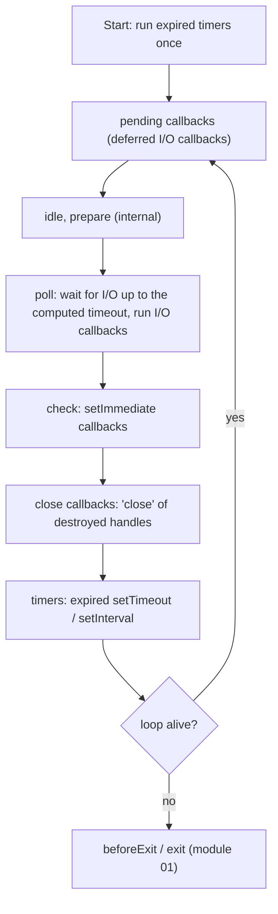
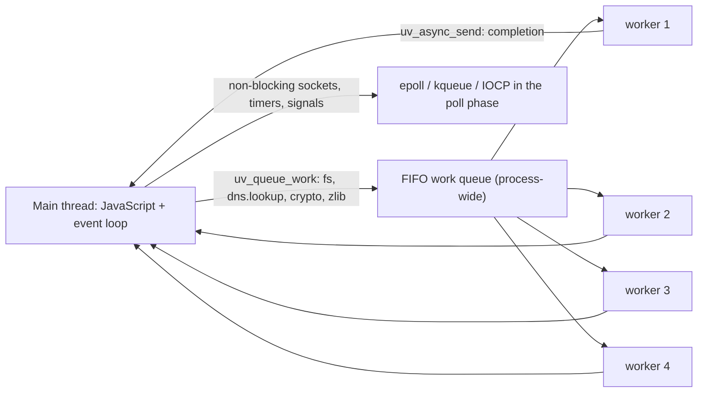

# 02 · The Event Loop for Real: libuv Phases, `nextTick`, Microtasks and the Thread Pool

> **Primary sources:** libuv [Design overview](https://docs.libuv.org/en/v1.x/design.html) and [Thread pool work scheduling](https://docs.libuv.org/en/v1.x/threadpool.html); libuv source `src/unix/core.c` (`uv_run`) and `src/threadpool.c`; Node.js Learn: [The Node.js Event Loop](https://nodejs.org/en/learn/asynchronous-work/event-loop-timers-and-nexttick) and [Don't Block the Event Loop](https://nodejs.org/en/learn/asynchronous-work/dont-block-the-event-loop); Node.js source `lib/internal/process/task_queues.js`, `lib/internal/timers.js`; API docs [Timers](https://nodejs.org/api/timers.html), [`process.nextTick`](https://nodejs.org/api/process.html#processnexttickcallback-args).
>
> **Executable proof:** [`examples/02-event-loop.test.ts`](../examples/02-event-loop.test.ts)

The language-level part of the story (what a job is, why promise reactions run in FIFO order, how many ticks an `await` costs) is owned by the JavaScript track: read [JavaScript module 06 §3](../../../languages/javascript/modules/06-agents-realms-job-queue.md#3-jobs-in-ecma-262) first. This module is the **host** half: what libuv does between JavaScript callbacks, where `process.nextTick` fits, what runs on other threads, and how those facts turn into latency incidents.

---

## 1. Definitions

- **Event loop.** A single-threaded loop, owned by libuv (`uv_run`), that repeatedly (a) asks the OS which I/O is ready or complete, (b) runs the callbacks for completed work, and (c) runs expired timers, until nothing keeps it alive ([module 01 §2.2](01-runtime-architecture.md#22-why-does-a-process-stay-alive)).
- **Handle** (`uv_handle_t`). A long-lived object that can produce callbacks repeatedly while active: TCP servers and sockets, timers, signals, `setImmediate`'s check handle, child processes, file watchers.
- **Request** (`uv_req_t`). A short-lived, one-shot operation: a write on a socket, a file system call, a DNS lookup, a unit of thread-pool work.
- **Macrotask** (informal). Any callback started by the loop: an I/O callback, a timer, an immediate, a close callback. Node does not use this word, but it maps onto HTML's "task".
- **`nextTick` queue.** A Node-specific FIFO queue of callbacks, processed after the current JavaScript operation finishes and **before** V8's microtask queue.
- **Microtask queue.** V8's queue of promise reaction jobs and `queueMicrotask` callbacks (the host's realisation of ECMA-262's `HostEnqueuePromiseJob`).
- **Tick processing.** After every callback that libuv starts, Node runs `processTicksAndRejections`: drain the `nextTick` queue, drain microtasks, repeat while either is non-empty, then report unhandled rejections.

---

## 2. One iteration of `uv_run`

libuv 1.45 (Node 20) changed the order inside an iteration: timers now run **after** the poll phase, and once before the first iteration for backwards compatibility. Node 26 ships libuv 1.52.1, so this is the current model. Abridged from `src/unix/core.c`:

```
uv_run(loop, UV_RUN_DEFAULT):
  alive ← uv__loop_alive(loop)                      ▷ active ref'd handles or requests?
  if alive: update_time(); run_timers()              ▷ once, before the first iteration
  while alive and not stopped:
     run_pending()                                   ▷ PENDING: I/O callbacks deferred from last iteration
     run_idle(); run_prepare()                       ▷ IDLE, PREPARE: internal (Node uses them for immediates)
     timeout ← 0 if immediates/pending/idle work exists
               else time until the nearest timer (∞ if none)
     io_poll(loop, timeout)                          ▷ POLL: epoll_wait/kevent/GetQueuedCompletionStatusEx;
                                                     ▷ runs I/O callbacks for ready fds and finished thread-pool work
     run_check()                                     ▷ CHECK: setImmediate callbacks
     run_closing_handles()                           ▷ CLOSE: 'close' callbacks of handles closed with uv_close
     update_time(); run_timers()                     ▷ TIMERS: expired setTimeout/setInterval
     alive ← uv__loop_alive(loop)
```



After **every single callback** in any phase, Node drains the `nextTick` queue and then the microtask queue. Microtasks are not a phase; they are a checkpoint between callbacks.

### 2.1 The poll timeout is the whole trick

The poll phase is where a Node process spends its idle time, blocked in `epoll_wait` (or the platform equivalent) with a timeout:

| Situation at poll time | Poll timeout |
| --- | --- |
| immediates are queued, or pending/idle work exists | **0**: do not block; check for ready I/O and move on |
| timers exist | time until the earliest timer expires |
| no timers, no immediates | infinite: block until some I/O completes or a signal arrives |
| `uv_stop` called | 0 |

This explains two classic facts:

1. **Inside an I/O callback, `setImmediate` always runs before `setTimeout(fn, 0)`.** The I/O callback runs in poll; check comes next in the same iteration; timers come after check. The test runs this 20 times and requires `['immediate', 'timeout']` every time.
2. **In the main module, the order is not guaranteed.** `setTimeout(fn, 0)` is really 1 ms (the delay is coerced to the range 1..2³¹−1). Before the first iteration, libuv runs expired timers. Whether 1 ms has elapsed since the timer was created depends on how long bootstrap took, so the output is either `timeout, immediate` or `immediate, timeout`. The test only checks that the output is one of the two; any test that asserts a specific order here is flaky by construction.

### 2.2 What the phases contain in practice

| Phase | Typical Node callbacks |
| --- | --- |
| timers | `setTimeout`, `setInterval` callbacks; internal timers such as HTTP keep-alive and `server.headersTimeout` checks |
| pending | TCP errors such as `ECONNREFUSED` that libuv defers to the next iteration on some platforms; a few write callbacks |
| poll | almost everything: `'data'`/`'connection'`/`'request'` events, completed `fs`/`dns.lookup`/`crypto`/`zlib` thread-pool work, child-process pipes, signal delivery (via a self-pipe) |
| check | `setImmediate` callbacks; internal work such as stream `'drain'` scheduling in some paths |
| close | `'close'` for handles torn down with `socket.destroy()`; graceful closes emit `'close'` via `process.nextTick` instead |

### 2.3 A model you can execute

[`examples/02-mini-loop.ts`](../examples/02-mini-loop.ts) is a deterministic model of the loop with a virtual clock: timers, a poll queue of completed I/O, a check queue, close callbacks, a tick queue and a microtask queue. The test file replays the guaranteed orderings of this module through the model and compares them with real Node. CLRS-style pseudocode with its invariants:

```
MINI-LOOP-RUN(L)
  RUN-TIMERS(L)                                   ▷ libuv ≥ 1.45: once before the loop
  while ALIVE(L)                                  ▷ timers ∪ io ∪ check ∪ close ≠ ∅
     ▷ Invariant I1: when a phase starts, tickQ = ∅ and microQ = ∅
     ▷ Invariant I2: every callback c is followed by DRAIN(L) before the next callback runs
     ▷ Invariant I3: callbacks added to the check queue during CHECK run in the next iteration
     for each cb in POP-ALL(L.io): RUN(L, cb)     ▷ poll
     batch ← L.check; L.check ← []                 ▷ snapshot: I3
     for each cb in batch: RUN(L, cb)
     for each cb in POP-ALL(L.close): RUN(L, cb)
     if L.check = ∅ and L.io = ∅: L.now ← max(L.now, NEXT-TIMER-DUE(L))   ▷ "block" in poll
     RUN-TIMERS(L)

RUN(L, cb)
  cb()
  DRAIN(L)

DRAIN(L)                                          ▷ processTicksAndRejections
  repeat
     while L.tickQ ≠ ∅: (dequeue L.tickQ)()
     while L.microQ ≠ ∅: (dequeue L.microQ)()
  until L.tickQ = ∅                               ▷ postcondition: I1 holds again
```

`DRAIN` terminates only if callbacks stop enqueueing ticks and microtasks; that is the formal content of "recursive `nextTick` starves I/O": `ALIVE(L)`'s other queues are never examined while `DRAIN` loops.

---

## 3. `process.nextTick` vs microtasks

### 3.1 The algorithm

`lib/internal/process/task_queues.js`, simplified:

```
processTicksAndRejections():
  repeat
     while tick ← nextTickQueue.shift():
        run tick.callback(...tick.args)              ▷ with its async context restored
     runMicrotasks()                                 ▷ V8 drains the whole microtask queue,
                                                     ▷ including microtasks queued while draining
  until nextTickQueue is empty and no rejections are pending
  processPromiseRejections()                         ▷ 'unhandledRejection' / default throw (module 04)
```

Invariants that follow, all pinned in the test:

1. Within one drain, **every queued `nextTick` runs before any microtask**.
2. A `nextTick` queued _by a microtask_ waits until the **entire** microtask queue is empty, including microtasks queued later in that same drain (`tick-from-p1` runs after `p1b` and `p-from-tick2` in the CommonJS case).
3. A microtask queued by a `nextTick` callback runs after all ticks queued in that round.
4. Both queues drain **completely** before the loop can continue, which is why unbounded recursion in either starves I/O (§4).

### 3.2 The ES module exception

The order depends on **where you start**. A CommonJS entry point runs as a plain synchronous call from C++; when it returns, Node processes ticks first. An ES module entry point is evaluated by V8's module machinery inside a promise job (module evaluation returns a promise, and the loader awaits it). When the module body finishes, V8 is **already draining microtasks**, so every microtask queued by the body runs before Node gets control back to process ticks.

```js
process.nextTick(() => log('tick'));
Promise.resolve().then(() => log('promise'));
// CommonJS entry:  tick, promise
// ES module entry: promise, tick
```

The test runs the same program as `node -e` (CommonJS) and `node --input-type=module -e` (ESM) and pins both orders. The same applies to code after any `await`: once you are inside an async function's continuation, you are inside a microtask, and newly queued microtasks run before newly queued ticks. In practice, **never write code whose correctness depends on the relative order of `nextTick` and promise callbacks**. Most interview "predict the output" questions are posed for CommonJS; ask which module system they mean.

### 3.3 When `nextTick` is the right tool

`nextTick` exists for API consistency, not performance:

- **Always-async callbacks.** An API that sometimes calls back synchronously and sometimes asynchronously ("releasing Zalgo") breaks callers. `process.nextTick(cb, err)` defers the synchronous error path so it behaves like the asynchronous one.
- **Emitting after the constructor returns.** An object that wants to emit `'ready'` or `'error'` from its constructor must defer it, or listeners attached after `new` miss it. Core streams use `nextTick` for `'error'` and `'close'` emission for this reason.

For new code that just needs "later", the Node documentation recommends `queueMicrotask` (same queue as promises, standard across runtimes) or `setImmediate` (yields to I/O). `process.nextTick` is not deprecated, and there is no plan to remove it.

### Then vs now: microtasks between timers

|  | Node ≤ 10 | Node ≥ 11 (current) |
| --- | --- | --- |
| Two expired timers `t1`, `t2`; `t1` queues a promise callback `p` | `t1, t2, p`: microtasks drained only after the whole timers phase | `t1, p, t2`: ticks and microtasks drained after **each** callback |
| Same for `setImmediate` | batch, then microtasks | after each immediate |

The change aligned Node with browsers (HTML performs a microtask checkpoint after each task). Code written for Node 10 that relied on batching, typically tests that asserted an order, changed behaviour; nothing in production should rely on either. The test asserts the modern order `t1, t1-tick, t1-p, t2`.

---

## 4. Blocking and starvation

**Definition.** The event loop is **blocked** when JavaScript (or a synchronous native call made from JavaScript) runs for longer than the latency budget of the work waiting behind it. Event-loop **lag** (or delay) is the difference between when a callback was due and when it ran. Event-loop **utilisation** (ELU) is the fraction of wall time the loop spent outside the poll wait (that is, running callbacks).

Because there is one thread, every request a server is handling shares it. If one request runs 200 ms of synchronous code, every other request on that process gets 200 ms of extra latency, and every timer (including keep-alive and request timeouts) is 200 ms late. The test proves the lower bound: a `setTimeout(fn, 0)` scheduled before a 60 ms busy loop fires at least 60 ms later.

### 4.1 What blocks

| Category | Examples | Fix |
| --- | --- | --- |
| Synchronous APIs | `fs.readFileSync`, `crypto.pbkdf2Sync`, `zlib.gzipSync`, `child_process.execSync` | the async variant (thread pool) |
| CPU-heavy JavaScript | `JSON.parse`/`JSON.stringify` of tens of MB, sorting large arrays, template rendering, regexes with catastrophic backtracking ([ReDoS](13-security.md#5-redos)) | limits on input size, streaming parsers, a worker pool ([module 09](09-concurrency-and-scaling.md#3-worker-pools)), partitioning with `setImmediate` |
| Unbounded microtask or `nextTick` recursion | a promise loop that never awaits real I/O, recursive `nextTick` retries | yield with `setImmediate` or `scheduler.yield()` |
| Long synchronous loops over large data | building a 1 GB string, iterating 10⁸ items | chunk the work and yield between chunks |

### 4.2 Starvation, proven

The test runs three loops for the same pending `fs.stat`:

- 200 000 recursive `process.nextTick` calls: the stat callback **never** runs during the recursion (poll is never reached).
- 200 000 recursive `Promise.resolve().then(f)`: same result.
- recursive `setImmediate`: the stat callback runs after a handful of iterations, because each iteration passes through poll. `setImmediate` recursion still burns CPU, but it lets I/O in.

### 4.3 Partitioning work

```ts
import { setImmediate as yieldToLoop } from 'node:timers/promises';

async function sumInChunks(values: Float64Array, chunk = 50_000): Promise<number> {
  let total = 0;
  for (let i = 0; i < values.length; i += chunk) {
    const end = Math.min(i + chunk, values.length);
    for (let j = i; j < end; j++) total += values[j]!;
    await yieldToLoop(); // a check-phase hop: I/O and timers run between chunks
  }
  return total;
}
```

Partitioning bounds the lag each chunk adds, but it multiplies total latency for the chunked request and does not use more cores. For sustained CPU-bound work, move it off the loop ([module 09](09-concurrency-and-scaling.md)). `scheduler.yield()` from `node:timers/promises` is the standard-shaped alternative to `await setImmediate()`.

---

## 5. The thread pool

**Definition.** libuv's thread pool (`src/threadpool.c`) is a fixed set of worker threads, shared by **the whole process** (all `worker_threads` share it too), with a FIFO work queue. Its size is `UV_THREADPOOL_SIZE`, default **4**, maximum 1024. It is created lazily on the first queued work item, and the size is read once at that moment, so setting `process.env.UV_THREADPOOL_SIZE` inside the program works only if no thread-pool work has happened yet. Set it in the environment.

What uses it:

| Operation | Why it needs a thread |
| --- | --- |
| All asynchronous `fs` operations except `fs.watch` (which uses inotify/FSEvents/ReadDirectoryChangesW) | POSIX file I/O has no portable non-blocking interface |
| `dns.lookup()` (and therefore `net.connect`/`http.request`/`fetch` to a host name, by default) | `getaddrinfo(3)` is blocking; it honours `/etc/hosts` and `nsswitch.conf` |
| `crypto.pbkdf2`, `crypto.scrypt`, `crypto.randomBytes` (async), `crypto.generateKeyPair`, `crypto.subtle.*` heavy operations | CPU-bound |
| `zlib` asynchronous compression (`zlib.gzip`, `createGzip` streams) | CPU-bound |
| Some native addons (`napi_create_async_work`) | by design |

What does **not** use it: network sockets (they are non-blocking and polled by epoll/kqueue/IOCP), timers, `dns.resolve*()` (c-ares does its own non-blocking DNS over UDP/TCP), child processes, pipes.

libuv classifies work into **fast I/O, slow I/O and CPU** kinds and limits slow I/O (`getaddrinfo`, `getnameinfo`) to about half the pool, so DNS alone cannot occupy every thread. CPU and fast I/O items still compete in one FIFO queue.

### 5.1 Thread-pool starvation

With four threads, four slow items block everything else that needs the pool. The test makes it deterministic by shrinking the pool to one: an asynchronous `crypto.pbkdf2` with 200 000 iterations queued before an `fs.stat` makes the `fs.stat` callback wait for the hash, every time. In production the symptoms are:

- "random" `fs` latency spikes that correlate with login traffic (bcrypt/scrypt/pbkdf2 password hashing),
- slow outbound HTTP connects that correlate with file uploads, because `dns.lookup` waits behind `fs` work,
- everything correlates with zlib compression of large responses.

Fixes, in order: avoid DNS lookups per request (keep-alive agents reuse connections; cache resolutions; [module 07](07-networking-and-http.md#7-dns-lookup-vs-resolve)); raise `UV_THREADPOOL_SIZE` to roughly the number of cores plus expected concurrent slow operations (a common setting is 8–64); move heavy hashing to a dedicated worker pool so its queue does not delay file I/O; measure.

The `Sync` variants (`pbkdf2Sync`, `scryptSync`, `readFileSync`) do not use the pool: they run on the main thread and block it. The test proves a zero-delay timer cannot fire during `pbkdf2Sync`.



---

## 6. Timers in depth

- **Clamping.** The delay is coerced to a number; values below 1 and `NaN` become 1 ms; values above 2³¹−1 ms (about 24.8 days) also become **1 ms** and emit a `TimeoutOverflowWarning`. The test schedules a `2 ** 31` timer and sees it fire immediately. Long-period scheduling (a job "in 30 days") belongs in a scheduler or a database, not in `setTimeout`.
- **Data structure.** Node keeps one linked list per distinct duration (`TimersList`), and a binary heap of those lists ordered by expiry. Inserting a timer with an existing duration is O(1) (append to that list); only one libuv timer is armed, for the earliest expiry. This is why 100 000 sockets with the same idle timeout are cheap.
- **Accuracy.** Timers are a lower bound. They run in the timers phase of the first iteration after expiry, behind whatever JavaScript was running. Under load, a 100 ms timer can fire at 400 ms.
- **`refresh()`** restarts a timer with its original duration without allocating; Node's own socket idle timeouts use it. **`unref()`** lets the process exit while the timer is pending; **`hasRef()`** reports the state. A `Timeout` converts to a numeric id (`+timeout`) that `clearTimeout` accepts, which helps when the id must cross a serialisation boundary.
- **Promise and iterator forms.** `node:timers/promises` exports `setTimeout(ms, value, { signal })`, `setImmediate(value, { signal })`, `setInterval(ms)` as an async iterator, and `scheduler.wait(ms)`/`scheduler.yield()`. All accept an `AbortSignal` and reject with an `AbortError` on abort, which the test checks.
- **Testing timers** without waiting: `node:test`'s `mock.timers` fakes `setTimeout`, `setInterval`, `setImmediate` and `Date` ([module 12](12-testing.md#4-mocking-functions-timers-and-modules)).

---

## 7. How Node builds its queues on top of libuv

libuv knows nothing about `setImmediate`, `process.nextTick` or promises. Node implements each with a small amount of glue:

| Node API | libuv primitive | Detail |
| --- | --- | --- |
| `setTimeout`/`setInterval` | **one** `uv_timer_t` per Environment | armed for the earliest expiry in the priority queue of `TimersList`s; when it fires, `processTimers` runs every expired list in expiry order, draining ticks and microtasks after each callback |
| `setImmediate` | a `uv_check_t` handle plus a `uv_idle_t` handle | the check handle runs the immediate queue in the check phase; the idle handle is started while immediates are pending, which forces the poll timeout to 0 so a pending immediate never waits for I/O |
| `process.nextTick` | none | a JavaScript array-backed FIFO in `task_queues.js`; processed by `processTicksAndRejections` after each callback that returns to C++ (`InternalCallbackScope`) |
| promise jobs | none (V8's `MicrotaskQueue`) | Node runs V8 with an explicit microtask policy and calls `runMicrotasks()` itself, after the tick queue |
| signals | `uv_signal_t` | libuv's signal handler writes to a self-pipe; the callback runs in poll |
| `fs.watch` | `uv_fs_event_t` | inotify/FSEvents/ReadDirectoryChangesW; not the thread pool |
| `fs.watchFile` | `uv_fs_poll_t` | `stat` polling on a timer, through the thread pool: expensive with many files |

The immediate queue is drained with a snapshot rule: immediates added while the check phase is running are appended to a new list and wait for the next iteration. The test schedules `A` (which queues `C` and a microtask) and `B`, and observes `A, A-microtask, B, C`.

---

## 8. Worked trace

A complete program, run as CommonJS, with every guaranteed ordering explained:

```js
const fs = require('node:fs');
console.log('1 sync');
setTimeout(() => console.log('timer'), 0);
setImmediate(() => console.log('immediate'));
fs.readFile(__filename, () => {
  console.log('io');
  setTimeout(() => console.log('io → timer'), 0);
  setImmediate(() => console.log('io → immediate'));
  process.nextTick(() => console.log('io → tick'));
});
Promise.resolve().then(() => console.log('2 promise'));
process.nextTick(() => console.log('2 tick'));
console.log('1 sync end');
```

| Step | Where | Output | Why it is guaranteed |
| --- | --- | --- | --- |
| 1 | main script | `1 sync`, `1 sync end` | synchronous |
| 2 | tick processing after the main script | `2 tick` | ticks before microtasks |
| 3 | microtask drain | `2 promise` |  |
| 4 | first timers run / first check phase | `timer` and `immediate` in **either** order | depends on whether 1 ms elapsed before the first timer check |
| 5 | a later poll phase | `io` | the read finished in the thread pool; its completion is delivered in poll |
| 6 | tick processing after the I/O callback | `io → tick` | ticks drain after every callback |
| 7 | check phase of the same iteration | `io → immediate` | check follows poll |
| 8 | timers phase at or after 1 ms | `io → timer` | timers follow check |

The relative order of step 4 and step 5 is also not guaranteed in theory (a very fast read on a slow machine could complete before the first check phase), which is why robust tests assert only orderings inside a single causal chain.

---

## 9. Other loops: workers, Deno and Bun

- **Each `worker_threads.Worker` has its own libuv loop, its own timers, tick queue and microtask queue**, and its own V8 isolate. Ordering guarantees hold within a thread, never across threads. Workers share the **process-wide thread pool**, so a worker doing heavy async `fs` or `crypto` competes with the main thread's file I/O ([module 09](09-concurrency-and-scaling.md)).
- **Deno** runs its event loop on Tokio (Rust), not libuv. It implements `setTimeout`, `setImmediate` (in its Node compatibility layer) and `process.nextTick`, but phase-level guarantees such as "`setImmediate` before `setTimeout` inside an I/O callback" are Node behaviours that compatibility layers emulate rather than guarantee.
- **Bun** uses its own event loop (built on its runtime in Zig, with JavaScriptCore). It also emulates Node's queues for compatibility.

Treat portable code as having only the language guarantee (synchronous code, then microtasks, then the next host task) plus documented API guarantees; treat phase orderings as Node-specific.

---

## 10. Measuring the loop

| Tool | What it reports | Module |
| --- | --- | --- |
| `perf_hooks.monitorEventLoopDelay({ resolution })` | a histogram of loop delay (min, max, mean, percentiles), sampled by a timer | [11](11-diagnostics-and-performance.md#3-event-loop-delay-and-utilisation) |
| `performance.eventLoopUtilization()` | idle vs active time since start or between two calls; ELU ≈ 1 means saturated | 11 |
| `process.getActiveResourcesInfo()` | what keeps the loop alive | 01 |
| `--cpu-prof`, flame graphs | where the blocking time goes | 11 |
| `async_hooks`/`AsyncLocalStorage` | causality between callbacks (who scheduled what) | 11 |

A good service-level alert is **p99 event-loop delay above ~100 ms for several minutes**, alongside request latency. ELU near 1.0 with low CPU on other cores is the signature of a process that needs horizontal scaling or offloading.

---

## 11. Production failure modes

| Symptom | Mechanism | Fix |
| --- | --- | --- |
| p99 latency jumps for _all_ routes when one route is called | that route does synchronous CPU work (huge `JSON.parse`, sync crypto, sync zlib) | async APIs, input limits, worker pool |
| Process becomes unresponsive, health checks time out, CPU 100% on one core | unbounded `nextTick` or promise recursion, or ReDoS | yield with `setImmediate`; regex limits; watchdog on loop delay |
| `fs` latency spikes under login load | password hashing fills the 4-thread pool | larger `UV_THREADPOOL_SIZE`; dedicated hashing workers |
| Outbound connects slow during uploads | `dns.lookup` queued behind `fs` work | keep-alive, DNS caching, larger pool |
| Flaky test: "immediate before timeout" | relies on main-module ordering, which depends on startup time | schedule inside an I/O callback, or use `mock.timers` |
| Code broke when converted from CJS to ESM | relied on `nextTick` running before promise callbacks | do not depend on cross-queue ordering |
| A 30-day `setTimeout` fires immediately | delay above 2³¹−1 ms | durable scheduler |
| Timeouts fire "late", connection timeouts trigger spuriously | the loop is blocked; timers are lower bounds | measure loop delay; remove blocking |

---

## Interview Drill

<details><summary>1. List the phases of the Node.js event loop in order, and say where microtasks fit.</summary>

Per iteration (libuv ≥ 1.45, Node ≥ 20): pending callbacks → idle/prepare (internal) → poll (wait for I/O, run I/O callbacks) → check (`setImmediate`) → close callbacks → timers. Timers also run once before the first iteration. Microtasks are not a phase: after every individual callback, Node drains the `process.nextTick` queue and then V8's microtask queue, repeating until both are empty. Older material lists timers first; that was accurate before libuv 1.45, and the observable difference is small because timers still run before the first poll.
</details>

<details><summary>2. Predict the output (CommonJS): `setTimeout(() => log('t'), 0); setImmediate(() => log('i')); process.nextTick(() => log('n')); Promise.resolve().then(() => log('p')); log('s');`</summary>

`s, n, p`, then either `t, i` or `i, t`. Synchronous code first; then the `nextTick` queue; then microtasks. The timer-vs-immediate order in the main module depends on whether 1 ms elapsed before the loop's first timer check. Inside an I/O callback it would always be `i, t`. In an ES module entry, `p` would come before `n`.
</details>

<details><summary>3. Why is `process.nextTick` processed before promise callbacks, and when would you still use it?</summary>

Node drains its own tick queue first in `processTicksAndRejections` and then asks V8 to run microtasks; `nextTick` predates promises in Node. Use it to make an API consistently asynchronous (deferring a synchronous error to the callback), or to emit an event after a constructor returns so listeners can be attached. For general deferral, prefer `queueMicrotask` or `setImmediate`.
</details>

<details><summary>4. What runs on the libuv thread pool, and what does not? What is the default size and why does it matter?</summary>

On the pool: asynchronous file system calls, `dns.lookup` (getaddrinfo), CPU-heavy crypto (pbkdf2, scrypt, key generation, async randomBytes), async zlib, and native addon async work. Not on the pool: network sockets (epoll/kqueue/IOCP), timers, `dns.resolve*` (c-ares), child processes. Default size 4, process-wide (shared with worker threads), read once when the pool starts. Four slow items (bcrypt-like hashing, slow DNS) delay every other pool user, which shows up as unexplained `fs` or connect latency.
</details>

<details><summary>5. A service's p99 latency is fine at low load but explodes at moderate load, CPU is at 100% of one core, and other cores are idle. What do you suspect and how do you confirm it?</summary>

The event loop is saturated or blocked: synchronous CPU work in the request path, or a hot path that is simply too expensive for one thread. Confirm with `monitorEventLoopDelay` (high p99 delay) and ELU close to 1, then take a CPU profile (`--cpu-prof` or the inspector) under load to find the hot functions. Fix by removing synchronous work, bounding inputs, moving CPU work to a worker pool, or running more processes per host.
</details>

<details><summary>6. How can recursive `setImmediate` be safe while recursive `process.nextTick` hangs a server?</summary>

The `nextTick` (and microtask) queues are drained to completion before the loop continues; recursion keeps them non-empty forever, so the loop never reaches poll and no I/O callback runs. Immediates queued during the check phase run on the next iteration, and each iteration passes through poll, so I/O still gets serviced between recursive steps.
</details>

<details><summary>7. Why does `setTimeout(fn, 2 ** 31)` fire immediately?</summary>

Timer delays are stored as 32-bit signed integers in milliseconds. Values above 2³¹−1 (about 24.8 days) are out of range; Node sets the delay to 1 ms and emits a `TimeoutOverflowWarning`. Use a durable job scheduler for long delays, or chain shorter timers.
</details>

<details><summary>8. How does `setImmediate` guarantee that the poll phase does not block while immediates are pending?</summary>

Node starts a libuv idle handle whenever the immediate queue is non-empty. Any active idle handle makes libuv compute a poll timeout of zero, so the poll phase only checks for ready I/O and returns, and the check phase runs the immediates in the same iteration.
</details>

<details><summary>9. Is the ordering between a callback on the main thread and one in a worker thread defined?</summary>

No. Each worker has its own isolate, event loop and queues; ordering guarantees hold only within one thread. Coordination across threads needs explicit messages (`postMessage`, which arrives as a task in the receiving loop) or shared memory with Atomics.
</details>

<details><summary>10. What changed in Node 11 about timers and microtasks, and why?</summary>

Before Node 11, microtasks ran after the entire timers (or immediates) phase, so `t1, t2, p` where `p` was queued by `t1`. Since Node 11, Node drains ticks and microtasks after each timer and immediate callback (`t1, p, t2`), matching browsers, where a microtask checkpoint follows every task.
</details>
