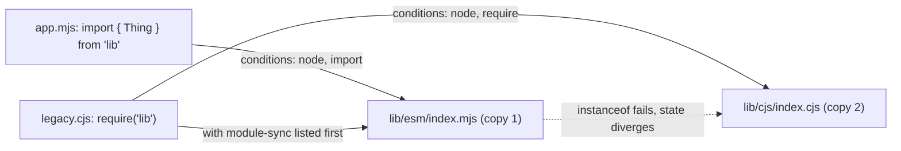

# 03 · Modules and Packages: the CommonJS Loader, `require(esm)`, Package Exports, Hooks and Type Stripping

> **Primary sources:** Node.js API docs: [Modules: CommonJS](https://nodejs.org/api/modules.html) (including the "All together" resolution pseudocode and "Loading ECMAScript modules using `require()`"), [Modules: ECMAScript modules](https://nodejs.org/api/esm.html), [Modules: Packages](https://nodejs.org/api/packages.html), [Modules: `node:module` API](https://nodejs.org/api/module.html) (customisation hooks, compile cache), [Modules: TypeScript](https://nodejs.org/api/typescript.html); npm docs: [`package-lock.json`](https://docs.npmjs.com/cli/v11/configuring-npm/package-lock-json), [`npm ci`](https://docs.npmjs.com/cli/v11/commands/npm-ci).
>
> **Executable proof:** [`examples/03-modules-and-packages.test.ts`](../examples/03-modules-and-packages.test.ts) with fixtures in [`examples/fixtures/03-modules/`](../examples/fixtures/03-modules/)

The _language_ semantics of ES modules (Module Records, the link and evaluate phases, live bindings, cycles and the TDZ, top-level await, import attributes, how `exports` conditions behave at runtime) are owned by the JavaScript track: [JavaScript module 08](../../../languages/javascript/modules/08-modules.md). Type-level module resolution (`moduleResolution: nodenext`, declaration files) is owned by [TypeScript module 06](../../../languages/typescript/modules/06-modules-declarations-and-tsconfig.md). This module owns what is specific to Node: the CommonJS loader, how Node's ESM loader finds and translates files, how the two interoperate (`require(esm)` and importing CJS), `package.json` fields as Node reads them, loader hooks, and the rules of Node's built-in TypeScript type stripping.

---

## 1. Two module systems in one runtime

**Definitions.**

- **CommonJS (CJS).** Node's original module format: a file is evaluated synchronously inside a function wrapper; `require(id)` returns the value of `module.exports`; resolution and evaluation happen at the moment `require` is called.
- **ECMAScript module (ESM).** The standard format: static `import`/`export`, resolved and linked before any code runs, evaluated asynchronously when top-level `await` is present. In Node, ESM specifiers are URLs (`file:`, `node:`, `data:`).
- **Module format** (Node term). The format Node assigns to a file before loading it: `commonjs`, `module`, `json`, `wasm`, `addon`, `builtin`, `commonjs-typescript` or `module-typescript`.

How Node decides a file's format (for files not inside a package that overrides it with hooks):

| File | Format |
| --- | --- |
| `.mjs`, `.mts` | ESM |
| `.cjs`, `.cts` | CJS |
| `.js`, `.ts` with nearest `package.json` `"type": "module"` | ESM |
| `.js`, `.ts` with nearest `package.json` `"type": "commonjs"` | CJS |
| `.js`, `.ts` with **no** `"type"` field | **syntax detection**: CJS, unless the file fails to parse as CJS _and_ parses as ESM (contains `import`/`export` statements, `import.meta`, or top-level `await`) |
| `.json` | JSON (with `with { type: 'json' }` from ESM) |
| `.node` | native addon (CJS `require` or `process.dlopen` only) |

Syntax detection (on by default since Node 22.7) is a convenience for scripts, not for libraries: it costs a failed parse, and a file that happens to be valid in both formats is treated as CJS. Always set `"type"` in a package. The test loads `typeless.js` (no `"type"` in its `package.json`, ESM syntax inside) both with `import` and with `require`.

---

## 2. The CommonJS loader

### 2.1 The algorithm

`require(id)` from a module at path _P_ calls `Module._load(id, parent)`, abridged from `lib/internal/modules/cjs/loader.js`:

```
Module._load(request, parent)
  1  if request starts with 'node:' or is a core module id: return the built-in            ▷ never shadowed by node_modules with node:
  2  filename ← Module._resolveFilename(request, parent)
        relative/absolute: try X, X.js, X.json, X.node, X/package.json "main", X/index.js ...
        "#..." : LOAD_PACKAGE_IMPORTS from the nearest package.json "imports"
        bare name: LOAD_PACKAGE_SELF, then for each node_modules dir walking up from P:
                   LOAD_PACKAGE_EXPORTS with conditions ["node", "require", "module-sync"],
                   else LOAD_AS_FILE / LOAD_AS_DIRECTORY
        then the global folders: $NODE_PATH, $HOME/.node_modules, $HOME/.node_libraries, $PREFIX/lib/node
  3  if Module._cache[filename] exists: return cached.exports                              ▷ possibly PARTIAL (cycles)
  4  module ← new Module(filename, parent); Module._cache[filename] ← module               ▷ cached BEFORE evaluation
  5  module.load(filename): choose the extension handler (.js/.cjs/.ts → compile, .json → JSON.parse, .node → dlopen,
                            ESM files → require(esm), see §4)
  6  on exception: delete Module._cache[filename]; rethrow
  7  return module.exports
```

### 2.2 The wrapper

CJS source is compiled as the body of a function (`require('node:module').wrapper` shows it; the test asserts it):

```js
(function (exports, require, module, __filename, __dirname) {
  // your file
});
```

This is why `require`, `module`, `exports`, `__filename` and `__dirname` look global but are parameters; why top-level `return` is legal in CJS; why top-level `var` does not create a global; and why top-level `this` is `module.exports`. Node compiles the source with V8's function-compilation API using those parameter names, rather than by concatenating strings, so stack-trace column numbers on line 1 are correct.

`exports` is a reference to the initial `module.exports` object. `exports = fn` rebinds the local parameter and exports nothing; `module.exports = fn` replaces the export. Mixing `exports.x = 1` with a later `module.exports = {}` silently discards `x`.

### 2.3 The cache

`require.cache` (`Module._cache`) maps **resolved absolute filenames** to `Module` objects. Consequences, all in the test:

- A module is evaluated **once per resolved path**; every later `require` returns the same `exports` object, which is how CJS singletons work.
- Two paths to the same code (for example two copies of a library at different `node_modules` depths, or a symlinked path without `--preserve-symlinks`) produce two instances.
- `delete require.cache[path]` makes the next `require` evaluate the file again, but objects that already hold the old exports keep the old instance. Hot-reloading by cache deletion leaks the old module graph and its timers.
- ES modules have their own module map, which user code cannot clear. `require(esm)` and `import` share it.

### 2.4 Cycles

Because a module is cached _before_ it is evaluated (step 4), a cycle returns the **partially populated** `exports` of the module still being evaluated. In the fixture, `cycle-a.cjs` sets `loaded = false`, requires `cycle-b.cjs`, which requires `cycle-a.cjs` back and sees `{ loaded: false }`; only after `b` returns does `a` set `loaded = true`. If `a` had used `module.exports = { ... }` _after_ requiring `b`, `b` would hold a reference to the abandoned original object forever. ESM cycles behave differently (live bindings and TDZ errors instead of partial objects): [JavaScript module 08 §3](../../../languages/javascript/modules/08-modules.md#3-cycles-and-the-temporal-dead-zone).

### 2.5 `require.resolve` and module paths

- `require.resolve(id, { paths })` runs step 2 without loading, and is the correct way to locate a dependency's files (`path.dirname(require.resolve('pkg/package.json'))`, which works only if the package exports `./package.json`).
- `module.createRequire(import.meta.url)` gives ESM code a `require` function anchored at the current file.
- `module.findPackageJSON(specifier, base)` (Node 23.2 and 22.14) returns the path of the `package.json` that governs a file; the test locates the fixture's.
- `NODE_PATH` still works for CJS but not for ESM; it is a legacy mechanism that hides missing dependencies.

---

## 3. Node's ESM loader

The ESM loader (`lib/internal/modules/esm/`) implements the host hooks that ECMA-262 leaves open: `HostLoadImportedModule` (resolve + load) and `HostGetImportMetaProperties`. For each specifier:

1. **Resolve** (`defaultResolve`): relative specifiers are resolved as URLs against the parent's URL; bare specifiers go through `package.json` `exports`/`imports` with conditions `["node", "import", "module-sync"]` plus `--conditions`; **no extension guessing and no directory index lookup** for relative paths (`import './util'` fails; write `./util.js` or `./util.ts`).
2. **Load** (`defaultLoad`): read the source and determine the format (§1). Only `file:`, `data:` and `node:` URLs are supported without hooks; the test's hook fixture shows the `ERR_UNSUPPORTED_ESM_URL_SCHEME` you get for anything else.
3. **Translate**: create a V8 Source Text Module Record (ESM), a synthetic module wrapping `module.exports` (CJS), a JSON module, or a WebAssembly module.
4. **Link and evaluate** with V8, as described in [JavaScript module 08 §1](../../../languages/javascript/modules/08-modules.md#1-module-records-and-the-three-phases).

ESM-only facilities in Node: `import.meta.url`, `import.meta.filename` and `import.meta.dirname` (absolute paths, `file:` modules only), `import.meta.resolve(specifier)` (synchronous), and `import.meta.main` (true when the module is the entry point). There is no `__dirname` in ESM.

### 3.1 Importing CommonJS from ESM

`import x from './lib.cjs'` evaluates the CJS module and wraps it in a synthetic module:

- **`default` is always `module.exports`.**
- **Named exports** are detected _statically_ by `cjs-module-lexer`, which scans the source for patterns such as `exports.a =`, `module.exports.b =`, `Object.defineProperty(exports, 'c', { value })` and `module.exports = { a, b }`, plus re-exports (`module.exports = require('./other')`). The test shows the two failure directions: a `defineProperty` **getter** is not detected (no named export `c`, though `default.c` works), while an assignment inside a dead branch is detected (named export `d` exists with value `undefined`).
- A `'module.exports'` named export is also present (Node 23+), equal to `default`.

If a named import is missing, the error is `SyntaxError: Named export 'x' not found. The requested module 'lib' is a CommonJS module, which may not support all module.exports as named exports.` Use the default import and destructure.

---

## 4. `require(esm)`

**Definition.** Since Node 22.12 / 23.0 (and 20.19), `require()` can load an ES module **synchronously**, provided the module and its entire import graph contain no top-level `await`. It returns the **module namespace object**.

| Release | Status |
| --- | --- |
| 22.0.0, 20.17.0 | added behind `--experimental-require-module` |
| 23.0.0, 22.12.0, 20.19.0 | enabled by default; `'module.exports'` interop export added |
| 23.5.0, 22.13.0, 20.19.0 | no experimental warning by default (`--trace-require-module` still reports uses) |
| **25.4.0** | **no longer experimental** |

Rules, each proven by the test:

1. The result is the namespace: `require('./esm.mjs')` gives `[Module: null prototype] { default, x, __esModule: true }`. The `__esModule: true` marker is added when there is a default export, so transpiled CJS code that does `mod.__esModule ? mod.default : mod` keeps working.
2. An ES module can decide what `require()` returns by exporting a binding under the string name `"module.exports"`: `export { Point as 'module.exports' }`. CJS consumers then get `Point` directly and **lose** the other named exports (`Point.named` is `undefined` in the test). Attach them as static properties if CJS callers need them.
3. If the required module **or anything it imports** uses top-level `await`, `require()` throws `ERR_REQUIRE_ASYNC_MODULE`. The fixture `imports-tla.mjs` has no `await` itself; it imports `tla.mjs`, which does, and still throws. `--experimental-print-required-tla` prints the location of the offending `await`. Use `await import()` for such graphs.
4. `--no-require-module` restores the old behaviour, where `require` of ESM threw `ERR_REQUIRE_ESM` (the test checks it).

### Then vs now: consuming ESM from CommonJS

|  | Then (Node ≤ 20.16 / 22.11) | Now (Node 22.12+, 24, 26) |
| --- | --- | --- |
| `require('esm-only-pkg')` | `ERR_REQUIRE_ESM`; workarounds were `await import()` (forcing async code paths), pinning the last CJS version of the dependency, or bundling | works if the graph has no top-level `await`; returns the namespace |
| Library publishing | "dual packages": ship CJS and ESM builds, with all the hazards in §5.3 | **ESM-only is viable** for libraries whose minimum Node is 20.19 / 22.12; optional `module-sync` condition for one shared ESM copy |
| Remaining traps | — | top-level `await` anywhere in the graph; code that expects `require()` to return the default export directly (it returns the namespace unless `'module.exports'` is exported); tools that patch `Module._extensions` |

Migration steps for a library: (1) raise `engines.node` to `>=20.19` (or `>=22.12`); (2) remove top-level `await` from the import graph of the entry points; (3) publish ESM only, or keep a `require` condition only if old Node versions must be supported; (4) if you keep `default` as the main export, add `export { default as 'module.exports' }` so CJS callers get the value they expect.

---

## 5. Packages as Node reads them

### 5.1 `package.json` fields with runtime meaning

| Field | Effect at runtime |
| --- | --- |
| `"name"` | enables **self-reference**: code inside the package can `import 'my-pkg/sub'` through its own `exports` |
| `"type"` | `"module"` or `"commonjs"`: the format of `.js`/`.ts` files in the package scope (§1) |
| `"exports"` | the package's public entry points; **encapsulates** everything else (`ERR_PACKAGE_PATH_NOT_EXPORTED` for unlisted subpaths); supports conditions and `*` patterns; takes precedence over `"main"` |
| `"imports"` | private, package-internal aliases that must start with `#` (`"#internal/*": "./internal/*.cjs"`), with conditions; resolves the same way for CJS and ESM |
| `"main"` | the legacy entry point, used only when `"exports"` is absent |
| `"engines"` | **not enforced by Node**; npm warns (or fails with `engine-strict`) |
| `"packageManager"` | read by Corepack, not by Node |
| `"scripts"` | read by `npm run` and by `node --run` |

`package.json` scope lookup stops at the nearest `package.json`, even one with only `{}` in it. A stray `package.json` in a subdirectory (common in monorepos and test fixtures) changes the format of every `.js` file below it.

### 5.2 Conditions

Conditions are keys inside `"exports"`/`"imports"` objects, matched **in object order**; the first matching key wins, so `"default"` must be last. Node's built-in conditions:

| Condition | Matches when |
| --- | --- |
| `"node"` | always in Node |
| `"import"` | the request comes from `import`/`import()` |
| `"require"` | the request comes from `require()` |
| `"module-sync"` | the loader can accept a synchronous ESM graph: matches for `import` **and** for `require()` while `require(esm)` is enabled |
| `"default"` | always (fallback) |
| custom (`"development"`, `"production"`, `"react-server"`, …) | only when passed with `--conditions=name` (`-C name`) |

The test's `sync-first` package lists `"module-sync"` first: `require('sync-first')` and `import 'sync-first'` resolve to the **same** ESM file, so both callers share one instance. Its `./feature` subpath returns the production build unless `--conditions=development` is given. Runtime matching semantics (order, nesting, fallbacks) are owned by [JavaScript module 08 §6](../../../languages/javascript/modules/08-modules.md#6-package-exports-and-conditions-at-runtime); TypeScript's `"types"` condition belongs to the TypeScript track.

### 5.3 The dual-package hazard

**Definition.** A package that ships separate CJS and ESM implementations under `"require"` and `"import"` conditions can be loaded **twice** in one process when one part of the application imports it and another requires it. Each copy has its own module-level state and its own classes, so singletons diverge and `instanceof` checks fail across the boundary. The test loads the fixture `dual` both ways and shows `new esmThing instanceof cjsThing === false`.

Real-world symptoms: two instances of a logger or metrics registry (half the metrics missing), a plugin registered on one copy of a framework but not the other, `instanceof ValidationError` failing in an error handler, two copies of a React context.

Mitigations, best first:

1. **Ship ESM only** and rely on `require(esm)` (Node ≥ 20.19 / 22.12).
2. Use **`"module-sync"`** (before `"require"`/`"import"`) so both loaders get one ESM copy where supported.
3. **Stateless wrapper**: ship the implementation once (CJS), and make the ESM entry a thin re-export of it (`export { default } from './index.cjs'`), so state lives in one place.
4. Use cross-realm-safe and cross-copy-safe checks: brand with a `Symbol.for('my-lib.Thing')` property instead of `instanceof`.



### 5.4 Then vs now: package entry points

|  | Then | Now |
| --- | --- | --- |
| Entry point | `"main": "lib/index.js"`; every file reachable by deep import (`pkg/lib/internal/x`) | `"exports"`: an explicit public API, deep imports blocked; adding `"exports"` to an existing package is a breaking change |
| Internal aliases | relative paths `../../utils`, or bundler aliases | `"imports"` with `#` subpaths, understood by Node, TypeScript (`nodenext`) and bundlers |
| Format | CJS by default, ESM via `.mjs` | set `"type"` explicitly; ESM-first |

### 5.5 How an `exports` key is matched

The resolver used by both loaders (`PACKAGE_EXPORTS_RESOLVE` in the ESM spec section of the docs), simplified:

```
PACKAGE-EXPORTS-RESOLVE(packageURL, subpath, exports, conditions)
  1  if exports is a string, an array, or an object with no key starting with ".":
        exports ← { ".": exports }                                    ▷ sugar for the main entry
  2  if subpath is a key of exports and contains no "*":
        return TARGET-RESOLVE(exports[subpath], patternMatch = null, conditions)
  3  best ← null
     for each key k of exports containing exactly one "*":            ▷ pattern keys
        if subpath starts with prefix(k) and ends with suffix(k) and is longer than k:
           if best = null or k is more specific than best: best ← k   ▷ longest prefix wins
  4  if best ≠ null: return TARGET-RESOLVE(exports[best], the text matched by "*", conditions)
  5  throw ERR_PACKAGE_PATH_NOT_EXPORTED

TARGET-RESOLVE(target, match, conditions)
  string  → must start with "./" (no "..", no "node_modules" segments); substitute match for "*"
  array   → try each element in order, return the first that resolves without an "invalid target" error
  object  → for each key in OBJECT ORDER: if key = "default" or key ∈ conditions, recurse on its value;
             return the first non-undefined result
  null    → explicitly not exported (used to carve exclusions out of a pattern)
```

Invariants worth stating: resolution never escapes the package directory (targets must start with `./` and may not contain `..`); conditions are tried in the **package author's** key order, never in the caller's priority order; and a `null` target is a hard "not exported", which is how `"./internal/*": null` hides a subtree that a broader pattern would expose.

### 5.6 JSON, WebAssembly and addons

- **JSON** loads synchronously with `require('./data.json')` (parsed once, then cached and shared, so mutating it mutates every importer's copy) and from ESM only with an import attribute: `import data from './data.json' with { type: 'json' }`. Without the attribute, ESM fails with `ERR_IMPORT_ATTRIBUTE_MISSING`; the attribute exists so that a server cannot turn a "JSON" import into executable code by changing the MIME type ([JavaScript module 08](../../../languages/javascript/modules/08-modules.md#import-attributes-es2025)).
- **WebAssembly** modules can be imported as ES modules (`import { add } from './math.wasm'`) without a flag on Node 26, but it still prints an `ExperimentalWarning` (verified on 26.12.1); the stable path is `WebAssembly.instantiate(await readFile(path))`.
- **Native addons** (`.node`) load only through `require()` or `process.dlopen()`; from ESM use `createRequire`. They are discussed in [module 01 §6](01-runtime-architecture.md#6-native-code-addons-and-node-api).

---

## 6. Customisation hooks: `module.registerHooks`

**Definition.** Module customisation hooks let code intercept resolution and loading for both `import` and `require`: mapping specifiers, loading from non-file sources, transpiling, instrumenting. Node 26 has two APIs:

|  | `module.registerHooks({ resolve, load })` | `module.register(url)` |
| --- | --- | --- |
| Added | 23.5.0, 22.15.0 | 20.6.0, 18.19.0 |
| Status in Node 26 | **Stability 1.2, release candidate** | **deprecated, runtime warning DEP0205** since 26.0.0 |
| Execution | **synchronous, on the same thread** as the loader, sharing globals with the application | asynchronous hooks on a separate loader thread, communicating by messages |
| Applies to | `import`, `import()`, `require()` and `createRequire` requires | ESM loading; not `require()` from `createRequire` |
| Workers | not inherited automatically (re-register via an `--import` preload, which workers inherit through `execArgv`) | inherited |

```js
// hooks/register.mjs, loaded with: node --import ./hooks/register.mjs main.mjs
import { registerHooks } from 'node:module';
registerHooks({
  resolve(specifier, context, nextResolve) {
    if (specifier === 'virtual:answer') return { url: 'virtual:answer', shortCircuit: true };
    return nextResolve(specifier, context);
  },
  load(url, context, nextLoad) {
    if (url === 'virtual:answer')
      return { format: 'module', source: 'export default 42;', shortCircuit: true };
    return nextLoad(url, context);
  },
});
```

Hooks form a chain (last registered runs first); each must either call `next*` or return `shortCircuit: true`. The test shows the same pair serving `import answer from 'virtual:answer'` and `require('virtual:answer')`, and that `module.register()` now prints DEP0205.

### Then vs now: loader hooks

| Era | API | Problem |
| --- | --- | --- |
| Node 12–20.5 | `--experimental-loader ./hooks.mjs` (`--loader`) | main-thread async hooks, ESM only; changed shape several times |
| Node 20.6–25 | `module.register()` with off-thread async hooks | worked for ESM, but `require()` bypassed them, so APM agents and test mockers needed separate CJS monkey-patching (`Module._load`, `Module._extensions`) |
| **Node 26** | `module.registerHooks()` synchronous hooks for both systems | one mechanism; `register()` runtime-deprecated; `--loader` still exists but is legacy |

Migration: replace `register('./hooks.mjs', import.meta.url)` with `registerHooks({ resolve, load })` whose functions are synchronous (no `await` inside); move async work (fetching, transpiling with async APIs) to a pre-build step or a synchronous implementation. Stop patching `Module._load`: it is private and not called on every path.

---

## 7. TypeScript type stripping

**Definition.** Node can execute `.ts`, `.mts` and `.cts` files by **erasing** type annotations and running the remaining JavaScript. It does not type-check, does not read `tsconfig.json`, and does not transform any syntax that has runtime semantics. The formal property is the one stated in [TypeScript module 01 §1.1](../../../languages/typescript/modules/01-toolchain-and-compiler-model.md#11-formal-statement): for erasable TypeScript, erasing types yields a JavaScript program with the same behaviour.

| Release | Status |
| --- | --- |
| 22.6.0 | `--experimental-strip-types` |
| 23.6.0, 22.18.0 | on by default (warning) |
| **25.2.0, 24.12.0** | **Stability 2, stable** |
| 26.0.0 | `--experimental-transform-types` **removed**; `module.stripTypeScriptTypes()` lost its `transform` and `sourceMap` options |

### 7.1 Rules, each pinned in the test

| Rule | Consequence |
| --- | --- |
| Only **erasable** syntax: annotations, `interface`, `type`, `declare`, `import type`, generics, `satisfies`, `as`, `!` | runs |
| `enum`, runtime `namespace`/`module` blocks, **parameter properties** (`constructor(private a: number)`), `import x = require()` aliases, legacy decorators with `emitDecoratorMetadata` | `ERR_UNSUPPORTED_TYPESCRIPT_SYNTAX` at load time. Configure `"erasableSyntaxOnly": true` in tsconfig so the type checker rejects them first ([TypeScript module 05](../../../languages/typescript/modules/05-classes-mutability-and-ts-only-syntax.md#then-vs-now-ts-only-syntax-and-erasablesyntaxonly)) |
| `import { Shape, area }` where `Shape` is only a type | **runtime** `SyntaxError: The requested module does not provide an export named 'Shape'`: the import survives stripping, the export does not. Use `import type` or inline `type` specifiers; enforce with `verbatimModuleSyntax` |
| Specifiers need the real extension: `import './types.ts'` | `import './types'` is `ERR_MODULE_NOT_FOUND`; TypeScript allows `.ts` specifiers with `allowImportingTsExtensions` (or `rewriteRelativeImportExtensions` for emitted output) |
| `tsconfig.json` is ignored | no `paths` aliases (use `"imports"` `#` subpaths), no `target` downlevelling, no JSX |
| `.tsx` | not supported (parsed as JavaScript, fails on JSX) |
| Files under `node_modules` | refused with `ERR_UNSUPPORTED_NODE_MODULES_TYPE_STRIPPING`: packages must publish JavaScript |
| Types are replaced by **whitespace** | line and column numbers are preserved, so stack traces are correct without source maps; the test checks that the stripped output has the same length and line count |
| `--no-strip-types` | turns it off |

Format rules follow §1: `.ts` follows `"type"`, `.mts` is ESM, `.cts` is CJS. This track's own examples are TypeScript files run this way: `node --test "examples/**/*.test.ts"`, with `tsc --noEmit` as a separate type-checking step.

### 7.2 When stripping is not enough

| Need | Tool |
| --- | --- |
| type checking | `tsc --noEmit` (TypeScript 7, the native compiler) in CI and the editor |
| JSX/TSX, enums, decorators with metadata, `paths` | a transpiler: `tsx`, esbuild, SWC, or `tsc` emit |
| publishing a library | compile to `.js` + `.d.ts`; never publish `.ts` as the runtime entry (Node refuses it under `node_modules`) |

---

## 8. Package managers and lockfiles

Node ships npm; it no longer ships Corepack: the TSC voted in March 2025 to stop distributing it, starting with Node 25 (install it with `npm install -g corepack` if you rely on `"packageManager"` pinning). This track's Node is pinned by mise, and its dependencies by `package-lock.json`.

| Practice | Why |
| --- | --- |
| Commit the lockfile (`package-lock.json` lockfileVersion 3, `pnpm-lock.yaml`, `yarn.lock`) | reproducible trees, integrity hashes for every tarball |
| Use `npm ci` (or `pnpm install --frozen-lockfile`) in CI and images | installs exactly the lockfile, fails if it disagrees with `package.json`, deletes `node_modules` first |
| Pin exact versions for tools that affect output (TypeScript, bundlers, test runners) | ranges in `devDependencies` make builds drift |
| `overrides` (npm) / `pnpm.overrides` / `resolutions` (Yarn) | force a patched transitive version |
| `--ignore-scripts` or an allow-list for install scripts | lifecycle scripts run arbitrary code at install time ([module 13](13-security.md#7-supply-chain)) |
| `npm audit signatures` | verifies registry signatures and provenance attestations |

pnpm's content-addressed store with symlinked `node_modules` changes one runtime behaviour: by default Node resolves the **real path** of a symlinked package, so dependencies resolve from the store layout, and undeclared ("phantom") dependencies that npm's flat layout would have hoisted are not found. That strictness is a feature: it exposes missing `dependencies` entries.

---

## 9. Startup cost: the compile cache

Large applications spend a noticeable share of startup compiling JavaScript. `module.enableCompileCache(dir?)` (stable since 25.4.0) or `NODE_COMPILE_CACHE=dir` makes Node persist V8 code caches for loaded CJS, ESM and stripped TypeScript modules to disk, and reuse them on the next start if the source is unchanged. It is safe (a stale or corrupt cache is ignored) and worthwhile for CLIs and serverless cold starts. `module.flushCompileCache()` writes pending entries early, for processes that exit with `process.exit()`. For the extreme case, a user-land startup snapshot or a single executable application avoids even module loading ([module 14](14-production-operations.md#4-single-executable-applications)).

---

## 10. Production failure modes

| Failure | Mechanism | Fix |
| --- | --- | --- |
| `ERR_REQUIRE_ASYNC_MODULE` after a dependency update | a module somewhere in the ESM graph added top-level `await` | `await import()`; ask the library to avoid TLA in entry graphs; `--experimental-print-required-tla` to find it |
| Two instances of a library, `instanceof` fails, plugins registered on the "wrong" copy | dual-package hazard | ESM-only, `module-sync`, or a stateless ESM wrapper; brand checks with `Symbol.for` |
| `ERR_PACKAGE_PATH_NOT_EXPORTED` after upgrade | the package added `"exports"`, blocking deep imports | use the public entry points; ask upstream to export the subpath |
| A file suddenly runs as the wrong format | a new `package.json` (even `{}`) appeared closer to it, or `"type"` was removed and syntax detection guessed | set `"type"` explicitly everywhere |
| Named import from CJS missing | `cjs-module-lexer` could not see the export (getters, dynamic keys) | default import and destructure |
| Runtime `SyntaxError ... does not provide an export named` in `.ts` | value import of a type-only export | `import type`; `verbatimModuleSyntax` |
| `ERR_UNSUPPORTED_TYPESCRIPT_SYNTAX` in production but not in tests | tests ran through a transpiler, production uses stripping | `erasableSyntaxOnly` in tsconfig; run tests with plain `node` |
| Memory grows with each hot reload | `delete require.cache[...]` leaves old module instances and their timers alive | restart the process (`--watch`) instead of cache surgery |
| Instrumentation misses `require()`d modules | async `module.register()` hooks never applied to `require()` | `module.registerHooks()` via `--import` |
| Phantom dependency works with npm, fails with pnpm or in production | relied on hoisting | declare every dependency |

---

## Interview Drill

<details><summary>1. What does `require()` do, step by step, and why can a CommonJS cycle return a half-built object?</summary>

It resolves the request to an absolute filename (core modules, relative paths with extension and index probing, `#imports`, self-reference, then `node_modules` directories walking upward with `exports` conditions `node`, `require`, `module-sync`), returns the cached `module.exports` if the filename is in `require.cache`, otherwise creates a `Module`, **stores it in the cache before evaluating**, evaluates the file inside the function wrapper, and returns `module.exports`. In a cycle, the second `require` of a module still being evaluated hits the cache and gets its exports object as populated so far.
</details>

<details><summary>2. Can you `require()` an ES module in Node 26? What are the limits?</summary>

Yes. Since 22.12/23.0 it is on by default and since 25.4.0 it is stable. It returns the module namespace (with `__esModule: true` if there is a default export), unless the module exports a binding named `"module.exports"`, in which case that value is returned. It throws `ERR_REQUIRE_ASYNC_MODULE` if the module or anything in its import graph uses top-level `await`. `--no-require-module` disables it.
</details>

<details><summary>3. Explain the dual-package hazard and three ways to avoid it.</summary>

When a package ships separate CJS and ESM implementations, an application that both imports and requires it loads two copies with separate state and separate classes: singletons diverge and `instanceof` fails. Avoid it by shipping ESM only and relying on `require(esm)`; by listing a `module-sync` condition so both loaders resolve to the same ESM file; or by keeping the implementation in one format and making the other entry a stateless re-export. Brand checks with `Symbol.for` make type checks robust across copies.
</details>

<details><summary>4. What is the difference between `exports` and `imports` in `package.json`?</summary>

`exports` defines the package's public entry points for consumers (and blocks every other subpath); `imports` defines private aliases that start with `#`, usable only from inside the package. Both support conditions and `*` patterns, and both are honoured by `require` and `import`. `imports` replaces `../../` chains and tsconfig `paths` in a way Node understands at runtime.
</details>

<details><summary>5. Why does `import { Foo } from './types.ts'` crash under Node's type stripping, even though `tsc` is happy?</summary>

If `Foo` is a type, stripping removes its declaration from `types.ts`, but the import statement in the importer still names it, because Node does not know which imports are types. At link time the ES module has no export `Foo`, so V8 throws a `SyntaxError`. Write `import type { Foo }` (or `import { type Foo }`), and enable `verbatimModuleSyntax` so the compiler flags it.
</details>

<details><summary>6. Which TypeScript features cannot run under type stripping, and how do you prevent them reaching production?</summary>

Anything with runtime semantics: `enum`, runtime `namespace`, parameter properties, `import =` aliases, decorators that need emitted metadata; plus JSX in `.tsx`. Node throws `ERR_UNSUPPORTED_TYPESCRIPT_SYNTAX`. Set `erasableSyntaxOnly: true` (and `verbatimModuleSyntax`) in tsconfig so `tsc --noEmit` rejects them, and run tests with plain `node` so test and production use the same path.
</details>

<details><summary>7. How do `module.registerHooks` and `module.register` differ, and which should a new APM agent use?</summary>

`registerHooks` installs synchronous `resolve`/`load` hooks that run on the loader's own thread and apply to both `import` and `require`; it is a release candidate in Node 26. `register` installs asynchronous hooks on a separate thread, applies only to ESM loading, and is runtime-deprecated (DEP0205) in Node 26. A new agent should use `registerHooks`, loaded early via `--import`.
</details>

<details><summary>8. A teammate deletes entries from `require.cache` to hot-reload configuration. What can go wrong?</summary>

Objects that captured the old exports keep using the old instance, so the process runs two versions at once; the old module's timers, sockets and closures stay alive (a leak with every reload); and ES modules cannot be evicted at all. Reload configuration through an explicit API (re-read the file into a new object and swap a reference), or restart the process.
</details>

<details><summary>9. Why does `import './util'` fail in Node ESM when it works in CommonJS and in bundlers?</summary>

Node's ESM resolver follows URL semantics: relative specifiers are resolved as URLs and must name the file exactly, with no extension probing and no directory `index` lookup. CommonJS's `require` and most bundlers probe extensions for compatibility. Write the extension (`./util.js`, or `./util.ts` under type stripping).
</details>
