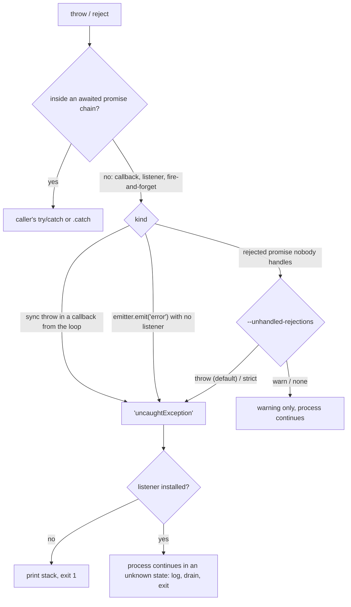

# 04 · Async Control Flow and Errors: Callbacks, EventEmitter, AbortSignal and Process-Level Policy

> **Primary sources:** Node.js API docs: [Events](https://nodejs.org/api/events.html), [Errors](https://nodejs.org/api/errors.html), [Process events](https://nodejs.org/api/process.html#process-events) and [`--unhandled-rejections`](https://nodejs.org/api/cli.html#--unhandled-rejectionsmode), [`util.promisify`](https://nodejs.org/api/util.html#utilpromisifyoriginal), [Globals: `AbortController`](https://nodejs.org/api/globals.html#class-abortcontroller); DOM Standard §3 (`EventTarget`, `AbortSignal`); Joyent, _Error Handling in Node.js_ (2014), the source of the operational vs programmer error distinction.
>
> **Executable proof:** [`examples/04-async-control-flow-and-errors.test.ts`](../examples/04-async-control-flow-and-errors.test.ts)

Promise semantics, `async`/`await` desugaring, the combinators, generic cancellation patterns, concurrency pools and retry with backoff are language-level topics owned by [JavaScript module 07](../../../languages/javascript/modules/07-async-in-depth.md). Rejection tracking at the spec level (`HostPromiseRejectionTracker`) is in [JavaScript module 06](../../../languages/javascript/modules/06-agents-realms-job-queue.md#3-jobs-in-ecma-262). This module covers what Node adds: the callback convention and its traps, `EventEmitter` (Node's most-used and most-misused abstraction), how Node APIs take `AbortSignal`, Node's error objects, and the process-wide policy for errors nobody caught.

---

## 1. Three generations of asynchronous APIs

| Generation | Shape | Where it still lives |
| --- | --- | --- |
| Error-first callbacks | `fs.readFile(path, (err, data) => {...})` | every classic core API; many older libraries |
| Event emitters | `stream.on('data', fn)`, `server.on('request', fn)` | streams, servers, sockets, child processes |
| Promises and `async` functions | `await fsp.readFile(path)` | `node:fs/promises`, `node:timers/promises`, `node:stream/promises`, `node:dns/promises`, `node:readline/promises`, `fetch` |

**Definition (error-first callback convention).** An asynchronous function takes a callback as its **last** argument and calls it **exactly once**, **asynchronously**, with `(err)` on failure or `(null, result)` on success. All three clauses matter:

1. _Last argument_: required by `util.promisify`.
2. _Exactly once_: calling twice runs the continuation twice (two responses on one HTTP request: `ERR_HTTP_HEADERS_SENT`); never calling it hangs the caller forever.
3. _Asynchronously_: see Zalgo, below.

### 1.1 Releasing Zalgo

An API that calls back **synchronously on some paths and asynchronously on others** ("releases Zalgo", Isaac Schlueter, 2013) makes the caller's ordering depend on data. The test's `getBad('hit', cb)` returns a cached value synchronously, so `cb` runs _before_ the line after the call; on a cache miss it runs after. Code that initialises state after calling the API breaks only on cache hits, which typically means only in production. The fix is to make every path asynchronous: `process.nextTick(cb, null, value)` for the synchronous path (cheap, runs before any I/O). Promises cannot release Zalgo: `then` callbacks are always asynchronous by specification.

### 1.2 Converting between styles

| Tool | Does | Detail |
| --- | --- | --- |
| `util.promisify(fn)` | callback API → promise API | appends a callback; rejects with `err`; resolves with the single result. Honours `fn[util.promisify.custom]` when a function's callback does not follow the convention (core uses it for `setTimeout`, `exec`, `dns.lookup` with `all`) |
| `util.callbackify(asyncFn)` | promise API → callback API | a rejection with a falsy reason (`null`, `undefined`, `0`) becomes an `Error` with the original in `.reason`, because `cb(null)` would mean success; the test checks it |
| `events.once(emitter, name)` | event → promise | resolves with the **array** of event arguments; rejects if `'error'` fires first |
| `events.on(emitter, name)` | event stream → async iterator | buffers events that arrive before they are consumed |
| `stream.promises.pipeline`, `finished` | stream lifecycle → promise | [module 05](05-buffers-streams-backpressure.md) |

### Then vs now: core APIs

| Then (Node ≤ 10) | Now |
| --- | --- |
| `util.promisify(fs.readFile)` or third-party `fs-extra`/`bluebird.promisifyAll` | `import { readFile } from 'node:fs/promises'` (stable since 10/14) |
| `new Promise(r => setTimeout(r, ms))` | `import { setTimeout } from 'node:timers/promises'` with `{ signal }` |
| `new Promise((res, rej) => stream.on('finish', res).on('error', rej))` | `await finished(stream)` from `node:stream/promises` |
| `async.waterfall`, `async.parallelLimit` | `async`/`await`, `Promise.all`, a small concurrency pool ([JavaScript module 07](../../../languages/javascript/modules/07-async-in-depth.md#a-concurrency-limited-pool)) |

Mixing styles is where bugs live: a callback API called from an `async` function whose callback throws produces an uncaught exception, not a rejection. Convert at the boundary and stay in one style.

---

## 2. `EventEmitter`

### 2.1 Mechanics

An `EventEmitter` stores listeners in a null-prototype object keyed by event name: a single function when there is one listener, an array when there are several. `emit(name, ...args)`:

```
EMIT(emitter, name, args)
  1  handlers ← emitter._events[name]
  2  if name = 'error' and handlers is undefined:
        if emitter has an errorMonitor listener: call it with args[0]
        throw args[0] if it is an Error, else throw ERR_UNHANDLED_ERROR wrapping it
  3  if handlers is undefined: return false
  4  listeners ← a COPY of handlers                     ▷ adding/removing during emit does not affect this emit
  5  for each l in listeners, in order: l.apply(emitter, args)    ▷ SYNCHRONOUS; an exception propagates to the emit() caller
                                                                  ▷ and the remaining listeners are skipped
  6  return true
```

Facts that follow, each in the test:

- **`emit()` is synchronous.** Listeners run inside the `emit` call, in registration order (`prependListener` inserts at the front). A slow listener blocks the emitter and everything after it on the stack. Emitting does not "schedule" anything.
- **A throwing listener aborts the emit.** Later listeners do not run, and the exception propagates to whoever called `emit()`, often deep inside a library or core stream code.
- **`'error'` is special.** With no listener, `emit('error', err)` throws `err`, which usually means an uncaught exception and a crash. Every emitter you create or receive (streams, sockets, servers, child processes, database clients) needs an `'error'` listener or must be consumed through an API that attaches one (`pipeline`, `events.once`).
- **`errorMonitor`** (`events.errorMonitor`) lets instrumentation observe errors _without_ counting as a handler, so the crash semantics are unchanged.
- **Async listeners are not awaited.** `emitter.on('x', async () => { throw ... })` produces a rejected promise that `emit` ignores: an unhandled rejection, which crashes the process by default (§5). With `new EventEmitter({ captureRejections: true })` (or `events.captureRejections = true` globally), Node attaches a rejection handler that re-emits the error as `'error'` (or calls `emitter[Symbol.for('nodejs.rejection')]` if defined).

### 2.2 Listener leaks and the max-listeners warning

Each emitter warns once per event name when more than `emitter.getMaxListeners()` listeners (default **10**, `events.defaultMaxListeners`) are registered: `MaxListenersExceededWarning: Possible EventEmitter memory leak detected`. It is a heuristic, not a limit; the 11th listener is still added (the test checks both). The typical cause is adding a listener per request to a long-lived emitter (a shared socket, `process`, a global `AbortSignal`) and never removing it, which leaks the listener and everything its closure captures. Raising the limit hides the leak; the fix is to remove listeners (`off`, `once`, an `AbortSignal` passed to `events.once`/`addEventListener`, or `events.addAbortListener`).

### 2.3 `EventEmitter` vs `EventTarget`

Node also implements the DOM's `EventTarget`/`Event` (used by `AbortSignal`, `MessagePort`, `BroadcastChannel`, `WebSocket`, `Worker` in the Web-compatible API).

|  | `EventEmitter` | `EventTarget` |
| --- | --- | --- |
| Listener signature | `(...args)` | `(event: Event)` |
| Duplicate listener | added twice | ignored (same type, same function, same capture flag) |
| `'error'` semantics | throws if unhandled | no special event |
| A listener throws | `emit` aborts, exception propagates to the caller | **remaining listeners still run**; the exception is reported asynchronously, which in Node means an uncaught exception on `process.nextTick` (the test shows `second listener ran`, `after dispatch`, then exit 1) |
| Ordering | registration order, `prependListener` | registration order |
| `once` | `emitter.once` | `{ once: true }` option |
| Removal by signal | `events.once(e, n, { signal })` | `{ signal }` option |

### 2.4 Designing your own emitters

Subclassing `EventEmitter` is still the idiomatic way for a Node library to expose lifecycle events. Rules that keep consumers safe:

1. **Document every event and its arguments**, and type them. `@types/node` lets you declare an event map: `class Queue extends EventEmitter<{ drained: []; failed: [job: Job, err: Error] }> {}` gives typed `on`/`emit` without a wrapper.
2. **Emit `'error'` only for errors the consumer must handle**, and only after construction has returned (defer with `process.nextTick` if the error is detected in the constructor, or listeners attached after `new` will miss it and the process crashes).
3. **Never emit from inside a loop over your own state** without copying it first: a listener may call back into your object and mutate it during the emit.
4. **Offer a promise or async-iterator API too** (`events.once`-friendly events, or an `async *[Symbol.asyncIterator]()`), so callers can use `await` and get backpressure where it matters.
5. **Provide a `close()` that removes listeners you attached to others** (sockets, signals, `process`): emitters that subscribe to long-lived objects are the most common listener leak.

Performance notes: `emit` with zero listeners is a property lookup and a `false` return, so emitting unobserved events is cheap. With one listener Node calls it directly; with several it copies the array (step 4 of `EMIT`), which is why very hot paths (stream internals) use direct callbacks instead of events.

---

## 3. Bridging events and `async`/`await`

`events.once(emitter, name, { signal })` is the idiomatic way to wait for one event. It rejects on `'error'` (unless you are waiting for `'error'` itself), and with a `signal` it removes its listener when aborted, so a timed-out wait leaks nothing (the test checks `listenerCount` before and after abort).

`events.on(emitter, name)` returns an async iterator. Events emitted before the consumer asks for them are **buffered without limit**: an emitter that produces faster than the loop body consumes will grow memory, because there is no backpressure in `EventEmitter`. `break` (or `return`) calls the iterator's `return()`, which removes the listener; the test emits four events, breaks after three and checks the listener is gone. For producers that can pause, use a stream (which has backpressure) instead of `events.on`.

```js
import { once } from 'node:events';
import { createServer } from 'node:net';

const server = createServer().listen(0);
await once(server, 'listening'); // rejects if 'error' (e.g. EADDRINUSE) fires first
const { port } = server.address();
```

---

## 4. Cancellation in Node APIs

`AbortController`/`AbortSignal` (global since Node 15) is the single cancellation primitive across Node and the Web platform. The generic patterns (propagating a signal, `AbortSignal.timeout`, `AbortSignal.any`, wiring your own APIs) are in [JavaScript module 07 §4](../../../languages/javascript/modules/07-async-in-depth.md#4-cancellation-abortcontroller-and-abortsignal). Node-specific facts:

| API | How it takes a signal | On abort |
| --- | --- | --- |
| `fs.readFile`, `fs.writeFile`, `fsp.readFile`, … | `{ signal }` | rejects with `AbortError` whose `cause` is `signal.reason` (the test) |
| `timers/promises` `setTimeout`, `setImmediate`, `setInterval` | `{ signal }` | rejects with `AbortError` |
| `events.once`, `events.on` | `{ signal }` | rejects; listener removed |
| `stream.pipeline`, `stream.addAbortSignal`, `Readable.from(...).map` | `{ signal }` / helper | destroys the streams |
| `child_process.spawn`/`exec`/`fork` | `{ signal }` | kills the child (`killSignal`, default `SIGTERM`) |
| `http.request`, `fetch` | `{ signal }` | destroys the request / rejects |
| `readline.question` | `{ signal }` | rejects |

Two Node-specific hazards:

- **Listener accumulation on long-lived signals.** Every API that accepts a signal adds an `'abort'` listener to it and removes it on completion. Code that passes one process-wide signal (a "shutdown signal") into thousands of operations can still accumulate listeners if any API path forgets cleanup; Node raises `MaxListenersExceededWarning` on `AbortSignal`s too. Use `AbortSignal.any([shutdown, perRequest])` per operation, and `events.getEventListeners(signal, 'abort')` to inspect.
- **`events.addAbortListener(signal, fn)`** registers an abort listener that runs even if a third party called `stopImmediatePropagation()`, and returns a `Disposable` (`using` support) that removes it.

---

## 5. Errors

### 5.1 Operational vs programmer errors

**Definitions** (Joyent, 2014; still the standard vocabulary):

- **Operational error**: a run-time problem that correct code must expect and handle: `ENOENT`, `ECONNREFUSED`, `ETIMEDOUT`, a 503 from a dependency, invalid user input. Handle it: retry, fall back, return a 4xx/5xx, log.
- **Programmer error**: a bug: `TypeError: Cannot read properties of undefined`, calling an API with wrong arguments, an assertion failure, a forgotten `await`. The program is in an unknown state. Do not try to "handle" it locally: let the process crash, and let the supervisor (systemd, Kubernetes) restart it.

The distinction drives the process-level policy in §6: catching _everything_ and continuing turns programmer errors into corrupted state and silent data loss.

### 5.2 Node's error objects

| Kind | Identify by | Example |
| --- | --- | --- |
| JavaScript errors | class (`TypeError`, `RangeError`, …) | invalid argument types are `TypeError` with `code: 'ERR_INVALID_ARG_TYPE'` |
| **Node errors** | stable `err.code` string `ERR_*` | `ERR_HTTP_HEADERS_SENT`, `ERR_STREAM_PREMATURE_CLOSE`, `ERR_REQUIRE_ASYNC_MODULE` |
| **System errors** | `err.code` (POSIX name), `err.errno` (negative number), `err.syscall`, plus `path`, `dest`, `address`, `port` when relevant | `{ code: 'ENOENT', syscall: 'open', path: '/definitely/not/here' }` (the test) |
| `AbortError` | `err.name === 'AbortError'` (and `err.code === 'ABORT_ERR'`) | aborted operations; `cause` carries the abort reason |
| `AggregateError` | `.errors` array | `Promise.any`, `net.connect` with `autoSelectFamily` when every address fails |

**Match on `err.code`, never on `err.message`.** Messages change between versions; codes are part of the API contract.

### 5.3 Causes, stacks and async stack traces

- `new Error(msg, { cause })` (ES2022) is the standard way to wrap an operational error while keeping the original; `util.inspect` prints the whole chain (`[cause]: Error: ENOENT`), and loggers such as pino serialise it.
- **Zero-cost async stack traces.** V8 reconstructs the chain of `await`ing callers from the promise reaction graph when the stack is captured, at no runtime cost until an error occurs. The test sees `at async outer` in a stack whose throw happened after an `await`. This works only through `await` on native promises; callbacks, `.then` chains and custom thenables break the chain.
- `Error.stackTraceLimit` (default 10) bounds the frames captured; raising it costs CPU on every `new Error()`. `Error.captureStackTrace(obj, fn)` attaches a stack to any object and omits frames above `fn`, which libraries use to hide their internals (the test).
- Capturing a stack is the expensive part of `new Error()`. Hot paths that use errors for control flow (validation failures thrown per field) can spend significant CPU there.

---

## 6. Process-level policy: uncaught exceptions and unhandled rejections

### 6.1 The mechanisms

| Event / flag | Fires when | Default behaviour |
| --- | --- | --- |
| `'uncaughtException'` `(err, origin)` | an exception reached the event loop with no handler; `origin` is `'uncaughtException'` or `'unhandledRejection'` | no listener: print the stack, exit **1**. With a listener: **the process continues**, in an unknown state |
| `'uncaughtExceptionMonitor'` | just before the above | observe only (log, metrics); does not change behaviour (the test: still exits 1) |
| `'unhandledRejection'` `(reason, promise)` | a rejected promise has no handler at the end of the current tick processing | depends on `--unhandled-rejections` |
| `'rejectionHandled'` `(promise)` | a handler was attached _later_ to a promise already reported as unhandled | informational (the test sees `unhandled` then `rejectionHandled`) |
| `process.setUncaughtExceptionCaptureCallback(fn)` | alternative single capture hook (used by REPL-like tools) | mutually exclusive with `'uncaughtException'` listeners |

`--unhandled-rejections=<mode>`, each row pinned in the test:

| Mode | Unhandled rejection with no `'unhandledRejection'` listener | With a listener |
| --- | --- | --- |
| `throw` (**default since Node 15**) | raised as an uncaught exception: exit 1 (unless an `'uncaughtException'` listener exists) | the listener handles it, process continues |
| `strict` | raised as an uncaught exception | raised as an uncaught exception **even though** a listener exists (listener still called) |
| `warn` | warning printed, process continues | listener called, no warning |
| `warn-with-error-code` | warning, process continues, **exit code 1** at the end | listener called |
| `none` | silence | listener called |

### Then vs now: unhandled rejections

|  | Node ≤ 14 | Node ≥ 15 (current) |
| --- | --- | --- |
| Default | `warn`: `UnhandledPromiseRejectionWarning` plus a deprecation warning promising future crashes | `throw`: the process exits with code 1 |
| Typical surprise | errors silently lost, requests hang | services that "worked" for years start crash-looping after an upgrade |

Migration: attach handlers to every promise you create and do not await (fire-and-forget work needs `.catch(log)`); add `captureRejections` to emitters with async listeners; do **not** "fix" it with `--unhandled-rejections=warn` in production, which reintroduces silent failure.

### 6.2 A defensible policy

```js
// Install early (e.g. in an --import preload). Log, flush, exit: never continue.
process.on('uncaughtException', (err, origin) => {
  logger.fatal({ err, origin }, 'uncaught: exiting');
  shutdown({ reason: origin, exitCode: 1 }); // stop accepting work, bounded drain, then exit (module 08)
});
// No 'unhandledRejection' listener: the default (throw) routes rejections to the handler above
// with origin 'unhandledRejection'. (The test proves this routing.)
```

Why exit: after an uncaught exception, the stack unwound through code that did not expect it, so locks may be held, transactions half-done, counters wrong, and resources leaked. A supervisor restart restores a known state. Keep at least two replicas so one process restarting does not cause an outage, and alert on restart rate. `domain`, the old attempt to make "catch everything and continue" safe, is deprecated (DEP0032) and should not be used; request-scoped context today is `AsyncLocalStorage` ([module 11](11-diagnostics-and-performance.md#5-asynclocalstorage-and-async-context)).

### 6.3 Capturing evidence before the process dies

A crash is only useful if it leaves evidence. Node can produce it without custom code:

| Flag | Produces | Cost |
| --- | --- | --- |
| `--report-uncaught-exception` | a JSON **diagnostic report** (JS and native stacks, heap statistics, libuv handles, environment, loaded libraries) when an uncaught exception kills the process | negligible until it fires; reports include environment variables, so use `--report-exclude-env` where secrets live in env |
| `--report-on-fatalerror` | a report on V8 fatal errors such as heap OOM | same |
| `--heapsnapshot-near-heap-limit=n` | up to _n_ heap snapshots as the heap approaches its limit | large files and a pause; see [module 10](10-v8-memory-and-gc.md#7-heap-limits-in-containers) |
| `--enable-source-maps` | stack traces mapped to TypeScript or bundled sources | CPU when stacks are formatted |
| `--abort-on-uncaught-exception` | a core dump instead of a clean exit (for `llnode`/`gdb` post-mortem) | core files are large; `uncaughtException` listeners are bypassed |

The order of events in a fatal path is: `'uncaughtExceptionMonitor'` listeners, then the diagnostic report (if enabled), then either your `'uncaughtException'` listener or the default "print and exit 1". Your logger's final write should be synchronous at that point (§5 of [module 01](01-runtime-architecture.md#52-standard-streams-are-not-uniformly-synchronous) explains why asynchronous stdout writes can be lost). Diagnostic reports are covered in depth in [module 11](11-diagnostics-and-performance.md).

---

## 7. Control-flow patterns that are Node-specific

The utilities below live in [`examples/04-control-flow.ts`](../examples/04-control-flow.ts) and are exercised, including their negative counterparts, by the module's test file.

### 7.1 Timeouts that cancel the loser

`Promise.race([work, sleep(1000).then(() => { throw … })])` has two defects: when `work` wins, the timeout's timer stays scheduled (one live timer per call, and a process that cannot exit until it fires; the negative test measures the process being held open for the full 300 ms), and when the timeout wins, `work` keeps running and consuming sockets or CPU. The fix is to hand a signal _into_ the work:

```ts
export async function withTimeout<T>(
  work: (signal: AbortSignal) => Promise<T>,
  ms: number,
  parent?: AbortSignal,
): Promise<T> {
  const timeout = AbortSignal.timeout(ms); // an unref'd timer: never keeps the process alive
  const signal = parent ? AbortSignal.any([parent, timeout]) : timeout;
  signal.throwIfAborted();
  return await work(signal); // the work passes `signal` to fetch, fs, timers, ...
}
```

Two details the test pins down:

- `AbortSignal.timeout()` is backed by an **unref'd** timer, so a successful call leaves nothing that keeps the loop alive (the child process exits promptly after printing `42`).
- When the deadline fires, Node APIs reject with an **`AbortError`** whose **`cause`** is the `TimeoutError` (`DOMException`) that is the signal's reason. Code that distinguishes "we timed out" from "the client went away" must inspect `err.cause` (or `signal.reason`), not `err.name`.

Invariant: at any moment, at most one of {work, deadline} is still consuming resources once the call has settled.

### 7.2 Callbacks called at most once

A producer that calls its callback twice (a classic bug when both `'error'` and `'close'` paths report completion) runs the continuation twice. Guard callbacks at trust boundaries:

```ts
export function onceCallback<A extends unknown[]>(
  cb: (err: Error | null, ...rest: A) => void,
  onDuplicate = (e: Error) => process.emitWarning(e),
) {
  let called = false;
  return (err: Error | null, ...rest: A) => {
    if (called) return onDuplicate(new Error('callback called more than once'));
    called = true;
    cb(err, ...rest);
  };
}
```

Reporting the duplicate (rather than silently dropping it) matters: it is a bug in the producer, and it is usually the only evidence of a race between an error path and a completion path.

### 7.3 Async handlers in callback-shaped frameworks

`node:http`'s `'request'` event, `EventEmitter` listeners, and older middleware frameworks call your function and ignore what it returns. An `async` handler that throws therefore produces an unhandled rejection: by default a **process crash** that takes every in-flight request with it. Wrap at the boundary:

```ts
export function safeHandler(handler, report) {
  return (req, res) => {
    handler(req, res).catch((err) => {
      report(err);
      if (!res.headersSent) {
        res.statusCode = 500;
        res.end('internal error');
      }
    });
  };
}
```

Frameworks with native promise support (Fastify, Express 5) do this for you ([module 08](08-building-services.md)); with raw `node:http` or Express 4 you must.

### 7.4 How an error travels



### 7.5 Other rules

- **Fire-and-forget must catch.** `void sendMetrics()` crashes the process when `sendMetrics` rejects. Write `sendMetrics().catch(logError)`.
- **Bounded concurrency** for I/O fan-out (a pool or `stream.Readable.from(items).map(fn, { concurrency })`, [module 05](05-buffers-streams-backpressure.md)); unbounded `Promise.all(items.map(fetch))` opens thousands of sockets and file descriptors.
- **`await` in loops is sequential by design.** Make it concurrent only when the downstream can take the load; that is a capacity decision, not a style choice.
- **Callbacks inside `async` functions escape the `try`.** In `async function f() { try { fs.readFile(p, (err) => { throw err; }); } catch {} }` the callback runs later on a fresh stack, outside the `try`: an uncaught exception. Promisify first, then `await`.

---

## 8. Production failure modes

| Failure | Mechanism | Fix |
| --- | --- | --- |
| Crash with "Unhandled 'error' event" | an emitter (socket, stream, client) emitted `'error'` with no listener | attach `'error'` listeners; consume streams with `pipeline` |
| Crash loop after upgrading from Node 14 | unhandled rejections throw since Node 15 | handle every promise; `captureRejections` for async listeners |
| `ERR_HTTP_HEADERS_SENT` | a callback called twice, or code continued after `res.end()` | `return` after responding; guard callbacks |
| Rare ordering bug on cache hits only | Zalgo: sync callback on one path | always-async (`process.nextTick`) |
| `MaxListenersExceededWarning` and growing memory | listener per request on a long-lived emitter or signal | remove listeners; `once` with `signal`; do not just raise the limit |
| Memory grows while iterating `events.on` | unbounded buffering, no backpressure | use streams for fast producers |
| Errors swallowed, state corrupted, "zombie" process | `uncaughtException` handler that logs and continues | log, drain, exit; let the supervisor restart |
| A listener failure skips other listeners | `emit` aborts on the first throw | catch inside listeners that must not affect others |
| Process exits only after a long delay | `Promise.race` timeout leaves timers pending | pass `AbortSignal.timeout` into the work |
| Error handling broke after a dependency upgrade | matched on `err.message` | match on `err.code` |

---

## Interview Drill

<details><summary>1. Is `EventEmitter.emit` synchronous or asynchronous? What follows from your answer?</summary>

Synchronous: all listeners run inside the `emit` call, in registration order, before `emit` returns. Consequences: a slow listener blocks the emitter and its caller; an exception thrown by a listener propagates to the `emit` caller and skips remaining listeners; an async listener's returned promise is ignored, so its rejection is unhandled unless `captureRejections` is on.
</details>

<details><summary>2. What happens when an emitter emits `'error'` and nobody listens?</summary>

`emit` throws the error (or an `ERR_UNHANDLED_ERROR` wrapping a non-Error value). If that happens inside an I/O callback, it becomes an uncaught exception and, by default, the process exits with code 1. `errorMonitor` listeners see the error but do not prevent the throw.
</details>

<details><summary>3. Distinguish operational errors from programmer errors, and say how each should be handled.</summary>

Operational errors are expected run-time conditions in correct programs (network failures, missing files, invalid input, timeouts): handle them locally by retrying, falling back or reporting to the caller. Programmer errors are bugs (type errors, wrong arguments, broken invariants): the process state is suspect, so log and crash, and rely on a supervisor to restart, with redundancy so a restart is not an outage.
</details>

<details><summary>4. What does `--unhandled-rejections=strict` do differently from the default `throw`?</summary>

In `throw` mode an `'unhandledRejection'` listener counts as handling the rejection, so the process continues. In `strict` mode the rejection is raised as an uncaught exception regardless of the listener (which is still called), so the `'uncaughtException'` path or a crash follows.
</details>

<details><summary>5. What is "releasing Zalgo" and how do you fix it in a callback API? Why can't promises have this problem?</summary>

An API that sometimes invokes its callback synchronously and sometimes asynchronously, so the caller's ordering depends on runtime data. Fix it by deferring the synchronous path (`process.nextTick(cb, null, value)`). Promise reactions are always queued as jobs, never run synchronously, so a `then` callback always runs after the current code completes.
</details>

<details><summary>6. How do `EventEmitter` and `EventTarget` differ when a listener throws?</summary>

`EventEmitter.emit` stops at the throwing listener and the exception propagates synchronously to the `emit` caller. `EventTarget.dispatchEvent` continues with the remaining listeners and reports the exception asynchronously; in Node that surfaces as an uncaught exception on the next tick.
</details>

<details><summary>7. Your service logs `MaxListenersExceededWarning` for `'abort'` on an `AbortSignal`. What is likely wrong?</summary>

A long-lived signal (for example a process-wide shutdown signal) is passed into many concurrent operations and their abort listeners accumulate, either because there are many in flight or because some code path never removes its listener. Create a per-operation signal with `AbortSignal.any([shutdown, local])`, ensure listeners are removed on completion (`{ signal }` options, `addAbortListener` disposables), and inspect with `events.getEventListeners`.
</details>

<details><summary>8. Why is `Promise.race([work(), timeout(1000)])` a weak timeout?</summary>

Whichever side loses keeps running: if work wins, the timeout's timer stays scheduled (keeping the process alive, one timer per call); if the timeout wins, the work continues consuming resources and its eventual rejection may go unhandled. Pass an `AbortSignal.timeout(ms)` into the work so it is actually cancelled, and clear timers in `finally`.
</details>

<details><summary>9. An `async` function registered with `server.on('request', handler)` throws. What happens, and how do you prevent it?</summary>

`node:http` ignores the returned promise, so the rejection is unhandled; under the default `throw` mode it becomes an uncaught exception and the process exits, dropping every in-flight request. Wrap the handler so the promise is caught at the boundary and turned into a 500 response (or use a framework that awaits handlers, such as Fastify or Express 5).
</details>

<details><summary>10. Why should error handling match on `err.code` rather than `err.message`?</summary>

Node documents `code` values (`ENOENT`, `ERR_HTTP_HEADERS_SENT`) as stable API; messages are human-readable and change between releases. System errors also expose `errno` and `syscall`, which identify the failing operation precisely.
</details>

<details><summary>11. A `try { fs.readFile(p, (err) => { if (err) throw err; }) } catch {}` inside an `async` function does not catch the error. Why?</summary>

The callback runs later, in the poll phase, on a fresh call stack; the `try` block finished long before. The `throw` becomes an uncaught exception. Use the promise API (`await fsp.readFile(p)`) so the failure arrives as a rejection inside the `try`, or handle `err` inside the callback.
</details>
