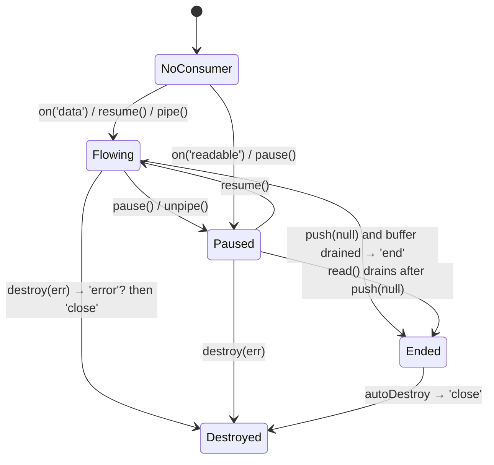
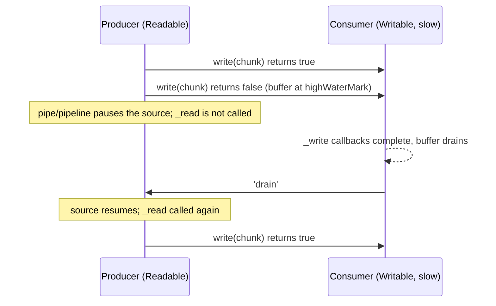

# 05 · Buffers, Streams and Backpressure

> **Primary sources:** Node.js API docs: [Buffer](https://nodejs.org/api/buffer.html), [Stream](https://nodejs.org/api/stream.html) (including "API for stream implementers" and "Three states"), [String decoder](https://nodejs.org/api/string_decoder.html), [Web Streams API](https://nodejs.org/api/webstreams.html), [Zlib](https://nodejs.org/api/zlib.html); Node.js Learn: [Backpressuring in Streams](https://nodejs.org/en/learn/modules/backpressuring-in-streams); WHATWG [Streams Standard](https://streams.spec.whatwg.org/); release notes for v22.0.0 (default high-water mark) and v26.3.0 (`Buffer.poolSize`).
>
> **Executable proof:** [`examples/05-buffers-streams-backpressure.test.ts`](../examples/05-buffers-streams-backpressure.test.ts) with the building blocks in [`examples/05-streams.ts`](../examples/05-streams.ts)

`ArrayBuffer`, typed arrays, `DataView`, resizable and transferable buffers, base64/hex built-ins and `structuredClone` are language features owned by [JavaScript module 11](../../../languages/javascript/modules/11-binary-data-memory-model.md). Async iteration (`for await`, async generators), which streams build on, is owned by [JavaScript module 05](../../../languages/javascript/modules/05-iterators-generators.md#4-async-iteration). This module owns Node's `Buffer`, the `node:stream` state machines, and **backpressure**, the mechanism that keeps a Node process's memory bounded when producers are faster than consumers.

---

## 1. `Buffer`

### 1.1 What a Buffer is

**Definition.** `Buffer` is a subclass of `Uint8Array` with Node-specific methods (encodings, `readUInt32BE`, `equals`, `indexOf` on bytes, …). Every `Buffer` is a _view_ (`buffer`, `byteOffset`, `length`) over an `ArrayBuffer` whose backing store lives **outside the V8 heap** (it is counted in `process.memoryUsage().arrayBuffers` and `external`, not in `heapUsed`). That placement matters for memory limits ([module 10](10-v8-memory-and-gc.md)): a process can hold gigabytes of Buffers while its V8 heap looks small.

| Allocation | Zero-filled | Pooled | Use |
| --- | --- | --- | --- |
| `Buffer.alloc(n)` | yes | no | default choice |
| `Buffer.allocUnsafe(n)` | **no**: contains whatever was in memory | yes, if `n < Buffer.poolSize >>> 1` | hot paths where every byte is overwritten immediately |
| `Buffer.allocUnsafeSlow(n)` | no | no | long-lived small buffers that should not pin a pool slab |
| `Buffer.from(string \| array \| arrayBuffer)` | n/a (copied in) | strings and arrays: yes | conversion; `Buffer.from(arrayBuffer)` **shares** memory, no copy |

### 1.2 The pool, and why `.buffer` is dangerous

Small unsafe allocations are carved out of a shared **slab** (`Buffer.poolSize`). Since **Node 26.3.0** (backported to 24.18.0) the default pool is **64 KiB** (it was 8 KiB), so every `allocUnsafe` and `Buffer.from(string)` smaller than **32 KiB** is a slice of a shared `ArrayBuffer`. The test checks the size and that two small allocations share one `ArrayBuffer`, while `alloc` and `allocUnsafeSlow` never do.

Two consequences:

1. **`buf.buffer` is the whole slab.** The negative test creates `Buffer.from('secret-token')`, then `Buffer.from('x')`, and finds `secret-token` inside `Buffer.from(mine.buffer)`. Passing `buf.buffer` to a worker (`postMessage`), to a WebAssembly module or to a native addon hands over neighbouring data from unrelated requests. Pass `buf` (structured clone copies only the view), or copy with `Buffer.from(buf)` / `buf.buffer.slice(buf.byteOffset, buf.byteOffset + buf.length)`.
2. **A tiny long-lived slice pins the slab.** Keeping a 10-byte pooled Buffer in a cache keeps its 64 KiB slab alive. For long-lived small values, copy into `allocUnsafeSlow` or convert to a string.

`Buffer.allocUnsafe` returning **uninitialised memory** is the classic disclosure bug (it is the reason `new Buffer(n)` was deprecated in favour of the explicit `alloc`/`allocUnsafe` pair, DEP0005): if a code path writes fewer bytes than it allocated, the remainder is old heap data. The safe idioms are `alloc`, or `allocUnsafe` immediately followed by a full write whose length you check. `--zero-fill-buffers` makes every allocation zeroed, which is a useful test-environment flag (the test verifies it) and a measurable slowdown in production.

### 1.3 Views, copies and `slice`

`buf.subarray(start, end)` and the doc-deprecated `buf.slice(start, end)` both return a **view** sharing memory, while `Uint8Array.prototype.slice` (which every other typed array uses) returns a **copy**. Code that mixes Buffers and `Uint8Array`s, or that was ported from browser code, can therefore mutate data it thought it copied (the test proves both directions). Use `subarray` when you mean a view and `Buffer.from(view)` / `Uint8Array.prototype.slice.call(buf)` when you mean a copy.

### 1.4 Encodings and character boundaries

Node encodings: `utf8` (default), `utf16le`, `latin1` (alias `binary`), `ascii`, `base64`, `base64url`, `hex`. Facts that cause production bugs:

- **Bytes are not characters.** `'€'.length === 1` but `Buffer.byteLength('€') === 3`; `'😀'.length === 2` (UTF-16 code units) and 4 bytes. HTTP `Content-Length`, database column limits and protocol length prefixes need `Buffer.byteLength`.
- **Invalid UTF-8 becomes U+FFFD**, silently. Decoding each chunk of a stream with `chunk.toString()` corrupts any multi-byte character that straddles a chunk boundary: `€` split as `e2 82 | ac` decodes as two replacement characters. `StringDecoder` (or `readable.setEncoding('utf8')`, or `TextDecoder` with `{ stream: true }`) keeps the incomplete tail until the next chunk. The test shows both.
- `latin1` maps bytes 0–255 to code points 0–255; it is not UTF-8 and mangles anything outside ASCII.
- `buffer.isUtf8(buf)` and `buffer.isAscii(buf)` validate without decoding (simdutf-backed).

### Then vs now: buffer and stream defaults

| Setting | Then | Now | Why it matters when upgrading |
| --- | --- | --- | --- |
| `new Buffer(n)` | allocated uninitialised memory (Node ≤ 9 without warning) | deprecated (DEP0005); use `Buffer.alloc`/`allocUnsafe` | the unsafe variant must be chosen explicitly |
| Byte-stream `highWaterMark` | 16 KiB (Node ≤ 21) | 64 KiB (Node 22+) | up to 4× more memory buffered per stream; fewer, larger chunks |
| `Buffer.poolSize` | 8 KiB, pooling below 4 KiB (Node ≤ 26.2, ≤ 24.17) | 64 KiB, pooling below 32 KiB (Node 26.3+, 24.18+) | more allocations share slabs; `.buffer` exposure and slab pinning affect larger Buffers |
| `_stream_readable` and friends | importable internals | removed (Node 26) | old packages break at import time |

---

## 2. Streams: the model

**Definition.** A stream is an `EventEmitter` that moves a sequence of **chunks** (Buffers or strings, or arbitrary values in **object mode**) between a source and a sink, with an internal buffer whose size is bounded by a **high-water mark** (`highWaterMark`), so producer and consumer can run at different speeds without unbounded memory.

| Kind | You implement | Consumers use | Examples |
| --- | --- | --- | --- |
| `Readable` | `_read(size)`, calling `this.push(chunk)` / `push(null)` | `'data'`, `read()`, `for await`, `pipe`, `pipeline` | `fs.createReadStream`, `http.IncomingMessage`, `process.stdin` |
| `Writable` | `_write(chunk, enc, cb)`, optionally `_writev`, `_final` | `write()`, `end()`, `'drain'`, `'finish'` | `fs.createWriteStream`, `http.ServerResponse`, `process.stdout` |
| `Duplex` | both, **independent** sides | both | `net.Socket`, `duplexPair()` |
| `Transform` | `_transform(chunk, enc, cb)`, `_flush(cb)` | both, output derived from input | `zlib.createGzip`, `crypto.createHash` (as a stream), parsers |
| `PassThrough` | nothing | both | tapping, tests |

High-water mark defaults: **65 536 bytes** for byte streams (raised from 16 KiB in Node 22.0.0) and **16 objects** in object mode; `stream.getDefaultHighWaterMark(objectMode)` reports them and `setDefaultHighWaterMark` changes them process-wide (the test pins both values). `fs.createReadStream` reads in 64 KiB chunks too.

### 2.1 The Readable state machine

A Readable is in one of three states for `readableFlowing`:

| `readableFlowing` | Meaning | Enters it by |
| --- | --- | --- |
| `null` | no consumer yet; data is not being pulled | construction |
| `true` | **flowing**: chunks are emitted as `'data'` as fast as they arrive | adding a `'data'` listener, `resume()`, `pipe()` |
| `false` | **paused**: data accumulates in the buffer up to the high-water mark, then the source stops being read | `pause()`, `unpipe()` |



Pull protocol: the stream calls `_read()` whenever its buffer is below `highWaterMark`; `push(chunk)` returns `false` when the buffer reaches the mark, telling the implementation to stop until `_read` is called again. A source that ignores `push()`'s return value (pushing from an event listener as fast as events arrive) defeats backpressure exactly as a producer ignoring `write()` does.

Attaching a `'data'` listener starts the flow **immediately**: data emitted before a second consumer is attached is lost for that consumer. Mixing consumption styles (`'data'` plus `for await`, or `pipe` plus `'readable'`) produces undefined interleavings; pick one.

### 2.2 Writable mechanics

`writable.write(chunk)` appends to the internal buffer (or calls `_write` directly if idle) and returns `writableLength < highWaterMark`. After `end()`, `_final` runs, then `'finish'`. With `autoDestroy` (default since Node 14), `'close'` follows `'finish'` or an error. Implementations must call the `_write` callback exactly once; calling it with an error destroys the stream.

`_writev(chunks, cb)` receives every buffered chunk at once, which lets a socket or a file write them with one `writev(2)` system call. `writable.cork()`/`uncork()` batches small writes for the same reason (HTTP headers plus a small body).

Since **26.3.0**, writing a _string_ chunk with the encoding `'buffer'` throws `ERR_UNKNOWN_ENCODING` (the test pins it); older code that passed `'buffer'` through generic helpers must pass a Buffer or a real text encoding.

### 2.3 Object mode and what the high-water mark counts

In byte mode, `highWaterMark` counts **bytes** (`chunk.length`); in object mode it counts **chunks**, regardless of their size. A stream of 16 database rows and a stream of 16 decoded 5 MB images both sit exactly at the default object-mode mark. Consequences:

- Choose object-mode high-water marks by the memory of a typical chunk: for large objects use 1–4; for tiny ones 100+ to reduce per-chunk overhead.
- A Transform with `readableObjectMode: true` and a byte-mode writable side (like `LineSplitter`) has two different units on its two buffers.
- `null` cannot be a chunk in object mode (it means end of stream); `undefined` is allowed but surprises consumers.
- A custom `highWaterMark` can also be set per stream with `readableHighWaterMark`/`writableHighWaterMark` on Duplex and Transform constructors.

### 2.4 The streams you already use

| Object | Kind | Notes |
| --- | --- | --- |
| `fs.createReadStream(path, { start, end, highWaterMark })` | Readable | 64 KiB reads through the thread pool; `start`/`end` are inclusive byte offsets (HTTP range requests) |
| `fs.createWriteStream(path, { flags })` | Writable | `flags: 'a'` appends; each write is a thread-pool request |
| `http.IncomingMessage` (server `req`, client `res`) | Readable | must be consumed or destroyed, or the socket is never freed for keep-alive |
| `http.ServerResponse`, `http.ClientRequest` | Writable | `write()` backpressure reflects the socket; `end()` sends the final chunk |
| `net.Socket`, `tls.TLSSocket` | Duplex | `allowHalfOpen` controls whether the writable side stays open after the peer ends |
| `process.stdin` / `process.stdout`, `process.stderr` | Readable / Writable | synchronous or asynchronous by file type ([module 01 §5.2](01-runtime-architecture.md#52-standard-streams-are-not-uniformly-synchronous)) |
| `child.stdin`, `child.stdout`, `child.stderr` | Writable / Readable | a child blocks when its stdout pipe fills and nobody reads it ([module 06](06-filesystem-process-os.md)) |
| `zlib.createGzip()`, `crypto.createCipheriv()`, `crypto.createHash()` | Transform | CPU work on the thread pool (zlib) or the main thread (hash updates) |
| `readline.createInterface({ input, crlfDelay: Infinity })` | async iterable of lines | the standard way to read a file line by line: `for await (const line of rl)` |

The `IncomingMessage` row deserves emphasis: a server that rejects a request (for example with 401) without reading or destroying the request body leaves the body unread; with keep-alive, the next request on that socket cannot be parsed until the body is drained, and Node may have to discard the socket. Respond, then `req.resume()` to discard the body, or close the connection.

---

## 3. Events and lifecycle

| Event | Stream | Meaning |
| --- | --- | --- |
| `'data'` | Readable | a chunk (flowing mode) |
| `'end'` | Readable | no more data **and** all of it was consumed (never fires if nobody consumes) |
| `'finish'` | Writable | `end()` was called and all data was flushed to the underlying resource |
| `'drain'` | Writable | the buffer emptied after `write()` returned `false` |
| `'error'` | both | failure; with `autoDestroy`, the stream is destroyed |
| `'close'` | both | the underlying resource is released; always the last event |

`stream.finished(stream)` (promise form in `node:stream/promises`) resolves on the right completion event for any kind of stream and rejects with `ERR_STREAM_PREMATURE_CLOSE` if the stream is destroyed before it ends or finishes. The test checks both outcomes. It is the correct way to "wait for a stream to be done".

---

## 4. Backpressure

**Definition.** Backpressure is the flow-control signal that propagates from a slow consumer back to a fast producer so that the producer slows down instead of the intermediate buffers growing. In Node streams it is the boolean returned by `writable.write()` (and by `readable.push()` on the producing side), with `'drain'` (and the next `_read` call) as the "you may continue" signal.

### 4.1 The protocol

```
PRODUCE(source, sink)
  ▷ Invariant: sink.writableLength ≤ sink.highWaterMark + (size of one chunk)
  ▷            whenever PRODUCE is waiting, so memory is O(highWaterMark), independent of input size
  for each chunk c of source:
     ok ← sink.write(c)
     if not ok:
        wait for sink 'drain' (or 'error'/'close' → abort)
  sink.end()
  wait for 'finish'
```

`write()` returning `false` is **advice, not refusal**: the chunk _was_ accepted and buffered (the test writes past the mark and sees `writableLength` grow). Nothing stops a producer that ignores the signal, and the negative test does exactly that: 1 000 writes of 1 KiB to a stalled consumer with a 1 KiB mark leave **1 000 KiB** buffered. Under real load this is the classic Node memory blow-up: reading a 10 GB file with `'data'` events and writing each chunk to a slow socket, or a logger writing faster than its destination accepts.

When producer and consumer are both streams, `pipe()`/`pipeline()` implement this protocol for you: the source is paused when `write()` returns `false` and resumed on `'drain'`. The bounded-memory test pipes a pull-based producer into a deliberately slow writer (each write completes one check phase later) and asserts that the bytes buffered in _both_ streams never exceed the two high-water marks plus one chunk, for any input length. `for await (const chunk of readable)` applies backpressure too: the stream only reads ahead up to its high-water mark while the loop body is busy (the test bounds how far the producer gets ahead).



### 4.2 Where backpressure breaks

| Break | Why | Fix |
| --- | --- | --- |
| Ignoring `write()`'s return value | the buffer grows without bound | `await once(w, 'drain')` when it returns `false`, or use `pipeline` |
| `readable.on('data', chunk => slowAsync(chunk))` | `'data'` does not wait for the promise | `for await` with `await` in the body, or a Writable/Transform |
| `events.on(emitter)` as a "stream" | `EventEmitter` has no backpressure; events are buffered without limit | a real Readable whose `_read` pulls from the source |
| `Readable.from(array)` of 10⁶ elements built in memory first | the source is already fully materialised | generate lazily with a generator |
| Unbounded `Promise.all` per chunk | concurrency, not buffering, is unbounded | `readable.map(fn, { concurrency })` |
| A Transform that `push`es many outputs per input without checking `push()` | the readable side grows | push in bounded steps, or split into chunks yielded from an async generator stage |
| Network sinks behind proxies | a slow client causes `res.write()` to return `false` | respect it in streaming endpoints; set timeouts so stalled clients are dropped ([module 07](07-networking-and-http.md#4-server-timeouts)) |

### 4.3 Measuring whether backpressure works

You cannot see backpressure in throughput numbers; you see it in memory. Useful measurements, in order of precision:

1. `writable.writableLength` and `readable.readableLength` sampled on a timer for the streams in a hot path (the test does this per chunk): bounded values mean the protocol holds.
2. `writable.writableNeedDrain` (true while a producer should be waiting) as a gauge: permanently true with growing `writableLength` means a producer ignores it.
3. `process.memoryUsage()`: Buffers show up in `arrayBuffers`/`external`, not `heapUsed`, so a backpressure leak can look like "RSS grows, heap is fine" ([module 10](10-v8-memory-and-gc.md)).
4. A heap snapshot: thousands of retained `Buffer`s or `WriteReq`-like objects under a single stream's buffered list identify the stream.

A load test with an artificially slow consumer (a client that reads at 10 KB/s) is the most direct check for a streaming endpoint; a fast local client never exercises the slow path.

---

## 5. `pipe()` vs `pipeline()`

`readable.pipe(writable)` wires data and backpressure, but **not errors or teardown**:

- If the source errors, the destination is **not** destroyed or ended (the test sees `dst.destroyed === false`): file descriptors and sockets leak.
- If the destination errors, the source is unpiped but keeps its resource open.
- Each stream needs its own `'error'` listener, or the process crashes.

`stream.pipeline(...streams, cb)` and `await pipeline(...)` from `node:stream/promises` connect the same way and also: forward the **first error** to the callback or promise, **destroy every stream** on error or premature close (the test sees `dst.destroyed === true`), accept **async generator functions** as transform stages and async iterables as sources, and accept `{ signal }` for cancellation (the test aborts mid-stream and gets an `AbortError`).

```js
import { pipeline } from 'node:stream/promises';
import { createReadStream, createWriteStream } from 'node:fs';
import { createGzip } from 'node:zlib';

await pipeline(
  createReadStream('access.log'),
  async function* (source) {
    // a transform stage as an async generator
    for await (const chunk of source) yield redact(chunk);
  },
  createGzip(),
  createWriteStream('access.log.gz'),
  { signal: AbortSignal.timeout(60_000) },
);
```

### Then vs now: composing streams

| Then | Now |
| --- | --- |
| `a.pipe(b).pipe(c)` with an `'error'` handler on every stream, plus `pump` or `stream-combiner` from npm for cleanup | `await pipeline(a, b, c)` (stable since Node 10; promise form since 15) |
| `through2` for quick transforms | async generator stages, or `new Transform({ transform })` |
| `new Promise` around `'finish'`/`'error'` | `await finished(stream)` |
| collecting with `concat-stream` | `stream/consumers` `text()`, `json()`, `buffer()`, `arrayBuffer()`, or `readable.toArray()` |
| `_stream_readable`, `_stream_transform`, … internal modules (used by old packages such as `readable-stream` v1 consumers) | **removed in Node 26**: import from `node:stream` |

Mixing old and new is safe: `pipeline` accepts any stream implementing the classic interface, including `readable-stream` v4 objects.

---

## 6. Implementing a Transform correctly

A line splitter is the canonical exercise, and the canonical bugs are dropping the partial line at a chunk boundary, splitting a multi-byte character, and forgetting the final line in `_flush`. From [`examples/05-streams.ts`](../examples/05-streams.ts):

```ts
export class LineSplitter extends Transform {
  private tail = '';
  private readonly decoder = new StringDecoder('utf8');
  constructor() {
    super({ readableObjectMode: true });
  } // bytes in, line strings out

  override _transform(chunk: Buffer | string, _enc: BufferEncoding, cb: TransformCallback): void {
    const text = this.tail + (typeof chunk === 'string' ? chunk : this.decoder.write(chunk));
    const parts = text.split('\n');
    this.tail = parts.pop() ?? ''; // invariant: tail = text after the last '\n'
    for (const line of parts) this.push(line);
    cb();
  }
  override _flush(cb: TransformCallback): void {
    const rest = this.tail + this.decoder.end();
    if (rest.length > 0) this.push(rest);
    cb();
  }
}
```

Correctness argument. Let _T_ be the concatenation of all input chunks. **Invariant:** after each `_transform`, the lines pushed so far are exactly the `'\n'`-terminated lines of the input consumed so far, and `tail` is the unterminated suffix. Base case: nothing consumed, nothing pushed, `tail = ''`. Step: prepending `tail` to the decoded chunk reconstructs the unterminated suffix plus the new text; splitting and keeping the last part re-establishes the invariant. At `_flush`, a non-empty `tail` is the final unterminated line. Hence the output depends only on _T_, not on its chunking. The fast-check property test generates random line sets and random cut points and checks exactly that statement; it found the edge case of a trailing newline during development (it ends the last line; it does not start an empty one).

Other rules for implementers:

- Report errors through the callback (`cb(err)`), never by throwing asynchronously; the test shows `pipeline` rejecting cleanly with the callback's error.
- Use `readableObjectMode`/`writableObjectMode` when only one side carries objects.
- Do not hold references to chunks after calling `cb()` if the upstream reuses buffers (some native sources do).
- `Duplex.from()`, `stream.compose()` and `duplexPair()` (two connected in-memory Duplexes, the test uses one) cover most "glue" needs without subclassing.

---

## 7. Binary protocols: framing over a byte stream

TCP, pipes and TLS deliver a **byte stream**, not messages: one `'data'` chunk can contain half a message, or three and a half. Every binary protocol on top of a stream therefore needs **framing**. The most common scheme is a length prefix: a 4-byte big-endian length followed by that many payload bytes. [`examples/05-streams.ts`](../examples/05-streams.ts) implements the decoder as a Transform:

```
FRAME-DECODE(chunk)
  pending ← pending ‖ chunk
  ▷ Invariant: pending holds no complete frame on loop exit; frames are pushed in input order
  while |pending| ≥ 4:
     len ← UINT32BE(pending[0..4))
     if len > maxFrame: fail E_FRAME_TOO_LARGE           ▷ checked BEFORE buffering the payload
     if |pending| < 4 + len: break                       ▷ wait for more bytes
     push COPY(pending[4 .. 4+len))
     pending ← pending[4+len ..)
FLUSH: if |pending| > 0: fail E_TRUNCATED                 ▷ never silently drop a partial frame
```

The tests prove three properties: (1) a fast-check property that the decoded messages are identical under **any** re-chunking of the byte stream (including one-byte chunks and cuts inside the header); (2) a declared length above the limit fails immediately, so an attacker cannot make the server buffer 10 MB by sending a 4-byte header; (3) a stream that ends mid-frame is an error rather than silent loss.

Engineering notes:

- **Copy what you push** when the payload is a small slice of a large chunk, or the slice pins the whole upstream chunk (§1.2).
- **`Buffer.concat` per chunk is O(n²)** when a large frame arrives in many tiny chunks; production decoders keep a list of chunks and a running length, and concatenate once the frame is complete.
- Use `buf.readUInt32BE`, `readBigUInt64LE`, `writeInt16LE` and friends (bounds-checked; out-of-range reads throw `ERR_OUT_OF_RANGE`) or a `DataView` over `buf.buffer` with `buf.byteOffset` added (never offset 0: the Buffer may be a pool slice).
- Text protocols (HTTP/1.1, Redis RESP, SMTP) frame with delimiters (`\r\n`) instead; the `LineSplitter` above is the same idea with a delimiter, and it needs the same maximum-line-length defence.

---

## 8. Compression and other CPU-bound streams

`zlib` streams (gzip, deflate, brotli, and **zstd** since Node 23.8/22.15) and `crypto` cipher/hash streams are Transforms whose work runs on the **libuv thread pool** for the asynchronous APIs ([module 02 §5](02-event-loop.md#5-the-thread-pool)); the `*Sync` variants block the event loop.

- **Decompression bombs.** A few kilobytes of gzip can expand to gigabytes. Set `maxOutputLength` on one-shot APIs (the test decompresses 50 MiB of zeros, compressed to under 100 KiB, with a 1 MiB limit and gets `ERR_BUFFER_TOO_LARGE`), and for streaming decompression count output bytes in a Transform after the decompressor and destroy the pipeline past a limit. Apply the same limit to `Content-Encoding: gzip` request bodies.
- **Memory per stream.** Each zlib stream allocates its window and state (hundreds of KiB for gzip at default settings, more for brotli at high quality). Thousands of concurrent compressed responses add up; `memLevel`/`windowBits` and brotli `quality` trade ratio for memory and CPU.
- **Flush semantics.** For server-sent events or streaming JSON through gzip, call `res.flush()` (compression middleware) or `zlib.flush()` after each event; otherwise the compressor holds data until its buffer fills and the client sees nothing.

---

## 9. Modern stream APIs and Web Streams

- **Readable helpers.** `readable.map(fn, { concurrency, signal })`, `filter`, `flatMap`, `forEach`, `reduce`, `take`, `drop`, `toArray`, `some`, `every`, `find`. `map` with `concurrency` processes several chunks at once while **preserving order** in its output (the test runs six items with concurrency 2, checks the peak in-flight count and the order).
- **`Readable.from(iterable)`** turns any (async) iterable into a stream; it pulls lazily, so a generator source gets backpressure for free.
- **`node:stream/consumers`** collects a whole stream: `text`, `json`, `buffer`, `arrayBuffer`, `blob`. Only for bounded inputs: these read everything into memory.
- **Web Streams** (`ReadableStream`, `WritableStream`, `TransformStream`, `CompressionStream`, `TextDecoderStream`) are globals, used by `fetch` bodies. Convert with `Readable.toWeb()`/`Readable.fromWeb()` and `Writable.toWeb()`/`fromWeb()` (the test round-trips through them). Web Streams have their own backpressure (`desiredSize`, queuing strategies) and are typically slower than `node:stream` for byte-heavy server code; convert at the edges.

---

## 10. Production failure modes

| Failure | Mechanism | Fix |
| --- | --- | --- |
| RSS grows to the container limit while uploading or proxying | `write()` return value ignored; `'data'` handler with async work | `pipeline`, `for await`, respect `'drain'` |
| File descriptor leak (`EMFILE`) after errors | `pipe()` does not destroy the other side | `pipeline` |
| Process crash "Unhandled 'error' event" from a stream | no `'error'` listener on one stream in a `pipe` chain | `pipeline` attaches them |
| Garbled characters at random positions | `chunk.toString()` per chunk splits multi-byte characters | `setEncoding('utf8')` / `StringDecoder` |
| Data from another request leaks to a client or worker | `buf.buffer` of a pooled Buffer exposed; or `allocUnsafe` not fully overwritten | pass views, copy, or `alloc` |
| A small cache pins far more memory than expected | pooled slices keep 64 KiB slabs alive | copy long-lived small Buffers |
| Missing last line in a parser | `_flush` not implemented | flush the tail |
| Memory spike when "streaming" a response | `stream/consumers.json()` or `toArray()` on unbounded input | real streaming parsers |
| Old package fails on Node 26 with `Cannot find module '_stream_readable'` | legacy internal modules removed | upgrade the package or use `node:stream` |
| Server memory explodes on a small upload | gzip/brotli bomb decompressed without an output limit | `maxOutputLength`; count bytes after decompression |
| Binary parser fails rarely, only under load | assumed one `'data'` chunk = one message | explicit framing with a buffer of pending bytes |
| Hanging `await` for completion | waited on `'end'` of a stream nobody consumed, or on `'finish'` of a Readable | `finished()` |

---

## Interview Drill

<details><summary>1. What is backpressure in Node streams, concretely?</summary>

The return value of `writable.write()`: `false` when the writable's buffered length reaches its `highWaterMark`. A well-behaved producer stops writing until `'drain'`. On the readable side, `push()` returning `false` and `_read()` being called again play the same roles. `pipe`, `pipeline` and `for await` implement the protocol automatically. Ignoring it does not lose data; it buffers everything in memory, which is worse.
</details>

<details><summary>2. Why prefer `pipeline` over `pipe`?</summary>

`pipe` handles data flow and backpressure but not errors: an error on one stream neither destroys nor ends the others, leaking descriptors, and each stream needs its own error listener. `pipeline` propagates the first error to one callback/promise, destroys all streams on failure or premature close, supports async generator stages and an `AbortSignal`.
</details>

<details><summary>3. Implement a Transform that splits input into lines. What are the edge cases?</summary>

Keep the partial last line between chunks (`tail`), decode bytes with a `StringDecoder` so multi-byte characters are not split, push complete lines, and emit the remaining tail in `_flush`. Edge cases: lines spanning chunks, a chunk ending mid-character, empty lines, input without a trailing newline, a trailing newline (no extra empty line), and errors via `cb(err)` rather than `throw`.
</details>

<details><summary>4. What is the difference between `Buffer.alloc` and `Buffer.allocUnsafe`, and when is the latter dangerous?</summary>

`alloc` zero-fills and is never pooled; `allocUnsafe` skips zero-filling and takes small sizes (below half of `Buffer.poolSize`, 32 KiB on Node 26) from a shared slab. It is dangerous when the code does not overwrite every byte before the buffer leaves the process (old memory is disclosed), and when `buf.buffer` of a pooled slice is passed somewhere, because it exposes the whole slab.
</details>

<details><summary>5. What changed in Node 22 and Node 26 for stream and buffer defaults?</summary>

Node 22.0.0 raised the default high-water mark for byte streams from 16 KiB to 64 KiB (object mode stays at 16). Node 26.3.0 raised `Buffer.poolSize` from 8 KiB to 64 KiB, so allocations below 32 KiB are pooled. Node 26.0.0 also removed the legacy `_stream_*` internal modules.
</details>

<details><summary>6. You read a large file with `fs.createReadStream` and, for each `'data'` chunk, `await` a database insert. Memory grows. Why?</summary>

The `'data'` event does not wait for the listener's promise: the stream keeps flowing and the listener starts thousands of concurrent inserts, each holding its chunk. Consume with `for await (const chunk of stream) { await insert(chunk) }`, which pauses reading while the body runs, or use a Writable/`pipeline`, or `readable.map(insert, { concurrency: n })` for bounded parallelism.
</details>

<details><summary>7. Why does decoding each chunk with `chunk.toString()` sometimes produce `�`?</summary>

UTF-8 characters are 1–4 bytes; a chunk boundary can fall inside one. Decoding the partial sequence yields U+FFFD, and the remainder in the next chunk yields more. Use `readable.setEncoding('utf8')`, a `StringDecoder`, or `TextDecoder` in streaming mode, which keep incomplete sequences until the next chunk.
</details>

<details><summary>8. When would you choose Web Streams over `node:stream` in Node?</summary>

At boundaries that speak Web Streams: `fetch` request and response bodies, code shared with browsers or edge runtimes, `CompressionStream`/`TextDecoderStream`. For server-side byte pipelines (files, sockets, zlib), `node:stream` is the native, faster model with the larger ecosystem; convert with `Readable.toWeb`/`fromWeb` at the edges.
</details>

<details><summary>9. Why must a length-prefixed protocol parser buffer partial input, and what limit must it enforce?</summary>

A byte stream has no message boundaries: one chunk may hold part of a frame or several frames, and the split can fall inside the length header. The parser keeps pending bytes until a complete header and payload are present, emits frames in order, and errors if the stream ends mid-frame. It must reject a declared length above a maximum before buffering the payload, or one forged header makes the server allocate arbitrary memory.
</details>

<details><summary>10. What does `highWaterMark` count in object mode, and why does that matter for memory?</summary>

It counts chunks, not bytes. Sixteen tiny rows and sixteen multi-megabyte objects both fill the default object-mode buffer, so the memory bound depends on chunk size. Size object-mode high-water marks from the typical chunk's memory footprint.
</details>
