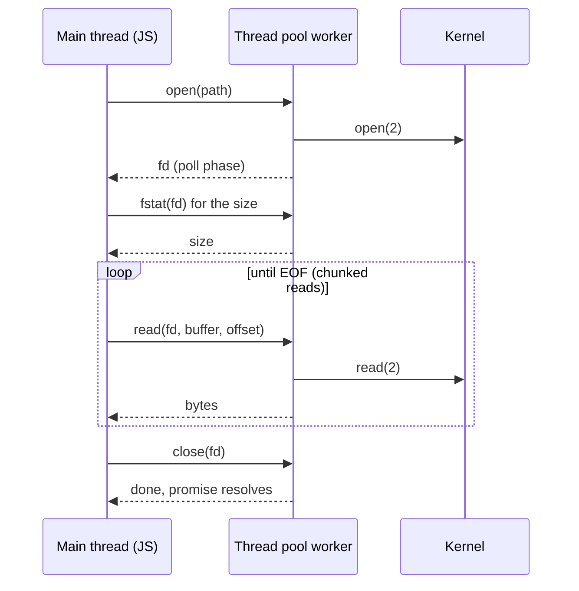
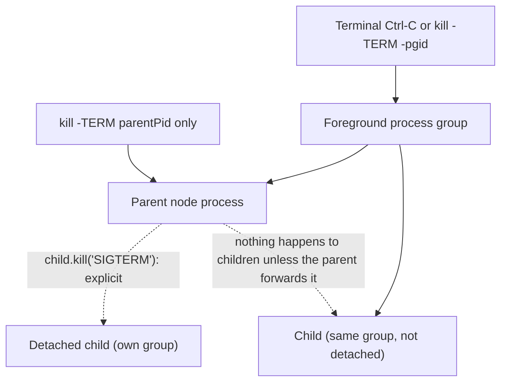

# 06 · File System, Child Processes, Paths and the OS

> **Primary sources:** Node.js API docs: [File system](https://nodejs.org/api/fs.html) (including "Promises API", "File system flags", "Availability" of `fs.watch`), [Path](https://nodejs.org/api/path.html), [Child process](https://nodejs.org/api/child_process.html), [OS](https://nodejs.org/api/os.html), [Process](https://nodejs.org/api/process.html); POSIX.1-2024 `rename(2)`, `fsync(2)`, `open(2)`; Linux man pages `inotify(7)`, `pipe(7)`; [DEP0190](https://nodejs.org/api/deprecations.html#DEP0190).
>
> **Executable proof:** [`examples/06-filesystem-process-os.test.ts`](../examples/06-filesystem-process-os.test.ts) with utilities in [`examples/06-fs-utils.ts`](../examples/06-fs-utils.ts)

Generic Linux semantics (process model, signals, file-system internals, namespaces, cgroups) are owned by `technologies/containers`; OS command injection as a vulnerability class is owned by [security-identity module 11](../../../architecture/security-identity/modules/11-web-and-api-vulnerability-classes.md#2-os-command-injection). This module owns the Node APIs on top of them and the ways those APIs fail in production.

---

## 1. Three APIs for the same system calls

`node:fs` exposes every operation three ways:

| Style | Example | Runs | Use for |
| --- | --- | --- | --- |
| Promise | `await fsp.readFile(p)` (`node:fs/promises`) | thread pool | application code |
| Callback | `fs.readFile(p, cb)` | thread pool | legacy code, the lowest overhead per call |
| Synchronous | `fs.readFileSync(p)` | **main thread, blocking** | startup, CLIs, build scripts; never in request handlers |

All asynchronous `fs` calls are thread-pool requests ([module 02 §5](02-event-loop.md#5-the-thread-pool)): four slow disk operations at a time with the default pool, competing with DNS lookups, crypto and zlib. `fs.readFile` of a large file is internally split into chunked reads; it still buffers the whole file in memory, so for large files use `createReadStream` ([module 05](05-buffers-streams-backpressure.md)).

### 1.1 `FileHandle` and descriptor hygiene

`fsp.open()` returns a `FileHandle` wrapping a file descriptor. Descriptors are a finite per-process resource (`ulimit -n`, commonly 1 024 to 1 048 576), and leaking them ends in `EMFILE: too many open files`, usually far away from the leak.

- **`FileHandle` implements `Symbol.asyncDispose`**, so `await using fh = await open(path)` closes it at scope exit even when the block throws. The test checks that `fh.fd` becomes `-1` after the block. This is the preferred form ([explicit resource management](../../../languages/javascript/modules/10-resource-management-temporal.md#part-a--explicit-resource-management) is a language feature; Node supplies the disposers).
- **Closing a `FileHandle` by garbage collection is an error on Node 26.** Older versions closed it during GC with a deprecation warning (DEP0137); now the process fails with `ERR_INVALID_STATE` ("A FileHandle object was closed during garbage collection"). The negative test drops a handle, forces GC with `--expose-gc` and sees exit code 1. Code that "worked" on older Node versions because GC cleaned up after it crashes after the upgrade.
- `fsp.mkdtempDisposable(prefix)` (and `fs.mkdtempDisposableSync`) creates a temporary directory whose disposal removes it recursively; the test uses it with `await using`.

### 1.2 Flags and modes that matter

| Flag | Meaning | Use |
| --- | --- | --- |
| `'r'`, `'r+'` | read; read/write, must exist |  |
| `'w'`, `'w+'` | truncate or create |  |
| `'a'`, `'a+'` | append: every write goes to the end atomically (`O_APPEND`) | log files written by several processes |
| `'wx'`, `'ax'` | fail with `EEXIST` if the path exists (`O_EXCL`) | lock files, temp files: refuses to follow a symlink planted by an attacker |
| `mode` (e.g. `0o600`) | permissions for a newly created file, masked by the umask | secrets, temp files |

### 1.4 Error codes you will meet

| `err.code` | Meaning | Typical cause and response |
| --- | --- | --- |
| `ENOENT` | no such file or directory | expected for optional files: handle it, do not pre-check |
| `EEXIST` | already exists | `'wx'` lost a race: someone else created it |
| `EACCES` / `EPERM` | permission denied / operation not permitted | wrong user in the container, read-only mount, permission model (`ERR_ACCESS_DENIED` is the Node-level equivalent) |
| `EISDIR` / `ENOTDIR` | wrong kind of path component | user input naming a directory |
| `EMFILE` / `ENFILE` | per-process / system-wide descriptor limit | descriptor leak, or a fan-out without bounded concurrency |
| `ENOSPC` / `EDQUOT` | disk full / quota exceeded | log files, temp files; fail the request, alert |
| `EBUSY` | resource busy | Windows: file open in another process; mount points |
| `EXDEV` | cross-device link | `rename` across file systems |
| `ELOOP` | too many symlinks | symlink cycle, or `O_NOFOLLOW` hit a symlink |
| `ENAMETOOLONG` | path or component too long | user-supplied names |
| `EAGAIN` | resource temporarily unavailable | `spawn` when the PID limit is reached |

Match on `err.code` ([module 04 §5.2](04-async-control-flow-and-errors.md#52-nodes-error-objects)), and log `err.syscall` and `err.path` with it.

### 1.3 What one `readFile` costs

`fsp.readFile(path)` is not one operation. On Node 26 it is a sequence of thread-pool requests, each a round trip between the main thread and a worker:



Consequences: many small `readFile` calls are dominated by round-trip and scheduling overhead, not disk time; a single huge `readFile` allocates the whole file as one Buffer (refused above `buffer.constants.MAX_LENGTH`, and a memory spike well before that); and under load each step waits in the shared thread-pool queue. For hot small files (templates, certificates) read once at startup and cache; for large files stream; for directories with millions of entries use `fsp.opendir(dir)`, an async iterator that reads entries in batches instead of returning one giant array like `readdir`.

### Then vs now: file-system helpers

| Then (npm package or legacy API) | Now (built in) | Since |
| --- | --- | --- |
| `rimraf`, `fs.rmdir(p, { recursive: true })` | `fsp.rm(p, { recursive: true, force: true })` | 14.14 (rmdir's recursive option is deprecated, DEP0147) |
| `mkdirp` | `fsp.mkdir(p, { recursive: true })` | 10.12 |
| `fs-extra.copy` / `ncp` | `fsp.cp(src, dest, { recursive: true })` | 16.7, stable in 22.3 |
| `glob`, `fast-glob` | `fsp.glob` | 22.0 |
| `fs.exists(p, cb)` | `fsp.access(p)` or just open and handle `ENOENT` | `fs.exists` deprecated (DEP0034) |
| `tmp`, `tmp-promise` | `fsp.mkdtemp`, `fsp.mkdtempDisposable` | `mkdtemp` long-standing; the disposable variant is recent and present in Node 26 |
| checking then acting (`if (exists) open`) | act and handle the error (`open(p, 'wx')`, catch `EEXIST`) | always: check-then-act is a race (TOCTOU) |

The last row is the important one. Between `access()` and `open()`, another process can create, delete or replace the file (time-of-check to time-of-use). Atomic flags (`O_EXCL`, `O_APPEND`) and `rename` make the operation itself the check.

---

## 2. Durability and atomic replacement

**Definitions.**

- A write is **visible** once another process can read it (after `write(2)` returns, through the page cache).
- A write is **durable** once it survives power loss: only after `fsync(2)` on the file (and, for a new or renamed name, on the **directory** that contains it).
- A replacement is **atomic** if every reader observes either the complete old content or the complete new content. POSIX guarantees that `rename(2)` within one file system atomically replaces the target name.

`fs.writeFile(target, data)` is neither atomic nor durable: it truncates and writes in place, so a crash or a concurrent reader sees an empty or partial file. The standard recipe, implemented in `writeFileAtomic`:

```
WRITE-FILE-ATOMIC(target, data)
  tmp ← target ‖ ".tmp-" ‖ pid ‖ random            ▷ same directory ⇒ same file system ⇒ rename is atomic
  fd ← open(tmp, O_WRONLY | O_CREAT | O_EXCL, 0600) ▷ O_EXCL: never reuse or follow an existing path
  write(fd, data); fsync(fd); close(fd)            ▷ content durable BEFORE it is published
  rename(tmp, target)                              ▷ the atomic publication step
  fsync(open(dirname(target)))                     ▷ make the new directory entry durable
  on any failure before rename: unlink(tmp); rethrow
```

**Invariant:** at every instant, `target` names either the old complete file or the new complete file. The tests check the success path (new content, no temp files left) and the failure path (original intact, no temp files left). Limits: renaming across file systems fails with `EXDEV` (so never put the temp file in `/tmp` when the target is elsewhere); Windows cannot `fsync` a directory (the utility treats that step as best effort); and network file systems weaken all of these guarantees.

### 2.1 Concurrent writers and lock files

Node has no portable advisory file-locking API (`flock`/`fcntl` locks are not exposed). Options, in order of preference:

1. **Avoid shared mutable files.** Give each process its own file, or use a database (SQLite with WAL handles multi-process access correctly).
2. **Append-only logs** opened with `'a'`: each `write` call is appended atomically with respect to other appenders on local file systems, as long as a record is written in one call.
3. **Lock files with `O_EXCL`.** `open(lockPath, 'wx')` succeeds for exactly one process; others get `EEXIST`. The lock holder writes its PID and a timestamp, and removes the file when done. The test proves mutual exclusion: of two concurrent `'wx'` opens, exactly one succeeds.

Lock files have a well-known failure mode: a holder that crashes leaves a **stale lock**, and nobody acquires it again. Recovery requires a staleness rule (the PID is not alive, `process.kill(pid, 0)` throws `ESRCH`, or the lock is older than a lease), and a takeover that is itself atomic (rename a new lock over the stale one, then re-read to confirm ownership). Across machines (NFS, shared volumes in Kubernetes) none of this is reliable: use a lease in a coordination service ([distributed-systems module 08](../../../architecture/distributed-systems/modules/08-distributed-coordination-and-locks.md)).

---

## 3. Paths and traversal

`node:path` is pure string manipulation with platform semantics (`path.posix`, `path.win32`; plain `path` is the current platform's). It never touches the file system.

| Function | Behaviour | Trap |
| --- | --- | --- |
| `path.join(...parts)` | concatenates and normalises `.`/`..` | `join('/srv/files', '../etc/passwd')` → `/srv/etc/passwd` |
| `path.resolve(...parts)` | right-to-left until absolute, then prepends `process.cwd()` | an absolute user part **discards the root**: `resolve('/srv/files', '/etc/passwd')` → `/etc/passwd` |
| `path.normalize(p)` | collapses `..` and duplicate separators | does not make a path safe |
| `path.relative(from, to)` | the relative path between two absolute paths | the basis of a correct containment check |

**Path traversal** (CWE-22) is the Node-specific face of "never build file paths from user input". The containment check must compare _path segments_, not string prefixes:

```ts
export function resolveInside(root: string, userPath: string): string {
  if (userPath.includes('\0') || path.posix.isAbsolute(userPath)) throw traversal();
  const full = path.posix.resolve(root, userPath);
  const rel = path.posix.relative(root, full);
  if (rel === '' || rel.startsWith('..') || path.posix.isAbsolute(rel)) throw traversal();
  return full;
}
```

The negative test shows why `resolved.startsWith(root)` is wrong: `/srv/files-secret/x` starts with `/srv/files`. Further defences: reject NUL bytes (Node's `fs` throws `ERR_INVALID_ARG_VALUE` on them anyway), decode URL-encoded input exactly once before checking, and remember that **symlinks inside the root can point outside it**, which no string check catches; use `fs.realpath` on the result and re-check, or serve from a directory that contains no symlinks. The permission model's `--allow-fs-read` does not help here: it follows symlinks too ([module 13](13-security.md#3-the-permission-model)).

### 3.1 File URLs

ES modules identify files by URL (`import.meta.url` is `file:///srv/app/main.js`). Convert with `url.fileURLToPath(url)` and `url.pathToFileURL(path)`, never by string surgery: percent-encoding (`%20`, `%23` for `#`), Windows drive letters (`file:///C:/…`) and UNC paths all break hand-written conversions. Most `fs` functions accept a `URL` object directly. `import.meta.dirname` and `import.meta.filename` give the converted values for the current module.

---

## 4. Watching and globbing

### 4.1 `fs.watch` caveats

`fs.watch` uses the OS notification API (inotify on Linux, FSEvents on macOS, `ReadDirectoryChangesW` on Windows), so its behaviour is platform-dependent by design:

- Events are **coalesced or duplicated**: one save in an editor can produce several `'change'` events (write, chmod, rename of a swap file), or a single `'rename'`.
- **The filename argument may be missing** on some platforms.
- `recursive: true` is supported on Linux since Node 20 (implemented in user space on top of inotify, which costs one watch per directory and can hit `fs.inotify.max_user_watches`).
- Watching a file that is replaced by rename (atomic writes, as in §2) watches the **old inode**; you stop receiving events. Watch the directory instead.
- Network and container bind-mount file systems often deliver no events at all.

`fs.watchFile` polls with `stat` on a timer instead: reliable everywhere, expensive with many files. Robust watchers (dev servers, `node --watch`) debounce events and re-scan. For tests, never assert on the number of watch events.

### 4.2 `fs.glob`

`fs.glob`, `fs.globSync` and `fsp.glob` (added in 22.0.0, no experimental warning on Node 26) return matches for shell-style patterns (`**/*.ts`, `{a,b}`), with `cwd` and `exclude` options; the promise form is an **async iterator**, so large trees stream rather than materialise. The test globs `*.log` in a temporary directory. It replaces the `glob`/`fast-glob` dependencies for most scripts.

---

## 5. Child processes

### 5.0 What a child inherits

- **Environment.** By default the child receives a copy of `process.env`, including every secret in it. Passing `env: { ... }` **replaces** the environment entirely (no `PATH`, no `HOME` unless you include them). Pass a minimal, explicit environment to children that run untrusted or third-party code.
- **Working directory** (`cwd`), **umask**, and open file descriptors only if listed in `stdio`.
- **`execArgv`** for `fork()`: the parent's Node flags (including `--inspect` ports, which then collide) unless you pass `execArgv`.
- **Program lookup.** Without a shell, `spawn('git', …)` searches `PATH` itself. On Windows, `.bat` and `.cmd` files are run by `cmd.exe`, whose argument parsing cannot be escaped safely; since the April 2024 security releases (CVE-2024-27980), Node refuses to spawn them without `shell: true` and throws `EINVAL`, so the risk is explicit.

### 5.1 The four functions

| Function | Shell? | Output | Returns | Use for |
| --- | --- | --- | --- | --- |
| `spawn(cmd, args, opts)` | no (unless `shell: true`) | **streams** (`child.stdout` …) | `ChildProcess` | long-running processes, large output |
| `execFile(file, args, opts, cb)` | no | **buffered** strings, limited by `maxBuffer` | `ChildProcess` + callback | short commands with small output |
| `exec(command, opts, cb)` | **yes** (`/bin/sh -c`, `cmd.exe`) | buffered | `ChildProcess` + callback | trusted, constant command strings only |
| `fork(modulePath, args, opts)` | no | streams + an **IPC channel** | `ChildProcess` with `send()` | Node-to-Node work distribution |

Each has a `*Sync` variant (`spawnSync`, `execFileSync`, `execSync`) that **blocks the event loop** for the child's whole lifetime (the test measures it), acceptable in CLIs and build scripts only.

### 5.2 Shell injection

`exec()` passes its string to a shell, which interprets `;`, `&&`, `|`, `$()`, backticks, redirections and globbing. The negative test runs `exec(\`echo ${input}\`)`with`input = 'x; echo INJECTED'`and the shell executes the second command. With`execFile('echo', [input])` the same input is a single literal argument. Rules:

1. Never pass user input to `exec`, `execSync`, or `spawn(..., { shell: true })`.
2. Use `execFile`/`spawn` with an argument **array**.
3. Even without a shell, validate arguments that the _program_ interprets: a user value starting with `-` can become an option (`--output=/etc/passwd`); put `--` before positional arguments where the program supports it.
4. `spawn(cmd, args, { shell: true })` **concatenates** `args` without escaping. On Node 26 this is a runtime deprecation (**DEP0190**); the test sees the warning _and_ the injected command running.

### 5.3 Buffering, pipes and deadlocks

- `exec`/`execFile` collect stdout and stderr in memory up to `maxBuffer` (default **1 MiB** each); beyond it the child is killed and the callback receives `ERR_CHILD_PROCESS_STDIO_MAXBUFFER` (the test writes 2 MB). Use `spawn` and stream for unbounded output.
- A child writing to a pipe **blocks** when the pipe buffer (64 KiB on Linux) is full and the parent is not reading. A parent that waits for `'exit'` before reading stdout, or that never consumes stderr, deadlocks with any chatty child. Always consume (or `stdio: 'ignore'`) every piped stream.
- `'exit'` fires when the process ends; `'close'` fires when its stdio streams have also closed. Read all output on `'close'`. The test streams 3 MB through `spawn` and gets exit code 7 on `'close'`.
- `code` and `signal` are mutually exclusive: a child killed by a signal reports `code === null` and `signal === 'SIGTERM'` (the test kills a child explicitly and through an `AbortSignal`).

### 5.4 `fork` and IPC

`fork()` starts a new Node process running a module, with an IPC channel (a pipe on file descriptor 3, `NODE_CHANNEL_FD`) for `child.send(msg)` / `process.on('message')`. Messages are serialised:

| `serialization` | Encodes | Cannot carry |
| --- | --- | --- |
| `'json'` (default) | JSON | `Map`/`Set` (become `{}`), `BigInt` (throws `TypeError`), `Date` (becomes a string), `undefined` in arrays, cycles |
| `'advanced'` | the structured clone algorithm (V8 serializer) | functions, class identity, symbols |

The tests send a `Map` and a `BigInt` both ways and pin each behaviour. Each forked process is a full Node instance (tens of MB of RSS, ~50 ms startup), so `fork` is for isolation, not for cheap parallelism; [module 09](09-concurrency-and-scaling.md) compares it with worker threads.

### 5.5 Detaching, process groups and orphans

- `detached: true` makes the child the leader of a new process group (POSIX), so signals sent to the parent's group (Ctrl-C) do not reach it; with `child.unref()` and `stdio: 'ignore'`, the parent can exit while the child continues.
- Conversely, **children are not killed when the parent dies** unless something kills them: a parent that crashes leaves orphans (reparented to PID 1, or to the container's init). Supervisors should kill the whole process group (`process.kill(-child.pid, 'SIGTERM')` for a detached child) on shutdown.
- `child.kill()` sends SIGTERM by default; on Windows signals are emulated and `kill` terminates the process.

### 5.7 Putting it together: a `run()` helper

[`examples/06-fs-utils.ts`](../examples/06-fs-utils.ts) contains a small helper that applies every rule in this section: no shell, an explicit environment, both pipes always drained, a cap on _stored_ output (reading continues so the child never blocks), a hard deadline (`spawn`'s `timeout` option with `killSignal: 'SIGKILL'`), and resolution on `'close'`. Its tests check that a child writing 5 MB completes with only 1 000 characters stored, that a hung child is killed after 200 ms with `code === null`, that a missing program surfaces as an `'error'` event with `ENOENT` (not as an exit code: the process never started), and that a replaced `env` really contains nothing else, not even `PATH`.

### 5.6 Signals across a process tree



Rules of thumb:

- A signal sent to one PID (as Kubernetes and Docker do to the container's main process) reaches **only that process**. A Node parent must forward shutdown to its children and wait for them, with a deadline, before exiting.
- A signal sent to a **process group** (a terminal's Ctrl-C, `kill -TERM -<pgid>`) reaches every non-detached child at once, so children may start shutting down before the parent asks them to; make child shutdown idempotent.
- `npm start`, `sh -c` and other wrappers in between may or may not forward signals; how this interacts with PID 1 in containers is in [module 14](14-production-operations.md#2-node-as-pid-1-and-signal-handling).

A minimal supervisor loop, as pseudocode with its invariant:

```
SUPERVISE(cmd, maxRestarts, window)
  ▷ Invariant: at most one child is running; restarts within `window` ≤ maxRestarts
  restarts ← []
  loop
     child ← spawn(cmd)
     on parent SIGTERM: forward SIGTERM to child; wait ≤ grace for exit; else SIGKILL; exit
     (code, signal) ← wait for child exit
     if code = 0: return                                  ▷ normal completion
     drop entries older than `window` from restarts; append now
     if |restarts| > maxRestarts: exit 1                  ▷ crash loop: escalate to the outer supervisor
     sleep(backoff(|restarts|))                           ▷ exponential, with jitter
```

In production this job belongs to systemd, Kubernetes or a process manager, not to hand-written Node code; the pseudocode is what they implement, and it is a common interview whiteboard question.

### Then vs now: running other programs

| Then | Now | Why |
| --- | --- | --- |
| `exec(\`git log ${branch}\`)` everywhere | `execFile('git', ['log', '--', branch])` | shell injection |
| `spawn(cmd, args, { shell: true })` for convenience | `shell: true` only with a constant command string; DEP0190 warns when args are passed | args are concatenated unescaped |
| spawning `.bat`/`.cmd` on Windows without a shell | throws `EINVAL` unless `shell: true` (April 2024 security releases) | `cmd.exe` argument parsing cannot be made safe |
| `execa` and similar wrappers for promises, timeouts and output limits | `util.promisify(execFile)`, `spawn` with `signal`/`timeout`, or a 20-line helper like `run()` | the core APIs grew the missing options |
| `child_process.fork` for parallel CPU work | `worker_threads` pools ([module 09](09-concurrency-and-scaling.md)) | lower memory and startup cost |

---

## 6. The OS and the process environment

| API | Gives | Trap |
| --- | --- | --- |
| `os.availableParallelism()` | CPUs this process may use (respects affinity) | prefer it to `os.cpus().length` for sizing pools; neither knows about a cgroup CPU _quota_ (a container limited to 2 CPUs on a 64-core host reports 64) |
| `os.totalmem()`, `os.freemem()` | host memory | the host's, not the container's limit; use `process.constrainedMemory()` for the cgroup limit ([module 10](10-v8-memory-and-gc.md)) |
| `os.constants.signals`, `os.constants.errno` | numeric codes (SIGTERM = 15) |  |
| `os.EOL` | `'\n'` or `'\r\n'` | do not use it for network protocols, which define their own line endings |
| `os.tmpdir()`, `os.homedir()` | directories | `tmpdir` is shared and world-writable on many systems: use `mkdtemp` with `0o700` |
| `process.cwd()`, `process.chdir()` | working directory | `chdir` affects every relative path in the process; not available in worker threads |
| `process.umask()` | file creation mask | deprecated without arguments (DEP0139) because reading it is racy |

`fs.stat` with `{ bigint: true }` returns nanosecond timestamps (`mtimeNs`), useful for change detection where millisecond `mtimeMs` collides.

### 6.1 Reading container limits

Inside a container, the numbers the OS module reports describe the **host**. The values that bound your process come from cgroup v2 files (generic semantics are owned by `technologies/containers`):

| Limit | cgroup v2 file | Node API |
| --- | --- | --- |
| memory limit | `/sys/fs/cgroup/memory.max` | `process.constrainedMemory()` (returns the limit in bytes, or a very large number when unlimited) |
| memory currently available under the limit | `memory.max` − `memory.current` | `process.availableMemory()` |
| CPU quota | `/sys/fs/cgroup/cpu.max` (`"200000 100000"` = 2 CPUs) | none: read the file |
| PIDs limit | `pids.max` | none: `spawn` fails with `EAGAIN` when reached |

V8 has used the cgroup memory limit to size its default heap since Node 12, but only as a heuristic; set `--max-old-space-size` (or `--max-old-space-size-percentage`) explicitly, as [module 10](10-v8-memory-and-gc.md#7-heap-limits-in-containers) explains.

---

## 7. Production failure modes

| Failure | Mechanism | Fix |
| --- | --- | --- |
| `EMFILE: too many open files` after hours | descriptors leaked: `FileHandle`s not closed, streams not destroyed after errors | `await using`, `pipeline`, monitor open fds (`ls /proc/self/fd \| wc -l`) |
| Process dies after upgrading to Node 26 with `ERR_INVALID_STATE` mentioning garbage collection | a `FileHandle` relied on GC to close it | close explicitly (`await using`) |
| Config file empty or truncated after a crash or deploy | in-place `writeFile` | temp file + `fsync` + `rename` |
| `EXDEV` on rename | temp file on another file system (`/tmp`) | create the temp file next to the target |
| Path traversal reads `/etc/passwd` | user input joined into a path; `startsWith` containment check | `resolveInside` with `path.relative`; `realpath` for symlinks |
| Remote command execution | `exec` with interpolated input; `shell: true` with args | `execFile`/`spawn` with arrays; `--` before positionals |
| Child hangs forever | its stdout or stderr pipe is full and unread | consume every pipe, or `stdio: 'ignore'` |
| `ERR_CHILD_PROCESS_STDIO_MAXBUFFER` | `exec` output above 1 MiB | `spawn` and stream |
| File watcher stops firing after the first save | the editor or deploy replaced the file by rename; the watch held the old inode | watch the directory; debounce and re-scan |
| Event loop stalls during "harmless" shell-outs | `execSync`/`spawnSync` in a request path | async APIs |
| Orphaned workers after a crash | children are not killed with the parent | process groups; supervisors that kill the group |
| Thread-pool starvation from file I/O | many concurrent `fs` calls or slow disks | bound concurrency; larger `UV_THREADPOOL_SIZE`; streams |

---

## Interview Drill

<details><summary>1. How do you replace a configuration file so that readers never see a partial file, even across a crash?</summary>

Write the new content to a temporary file in the same directory (opened with `wx`), `fsync` it, `rename` it over the target (atomic within one file system), and `fsync` the directory to persist the rename. On failure before the rename, delete the temp file. Readers see the old file until the rename and the complete new file after it.
</details>

<details><summary>2. What is the difference between `exec`, `execFile`, `spawn` and `fork`?</summary>

`exec` runs a command string through a shell and buffers output (up to `maxBuffer`); `execFile` runs a program directly with an argument array and buffers output; `spawn` runs a program with an argument array and exposes output as streams; `fork` spawns a new Node process for a module with an IPC channel. Only `exec` (and `shell: true`) involves a shell, and therefore shell injection.
</details>

<details><summary>3. A user-supplied filename is joined to an upload directory with `path.join`. How can that be exploited and how do you fix it?</summary>

`../` segments escape the directory (`../../etc/passwd`), and with `path.resolve` an absolute input replaces the root entirely. Fix: reject absolute paths and NUL bytes, resolve against the root, and check containment with `path.relative(root, full)` (not `startsWith`, which `/srv/files-secret` defeats); resolve symlinks with `realpath` and check again, or keep symlinks out of the served tree.
</details>

<details><summary>4. Why might a child process hang even though it has finished its work?</summary>

It is blocked writing to a full pipe: the parent created `stdout` or `stderr` as a pipe but never reads it, and once the kernel pipe buffer (64 KiB on Linux) fills, the child's `write` blocks forever. Consume every piped stream (or use `stdio: 'ignore'`/`'inherit'`), and wait for `'close'` rather than `'exit'` when you need all output.
</details>

<details><summary>5. What changed about `FileHandle` cleanup, and why does it matter for upgrades to Node 26?</summary>

Older versions closed a `FileHandle` that was garbage collected while open, printing a deprecation warning. Node 26 treats this as an error (`ERR_INVALID_STATE`), which crashes the process. Code that leaked handles silently now fails; close handles explicitly, ideally with `await using`.
</details>

<details><summary>6. When is `fs.watch` unreliable, and what do robust watchers do?</summary>

Event counts and types differ by platform (duplicates, coalescing), filenames can be missing, files replaced by rename leave the watch on a dead inode, recursive watching on Linux consumes inotify watches, and network or bind-mounted file systems may deliver nothing. Robust watchers watch directories, debounce, re-scan to compute the real change set, and fall back to polling where events are unavailable.
</details>

<details><summary>7. Why is `os.cpus().length` a poor choice for sizing a worker pool in a container?</summary>

It reports every CPU of the host, ignoring affinity and cgroup CPU quotas. `os.availableParallelism()` respects affinity but still not quotas. Size pools from configuration or from the cgroup quota (`cpu.max`), and treat CPU counts from the OS as an upper bound.
</details>

<details><summary>8. What does `serialization: 'advanced'` change for `fork()` IPC?</summary>

Messages are serialised with the structured clone algorithm instead of JSON, so `Map`, `Set`, `BigInt`, `Date`, typed arrays and cyclic structures survive the trip. With the default JSON, a `Map` arrives as `{}`, a `Date` as a string, and a `BigInt` makes `send()` throw.
</details>

<details><summary>9. Why is "check if the file exists, then open it" a bug, and what replaces it?</summary>

Between the check and the use, another process can create, remove or swap the file (a TOCTOU race), which at best fails unpredictably and at worst follows an attacker's symlink. Make the operation atomic and handle its error: `open(path, 'wx')` and catch `EEXIST` to create exclusively, `open(path, 'r')` and catch `ENOENT` to read if present, `rename` to replace.
</details>

<details><summary>10. Your Node process supervises worker children. Kubernetes sends SIGTERM to the pod. What must happen for a clean shutdown?</summary>

The signal reaches only the main process. Its SIGTERM handler must stop accepting work, forward SIGTERM to each child, wait for them to exit within a deadline shorter than the pod's grace period, SIGKILL any that do not, then exit. Children must handle SIGTERM idempotently, since a process-group signal could also reach them directly.
</details>

<details><summary>11. A child process could not be started because the program does not exist. How does Node report it?</summary>

Through the `'error'` event on the `ChildProcess` (or a rejected promise for promisified `execFile`) with `code: 'ENOENT'`; there is no exit code because no process ran. Code that only listens for `'exit'` or `'close'` waits forever or crashes on the unhandled `'error'`.
</details>

<details><summary>12. Why should you not convert `import.meta.url` to a path with `url.replace('file://', '')`?</summary>

File URLs are percent-encoded (a space is `%20`, `#` is `%23`), and Windows file URLs carry a drive letter after an extra slash (`file:///C:/app`). String replacement yields wrong or non-existent paths in exactly those cases. `fileURLToPath` (or `import.meta.filename`/`dirname`) decodes correctly on every platform.
</details>

<details><summary>13. A service must write uploaded files where only it can read them, under a name chosen by the user. Which Node APIs and flags do you use?</summary>

Validate and contain the name with `resolveInside` (segment-based `path.relative` check, no NUL, no absolute paths), create the file with `open(path, 'wx', 0o600)` so it fails on an existing or planted path and is private to the user, stream the body into it with `pipeline` and a byte limit, `sync()` before publishing, and `rename` into place if readers must never see partial files.
</details>
