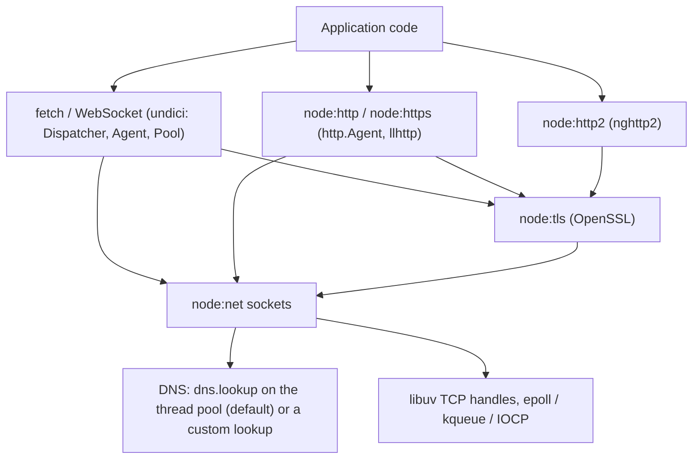
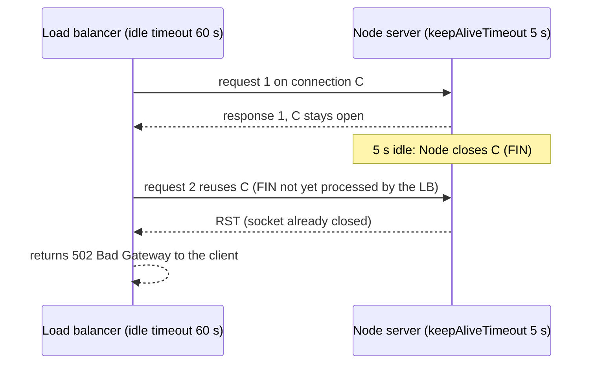

# 07 · Networking and HTTP: Sockets, Server Timeouts, Agents, `fetch`, DNS, TLS and HTTP/2

> **Primary sources:** Node.js API docs: [Net](https://nodejs.org/api/net.html), [HTTP](https://nodejs.org/api/http.html) (`server.headersTimeout`, `server.requestTimeout`, `server.keepAliveTimeout`, `http.Agent`), [HTTP/2](https://nodejs.org/api/http2.html), [TLS](https://nodejs.org/api/tls.html), [DNS](https://nodejs.org/api/dns.html) ("Implementation considerations"), [Globals: `fetch`](https://nodejs.org/api/globals.html#fetch); undici documentation ([Dispatcher](https://undici.nodejs.org/#/docs/api/Dispatcher), [MockAgent](https://undici.nodejs.org/#/docs/api/MockAgent)); RFC 9110 (HTTP semantics), RFC 9112 (HTTP/1.1, §6.3 message body length), RFC 9113 (HTTP/2), RFC 8305 (Happy Eyeballs v2); AWS Elastic Load Balancing documentation on idle timeouts.
>
> **Executable proof:** [`examples/07-networking-and-http.test.ts`](../examples/07-networking-and-http.test.ts): every server listens on port 0 on loopback, slow and malicious clients are simulated with raw sockets, and outbound HTTP is mocked with undici's `MockAgent`.

Protocol theory is owned by the networking track: TCP internals in [networking module 06](../../../architecture/networking/modules/06-tcp-internals.md), DNS in [module 08](../../../architecture/networking/modules/08-dns.md), TLS 1.3 in [module 09](../../../architecture/networking/modules/09-tls-1-3-and-pki-on-the-wire.md), HTTP/1.1 framing, request smuggling and HTTP/2 in [module 10](../../../architecture/networking/modules/10-http-1-1-and-http-2.md), load balancers in [module 13](../../../architecture/networking/modules/13-load-balancing-cdn-nat.md). Crypto primitives and PKI policy belong to the security-identity track. This module owns how Node realises those protocols: which object does what, what the defaults are on Node 26, and which defaults cause outages.

---

## 1. The networking stack inside Node

| Layer | Module | Implementation |
| --- | --- | --- |
| UDP | `node:dgram` | libuv `uv_udp_t` |
| TCP and Unix sockets / Windows named pipes | `node:net` | libuv `uv_tcp_t` / `uv_pipe_t`, non-blocking, polled in the poll phase |
| TLS | `node:tls` | OpenSSL 3.5 over a `net.Socket` |
| HTTP/1.1 server and classic client | `node:http`, `node:https` | llhttp (C) parser, JavaScript `IncomingMessage`/`ServerResponse`/`ClientRequest`, `http.Agent` connection pooling |
| HTTP/2 | `node:http2` | nghttp2 |
| `fetch`, `WebSocket`, `EventSource` | globals | **undici**, a separate HTTP/1.1 (and HTTP/2) client written in JavaScript on top of `net`/`tls`, with its own llhttp (WebAssembly) parser and its own connection pools |
| DNS | `node:dns` | `lookup` → `getaddrinfo` on the thread pool; `resolve*` → c-ares |
| HTTP/3 / QUIC | — | not in default builds on Node 26 (`process.features.quic === false`) |



Two consequences of this split are easy to miss: **`fetch` does not use `http.Agent`** (settings on `http.globalAgent` do not affect `fetch`, and vice versa), and both clients resolve host names with `dns.lookup` by default, which means **the thread pool and no DNS cache** (§7).

---

## 2. TCP with `node:net`

A `net.Socket` is a `Duplex` stream ([module 05](05-buffers-streams-backpressure.md)) over a connected TCP socket. A `net.Server` accepts connections and emits `'connection'` with a new socket for each.

- **TCP is a byte stream.** Message boundaries are not preserved; one `write('he')` plus `write('llo')` can arrive as one chunk or three. Framing is the application's job ([module 05 §7](05-buffers-streams-backpressure.md#7-binary-protocols-framing-over-a-byte-stream)).
- **Half-close.** When the peer sends FIN, the socket emits `'end'`. With the default `allowHalfOpen: false`, Node then ends its own side automatically. With `allowHalfOpen: true` the writable side stays open, so a server can read a whole request terminated by the client's FIN and still reply; the echo test does exactly that.
- **Nagle and delayed ACK.** `socket.setNoDelay(true)` disables Nagle's algorithm, so small writes are sent immediately; `node:http` enables it for its sockets. `socket.setKeepAlive(true, initialDelayMs)` enables **TCP** keep-alive probes, which detect dead peers on idle connections; it is unrelated to **HTTP** keep-alive (connection reuse).
- **Errors are events.** `ECONNREFUSED` (nothing listening; the test closes a server and connects to its port), `ECONNRESET` (the peer sent RST: crashed, timed out, or a proxy killed the connection), `ETIMEDOUT`, `EPIPE` (writing after the peer closed), `EADDRINUSE` on `listen`. Each socket needs an `'error'` listener; an unhandled one crashes the process.
- **Listening.** `server.listen(0)` picks a free port (`server.address().port`); `listen({ port, host, backlog, reusePort })` controls the accept queue and, on Linux, `SO_REUSEPORT` ([module 09](09-concurrency-and-scaling.md)). Binding to `'0.0.0.0'` vs `'::'` vs `'127.0.0.1'` decides which interfaces accept connections; in containers, listening on `127.0.0.1` makes the service unreachable from outside the container.

### 2.1 UDP with `node:dgram`

UDP sockets (`dgram.createSocket('udp4')`) send and receive **datagrams**: message boundaries are preserved, but delivery, ordering and duplication are not guaranteed, and a datagram larger than the path MTU is fragmented or dropped. Node uses UDP mostly indirectly (c-ares DNS queries, StatsD-style metrics clients). Things to know: `socket.send()` is asynchronous and its callback reports only local errors, never delivery; an unhandled `'error'` (for example `EMSGSIZE`) crashes the process like any emitter; `socket.bind({ port, exclusive: false })` lets `cluster` workers share a port; there is no backpressure, so a sender in a tight loop drops packets in the kernel's buffers silently.

---

## 3. The HTTP/1.1 server

### 3.1 Request lifecycle

1. A connection is accepted; Node attaches an llhttp parser to the socket.
2. Bytes arrive in the poll phase and are fed to llhttp. When the request line and headers are complete, the server emits `'request'` with an `IncomingMessage` (a Readable for the body) and a `ServerResponse` (a Writable).
3. Your handler reads the body (or not) and writes the response. `res.writeHead()` (the removed `writeHeader()` alias is gone in Node 26) sets status and headers; the first `res.write()` sends them; `res.end()` finishes the message, using `Content-Length` if known or chunked encoding otherwise.
4. With keep-alive, the socket waits for the next request; pipelined requests are queued and answered in order.

### 3.2 What the parser rejects for you

llhttp is strict by default, and the tests pin three behaviours:

| Input | Response | Why |
| --- | --- | --- |
| headers never completed within `headersTimeout` | **408** Request Timeout, connection closed | slowloris defence (§4) |
| `Content-Length` **and** `Transfer-Encoding` in one request | **400** Bad Request | RFC 9112 §6.3: the combination is the root of CL.TE/TE.CL request smuggling ([networking module 10 §3](../../../architecture/networking/modules/10-http-1-1-and-http-2.md#3-http-request-smuggling-clte--tecl-attacks)) |
| header section larger than `maxHeaderSize` (16 KiB) | **431** Request Header Fields Too Large | memory and CPU bound per request; raise with `--max-http-header-size` or the `maxHeaderSize` server option only with a reason |

`--insecure-http-parser` (or `insecureHTTPParser: true`) relaxes these checks to talk to broken peers. It reopens smuggling holes when Node sits behind a proxy that parses differently; never enable it on a public server.

### 3.3 Reading bodies safely

`node:http` hands you the body as a stream and imposes **no size limit**. A handler that buffers the whole body (`for await (const c of req) chunks.push(c)`) lets one client exhaust memory. [`examples/07-http-utils.ts`](../examples/07-http-utils.ts) implements the two checks every body reader needs:

```
READ-BODY(req, limit)
  if Content-Length is present and > limit: fail 413 before reading a byte
  size ← 0
  for each chunk c:                                  ▷ Invariant: size ≤ limit, so buffered bytes ≤ limit
     size ← size + |c|
     if size > limit: stop listening, pause req, fail 413
     append c
  return concat(chunks)
```

The first check rejects honest large uploads cheaply; the second catches chunked bodies (no `Content-Length`) and lying clients. The tests cover a body within the limit, a declared 999 999-byte body refused before reading, and a 4 KiB chunked body cut off at a 1 KiB limit. One subtlety the tests forced: the reader **pauses** the request rather than destroying it, because destroying the request destroys the socket, and the client then receives a connection reset instead of the 413. The handler responds with `Connection: close`, so Node discards the unread remainder by closing the connection after the response. Frameworks do this for you (Fastify's `bodyLimit` defaults to 1 MiB, [module 08](08-building-services.md)); raw `node:http` code must do it itself.

---

## 4. Server timeouts

Every server must bound how long a client may hold resources. Node 26's `http.Server` has five knobs; the defaults are pinned in the test.

| Setting | Default (Node 26) | Bounds | When it fires |
| --- | --- | --- | --- |
| `headersTimeout` | **60 000 ms** | time from connection (or previous request) until the full header section arrives | 408 and close; checked every `connectionsCheckingInterval` (default 30 000 ms) |
| `requestTimeout` | **300 000 ms** | time to receive the **entire request** including body | 408 and close; same periodic check |
| `keepAliveTimeout` | **5 000 ms** | idle time between requests on a kept-alive socket | the socket is destroyed; advertised to clients as `Keep-Alive: timeout=5` |
| `keepAliveTimeoutBuffer` | **1 000 ms** (added 24.6.0) | extra time added to `keepAliveTimeout` for the internal socket timer | gives in-flight requests from the client a little slack |
| `timeout` (`server.setTimeout`) | **0** (disabled) | socket inactivity at any time | `'timeout'` event; the socket is **not** destroyed unless you do it |

The 408 test sets `headersTimeout: 100` and `connectionsCheckingInterval: 20`, sends an unfinished header section from a raw socket, and receives `408 Request Timeout`. Note that with the default 30-second check interval, a `headersTimeout` is enforced with up to 30 seconds of slack.

### 4.1 Aligning with load balancers: the 502 problem

A reverse proxy or load balancer keeps a pool of idle connections to each backend, with its own idle timeout (AWS ALB: **60 s** by default; many proxies: 60–120 s). If the **backend's** keep-alive timeout is _shorter_, this race happens:



The rule: **the side that initiates connection reuse (the LB) must give up on idle connections first.** Set the Node server's `keepAliveTimeout` _above_ the load balancer's idle timeout (for example 65 s behind a 60 s ALB), and `headersTimeout` above `keepAliveTimeout` (older Node versions required this ordering explicitly). The symptom of getting it wrong is a low, steady rate of 502s that correlates with traffic gaps, never with load.

The same race exists between a Node **client** and a remote server: the client's agent must drop idle sockets before the server does. `http.Agent`'s default `timeout` for free sockets is 5 000 ms on Node 26; if the upstream closes after 4 s, lower it, and retry idempotent requests that fail with `ECONNRESET` on a reused socket (`req.reusedSocket` tells you).

### 4.2 A baseline server configuration

```ts
import http from 'node:http';

const server = http.createServer(
  {
    requestTimeout: 30_000, // whole request, body included; well below the 300 s default for APIs
    headersTimeout: 70_000, // must exceed keepAliveTimeout
    keepAliveTimeout: 65_000, // above the load balancer's 60 s idle timeout
    connectionsCheckingInterval: 5_000, // enforce the two timeouts above with at most 5 s slack
    maxHeaderSize: 16 * 1024, // the default, stated explicitly
    requireHostHeader: true, // the default since 20: 400 for HTTP/1.1 requests without Host
  },
  handler,
);
server.maxRequestsPerSocket = 1000; // recycle long-lived connections so load spreads after scaling events
server.listen({ port: 8080, host: '0.0.0.0' });
```

Each value is a decision about the deployment, not a universal constant: an upload service needs a longer `requestTimeout`, a service called directly by browsers without a proxy needs the slowloris defaults tightened, and a service behind a proxy with a 350 s idle timeout needs `keepAliveTimeout` above 350 s.

### Then vs now: server timeouts

| Setting | Then | Now | Why it changed |
| --- | --- | --- | --- |
| `headersTimeout` | 40 s (Node 10–17) | 60 s (Node 18+) | aligned with `requestTimeout` work |
| `requestTimeout` | 0 = unlimited (Node 14.11–17) | **300 s** (Node 18+) | unlimited request bodies allowed slow-POST attacks |
| `keepAliveTimeout` | 5 s since Node 8 (before 8: no keep-alive timeout) | 5 s, plus `keepAliveTimeoutBuffer` 1 s (24.6+) | the buffer reduces the reuse race for clients that honour `Keep-Alive: timeout` |
| `server.close()` | waited for every keep-alive connection to time out | also closes **idle** connections (Node 19+); `closeIdleConnections()`/`closeAllConnections()` for explicit control | shutdowns hung for `keepAliveTimeout` |
| `http.globalAgent` | no keep-alive (every request a new TCP+TLS handshake) | `keepAlive: true` (Node 19+) | performance; but it exposed the client-side reuse race |

Note on typings: `@types/node` 26.6.6 documents `keepAliveTimeout`'s default as 65 000 ms in one JSDoc comment; the runtime value on Node 26.12.1 is 5 000 ms (the test asserts the runtime). Configure it explicitly rather than relying on either.

---

## 5. The classic HTTP client and `http.Agent`

**Definition.** An `http.Agent` is a connection pool keyed by `host:port[:localAddress][:family]` (plus TLS options for `https.Agent`). It hands out a free socket for each request, or opens a new one up to `maxSockets` per origin, and returns sockets to the free list after the response has been **fully consumed**.

| Option | Node 26 default | Meaning |
| --- | --- | --- |
| `keepAlive` | `true` for `globalAgent`, `false` for `new Agent()` unless set | reuse sockets |
| `maxSockets` | `Infinity` | concurrent sockets per origin |
| `maxTotalSockets` | `Infinity` | across all origins |
| `maxFreeSockets` | 256 | idle sockets kept per origin |
| `timeout` | 5 000 ms (`globalAgent`) | idle free socket timeout |
| `scheduling` | `'lifo'` | reuse the most recently used socket: keeps a small hot set, lets the rest time out |

Rules the tests prove:

- With keep-alive, a second sequential request reuses the socket (`res.req.reusedSocket === true`).
- **An unconsumed response body keeps its socket busy.** The negative test leaves a 200 KB body unread and the next request opens a new connection. In production this becomes socket exhaustion or `maxSockets` queueing. Always `res.resume()` (discard) or read the body, even on error statuses.
- An `AbortSignal` (or `req.destroy()`) cancels the request with an `AbortError`.
- `maxSockets: Infinity` means a traffic spike opens as many connections to an upstream as there are concurrent requests: thousands of TCP and TLS handshakes, ephemeral-port exhaustion, and an overwhelmed upstream. Set a finite `maxSockets` per upstream as a deliberate concurrency limit.

### 5.1 Retrying safely

A request that fails can be retried only if repeating it cannot cause a second side effect. Two conditions, both implemented in `withRetry` and pinned by its tests:

1. **The method is idempotent** (RFC 9110 §9.2.2: `GET`, `HEAD`, `OPTIONS`, `PUT`, `DELETE`), or the request carries an idempotency key the server honours. A `POST` is never retried automatically (the test asserts one attempt).
2. **The failure happened before the server could have acted**: `ECONNREFUSED`, or `ECONNRESET`/`UND_ERR_SOCKET` on a **reused** keep-alive socket, which is the stale-socket race of §4.1. A 500 response or a timeout after the request was sent is not safely retryable without idempotency (the test asserts no retry on an `HttpError`).

Add exponential backoff with jitter between attempts and a retry budget across the process, so retries cannot multiply load during an upstream outage; the generic algorithm is in [JavaScript module 07](../../../languages/javascript/modules/07-async-in-depth.md#retry-with-exponential-backoff-and-jitter). undici ships a `RetryAgent`/retry interceptor implementing the same rules.

---

## 6. `fetch` and undici

### 6.1 Architecture

`fetch` (stable since Node 21) is implemented by **undici** (8.12.x on Node 26.12). Its building blocks:

| undici object | Role |
| --- | --- |
| `Client` | one connection (optionally pipelined) to one origin |
| `Pool` | several `Client`s to one origin |
| `Agent` | a `Pool` per origin, created on demand: the default global dispatcher |
| `Dispatcher` | the interface all of them implement (`dispatch(options, handler)`); interceptors (retry, redirect, DNS cache) compose around it |
| `MockAgent` | a dispatcher that answers from interceptors, for tests |
| `setGlobalDispatcher(d)` | replaces the dispatcher used by global `fetch` (it is shared through a global symbol, so the npm `undici` package and Node's bundled copy agree within a major) |

Facts with consequences:

- `fetch` **resolves on HTTP errors**: a 503 is `res.ok === false`, not a rejection. It rejects only for network-level failures, aborts and invalid requests; the underlying error is in `err.cause` (`ECONNREFUSED`, `UND_ERR_HEADERS_TIMEOUT`, `UND_MOCK_ERR_MOCK_NOT_MATCHED`, …).
- **Always consume or cancel the body** (`await res.text()`, `await res.arrayBuffer()`, or `await res.body?.cancel()`). An unread body holds the connection, exactly as with `http.Agent`.
- undici's own timeouts: `headersTimeout` and `bodyTimeout` (300 s each by default) on the dispatcher, `connect.timeout` (10 s). Per-request deadlines come from `signal: AbortSignal.timeout(ms)`, which rejects with a `TimeoutError` (the test).
- `undici.request()` (not `fetch`) is the fastest client API: no WHATWG `Request`/`Response` objects, a Node Readable body. The pooling test makes five sequential requests through `new Agent({ connections: 1 })` and counts **one** TCP connection on the server.
- **Testing outbound HTTP:** `MockAgent` with `disableNetConnect()` intercepts `fetch` without any network; an unmatched request fails with `UND_MOCK_ERR_MOCK_NOT_MATCHED` instead of escaping to the internet. Restore the previous dispatcher afterwards (the test does it in `finally`).

### 6.2 Proxies and the environment

Node ignores `HTTP_PROXY`/`HTTPS_PROXY`/`NO_PROXY` by default: neither `http.request` nor `fetch` consults them, which surprises everyone coming from curl or Python. Options on Node 26:

| Mechanism | Scope |
| --- | --- |
| `--use-env-proxy` (or `NODE_USE_ENV_PROXY=1`) | makes Node's built-in clients honour the proxy environment variables, including `NO_PROXY` |
| `setGlobalDispatcher(new EnvHttpProxyAgent())` from undici | the same for `fetch`/undici only, in code |
| `new ProxyAgent(url)` (undici) or an `http.Agent` subclass such as `https-proxy-agent` | explicit, per client |

Verify the behaviour in the deployment environment: a corporate proxy that intercepts TLS also needs its CA in `NODE_EXTRA_CA_CERTS` (§8), and `NO_PROXY` must list internal service names or they will be routed through the proxy.

### 6.3 Bounding outbound concurrency

Every outbound dependency should have an explicit concurrency budget, enforced in one place:

- For undici, `new Agent({ connections: n })` caps connections **per origin**; requests beyond the cap queue inside the pool (unbounded by default), so pair it with a per-request timeout.
- For `http.Agent`, `maxSockets` per origin and `maxTotalSockets` overall; again, excess requests queue in the agent.
- At the application level, a semaphore (a concurrency-limited pool, [JavaScript module 07](../../../languages/javascript/modules/07-async-in-depth.md#a-concurrency-limited-pool)) around calls lets you reject early (503 with `Retry-After`) when the queue is long, instead of accumulating latency.

Queueing inside the client is invisible to metrics unless you measure it: record the time from "request created" to "socket assigned" separately from the time to first byte.

### Then vs now: HTTP clients

| Then | Now | Notes |
| --- | --- | --- |
| `request` (deprecated 2020), `node-fetch`, `axios`, `got` | global `fetch` (stable since 21); `undici.request` for throughput | fewer dependencies; one pool implementation |
| `nock` (patches `http.request`) for tests | `MockAgent` for `fetch`/undici; `nock` 14 also intercepts `fetch` | patching-based mocks did not see `fetch` traffic |
| keep-alive opt-in (`agentkeepalive` package) | on by default for both `globalAgent` and undici | handle reused-socket resets |
| `url.parse()` | WHATWG `new URL()` (`url.parse` runtime-deprecated since Node 24) | `url.parse` had host-confusion bugs exploited in SSRF |

Mixing old and new: a service that configures `http.globalAgent` (proxies, CA certificates, `maxSockets`) gets **none** of that applied to `fetch`. Configure undici's dispatcher (`setGlobalDispatcher(new Agent({...}))`, `EnvHttpProxyAgent` for `HTTP_PROXY`/`NO_PROXY`) separately.

---

## 7. DNS: `lookup` vs `resolve`

|  | `dns.lookup()` | `dns.resolve*()` / `dns.Resolver` |
| --- | --- | --- |
| Implementation | `getaddrinfo(3)` on the **libuv thread pool** | c-ares, non-blocking, on the event loop |
| Sources | `/etc/hosts`, `nsswitch.conf`, mDNS, VPN resolvers: whatever the OS uses | DNS servers only (`/etc/resolv.conf` or `setServers`) |
| Used by | `net.connect`, `http.request`, `fetch`, every host-name connection **by default** | nothing, unless you call it or plug it in as `lookup` |
| Caching | none in Node; the OS may cache (nscd, systemd-resolved) | none |
| Failure mode | slow DNS occupies thread-pool slots, delaying `fs`/crypto ([module 02 §5](02-event-loop.md#5-the-thread-pool)) | per-query timeouts and retries (`timeout`, `tries` options) |

**Node does not cache DNS results.** Every new connection to a host name performs a lookup; keep-alive pools hide this until a burst of new connections (after a deploy, a pool reset, or with keep-alive disabled) produces a burst of `getaddrinfo` calls on the thread pool. Remedies: keep-alive (the default), a caching `lookup` function (undici has a DNS-caching interceptor; there are maintained npm caches), or a local caching resolver.

Defaults that changed:

- **Result order** is `'verbatim'` (Node 17+): addresses are used in the order the resolver returns them, so IPv6 may come first. Before Node 17 Node reordered IPv4 first. `--dns-result-order=ipv4first` or `dns.setDefaultResultOrder()` restores the old behaviour.
- **Happy Eyeballs** (`autoSelectFamily`, RFC 8305-style) is on by default (Node 20+): `net.connect` tries the addresses in parallel with a staggered delay (`getDefaultAutoSelectFamilyAttemptTimeout()`, 500 ms observed on 26.12.1) and uses the first that connects. This fixed the classic "`localhost` resolves to `::1` but the server listens on `127.0.0.1`" `ECONNREFUSED`.

A **custom `lookup`** function plugs into every socket API (`net.connect`, `http.request`, undici's `connect` option). The test resolves `service.internal` to `127.0.0.1` with a static map and gets the response, with no DNS involved. The same hook is how you pin resolved addresses to defeat DNS rebinding in an SSRF defence ([module 13](13-security.md)).

---

## 8. TLS in Node

Protocol and PKI theory: [networking module 09](../../../architecture/networking/modules/09-tls-1-3-and-pki-on-the-wire.md) and the security-identity track. Node specifics:

| Topic | Node 26 behaviour |
| --- | --- |
| Minimum version | TLS 1.2 (`tls.DEFAULT_MIN_VERSION`); `--tls-min-v1.3` raises it process-wide |
| Trust store | Node's **bundled** Mozilla CA list (`tls.rootCertificates`) by default; `--use-system-ca` uses the OS store, `--use-openssl-ca` OpenSSL's; `NODE_EXTRA_CA_CERTS=file.pem` adds corporate CAs (read once at startup) |
| Verification | on by default; `rejectUnauthorized: false` or `NODE_TLS_REJECT_UNAUTHORIZED=0` disables it **for everything**, including credentials you send, and prints a warning: never in production |
| Hostname check | `tls.checkServerIdentity` (override only to add pinning, never to skip) |
| Server certificates per host | `SNICallback` or `server.addContext(hostname, ctx)` |
| Session resumption | session tickets on by default (TLS 1.3 PSK); clients reuse sessions through the agent |
| mTLS | `requestCert: true, ca: [...]` on the server; `socket.getPeerCertificate()` / `req.socket.authorized` |
| `fetch` | undici's TLS options go on its `Agent` (`connect: { ca, cert, key }`), not on `https.globalAgent` |

Terminating TLS in Node is fine for internal services; at the edge, a proxy (or the cloud load balancer) usually terminates TLS and Node speaks plain HTTP, which makes **`X-Forwarded-*` trust** the Node-side concern ([networking module 13 §4](../../../architecture/networking/modules/13-load-balancing-cdn-nat.md#4-layer-7-reverse-proxying--client-ip-preservation); Fastify's `trustProxy` in [module 08](08-building-services.md)).

---

## 9. HTTP/2, WebSocket and HTTP/3 in Node

- **`node:http2`** provides servers and clients over TLS (`h2`) or cleartext (`h2c`). One connection multiplexes many streams (the test runs three concurrent requests over one `h2c` session). It also has a compatibility API (`http2.createSecureServer({ allowHTTP1: true }, (req, res) => …)`) that mimics `http`. Limits that matter: `maxConcurrentStreams`, `maxSessionMemory`, and the protections against rapid-reset floods (CVE-2023-44487, mitigated in Node's nghttp2 integration; theory in [networking module 10](../../../architecture/networking/modules/10-http-1-1-and-http-2.md#7-the-rapid-reset-attack-cve-2023-44487)). In practice most Node services speak HTTP/1.1 to a proxy that speaks HTTP/2 or HTTP/3 to clients; HTTP/2 between services matters most for gRPC (`@grpc/grpc-js` is built on `node:http2`).
- **`WebSocket`** is a global client (undici) since Node 22; a WebSocket _server_ still needs a library (`ws`) or a framework plugin. WebSocket connections are long-lived: they bypass request timeouts, so they need their own heartbeats (ping/pong) and idle limits, and they complicate graceful shutdown ([module 08](08-building-services.md#6-graceful-shutdown)).
- **HTTP/3/QUIC** is not available in default Node 26 builds (`process.features.quic` is `false`). Terminate HTTP/3 at the edge.

### 9.1 Long-lived HTTP responses: server-sent events and streaming

Server-sent events (`Content-Type: text/event-stream`) and streamed responses (NDJSON, LLM token streams) are ordinary HTTP/1.1 responses that never end quickly. Node-specific rules:

- Disable buffering on the way out: no compression middleware without explicit flushing (§8 of [module 05](05-buffers-streams-backpressure.md#8-compression-and-other-cpu-bound-streams)), and `X-Accel-Buffering: no` behind nginx.
- Respect `res.write()` backpressure: a slow client must not make the server buffer every event.
- Send a comment heartbeat (`: ping\n\n`) more often than every proxy idle timeout on the path, or intermediaries cut the stream.
- Listen for `req.on('close')` (or `res.on('close')`) and stop producing when the client goes away; otherwise the producer keeps running for a disconnected client.
- `requestTimeout` covers receiving the _request_, not the length of the response, so a streaming response is not cut by it; `server.timeout` (socket inactivity), if you set it, would be.
- On shutdown these connections never become idle; the shutdown sequence must end them explicitly ([module 08](08-building-services.md#6-graceful-shutdown)).

---

## 10. Production failure modes

| Failure | Mechanism | Fix |
| --- | --- | --- |
| Sporadic 502s behind a load balancer, worse after traffic gaps | Node closes idle keep-alive sockets before the LB stops reusing them | `keepAliveTimeout` > LB idle timeout; `headersTimeout` > `keepAliveTimeout` |
| Sporadic `ECONNRESET` on outbound calls | client reuses a socket the upstream just closed | agent idle timeout below the upstream's; retry idempotent requests when `reusedSocket` |
| Upstream connection count explodes under load | `maxSockets: Infinity` | finite `maxSockets` / undici `connections` per origin |
| Outbound calls hang, sockets pile up | response bodies not consumed (`http` or `fetch`) | always read, `resume()` or `cancel()` the body |
| `fetch` ignores proxy, CA or pool settings | configured `http.globalAgent`, which `fetch` does not use | configure undici's dispatcher |
| Error handling misses failed calls | `fetch` resolved with `res.ok === false` | check `res.ok`/`status` |
| Slow-client attacks tie up memory and sockets | timeouts disabled or huge | keep `headersTimeout`/`requestTimeout`; body size limits ([module 08](08-building-services.md)) |
| Request smuggling through a proxy chain | `insecureHTTPParser` enabled, or proxies disagreeing on framing | keep the strict parser; normalise at the edge |
| Random latency spikes on new connections | DNS lookups on a saturated thread pool, no DNS cache | keep-alive, DNS caching, bigger pool |
| `ECONNREFUSED ::1` on localhost (older Node) | IPv6 tried first, server on IPv4 | Node 20+ Happy Eyeballs; listen on both families |
| Service unreachable in a container | listening on `127.0.0.1` | listen on `0.0.0.0`/`::` |
| TLS errors "fixed" with `NODE_TLS_REJECT_UNAUTHORIZED=0` | verification disabled process-wide | `NODE_EXTRA_CA_CERTS`, `--use-system-ca` |

---

## Interview Drill

<details><summary>1. Your Node service behind an AWS ALB returns occasional 502s, mostly after quiet periods. What is happening and how do you fix it?</summary>

The ALB reuses idle backend connections for up to 60 s, but Node's default `keepAliveTimeout` is 5 s. After 5 s of idleness Node closes the socket; if the ALB sends a request on it in that window, it receives a reset and returns 502. Set `server.keepAliveTimeout` above the ALB idle timeout (for example 65 s), keep `headersTimeout` above that, and verify with load that has idle gaps.
</details>

<details><summary>2. What are `headersTimeout` and `requestTimeout`, and what attack do they mitigate?</summary>

`headersTimeout` bounds the time to receive the full header section; `requestTimeout` bounds the time to receive the entire request including the body. Both answer with 408 and close the connection. They mitigate slowloris-style attacks, where clients trickle bytes to hold connections and memory indefinitely. They are checked periodically (`connectionsCheckingInterval`), so enforcement has some slack.
</details>

<details><summary>3. Does `fetch` reject when the server returns 500? How do you handle errors and timeouts correctly?</summary>

No: `fetch` resolves for any HTTP response; check `res.ok` or `res.status`. It rejects only for network failures, aborts and invalid requests, with details in `err.cause`. Use `signal: AbortSignal.timeout(ms)` for deadlines (it rejects with `TimeoutError`), and always consume or cancel the body so the connection returns to the pool.
</details>

<details><summary>4. Why can unread response bodies exhaust connections, and how does it show up?</summary>

A keep-alive socket returns to the pool only after its response is fully read. If code ignores bodies (for example on non-200 responses), sockets stay busy, the agent opens new ones up to `maxSockets` (or forever if `Infinity`), and eventually requests queue or the process runs out of descriptors or ephemeral ports. Read, `resume()` or `cancel()` every body.
</details>

<details><summary>5. What is the difference between `dns.lookup` and `dns.resolve`, and which does `http.request` use?</summary>

`lookup` calls the OS resolver (`getaddrinfo`) on the libuv thread pool and honours `/etc/hosts` and system resolver configuration; `resolve*` queries DNS servers directly with c-ares on the event loop. `http.request`, `net.connect` and `fetch` use `lookup` by default. Node caches neither, so connection churn generates DNS load and thread-pool pressure.
</details>

<details><summary>6. Does configuring `http.globalAgent` affect `fetch`?</summary>

No. `fetch` is implemented by undici with its own dispatcher and pools. Proxy settings, CA certificates and connection limits must be configured on undici's dispatcher (`setGlobalDispatcher(new Agent({...}))`, `EnvHttpProxyAgent`) or passed per request.
</details>

<details><summary>7. How do you test code that calls external HTTP APIs with `fetch`, without network access?</summary>

Install an undici `MockAgent` as the global dispatcher, call `disableNetConnect()`, and register interceptors per origin and path with canned replies. Unmatched requests fail with `UND_MOCK_ERR_MOCK_NOT_MATCHED` instead of reaching the network. Restore the previous dispatcher after the test.
</details>

<details><summary>8. Why does Node reject a request containing both `Content-Length` and `Transfer-Encoding`?</summary>

RFC 9112 forbids relying on both; proxies and servers that resolve the conflict differently disagree about where one request ends, which is the basis of request smuggling. llhttp rejects the message with 400 so a Node backend cannot be desynchronised that way. `--insecure-http-parser` disables such checks and should never be used on exposed servers.
</details>

<details><summary>9. What changed in Node 17 and Node 20 about IPv4/IPv6 when connecting to host names?</summary>

Node 17 switched DNS result order to `verbatim` (no longer IPv4 first), which exposed services listening only on IPv4 when `localhost` resolved to `::1` first. Node 20 enabled Happy Eyeballs (`autoSelectFamily`) by default: `net.connect` attempts the resolved addresses in a staggered parallel race and uses the first that connects, which fixes most of those failures.
</details>

<details><summary>10. What does `server.close()` do to keep-alive connections on Node 26?</summary>

It stops accepting new connections and, since Node 19, also closes idle keep-alive connections immediately; connections with requests in flight finish their current request and then close. `closeIdleConnections()` and `closeAllConnections()` give explicit control, which graceful shutdown uses as the last step after a deadline.
</details>

<details><summary>11. How do you stop a client from exhausting memory with a large request body on a raw `node:http` server?</summary>

Reject a declared `Content-Length` above the limit with 413 before reading; while reading, count bytes and stop at the limit (pause, stop buffering, respond 413 with `Connection: close`) to catch chunked or lying bodies. Never buffer an unbounded body; stream large uploads to their destination with backpressure instead.
</details>

<details><summary>12. When is it safe to retry a failed HTTP request automatically?</summary>

When repeating it cannot duplicate a side effect: idempotent methods (or an idempotency key), and failures that happened before the server processed the request, such as a refused connection or a reset on a reused keep-alive socket. Use backoff with jitter and a retry budget so retries do not amplify an outage.
</details>

<details><summary>13. Why does Node ignore `HTTPS_PROXY` by default, and how do you make `fetch` use a proxy?</summary>

Node's clients connect directly unless configured; environment-variable proxy support is opt-in. Start Node with `--use-env-proxy` to make the built-in clients honour `HTTP_PROXY`/`HTTPS_PROXY`/`NO_PROXY`, or install an undici `EnvHttpProxyAgent` (or an explicit `ProxyAgent`) as the global dispatcher for `fetch`. If the proxy intercepts TLS, add its CA with `NODE_EXTRA_CA_CERTS`.
</details>
