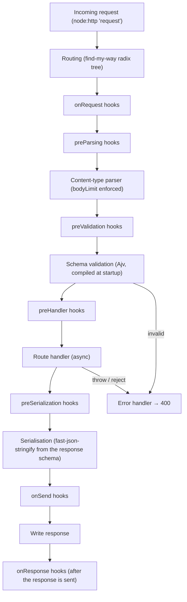
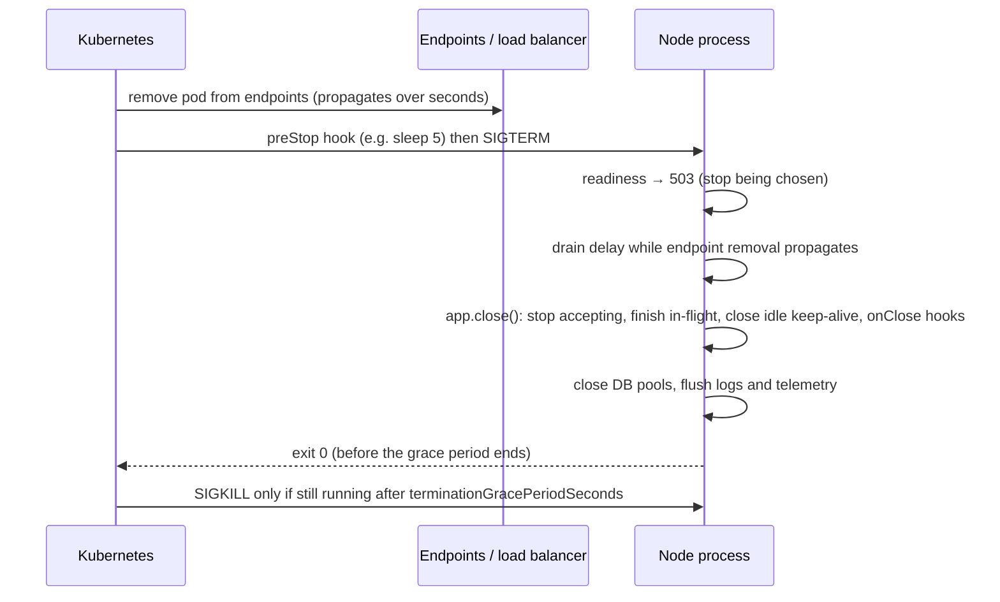

# 08 · Building Services: Fastify 5, Validation, Logging, Health, Rate Limits and Graceful Shutdown

> **Primary sources:** Fastify 5 documentation ([Lifecycle](https://fastify.dev/docs/latest/Reference/Lifecycle/), [Hooks](https://fastify.dev/docs/latest/Reference/Hooks/), [Encapsulation](https://fastify.dev/docs/latest/Reference/Encapsulation/), [Validation and Serialization](https://fastify.dev/docs/latest/Reference/Validation-and-Serialization/), [Server options](https://fastify.dev/docs/latest/Reference/Server/), [Diagnostics channel](https://fastify.dev/docs/latest/Reference/Hooks/#diagnostics-channel-hooks)); pino documentation (redaction, transports); Node.js API docs [Diagnostics Channel](https://nodejs.org/api/diagnostics_channel.html); Kubernetes documentation on [container probes](https://kubernetes.io/docs/concepts/configuration/liveness-readiness-startup-probes/) and [pod termination](https://kubernetes.io/docs/concepts/workloads/pods/pod-lifecycle/#pod-termination); RFC 6585 §4 (429 Too Many Requests); RFC 9110 §15.6.4 (503 and `Retry-After`).
>
> **Executable proof:** [`examples/08-building-services.test.ts`](../examples/08-building-services.test.ts) with the service in [`examples/08-service.ts`](../examples/08-service.ts) and a real process entry point in [`examples/fixtures/08-service/server.ts`](../examples/fixtures/08-service/server.ts). Route tests use `inject()` (no sockets); the shutdown tests start the service as a child process and signal it.

This module is the "services" half of the retired JSNSD syllabus (public web servers, RESTful services, consuming other HTTP services, processing user input, attack mitigation) applied to a modern stack: **Fastify 5.12.8** on Node 26. The HTTP mechanics underneath (timeouts, agents, body limits) are in [module 07](07-networking-and-http.md); typing request and response schemas, Standard Schema and Zod are owned by [TypeScript module 11](../../../languages/typescript/modules/11-runtime-boundaries-validation.md); OWASP-level vulnerability classes and authentication/authorisation are owned by the security-identity track. Telemetry pipelines (OpenTelemetry collectors, metrics backends, SLO math) belong to `technologies/observability`; this module covers only the Node-side hooks.

---

## 1. Why a framework, and why Fastify

Raw `node:http` gives you a request stream and a response stream. A production service additionally needs routing, body parsing with limits, input validation, output shaping, error mapping, structured logging with request correlation, plugins with clear boundaries, health endpoints and an orderly shutdown. Writing those by hand is how the failure modes of [module 07](07-networking-and-http.md#10-production-failure-modes) get into code.

|  | Express 5 (2024) | Fastify 5 (2024) |
| --- | --- | --- |
| Model | middleware chain `(req, res, next)` on top of Node's objects | plugin tree with encapsulation; hooks at named lifecycle points |
| Async handlers | supported since 5.0 (rejections go to the error handler) | first-class since v2 |
| Validation | bring your own | JSON Schema via Ajv, compiled per route |
| Serialisation | `JSON.stringify` | `fast-json-stringify` compiled from the response schema (faster, and it **drops undeclared fields**) |
| Logging | bring your own | pino built in, with a per-request child logger |
| Testing | supertest over a socket | `app.inject()`: in-process, no socket (light-my-request) |
| Throughput | baseline | typically several times higher in framework benchmarks |

### Then vs now: Node web frameworks

| Then | Now | Why |
| --- | --- | --- |
| Express 4 (2014–2024): async errors needed `express-async-errors` or try/catch in every handler, else unhandled rejections | Express 5 awaits handlers; Fastify always did | unhandled rejections crash the process since Node 15 ([module 04](04-async-control-flow-and-errors.md#6-process-level-policy-uncaught-exceptions-and-unhandled-rejections)) |
| `body-parser` without limits, `joi`/`express-validator` per route | schema-first routes (JSON Schema, or Zod/Valibot through a type provider or Standard Schema) | one source of truth for validation, types and documentation (OpenAPI) |
| `console.log` and morgan access logs | structured JSON logs with request ids (pino) | logs are queried, not read |
| Fastify 4 (Node 14+) | Fastify 5 (Node 20+): full JSON Schema required for `querystring`/`params`/`body` shorthand removed, `reply.redirect(url, code)` argument order, `listen({ port })` object form only, removal of deprecated `request.connection` | cleanup of v4 deprecations |

---

## 2. Fastify's architecture

### 2.1 The request lifecycle



The test registers one hook of each kind and asserts the exact order `onRequest, preParsing, preValidation, preHandler, handler, preSerialization, onSend, onResponse`. Placement guidance:

| Concern | Hook | Why there |
| --- | --- | --- |
| authentication, rate limiting, request ids | `onRequest` | before the body is read: reject cheap requests cheaply |
| decompression, body size accounting | `preParsing` | sees the raw stream |
| authorisation based on the body | `preHandler` | after validation, so the body has a known shape |
| response envelopes, ETags | `onSend` | sees the serialised payload |
| metrics, access logs | `onResponse` | the response is complete; never blocks it |

### 2.2 Encapsulation

**Definition.** A Fastify application is a **tree of contexts**. `app.register(plugin)` creates a child context; decorators (`app.decorate`), hooks and routes registered inside it are visible to that context and its descendants, **not** to siblings or the parent. This gives plugins private state and lets a sub-application have its own authentication hook without affecting the rest.

To share something with the parent (a database client, a configuration object), a plugin must **opt out** of encapsulation. The `fastify-plugin` package does that by setting the `Symbol.for('skip-override')` property on the plugin function; the example sets it directly. The test shows both outcomes: `/private/check` sees its own `secretHelper`, `/public/check` does not, and both see the shared `db`.

Plugins are loaded by **avvio** in registration order, asynchronously; `await app.register(...)` or `app.after()` waits for one, and `app.ready()` waits for the whole tree. Accessing a decorator before its plugin has loaded is the most common Fastify startup bug.

### 2.3 Plugin boundaries in a real codebase

A layout that follows the encapsulation model:

```
src/
  app.ts                 buildApp(config): registers everything, returns the instance (no listen)
  server.ts              entry point: loads config, buildApp, installGracefulShutdown, listen
  plugins/               infrastructure, registered with fastify-plugin (shared):
    db.ts                  decorates app.db, closes the pool in onClose
    auth.ts                decorates request.user via an onRequest hook factory
  routes/                features, each an encapsulated plugin with a prefix:
    users/index.ts         schemas + handlers for /users
    admin/index.ts         adds its own authorisation hook, invisible to /users
```

Separating `buildApp` from `listen` is what makes `inject()` testing possible: tests build the app with test configuration (an in-memory database, a mocked dispatcher for outbound HTTP) and never open a port. The example service follows that split (`buildApp` in `08-service.ts`, `listen` only in the fixture's `server.ts`).

---

## 3. Schemas: validation in, serialisation out

```ts
const userSchema = {
  body: {
    type: 'object',
    required: ['name', 'email'],
    additionalProperties: false,
    properties: {
      name: { type: 'string', minLength: 1, maxLength: 100 },
      email: { type: 'string', format: 'email' },
    },
  },
  response: {
    201: { type: 'object', properties: { id: { type: 'integer' }, name: { type: 'string' } } },
  },
} as const;
```

**Input.** Fastify compiles each route's JSON Schema with Ajv at startup; a request that fails gets **400** before the handler runs (`FST_ERR_VALIDATION`, the test). Fastify's default Ajv options include **`removeAdditional: true`**, `coerceTypes: 'array'` and `useDefaults: true`. The first is a surprise worth a test: with `additionalProperties: false`, unknown properties are **silently removed**, not rejected (the test posts `isAdmin: true` and gets 201). That is safe for mass-assignment (the handler never sees `isAdmin`), but if you need a 400 for unknown fields, configure `ajv: { customOptions: { removeAdditional: false } }`. Coercion means `?limit=10` arrives as a number when the schema says `integer`.

**Output.** The response schema compiles to a serialiser that writes **only declared properties**. The handler returns the full user object including `email`; the client receives `{ id, name }` (the test). This is a security control as much as a performance one: it prevents accidental leaks of internal fields (password hashes, tokens) added to a model later. It is not a substitute for not loading them.

**Types.** JSON Schema `as const` plus a type provider (`@fastify/type-provider-json-schema-to-ts`, or `fastify-type-provider-zod`) gives typed `req.body`. The general theory of parsing at boundaries, and Standard Schema for library-neutral validators, is in [TypeScript module 11](../../../languages/typescript/modules/11-runtime-boundaries-validation.md#4-standard-schema-a-library-neutral-contract).

**Limits.** `bodyLimit` (default **1 MiB**; 16 KiB in the example) answers **413** before buffering more (the test sends 20 KB). Set it per route for uploads rather than raising it globally. String `maxLength`, array `maxItems` and object `maxProperties` bound the work validation and handlers do; regex `pattern`s must be ReDoS-safe ([module 13](13-security.md#5-redos)).

---

## 4. Errors, logging and request correlation

### 4.1 Error handling

`app.setErrorHandler((err, req, reply) => …)` receives validation errors (`err.validation` set), errors thrown by handlers and hooks, and errors with a `statusCode`. A sound policy, implemented in the example:

- 4xx: return a stable, documented error body.
- 5xx: log the full error (with stack and cause) at `error` level, return a **generic** message plus the request id. The test throws `Error('database password is hunter2')` and checks the response body does not contain the message, while the log line carries `reqId: 'req-123'`.
- Never return `err.stack` or raw database errors to clients.
- `setNotFoundHandler` for 404s, so they share the same shape.

Errors thrown after the response started (in a stream) cannot change the status; Fastify logs them and destroys the socket.

### 4.2 Logging with pino

Fastify's logger is **pino**: JSON lines, one object per event, written asynchronously and cheaply (serialisation is fast, formatting is deferred to tools). Rules:

- Use `req.log` (a child logger bound to the request id), not a global logger, inside handlers; every line then carries `reqId`.
- Accept an upstream request id (`requestIdHeader: 'x-request-id'`) or generate one (`genReqId`); return it in error bodies and propagate it to downstream calls. The test sends `x-request-id: req-123` and finds it in both the response and the log.
- **Redact** secrets by path (`redact: ['req.headers.authorization', '*.password']`). Fastify's default request serialiser logs method, URL, host and remote address but not headers; redaction matters as soon as you log headers or bodies.
- Do heavy formatting (pretty printing, shipping to a backend) in a separate process or a pino **transport** (a worker thread), never in the request path.
- Log at `info` for lifecycle events, `warn` for handled anomalies, `error` for 5xx; set the level from configuration.

`console.log` is synchronous to a TTY or file but asynchronous to a pipe ([module 01 §5.2](01-runtime-architecture.md#52-standard-streams-are-not-uniformly-synchronous)), unstructured and uncorrelated. Keep it out of services.

### 4.3 Diagnostics channels and OpenTelemetry

`node:diagnostics_channel` is Node's publish/subscribe API for instrumentation: libraries publish named events, instrumentation subscribes, and with no subscribers publishing costs almost nothing. `tracingChannel(name)` standardises five sub-channels (`start`, `end`, `asyncStart`, `asyncEnd`, `error`) for an operation. Node core publishes `http.client.request.start`, `http.server.request.start`, `undici:request:create`, `net.client.socket`, worker and process events, among others; Fastify publishes `fastify.initialization` and the tracing channel `fastify.request.handler`. The test subscribes to the latter and sees `start /healthz` then `end`.

This is how modern OpenTelemetry instrumentation for Node works: instead of monkey-patching `require`d modules (fragile with ESM, see [module 03 §6](03-modules-and-packages.md#6-customisation-hooks-moduleregisterhooks)), it subscribes to channels. Load the OpenTelemetry SDK with `--import ./otel.mjs` so it is active before the application imports anything. Request-scoped context (which trace and request a log line belongs to) travels with `AsyncLocalStorage` ([module 11](11-diagnostics-and-performance.md#5-asynclocalstorage-and-async-context)).

### 4.4 Testing services without sockets

`app.inject({ method, url, payload, headers })` runs the full lifecycle (routing, hooks, parsing, validation, handler, serialisation, `onSend`, `onResponse`) against an in-memory request object, and returns status, headers and body. It is fast (no TCP), deterministic (no ports, no timing), and exercises exactly what production runs. Every route test in this module uses it. Reserve real sockets for what `inject` cannot show: timeouts, keep-alive, TLS, and process-level behaviour such as signals (the shutdown tests start a real process for that reason). Close every app in the test (`await app.close()`), or `onClose` hooks never run and handles keep the test runner alive ([module 12](12-testing.md)).

---

## 5. Health checks, rate limits and load shedding

### 5.1 Liveness, readiness, startup

| Probe | Question | Failing it causes | Must not depend on |
| --- | --- | --- | --- |
| **Liveness** (`/healthz`) | "is this process able to make progress at all?" | a **restart** | downstream dependencies (a database outage would restart every pod: a self-inflicted outage) |
| **Readiness** (`/readyz`) | "should traffic be routed here **now**?" | removal from the load balancer, no restart | — it may check critical dependencies and is the switch you flip during shutdown |
| **Startup** | "has initialisation finished?" | delays the other probes | — for slow warm-ups (caches, JIT, migrations) |

The test flips the example's readiness flag and sees `/readyz` return 503 while `/healthz` stays 200. A liveness endpoint served by the same event loop also detects a **blocked loop** (the probe times out), which is the main failure a Node liveness probe exists to catch; keep its handler trivial.

### 5.2 Rate limiting

A **token bucket** of capacity _C_ refilled at _r_ tokens/s allows bursts of _C_ and a sustained rate _r_. The example's implementation:

```
TAKE(bucket[key], now)
  ▷ Invariant: 0 ≤ tokens ≤ C
  tokens ← min(C, tokens + (now − at) · r);  at ← now
  if tokens ≥ 1: tokens ← tokens − 1; return ALLOW
  return DENY with Retry-After = ⌈(1 − tokens) / r⌉
```

The test drives it with a **virtual clock** (no sleeping): capacity 2 allows `200, 200`, then `429` with `Retry-After: 1`, and one simulated second later a request passes again. The `onRequest` hook placement means a rate-limited request costs no body parsing.

The negative test shows the classic architecture mistake: three processes (cluster workers, pods) each holding an in-memory bucket of 10 allow **30** requests. In-memory limiters are per process; real limits need a shared store (Redis with an atomic script, as `@fastify/rate-limit` supports) or enforcement at the gateway. Key choice matters as much: limiting by `req.ip` behind a proxy limits the proxy unless `trustProxy` is configured correctly, and trusting `X-Forwarded-For` from the internet lets clients choose their own key ([networking module 13](../../../architecture/networking/modules/13-load-balancing-cdn-nat.md#4-layer-7-reverse-proxying--client-ip-preservation)).

### 5.3 Load shedding

Rate limits protect against one client; **load shedding** protects the process against all of them. When event-loop delay or utilisation crosses a threshold ([module 11](11-diagnostics-and-performance.md#3-event-loop-delay-and-utilisation)), answer new requests with **503 and `Retry-After`** immediately instead of queueing them behind work that is already late. `@fastify/under-pressure` implements this with `maxEventLoopDelay`, `maxEventLoopUtilization`, `maxHeapUsedBytes` and `maxRssBytes`. Shedding early keeps latency bounded for the requests you do accept, and makes the load balancer or client retry elsewhere.

### 5.4 Protecting yourself from dependencies

Load shedding handles too much incoming work; the same discipline applies to outgoing calls, where a slow dependency is more dangerous than a dead one (a dead one fails fast):

- **Deadline per outbound call**, derived from the remaining budget of the incoming request (`AbortSignal.any([req.signal, AbortSignal.timeout(ms)])`, [module 04 §7](04-async-control-flow-and-errors.md#7-control-flow-patterns-that-are-node-specific)), so no request waits on a dependency longer than its own client will wait.
- **Bulkheads**: a bounded concurrency pool per dependency ([module 07 §6.3](07-networking-and-http.md#63-bounding-outbound-concurrency)), so one slow dependency cannot absorb every socket and every in-flight request.
- **Circuit breaker**: after a failure-rate threshold, fail calls immediately for a cool-down period, then let a few probes through. This turns a slow dependency into a fast failure and gives it room to recover. Libraries such as `opossum` implement it; the state machine (closed → open → half-open) is short enough to write and test with a virtual clock.
- **Fallbacks** only where a degraded answer is acceptable (cached data, a default), and visible in metrics.

The breaker in [`examples/08-service.ts`](../examples/08-service.ts), as pseudocode:

```
CALL(breaker, fn)
  ▷ States: CLOSED (calls pass), OPEN (calls fail fast), HALF-OPEN (one probe at a time)
  if state = OPEN:
     if now − openedAt < coolDown: fail fast with E_CIRCUIT_OPEN       ▷ no load on the dependency
     state ← HALF-OPEN
  if state = HALF-OPEN and a probe is in flight: fail fast
  try result ← fn()
  on success: failures ← 0; state ← CLOSED; return result
  on failure: failures ← failures + 1
              if state = HALF-OPEN or failures ≥ threshold: state ← OPEN; openedAt ← now
              rethrow
```

Its test runs on a virtual clock: after `threshold` failures the breaker opens and calls fail without invoking the dependency; after the cool-down one probe goes through, and its success closes the breaker again; a failed probe reopens it.

---

## 6. Graceful shutdown

**Definition.** A graceful shutdown stops a service **without failing requests that were accepted**: no new work is admitted, in-flight work finishes (or is cut at a deadline), resources are released in dependency order, and the process exits with a meaningful code.

### 6.1 The sequence

In Kubernetes, termination proceeds roughly as: the pod is marked terminating and removed from Service endpoints (asynchronously, propagating to kube-proxy and load balancers over seconds) **while** the kubelet runs the `preStop` hook and then sends **SIGTERM** to the container's main process; after `terminationGracePeriodSeconds` (default 30 s) it sends **SIGKILL**. Endpoint removal and SIGTERM race, so a process that stops accepting connections the instant it receives SIGTERM still gets new requests routed to it for a few seconds and refuses them.



`installGracefulShutdown` in the example:

```ts
const onSignal = async (signal: NodeJS.Signals) => {
  if (shuttingDown) return; // idempotent: SIGTERM then SIGINT must not run it twice
  shuttingDown = true;
  app.state.ready = false; // 1. fail readiness
  const deadline = setTimeout(() => {
    // 4. hard deadline, below the orchestrator's grace period
    process.stderr.write('shutdown deadline exceeded\n');
    process.exit(1);
  }, deadlineMs);
  deadline.unref(); //    must not keep the process alive by itself
  await sleep(drainDelayMs); // 2. let endpoint removal propagate
  await app.close(); // 3. stop accepting, wait for in-flight, close idle sockets, onClose hooks
  process.exitCode = 0; //    let the loop drain (module 01: exitCode, not exit())
};
process.once('SIGTERM', onSignal);
process.once('SIGINT', onSignal);
```

The two shutdown tests run the real service as a child process:

- **Positive.** The test starts a `/slow` request (300 ms), waits until the server prints `request-started` (an explicit readiness token, no sleeping), sends SIGTERM, and asserts the request still completes with 200 and the process exits **0** after printing `closed after SIGTERM`.
- **Negative.** With a 5-second request and a 200 ms deadline, the deadline fires, the process exits **1**, and the client sees its connection cut. A deadline is not a failure of the design; it is what keeps one stuck request from turning a deploy into a SIGKILL with no logs.

### 6.2 What `close()` does, and what it does not

`fastify.close()` calls `server.close()` (stop accepting; since Node 19 also close idle keep-alive connections, [module 07 §4](07-networking-and-http.md#4-server-timeouts)), sets `return503OnClosing` behaviour (requests that arrive on existing connections during close get 503 with `Connection: close`), waits for in-flight requests, then runs `onClose` hooks in reverse registration order, which is where database pools, queues and caches should be closed. It does **not**:

- end WebSockets, server-sent event streams or long polls: those never become idle; track them and end them explicitly (send a close frame, end the stream) at the start of shutdown;
- stop background work you started (intervals, consumers of message queues): stop consuming first, finish the current message, then close connections;
- flush asynchronous logs and telemetry exporters: do it in an `onClose` hook, within the deadline.

### 6.3 Signals must reach Node

None of this runs if the signal never arrives. `npm start` and `sh -c "node app.js"` wrappers may not forward SIGTERM, and Node as PID 1 has its own signal semantics; both are in [module 14 §2](14-production-operations.md#2-node-as-pid-1-and-signal-handling). Run `node` directly as the container command (exec form), or behind a minimal init.

### Then vs now: shutdown

| Then | Now |
| --- | --- |
| `server.close()` waited for every keep-alive connection to time out (Node ≤ 18), so shutdowns hung; libraries such as `http-terminator`/`stoppable` tracked sockets | `server.close()` closes idle connections (Node 19+); `closeAllConnections()` at the deadline |
| `process.exit(0)` right after `close()` was called | await `close()`, flush, set `exitCode` |
| no readiness flip: requests refused during endpoint propagation | readiness 503 plus a drain delay (or a `preStop` sleep) |

---

## 7. RESTful design and proxies (JSNSD domains)

The retired JSNSD exam asked candidates to build RESTful services and consume other HTTP services under time pressure; a proxy is the classic case of doing both. The durable skills:

- **Resource-oriented routes** with correct methods and status codes: `201` with `Location` for creation, `204` for empty success, `404` vs `405` (Fastify answers 404 for unknown routes and lets you add 405 handling), `409` for conflicts, `422`/`400` for validation, `429`/`503` with `Retry-After`.
- **Idempotency**: `PUT` and `DELETE` are idempotent by definition; for `POST` that clients may retry, accept an `Idempotency-Key` header and store results by key ([distributed-systems module 10](../../../architecture/distributed-systems/modules/10-messaging-logs-and-delivery-semantics.md)).
- **Pagination** with cursors rather than offsets for large or changing collections; a maximum page size enforced by schema.
- **Proxies.** An HTTP proxy in Node streams the request body to the upstream and the response body back with `pipeline` (backpressure both ways), copies or drops hop-by-hop headers (`Connection`, `Keep-Alive`, `Transfer-Encoding`, `Upgrade`, `TE`, `Trailer`, `Proxy-Authorization`), sets `X-Forwarded-For`/`Forwarded`, applies a timeout per upstream request, and maps upstream failures to 502 (bad response) or 504 (timeout). `@fastify/http-proxy` and `@fastify/reply-from` (built on undici) implement this; writing one by hand is a good interview exercise precisely because of the header and backpressure rules. A proxy that fetches arbitrary user-supplied URLs is an SSRF vector ([module 13](13-security.md)).
- **Security headers and CORS** (`@fastify/helmet`, `@fastify/cors`): set an explicit origin allow-list; `Access-Control-Allow-Origin: *` with credentials is rejected by browsers, and reflecting the request `Origin` blindly defeats the point.

---

## 8. Configuration

- Read configuration **once at startup**, from the environment (or `--env-file` in development, [module 01 §3.1](01-runtime-architecture.md#31-environment-files)), parse it with a schema, and **fail fast** with a clear message if it is invalid. A service that starts with a missing database URL and fails on the first request is worse than one that never starts (the orchestrator shows the crash loop immediately).
- Freeze the parsed object and pass it explicitly (a Fastify decorator), instead of reading `process.env` throughout the code; `process.env` lookups are slow (they cross into C++) and untyped.
- Never log secrets at startup; log a redacted summary of the effective configuration.

```ts
// config.ts: parse once, fail fast, freeze
const raw = { ...process.env };
const port = Number(raw.PORT ?? 8080);
if (!Number.isInteger(port) || port < 1 || port > 65535)
  throw new Error(`invalid PORT: ${raw.PORT}`);
if (!raw.DATABASE_URL) throw new Error('DATABASE_URL is required');
export const config = Object.freeze({
  port,
  databaseUrl: raw.DATABASE_URL,
  logLevel: raw.LOG_LEVEL ?? 'info',
});
```

In practice the checks are a schema (JSON Schema with `env-schema`, or Zod/Valibot), which also documents every variable. `util.parseEnv` is available when you need to parse a `.env`-format string yourself.

---

## 9. Production failure modes

| Failure | Mechanism | Fix |
| --- | --- | --- |
| 502s during every deploy | SIGTERM handled by exiting immediately, or readiness never flips, while endpoints still route traffic | readiness 503, drain delay, `close()`, deadline |
| Deploys take exactly the grace period and end in SIGKILL | a WebSocket/SSE/consumer keeps the process alive; or the signal never reached Node | end long-lived connections explicitly; exec-form command or init |
| Internal fields leaked in API responses | no response schema, or a schema with `additionalProperties` allowing everything | response schemas for every route |
| Unexpected fields silently dropped, client confused | Ajv `removeAdditional` with `additionalProperties: false` | document it, or configure rejection |
| Error messages with SQL or secrets returned to clients | default or naive error handler | generic 5xx bodies, details in logs with request id |
| Rate limit ineffective after scaling out | per-process in-memory limiter | shared store or gateway enforcement |
| All clients rate-limited together | keyed on the proxy's IP | correct `trustProxy` configuration |
| Pods restarted during a database outage | liveness probe checks the database | liveness checks only the process; readiness may check dependencies |
| Latency collapse under overload | requests queue behind late work | load shedding on event-loop delay |
| Logs without request ids, impossible to correlate | global logger, `console.log` | `req.log`, propagated request ids |
| Slow requests block nothing but never end | Fastify's `requestTimeout` defaults to 0 (disabled), unlike Node's 300 s | set `requestTimeout` and `connectionTimeout` explicitly |
| One slow dependency makes every endpoint slow | no per-dependency deadline or concurrency bound; requests pile up waiting | deadlines from the request budget, bulkheads, circuit breaker |
| Retries during an outage multiply load | every layer retries independently | retry budget, breaker in front of retries |
| Decorator undefined at startup | plugin not yet loaded (avvio ordering) | `await app.register()` / `app.ready()` |

---

## Interview Drill

<details><summary>1. Walk through a graceful shutdown of a Node HTTP service in Kubernetes.</summary>

On SIGTERM: mark readiness as failing so the endpoint is removed; wait a few seconds (or rely on a `preStop` sleep) because endpoint removal propagates asynchronously and races with SIGTERM; call `server.close()`/`fastify.close()` to stop accepting, let in-flight requests finish and close idle keep-alive connections; end long-lived connections and stop background consumers; close database pools and flush logs in `onClose` hooks; exit 0 via `exitCode`. Guard it all with an unref'd deadline shorter than `terminationGracePeriodSeconds` that exits 1. Make sure the signal actually reaches Node (no `npm start` wrapper as PID 1).
</details>

<details><summary>2. What is the difference between liveness and readiness probes, and what should each check?</summary>

Liveness asks whether the process can make progress; failing it restarts the container, so it must not depend on downstream services (or one outage restarts everything) and should be trivial (which also detects a blocked event loop). Readiness asks whether the instance should receive traffic now; failing it removes the pod from load balancing without restarting it, so it may check critical dependencies and is the switch flipped during shutdown or warm-up.
</details>

<details><summary>3. What does Fastify's encapsulation give you, and how does `fastify-plugin` change it?</summary>

Each `register` creates a child context; decorators, hooks and routes inside it are visible only to it and its descendants. That isolates plugins (for example an auth hook for one route prefix). `fastify-plugin` sets the `skip-override` symbol so the plugin runs in its parent's context, which is how shared infrastructure such as a database client is exposed to the whole application.
</details>

<details><summary>4. Why define response schemas in Fastify?</summary>

They compile into a fast serialiser and, more importantly, only declared properties are written: internal fields added to models later (hashes, tokens, flags) cannot leak by accident. They also document the API (OpenAPI generation) and give the types of replies.
</details>

<details><summary>5. You add an in-memory rate limiter and then scale to 3 replicas. What happens?</summary>

Each replica enforces its own limit, so the effective limit is three times higher, and a client's budget depends on which replica it hits. Use a shared atomic store (Redis) or enforce limits at the gateway. Also check the key: behind a proxy, `req.ip` is the proxy unless `trustProxy` is configured for the actual proxy chain.
</details>

<details><summary>6. How would you implement an HTTP reverse proxy endpoint in Node, and what can go wrong?</summary>

Stream the incoming request to the upstream with an undici or `http` client and stream the response back with `pipeline`, so backpressure works in both directions; strip hop-by-hop headers, add `X-Forwarded-For`/`Forwarded`, enforce per-request timeouts, and map failures to 502/504. Pitfalls: buffering whole bodies, forwarding `Connection`/`Transfer-Encoding` headers, missing timeouts, not handling client aborts (destroy the upstream request), and SSRF if the target is user-controlled.
</details>

<details><summary>7. What is load shedding and how do you trigger it in a Node service?</summary>

Rejecting new work quickly (503 with `Retry-After`) when the process is already overloaded, instead of queueing it. In Node the best signals are event-loop delay and event-loop utilisation (plus heap and RSS limits); `@fastify/under-pressure` implements this. It bounds latency for accepted requests and lets the client or load balancer retry elsewhere.
</details>

<details><summary>8. How does modern Node instrumentation (OpenTelemetry) observe Fastify and `http` without monkey-patching?</summary>

Through `node:diagnostics_channel`: Node core and libraries such as Fastify and undici publish events (including standardised tracing channels with start/end/asyncStart/asyncEnd/error), and instrumentation subscribes. It is loaded with `--import` before the application, and request context propagates with `AsyncLocalStorage`.
</details>

<details><summary>9. Which Fastify defaults differ from `node:http`, and why does that matter?</summary>

Fastify sets `keepAliveTimeout` to 72 s (above common load-balancer idle timeouts, which avoids the 502 race) and leaves `requestTimeout` at 0 (disabled), while `node:http` defaults to 5 s and 300 s. A Fastify service therefore has no whole-request deadline unless you set one, so slow-body clients can hold connections; set `requestTimeout` (and `connectionTimeout`) explicitly.
</details>

<details><summary>10. Why should `buildApp()` and `listen()` be separate, and what do you test with `inject()` versus a real server?</summary>

Separating construction from listening lets tests build the application with test configuration and drive it with `inject()`, which runs the whole Fastify lifecycle in memory: fast, deterministic, no ports. Real servers (in a child process where signals matter) are needed only for socket-level behaviour: timeouts, keep-alive, TLS, and shutdown on signals.
</details>

<details><summary>11. Explain the circuit-breaker states and why a breaker helps a dependency recover.</summary>

Closed: calls pass and failures are counted. Open: after a threshold of failures, calls fail immediately without touching the dependency, for a cool-down period. Half-open: after the cool-down, a limited number of probe calls go through; success closes the breaker, failure reopens it. It converts a slow, failing dependency into fast local failures, which frees sockets and in-flight requests on the caller and removes load from the dependency so it can recover.
</details>
