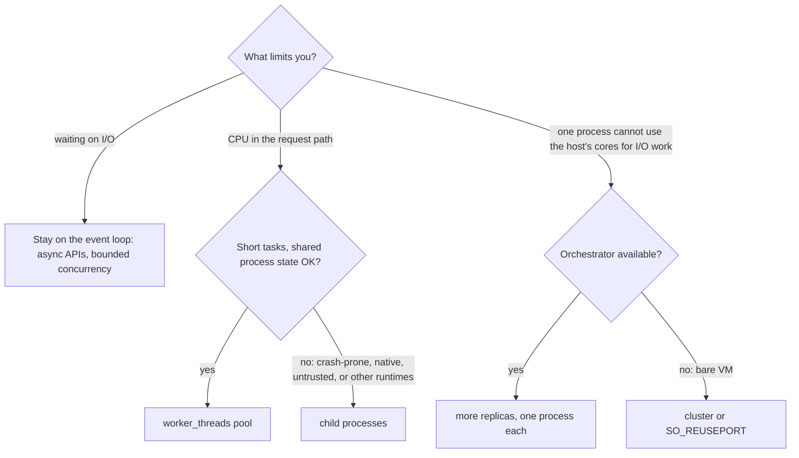

# 09 · Concurrency and Scaling: Worker Threads, Pools, Shared Memory, Cluster and Processes

> **Primary sources:** Node.js API docs: [Worker threads](https://nodejs.org/api/worker_threads.html) (`resourceLimits`, `transferList`, `SHARE_ENV`, "Considerations when transferring TypedArrays and Buffers"), [Cluster](https://nodejs.org/api/cluster.html) ("How it works", `schedulingPolicy`), [Net: `server.listen` options](https://nodejs.org/api/net.html#serverlistenoptions-callback), [SQLite](https://nodejs.org/api/sqlite.html); HTML Standard §2.7 (structured serialisation); ECMA-262 §29 (memory model); the piscina documentation; Linux `socket(7)` (`SO_REUSEPORT`).
>
> **Executable proof:** [`examples/09-concurrency-and-scaling.test.ts`](../examples/09-concurrency-and-scaling.test.ts), the pool in [`examples/09-pool.ts`](../examples/09-pool.ts) and worker entry points in [`examples/fixtures/09-workers/`](../examples/fixtures/09-workers/).

Language-neutral concurrency theory (races, locks, lock-free structures) is assigned to `algorithms/dsa`; the JavaScript memory model, `SharedArrayBuffer` and `Atomics` semantics are owned by [JavaScript module 11](../../../languages/javascript/modules/11-binary-data-memory-model.md#6-the-memory-model), and agents and realms by [JavaScript module 06](../../../languages/javascript/modules/06-agents-realms-job-queue.md#1-agents-and-agent-clusters). This module owns the Node mechanisms for using more than one core and more than one process, and the decision of which to use.

---

## 1. Concurrency, parallelism and the four options

**Definitions.**

- **Concurrency**: several tasks are in progress at the same time (their lifetimes overlap). One Node thread is highly concurrent: thousands of requests waiting on I/O.
- **Parallelism**: several computations execute at the same instant on different cores. One Node thread runs JavaScript on one core; parallelism needs more threads or processes.
- **CPU-bound** work is limited by computation (hashing, image processing, compression, large JSON, template rendering); **I/O-bound** work is limited by waiting (network, disk). The event loop handles I/O-bound concurrency without help ([module 02](02-event-loop.md)); CPU-bound work blocks it.

| Option | Unit | Memory isolation | Shares | Start cost | Communication | Typical use |
| --- | --- | --- | --- | --- | --- | --- |
| The event loop alone | callbacks on one thread | — | everything | — | direct calls | I/O-bound services |
| **`worker_threads`** | thread with its own V8 isolate and event loop | separate JS heaps | process: fds, thread pool, native memory, `SharedArrayBuffer` | a few ms, several MB | `postMessage` (structured clone or transfer), shared memory | CPU-bound tasks inside one service |
| **`child_process.fork`/`spawn`** | OS process | full | nothing (pipes, IPC) | tens of ms, tens of MB | IPC messages, stdio | running other programs; isolating untrusted or crash-prone work |
| **`cluster`** | OS processes sharing a listening socket | full | the listening port | tens of ms each | IPC with the primary | using all cores on a VM without an orchestrator |
| **Multiple containers / replicas** | process per container | full + resource limits | nothing | seconds | the network | the default way to scale services horizontally |

### 1.1 What parallelism can buy: Amdahl and Little

**Amdahl's law.** If a fraction _p_ of a request's work can run in parallel on _N_ cores and the rest (1 − _p_) is serial, the best speed-up is

_S_(_N_) = 1 / ((1 − _p_) + _p_ / _N_), bounded by 1 / (1 − _p_) as _N_ → ∞.

For a Node service the "serial" part includes everything on the main thread: parsing, routing, serialising, and the message round trip to the worker. Offloading a 40 ms computation from a request that also spends 10 ms on the main thread gives at most a 5× throughput gain per process, however many workers you add.

**Little's law.** In a stable system, the average number of requests in flight _L_ equals the arrival rate _λ_ times the average time in the system _W_ (_L_ = _λW_). With a pool of _k_ workers and a task service time _s_, the pool saturates at _λ_ = _k_/_s_; beyond that the queue, and _W_, grow without bound. That is the quantitative reason pools need a bounded queue and load shedding (§3.1): admit at most what _k_/_s_ can serve within the deadline.



---

## 2. Worker threads

### 2.1 The model

A `Worker` is an OS thread running its **own V8 isolate** (separate heap and garbage collector), its **own libuv event loop** (timers, I/O, microtasks), and its own copy of Node's JavaScript core. In ECMA-262 terms it is a separate _agent_. What it shares with the main thread is the **process**: file descriptors, the libuv **thread pool** ([module 02 §5](02-event-loop.md#5-the-thread-pool)), native memory (so `process.memoryUsage().rss` counts all workers), and any `SharedArrayBuffer` you hand it. Per-worker differences:

- `process.env` is a **copy** taken at startup (unless `env: SHARE_ENV`); changes do not propagate.
- `process.chdir()`, `process.setuid()` and signal listeners are unavailable; `process.exit()` ends only the worker.
- `require` cache, module map, globals and prototypes are separate: the test sets `globalThis.mine` in a worker and the main thread does not see it.
- Workers inherit `execArgv` (including `--import` preloads) unless you pass `execArgv`; the permission model requires `--allow-worker` to create them ([module 13](13-security.md#3-the-permission-model)).

### 2.2 Messages: clone, transfer, share

| Mechanism | Semantics | Cost | Proven by |
| --- | --- | --- | --- |
| `postMessage(value)` | **structured clone**: deep copy of plain data, `Map`, `Set`, `Date`, `RegExp`, typed arrays, `Error`s, cycles | proportional to size, on both threads | the test sends a `Map` containing a `Date` and gets an equal copy, not the same object |
| `postMessage(value, [arrayBuffer])` | **transfer**: ownership moves; the sender's buffer becomes **detached** (length 0) | O(1) | the test transfers a `Float64Array`'s buffer and sees `byteLength === 0` in the sender |
| `SharedArrayBuffer` in `workerData` or a message | **shared**: both threads see the same memory | none per access; needs `Atomics` for correctness | four workers each `Atomics.add` 50 000 times; the counter is exactly 200 000 |

What cannot cross: functions (`DataCloneError`, in the test), class identity (a `Point` instance arrives as a plain object without its prototype), symbols, DOM-like host objects, and closures over state. Design messages as plain data with explicit types.

Pooled Buffers deserve a warning: a small `Buffer` is a view into a shared 64 KiB slab ([module 05 §1.2](05-buffers-streams-backpressure.md#12-the-pool-and-why-buffer-is-dangerous)). Node marks that slab as **untransferable** (`worker_threads.isMarkedAsUntransferable(buf.buffer) === true`), so `postMessage(buf.buffer, [buf.buffer])` throws `DataCloneError` (the test checks it). Without the transfer list, `postMessage(buf.buffer)` _clones_ the whole slab, sending the neighbouring Buffers' bytes to the worker. Send the Buffer view itself (`postMessage(buf)` clones only its bytes), or allocate data you intend to transfer with `Buffer.allocUnsafeSlow`/`new ArrayBuffer` so it owns its memory.

### 2.4 A worker entry point and a message protocol

Treat the boundary like a network API: a small set of message types, each plain data, with an id to correlate replies. The pool's worker ([`fixtures/09-workers/task.mjs`](../examples/fixtures/09-workers/task.mjs)):

```js
import { parentPort } from 'node:worker_threads';

function fib(n) {
  return n < 2 ? n : fib(n - 1) + fib(n - 2);
}

parentPort.on('message', ({ id, kind, n }) => {
  if (kind === 'crash') throw new Error(`task ${id} crashed the worker`); // exercised by the tests
  if (kind === 'fib') return parentPort.postMessage({ id, result: fib(n) });
  if (kind === 'sum') {
    // n is a TRANSFERRED ArrayBuffer
    let s = 0;
    for (const v of new Float64Array(n)) s += v;
    return parentPort.postMessage({ id, result: s });
  }
});
```

Design rules: the worker holds no per-task state between messages (so a replacement worker is equivalent); it reports errors as data (`{ id, error }`) when they are expected and lets the process-level `'error'` path handle bugs; and it never assumes message order across different workers.

### 2.5 Channels between threads

- **`MessageChannel`** creates a pair of entangled `MessagePort`s. A port can itself be transferred (`postMessage({ port }, [port])`), which gives two workers a **direct** channel that bypasses the main thread. `receiveMessageOnPort(port)` reads one queued message synchronously (the tests use it to avoid timing).
- **`BroadcastChannel(name)`** delivers a message to every thread in the process that opened a channel with the same name: useful for cache invalidation or configuration reloads across a pool.
- **`workerData`** passes a cloned initial value at construction; **`setEnvironmentData`/`getEnvironmentData`** set values that every _subsequently created_ worker inherits.
- `port.unref()` and `worker.unref()` let the process exit while a port or worker is idle; an open `MessagePort` otherwise keeps the event loop alive, which is a classic "test runner never exits" cause.

### 2.6 Observing workers

Each `Worker` exposes the same diagnostics as the main thread, from the parent's side: `worker.performance.eventLoopUtilization()` (is the worker saturated?), `worker.cpuUsage()`, `worker.getHeapStatistics()` and `worker.getHeapSnapshot()` (a readable stream of a heap snapshot of that isolate). Export them per worker; an aggregate process CPU figure hides one stuck worker. `--inspect` also lists workers as separate targets in DevTools ([module 11](11-diagnostics-and-performance.md)).

### 2.3 Failure semantics

- An uncaught exception in a worker emits **`'error'`** on the `Worker` object in the parent, then **`'exit'` with code 1**. The parent process survives (the test). Without an `'error'` listener, the parent crashes like any unhandled emitter error.
- **`resourceLimits`** (`maxOldGenerationSizeMb`, `maxYoungGenerationSizeMb`, `codeRangeSizeMb`, `stackSizeMb`) give a worker its own heap ceiling. Exceeding it terminates the worker with `ERR_WORKER_OUT_OF_MEMORY`, while the parent continues (the test runs this in a separate process and checks both). Without limits, a runaway worker grows the shared process heap until the whole process aborts.
- `worker.terminate()` stops JavaScript execution as soon as possible (even inside a tight loop) and resolves with the exit code; pending messages are lost.

---

## 3. Worker pools

**Definition.** A worker pool keeps a fixed set of long-lived workers and a queue of tasks, dispatching each task to an idle worker. It amortises worker start-up (milliseconds and megabytes each) over many tasks and bounds CPU parallelism.

[`examples/09-pool.ts`](../examples/09-pool.ts) is a minimal implementation (piscina adds cancellation, task-level `AbortSignal`, idle timeouts, histograms and transfer helpers):

```
RUN(pool, task)
  ▷ I1: |busy| ≤ size                 (one task per worker)
  ▷ I2: every task settles exactly once (resolve on reply; reject if its worker dies)
  ▷ I3: |idle| + |busy| = size after any worker death (the dead worker is replaced)
  if idle ≠ ∅: w ← POP(idle); START(w, task)
  else: ENQUEUE(queue, task)                    ▷ production pools bound this queue

ON-REPLY(w, result)
  RESOLVE(busy[w], result); remove busy[w]
  if queue ≠ ∅: START(w, DEQUEUE(queue)) else PUSH(idle, w)

ON-WORKER-ERROR(w, err)
  REJECT(busy[w], err); remove busy[w]
ON-WORKER-EXIT(w)
  if not closed: RELEASE(SPAWN())               ▷ restores I3, then serves the queue
```

The tests check each invariant: six Fibonacci tasks on a 2-worker pool return the right values with a measured peak concurrency of exactly 2 (I1); a task that crashes its worker rejects alone, and the next task succeeds on a replacement worker (I2, I3); and while a worker computes `fib(30)`, the main thread keeps iterating its event loop (the test counts `setImmediate` turns), which is the whole point.

### 3.1 Sizing and granularity

- **Pool size.** For CPU-bound tasks, about the number of cores available to the process: `os.availableParallelism()` on a host, or the container's CPU quota (which Node does not report; [module 06 §6.1](06-filesystem-process-os.md#61-reading-container-limits)). Leave one core for the main thread when it also serves traffic. More workers than cores adds context switching and memory without throughput.
- **Task granularity.** Each task pays a message round trip and a structured clone of its input and output. A task must do substantially more work than copying its data: offloading a 50 µs computation on a 5 MB input is slower than doing it inline. Transfer large inputs (`ArrayBuffer`s) instead of cloning them, as the `sum` test does, or keep data in shared memory.
- **Bound the queue.** An unbounded queue converts overload into unbounded latency and memory. Reject (or shed with 503) when the queue exceeds what can be processed within the request deadline: that is backpressure for CPU work.
- **Mind the thread pool.** Workers share the 4-thread libuv pool with the main thread; a pool of 8 workers each doing async `fs` or `crypto` competes for those 4 threads.

### 3.2 Cancellation and deadlines for pooled tasks

A task waiting in the queue or running in a worker should be cancellable when its request is abandoned:

```
RUN(pool, task, signal)
  if signal.aborted: reject AbortError
  on signal abort:
     if task is QUEUED: remove it from the queue; reject AbortError          ▷ cheap
     if task is RUNNING on worker w: reject AbortError; TERMINATE(w); SPAWN() ▷ the only way to stop
                                                                            ▷ synchronous JS in a thread
```

Terminating a worker to cancel one task costs a worker restart, so for long computations prefer **cooperative cancellation**: pass a `SharedArrayBuffer` flag the worker checks between chunks of work (`Atomics.load(flag, 0) === 1`). piscina accepts a `signal` per task and implements the queued case; the running case depends on the task's design.

### Then vs now: parallelism in Node

| Then | Now |
| --- | --- |
| `child_process.fork` worker farms, `webworker-threads`, `napajs` | `worker_threads` (experimental in 10.5, stable since 12) |
| `--experimental-worker` | no flag |
| hand-written pools | piscina 5.x (`new Piscina({ filename })`), or a small pool like the example |
| `cluster` to use all cores for CPU work | worker pools for CPU work; replicas for I/O scale |
| Web Workers API absent | a browser-compatible `Worker` global is available behind `--experimental-web-worker` on Node 26; `worker_threads` remains the stable API |

---

## 4. Shared memory in practice

Semantics are in [JavaScript module 11](../../../languages/javascript/modules/11-binary-data-memory-model.md#the-atomics-api). Node-specific points:

- `Atomics.wait` is **allowed on Node's main thread** (unlike a browser's), and it blocks the event loop for its whole duration. Use `Atomics.waitAsync` on the main thread, and `Atomics.wait` only inside workers.
- A `SharedArrayBuffer` can be passed in `workerData` or in a message; it is shared, never copied or transferred.
- Shared memory makes data races possible again: without `Atomics`, concurrent `counter[0]++` from several workers loses updates. The test uses `Atomics.add` and gets an exact count; the racy variant is demonstrated (non-deterministically, as it must be) in the JavaScript track.
- Typical uses in Node: progress counters and cancellation flags visible to workers without messages, ring buffers between a producer worker and a consumer, and large read-only datasets loaded once and read by all workers.

### 4.1 A lock-free single-producer, single-consumer ring buffer

[`examples/09-ring.ts`](../examples/09-ring.ts) passes `Int32` values from a producer worker to a consumer through a `SharedArrayBuffer` laid out as `[head, tail, slot₀ … slotₙ₋₁]`, with no locks:

```
PUSH(v)                                        ▷ producer only; writes tail and slots
  t ← ATOMIC-LOAD(tail); h ← ATOMIC-LOAD(head)
  if t − h = n: return FULL                    ▷ backpressure
  slot[t mod n] ← v
  ATOMIC-STORE(tail, t + 1)                    ▷ publish AFTER the slot write
  ATOMIC-NOTIFY(tail)                          ▷ wake a consumer blocked in Atomics.wait

POP()                                          ▷ consumer only; writes head
  h ← ATOMIC-LOAD(head); t ← ATOMIC-LOAD(tail)
  if h = t: return EMPTY
  v ← slot[h mod n]
  ATOMIC-STORE(head, h + 1)                    ▷ free the slot AFTER reading it
  return v
```

**Invariant:** 0 ≤ tail − head ≤ n, and slots in [head, tail) hold published, unconsumed values. Correctness rests on two facts: each index has exactly one writer, so there are no write–write races on `head` or `tail`; and JavaScript `Atomics` operations are sequentially consistent, so a consumer that observes the new `tail` also observes the slot written before it ([JavaScript module 11](../../../languages/javascript/modules/11-binary-data-memory-model.md#what-you-are-guaranteed)). Using plain `a[TAIL] = t + 1` instead would allow the consumer to read a stale slot. The test streams 20 000 values through an 8-slot ring (forcing thousands of wrap-arounds and full-buffer back-offs) and checks every value arrives once, in order. The consumer on the main thread yields with `setImmediate` when the ring is empty instead of `Atomics.wait`, which would block the event loop; the producer, being a worker, may block.

---

## 5. Cluster and `SO_REUSEPORT`

### 5.1 How `cluster` works

`cluster.fork()` starts worker **processes** running the same entry script (`cluster.isPrimary` distinguishes the roles). When a worker calls `server.listen(port)`, it asks the primary over IPC; the primary owns the listening socket. Connection distribution depends on `cluster.schedulingPolicy`:

| Policy | Default on | Behaviour |
| --- | --- | --- |
| `SCHED_RR` (round-robin) | every platform except Windows | the **primary accepts** connections and hands them to workers in turn over IPC |
| `SCHED_NONE` | Windows | the listening handle is shared with workers and the **OS decides** which worker's `accept` wins, which on Linux historically concentrated connections on a few busy processes |

The test starts a primary with two workers on one port and makes ten requests with fresh connections (`agent: false`): both worker PIDs answer, which is round-robin at work. Distribution is per **connection**, not per request, so clients with long-lived keep-alive connections stay pinned to one worker.

### 5.2 `SO_REUSEPORT` as an alternative

On Linux, several independent processes can each `listen({ port, reusePort: true })` on the same port; the kernel then load-balances new connections across them by hashing the connection 4-tuple, without a primary process in the path. Node 26 supports the `reusePort` option on `server.listen` (where the OS supports it). It is how you run several Node processes behind one port without `cluster`, and how zero-downtime restarts can overlap old and new processes.

### 5.3 Why containers mostly replaced `cluster`

`cluster` was the answer to "Node uses one core" on a VM. With an orchestrator, running **one Node process per container** and scaling the number of replicas is simpler: the orchestrator restarts crashed processes, the load balancer distributes connections, memory and CPU limits apply per process, and metrics are per process. A cluster inside a container hides restarts from the orchestrator, complicates signal handling (the primary must forward SIGTERM and wait, [module 06 §5.6](06-filesystem-process-os.md#56-signals-across-a-process-tree)), and makes memory limits shared by several heaps. Use `cluster` (or PM2, which wraps it) for bare VMs and single-host deployments.

### 5.4 State does not cluster

Every scaling option except threads with shared memory gives each unit its **own memory**. In-memory caches, rate limiters ([module 08 §5.2](08-building-services.md#52-rate-limiting)), WebSocket session maps, scheduled jobs and "only one instance should do this" logic all silently become per process. Symptoms: rate limits multiplied by the replica count, a cache that "randomly" misses, cron jobs running N times, WebSocket broadcasts reaching only the clients of one process. Move shared state to a shared store (Redis, a database), use leader election or a job queue for singleton work, and use a pub/sub channel for cross-process broadcasts. Sticky sessions (routing a client to the same process) reduce some symptoms and add others (uneven load, lost sessions on restart).

### 5.5 A cluster entry point

The test's fixture ([`fixtures/09-workers/cluster-server.cjs`](../examples/fixtures/09-workers/cluster-server.cjs)) is the minimal correct shape:

```js
const cluster = require('node:cluster');
const http = require('node:http');
if (cluster.isPrimary) {
  let listening = 0;
  for (let i = 0; i < 2; i++) cluster.fork();
  cluster.on('listening', (_w, addr) => {
    if (++listening === 2) console.log(`ready ${addr.port}`);
  });
  process.on('SIGTERM', () => {
    for (const w of Object.values(cluster.workers)) w.kill('SIGTERM');
  });
} else {
  http.createServer((_req, res) => res.end(String(process.pid))).listen(0);
}
```

Two details: `listen(0)` in cluster workers returns the **same** random port for all of them (the primary owns the socket), which is why the test can address both workers through one port; and the primary forwards SIGTERM to its workers, which then shut down gracefully on their own ([module 08 §6](08-building-services.md#6-graceful-shutdown)). A production primary also restarts workers that exit unexpectedly (with backoff), and stops restarting during shutdown.

### 5.6 Zero-downtime restarts on a single host

Without an orchestrator, a deploy must replace processes without refusing connections:

1. **Rolling worker restart with `cluster`:** for each worker in turn, fork a replacement, wait for its `'listening'` event, then ask the old worker to shut down gracefully (`worker.disconnect()`, which stops it accepting and lets in-flight requests finish), and wait for its `'exit'` before moving on. Capacity never drops below _N_ − 0.
2. **Overlap with `reusePort`:** start the new process on the same port while the old one still listens; the kernel spreads new connections over both; then signal the old process to drain and exit.
3. **Socket handover:** a supervisor (systemd socket activation) owns the listening socket and passes the file descriptor to each new process, so the socket never closes.

In every variant, the old process must drain rather than exit immediately, which is the same graceful shutdown as in [module 08 §6](08-building-services.md#6-graceful-shutdown).

### Then vs now: multi-process Node

| Then | Now |
| --- | --- |
| `cluster` + PM2 on VMs as the default deployment | one process per container, replicas managed by the orchestrator |
| `SCHED_NONE` default on Linux before Node 0.12, uneven load | `SCHED_RR` default except on Windows |
| sticky sessions for Socket.IO across workers | a shared adapter (Redis pub/sub) and stateless processes |
| primary-mediated port sharing only | `reusePort` listening for independent processes on Linux |

---

## 6. `node:sqlite`: a synchronous database in the process

`node:sqlite` (bundled SQLite 3.54 on Node 26.12, scheme-only built-in, no flag and no warning on Node 26) provides `DatabaseSync` with prepared statements. Its API is **synchronous**: every `run`, `get`, `all` and `exec` executes on the calling thread and blocks the event loop until SQLite returns. That is acceptable, and fast, for small embedded datasets, CLIs, tests and caches (the test inserts 1 000 rows in one transaction and counts them); it is a latency hazard for large queries on a busy server. Options: keep queries small and indexed, wrap writes in transactions (one `fsync` instead of one per statement), use WAL mode for concurrent readers, or run the database in a worker thread and talk to it with messages. SQLite internals and operations are owned by `technologies/sqlite`.

```js
import { DatabaseSync } from 'node:sqlite';

const db = new DatabaseSync('app.db');
db.exec('PRAGMA journal_mode = WAL'); // readers do not block the writer
const insert = db.prepare('INSERT INTO jobs (status) VALUES (?)');
db.exec('BEGIN'); // one transaction: one fsync instead of 1 000
for (const s of statuses) insert.run(s);
db.exec('COMMIT');
const { n } = db.prepare('SELECT count(*) AS n FROM jobs WHERE status = ?').get('queued');
db.close();
```

Prepared statements with `?` parameters are also the SQL-injection defence; never interpolate values into SQL text.

---

## 7. Choosing, with examples

| Workload | Choice | Reason |
| --- | --- | --- |
| REST API calling a database and two services | event loop only; replicas for scale | I/O-bound |
| Password hashing (scrypt/argon2) on login | async crypto (thread pool) or a dedicated worker pool | keeps the main thread and `fs` latency safe ([module 02 §5.1](02-event-loop.md#51-thread-pool-starvation)) |
| Image resizing, PDF rendering, large CSV parsing per request | worker pool with a bounded queue, transfer buffers | CPU-bound, data passes once |
| Running `ffmpeg`, `git`, a Python model | `spawn` | other programs |
| A plugin system executing third-party code | separate process with OS-level isolation (container, separate user) | workers and `vm` share the process ([module 13](13-security.md)) |
| A VM with 8 cores and no orchestrator | `cluster` or 8 `reusePort` processes behind a supervisor | uses all cores |
| A Kubernetes deployment | 1 process per pod, horizontal autoscaling | simplest failure and resource model |

---

## 8. Production failure modes

| Failure | Mechanism | Fix |
| --- | --- | --- |
| Whole process OOM-killed because of one task | unlimited worker heap, or native memory growth across workers | `resourceLimits`; container memory sized for all heaps |
| Process crashes on a worker bug | no `'error'` listener on the `Worker` | listen for `'error'` and `'exit'`; replace workers |
| Offloading made latency worse | tasks too small; inputs cloned instead of transferred | coarser tasks; transfer `ArrayBuffer`s |
| Latency grows without bound under load | unbounded task queue | bounded queue, shed with 503 |
| `DataCloneError` when transferring a Buffer, or neighbouring data leaking to a worker | tried to transfer (or cloned) a pooled Buffer's slab | send the view; transfer only owned `ArrayBuffer`s |
| Rate limits, caches, cron jobs behave per process | in-memory state with `cluster`/replicas | shared store, leader election, job queue |
| Uneven load across cluster workers | `SCHED_NONE` or long-lived keep-alive connections pinned to one worker | `SCHED_RR`; `maxRequestsPerSocket`; more replicas |
| Event loop stalls on database calls | synchronous `node:sqlite` queries on the main thread | small queries, transactions, or a DB worker |
| `Atomics.wait` freezes the server | used on the main thread | `Atomics.waitAsync` |
| Worker cannot see an environment change | `process.env` copied at worker start | pass values explicitly, or `SHARE_ENV` |
| Requests refused during a single-host deploy | old processes killed before replacements listen | rolling restart: fork, wait for `'listening'`, then disconnect the old worker |
| Test runner never exits after worker tests | an open `MessagePort` or a running worker keeps the loop alive | `terminate()` workers, `close()` ports, or `unref()` |
| Shutdown leaves orphaned cluster workers | primary exits without forwarding signals | forward SIGTERM, wait, then exit |

---

## Interview Drill

<details><summary>1. When would you use `worker_threads`, `child_process` and `cluster`?</summary>

`worker_threads` for CPU-bound JavaScript inside one service (cheap-ish threads, shared memory possible, same process). `child_process` to run other programs or to isolate crash-prone, native or untrusted work in a separate process. `cluster` (or `SO_REUSEPORT` processes) to use several cores for an I/O-bound server on a host without an orchestrator; with Kubernetes, prefer one process per pod and more replicas.
</details>

<details><summary>2. What is shared between a worker thread and the main thread, and what is not?</summary>

Shared: the process (file descriptors, libuv thread pool, native memory, RSS) and any `SharedArrayBuffer`. Not shared: the V8 heap, garbage collector, event loop, module cache, globals, `process.env` (a copy) and signal handling. Communication is by structured-clone messages, transfers or shared memory.
</details>

<details><summary>3. What does "transfer" mean in `postMessage`, and what is the pitfall with Node Buffers?</summary>

Transferring an `ArrayBuffer` moves ownership to the receiver in O(1) and detaches it in the sender (length 0). Small Node Buffers are views into a shared pool slab, which Node marks untransferable: putting `buf.buffer` in the transfer list throws `DataCloneError`, and sending `buf.buffer` without transferring clones the whole slab, leaking neighbouring data. Send the view, or transfer only `ArrayBuffer`s you allocated yourself.
</details>

<details><summary>4. Design a worker pool. What invariants must it maintain?</summary>

A fixed set of workers, an idle list and a task queue. Invariants: at most one task per worker (bounded parallelism); every task settles exactly once, including rejection when its worker dies; dead workers are replaced so capacity is restored; and the queue is bounded so overload produces fast rejections instead of unbounded latency. Size it from available CPUs (or the container quota), and make tasks coarse enough to amortise messaging.
</details>

<details><summary>5. How does `cluster` distribute connections on Linux, and what problems does it not solve?</summary>

By default the primary accepts connections and hands them to workers round-robin over IPC (`SCHED_RR`). It distributes connections, not requests, so keep-alive clients stay pinned. It does not share state: caches, rate limiters, sessions and scheduled jobs become per process. Signal forwarding and restarts are the primary's job.
</details>

<details><summary>6. A worker runs out of memory. What happens to the process, and how do you contain it?</summary>

Without limits, the worker's heap grows until V8 cannot allocate and the whole process may abort. With `resourceLimits.maxOldGenerationSizeMb`, only the worker is terminated with `ERR_WORKER_OUT_OF_MEMORY`; the parent receives `'error'` and `'exit'` and can replace it. The container's memory limit must still account for all heaps plus native memory.
</details>

<details><summary>7. Why can moving work to a worker thread make things slower?</summary>

Each task pays message passing, structured cloning of inputs and outputs on both threads, and possibly worker start-up. For small or data-heavy computations, those costs exceed the computation. Use coarse tasks, keep workers alive in a pool, transfer buffers, or keep data in shared memory.
</details>

<details><summary>8. What is `SO_REUSEPORT` and how does it compare with `cluster`?</summary>

A Linux socket option that lets several processes bind the same port; the kernel hashes incoming connections across them. With `listen({ reusePort: true })`, independent Node processes can share a port without a primary process accepting and forwarding connections, which removes the IPC hop and a single point of failure, and allows overlapping old and new processes during restarts.
</details>

<details><summary>9. Is `node:sqlite` safe to use in a request handler?</summary>

It is synchronous: each query blocks the event loop until it finishes. Short indexed queries and batched writes in transactions are fine; large scans or slow disks add their full duration to every concurrent request's latency. Move heavy database work to a worker thread or use an asynchronous client for a server database.
</details>

<details><summary>10. Implement a single-producer, single-consumer queue between two threads without locks. What makes it correct?</summary>

A ring buffer in a `SharedArrayBuffer` with a head index written only by the consumer and a tail index written only by the producer. The producer writes the slot, then publishes with `Atomics.store` on the tail; the consumer reads the tail with `Atomics.load`, reads the slot, then advances the head with `Atomics.store`. Single writers per index avoid write races, and sequentially consistent atomics guarantee the slot write is visible before the new tail. Full and empty are `tail − head = n` and `head = tail`. Blocking waits (`Atomics.wait`) belong in workers only.
</details>

<details><summary>11. How do you cancel a task that is already running in a worker thread?</summary>

Synchronous JavaScript cannot be interrupted from outside except by terminating the thread, so either terminate the worker (and replace it, which costs start-up) or design the task for cooperative cancellation: check a shared flag (`Atomics.load` on a `SharedArrayBuffer`) between chunks of work. Queued tasks are cancelled by removing them from the queue.
</details>

<details><summary>12. Adding workers stopped improving throughput at 4 workers on an 8-core machine. Give two explanations.</summary>

Amdahl's law: the serial part on the main thread (parsing, routing, serialising, message passing) bounds the speed-up regardless of worker count. Shared resources: workers compete for the 4-thread libuv pool (async `fs`, crypto, zlib), for memory bandwidth, or for a container CPU quota smaller than the core count. Measure main-thread ELU and per-worker ELU to tell them apart.
</details>

<details><summary>13. How do you restart a `cluster` of Node workers on one VM without dropping connections?</summary>

Roll through the workers: fork a replacement, wait until it emits `'listening'`, then call `disconnect()` on the old worker so it stops accepting and finishes in-flight requests, wait for its exit, and continue with the next. Alternatively run independent processes with `reusePort` and overlap old and new, or let a supervisor own the listening socket and hand it to new processes.
</details>

<details><summary>14. Why does a CPU-bound worker pool not make a Node service faster when its container has a CPU limit of 1?</summary>

All threads of the process share the quota: the main thread, every worker, GC and JIT helper threads. With one CPU of quota, workers compete with the main thread instead of running in parallel, and throttling adds latency. Size the pool from the CPU quota (not the host's core count) and raise the limit or scale out horizontally.
</details>
