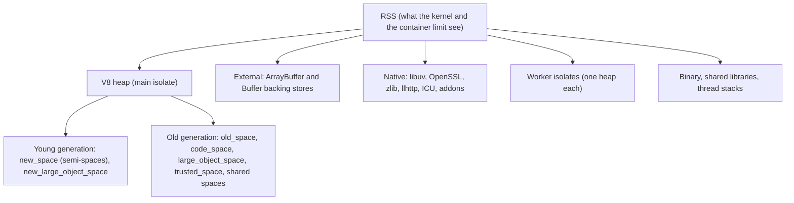

# 10 · V8 Memory and Garbage Collection in Node: Heap Spaces, Limits, Leaks and Containers

> **Primary sources:** V8 blog: [Trash talk: the Orinoco garbage collector](https://v8.dev/blog/trash-talk), [Concurrent marking](https://v8.dev/blog/concurrent-marking), [Jank busters part one](https://v8.dev/blog/jank-busters), [Pointer compression](https://v8.dev/blog/pointer-compression); Node.js API docs: [`v8`](https://nodejs.org/api/v8.html), [`process.memoryUsage()`](https://nodejs.org/api/process.html#processmemoryusage), [`--max-old-space-size`](https://nodejs.org/api/cli.html#--max-old-space-sizesize-in-mib), [`--heapsnapshot-near-heap-limit`](https://nodejs.org/api/cli.html#--heapsnapshot-near-heap-limitmax_count), [Performance hooks: `gc` entries](https://nodejs.org/api/perf_hooks.html#class-performanceentry); Node.js Learn: [Understanding and tuning memory](https://nodejs.org/en/learn/diagnostics/memory/understanding-and-tuning-memory); Jones, Hosking and Moss, _The Garbage Collection Handbook_ (2nd ed., 2023), chapters 4 (copying), 13 (concurrent) and 15 (tri-colour invariants); Cheney (1970), "A nonrecursive list compacting algorithm".
>
> **Executable proof:** [`examples/10-v8-memory-and-gc.test.ts`](../examples/10-v8-memory-and-gc.test.ts). Flag experiments and out-of-memory crashes run in child processes; collection assertions use `--expose-gc` and explicit `gc()` calls in a child, never the timing of the collector.

The JavaScript track owns V8's execution pipeline at the "why is my code slow" level: Ignition, Sparkplug, Maglev and Turbofan, hidden classes, inline caches, elements kinds and deoptimisation ([JavaScript module 12](../../../languages/javascript/modules/12-engine-internals-v8.md)), plus a short GC overview ([§6 there](../../../languages/javascript/modules/12-engine-internals-v8.md#6-garbage-collection-basics)), and weak references ([JavaScript module 09 §4](../../../languages/javascript/modules/09-metaprogramming.md#4-weak-collections-and-weak-references)). This module owns what a Node operator needs: where a process's memory actually goes, how V8's collector behaves under a server workload, the flags that size it, how leaks look in Node, and how heap limits interact with container limits.

---

## 1. Where a Node process's memory goes

**Definition.** The **resident set size** (RSS) of a Node process is the physical memory it occupies. It is the sum of:

| Component | Contents | Reported by | Bounded by |
| --- | --- | --- | --- |
| **V8 heap** | JavaScript objects, strings, closures, compiled code, maps (hidden classes) | `heapTotal`, `heapUsed` | `--max-old-space-size` (old generation) and `--max-semi-space-size` (young generation) |
| **External memory** | backing stores of `ArrayBuffer`s and `Buffer`s, and native memory that addons report to V8 | `external`, `arrayBuffers` | nothing by default |
| **Native heap** | libuv handles and requests, OpenSSL contexts, zlib streams, the HTTP parser, ICU data, addon allocations | only in RSS | nothing |
| **Other isolates** | each worker thread's own V8 heap ([module 09](09-concurrency-and-scaling.md)) | the worker's own statistics; RSS in the parent | each worker's `resourceLimits` |
| **Code and stacks** | the `node` binary, shared libraries, thread stacks | RSS | — |



The test allocates a 64 MiB Buffer and shows `arrayBuffers` grow by 64 MiB while `heapUsed` grows by almost nothing. That single fact explains many incidents: a service whose heap graph is flat while RSS climbs to the container limit is leaking Buffers or native memory, not JavaScript objects, and a heap snapshot alone will not find it.

`process.memoryUsage()` costs a walk over heap spaces; `process.memoryUsage.rss()` is the cheap way to sample RSS frequently. `v8.getHeapStatistics()` gives `used_heap_size`, `total_heap_size`, `heap_size_limit`, `external_memory` and more; `v8.getHeapSpaceStatistics()` breaks the heap down by space. On V8 14.6 the space names include `new_space`, `old_space`, `code_space`, `large_object_space`, `new_large_object_space`, `trusted_space` and the `shared_*` spaces used for objects shared between isolates (the test lists them).

---

## 2. The generational heap

**The weak generational hypothesis.** Most objects die young. A request handler allocates parsed bodies, intermediate arrays, closures and promises that are garbage milliseconds later; a few objects (caches, connection pools, module state) live for the process's lifetime. V8 therefore splits the heap into a small **young generation** collected often and cheaply, and a large **old generation** collected rarely and expensively.

### 2.1 Young generation: the Scavenger

The young generation is two equal **semi-spaces**: allocation happens in _from-space_ by bumping a pointer (a few instructions). When it is full, the **Scavenger** runs a copying collection in the style of Cheney (1970):

```
SCAVENGE()
  ▷ Invariant: every object reachable from the roots or from the old generation's remembered set
  ▷            is copied exactly once; the forwarding pointer left in from-space records where.
  scan ← to-space.start; free ← to-space.start
  for each root r (stack, handles, globals, old→young slots in the remembered set):
     r ← EVACUATE(r)
  while scan < free:                                 ▷ breadth-first, no recursion, no mark stack
     for each pointer field p of the object at scan:
        p ← EVACUATE(p)
     scan ← scan + size(object at scan)
  swap(from-space, to-space)                         ▷ everything left in old from-space is garbage

EVACUATE(o)
  if o is not in from-space: return o
  if o has a forwarding pointer: return it
  copy o to to-space (or PROMOTE it to old space if it already survived one scavenge)
  leave a forwarding pointer in o; return the new address
```

Its cost is proportional to the **live** young objects, not to the garbage, which is why allocation-heavy request handling is cheap as long as little survives. Objects that survive two scavenges are **promoted** to the old generation. V8 runs the scavenger **in parallel** on several threads, but it is a **stop-the-world** pause for the main thread: typically sub-millisecond to a few milliseconds.

The **remembered set** is what makes this sound: whenever old-generation code stores a pointer to a young object (`cache.set(key, freshObject)`), a **write barrier** records the slot, so the scavenger can treat it as a root without scanning the entire old generation.

### 2.2 Old generation: Mark-Compact

The old generation is collected by **Mark-Compact**: mark all reachable objects, sweep (free) the unmarked ones, and compact fragmented pages by evacuating live objects. V8's Orinoco project made most of this work concurrent or parallel:

| Phase | How it runs | Main-thread cost |
| --- | --- | --- |
| Marking | **concurrent** on helper threads while JavaScript runs, with **incremental** steps on the main thread; a final atomic pause finishes it | short final pause |
| Sweeping | **concurrent** and lazy | almost none |
| Compaction (evacuation) | **parallel** during the pause | proportional to evacuated live data |
| Finalisation of weak references, `FinalizationRegistry` callbacks | in the pause / later tasks | small |

Concurrent marking needs the **tri-colour invariant** (Dijkstra et al., 1978): objects are white (not yet seen), grey (seen, fields not yet scanned) or black (seen and scanned). The collector maintains that **no black object points to a white object**; whenever JavaScript writes a pointer into an already-black object while marking is running, the **marking write barrier** greys the target. Without that barrier, the mutator could hide a live object from a concurrent marker and the sweeper would free it.

### 2.3 What GC pauses mean for a server

Every pause stops the event loop. Scavenges are frequent and short; mark-compact pauses are rarer and longer, and they grow with the amount of **live** data and with fragmentation. A process with a 3 GB heap of live cache data pays for that cache in every full collection. Two operational consequences:

- **GC pressure is visible as event-loop delay** ([module 11 §3](11-diagnostics-and-performance.md#3-event-loop-delay-and-utilisation)). A p99 latency spike that coincides with `Mark-Compact` lines in `--trace-gc` output is a GC problem, not a code problem.
- **Big in-process caches are a latency trade-off.** Moving large, long-lived datasets out of the V8 heap (to Redis, to a `SharedArrayBuffer`/`Buffer`, or to SQLite) shortens full collections, because the collector does not trace inside Buffers.

### 2.4 Allocation and object representation: what costs memory

- **Allocation is a pointer bump** in the young generation: allocating is cheap; _retaining_ is what costs (copying at each scavenge, promotion, old-generation tracing).
- **Large objects** (above V8's regular-object size limit, around 128 KiB on 64-bit builds) go straight to `large_object_space` (or `new_large_object_space`) and are never copied; a big array or string built in a request handler therefore skips the cheap young-generation path.
- **Strings have several internal representations.** Concatenation builds _cons strings_ (a tree of pieces, flattened on demand); `slice`/`substring` of a long string can build a _sliced string_ that points into its parent instead of copying. A 20-character slice of a 40 MB string can therefore keep all 40 MB alive. The negative test keeps five 20-character slices of five 8 MB strings and measures more than 30 MiB still retained after a full GC; copying the slices (`Buffer.from(s).toString()`) releases more than 20 MiB. This is a real leak pattern when servers extract small tokens (ids, headers, keys) from large payloads and cache them.
- **Objects with the same shape share a hidden class** (a "map"); objects that receive properties in different orders, or use `delete`, get different or dictionary-mode maps, which costs memory per object as well as speed ([JavaScript module 12 §2](../../../languages/javascript/modules/12-engine-internals-v8.md#2-hidden-classes-maps-and-shapes)).
- **Arrays** store small integers unboxed and doubles unboxed per elements kind; mixing types forces boxed elements (a pointer plus a heap number per value).
- **Closures** allocate a context object for captured variables, shared by all closures of the same scope.

---

## 3. Observing the collector

| Tool | What you get | Use |
| --- | --- | --- |
| `--trace-gc` | one line per collection: type (`Scavenge`, `Mark-Compact`), heap size before → after, pause duration, reason | quick diagnosis on a test instance; the test matches both kinds |
| `--trace-gc-verbose`, `--trace-gc-nvp` | per-phase details | deep dives |
| `PerformanceObserver` with `entryTypes: ['gc']` | `PerformanceEntry` objects with `detail.kind` (minor, major, incremental, weak callbacks) and duration | in-process metrics: GC time per minute, longest pause |
| `v8.getHeapStatistics()` sampled over time | used vs total vs limit | dashboards: used heap trending upward after each full GC = leak |
| `v8.getHeapSpaceStatistics()` | per-space usage | young generation sizing, large objects |
| heap snapshots, sampling heap profiler | what is retained and by whom | [module 11](11-diagnostics-and-performance.md#4-memory-heap-snapshots-and-the-sampling-heap-profiler) |

```js
import { PerformanceObserver, constants } from 'node:perf_hooks';
const obs = new PerformanceObserver((list) => {
  for (const e of list.getEntries()) {
    const major = e.detail?.kind === constants.NODE_PERFORMANCE_GC_MAJOR;
    metrics.observe(major ? 'gc_major_ms' : 'gc_minor_ms', e.duration);
  }
});
obs.observe({ entryTypes: ['gc'] });
```

### 3.1 Reading `--trace-gc`

A line from the test's child process on Node 26.12.1 (V8 14.6):

```
[4077:0x28eed000]  54 ms: Scavenge 8.7 (10.7) -> 7.7 (10.4) MB, pooled: 0.0 MB, 7.01 / 0.00 ms (average mu = 1.000, current mu = 1.000) allocation failure;
```

| Field | Meaning |
| --- | --- |
| `[4077:0x28eed000]` | process id and isolate address (workers have their own) |
| `54 ms` | time since isolate start |
| `Scavenge` / `Mark-Compact` (or `Mark-Compact (reduce)`) | young-generation or full collection |
| `8.7 (10.7) -> 7.7 (10.4) MB` | heap used (committed) before → after |
| `7.01 / 0.00 ms` | main-thread pause / time spent in external callbacks |
| `mu` | _mutator utilisation_: the fraction of recent time spent running JavaScript rather than collecting; values falling well below 1 under load mean GC is eating throughput |
| `allocation failure` | the reason: the young generation filled up (normal); other reasons include `finalize incremental marking`, `testing` (from `gc()`), `low memory notification`, `heap limit` |

Patterns: many scavenges where "after" is close to "before" mean most young objects survive (premature promotion: consider a larger semi-space); `Mark-Compact` lines whose "after" keeps rising mean a leak or growing live data; long `Mark-Compact` pauses track the size of the live heap.

Read heap graphs correctly: heap usage is a **sawtooth** (allocation raises it, collection drops it). A leak is a rising **floor**, the minimum after each major collection, not a rising peak.

---

## 4. Sizing flags

| Flag | Default on Node 26 | Effect | When to change |
| --- | --- | --- | --- |
| `--max-old-space-size=<MiB>` | derived by V8 from available memory (2 144 MiB total limit observed on an 8 GiB sandbox) | caps the old generation; `heap_size_limit` = this + the young-generation reservation | **always** in containers (§7) |
| `--max-old-space-size-percentage=<n>` | — | sets the old-generation cap as a percentage of available memory (which respects the cgroup limit) | when one image runs under different memory limits |
| `--max-semi-space-size=<MiB>` | V8-chosen, grows dynamically | caps each young semi-space | allocation-heavy services: a larger young generation means fewer scavenges and fewer premature promotions, at the cost of slightly longer scavenges; measure |
| `--heapsnapshot-near-heap-limit=<n>` | 0 | write up to _n_ heap snapshots when the heap approaches its limit | production, with disk space and an accepted pause |
| `--expose-gc` | off | exposes `gc()` | tests only; calling `gc()` in production makes latency worse |
| `--jitless` | off | no runtime code generation (interpreter only) | hardened environments that forbid W^X memory; large slowdown |

The tests prove the arithmetic and the transport: `--max-old-space-size=400` raises `heap_size_limit` by exactly 300 MiB relative to `=100` (the difference is the old-generation part; the rest is the young-generation reservation), the percentage flag scales with its argument, and a heap flag in `NODE_OPTIONS` reaches every child Node process. `v8.setFlagsFromString()` can change some flags at runtime, but heap limits are fixed when the isolate is created; set them on the command line or in `NODE_OPTIONS`.

### 4.1 V8 versions shipped by Node

GC and JIT behaviour changes with every V8 upgrade, which is why this track pins V8-sensitive observations to one version.

| Node line | V8 | Memory- and performance-relevant changes for operators |
| --- | --- | --- |
| 20 | 11.3 | Maglev not yet on by default in Node; Orinoco GC mature |
| 22 | 12.4 | Maglev mid-tier compiler enabled by default on supported architectures |
| 24 | 13.6 | `Float16Array`, explicit resource management; AsyncContextFrame-based `AsyncLocalStorage` (module 11) |
| 26 | 14.6 | Temporal, `Map.prototype.getOrInsert`, Maglev on more platforms (s390x); the heap spaces listed in §1 |

Re-baseline memory budgets and GC metrics after every major upgrade: the same code can have a different heap profile on a new V8, and flags tuned on an old version (semi-space sizes especially) may no longer help.

### 4.2 Flags to leave alone

`--gc-interval`, `--optimize-for-size`, `--single-threaded-gc`, `--no-concurrent-marking`, `--max-lazy`, and similar V8 internals appear in old blog posts and Stack Overflow answers. They change collector strategy globally, are not covered by Node's compatibility guarantees, and are usually slower. Change heap sizes; change collector internals only with a benchmark and a reason.

**Pointer compression**, which halves the size of pointers by keeping the heap in a 4 GiB "cage", is enabled in Chrome but **not** in Node's default builds, so Node heaps can exceed 4 GiB and pay full 64-bit pointers. Builds with pointer compression exist for memory-sensitive deployments; they cap each isolate's heap.

---

## 5. Out of memory: what actually happens

When the old generation reaches its limit, V8 runs increasingly aggressive full collections. If they cannot free enough ("ineffective mark-compacts near heap limit"), V8 calls the embedder's fatal-error handler: Node prints

```
FATAL ERROR: Ineffective mark-compacts near heap limit Allocation failed - JavaScript heap out of memory
```

with a native stack and **aborts** (SIGABRT). There is no exception to catch: the test wraps the allocation loop in `try/catch` and the `catch` never runs; the child dies with `signal === 'SIGABRT'` (exit status 134 in a shell). Evidence capture therefore has to be configured in advance:

- `--heapsnapshot-near-heap-limit=1` writes a heap snapshot shortly before the limit (the test finds the `.heapsnapshot` file in the child's working directory). Writing it needs roughly as much memory again as the heap and pauses the process for seconds; size the container accordingly.
- `--report-on-fatalerror` writes a diagnostic report ([module 11](11-diagnostics-and-performance.md)).
- Before the crash, GC time rises sharply and event-loop delay explodes; alert on heap used / limit above ~85% after major GCs so a human or an autoscaler acts before the abort.

### 5.1 OOM triage checklist

1. **Which OOM?** Exit 134 with `JavaScript heap out of memory` (V8) or 137/`OOMKilled` (kernel)? The fixes differ (§7).
2. **Leak or load?** Did the heap floor rise steadily over hours (leak) or jump with a traffic pattern (a request type that builds huge live data, such as an unbounded query result or a large upload buffered in memory)?
3. **Evidence.** Snapshot near the limit, a diagnostic report, `--trace-gc` from a canary, RSS/heap/external time series.
4. **What dominates the snapshot?** Sort by retained size; check strings (sliced parents, giant JSON), arrays (unbounded buffers), closures (listeners), `Promise` counts (stuck waits).
5. **Bound it.** Every structure that can grow with input or time needs a bound: page sizes, body limits, cache sizes, queue lengths, concurrency.
6. **Only then** raise memory, and record why.

Workers are the exception: a worker that exceeds its own `resourceLimits` ends with `ERR_WORKER_OUT_OF_MEMORY` while the parent survives ([module 09 §2.3](09-concurrency-and-scaling.md#23-failure-semantics)).

---

## 6. Memory leaks in Node

**Definition.** In a garbage-collected runtime, a leak is memory that is **still reachable but no longer needed**: something keeps a reference the program will never use again. The collector is working correctly; the program's reference graph is wrong.

### 6.1 The usual retainers

| Retainer | Example | Proof or pattern | Fix |
| --- | --- | --- | --- |
| Listener on a long-lived emitter | `bus.on('tick', () => use(req))` per request, never removed | the test: after GC the request object is still reachable through the listener's closure | `once`, `off`, `{ signal }`; see [module 04 §2.2](04-async-control-flow-and-errors.md#22-listener-leaks-and-the-max-listeners-warning) |
| Unbounded `Map` cache | `cache.set(id, result)` with no eviction | the test: a `Map` key stays alive, a `WeakMap` key is collected | an LRU with a size bound, TTLs, or a `WeakMap` keyed by objects whose lifetime should govern the entry |
| Closures capturing more than they use | a callback that captures a large scope; V8 contexts keep every variable referenced by _any_ closure of that scope | [JavaScript module 03](../../../languages/javascript/modules/03-execution-contexts-scope-closures.md#what-a-closure-retains-v8-reality) | narrow scopes; null out large locals |
| Timers and intervals | `setInterval` referencing request state, never cleared | heap snapshot shows `Timeout` objects | `clearInterval`, `AbortSignal` |
| Promises that never settle | `await new Promise(...)` waiting on an event that never comes; each holds its continuation and scope | growing count of `Promise` objects | timeouts on every wait |
| `AsyncLocalStorage` stores | storing large objects in the store; contexts captured by long-lived resources (timers, pooled connections) | [module 11 §5](11-diagnostics-and-performance.md#5-asynclocalstorage-and-async-context) | keep stores small; `exit()` for background work |
| Pooled Buffer slices | a 10-byte slice kept in a cache pins a 64 KiB slab | `arrayBuffers` grows, heap does not | copy small long-lived Buffers ([module 05 §1.2](05-buffers-streams-backpressure.md#12-the-pool-and-why-buffer-is-dangerous)) |
| Module cache manipulation | `delete require.cache[...]` reloads | old module graphs retained by references | restart instead ([module 03 §2.3](03-modules-and-packages.md#23-the-cache)) |
| Native leaks | an addon or a library that never frees native memory; unclosed zlib streams | RSS grows, heap and `external` flat | update or replace the dependency; close streams |

### 6.2 Weak references are not a leak fix

`WeakMap` is the right tool when an entry should live exactly as long as its key object. `WeakRef` and `FinalizationRegistry` give no timing guarantees: callbacks may run late or never (for example at process exit). Using them to release _resources_ (file descriptors, sockets) is a bug; release resources deterministically with `try/finally` or `using` ([JavaScript module 10](../../../languages/javascript/modules/10-resource-management-temporal.md#part-a--explicit-resource-management)), as Node 26 now enforces for `FileHandle` ([module 06 §1.1](06-filesystem-process-os.md#11-filehandle-and-descriptor-hygiene)).

### 6.3 A leak-hunting procedure

```
FIND-LEAK(service)
  1  Confirm: the heap FLOOR after major GCs rises under steady load (not just peaks), or RSS rises with a flat heap
  2  If RSS rises and heap does not: suspect external/native memory → check arrayBuffers/external,
     open handles (process.getActiveResourcesInfo()), zlib/crypto streams, addons
  3  Otherwise: take heap snapshot S1 after warm-up, apply load, force no GC manually, take S2, apply more load, take S3
  4  Compare S2 and S3 (Comparison view): constructors whose COUNT grows proportionally to load are suspects
  5  For a suspect object, read its RETAINER path up to a GC root: that path is the bug
  6  Fix, then repeat step 1 under the same load
```

The tools for steps 3–5 (DevTools memory panel, `v8.writeHeapSnapshot()`, `--heapsnapshot-signal`, the sampling heap profiler) are in [module 11](11-diagnostics-and-performance.md#4-memory-heap-snapshots-and-the-sampling-heap-profiler).

### 6.4 A worked leak and its fix

```js
// LEAK: one listener per request on a process-wide emitter
const configBus = new EventEmitter();
app.get('/report', async (req, reply) => {
  const report = await buildReport(req.query); // tens of MB
  configBus.on('reload', () => report.invalidate()); // the closure retains `report` forever
  return report.summary;
});
```

Symptoms in order: `MaxListenersExceededWarning: 11 reload listeners`, heap floor rising with request count, retainer path in a heap snapshot `report ← context ← (closure) ← listener array ← _events ← configBus ← (module scope)`. The fix is to scope the subscription to the request, or not to subscribe at all:

```js
app.get('/report', async (req, reply) => {
  const report = await buildReport(req.query);
  const onReload = () => report.invalidate();
  configBus.on('reload', onReload);
  try {
    return report.summary;
  } finally {
    configBus.off('reload', onReload);
  } // removed when the request ends
});
```

The test file's listener test is the minimal form of the leaky version: after forcing GC, a `WeakRef` to the request object still dereferences, and the emitter reports one listener.

---

## 7. Heap limits in containers

A container's memory limit (cgroup v2 `memory.max`) bounds **RSS**: heap, external memory, native memory, every worker isolate. V8's heap limit bounds only the V8 heap. The two failure modes look different and need different fixes:

|  | V8 heap OOM | Container OOM kill |
| --- | --- | --- |
| Cause | old generation reached `--max-old-space-size` | RSS reached the cgroup limit |
| Who acts | V8 (fatal error handler) | the kernel OOM killer |
| Signal / exit | SIGABRT, **134** | SIGKILL, **137**, Kubernetes reason `OOMKilled` |
| Output | `FATAL ERROR: ... JavaScript heap out of memory` and a native stack | nothing from the process: it is killed mid-instruction |
| Evidence possible | heap snapshot near limit, diagnostic report | none from inside; only metrics recorded before |
| Typical root cause | a JS-object leak or genuinely large live data | heap limit set **above** the container limit, or Buffer/native growth |

The dangerous configuration is a heap limit larger than what the container can actually hold. Then the process never gets V8's heap OOM (with its snapshot and stack) because the kernel kills it first, silently, and the post-mortem has nothing. Rules:

1. **Set the heap limit explicitly**, below the container limit, leaving room for everything else in §1. A common starting point is the old generation at 50–75% of the container limit (more headroom for Buffer-heavy services, streaming proxies and worker pools), then adjust from observed RSS minus heap.
2. Prefer `--max-old-space-size-percentage` when one image is deployed with different limits, so the heap follows the limit; it is computed from the memory Node sees as available, which respects the cgroup limit (`process.constrainedMemory()`, [module 06 §6.1](06-filesystem-process-os.md#61-reading-container-limits)).
3. Account for **worker isolates**: each worker has its own heap; give workers `resourceLimits`, and include them in the budget.
4. Alert on RSS approaching the limit **and** on heap used / heap limit; they fail for different reasons.
5. Leave a memory margin for `--heapsnapshot-near-heap-limit` if you enable it, or the snapshot itself triggers the OOM kill.

### 7.1 A worked memory budget

A container limited to **1 GiB** runs an HTTP API that proxies file downloads and uses a 2-worker pool for image thumbnails. A budget, before measurement:

| Component | Estimate | Basis |
| --- | --- | --- |
| Main isolate old generation | 448 MiB | `--max-old-space-size=448` |
| Main isolate young generation | ~50 MiB | V8 reservation (`heap_size_limit` minus the old-space flag, measured on the pinned version) |
| Two worker isolates | 2 × 96 MiB | `resourceLimits: { maxOldGenerationSizeMb: 80 }` plus young generation |
| Buffers in flight | ~120 MiB | 500 concurrent downloads × 64 KiB high-water mark × ~2 buffers each ([module 05](05-buffers-streams-backpressure.md)) |
| Native (OpenSSL, zlib, libuv, ICU), binary, stacks | ~120 MiB | measured RSS minus heap minus external at idle |
| Headroom (fragmentation, snapshot capture) | the rest (~90 MiB) |  |

Then load-test with production-like concurrency and compare peak RSS with the budget. If a heap snapshot near the limit is required, the headroom must be at least the size of the heap, which in this budget means lowering the heap limit or raising the container limit.

### Then vs now: heap sizing

| Then | Now |
| --- | --- |
| Node ≤ 11: fixed default old-space limits (~1.4 GB on 64-bit) regardless of machine size, so big machines needed the flag and small containers were oversubscribed | V8 derives the default from available memory, and Node 26 reads cgroup limits for `process.constrainedMemory()`; the default is still a heuristic, not a container-aware budget |
| `--max-old-space-size` hard-coded per environment | `--max-old-space-size-percentage` scales with the limit |
| stop-the-world mark-sweep pauses of hundreds of ms on large heaps | Orinoco: parallel scavenges, concurrent marking and sweeping, parallel compaction (V8 6.x–7.x, Node 10–12 onward) |
| `--optimize-for-size`, `--gc-interval` folklore | measure with `--trace-gc` and `gc` performance entries; change one flag at a time |

---

## 8. Production failure modes

| Failure | Mechanism | Fix |
| --- | --- | --- |
| Pods `OOMKilled` (137) with no logs or snapshots | heap limit above the container limit, or native/external growth | explicit heap limit with headroom; watch RSS vs heap |
| `JavaScript heap out of memory` (134) after hours | JS-object leak; or the dataset outgrew the heap | heap snapshot comparison; bound caches; raise the limit only for real data growth |
| Latency spikes every few seconds under load | frequent scavenges promoting short-lived objects; major GCs on a large live heap | larger young generation (`--max-semi-space-size`), less allocation, smaller in-heap caches |
| RSS grows, heap flat | Buffers, streams, addons, workers | `arrayBuffers`/`external` metrics, close streams, `resourceLimits` |
| `MaxListenersExceededWarning` followed by growth | listener leak | remove listeners; never just raise the limit |
| A cache "with WeakRef" still leaks, or drops entries randomly | weak references used as a caching policy | explicit LRU with size and TTL |
| `gc()` calls in production code | someone used `--expose-gc` to "fix" memory | remove; fix the retainer |
| Heap snapshot capture kills the pod | snapshot needs heap-sized memory | memory headroom, or capture on a canary |

---

## Interview Drill

<details><summary>1. Explain V8's generational garbage collection and why it suits a Node server.</summary>

Most objects die young. The young generation is collected by a parallel copying Scavenger whose cost is proportional to surviving objects, so per-request garbage is cheap; survivors of two scavenges are promoted. The old generation is collected by Mark-Compact with concurrent marking, concurrent sweeping and parallel compaction, so long-lived state (caches, pools) is traced rarely and mostly off the main thread. A write barrier records old-to-young pointers so scavenges need not scan the old generation.
</details>

<details><summary>2. A container is OOM-killed with exit code 137 and no stack trace. Another dies with 134 and "JavaScript heap out of memory". How do they differ and what do you change?</summary>

137 is SIGKILL from the kernel: RSS exceeded the cgroup limit, usually because the V8 heap limit is set above the container limit or because Buffers/native memory/worker heaps grew; set the heap limit below the container limit with headroom and watch RSS minus heap. 134 is SIGABRT from V8's fatal error handler: the old generation hit `--max-old-space-size`; investigate with heap snapshots (enable `--heapsnapshot-near-heap-limit`) and fix the leak or size the heap for the real live data.
</details>

<details><summary>3. Why might `heapUsed` stay flat while RSS keeps growing?</summary>

The growth is outside the V8 heap: `Buffer`/`ArrayBuffer` backing stores (`external`/`arrayBuffers`), native allocations by libuv, OpenSSL, zlib streams or addons, or worker isolates. Heap snapshots will not show it. Check `process.memoryUsage()` fields, open handles and streams, and addon behaviour.
</details>

<details><summary>4. How do you find a memory leak in a Node service?</summary>

Confirm that the heap floor after major collections rises under steady load. Take heap snapshots at intervals under load, compare them, and look for constructors whose counts grow with load; follow the retainer path of a leaked instance to a GC root, which names the reference to remove (a listener, a cache, a timer, a closure). Re-test under the same load.
</details>

<details><summary>5. What is the tri-colour invariant and why does concurrent marking need a write barrier?</summary>

Objects are white (unvisited), grey (visited, children pending) or black (visited and scanned); the invariant is that no black object points to a white one. When marking runs concurrently with JavaScript, the program can store a pointer to a white object into a black one and drop all other references; the marker would never see it and the sweeper would free a live object. The marking write barrier greys the stored target, preserving the invariant.
</details>

<details><summary>6. When would you raise `--max-semi-space-size`?</summary>

For allocation-heavy services where `--trace-gc` shows very frequent scavenges and objects being promoted only because the young generation filled before they died. A larger young generation reduces scavenge frequency and premature promotion (and so old-generation growth and major GCs), at the cost of somewhat longer individual scavenges and more memory. Measure throughput and latency before and after.
</details>

<details><summary>7. Can you catch a JavaScript heap out-of-memory error in Node?</summary>

No. It is a fatal V8 error: Node prints the message and aborts the process. Prepare evidence instead (`--heapsnapshot-near-heap-limit`, `--report-on-fatalerror`), alert before the limit, and let the supervisor restart the process. Only worker threads with `resourceLimits` fail softly, with `ERR_WORKER_OUT_OF_MEMORY` in the parent.
</details>

<details><summary>8. Why are large in-process caches a latency risk, and what are the alternatives?</summary>

Full collections must trace all live objects, so a multi-gigabyte cache lengthens every major GC pause and raises the cost of compaction. Alternatives: bound the cache (LRU with size limits), move it out of the V8 heap (Redis, a shared Buffer-based structure, SQLite), or share it across processes instead of duplicating it per process.
</details>

<details><summary>9. A cache stores 20-character tokens extracted from large request bodies, and memory grows far faster than the token count suggests. Why?</summary>

`slice`/`substring` of a long string may produce a sliced string that references its parent, so each cached token can keep the entire request body alive. Copy extracted substrings before caching them (for example through a Buffer round trip), or parse tokens from Buffers into fresh strings.
</details>

<details><summary>10. How do you plan the memory limit of a container running a Node service?</summary>

Budget RSS, not just the heap: old-generation limit plus young generation for the main isolate, each worker's heap, Buffers in flight (concurrency times stream high-water marks), native memory, and headroom for fragmentation and evidence capture. Set heap flags below the container limit accordingly, then validate peak RSS under realistic load and alert on both heap usage and RSS.
</details>

<details><summary>11. What does a falling "mu" value in `--trace-gc` output tell you?</summary>

Mutator utilisation is the fraction of time the program runs JavaScript instead of the collector. A falling value under load means garbage collection is consuming a growing share of CPU and pause time, typically from high allocation rates with many survivors, or from a large and growing live heap near the limit. Reduce allocation and retention, resize the young generation, or bound the live data.
</details>

<details><summary>12. After upgrading from Node 22 to Node 26, p99 latency and memory change although the code did not. Where do you look first?</summary>

At the engine: Node 26 ships V8 14.6 instead of 12.4, with different compiler tiers, heap layout and collector heuristics, and different defaults elsewhere (stream high-water marks, Buffer pool size). Compare `--trace-gc` and `gc` performance entries, heap space statistics and CPU profiles before and after on the same load, and re-check flags that were tuned for the old version.
</details>
