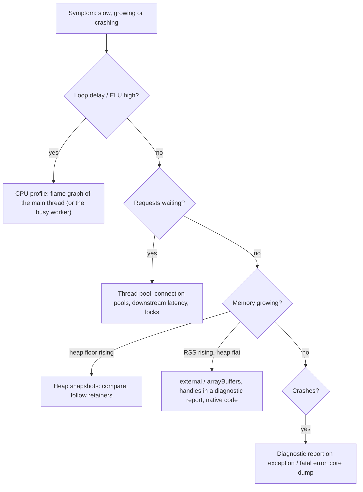

# 11 · Diagnostics and Performance: Loop Delay, Profiles, Heap Snapshots, Reports and Async Context

> **Primary sources:** Node.js API docs: [Performance measurement APIs](https://nodejs.org/api/perf_hooks.html) (`monitorEventLoopDelay`, `eventLoopUtilization`, histograms), [Inspector](https://nodejs.org/api/inspector.html), [V8 (`writeHeapSnapshot`)](https://nodejs.org/api/v8.html#v8writeheapsnapshotfilenameoptions), [Diagnostic report](https://nodejs.org/api/report.html), [Asynchronous context tracking](https://nodejs.org/api/async_context.html), [Async hooks](https://nodejs.org/api/async_hooks.html) (status note), [Diagnostics Channel](https://nodejs.org/api/diagnostics_channel.html), [Trace events](https://nodejs.org/api/tracing.html); Node.js Learn: [Diagnostics guides](https://nodejs.org/en/learn/diagnostics/user-journey) (memory, poor performance, flame graphs); Chrome DevTools Protocol (`Profiler`, `HeapProfiler` domains); Brendan Gregg, "The USE Method" and _Systems Performance_ (2nd ed., 2020); Gil Tene on coordinated omission (2013).
>
> **Executable proof:** [`examples/11-diagnostics-and-performance.test.ts`](../examples/11-diagnostics-and-performance.test.ts) and a heap-snapshot reader in [`examples/11-heap-snapshot.ts`](../examples/11-heap-snapshot.ts). Measurements are asserted only as lower bounds that cannot be violated (a 120 ms block produces at least 100 ms of recorded delay), never as timing races.

How V8 executes and optimises code (tiers, deopts) is owned by [JavaScript module 12](../../../languages/javascript/modules/12-engine-internals-v8.md#7-diagnosing-performance); the GC and memory model of a Node process is in [module 10](10-v8-memory-and-gc.md); telemetry pipelines, dashboards and SLO burn-rate math belong to `technologies/observability`. This module owns Node's built-in diagnostic tooling and how to use it on a live problem.

---

## 1. A method before tools

Performance work in Node fails most often by profiling the wrong thing. Classify first.

| Symptom | First question | First tool |
| --- | --- | --- |
| High latency for **all** routes, one core at 100% | is the event loop blocked or saturated? | event-loop delay and ELU (§3), then a CPU profile (§6) |
| High latency, **low** CPU | waiting on what? | outbound call timings, thread-pool queueing ([module 02 §5](02-event-loop.md#5-the-thread-pool)), connection pool waits ([module 07 §6.3](07-networking-and-http.md#63-bounding-outbound-concurrency)) |
| Memory grows until a restart | heap or outside the heap? | `process.memoryUsage()` series, then heap snapshots (§4) |
| Periodic latency spikes | GC? timers? cron work? | `--trace-gc`, `gc` performance entries ([module 10 §3](10-v8-memory-and-gc.md#3-observing-the-collector)) |
| Crash with no explanation | what was the state at the crash? | diagnostic report (§7), core dump |
| Wrong data in logs (wrong request id) | context propagation | `AsyncLocalStorage` rules (§5) |



**The USE method** (Gregg) for every resource: **U**tilisation, **S**aturation, **E**rrors. For a Node process the resources are the event loop (utilisation = ELU, saturation = loop delay), the thread pool (busy threads, queue length), memory (heap used / limit, RSS / container limit), sockets and descriptors (open handles, pool waits), and CPU (process CPU, per-worker CPU).

---

## 2. The built-in toolbox

| Tool | Answers | Overhead | Safe in production? |
| --- | --- | --- | --- |
| `perf_hooks.monitorEventLoopDelay` | how late are callbacks? | a timer per `resolution` ms | **yes**, always on |
| `performance.eventLoopUtilization()` | how busy is the loop? | negligible | **yes**, always on |
| `--cpu-prof` / inspector `Profiler` | where does CPU time go? | sampling: low | yes, for bounded windows |
| `--heap-prof` (sampling heap profiler) | which call sites allocate what is retained? | low | yes, for bounded windows |
| `v8.writeHeapSnapshot()` / `--heapsnapshot-signal` | what is retained and why? | **stops the process** for seconds; memory ≈ heap size | carefully: on a canary or drained instance |
| `process.report` / `--report-*` | full process state at a moment or at a crash | small | **yes** (exclude env) |
| `--inspect` + DevTools | interactive debugging and profiling | breakpoints stop everything | **no** on a public interface |
| `diagnostics_channel` | events from core and libraries | ~zero without subscribers | yes |
| `--trace-gc`, `--trace-event-categories` | GC and internal trace events | moderate | short windows |
| `node --test --experimental-test-coverage` | which code tests reach | high | test only ([module 12](12-testing.md)) |

### 2.1 The metrics every Node service should export

A minimal, always-on set (names follow common Prometheus client conventions; `prom-client`'s default metrics cover most of them):

| Metric | Source | Why |
| --- | --- | --- |
| process CPU seconds (user, system) | `process.cpuUsage()` | saturation of the main thread and helpers |
| RSS | `process.memoryUsage.rss()` | the number the container limit enforces |
| heap used, heap total, heap limit | `v8.getHeapStatistics()` | leaks (rising floor), headroom to V8 OOM |
| external / array buffers | `process.memoryUsage()` | Buffer and native growth invisible in the heap |
| event-loop utilisation | `performance.eventLoopUtilization()` | capacity |
| event-loop delay p50/p99/max | `monitorEventLoopDelay()` | responsiveness |
| GC time by kind, longest pause | `PerformanceObserver` `gc` entries | GC pressure |
| active handles by type | `process.getActiveResourcesInfo()` | leaks of sockets, timers, watchers |
| open file descriptors | `/proc/self/fd` count on Linux | `EMFILE` before it happens |
| HTTP request rate, error rate, latency histogram per route | framework hooks or `diagnostics_channel` | the RED method for the service itself |
| outbound call latency and pool wait time per dependency | undici/http instrumentation | blames dependencies correctly |

Label metrics with the Node version and the build/commit, so a regression after an upgrade is visible as a step at the deploy.

---

## 3. Event-loop delay and utilisation

### 3.1 Definitions

- **Event-loop delay** (lag) at a moment: the difference between when a timer was due and when its callback actually ran. `monitorEventLoopDelay({ resolution })` arms an internal timer every `resolution` ms (default 10) and records the lateness of each firing into an HDR histogram, in **nanoseconds**: `min`, `max`, `mean`, `stddev`, `percentile(p)`, `percentiles`.
- **Event-loop utilisation** (ELU) over an interval: `active / (active + idle)`, where _idle_ is the time the loop spent blocked in the poll phase waiting for I/O, and _active_ is everything else (running callbacks, microtasks, GC pauses on the main thread). `performance.eventLoopUtilization(previous)` returns the delta since a previous sample: `{ idle, active, utilization }`.

They answer different questions. ELU says how much of the thread's capacity is used; delay says how much that use hurts latency. A loop at ELU 0.6 with low delay is healthy; a loop at ELU 0.3 with a 2-second max delay has rare but severe blocking (one huge synchronous operation).

The tests prove both definitions with lower bounds that cannot race: a 120 ms synchronous block yields a histogram `max` of at least 100 ms, and the ELU of an interval spent entirely in a synchronous block is above 0.9 with at least 50 ms of `active` time.

### 3.2 Exporting them

```js
import { monitorEventLoopDelay, performance } from 'node:perf_hooks';

const delay = monitorEventLoopDelay({ resolution: 20 });
delay.enable();
let lastElu = performance.eventLoopUtilization();

setInterval(() => {
  const elu = performance.eventLoopUtilization(lastElu);
  lastElu = performance.eventLoopUtilization();
  metrics.gauge('nodejs_eventloop_utilization', elu.utilization);
  metrics.gauge('nodejs_eventloop_delay_p99_ms', delay.percentile(99) / 1e6);
  metrics.gauge('nodejs_eventloop_delay_max_ms', delay.max / 1e6);
  delay.reset(); // per-interval percentiles, not since start
}, 10_000).unref();
```

Rules of thumb for alerts and autoscaling: sustained ELU above ~0.8 means the process is near saturation (scale out or optimise); p99 delay above ~100 ms for minutes means users notice; a `max` spike without a p99 change is one blocking operation worth a profile. The resolution is also the floor of what you can see: with 20 ms resolution, a 5 ms block is invisible. Worker threads have their own loop: sample `worker.performance.eventLoopUtilization()` from the parent ([module 09 §2.6](09-concurrency-and-scaling.md#26-observing-workers)).

### 3.3 From "the loop is blocked" to the culprit

```
FIND-BLOCKER(process)
  1  Confirm with delay max / p99 that the loop is blocked (not just a slow dependency)
  2  Capture a CPU profile spanning a spike (--cpu-prof on a canary, or the inspector on demand)
  3  In the flame graph, look for WIDE frames under the event loop entry points
     (processTicksAndRejections, listOnTimeout, emit, parserOnHeadersComplete ...)
  4  Typical findings: JSON.parse/stringify of large payloads, regex backtracking, sync crypto/zlib/fs,
     template rendering, sorting/large array operations, GC (wide "(garbage collector)" frames)
  5  Fix by bounding input, moving work off-thread (module 09), or streaming; then re-measure step 1
```

### 3.4 When the loop is idle but requests are slow

Low ELU with high latency means requests are **waiting**, not computing. The usual queues, none of which `monitorEventLoopDelay` sees:

- **libuv thread pool**: four threads shared by `fs`, `dns.lookup`, crypto and zlib. There is no public queue-length API; detect it by timing a trivial `fs.stat` periodically (a canary operation) and by correlating with hashing or compression load ([module 02 §5.1](02-event-loop.md#51-thread-pool-starvation)).
- **Connection pools**: undici and `http.Agent` queue requests beyond their socket limits; database clients queue beyond their pool size. Measure time-to-socket or time-to-connection separately from query time.
- **Downstream services**: outbound latency histograms per dependency, with the request id propagated (§5.4) so one slow call can be traced end to end.
- **Locks and serialisation in your code**: a promise-based mutex or a single-consumer queue that every request passes through.

---

## 4. Memory: heap snapshots and the sampling heap profiler

### 4.1 Heap snapshots

A heap snapshot is a graph of every object in one isolate's heap: nodes (objects, strings, closures, arrays, code, hidden classes) with their **self size**, and edges (properties, closure variables, internal references) to other nodes. Tools compute each node's **retained size** (memory freed if it were collected) via dominator trees, and the **retainer path** from a GC root.

Ways to take one:

| Method | When |
| --- | --- |
| `v8.writeHeapSnapshot(path)` | from code, e.g. an admin endpoint on an internal port |
| `--heapsnapshot-signal=SIGUSR2` then `kill -USR2 <pid>` | on demand without code changes |
| `--heapsnapshot-near-heap-limit=n` | automatically before a heap OOM ([module 10 §5](10-v8-memory-and-gc.md#5-out-of-memory-what-actually-happens)) |
| DevTools Memory panel over `--inspect` | interactive, development |
| `worker.getHeapSnapshot()` | a worker's isolate |

Costs: the process stops while the snapshot is written (seconds for large heaps), and peak memory roughly doubles. Take snapshots from an instance removed from the load balancer, or from a canary.

**The format** is JSON with a flat integer array per node (`snapshot.meta.node_fields` gives the field order: `type`, `name`, `id`, `self_size`, `edge_count`, …) and a string table. [`examples/11-heap-snapshot.ts`](../examples/11-heap-snapshot.ts) counts nodes by constructor name in about twenty lines:

```
COUNT-BY-NAME(snapshot, wantedType)
  stride ← |node_fields|;  t ← index of "type";  n ← index of "name"
  for i ← 0, stride, 2·stride, … < |nodes|:        ▷ Invariant: i is the start of node i/stride
     if nodes[i + t] = index of wantedType in node_types:
        counts[strings[nodes[i + n]]] += 1
```

The test creates exactly 1 234 `LeakyThing` instances in a child process, writes a snapshot and finds 1 234 `object` nodes named `LeakyThing`. The same reader, run on two snapshots, gives the "which constructors grow with load" step of the leak procedure in [module 10 §6.3](10-v8-memory-and-gc.md#63-a-leak-hunting-procedure), scriptable in CI or on a production snapshot without opening DevTools.

### 4.2 Reading a snapshot in DevTools

- **Summary** view, sorted by retained size: the biggest owners of memory.
- **Comparison** view between two snapshots: `# New`, `# Deleted`, `# Delta` per constructor. A constructor whose delta is proportional to the number of requests between snapshots is the leak candidate.
- **Retainers** panel for a selected object: the path to a GC root. Read it bottom-up: the first non-framework object on the path (a module-level `Map`, an emitter's listener array, a closure's context) is usually the bug.
- `(closure)`, `(system)`, `(array)` and `(string)` groups need care: closures show their **context** as a retainer edge; sliced and cons strings show their parents ([module 10 §2.4](10-v8-memory-and-gc.md#24-allocation-and-object-representation-what-costs-memory)).

### 4.3 The sampling heap profiler

`--heap-prof` (or the inspector's `HeapProfiler.startSampling`) records the **allocation stack** for a sample of allocations (one per `--heap-prof-interval` bytes, default 512 KiB) and reports which of those are still alive when the profile is written. It answers "which code allocated what is retained" at low overhead, which a snapshot (a picture of the heap, with no allocation stacks) cannot. Use it to attribute growth to code paths; use snapshots to understand retention.

---

## 5. `AsyncLocalStorage` and async context

### 5.1 Definition

**Async context** is a value associated with a logical flow of execution (a request) that is visible to every callback and continuation causally descended from the point where it was set, and to nothing else. `AsyncLocalStorage` provides it:

```js
import { AsyncLocalStorage } from 'node:async_hooks';
export const requestContext = new AsyncLocalStorage();

app.addHook('onRequest', (req, _reply, done) => {
  requestContext.run({ requestId: req.id, user: null }, done); // everything after `done` sees the store
});
// anywhere below, including inside awaited calls and timers:
logger.info({ requestId: requestContext.getStore()?.requestId }, 'charging card');
```

Semantics, each pinned in the tests:

- `als.run(store, fn)` sets the store for `fn` and everything it schedules: `await` continuations, timers, immediates, promise callbacks (the test reads the same store after `await`, `setTimeout` and `setImmediate`, and `undefined` after `run` returns).
- Concurrent flows are isolated: three interleaved `run`s each see only their own store.
- `als.exit(fn)` runs `fn` (and what it schedules) with no store: background work started during a request should not keep the request's store alive.
- `als.enterWith(store)` sets the store for the rest of the current synchronous execution and its descendants; it is easy to leak into unrelated work, so prefer `run`.

### 5.2 Where context is lost or wrong

Context follows **causality as the runtime sees it**, which is not always the causality you mean:

| Situation | What happens | Fix |
| --- | --- | --- |
| `EventEmitter` listener | runs in the context of the code that calls `emit()`, not of the code that registered it. The test registers in context A, emits from B, and the listener sees B. A shared connection or client emitting `'data'` for many requests therefore logs the wrong request id | `AsyncResource.bind(fn)` at registration (the test sees A), or `EventEmitterAsyncResource` |
| Callback queues and pools written in userland (a connection pool that queues callbacks and calls them from another request's I/O) | the callback runs in whatever context triggered the flush | bind callbacks with `AsyncResource.bind` / `AsyncLocalStorage.bind` when queuing |
| Native addons, some older libraries using custom thenables or their own schedulers | context may be dropped | upgrade, or bind at the boundary |
| Work started in `onRequest` but continued from a global interval | the interval was created outside any request | pass data explicitly |

### 5.3 Implementation: AsyncContextFrame

Since **Node 24**, `AsyncLocalStorage` is implemented with **AsyncContextFrame** by default: the current context is a small immutable map stored in V8's continuation-preserved embedder data, captured when a promise reaction or callback is created and restored when it runs, in the spirit of the TC39 AsyncContext proposal ([JavaScript module 07 §6](../../../languages/javascript/modules/07-async-in-depth.md#6-asynccontext-stage-2)). The previous implementation propagated stores through `async_hooks` resource objects, which cost a hook call per asynchronous resource and broke in more edge cases. `--no-async-context-frame` restores the old implementation (the test checks that ordinary semantics are identical).

### 5.4 Propagating context beyond the process

`AsyncLocalStorage` carries context inside one process. Across processes, the context must travel in the request:

```js
const ctx = new AsyncLocalStorage();

export async function callInventory(sku, { signal } = {}) {
  const { requestId, deadline } = ctx.getStore() ?? {};
  return fetch(`http://inventory.internal/items/${encodeURIComponent(sku)}`, {
    headers: { 'x-request-id': requestId ?? crypto.randomUUID() }, // correlation for logs
    signal: AbortSignal.any([
      signal ?? new AbortController().signal, // the caller's cancellation
      AbortSignal.timeout(Math.max(0, deadline - Date.now())),
    ]), // remaining budget
  });
}
```

OpenTelemetry does the same for traces with the W3C `traceparent` header, injected automatically by its HTTP and undici instrumentation and read back on the receiving side into its own context (built on `AsyncLocalStorage`). Propagating the **deadline**, not just the id, stops a downstream service from working on a request its caller has already abandoned.

### Then vs now: async context

| Then | Now |
| --- | --- |
| `continuation-local-storage`, `cls-hooked` (monkey-patching, then `async_hooks`) | `AsyncLocalStorage` (stable since 16.4) |
| `async_hooks.createHook` to build your own tracking | **discouraged**: the docs recommend `AsyncLocalStorage` and `diagnostics_channel`; `createHook` has measurable overhead and an unstable surface |
| `domain` for request scoping and error capture | deprecated (DEP0032); use `AsyncLocalStorage` for context and explicit error handling ([module 04](04-async-control-flow-and-errors.md#6-process-level-policy-uncaught-exceptions-and-unhandled-rejections)) |
| ALS via `async_hooks` resources (Node 16–23) | AsyncContextFrame (Node 24+ default); cheaper, fewer edge cases |

Cost guidance: `getStore()` is cheap; `run()` allocates a frame. Store one small object per request (ids, user, deadline) rather than large payloads, and never store something whose lifetime should end with the request in a place that outlives it ([module 10 §6.1](10-v8-memory-and-gc.md#61-the-usual-retainers)).

---

## 6. CPU profiling and flame graphs

**Definition.** A sampling CPU profiler interrupts the thread at a fixed interval (V8 default about 1 ms; `--cpu-prof-interval` in µs) and records the current JavaScript stack. Aggregated samples estimate where time goes, with error proportional to 1/√samples; functions that run for less than the interval in total may not appear at all.

Ways to profile:

| Method | Output | Notes |
| --- | --- | --- |
| `node --cpu-prof app.js` | `.cpuprofile` on exit (`--cpu-prof-dir`, `--cpu-prof-name`) | the test profiles a 300 ms `hotFunction` in a child and finds it among the profile's nodes |
| inspector `Profiler.start`/`stop` (`node:inspector/promises`) | profile object in-process | the test profiles itself; behind an authenticated admin endpoint, gives on-demand production profiles |
| DevTools Performance panel over `--inspect` | interactive | development |
| `--prof` + `node --prof-process` | V8 tick log, text report including C++ and GC | native frames |
| Linux `perf` with `--perf-basic-prof` | system-wide profiles with JS symbols | kernel and native time too |

Open `.cpuprofile` files in Chrome DevTools or speedscope. In a **flame graph**, the x-axis is the share of samples (not time order), the y-axis is stack depth; look for wide plateaus. Watch for `(garbage collector)` (GC pressure, [module 10](10-v8-memory-and-gc.md)), `(program)` (native/idle), and deep stacks of framework code over a single hot leaf.

### 6.1 A worked profile

A `/export` endpoint's p99 rose from 80 ms to 1.4 s after a customer's data grew. A 30-second `--cpu-prof` capture on a canary under replayed traffic showed, by self time:

```
 61.2%  JSON.stringify            (native)          ← one wide plateau under the route handler
 14.8%  (garbage collector)
  6.1%  serializeRow              export.js:41
  3.0%  parserOnHeadersComplete   node:_http_common
```

Reading: one request type serialises a multi-megabyte array in a single synchronous call; GC time follows from the allocation of the giant string. The fix was structural, not micro-optimisation: stream the export as NDJSON with a Readable that serialises one row per `_read` (bounded memory, backpressure from the client, [module 05](05-buffers-streams-backpressure.md)), so no single callback holds the loop for long. After the change, the same capture showed no plateau above 5%, loop-delay p99 fell below 20 ms, and the endpoint's own latency became proportional to the client's download speed instead of blocking everyone else.

Third-party tools: `0x` produces flame graphs from `--prof`/perf data; Clinic.js (Doctor, Flame, Bubbleprof) popularised Node diagnostics, but its maintenance status is uncertain on current Node versions, so this track teaches the built-in tools first.

### Then vs now: diagnostics tooling

| Then | Now |
| --- | --- |
| `node-report` npm addon | built-in diagnostic reports (stable since 13) |
| `heapdump` / `v8-profiler` native addons | `v8.writeHeapSnapshot()`, `--heapsnapshot-signal`, `--cpu-prof`, `--heap-prof`, `node:inspector/promises` |
| `blocked-at`, `toobusy-js` | `monitorEventLoopDelay`, `eventLoopUtilization` |
| `async_hooks`-based context and APM patching | `AsyncLocalStorage` on AsyncContextFrame, `diagnostics_channel` tracing channels |
| Clinic.js as the default toolkit | built-ins plus DevTools/speedscope; third-party tools where maintained |

---

## 7. Diagnostic reports

A **diagnostic report** is a JSON document describing the process at one moment: header (Node and V8 versions, command line, OS, glibc), JavaScript stack, native stack, JavaScript heap statistics per space, resource usage, **libuv handles** (every open socket, timer, file watcher), environment variables, loaded shared libraries and workers.

| Trigger | How |
| --- | --- |
| on demand | `process.report.writeReport()` / `getReport()` (the test checks `header.nodejsVersion` and the `libuv` handle list) |
| uncaught exception | `--report-uncaught-exception` (the test crashes a child and finds the report, whose trigger names the exception) |
| fatal error (heap OOM) | `--report-on-fatalerror` |
| signal | `--report-on-signal` (default `SIGUSR2`, change with `--report-signal`) |
| options | `--report-directory`, `--report-filename`, `--report-compact` (one line, for log shipping), `--report-exclude-env`, `--report-exclude-network` |

Reports **include environment variables by default**, which usually contain secrets. Use `--report-exclude-env` (the test asserts the section is absent) or scrub before shipping. The libuv section is the fastest way to answer "what is this process holding open?" in production: thousands of `tcp` handles to one upstream, `fs_event` watchers, timers that should not exist.

---

## 8. Tracing your own operations

`diagnostics_channel.tracingChannel(name)` gives library and application code the same instrumentation surface as Node core and Fastify ([module 08 §4.3](08-building-services.md#43-diagnostics-channels-and-opentelemetry)): `traceSync`, `tracePromise` and `traceCallback` publish `start`, `end`, `asyncStart`, `asyncEnd` and `error` events with a shared context object. The test wraps a fake database query with `tracePromise` and observes `start SELECT 1, end, asyncStart, asyncEnd`. With no subscribers, `channel.hasSubscribers` is `false` and publishing does nothing, so the instrumentation can stay in production code permanently; an APM agent or your own metrics module subscribes when present.

For user timing, `performance.mark`/`measure` produce `PerformanceEntry` objects that a `PerformanceObserver` can export; `performance.timerify(fn)` wraps a function to emit `function` entries; `createHistogram()` records your own latency distributions (the test records four values and reads `min`, `max`, `count`). `--trace-event-categories=v8,node,node.async_hooks` writes Chrome trace-event files for very detailed internal timelines.

---

## 9. Benchmarking and load testing

- **Micro-benchmarks** of JavaScript are dominated by JIT effects (warm-up, inlining, dead-code elimination). Warm up, use realistic inputs, consume results, run many iterations, and compare distributions, not single numbers. Node 26 has an experimental `node:bench` module behind `--experimental-bench`; established libraries such as `mitata` and `tinybench` are the usual choice.
- **Load tests** of HTTP services: `autocannon` 8.0.0 (npm) drives a server with many connections and reports latency percentiles and throughput. Load tests are non-deterministic by nature, so this track runs them manually and reports, never as CI gates.
- **Coordinated omission.** A load generator that waits for each response before sending the next request (closed loop) stops sending exactly when the server stalls, so stalls are under-represented in the latency distribution. Use open-loop, constant-rate tools or tools that correct for it, and report p99/p99.9 at a fixed request rate, not "max throughput".
- Test with production-like concurrency, payload sizes, keep-alive behaviour and slow clients; a local benchmark over loopback with tiny payloads exercises a different system.

---

## 10. Debugging live processes

- `--inspect[=host:port]` starts the inspector (default `127.0.0.1:9229`); `--inspect-brk` pauses before the first line; `--inspect-wait` waits for a debugger without pausing. `kill -USR1 <pid>` (or `process._debugProcess(pid)`) opens the inspector in a running process.
- **Never bind the inspector to a public interface.** Anyone who can reach the port can execute arbitrary code in the process. `--inspect=0.0.0.0:9229` in a container image is a remote-code-execution vulnerability; use port-forwarding (`kubectl port-forward`) to a loopback-bound inspector, and the permission model blocks the inspector unless `--allow-inspector` is given ([module 13](13-security.md#3-the-permission-model)).
- A breakpoint stops the whole event loop: every request on that process stalls. Debug on an instance removed from the load balancer; use logpoints (conditional, non-pausing) where possible.
- `node inspect app.js` is the built-in CLI debugger for environments without a browser.

---

## 11. Production failure modes

| Failure | Mechanism | Fix |
| --- | --- | --- |
| p99 latency unexplained; dashboards show only averages | no loop-delay metric | export delay percentiles and ELU |
| Heap snapshot capture takes the instance down | stop-the-world write, memory doubling | drain first, or capture on a canary with headroom |
| Logs show another request's id | context taken from the emitter's caller or a shared pool | `AsyncResource.bind` at registration; review pooled callbacks |
| Memory leak via async context | large objects in the store; long-lived timers created inside `run` | small stores; `als.exit` for background work |
| Secrets in crash reports | reports include the environment by default | `--report-exclude-env` |
| Remote code execution through the debugger port | `--inspect=0.0.0.0` exposed | loopback only, port-forward, permission model |
| Optimisations that do not help | benchmarked with closed-loop load or micro-benchmarks without warm-up | open-loop load at fixed rates; realistic benchmarks |
| Profiles show nothing useful | profiling the wrong process (a worker, or the primary of a cluster) | profile the process that burns CPU; workers are separate targets |
| Slow requests with an idle loop | waiting in the thread pool, a connection pool or downstream | canary `fs.stat` timing, pool wait metrics, per-dependency latency |
| Downstream keeps working after the client gave up | only the request id was propagated, not the deadline or cancellation | propagate the remaining budget and an `AbortSignal` |
| `async_hooks.createHook` slows everything | a hook per async resource | `AsyncLocalStorage` and `diagnostics_channel` |

---

## Interview Drill

<details><summary>1. What are event-loop delay and event-loop utilisation, and how do you use them together?</summary>

Delay is how late timer callbacks run relative to when they were due, recorded in a histogram by `monitorEventLoopDelay`; utilisation is the fraction of time the loop is active rather than waiting in the poll phase. Utilisation tells you how close to capacity the thread is; delay tells you how much that hurts responsiveness. High utilisation with low delay means busy but healthy; low utilisation with high max delay means rare long blocking operations worth a profile.
</details>

<details><summary>2. How would you find the cause of a CPU spike in a production Node service?</summary>

Confirm with ELU and loop delay that the main thread is saturated. Capture a CPU profile spanning the spike: `--cpu-prof` on a canary, or an on-demand inspector `Profiler` session behind an internal endpoint. Open it as a flame graph and look for wide frames: large `JSON` work, regex backtracking, synchronous crypto or zlib, GC. Fix by bounding inputs, offloading, or streaming, then re-measure.
</details>

<details><summary>3. Heap snapshot versus sampling heap profiler: what does each tell you?</summary>

A snapshot is the complete object graph at one moment: sizes, retained sizes and retainer paths, which explain why memory is held. The sampling heap profiler records allocation stacks for a sample of allocations and reports which are still live, which explains which code allocated it, at much lower cost. Snapshots stop the process and need memory; the sampler can run for minutes in production.
</details>

<details><summary>4. How does `AsyncLocalStorage` work since Node 24, and where does context get lost?</summary>

It uses AsyncContextFrame: the current context map is captured when callbacks and promise reactions are created and restored when they run, so `run()` makes a store visible to all causally descended work. Context follows the runtime's causality: `EventEmitter` listeners run in the context of whoever calls `emit()`, and userland queues or pools that invoke callbacks from another flow give them that flow's context. Bind callbacks with `AsyncResource.bind` or `AsyncLocalStorage.bind` where they are registered or queued.
</details>

<details><summary>5. What is in a diagnostic report and what is the main risk of enabling reports?</summary>

JS and native stacks, heap statistics per space, resource usage, libuv handles, OS and build information, loaded libraries, workers and environment variables. The risk is secrets: environment variables are included by default. Use `--report-exclude-env` (and exclude network data if needed) and treat reports as sensitive artefacts.
</details>

<details><summary>6. Why is `--inspect=0.0.0.0:9229` dangerous?</summary>

The inspector protocol allows evaluating arbitrary code in the process. Exposing it on all interfaces gives anyone who can reach the port remote code execution with the process's privileges. Bind to loopback and use port-forwarding, or enable the inspector only temporarily on a drained instance; the permission model also blocks it without `--allow-inspector`.
</details>

<details><summary>7. What is coordinated omission and how does it distort load-test results?</summary>

A closed-loop load generator waits for each response before sending the next request, so when the server stalls, the generator stops issuing requests and records far fewer slow samples than real independent users would experience. Latency percentiles look much better than reality. Use constant-rate (open-loop) generators or tools that correct for it, and report percentiles at fixed request rates.
</details>

<details><summary>8. Why should libraries publish `diagnostics_channel` events instead of letting APM agents monkey-patch them?</summary>

Channels are a stable, explicit contract: zero cost when nobody subscribes, no dependency on module loading order or CommonJS internals (which break with ESM), and the same mechanism Node core and frameworks use. Tracing channels standardise start, end, async boundaries and errors, so agents can build spans without knowing library internals.
</details>

<details><summary>9. Latency is high but event-loop utilisation is low. Where do you look?</summary>

The process is waiting, not computing: the libuv thread pool (slow DNS or hashing starving `fs`), connection pools to databases or HTTP upstreams queueing requests, slow downstream services, or an application-level lock or single queue. Measure pool wait times and per-dependency latency, time a canary thread-pool operation, and follow a slow request across services with propagated ids or traces.
</details>

<details><summary>10. Your service's heap is stable but RSS grows by 200 MB a day. Which tools do you use, in which order?</summary>

Start with `process.memoryUsage()` series: if `external`/`arrayBuffers` grows, look for retained Buffers (pooled slices, unconsumed streams, caches of Buffers). Take a diagnostic report to list libuv handles and spot leaked sockets, zlib streams or watchers. If neither grows, suspect native code (addons, OpenSSL or zlib usage patterns) and compare across versions of the suspected dependency. Heap snapshots alone will not show memory outside the V8 heap.
</details>
