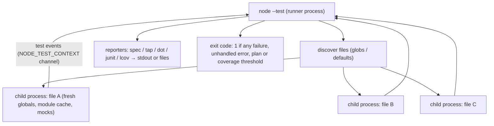

# 12 · Testing Node Code with `node:test`: Runner, Mocks, Snapshots, Coverage and Determinism

> **Primary sources:** Node.js API docs: [Test runner](https://nodejs.org/api/test.html) (`node:test`, `mock`, `MockTimers`, module mocking, snapshots, coverage, reporters, `--test-isolation`), [Assert](https://nodejs.org/api/assert.html) ("Comparison details" for `deepStrictEqual`), [Command-line options: test runner flags](https://nodejs.org/api/cli.html#--test); undici [MockAgent](https://undici.nodejs.org/#/docs/api/MockAgent); fast-check documentation (property-based testing); Fowler, "Mocks Aren't Stubs" (2007); Meszaros, _xUnit Test Patterns_ (2007) for test-double vocabulary.
>
> **Executable proof:** [`examples/12-testing.test.ts`](../examples/12-testing.test.ts) exercises mocks and assertions in-process and runs `node --test` on the fixtures in [`examples/fixtures/12-testing/`](../examples/fixtures/12-testing/) in child processes to prove runner behaviour (exit codes, counts, files written).

General testing theory (the test pyramid, property-based and mutation testing) has no owning track yet; the ownership registry proposes `languages/javascript` for it. Vitest and the TypeScript type-test tooling are covered in [TypeScript module 13](../../../languages/typescript/modules/13-library-authoring-performance-and-type-tests.md). This module owns Node's built-in test runner and assertion library, and the Node-specific techniques for testing code that touches time, the file system, the network, child processes and process-wide state. Every test file in this track is an example of the techniques described here.

---

## 1. Why the built-in runner

`node:test` has been **stable since Node 20**. It needs no dependency, runs TypeScript through type stripping ([module 03 §7](03-modules-and-packages.md#7-typescript-type-stripping)), understands ESM natively, and its mocking, timers, snapshots and coverage are part of the runtime.

### Then vs now: test tooling

| Then | Now (Node 26) | Notes |
| --- | --- | --- |
| mocha + chai + sinon + nyc | `node:test` + `node:assert` + `mock` + `--experimental-test-coverage` | one tool, no transform step |
| Jest with Babel/ts-jest transforms, its own module system | `node --test` on native ESM and stripped TypeScript | Jest's module registry and fake timers differ from Node's real behaviour; ESM support required flags |
| `sinon.useFakeTimers()` | `mock.timers.enable()` | built in |
| `proxyquire`, `jest.mock()` | `mock.module()` (experimental, flag) | §4.3 |
| `supertest` over a real socket | `app.inject()` (Fastify) or `fetch` to a port-0 server | [module 08](08-building-services.md#44-testing-services-without-sockets) |
| `nock` (patches `http.request`) | undici `MockAgent` for `fetch` | [module 07](07-networking-and-http.md#6-fetch-and-undici) |
| Vitest | still a strong choice for front-end and Vite projects (watch UI, browser mode) | pick one runner per package |

---

## 2. Structure

```ts
import { describe, test, before, after, beforeEach } from 'node:test';
import assert from 'node:assert/strict';

describe('cart', () => {
  // a suite (alias: suite)
  let db: TestDb;
  before(async () => {
    db = await TestDb.create();
  });
  after(() => db.close()); // runs even if tests fail
  beforeEach(() => db.truncate());

  test('adds an item', async (t) => {
    // async tests: the returned promise is awaited
    t.after(() => db.flushLogs()); // per-test cleanup
    await addItem(db, 'sku-1');
    assert.equal(await count(db), 1);
  });

  test('rejects unknown SKUs', { timeout: 5_000 }, async () => {
    await assert.rejects(addItem(db, 'nope'), { code: 'E_UNKNOWN_SKU' });
  });
});
```

The **test context** `t` provides: `t.after()`/`t.before()`/`t.beforeEach()` for scoped hooks, `t.signal` (an `AbortSignal` aborted when the test times out or is cancelled, which you pass into the code under test so it stops), `t.plan(n)`, `t.assert` (assertions bound to the test, needed for `t.plan` and snapshots), `t.mock` (mocks restored automatically after the test), `t.skip()`, `t.todo()`, `t.diagnostic(msg)`, `t.name`, and `t.test()` for subtests (awaited automatically since Node 24).

Modifiers, all proven by the fixture `modifiers.test.mjs`:

| Modifier                           | Effect on the run                                           |
| ---------------------------------- | ----------------------------------------------------------- |
| `{ skip: 'reason' }` / `test.skip` | not run; counted as skipped; does not fail the run          |
| `{ todo: 'reason' }` / `test.todo` | runs, but failures are reported and do **not** fail the run |
| `test.only` with `--test-only`     | only `only` tests run (the test sees exactly one pass)      |
| `{ timeout: ms }`                  | fails the test after `ms`; `t.signal` aborts                |
| `{ concurrency: n }`               | subtests run concurrently                                   |

`t.plan(n)` asserts the number of assertions made through `t.assert` (or subtests). An assertion made from a callback **after the test function returned** counts only with `t.plan(n, { wait: true })`; without `wait`, the plan fails with "expected 2 assertions but received 1". The fixture `plan.test.mjs` contains both cases and the test checks one pass and one failure. Plans are the simplest guard against callback-based tests that pass because their assertions never ran.

---

## 3. The runner

### 3.1 Discovery, isolation and concurrency

`node --test` with no arguments runs files matching the default patterns (`**/*.test.{js,mjs,cjs,ts,mts,cts}`, `**/*-test.*`, `**/test/**/*.{js,…}` and similar, excluding `node_modules`); with arguments it treats them as globs or files. This track's `npm test` runs `node --test "examples/**/*.test.ts"`.

| Option | Default | Effect |
| --- | --- | --- |
| `--test-isolation=process` | **default** | each test **file** runs in its own child process: fresh globals, module caches, mocks and process state |
| `--test-isolation=none` |  | all files in the runner's process: faster, but state leaks across files (the fixture pair `isolation-a`/`isolation-b` prints `SHARED=1` under `none` and `SHARED=unset` under the default, in the test) |
| `--test-concurrency=n` | number of CPUs − 1 (files) | how many files (processes) run at once |
| `--test-shard=i/n` |  | run a deterministic 1/n slice of the files, for CI parallelism |
| `--test-name-pattern`, `--test-skip-pattern` |  | select tests by name (regex); the test runs exactly the one test named `runs` |
| `--test-timeout=ms` | `Infinity` | default per-test timeout; this track sets 60 s so a hang fails instead of blocking CI |
| `--watch` |  | re-run affected files on change |
| config file `test` namespace |  | `{"test": {"test-isolation": "process"}}` ([module 01 §3.2](01-runtime-architecture.md#32-the-configuration-file)) |



Because files run in parallel processes by default, tests in different files must not share external state (the same port, the same temporary directory, the same database schema). Use port 0, `mkdtemp`, and per-file database names.

### 3.2 Reporters

`--test-reporter` accepts `spec` (default on a TTY), `tap` (default otherwise), `dot`, `junit`, `lcov` (coverage), or a module path for a custom reporter; `--test-reporter-destination` sends each reporter to a file. Several pairs can be given at once, for example `--test-reporter=spec --test-reporter-destination=stdout --test-reporter=junit --test-reporter-destination=junit.xml` for a human log and a CI artefact. The test checks that the junit reporter emits `<testsuites>` with a `<testcase name="…">`. The `run()` function from `node:test` runs tests programmatically and returns a stream of events, for custom tooling.

### 3.3 What fails a run

- a failed assertion or a thrown/rejected test function;
- an **unhandled rejection** or uncaught exception during a test (the fixture `leaky.test.mjs` creates `Promise.reject()` without awaiting it, and the run fails with "lost rejection");
- a failed `t.plan`, a timeout, a failing `before` hook (the suite's tests are cancelled);
- a coverage threshold not met (§6).

A test file whose handles never close (an open server, an interval, a database pool) keeps its child process alive until the test timeout; the runner then reports it. Close resources in `after` hooks, or `unref()` them.

### 3.4 Testing TypeScript

This track's tests are `.ts` files executed directly: `node --test` loads them through type stripping, so tests and production use the same loader and the same erasable-syntax rules ([module 03 §7.1](03-modules-and-packages.md#71-rules-each-pinned-in-the-test)). Type checking is a separate gate, `tsc --noEmit -p tsconfig.json` (TypeScript 7.0.2 here), run in CI next to the tests. Consequences:

- a type error never fails a test run, and a passing type check never proves runtime behaviour: run both;
- tests cannot use `enum`, parameter properties or runtime namespaces (the pool and stream classes in this track declare fields explicitly for that reason);
- fixture files that are deliberately invalid (the TypeScript fixtures of module 03) are excluded from `tsconfig.json`'s `include` so the type check does not reject them.

---

## 4. Mocking: functions, timers and modules

Vocabulary (Meszaros): a **stub** returns canned answers; a **spy** records calls to a real or fake function; a **mock** is a spy with expectations; a **fake** is a working lightweight implementation (an in-memory database). `node:test`'s `mock` object provides spies and stubs; fakes are your own code.

### 4.1 Functions, methods, getters

| API | Does |
| --- | --- |
| `mock.fn(impl?)` | a spy function; `fn.mock.calls[i]` has `arguments`, `result`, `error`, `this`, `target`, `stack`; `fn.mock.callCount()` |
| `fn.mock.mockImplementation(f)`, `mockImplementationOnce(f, onCall?)` | change behaviour, for one call or all following calls (the test sees `first` then `default`) |
| `mock.method(obj, name, impl?)` | replace a method; `m.mock.restore()` puts back the original (the test) |
| `mock.getter`, `mock.setter` | spy on accessors |
| `mock.restoreAll()`, `mock.reset()` | global cleanup; prefer `t.mock`, restored automatically per test |

### 4.2 Timers and dates

`mock.timers.enable({ apis, now })` replaces `setTimeout`, `setInterval`, `setImmediate`, `Date` and the `node:timers`/`node:timers/promises` variants with a fake clock. Time moves only when the test calls `mock.timers.tick(ms)` (or `runAll()`, `setTime(ms)`), so time-dependent code becomes **deterministic and instantaneous**. The tests:

- schedule timers at 100 ms and 50 ms, tick 60 ms (only `t50` fired), then 40 ms more (both fired, in order);
- check a 30-day expiry with `Date` without waiting 30 days;
- test a debounce: two calls 50 ms apart, then 99 ms (nothing), then 1 ms (only the last value).

Fake timers do not fake I/O: a promise that waits on a socket or the file system still waits for real. Mixing fake timers with real I/O is the most common source of "hangs only under fake timers"; keep those tests separate, or fake the I/O too.

### 4.3 Modules

`mock.module(specifier, { exports, defaultExport, cache })` replaces a module **for subsequent imports** in the same process. On Node 26 it is still **experimental** and requires `--experimental-test-module-mocks`; without the flag `mock.module` is not a function (the test sees the fixture fail without the flag and pass with it). The option for named exports is now `exports`; the older `namedExports` still works but prints a deprecation warning.

```js
// fixtures/12-testing/module-mock.test.mjs (run with --experimental-test-module-mocks)
const m = mock.module('./clock.mjs', { exports: { now: () => 'frozen' } });
const { greet } = await import('./greeter.mjs'); // greeter imports ./clock.mjs → gets the mock
assert.equal(greet('Ada'), 'hello Ada at frozen');
m.restore();
```

The mock applies only to imports evaluated **after** it is registered, which is why the code under test is imported dynamically. Since the runner isolates files in processes, module mocks do not leak into other files. Prefer **dependency injection** (pass the clock, the HTTP client, the repository as parameters) where you control the design; module mocking is for code you cannot change.

### 4.4 Prefer injection to mocking

The cheapest mock is a parameter. Code that receives its collaborators can be tested with plain fakes, no flags and no import-order rules:

```ts
// production code
export interface Deps {
  now(): number;
  fetch: typeof fetch;
  log(msg: string): void;
}

export async function refreshToken(deps: Deps, token: { value: string; expiresAt: number }) {
  if (token.expiresAt - deps.now() > 60_000) return token; // still valid for a minute
  const res = await deps.fetch('https://auth.example.com/token', { method: 'POST' });
  if (!res.ok)
    throw Object.assign(new Error('refresh failed'), { code: 'E_REFRESH', status: res.status });
  deps.log('token refreshed');
  return (await res.json()) as { value: string; expiresAt: number };
}

// test: a fake clock and a fake fetch, no mock.module, no MockAgent
const deps = {
  now: () => 1_000_000,
  fetch: mock.fn(async () => Response.json({ value: 'new', expiresAt: 2_000_000 })),
  log: mock.fn(),
};
assert.equal((await refreshToken(deps, { value: 'old', expiresAt: 1_030_000 })).value, 'new');
assert.equal(deps.fetch.mock.callCount(), 1);
```

The three tests for this function live in [`examples/12-di.ts`](../examples/12-di.ts) and the module's test file: refresh with a fake clock and fetch, no network call for a token valid for more than a minute, and a coded error for a 503.

Use `mock.module` and `MockAgent` at the edges you do not control (third-party modules, code that calls global `fetch`), and injection everywhere you do.

---

## 5. Snapshots

`t.assert.snapshot(value)` serialises `value` and compares it with the stored snapshot in `<test file>.snapshot` (a JavaScript file keyed by test name and sequence). The workflow, proven step by step in the test against a copy of the fixture: the first run **fails** because the snapshot file is missing; `--test-update-snapshots` writes it; later runs compare against it. `snapshot.setDefaultSnapshotSerializers()` and `snapshot.setResolveSnapshotPath()` customise the format and location.

Snapshots are good for large, structured outputs whose exact shape matters (serialised API responses, generated code, error messages for users) and bad for anything with timestamps, ids or ordering that is not part of the contract: normalise those before snapshotting. Review snapshot diffs like code; blindly running `--test-update-snapshots` turns a regression into the new expectation.

---

## 6. Coverage

`--experimental-test-coverage` (still marked experimental on Node 26) collects V8's precise coverage for the test processes and prints a line/branch/function table. Thresholds turn it into a gate:

| Flag | Effect |
| --- | --- |
| `--test-coverage-lines=n`, `--test-coverage-branches=n`, `--test-coverage-functions=n` | fail the run below _n_% (the test: `partial.test.mjs` leaves one line of `classify` uncovered, so `--test-coverage-lines=100` exits 1) |
| `--test-coverage-include`, `--test-coverage-exclude` | globs |
| `--test-coverage-include-all` | count files that were never loaded (otherwise untested files are invisible) |
| `--test-reporter=lcov` | lcov output for coverage services |

Coverage measures what ran, not what was checked: a test with no assertions covers code. Use it to find untested branches, not as a quality score. Without the flag, `NODE_V8_COVERAGE=dir` makes any Node process write raw V8 coverage, which tools like `c8` turn into reports.

---

## 7. `node:assert`: equality, precisely

Always import **`node:assert/strict`** (or use the `strict` variants). The legacy, non-strict functions use `==` and ignore prototypes: `assert.deepEqual({ a: 1 }, { a: '1' })` **passes** in the legacy API (the negative test), a classic false positive that `assert/strict`'s `deepEqual` (which is `deepStrictEqual`) rejects.

`deepStrictEqual(actual, expected)`, as specified in "Comparison details":

| Aspect | Rule | In the test |
| --- | --- | --- |
| primitives | `Object.is` (SameValue): `NaN` equals `NaN`; `0` and `-0` differ | both |
| `[[Prototype]]` | must be identical (`===`) | `Object.create(null)` ≠ `{}` |
| type tags | `Object.prototype.toString` tags must match | an array ≠ an array-like object |
| own enumerable properties | string and symbol keys compared recursively; property **order is ignored** |  |
| `Map`, `Set` | compared by contents, **order ignored**; keys compared deeply |  |
| `Date`, `RegExp`, boxed primitives, `Error` | compared by their internal value (time value, source and flags, `name` and `message`) | `new Date(0)` |
| typed arrays, `ArrayBuffer` | byte content |  |
| `WeakMap`, `WeakSet`, `Promise` | compared by reference only (contents are not observable) |  |
| cycles | handled |  |

Other assertions worth knowing: `assert.partialDeepStrictEqual(actual, expected)` (only the properties present in `expected` must match, recursively; the test checks a nested subset), `assert.rejects`/`assert.throws` with a **validation object** (`{ code: 'E_X' }`) or a class or a function, `assert.match` for strings, `assert.ok`, `assert.fail`. Match errors on `code`, not on `message` ([module 04 §5.2](04-async-control-flow-and-errors.md#52-nodes-error-objects)).

---

## 8. Test doubles for Node's I/O

Every test file in this track uses one of these patterns; together they make the suite hermetic:

| Dependency | Technique | Where in this track |
| --- | --- | --- |
| time | `mock.timers`, or a virtual clock injected into the code (`now: () => number`) | §4.2; rate limiter and circuit breaker in [module 08](08-building-services.md#52-rate-limiting) |
| file system | a fresh `mkdtemp` directory per test, removed in `finally`/`after`; `mkdtempDisposable` with `await using` | [module 06](06-filesystem-process-os.md) |
| inbound HTTP | Fastify `inject()`; a real server on **port 0** on `127.0.0.1` when socket behaviour matters | modules 07, 08 |
| outbound HTTP | undici `MockAgent` with `disableNetConnect()`; restore the previous dispatcher | [module 07](07-networking-and-http.md#6-fetch-and-undici) |
| slow or malicious clients | raw `net.connect` writing partial or invalid requests | [module 07 §3.2](07-networking-and-http.md#32-what-the-parser-rejects-for-you) |
| process-wide flags, exit codes, signals, crashes, OOM | a **child process** running the same Node binary with a clean environment (`helpers/run-node.ts`) | every module |
| long-running processes | start a child, wait for an explicit **readiness token** on stdout, act, then await exit | shutdown tests in [module 08](08-building-services.md#6-graceful-shutdown) |
| randomness and many inputs | fast-check property tests (deterministic seed reported on failure) | modules 05 (framing, line splitting) |
| GC-dependent behaviour | a child with `--expose-gc`, explicit `gc()` and `WeakRef` | [module 10](10-v8-memory-and-gc.md) |
| environment | `cleanEnv()` removes inherited `NODE_OPTIONS` and `NODE_TEST_CONTEXT` | [module 01 §3.2](01-runtime-architecture.md#32-the-configuration-file) |

The last row is a Node-specific trap: `node --test` sets `NODE_TEST_CONTEXT` in its child processes, so a test that itself spawns `node --test` (as this module's tests do) must remove it, or the grandchild reports to the wrong parent. And an inherited `NODE_OPTIONS` changes the behaviour of every child, as module 01 showed for config files.

### 8.1 The child-process helper

Most runtime-flag experiments in this track go through two small functions in [`examples/helpers/run-node.ts`](../examples/helpers/run-node.ts):

```ts
export function cleanEnv(extra = {}) {
  const env = { ...process.env };
  delete env.NODE_OPTIONS; // the host may set one; it changes config-file behaviour (module 01)
  delete env.NODE_TEST_CONTEXT; // otherwise a child `node --test` reports to our runner
  delete env.NODE_CHANNEL_FD; // never inherit an IPC channel by accident
  return Object.assign(env, extra);
}

export function runNode(args, opts = {}) {
  const r = spawnSync(process.execPath, args, {
    // the SAME binary that runs the tests
    encoding: 'utf8',
    input: opts.input,
    cwd: opts.cwd,
    env: cleanEnv(opts.env),
    timeout: opts.timeout ?? 30_000,
    maxBuffer: 64 * 1024 * 1024,
  });
  return { status: r.status, signal: r.signal, stdout: r.stdout ?? '', stderr: r.stderr ?? '' };
}
```

Design points: `process.execPath` guarantees the child runs the pinned Node version; `status` and `signal` are returned separately because a signal death has no status ([module 01 §2.4](01-runtime-architecture.md#24-exit-codes)); `maxBuffer` is raised because `spawnSync`'s 1 MiB default would kill children that print a lot (a bug this track hit in module 01's stdout test); and `startNode` (the asynchronous sibling) resolves only when the child prints a readiness token.

---

## 9. Determinism

**Definition.** A test is deterministic if its outcome depends only on the code under test, never on scheduling, wall-clock time, machine speed, test order or the network. A flaky test (non-deterministic) is worse than none: it trains people to re-run failures.

| Flake source | Example | Deterministic alternative |
| --- | --- | --- |
| asserting a race the runtime does not order | `setTimeout(0)` vs `setImmediate` in the main module | assert only guaranteed orderings ([module 02](02-event-loop.md#21-the-poll-timeout-is-the-whole-trick)) |
| sleeping to "wait until ready" | `await sleep(500)` before connecting | wait for an event or a readiness line |
| timing thresholds | "must complete in < 50 ms" | lower bounds that cannot be violated, or no timing at all |
| real time and dates | tests that fail at midnight, at month end, during DST changes | fake timers, injected clocks, fixed `Temporal` instants |
| shared state across tests | a module-level cache, a fixed port, a shared temp dir | fresh instances, port 0, `mkdtemp`, process isolation |
| test order | test B relies on data from test A | each test arranges its own data |
| GC timing | expecting `FinalizationRegistry` callbacks | explicit `gc()` in a child, `WeakRef` checks |
| network | calling a real API | `MockAgent`, local servers |
| unawaited promises | assertions in a callback that runs after the test ended | `await`, `t.plan(n, { wait: true })` |

```
HERMETIC-TEST-CHECKLIST(test)
  ▷ Invariant: running the suite twice, in any order, on any machine, gives the same result
  1  every resource it opens is closed in after/t.after/finally (servers, ports, temp dirs, workers, mocks)
  2  every wait waits for an event, never for time
  3  every clock it reads is fake or injected
  4  every process-wide setting it changes is changed in a child process
  5  every external dependency is replaced by a local fake or mock
  6  every random input comes from a seeded generator
```

### 9.1 Property-based tests

A property test states an invariant for **all** inputs and lets a generator search for counterexamples, shrinking any failure to a minimal case. fast-check is seeded and prints the seed and path of a failure, so failures are reproducible, which keeps property tests deterministic in the sense of §9. Module 05's line splitter is specified this way:

```ts
await fc.assert(
  fc.asyncProperty(
    fc.array(fc.stringMatching(/^[a-z]{0,5}$/)), // random lines
    fc.array(fc.nat(30)), // random cut points
    async (lines, cuts) => {
      const text = lines.join('\n');
      const chunks = cutAt(text, cuts); // the same text, chunked arbitrarily
      const expected = text.split('\n');
      if (expected.at(-1) === '') expected.pop();
      assert.deepEqual(await splitWith(new LineSplitter(), chunks), expected);
    },
  ),
  { numRuns: 100 },
);
```

It found a real specification bug during development (a trailing newline must not produce an empty final line), shrunk to the two-element counterexample `["", ""]`. Example-based tests had not covered it. Stream parsers, encoders/decoders (encode then decode is the identity), and anything with a "same result regardless of chunking/ordering" property are ideal targets.

---

## 10. Production failure modes (of test suites)

| Failure | Mechanism | Fix |
| --- | --- | --- |
| CI hangs until the job timeout | an open handle keeps a test process alive | `after` hooks; `--test-timeout`; print `process.getActiveResourcesInfo()` |
| Tests pass, behaviour broken | legacy `assert.deepEqual` coercion; callback assertions that never ran | `assert/strict`; `t.plan`; `await` everything |
| Tests pass locally, fail in CI | parallel files share a port or directory; inherited `NODE_OPTIONS` | port 0, `mkdtemp`, clean child environments |
| "Works with Jest, fails in production" | Jest's module registry and transforms differ from Node's loader | run tests with plain `node --test` |
| Test suite slows down as it grows | everything in one process with `--test-isolation=none`, or heavy per-test setup | default isolation with sharding; shared setup per file |
| A mocked module leaks into other tests | `mock.module` without `restore`, under `--test-isolation=none` | `t.mock`, process isolation |
| Snapshot tests lock in a bug | snapshots updated without review | review snapshot diffs; normalise volatile fields |
| Coverage gate passes with untested files | files never loaded are not counted | `--test-coverage-include-all` |
| Property test fails once, never reproduced | seed not recorded | keep fast-check's printed seed and path; replay with them |
| Tests silently test nothing after a refactor | the module mock targets a specifier the code no longer imports | prefer injection; assert the mock was called |
| Fake timers deadlock a test | code awaits real I/O while time is fake | fake the I/O too or use real timers for that test |

---

## Interview Drill

<details><summary>1. Why might you choose `node:test` over Jest for a Node service in 2026?</summary>

It is built in and stable (no dependencies to audit or upgrade), runs native ESM and stripped TypeScript without transforms, uses Node's real module loader (so tests exercise production loading), and includes mocks, fake timers, snapshots, coverage and reporters. Jest's own module registry and transforms can make tests pass that fail under real Node. Vitest remains a good choice for Vite-based front-end code.
</details>

<details><summary>2. How do you test code that waits 30 days, retries with backoff, or debounces, without the test taking that long?</summary>

Use fake timers (`mock.timers.enable({ apis: ['setTimeout', 'setInterval', 'Date'] })`) and advance time explicitly with `tick()`, or inject a clock and scheduler into the code. Time then moves only when the test says so, making the test instantaneous and deterministic. Keep real I/O out of those tests, since fake timers do not fake I/O.
</details>

<details><summary>3. What does `--test-isolation` control, and what goes wrong with `none`?</summary>

Whether each test file runs in its own child process (`process`, the default) or all files share the runner's process (`none`). With `none`, globals, module caches, module mocks, environment changes and open handles leak between files, so results depend on file order. It is faster and occasionally useful, but process isolation is the safe default.
</details>

<details><summary>4. What is the difference between `assert.deepEqual` and `assert.deepStrictEqual`?</summary>

The legacy `deepEqual` compares primitives with `==` and ignores prototypes, so `{ a: 1 }` equals `{ a: '1' }`. `deepStrictEqual` uses `Object.is` for primitives (`NaN` equals `NaN`, `0` differs from `-0`), requires identical prototypes and type tags, and compares `Map`/`Set` contents regardless of order. Importing `node:assert/strict` makes `deepEqual` mean `deepStrictEqual`.
</details>

<details><summary>5. How do you mock a module that the code under test imports, and what are the limits?</summary>

With `mock.module(specifier, { exports, defaultExport })`, still experimental on Node 26 and behind `--experimental-test-module-mocks`; the mock affects imports evaluated after it is registered, so import the code under test dynamically afterwards, and call `restore()`. Limits: the flag, the ordering requirement, and coupling to module structure; dependency injection is usually cleaner for your own code.
</details>

<details><summary>6. Your test suite hangs in CI after all tests pass. How do you diagnose it?</summary>

A test process still has a referenced handle: an unclosed server or socket, a database pool, an interval, a worker or a `MessagePort`. Set `--test-timeout` so it fails instead of hanging, log `process.getActiveResourcesInfo()` in an `after` hook to see the handle types, then close or `unref()` them in the right test's cleanup.
</details>

<details><summary>7. How do you test graceful shutdown on SIGTERM deterministically?</summary>

Run the service as a child process, wait for an explicit readiness line, start a request whose handler prints a token when it begins, send SIGTERM only after seeing that token, then assert that the request completes and the process exits 0. A second test with a short deadline asserts the forced path (exit 1). No sleeps decide ordering; only events do.
</details>

<details><summary>8. When are snapshot tests appropriate, and how do they go wrong?</summary>

For large structured outputs whose exact shape is the contract: serialised responses, generated code, user-facing messages. They go wrong when snapshots contain volatile data (timestamps, ids, ordering), producing churn, and when updates are accepted without review, which converts regressions into expectations. Normalise volatile fields and review snapshot diffs as code.
</details>

<details><summary>9. What is a property-based test, and when does it beat example-based tests?</summary>

It asserts an invariant over generated inputs (for example, a parser's output does not depend on how the input is chunked) and shrinks failures to minimal counterexamples; a fixed seed makes failures reproducible. It beats examples when the input space has many edge cases nobody thinks to enumerate: chunk boundaries, empty and boundary values, unusual Unicode, orderings.
</details>

<details><summary>10. Why do tests that spawn `node --test` themselves need a cleaned environment?</summary>

The runner communicates with its file processes through `NODE_TEST_CONTEXT`; a grandchild that inherits it reports its results to the outer runner instead of producing its own output and exit code. Inherited `NODE_OPTIONS` can also change the child's behaviour. Remove both before spawning, and spawn `process.execPath` so the version matches.
</details>
