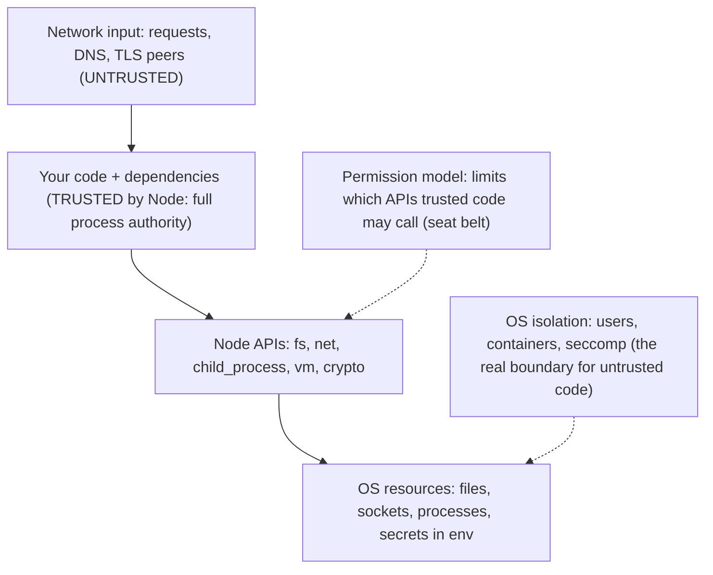

# 13 · Node-Specific Security: Threat Model, Permission Model, Pollution, ReDoS, SSRF and the Supply Chain

> **Primary sources:** Node.js [`SECURITY.md` and threat model](https://github.com/nodejs/node/blob/main/SECURITY.md), Node.js API docs: [Permissions](https://nodejs.org/api/permissions.html), [VM ("not a security mechanism")](https://nodejs.org/api/vm.html), [`net.BlockList`](https://nodejs.org/api/net.html#class-netblocklist), [`crypto.timingSafeEqual`](https://nodejs.org/api/crypto.html#cryptotimingsafeequala-b), [`--disable-proto`](https://nodejs.org/api/cli.html#--disable-protomode); Node.js Learn: [Security best practices](https://nodejs.org/en/learn/getting-started/security-best-practices); npm documentation ([`npm ci`](https://docs.npmjs.com/cli/v11/commands/npm-ci), [`npm audit signatures`](https://docs.npmjs.com/cli/v11/commands/npm-audit), [provenance](https://docs.npmjs.com/generating-provenance-statements), [`ignore-scripts`](https://docs.npmjs.com/cli/v11/using-npm/config#ignore-scripts)); Davis et al., "The impact of regular expression denial of service (ReDoS) in practice" (FSE 2018); Arteau, "Prototype pollution attack in NodeJS application" (2018); OWASP SSRF Prevention Cheat Sheet.
>
> **Executable proof:** [`examples/13-security.test.ts`](../examples/13-security.test.ts) with utilities in [`examples/13-security.ts`](../examples/13-security.ts) and an npm fixture with a hostile install script in [`examples/fixtures/13-security/`](../examples/fixtures/13-security/). Permission-model and engine-flag behaviour is tested in child processes.

Generic vulnerability classes (OWASP Top 10:2025, injection families, SSRF theory and DNS rebinding, deserialisation), threat modelling, cryptographic primitives, password hashing and supply-chain frameworks (SLSA, Sigstore, SBOMs) are owned by the security-identity track: [module 01](../../../architecture/security-identity/modules/01-threat-modeling-and-security-principles.md), [module 02](../../../architecture/security-identity/modules/02-crypto-primitives-for-engineers.md), [module 03](../../../architecture/security-identity/modules/03-passwords-and-secrets-at-rest.md), [module 11](../../../architecture/security-identity/modules/11-web-and-api-vulnerability-classes.md), [module 12](../../../architecture/security-identity/modules/12-supply-chain-and-dependency-security.md). Prototype pollution and ReDoS as _language_ phenomena are in [JavaScript module 13](../../../languages/javascript/modules/13-correctness-security-pitfalls.md). This module owns the Node delta: what Node's threat model promises, the permission model, the Node-specific shapes of those attacks, and the npm supply chain as Node developers meet it.

---

## 1. Node's threat model

The Node.js project's `SECURITY.md` defines what counts as a Node vulnerability. Its core premise: **Node trusts the code it is asked to run.** Everything executed in the process (your code, every dependency, every transitive dependency, the code loaded by `--require`/`--import`) has the full authority of the process. Consequently:

| Trusted by Node | Not trusted by Node |
| --- | --- |
| the JavaScript and native code it runs, including all of `node_modules` | data arriving over the network (HTTP requests, DNS responses, TLS peers) |
| the operating system, file system contents and environment variables | input that the application passes to Node APIs **as data** |
| command-line options and configuration files |  |

So a bug that lets a malicious HTTP request crash Node's HTTP parser is a Node vulnerability; a malicious npm package reading your SSH keys is not (it is code Node was asked to run), and neither is an application passing user input to `child_process.exec`. Defending against untrusted code is the job of OS-level isolation (separate processes, users, containers, seccomp), not of anything inside the process.



### 1.1 Security releases

Node publishes coordinated security releases for **all supported lines at once**, usually pre-announced about a week ahead with severity levels, through the nodejs-sec mailing list and the blog. Only lines that are Current or LTS receive fixes ([module 01 §4](01-runtime-architecture.md#4-release-lines-and-choosing-a-version)); Node 20 stopped receiving them on 2026-04-30. Operational rules: subscribe to the announcements, be able to ship a patch-level Node upgrade within days (pinned versions, as in this track's `.mise.toml`, make that a one-line change), and rebuild container images to pick up new base images.

### 1.2 Reporting and triage

Suspected vulnerabilities in Node itself go to the project's HackerOne programme, as `SECURITY.md` describes, never to a public issue. When triaging a report against your own service, the threat model above is the first filter: "a dependency can read files" is expected behaviour, "a crafted request makes the server read files" is a vulnerability in whichever code turned request data into a file path. Node's own security advisories state the affected lines and fixed versions; map them to your pinned versions immediately.

---

## 2. Then vs now: Node security features

| Then | Now (Node 26) |
| --- | --- |
| no way to restrict what loaded code can do | the **permission model** (`--permission`), stable since 23.5/22.13 |
| `--experimental-permission` (20.x–23.x) | `--permission` (renamed in Node 24) |
| `--experimental-policy` manifests (integrity checks for loaded modules) | removed; use lockfile integrity and provenance |
| `new Buffer(n)` returning uninitialised memory | `Buffer.alloc` / explicit `allocUnsafe` ([module 05](05-buffers-streams-backpressure.md#12-the-pool-and-why-buffer-is-dangerous)) |
| `url.parse()` (lenient, host-confusion bugs) | WHATWG `URL` (`url.parse` runtime-deprecated since 24) |
| unhandled rejections only warned, errors swallowed | crash by default since 15 ([module 04](04-async-control-flow-and-errors.md#6-process-level-policy-uncaught-exceptions-and-unhandled-rejections)) |
| HTTP parser lenient about framing | strict llhttp; CL+TE rejected ([module 07](07-networking-and-http.md#32-what-the-parser-rejects-for-you)) |
| install scripts run silently for every dependency (npm, Yarn 1) | pnpm 10 does not run dependency lifecycle scripts unless allow-listed; npm still runs them unless `--ignore-scripts` |

---

## 3. The permission model

### 3.1 Definition and scopes

**Definition.** The permission model restricts which **capabilities** the code running in a process may use. With `--permission`, every capability is denied unless granted by a flag (or a `permission` block in the config file, [module 01 §3.2](01-runtime-architecture.md#32-the-configuration-file)). A denied operation throws `ERR_ACCESS_DENIED` with `permission` and `resource` properties.

| Capability | Grant | Covers |
| --- | --- | --- |
| file system read | `--allow-fs-read=<path>` (repeatable, `*` for all; an existing directory is auto-wildcarded) | `fs` reads, `require`/`import` of files outside grants |
| file system write | `--allow-fs-write=<path>` | `fs` writes, deletes, renames |
| network | `--allow-net` | `net`, `http`, `fetch`, `dgram`, DNS |
| child processes | `--allow-child-process` | `child_process` |
| worker threads | `--allow-worker` | `Worker` (and `module.register()` hooks, which use a thread) |
| native addons | `--allow-addons` | `.node` files, `process.dlopen` |
| WASI | `--allow-wasi` | `node:wasi` |
| FFI | `--allow-ffi` | `node:ffi` (FFI builds) |
| inspector | `--allow-inspector` | opening the inspector |
| OpenSSL store loaders | `--allow-openssl-store` | broad authority; not limited by fs/net scopes |

The entry point and `-r` preloads are readable automatically. The test grants read access to one directory and the probe script, then shows: a file in the directory is readable, a file outside is `ERR_ACCESS_DENIED`, and child processes, workers and writes are all denied.

### 3.2 Runtime API and audit mode

- `process.permission.has(scope, reference?)` checks a permission (`'fs.read'`, `'fs.write'`, `'net'`, `'child'`, `'worker'`, …); the probe confirms `has('fs.read', secretPath) === false`.
- `process.permission.drop(scope, reference?)` **irreversibly** revokes a permission for the rest of the process, for example after startup has read its configuration and certificates. The test reads a file, drops `fs.read`, and the next read is denied. Dropping affects future checks only: resources already open stay usable.
- `--permission-audit` **allows** everything but publishes each would-be violation on `diagnostics_channel` channels `node:permission-model:fs`, `:net`, `:child`, `:worker`, `:inspector`, `:wasi`, `:addon`, `:ffi`. The test subscribes and sees `FileSystemRead`. This is how to roll the model out: run in audit mode in staging, collect the real access pattern, then write the grants.

### 3.3 Limits: a seat belt, not a sandbox

The documentation is explicit that the model is **not a security boundary against malicious code**. Known gaps, two of them proven by tests:

| Gap | Consequence |
| --- | --- |
| **Symbolic links are followed**, even outside granted paths | a symlink inside a granted directory exposes any file it points to; the test reads `secret/key.txt` through `allowed/link.txt` while direct access is denied |
| `--env-file` (and `--openssl-config`) are read **before** the model initialises | not restricted; the test loads an env file from a non-granted directory under `--permission` |
| already-open file descriptors | not re-checked (fd-based operations are disabled, but descriptors obtained earlier keep working) |
| `process._debugProcess(pid)` | can signal another Node process of the same OS user to open its inspector, outside any scope |
| workers | do not inherit the model unless they inherit the flags; passing `execArgv` replaces them |
| native addons, FFI, WASI | granted means full native authority |

Use the model to **reduce the blast radius of your own trusted code** (a bug or a compromised dependency that tries to spawn a shell or read `~/.ssh` fails loudly), and to document intended capabilities. To run untrusted code, use OS isolation (§6).

### 3.4 Rolling the model out

```
ADOPT-PERMISSIONS(service)
  1  run staging with --permission-audit; subscribe to node:permission-model:* and log {permission, resource}
  2  derive grants from the observed set: read paths (app dir, certs, config), write paths (tmp, uploads),
     net, child/worker only if observed and justified
  3  express them in node.config.json (reviewable, versioned) instead of a long command line
  4  switch to --permission (enforcement) in staging; run the full test and load suites
  5  production: enforce; alert on ERR_ACCESS_DENIED in logs (it is either a missing grant or an attack)
  6  after startup, process.permission.drop() what was needed only to boot (config dirs, child processes for migrations)
```

```json
{
  "permission": {
    "allow-fs-read": ["./", "/etc/ssl/certs", "/run/secrets"],
    "allow-fs-write": ["/tmp/app"],
    "allow-net": true,
    "allow-child-process": false,
    "allow-worker": true
  }
}
```

The table below outlines the end-to-end lifecycle phases, audit channels, and runtime enforcement guarantees when implementing least-privilege capability dropping:

| Phase | Operation / Scope | Runtime Enforcement & Audit Channel | Security Invariant |
| --- | --- | --- | --- |
| 1. Startup | Read certs & secrets (`/etc/ssl`, `/run/secrets`) | `process.permission.has('fs.read', '/run/secrets')` returns `true` | Required for TLS credentials and DB connection string bootstrap |
| 2. Post-init | `process.permission.drop('fs.read', '/run/secrets')` | Irreversible capability revocation in V8 C++ permission manager | Descriptors already open remain accessible; subsequent `open()` calls fail |
| 3. Steady state | Application request handling | Attempted read throws `ERR_ACCESS_DENIED` (`node:permission-model:fs`) | Compromised dependency cannot exfiltrate filesystem secrets |
| 4. Process spawn | `child_process.exec()` / `fork()` | Denied unconditionally without `--allow-child-process` | Eliminates shell escape vectors and arbitrary binary execution |
| 5. Native bindings | `.node` native addon loading | Denied unconditionally without `--allow-addons` | Prevents arbitrary native memory manipulation or bypass of V8 guards |

The following worked implementation demonstrates bootstrapping trusted credentials followed by irreversible runtime privilege shedding:

```typescript
// server.ts - Least-privilege startup with runtime capability dropping
import fs from 'node:fs';
import https from 'node:https';

// Phase 1: Bootstrapping with elevated read permissions
const tlsCert = fs.readFileSync('/etc/ssl/certs/server.crt', 'utf8');
const tlsKey = fs.readFileSync('/etc/ssl/private/server.key', 'utf8');
const dbCredentials = JSON.parse(fs.readFileSync('/run/secrets/db-creds.json', 'utf8'));

// Phase 2: Irreversibly drop secret directory access before handling traffic
if (process.permission && typeof process.permission.drop === 'function') {
  process.permission.drop('fs.read', '/run/secrets');
  process.permission.drop('fs.read', '/etc/ssl/private');
}

// Phase 3: Verify capability boundary enforcement
try {
  fs.readFileSync('/run/secrets/db-creds.json', 'utf8');
} catch (err: unknown) {
  // Throws ERR_ACCESS_DENIED: Access to this API has been restricted
  console.info('Successfully revoked secret directory read permission');
}
```

Keep symlinks out of granted trees (container images often contain them under `/app/node_modules/.bin`; grant the real directories), and remember that a granted `node_modules` directory is where a malicious dependency already runs: the model limits what it can reach next, not what it is.

---

## 4. Prototype pollution in Node

The mechanism (assigning through `__proto__`, `constructor.prototype`, the override mistake) is explained in [JavaScript module 13 §1](../../../languages/javascript/modules/13-correctness-security-pitfalls.md#1-prototype-pollution). Node-specific facts:

- **`JSON.parse` creates an own property named `"__proto__"`** (the test asserts `Object.hasOwn(payload, '__proto__')`). It is harmless until a recursive merge, deep-set (`lodash.set`-style paths) or object-spread-into-existing-object helper copies it **with assignment**, which invokes the `__proto__` setter on the target. The negative test runs a naive merge of `{"__proto__": {"isAdmin": true}}` and every object in the process acquires `isAdmin === true`.
- The fix has three layers: refuse dangerous keys in merge code (`safeMerge` skips `__proto__`, `constructor`, `prototype` and defines properties instead of assigning them; the test shows the payload no longer pollutes), avoid prototype lookups for untrusted keys (`Object.create(null)` dictionaries or `Map`), and validate request bodies against schemas with `additionalProperties: false` ([module 08 §3](08-building-services.md#3-schemas-validation-in-serialisation-out)).
- **Fastify** parses JSON with `secure-json-parse` and **rejects** bodies containing `__proto__` (and optionally `constructor.prototype`) with 400 by default (`onProtoPoisoning: 'error'`); the test posts such a body and gets 400. Express's `body-parser` does not.
- **`--disable-proto=throw`** removes the `Object.prototype.__proto__` accessor for the whole process (`delete` removes it silently instead): any `obj.__proto__` access throws `ERR_PROTO_ACCESS` (the test). Use `Object.getPrototypeOf`/`setPrototypeOf` in your own code; check that dependencies work before enabling it.
- `--frozen-intrinsics` (experimental) freezes built-in prototypes, preventing pollution entirely at the cost of breaking libraries that patch them.

Pollution in Node escalates further than in browsers, through **gadgets**: code that reads a property an attacker can now supply through the prototype. Published chains used polluted options objects to reach `child_process` (`shell`, `env`, `NODE_OPTIONS`), template engines (code generation) and database clients. Node core hardened its own option handling: on Node 26, `child_process` reads only **own** properties of options objects, so a polluted `Object.prototype.shell` or `.env` has no effect (the test pollutes both in a child process and observes neither). Application code and libraries are another matter: any `if (options.isAdmin)` or `{ ...defaults, ...options }` that reads through the prototype chain is a gadget (the negative test authorises a plain user object because `isAdmin` was inherited). Read untrusted-option-derived properties with `Object.hasOwn`, and build options objects from null-prototype objects or validated schemas.

---

## 5. ReDoS

**Definition.** Regular-expression denial of service exploits a backtracking regex engine (V8's Irregexp is one) whose matching time is exponential or high-degree polynomial in the input length for certain patterns, typically nested or overlapping quantifiers such as `^(a+)+$`, `(a|a)*`, `(\w+\s?)*$`. Theory and pattern analysis: [JavaScript module 13 §2](../../../languages/javascript/modules/13-correctness-security-pitfalls.md#2-regular-expression-denial-of-service-redos).

Node's delta is the **single thread**: one request whose input triggers catastrophic backtracking blocks the event loop for every other request in the process ([module 02 §4](02-event-loop.md#4-blocking-and-starvation)), and no timeout can interrupt a running regex. The negative test runs `/^(a+)+$/` against 40 `a`s followed by `!` in a child process: it never finishes and is killed after 1.5 s.

Defences, in order of effectiveness:

1. **Bound input length before matching** (headers, form fields, path segments). Exponential behaviour needs length; a 64-character cap turns a 2⁴⁰-step match into an affordable one (the test's `check` rejects 10 000 characters before the regex runs).
2. **Write linear patterns**: no nested quantifiers over overlapping alternatives; anchor; prefer explicit character classes. Lint with `eslint-plugin-regexp` or `safe-regex`-style checks in CI.
3. **Use a linear-time engine for untrusted patterns or inputs.** V8 ships an experimental non-backtracking engine: with `--enable-experimental-regexp-engine`, a regex with the `l` flag is matched in linear time (the test gets `false` instantly for the same input). The `re2` npm addon (Google RE2) is the production-proven option; both reject backreferences and lookarounds, which have no linear-time algorithm.
4. **Never compile user-supplied patterns** (`new RegExp(userInput)`) without a linear engine; escape user text with `RegExp.escape` (ES2025) when building patterns from it.
5. **Validate with schemas**, and remember that JSON Schema `pattern`s and `format` validators are regexes too ([module 08](08-building-services.md)).

### 5.1 Vulnerable and safe patterns

| Purpose | Vulnerable | Why | Safer |
| --- | --- | --- | --- |
| email-ish check | `^([a-zA-Z0-9]+\.?)+@example\.com$` | nested quantifier over overlapping classes | `^[a-zA-Z0-9.]{1,64}@example\.com$` plus a length cap |
| trailing whitespace | `\s+$` on huge input | quadratic on many spaces followed by a non-space (each start position rescans) | `trimEnd()` or a length cap |
| key=value lists | `^(\w+=\w+,?)*$` | nested quantifier with an optional separator | split on `,` and validate each part |
| HTML-ish tags | `<([a-z]+)([^>]*)*>` | `([^>]*)*` is a nested star | a real parser |

The common shape is a quantified group whose body can match the same text in more than one way; the engine explores every split before failing. Linters flag most of these mechanically.

---

## 6. `vm` is not a sandbox

`node:vm` runs code in a separate **realm** (its own global object and intrinsics) inside the **same process and isolate**. The documentation states that it is not a security mechanism. Escaping is one line, and the negative test does it: `this.constructor.constructor('return process')()` reaches the host realm's `Function` through the context object's constructor chain and returns the host `process`, with the same PID. From there, `process.binding`, `require` through `process.mainModule`, or `child_process` are reachable.

`vm`'s `timeout` option interrupts synchronous loops (the test gets `ERR_SCRIPT_EXECUTION_TIMEOUT`) but not asynchronous work scheduled by the code, and `vm` offers no memory limit. Legitimate uses: evaluating **trusted** templates or configuration in a separate global scope, test runners that need fresh globals, REPL-like tools.

For **untrusted** code, the isolation must come from outside the process:

| Option | Boundary | Notes |
| --- | --- | --- |
| separate process, separate OS user, no secrets in its environment, seccomp/AppArmor, container with no network | OS | the standard answer; combine with the permission model as an extra layer |
| WebAssembly (with WASI capabilities granted explicitly) | linear-memory sandbox | the guest can only call what you import into it |
| `isolated-vm` (third-party native addon: separate V8 isolates with memory limits) | V8 isolate | stronger than `vm`, still in-process: a V8 bug is an escape |
| a worker thread | none for security | shares the process; only a resource-limit mechanism |

---

## 7. Supply chain

Supply-chain theory (typosquatting, dependency confusion, maintainer takeover, SLSA, Sigstore, SBOM formats) is owned by [security-identity module 12](../../../architecture/security-identity/modules/12-supply-chain-and-dependency-security.md). The Node/npm practice:

### 7.1 Install scripts

npm runs a dependency's `preinstall`, `install` and `postinstall` scripts with your user's privileges when you install. The fixture is a local dependency whose `postinstall` writes a `PWNED` marker into the installing project; the test installs it offline twice: with `--ignore-scripts` no marker appears, without it the marker appears. That is the whole attack surface of most npm malware incidents: code runs at **install** time on developer machines and CI runners, where credentials live.

- Install with `--ignore-scripts` in CI (or `ignore-scripts=true` in `.npmrc`), and run the few necessary build scripts explicitly (`npm rebuild <pkg>` for native addons).
- pnpm 10 does not run dependency lifecycle scripts unless the package is listed in `onlyBuiltDependencies`, which is the safer default.
- Prefer dependencies that ship prebuilt binaries or WebAssembly over ones that compile at install time.

### 7.2 Reproducible, verified installs

| Practice | Command / setting | Protects against |
| --- | --- | --- |
| commit the lockfile; install exactly it | `npm ci` | drift, unexpected new versions, tampered tarballs (integrity hashes) |
| verify registry signatures and provenance | `npm audit signatures` | tarballs not built from the claimed source, registry compromise |
| publish with provenance / trusted publishing | `npm publish --provenance` from CI with OIDC | stolen long-lived npm tokens |
| known-vulnerability scan | `npm audit`, OSV-Scanner, Dependabot/Renovate | known CVEs (not malware) |
| scope private packages and pin the registry per scope | `@corp:registry=https://npm.corp.example` in `.npmrc` | dependency confusion |
| force patched transitive versions | `overrides` in `package.json` | vulnerable transitive dependencies |
| SBOM | `npm sbom --sbom-format cyclonedx` | inventory for incident response |
| delay new versions | Renovate `minimumReleaseAge`, pnpm `minimumReleaseAge` | most malicious versions are detected and removed within days |
| fewer dependencies | review what each one pulls in | every package is trusted code (§1) |

### 7.4 A minimal `.npmrc` and CI install

```ini
# .npmrc (committed)
ignore-scripts=true                 # dependency lifecycle scripts do not run
audit=false                         # run audits as a separate, reported CI step
fund=false
@corp:registry=https://npm.corp.example/   # scoped private packages only from the private registry
engine-strict=true                  # refuse dependencies that declare an incompatible Node version
```

```bash
npm ci                              # exact lockfile, integrity-checked, no scripts (from .npmrc)
npm rebuild better-sqlite3          # the one dependency that needs its install script, explicitly
npm audit signatures                # registry signatures and provenance attestations
```

Review lockfile diffs in pull requests like code: a new transitive dependency, a changed `resolved` URL (a different registry) or a removed `integrity` field is a signal.

### 7.3 At runtime

A compromised dependency that slipped through still runs with your process's authority. Reduce what that authority is: the permission model (§3) denies unexpected capabilities; container users without write access to the application directory, read-only root file systems and no secrets in environment variables of processes that do not need them limit what a compromise can reach; egress network policies stop exfiltration and SSRF pivots.

---

## 8. SSRF in Node

**Definition** and the generic defences (allow-lists, metadata endpoints, DNS rebinding): [security-identity module 11 §2](../../../architecture/security-identity/modules/11-web-and-api-vulnerability-classes.md#2-a012025--broken-access-control-ssrf--dns-rebinding). The Node-specific realisation is to check the **address actually connected to**, not the host name in the URL:

```ts
export function ssrfSafeLookup(
  blockList = privateAddressBlockList(),
  resolve = dns.lookup,
): net.LookupFunction {
  return (hostname, options, callback) => {
    resolve(hostname, { ...options, all: true }, (err, addresses) => {
      if (err) return callback(err, '', 0);
      for (const a of addresses) {
        const n = normalise(a.address, a.family); // ::ffff:169.254.169.254 → 169.254.169.254
        if (blockList.check(n.address, n.type))
          return callback(blocked(a.address, hostname), '', 0);
      }
      options.all
        ? callback(null, addresses)
        : callback(null, addresses[0].address, addresses[0].family);
    });
  };
}
```

Pass it as `lookup` to `http.request`, `net.connect`, or undici's `connect` option: `fetch(url, { dispatcher: new Agent({ connect: { lookup: ssrfSafeLookup() } }) })`, which the test also proves blocks a `localhost` target for `fetch`. Because the check runs inside the connection's own resolution, there is no window between "validate" and "connect" for DNS rebinding to exploit. `net.BlockList` holds the ranges (loopback, RFC 1918, link-local including cloud metadata `169.254.169.254`, CGNAT, IPv6 loopback, ULA and link-local). The tests prove: the list covers each range; an `http.get` to `localhost` through the guard fails with `E_SSRF_BLOCKED` while a local server is listening; and an **IPv4-mapped IPv6** answer (`::ffff:169.254.169.254`), a classic bypass of naive checks, is normalised and blocked.

Further Node-specific rules:

- **Redirects.** `fetch` follows up to 20 redirects by default; each hop needs the same check. With a guarded dispatcher every connection is checked; otherwise use `redirect: 'manual'` and validate each `Location`.
- **Parse URLs with `new URL()`** only, and compare `url.protocol` against an allow-list (`https:`). The deprecated `url.parse()` disagreed with WHATWG parsing on edge cases (backslashes, credentials, hostnames with `@`), which attackers used to make a validator and a client see different hosts.
- Bound response size and time for user-directed fetches (a "URL preview" feature can be used to download a 10 GB file).

---

## 9. Other Node-specific defences, briefly

| Threat | Node behaviour | Where |
| --- | --- | --- |
| HTTP response splitting / header injection | `setHeader`/`writeHead` reject CR, LF and other invalid characters with `ERR_INVALID_CHAR` (the test) | here |
| Request smuggling | strict llhttp; never `--insecure-http-parser` | [module 07 §3.2](07-networking-and-http.md#32-what-the-parser-rejects-for-you) |
| Slowloris, slow POST | `headersTimeout`, `requestTimeout` (Fastify: set it) | [module 07 §4](07-networking-and-http.md#4-server-timeouts) |
| Huge bodies, zip bombs | `bodyLimit`, `maxOutputLength` | [module 08 §3](08-building-services.md#3-schemas-validation-in-serialisation-out), [module 05 §8](05-buffers-streams-backpressure.md#8-compression-and-other-cpu-bound-streams) |
| OS command injection | `execFile`/`spawn` with argument arrays; DEP0190 | [module 06 §5.2](06-filesystem-process-os.md#52-shell-injection) |
| Path traversal | `resolveInside` with `path.relative`; symlinks | [module 06 §3](06-filesystem-process-os.md#3-paths-and-traversal) |
| Memory disclosure | `Buffer.allocUnsafe`, pooled `buf.buffer` | [module 05 §1.2](05-buffers-streams-backpressure.md#12-the-pool-and-why-buffer-is-dangerous) |
| Debugger exposure | `--inspect` bound to loopback only | [module 11 §10](11-diagnostics-and-performance.md#10-debugging-live-processes) |
| Secrets in crash artefacts | `--report-exclude-env`, heap snapshots contain every string in memory | [module 11 §7](11-diagnostics-and-performance.md#7-diagnostic-reports) |

### 9.1 Secrets and comparisons

- Compare secrets (API keys, HMAC signatures, CSRF tokens) in **constant time**. `crypto.timingSafeEqual(a, b)` requires equal-length Buffers and **throws** `ERR_CRYPTO_TIMING_SAFE_EQUAL_LENGTH` otherwise (the test), which both crashes naive callers and leaks the length; hashing both sides first (`safeEqual` in the example) gives equal lengths and constant time.
- Generate identifiers and tokens with `crypto.randomUUID()` / `crypto.randomBytes()` / `crypto.getRandomValues()`, never `Math.random()` (predictable).
- Hash passwords with `crypto.scrypt` (asynchronous: it uses the thread pool, so mind [module 02 §5.1](02-event-loop.md#51-thread-pool-starvation)) or Argon2id via a maintained library; parameters and policy are owned by [security-identity module 03](../../../architecture/security-identity/modules/03-passwords-and-secrets-at-rest.md).
- Keep secrets out of `process.env` for processes that spawn children (children inherit the environment by default, [module 06 §5.0](06-filesystem-process-os.md#50-what-a-child-inherits)), out of logs (redaction, [module 08 §4.2](08-building-services.md#42-logging-with-pino)) and out of diagnostic reports.

### 9.2 Errors and logs as information leaks

- Stack traces in HTTP responses reveal file paths, dependency names and versions; return generic 5xx bodies with a request id ([module 08 §4.1](08-building-services.md#41-error-handling)).
- `util.inspect` of request objects or errors with `cause` chains can print headers (cookies, `authorization`) and database connection strings; configure logger redaction paths and serialisers rather than logging raw objects.
- Error messages that differ between "user not found" and "wrong password" enable enumeration; normalise them, and equalise timing with the same hashing work on both paths.
- Heap snapshots, core dumps and diagnostic reports contain every secret in memory; restrict who can trigger and download them.

---

## 10. A hardening checklist

```
HARDEN(service)
  runtime      supported LTS line; patch releases applied within days; no --inspect on public interfaces
  install      npm ci --ignore-scripts; lockfile committed; npm audit signatures; minimum release age for updates
  process      non-root user; read-only root fs; secrets via files or a secret manager, not inherited env
               --permission with explicit grants (audit mode first); --disable-proto=throw if dependencies allow
  input        schema validation with additionalProperties: false; body, header, string and array size limits
               linear regexes, bounded inputs; no user-controlled RegExp, vm, eval, exec, or require paths
  output       response schemas; generic 5xx bodies; CR/LF-safe headers (Node enforces)
  network      server timeouts; rate limits; SSRF-safe lookup for user-directed fetches; egress policy
  monitoring   loop delay (ReDoS shows here), crash reports without env, alerts on new outbound destinations
```

---

## 11. Production failure modes

| Failure | Mechanism | Fix |
| --- | --- | --- |
| Every user becomes admin after one request | prototype pollution through a deep merge of parsed JSON | safe merge, schemas, `--disable-proto`, Fastify's default |
| Service freezes on one crafted header | ReDoS in a validation regex | length caps, linear patterns or engine |
| Cloud credentials stolen through a "fetch this URL" feature | SSRF to the metadata service, sometimes via IPv4-mapped IPv6 or redirects | guarded `lookup`, no redirects without checks, egress policy |
| Plugin sandbox escaped | `vm` used as a security boundary | separate process with OS isolation |
| Developer laptops and CI runners compromised | malicious `postinstall` in a dependency | `--ignore-scripts`, pnpm's allow-list, minimum release age |
| Permission model "bypassed" | symlink inside a granted directory, env file, existing descriptors | no symlinks in granted trees; treat the model as a seat belt |
| Crash on token comparison | `timingSafeEqual` with different lengths | hash first, or check length explicitly before comparing |
| Secrets in heap snapshots or reports shared in a ticket | artefacts contain environment and memory | exclude env; treat artefacts as secrets |
| Remote code execution through the debugger | `--inspect=0.0.0.0` | loopback only |
| Authorisation bypass via an inherited flag | application code reads `user.isAdmin` through a polluted prototype | `Object.hasOwn`, null-prototype objects, schema-validated inputs |
| Stack traces and secrets in responses or logs | raw errors returned; raw objects logged | generic 5xx bodies; redaction |
| Running an EOL Node line | no security fixes after EOL | track `schedule.json`; upgrade yearly |

---

## Interview Drill

<details><summary>1. What does Node's threat model trust, and what does that imply for npm dependencies?</summary>

Node trusts all code it runs (your code and every dependency), the OS, the file system, environment and CLI options; it does not trust network input and data passed into APIs. A malicious dependency is therefore not a Node vulnerability: it already has the process's full authority. Defences are supply-chain hygiene (lockfiles, `npm ci`, ignoring install scripts, provenance), least privilege at runtime (permission model, non-root, minimal secrets) and OS isolation for genuinely untrusted code.
</details>

<details><summary>2. What is Node's permission model, what can it restrict, and what are its limits?</summary>

With `--permission`, capabilities are denied unless granted: file reads and writes per path, network, child processes, workers, addons, WASI, FFI, inspector. Violations throw `ERR_ACCESS_DENIED`; `process.permission.has/drop` query and irreversibly revoke; `--permission-audit` reports violations through `diagnostics_channel` without blocking. Limits: it follows symlinks out of granted paths, does not cover files read before it starts (`--env-file`), does not re-check open descriptors, and is documented as not a sandbox against malicious code.
</details>

<details><summary>3. Explain prototype pollution in a Node API and three defences.</summary>

`JSON.parse` turns `"__proto__"` into an own property; a recursive merge or deep-set helper that copies it by assignment invokes the `__proto__` setter on the target and writes into `Object.prototype`, so every object gains attacker-chosen properties (authorisation flags, options like `shell` or `env` for `spawn`). Defences: skip `__proto__`/`constructor`/`prototype` keys and define rather than assign; validate bodies with closed schemas and use a parser that rejects `__proto__` (Fastify's default); use `Object.create(null)` or `Map` for dictionaries; `--disable-proto=throw` process-wide.
</details>

<details><summary>4. Why is ReDoS worse in Node than in a thread-per-request server, and how do you defend?</summary>

A regex match runs synchronously on the event loop and cannot be interrupted, so one malicious input stalls every request in the process, not just its own thread. Defend by capping input length before matching, writing patterns without nested overlapping quantifiers (linted in CI), using a linear-time engine (`re2`, or V8's experimental `/l` engine) for untrusted patterns or inputs, and never compiling user-supplied patterns.
</details>

<details><summary>5. Can you run untrusted user code with `vm.runInNewContext`?</summary>

No. `vm` creates a new realm in the same isolate and process; the constructor chain of any object passed in reaches the host's `Function`, so `this.constructor.constructor('return process')()` returns the real `process`. Timeouts stop only synchronous loops, and there is no memory limit. Use a separate process with OS-level isolation, or WebAssembly with explicit capabilities.
</details>

<details><summary>6. How do you protect a "fetch a user-supplied URL" feature from SSRF in Node?</summary>

Allow only `https:` URLs parsed with `new URL()`, and enforce the address check in the connection's own DNS lookup: resolve, normalise IPv4-mapped IPv6, and reject loopback, private, link-local (metadata) and similar ranges with a `net.BlockList`, so the checked address is the connected address (no rebinding window). Apply it to every redirect hop (or disable redirects), bound response size and time, and add an egress network policy.
</details>

<details><summary>7. What makes npm install scripts dangerous, and what do you change in CI?</summary>

Lifecycle scripts of any dependency run arbitrary code with the installing user's privileges at install time, on developer machines and CI runners that hold credentials; most npm malware uses them. In CI use `npm ci --ignore-scripts` (rebuild the few packages that need native builds explicitly), verify signatures and provenance with `npm audit signatures`, keep the lockfile authoritative, delay adopting brand-new versions, and run installs without access to production secrets.
</details>

<details><summary>8. What is wrong with `crypto.timingSafeEqual(Buffer.from(given), Buffer.from(expected))` for API key checks?</summary>

It throws when the lengths differ, which turns a wrong-length key into an exception (a crash path if unhandled) and reveals the expected length through behaviour. Hash both values with SHA-256 (or HMAC with a server key) and compare the equal-length digests, or check lengths explicitly in a way that does not branch on secret content.
</details>

<details><summary>9. Does polluting `Object.prototype.shell` make `child_process.spawn` run a shell on Node 26?</summary>

No: Node core now reads only own properties of `child_process` options, so inherited `shell` or `env` values are ignored. The risk moves to application and library code that reads options or flags through the prototype chain (`if (user.isAdmin)`), which remain gadgets. Use `Object.hasOwn`, null-prototype objects and validated schemas for anything derived from untrusted input.
</details>

<details><summary>10. How would you introduce the permission model into an existing service?</summary>

Run staging with `--permission-audit` and record every reported capability use, derive minimal grants, encode them in a versioned `node.config.json` `permission` block, enforce in staging and run tests and load, then enforce in production with alerts on `ERR_ACCESS_DENIED`, and drop boot-only permissions with `process.permission.drop()`. Keep symlinks out of granted directories and treat it as defence in depth, not isolation.
</details>

<details><summary>11. A service logs `ERR_ACCESS_DENIED` for `FileSystemRead` on `/root/.ssh/id_rsa` after a dependency update. What happened and what do you do?</summary>

Code running in the process (almost certainly the updated dependency or one of its new transitive dependencies) tried to read a private key; the permission model blocked it. Treat it as a supply-chain incident: pin back to the previous lockfile, identify the package and version from the stack in the error, check whether other capabilities (network, child processes) were attempted, rotate any credentials the process could reach, and report the package to the registry.
</details>

<details><summary>12. Why must the SSRF check happen inside the socket's DNS lookup rather than before calling `fetch`?</summary>

A separate pre-check resolves the name once and the client resolves it again when connecting; with a short TTL an attacker's DNS can answer with a public address the first time and a private one the second (DNS rebinding). Checking inside the lookup the connection uses means the validated address is the connected address, for every connection and every redirect hop.
</details>
