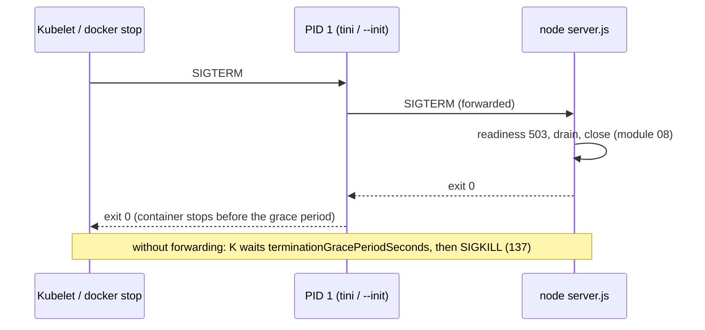

# 14 · Production Operations: Signals and PID 1, Images, Single Executables, Source Maps, Upgrades and Version History

> **Primary sources:** Node.js API docs: [Single executable applications](https://nodejs.org/api/single-executable-applications.html), [`--enable-source-maps`](https://nodejs.org/api/cli.html#--enable-source-maps), [`module.SourceMap`](https://nodejs.org/api/module.html#class-modulesourcemap), [Deprecations](https://nodejs.org/api/deprecations.html), [Process signal events](https://nodejs.org/api/process.html#signal-events); Linux `signal(7)` and `pid_namespaces(7)` (PID 1 signal semantics); Docker documentation ([`docker run --init`](https://docs.docker.com/reference/cli/docker/container/run/#init), [Dockerfile `CMD` exec form](https://docs.docker.com/reference/dockerfile/#cmd)); the official `node` Docker image documentation ("Best practices"); Kubernetes [pod lifecycle and termination](https://kubernetes.io/docs/concepts/workloads/pods/pod-lifecycle/#pod-termination); Node.js release notes v20.0.0 through v26.13.0 and the [release-model announcement](https://nodejs.org/en/blog/announcements/evolving-the-nodejs-release-schedule).
>
> **Executable proof:** [`examples/14-production-operations.test.ts`](../examples/14-production-operations.test.ts) (signal forwarding through wrappers, a real single executable built with `--build-sea`, source-mapped stack traces from TypeScript compiled by `tsc`) and the Docker-only checks in [`examples/integration/14-docker.itest.ts`](../examples/integration/14-docker.itest.ts), which `npm run test:integration` runs when Docker is available and skips with a message otherwise. The image in [`examples/integration/Dockerfile`](../examples/integration/Dockerfile) is illustrative.

Linux process semantics, signals, namespaces, cgroups and image formats are owned by `technologies/containers`; workloads, probes and rollouts by `technologies/kubernetes`; telemetry backends and SLO burn rates by `technologies/observability`. This module is the Node delta that turns everything before it into an operable service, and it closes the track with the version history.

---

## 1. What "operable" means for a Node process

A Node service is operable when an operator, without reading its code, can:

1. **start it** reproducibly (pinned runtime, pinned dependencies, explicit flags);
2. **stop it** without dropping work (signals reach Node; graceful shutdown; [module 08 §6](08-building-services.md#6-graceful-shutdown));
3. **size it** (heap limits under container limits; [module 10 §7](10-v8-memory-and-gc.md#7-heap-limits-in-containers));
4. **see it** (loop delay, ELU, memory, GC, request metrics; [module 11 §2.1](11-diagnostics-and-performance.md#21-the-metrics-every-node-service-should-export));
5. **debug it after a crash** (reports, source-mapped stacks, snapshots near OOM);
6. **upgrade it** across Node lines on a schedule.

This module covers the pieces not yet covered: signals in containers, images, single executables, source maps, and upgrades.

---

## 2. Node as PID 1 and signal handling

### 2.1 Why PID 1 is special

In a PID namespace (every container), the first process has PID 1 and the kernel treats it like `init`: **signals for which PID 1 has not installed a handler are not delivered with their default action** (with the exception of SIGKILL and SIGSTOP sent from outside the namespace). For an ordinary process, an unhandled SIGTERM terminates it; for PID 1, an unhandled SIGTERM is **ignored**. PID 1 is also expected to **reap** orphaned children (call `wait` on them); otherwise they remain as zombies.

Node's default behaviour for SIGTERM and SIGINT on POSIX is implemented by **installing no JavaScript handler** and relying on the default disposition ([module 01 §5.3](01-runtime-architecture.md#53-signals-briefly)). Therefore:

| How Node runs | `docker stop` / Kubernetes SIGTERM without a JS handler | With a `process.on('SIGTERM')` handler |
| --- | --- | --- |
| Node is PID 1 (`CMD ["node", "server.js"]`, no init) | **ignored**: after the grace period (Docker 10 s, Kubernetes 30 s) SIGKILL, exit **137**, in-flight requests dropped | handler runs: graceful shutdown works |
| an init is PID 1 (`docker run --init`, tini, dumb-init), Node is its child | init forwards SIGTERM; Node exits by default (143) | handler runs |
| a shell is PID 1 (`CMD npm start` or shell form `CMD node server.js` → `/bin/sh -c`) | the shell may not forward the signal: Node never sees it, SIGKILL after the grace period | **handler never runs** |
| `npm start` as the command | npm historically did not forward signals reliably to the script's process; behaviour varies by npm version | do not depend on it |

The integration test (Docker only) shows the first two rows: Node as PID 1 without a handler needs the whole `docker stop` timeout and exits 137; with `--init` it stops promptly.

### 2.2 Wrappers that do and do not forward

The hermetic tests reproduce the wrapper problem without containers. [`wrapper-naive.cjs`](../examples/fixtures/14-ops/wrapper-naive.cjs) spawns the service and does nothing about signals, like a shell or a launcher script: SIGTERM kills the wrapper, and the test proves the real service **is still running** afterwards and never logged its shutdown, an orphan that the orchestrator will eventually SIGKILL. [`wrapper-forwarding.cjs`](../examples/fixtures/14-ops/wrapper-forwarding.cjs) does what tini does:

```js
const child = spawn(process.execPath, [serviceEntry], { stdio: ['ignore', 'inherit', 'inherit'] });
for (const sig of ['SIGTERM', 'SIGINT']) process.on(sig, () => child.kill(sig)); // forward
child.on('exit', (code, signal) => {
  // mirror status
  process.exitCode = code ?? 128 + os.constants.signals[signal];
});
```

and the test sees the service log `SIGTERM received, draining`, then `drained`, and the wrapper exit 0.



### 2.4 Kubernetes settings that interact with Node

```yaml
spec:
  terminationGracePeriodSeconds: 30 # must exceed: preStop + drain delay + longest request + close hooks
  containers:
    - name: api
      image: registry.example.com/api@sha256:<digest>
      command: ['node', '--enable-source-maps', 'src/server.js'] # exec form; no shell, no npm
      lifecycle:
        preStop:
          exec: { command: ['sleep', '5'] } # endpoints propagate while the pod still serves
      readinessProbe:
        httpGet: { path: /readyz, port: 8080 }
        periodSeconds: 5
      livenessProbe:
        httpGet: { path: /healthz, port: 8080 }
        periodSeconds: 10
        timeoutSeconds: 2 # a blocked event loop fails this: that is the point
        failureThreshold: 3
      resources:
        limits: { memory: 1Gi } # the heap flag must fit inside this (module 10 §7)
        requests: { cpu: '1' } # one busy event loop ≈ one core
```

Points specific to Node: a `sleep` in `preStop` requires a shell utility in the image (distroless images need a different mechanism, such as an in-process drain delay as in [module 08 §6](08-building-services.md#6-graceful-shutdown)); the liveness timeout is your detector for a stuck event loop, so keep the handler trivial; and CPU _limits_ throttle the single main thread (CFS quota), which shows up as event-loop delay even at modest load, so many teams set CPU requests and avoid tight CPU limits for Node.

### 2.3 Rules

1. Use the **exec form** `CMD ["node", "server.js"]`, never the shell form or `npm start`, so no shell sits between the runtime and Node.
2. Run an init as PID 1: `docker run --init`, `tini` as `ENTRYPOINT`, or in Kubernetes rely on the container runtime's support or `shareProcessNamespace: true` (which makes the pause container PID 1). Alternatively, make Node PID 1 deliberately **and** install SIGTERM/SIGINT handlers (which a graceful-shutdown implementation does anyway), accepting that Node will not reap orphans it did not spawn.
3. Make shutdown finish well within the grace period (Kubernetes default 30 s), with an internal deadline shorter than it ([module 08 §6](08-building-services.md#6-graceful-shutdown)).
4. Forward signals to any child processes you spawn and wait for them ([module 06 §5.6](06-filesystem-process-os.md#56-signals-across-a-process-tree)).

---

## 3. Container images for Node

The illustrative [`Dockerfile`](../examples/integration/Dockerfile):

```dockerfile
FROM node:26.13.0-slim AS deps
WORKDIR /app
COPY package.json package-lock.json ./
RUN npm ci --omit=dev --ignore-scripts

FROM node:26.13.0-slim AS runtime
ENV NODE_ENV=production
WORKDIR /app
COPY --from=deps /app/node_modules ./node_modules
COPY --chown=node:node src ./src
USER node
EXPOSE 8080
CMD ["node", "--enable-source-maps", "--max-old-space-size-percentage=60", "src/server.js"]
```

| Decision | Why |
| --- | --- |
| exact base tag (and, in real pipelines, a digest) | reproducible builds; Node patch upgrades are explicit commits |
| multi-stage, `npm ci --omit=dev --ignore-scripts` | no compilers or dev tools in the runtime image; no install-time code ([module 13 §7](13-security.md#7-supply-chain)) |
| `USER node` (the official image's unprivileged user) | a compromise does not get root in the container |
| `-slim` (Debian, glibc) vs `-alpine` (musl) vs distroless | Alpine's musl changes DNS resolution behaviour and native addon compatibility (prebuilt binaries are usually glibc); distroless has no shell, which is good for security and bad for debugging |
| `NODE_ENV=production` | **Node itself ignores it**; frameworks and libraries read it (Express disables stack traces in errors, some libraries skip dev checks). It is not a substitute for configuration |
| heap flag relative to the limit | [module 10 §7](10-v8-memory-and-gc.md#7-heap-limits-in-containers) |
| `.dockerignore` with `node_modules`, `.git`, `.env*` | no host `node_modules` (wrong platform binaries) and no secrets in layers |
| read-only root file system, writable `/tmp` volume | limits what an attacker or a bug can modify |

### 3.2 Logs, stdout and the container runtime

Containers collect logs from stdout and stderr, which are **pipes**: writes are asynchronous when the pipe is full ([module 01 §5.2](01-runtime-architecture.md#52-standard-streams-are-not-uniformly-synchronous)). Consequences for production:

- Write structured JSON lines to stdout (pino's default) and let the platform ship them; do not write log files inside the container.
- A log collector that falls behind makes the pipe fill; pino and Node then buffer in memory, so a log storm can raise RSS. Sample or rate-limit noisy logs, and keep log lines small.
- On fatal paths, flush synchronously before exiting (pino's final/synchronous destination), or the last lines, which explain the crash, are lost.
- Never log secrets; the container runtime stores logs on the node's disk and ships them to systems with broad read access.

Health checks belong to the orchestrator's probes ([module 08 §5.1](08-building-services.md#51-liveness-readiness-startup)) rather than a Dockerfile `HEALTHCHECK`, which Kubernetes ignores.

### 3.1 Startup time

Startup matters for autoscaling, serverless and crash recovery. In order of effort:

1. Load less: lazy-`import()` rarely used modules; avoid heavy work at module top level.
2. **Compile cache**: set `NODE_COMPILE_CACHE=/app/.cache` (or call `module.enableCompileCache()`) so V8 code caches are written on the first start and reused afterwards; with a writable cache directory baked by a warm-up run during the image build, even the first container start benefits ([module 03 §9](03-modules-and-packages.md#9-startup-cost-the-compile-cache)). The test sets the variable and sees `module.getCompileCacheDir()` report it and the directory appear.
3. Bundling to one file reduces module resolution and file-system round trips.
4. A startup snapshot (`--build-snapshot`, or `useSnapshot` in a SEA) deserialises an initialised heap instead of running initialisation code.

---

## 4. Single executable applications

**Definition.** A single executable application (SEA) is a copy of the `node` binary with an application blob injected into it: running the executable runs the embedded script instead of reading files from disk. The test builds one and runs it:

```json
{ "main": "app.cjs", "output": "app-bin", "disableExperimentalSEAWarning": true }
```

```bash
node --build-sea=sea-config.json        # Node 26: build in one step
./app-bin a b                           # → hello from a single executable: isSea=true args=a,b
```

The test asserts the binary is larger than 50 MB (it **embeds all of Node**, about 150 MB on this platform), that it runs without `node` or `node_modules` beside it, and that `require('node:sea').isSea()` is `true` inside it.

Mechanics and limits:

| Topic | Detail |
| --- | --- |
| Build | Node 26 has `node --build-sea=<config>`; the older flow (`--experimental-sea-config` to produce a blob, then `postject` to inject it into a copied binary) still works and is what older guides show |
| Entry point | a single script; bundle multi-file applications (esbuild, rollup, `ncc`) into one CommonJS or ESM file first |
| Assets | `"assets": { "name": "path" }` in the config; read at runtime with `sea.getAsset(name)` / `getAssetAsBlob` / `getRawAsset` |
| Startup | `"useSnapshot": true` embeds a startup snapshot built from the entry, and `"useCodeCache": true` embeds compiled code, both reducing startup time ([module 01 §2.1](01-runtime-architecture.md#21-startup-step-by-step)) |
| Native addons | not embedded; ship `.node` files next to the binary and load with `process.dlopen`, or avoid them |
| Platform | one binary per OS and architecture; macOS requires re-signing after injection, Windows signing tools may need the signature removed first |
| Status | single executable applications are still documented as an active-development (experimental) feature; the config option above silences the warning |

Uses: CLIs distributed to machines without Node, internal tools, air-gapped installs. For services in containers, a SEA brings little: the image already pins Node.

### 4.1 A fuller configuration

```json
{
  "main": "dist/cli.cjs",
  "output": "dist/mytool",
  "disableExperimentalSEAWarning": true,
  "useSnapshot": false,
  "useCodeCache": true,
  "assets": { "templates/report.html": "assets/report.html", "schema.json": "assets/schema.json" }
}
```

```js
// inside dist/cli.cjs
const sea = require('node:sea');
const template = sea.isSea()
  ? sea.getAsset('templates/report.html', 'utf8') // embedded in the binary
  : require('node:fs').readFileSync('assets/report.html', 'utf8'); // development: plain files
```

Keeping the `isSea()` branch lets the same bundle run under plain `node` in development and tests.

### Then vs now: packaging Node applications

| Then | Now |
| --- | --- |
| `pkg` (Vercel, deprecated), `nexe`: patched Node builds with a virtual file system | official SEA support in Node (since 19.7/18.16), `--build-sea` on Node 26 |
| `postject` injection by hand | one `node --build-sea` command |
| shipping `node_modules` and hoping the target has the right Node | container images pinning Node, or a SEA for CLIs |

---

## 5. Source maps and stack traces

**Definition.** A source map (Source Map Revision 3, now ECMA-426) maps positions in generated JavaScript back to positions in original sources. Node applies them to `Error.stack` when **`--enable-source-maps`** is set (or `process.setSourceMapsEnabled(true)` is called early), reading `//# sourceMappingURL=` comments for files it loads.

The test compiles a TypeScript fixture with `tsc --sourceMap` and runs the output twice: without the flag, the stack frame says `pay.js:<line>:<col>` in compiled code; with it, `at charge (…/pay.ts:6:9)`, the original line and column.

Facts for production:

- **Type stripping needs no source maps.** Node's built-in TypeScript support replaces types with whitespace, so positions already match ([module 03 §7.1](03-modules-and-packages.md#71-rules-each-pinned-in-the-test)). Source maps matter for **compiled or bundled** code: `tsc` emit, esbuild/rollup bundles, transpiled decorators, SEA bundles.
- **Cost.** With source maps enabled, formatting a stack trace (`err.stack` access) parses and consults maps; this is cheap for occasional errors and expensive for code that creates and stringifies many errors per request. Large bundles have large maps held in memory once loaded.
- **Shipping maps.** Either ship `.map` files with the code (simple; reveals sources to anyone with file access) or upload them to an error-reporting service and keep them out of the image, mapping stacks after the fact.
- **Programmatic mapping.** `module.findSourceMap(path)` returns a `SourceMap` for a loaded file; `new SourceMap(payload).findEntry(line, column)` maps a position. The test maps a tiny hand-written payload. Log processors use this to map stacks from production logs.
- `Error.stackTraceLimit` (default 10) bounds frames; async stack traces add `at async` frames ([module 04 §5.3](04-async-control-flow-and-errors.md#53-causes-stacks-and-async-stack-traces)). A custom `Error.prepareStackTrace` changes formatting globally and interacts with source maps: libraries that override it can break mapped stacks.

### 5.1 From a crash to a readable report

```
ERROR-PIPELINE(process)
  on uncaughtException / unhandled rejection (module 04 §6):
     log synchronously: err.stack (source-mapped), err.cause chain, err.code, request id from AsyncLocalStorage
     write a diagnostic report (--report-uncaught-exception, env excluded)
     exit 1 (the supervisor restarts)
  in the log pipeline:
     group by (err.code, top source-mapped frame) to deduplicate
     attach build id / commit and Node version to every event (module 11 §2.1)
     link to the report file and the deploy that introduced the first occurrence
```

The grouping key matters: grouping by message text splits one bug into thousands of groups (messages contain ids), and grouping by a frame in a bundle (without source maps) merges unrelated bugs that share a minified function.

---

## 6. Upgrading Node in production

### 6.1 A procedure

```
UPGRADE(service, from = N, to = N + k)                      ▷ one LTS line at a time
  1  read the release notes of every major in (N, to]: semver-major changes and removals,
     and the deprecations list (DEPxxxx) for anything you use
  2  in CI, run the suite on `to` with --throw-deprecation (or --pending-deprecation first)
     so runtime-deprecated APIs fail tests instead of printing warnings in production
  3  rebuild native addons (NODE_MODULE_VERSION changes per major; Node-API addons do not need it)
  4  re-baseline performance and memory: V8 changed (module 10 §4.1); stream and buffer defaults may have
  5  canary in production with the same traffic mix; compare loop delay, GC, RSS, error rates
  6  roll out; keep the previous image for a fast rollback; update engines and .mise.toml
```

Typical breakages across recent majors, all covered earlier in this track: unhandled rejections crashing (15), `ERR_REQUIRE_ESM` disappearing and `ERR_REQUIRE_ASYNC_MODULE` appearing (22–23), `url.parse` warnings (24), `module.register` deprecation, removed `writeHeader` and `_stream_*` internals (26), `FileHandle`s closed by GC becoming fatal (26), `Buffer.poolSize` and high-water-mark changes altering memory profiles (22, 26.3).

### 6.2 Which line, and when

With the release model of [module 01 §4](01-runtime-architecture.md#4-release-lines-and-choosing-a-version): adopt a new line when it becomes LTS (October), finish migrating before the previous line leaves Maintenance, and test the next major (from 2027, the Alpha channel) in a non-blocking CI job so breaking changes are visible months ahead.

### 6.3 Deprecations as an early-warning system

Node deprecations move through documentation-only, runtime (a `DeprecationWarning` printed once) and end-of-life (removed). A runtime deprecation in production is easy to miss: the test calls `url.parse()` (DEP0169), the process prints a warning and carries on with exit code 0. Under **`--throw-deprecation`** the same program exits 1; the warning is emitted on the next tick, so the statement after the deprecated call still runs, but the process (or test file) fails. Run CI with `--throw-deprecation` (and periodically with `--pending-deprecation`, which also surfaces documentation-only deprecations such as `Buffer()` constructor use), and you learn about removals one or two majors before they break production. `--trace-deprecation` prints the stack of each first use, which finds the dependency responsible.

---

## 7. Version history: Node 20 → 27

The releases relevant to practitioners, each verified against its release notes or the API documentation history tables; the module that teaches each change is linked.

| Line | Released | Status (2026-11-04) | V8 | Changes that matter for this track |
| --- | --- | --- | --- | --- |
| **20** "Iron" | 2023-04 | **EOL 2026-04-30** | 11.3 | experimental permission model (`--experimental-permission`); stable `node:test`; single executable apps (experimental); libuv 1.45 runs timers after poll ([02](02-event-loop.md)); Happy Eyeballs on by default ([07](07-networking-and-http.md#7-dns-lookup-vs-resolve)); `import.meta.resolve` synchronous |
| **22** "Jod" | 2024-04 | Maintenance LTS to 2027-04-30 | 12.4 | `require(esm)` behind a flag, unflagged in 22.12 ([03](03-modules-and-packages.md#4-requireesm)); watch mode stable; `node --run`; `fs.glob`; `WebSocket` client global; stream high-water mark 64 KiB ([05](05-buffers-streams-backpressure.md#then-vs-now-buffer-and-stream-defaults)); Maglev; syntax detection on by default (22.7); `--experimental-strip-types` (22.6), on by default in 22.18 |
| 23 (odd) | 2024-10 | EOL | 12.9 | `require(esm)` unflagged (23.0); permission model stable (23.5); type stripping on by default (23.6); `--config-file` added (23.10) |
| **24** "Krypton" | 2025-05-06 | Maintenance LTS to 2028-04-30 | 13.6 | `AsyncLocalStorage` on AsyncContextFrame ([11](11-diagnostics-and-performance.md#53-implementation-asynccontextframe)); `--permission` replaces `--experimental-permission`; `URLPattern` global; undici 7; `url.parse()` runtime-deprecated; test runner awaits subtests; `Float16Array`, explicit resource management |
| 25 (odd) | 2025-10 | EOL 2026-06-01 | 14.1 | Corepack no longer distributed; type stripping stable (25.2); `require(esm)` stable and `module.registerHooks` release candidate (25.4); `module.register` doc-deprecated (25.9) |
| **26** "Lithium" | 2026-05-05 | **Active LTS since 2026-10-28** (26.13.0) | 14.6 | Temporal on by default; `Map.prototype.getOrInsert`, `Iterator.concat`; undici 8; removed `writeHeader`, `_stream_*`, `--experimental-transform-types`; `module.register` runtime-deprecated (DEP0205); `Buffer.poolSize` 64 KiB (26.3); `--config-file` stable (26.12); `FileHandle` closed by GC is an error ([06](06-filesystem-process-os.md#11-filehandle-and-descriptor-hygiene)); last line under the old release model |
| **27** | alphas from 2026-10; 27.0.0 scheduled 2027-04 | Alpha | — | first line of the new model: one major per year, every major LTS, Alpha channel ([01](01-runtime-architecture.md#42-then-vs-now-the-release-model)) |

---

## 8. Running the service: SLOs and runbooks

Request-level SLOs (availability, latency percentiles) are owned by the observability and system-design tracks. Node adds **leading indicators** that predict SLO violations before users feel them:

| Indicator | Threshold to page on (starting points) | Usual cause | First action |
| --- | --- | --- | --- |
| event-loop delay p99 | > 100 ms for 5 min | blocking code, CPU saturation, GC | CPU profile on a canary ([11 §3.3](11-diagnostics-and-performance.md#33-from-the-loop-is-blocked-to-the-culprit)) |
| ELU | > 0.85 sustained | load beyond one process's capacity | scale out; check for a new hot path |
| heap used / limit after major GC | > 85% and rising | leak or growing live data | snapshots on a drained instance ([10 §6.3](10-v8-memory-and-gc.md#63-a-leak-hunting-procedure)) |
| RSS / container limit | > 90% | external or native memory, worker heaps | `external`/`arrayBuffers`, diagnostic report handles |
| restarts per hour | > 0 unexpected | crashes (unhandled errors, OOM 134/137) | crash reports, exit codes ([01 §2.4](01-runtime-architecture.md#24-exit-codes)) |
| 502/504 at the load balancer with healthy backends | any steady rate | keep-alive timeout race, slow shutdowns | timeouts ([07 §4.1](07-networking-and-http.md#41-aligning-with-load-balancers-the-502-problem)), shutdown ([08 §6](08-building-services.md#6-graceful-shutdown)) |
| open file descriptors | > 80% of the limit | descriptor leak | handle list in a diagnostic report |

A runbook entry per indicator, with the commands to capture evidence (profile, snapshot, report) on a drained instance, turns an incident from guesswork into procedure.

### 8.1 A runbook entry, written out

**Alert: event-loop delay p99 > 100 ms for 5 minutes on `api`.**

1. Check whether it is one instance or all. One instance: drain it (fail readiness) and continue on it. All: check the deploy history first; a new release is the most likely cause.
2. Look at ELU and CPU. High ELU and CPU: computation (go to 3). Low ELU: the delay is GC or the host (check `gc` metrics and CPU throttling).
3. Capture a 30-second CPU profile on the drained instance (inspector `Profiler` via the internal admin endpoint, or `--cpu-prof` on a canary started with the flag).
4. Read the flame graph for wide plateaus; compare with a profile from the previous release if available.
5. Mitigate: roll back, or shed the offending route (rate limit, feature flag) while a fix is prepared.
6. Record the profile, the cause and the fix in the incident; add a regression test or a benchmark if the cause was input size.

---

## 9. Production failure modes

| Failure | Mechanism | Fix |
| --- | --- | --- |
| Every deploy drops requests; pods end with 137 | SIGTERM never reaches Node (shell or npm as PID 1), or Node as PID 1 without handlers | exec-form `CMD`, an init, SIGTERM handlers, graceful shutdown |
| Zombie processes accumulate in a container | Node as PID 1 spawns children that spawn grandchildren; nobody reaps orphans | `--init`/tini |
| Native addon crashes or fails to load in the image | built on the host (other libc or platform) or for another `NODE_MODULE_VERSION` | build in the image stage; prebuilt binaries for the target; Node-API |
| DNS or addon behaviour differs only in production | Alpine/musl image vs glibc development machines | match base images across environments |
| Stack traces point into bundles | source maps not enabled or not shipped | `--enable-source-maps`, or upload maps to the error tracker |
| Error-heavy endpoint slows after enabling source maps | stack formatting consults maps for every `err.stack` | avoid stringifying stacks on hot paths; sample error logging |
| Upgrade breaks at runtime only in production | runtime-deprecated API, removed internals, rebuilt addon missing | `--throw-deprecation` in CI, canaries, rebuild addons |
| A CLI distributed as a SEA fails on some machines | wrong platform/architecture binary, unsigned on macOS, native addon not shipped | one artefact per platform, signing, no addons |
| Event-loop delay rises under modest load only in Kubernetes | CPU limit (CFS quota) throttles the main thread | CPU requests without tight limits; measure throttling |
| Pods restart during traffic spikes | liveness probe with a short timeout fails while the loop is busy but healthy | trivial liveness handler, realistic timeout and threshold; shed load instead |
| Upgrade-blocking removal discovered in production | runtime deprecations ignored as warnings | `--throw-deprecation` in CI, `--trace-deprecation` to locate |
| Secrets baked into an image layer | `.env` copied or `ARG`/`ENV` with secrets | `.dockerignore`, runtime secret injection |

---

## 10. Where this track hands over

| Topic | Owner | What this track gave it |
| --- | --- | --- |
| PID namespaces, signals, cgroups v2, seccomp, image formats | `technologies/containers` | Node's PID 1 behaviour, heap vs cgroup limits, image decisions |
| Deployments, probes, rollouts, autoscaling | `technologies/kubernetes` | probe semantics for a single-threaded runtime, grace periods, CPU limits and loop delay |
| Metrics, logs, traces pipelines; SLO burn rates | `technologies/observability` | the Node metric set, `diagnostics_channel` and `AsyncLocalStorage` instrumentation |
| Threat modelling, crypto, identity, OWASP classes | `architecture/security-identity` | the Node delta in module 13 |
| SQLite, Redis, PostgreSQL clients and pooling | the respective technology tracks | event-loop and thread-pool implications of client choices |
| Deno and Bun | out of scope | both implement much of Node's API surface (`node:` modules, npm compatibility) on different engines and event loops; phase-level and V8-specific behaviour in this track does not transfer, and their permission models are capability flags enforced at the runtime level rather than Node's documented "seat belt" |

---

## Interview Drill

<details><summary>1. A Node container takes exactly 10 seconds to stop and exits with 137. Why, and how do you fix it?</summary>

Node is PID 1 (or behind a shell/npm that does not forward signals) and has no SIGTERM handler. For PID 1 the kernel does not apply the default action of unhandled signals, so SIGTERM is ignored; Docker waits its 10-second timeout and sends SIGKILL (137). Fix: exec-form `CMD ["node", …]` with an init (`--init`, tini) as PID 1, and implement SIGTERM handling with graceful shutdown so in-flight work completes.
</details>

<details><summary>2. Why is `CMD npm start` a bad container command for a Node service?</summary>

It puts npm (and a shell for the script) between the runtime and Node. Signals sent to the container's main process may not be forwarded to the Node process, so graceful shutdown never runs and the container is killed after the grace period; it also adds npm's startup cost and memory. Run `node` directly in exec form.
</details>

<details><summary>3. What does `NODE_ENV=production` do in Node itself?</summary>

Nothing: Node core does not read it. Libraries and frameworks do (Express hides error details, some libraries disable development checks or enable caches). It is a convention, not configuration; set real settings explicitly and do not rely on `NODE_ENV` for security behaviour.
</details>

<details><summary>4. What is a Node single executable application and what are its limitations?</summary>

A copy of the `node` binary with an injected application blob (built with `node --build-sea` on Node 26), so one file runs the app without a separate Node installation. Limits: one entry script (bundle first), assets must be declared and read via `node:sea`, native addons are not embedded, one binary per platform and architecture, code signing on macOS and Windows, a large file (it contains Node), and the feature is still marked as under active development.
</details>

<details><summary>5. When do you need `--enable-source-maps`, and what does it cost?</summary>

When running compiled or bundled JavaScript (tsc output, esbuild bundles): it maps stack traces back to original files and lines. Node's own type stripping does not need it because positions are preserved. The cost is paid when stack traces are formatted (parsing and consulting maps, memory for loaded maps), which matters for code that creates and stringifies many errors.
</details>

<details><summary>6. How do you plan an upgrade from Node 22 to Node 26?</summary>

Read the release notes and deprecations for 23 through 26; run CI on 26 with `--throw-deprecation`; fix removed or deprecated APIs (for example `module.register`, `writeHeader`, `_stream_*`, GC-closed `FileHandle`s); rebuild native addons for the new `NODE_MODULE_VERSION`; re-baseline memory and latency because V8 and stream/buffer defaults changed; canary with production traffic; then roll out and update `engines`, `.mise.toml` and images, keeping a rollback image.
</details>

<details><summary>7. Which Node-specific metrics would you alert on, beyond request latency and errors?</summary>

Event-loop delay p99 and ELU (blocking and saturation), heap used relative to the heap limit after major GCs (leaks, V8 OOM risk), RSS relative to the container limit (native and external memory, kernel OOM risk), unexpected restarts with their exit codes, open file descriptors, and load-balancer 502/504 rates with healthy backends (timeout races and shutdown problems).
</details>

<details><summary>8. What changed in Node between 20 and 26 that most often breaks applications on upgrade?</summary>

Module loading (`require(esm)` replacing `ERR_REQUIRE_ESM` with `ERR_REQUIRE_ASYNC_MODULE` for top-level await graphs, syntax detection, `module.register` deprecation), removed APIs (`writeHeader`, `_stream_*`, `--experimental-transform-types`), stricter resource handling (GC-closed `FileHandle`s are fatal), changed defaults that alter memory and performance (64 KiB stream high-water mark, 64 KiB Buffer pool, V8 versions), and native addon rebuilds for each `NODE_MODULE_VERSION`.
</details>

<details><summary>9. Why might a Node service show high event-loop delay in Kubernetes but not on a developer machine at the same request rate?</summary>

A CPU limit enforces a CFS quota: once the container uses its quota in a period, all its threads are paused until the next period. The main thread then runs late, which is measured as event-loop delay, even though average CPU looks moderate. GC and JIT threads consume quota too. Check throttling metrics, raise or remove tight CPU limits (keep requests), or scale out.
</details>

<details><summary>10. How do you find out, before upgrading, which deprecated APIs your service and its dependencies use?</summary>

Run the test suite (and a staging instance) with `--throw-deprecation` so runtime deprecations fail, `--pending-deprecation` to surface documentation-only ones, and `--trace-deprecation` to get the stack of each first use, which names the dependency. Then upgrade or replace those dependencies before moving to the next major.
</details>
