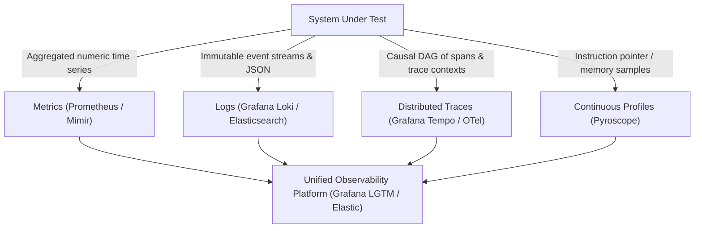
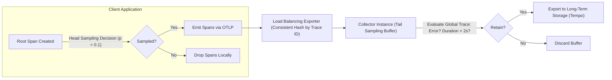

# Module 01: Observability Foundations: Telemetry Signals, Cardinality Economics, Sampling Theory, and RED/USE/Golden Signals

## Introduction

Modern distributed systems comprise thousands of ephemeral microservices, event-driven message brokers, serverless functions, and managed cloud primitives. In such architectures, traditional debugging techniques—such as attaching a local debugger or inspecting a single log file—are entirely inadequate. Observability is the mathematical and operational discipline of inferring the internal state of a complex system solely by examining its external outputs. Unlike monitoring, which answers the question "Is the system working?", observability answers "Why is the system failing?" when encountering novel, unpredicted failure modes. This module establishes the foundational principles of observability, examining the theoretical nature of telemetry signals, the economics of metric cardinality, probabilistic sampling theory, and standard operational frameworks including RED, USE, and the Google Golden Signals.

## Theoretical Foundations: Monitoring vs. Observability

To understand observability, we must rigorously separate it from monitoring. Monitoring relies on predefined dashboards and alerts built upon known failure states. If an operator can anticipate every possible failure mode, write a static check, and trigger an alert, monitoring suffices. However, distributed systems exhibit emergent properties: complex interactions between independent components give rise to failure modes that could never be anticipated at design time. Observability measures how well the internal states of a system can be inferred from knowledge of its external outputs. Formally, let a system be modeled as a discrete-time state machine with internal state vector \(S(t) \in \mathbb{R}^n\) at time \(t\), input vector \(U(t) \in \mathbb{R}^m\), and output telemetry vector \(Y(t) \in \mathbb{R}^p\). A system is fully observable if and only if the observability matrix \(O\) has full rank \(n\), where \(O\) is defined over the system dynamics Jacobian matrices. In practical software engineering, we cannot achieve full mathematical observability due to bandwidth, storage, and CPU overhead constraints. Instead, we maximize practical observability by emitting three primary telemetry pillars—metrics, logs, and traces—alongside emerging modalities like continuous profiles and security events.

## The Telemetry Pillars and Supplemental Signals

Observability relies on distinct telemetry signals, each serving a specific diagnostic purpose across spatial and temporal dimensions.

### Metrics

Metrics are numeric values aggregated over time intervals, represented as time series identified by a metric name and a set of key-value pairs called labels or dimensions. Metrics are highly storage-efficient and well-suited for alerting and dashboarding due to their bounded memory footprint. However, metrics lack context; they tell you _that_ latency increased, but not _which_ specific user request caused the slowdown.

### Logs

Logs are immutable, timestamped records of discrete events emitted by applications and infrastructure, formatted as unstructured text, structured JSON, or binary payloads. Logs provide rich contextual detail about specific code execution paths. Their primary disadvantage is cost and volume: storing raw text logs at scale requires massive ingestion pipelines, indexing clusters, and strict retention tiers.

### Traces

Distributed traces capture the lifecycle of a request as it propagates across service boundaries. A trace is a directed acyclic graph (DAG) of spans, where each span represents a contiguous unit of work with a start time, duration, attributes, events, and links. Traces solve the spatial blind spot of microservices by explicitly mapping causal relationships across network hops.

### Profiles and Events

Continuous profiling samples CPU instruction pointers, memory allocations, and lock contention profiles over time, linking performance bottlenecks directly to function names and line numbers. Security and audit events record policy violations, authentication attempts, and authorization decisions, bridging observability with runtime security.



## Cardinality Economics and Dimensionality

Cardinality is the number of unique time series generated by a metric, defined mathematically as the Cartesian product of the cardinality of all label dimensions. Let a metric \(M\) have \(k\) label dimensions \(L_1, L_2, \dots, L_k\). The total cardinality \(C(M)\) is bounded by:

\[ C(M) = \prod_{i=1}^{k} |L_i| \]

where \(|L_i|\) represents the number of distinct values for dimension \(i\). In high-throughput distributed systems, introducing unbounded labels—such as `user_id`, `request_id`, client IP addresses, or unconstrained URL paths—causes cardinality explosion. If a service handles 10,000 requests per second and labels metrics with `user_id`, the time series database (TSDB) attempts to allocate memory for millions of new series every minute. This leads directly to out-of-memory (OOM) crashes in Prometheus, ingestion rejection in Mimir, and runaway cloud storage bills. Engineers must enforce strict cardinality governance:

- Restrict metric dimensions to bounded, low-cardinality enumerations (e.g., `status_code`, `http_method`, `region`, `service_name`).
- Delegate high-cardinality identifiers (`trace_id`, `user_id`) exclusively to distributed traces and structured log metadata.
- Utilize metric drop filters and relabeling rules at the collection edge to strip volatile parameters from query paths.

## Sampling Theory: Head vs. Tail Sampling

Because emitting 100% of traces in high-traffic production environments is economically and computationally prohibitive, observability pipelines rely on trace sampling.

### Head Sampling

Head sampling is performed at the instrumentation SDK level when the trace is initiated. A deterministic or random decision is made at the root span: should this entire trace be recorded or dropped? The sampling rate \(p \in (0, 1]\) is fixed. Head sampling is computationally inexpensive and requires zero coordination between downstream microservices. However, its fatal flaw is blindness to rare events: if an error rate is 0.01%, uniform head sampling at 1% will likely drop all error traces, rendering debugging impossible.

### Tail Sampling

Tail sampling is performed downstream in an OpenTelemetry Collector cluster after the entire trace has completed and all spans have arrived. Because the collector buffers spans in memory across a sliding time window, it can evaluate global trace properties before making a retention decision. A tail sampling policy can state: "Retain 100% of traces where `status.code == ERROR` or `duration > 2000ms`, but retain only 0.1% of successful 200 OK traces." To implement tail sampling in a distributed collector deployment, operators must deploy a load-balancing exporter that routes all spans belonging to the same `trace_id` to the exact same collector instance via consistent hashing.



## Operational Frameworks: RED, USE, and Golden Signals

Observability frameworks provide structured methodologies for instrumenting services and infrastructure without guessing what to measure.

### The RED Method (for Microservices and Request-Driven Services)

Proposed by Tom Wilkie, RED focuses on request-oriented workloads:

- **Rate**: The number of requests per second being served.
- **Errors**: The number of failed requests per second.
- **Duration**: The distribution of request latency (e.g., p50, p95, p99).

### The USE Method (for Infrastructure and Hardware Resources)

Proposed by Brendan Gregg, USE focuses on physical and virtual resources:

- **Utilization**: The percentage time that the resource is busy servicing work.
- **Saturation**: The degree to which the resource has extra work it can't service, often queued.
- **Errors**: The count of error events encountered by the resource.

### Google Golden Signals

Derived from the Site Reliability Engineering (SRE) book, Google defines four critical metrics for user-facing services:

- **Latency**: The time taken to service requests (distinguishing successful vs. failed requests).
- **Traffic**: A measure of how much demand is being placed on your system (e.g., QPS).
- **Errors**: The rate of requests that fail (explicit errors, policy failures, or protocol faults).
- **Saturation**: How "full" your service is, emphasizing the resource most constrained (e.g., memory, thread pools, file descriptors).

## Then vs Now: Observability Evolution

| Approach / Tool | Era / Version Range | Paradigm / Architecture | Key Limitation / Why It Changed |
| --- | --- | --- | --- |
| Monolithic Monitoring | Pre-2015 | Nagios, Zabbix, static SNMP polling, agent-per-host | Rigid polling, unable to cope with dynamic container lifecycles or cloud-native scale. |
| OpenTracing & OpenCensus | 2016–2019 | Fragmented API specs (OpenTracing) vs SDK implementations (OpenCensus) | Industry fragmentation; developers had to choose vendor APIs and rewrite instrumentation. |
| OpenTelemetry (OTel) | 2019–Present | Unified CNCF standard merging API, SDK, semantic conventions, and OTLP wire protocol | Constant evolution of semantic conventions requiring upgrade cycles across language ecosystems. |
| Prometheus 2.x | 2018–2024 | Custom TSDB engine, classic summary/histogram buckets | High memory overhead for sparse histograms, lack of native OTLP ingestion. |
| Prometheus 3.x | 2024–Present | Native OTLP ingestion, Native Histograms, UTF-8 metric and label names | Migration required for older exporters emitting non-UTF8 strings or strict legacy formats. |

## Algorithmic Mechanics and CLRS Pseudocode

Below is the formal CLRS-style pseudocode and loop invariant proof for the telemetry processing mechanics covered in this module.

```text
PROCEDURE ProcessTelemetryStream(Stream S, Integer MaxCardinality)
    Let C be an empty Hash Set
    Let MetricsBuffer be an empty Queue
    FOR each telemetry record r IN S DO
        IF Length(C) >= MaxCardinality AND r.key NOT IN C THEN
            DISCARD r -- Cardinality limit exceeded
            CONTINUE
        END IF
        INSERT r.key INTO C
        ENQUEUE(MetricsBuffer, r)
    END FOR
    RETURN MetricsBuffer
END PROCEDURE
```

### Loop Invariant and Formal Proof

**Initialization**: Prior to the first iteration of the loop, the cardinality set \(C\) is empty, and no telemetry records have been processed, satisfying the cardinality bound \(0 \le |C| \le ext{MaxCardinality}\).

**Maintenance**: At the start of each iteration, if an incoming record contains a label key already present in \(C\) or if \(|C| < ext{MaxCardinality}\), the record is safely buffered and \(C\) is updated. If the cardinality threshold is reached and a novel key arrives, the record is dropped, preserving the invariant \(|C| \le ext{MaxCardinality}\).

**Termination**: When the stream \(S\) is fully consumed, the algorithm terminates with all retained metrics strictly bounded within the permitted cardinality ceiling.

## Production Configuration and Implementation

Below is a production-grade configuration illustrating telemetry collection, metric labeling, and sampling rules.

```yaml
receivers:
  otlp:
    protocols:
      grpc:
        endpoint: 0.0.0.0:4317
processors:
  memory_limiter:
    check_interval: 1s
    limit_percentage: 80
    spike_limit_percentage: 20
  tail_sampling:
    decision_wait: 10s
    num_traces: 10000
    expected_new_traces_per_sec: 2000
    policies:
      - name: drop-successful-traces
        type: probabilistic
        probabilistic:
          sampling_percentage: 1.0
exporters:
  otlp:
    endpoint: tempo:4317
service:
  pipelines:
    traces:
      receivers: [otlp]
      processors: [memory_limiter, tail_sampling]
      exporters: [otlp]
```

## Exam Delta: PCA and OTCA Alignment

For candidates preparing for the **Prometheus Certified Associate (PCA)** and **OpenTelemetry Certified Associate (OTCA)** exams, questions heavily emphasize:

- Distinguishing between metrics, logs, and traces and knowing when to apply each signal.
- Calculating metric cardinality and identifying high-cardinality anti-patterns.
- Understanding the architectural distinction between head sampling (SDK) and tail sampling (Collector).
- Applying the RED method to microservices and the USE method to infrastructure nodes.

> [!IMPORTANT]
> **Exam Delta Note**: While older monitoring exams focused exclusively on Prometheus scrape configurations and basic alerting rules, modern CNCF certifications (PCA v2 and OTCA) explicitly test OpenTelemetry collector pipeline configurations, OTLP payload structures, and trace propagation semantics alongside PromQL time-series analysis.

## Production Failure Modes & Gotchas

1. **Unbounded Cardinality Labels**: Injecting raw HTTP request paths containing user IDs (`/users/98765/profile`) into metric labels. This creates an unbounded number of time series, instantly exhausting Prometheus memory.
2. **Ignoring Head Sampling Blind Spots**: Setting head sampling to 0.01% without tail sampling backstops, causing intermittent 500 Internal Server Errors to be entirely invisible in traces.
3. **Confusing Saturation with Utilization**: Assuming a CPU utilization of 100% indicates a failure. In batch processing systems, 100% utilization is desired; saturation (run queue length > CPU count) is the true indicator of distress.
4. **Sampling Rate Mismatch Across Tiers**: Configuring upstream gateways to sample at 10% and downstream services at 50%, producing broken trace graphs with orphaned child spans.

## Interview Drill

<details><summary><strong>Q1. What is the mathematical definition of time series cardinality, and how does a cardinality explosion manifest in a TSDB? Can you provide a concrete example?</strong></summary>

Cardinality \(C(M)\) is the product of the number of unique values across all label dimensions attached to a metric: \(C(M) = \prod_{i=1}^{k} |L_i|\). When labels with unbounded domains—such as `client_ip` or `transaction_id`—are attached, \(|L_i|\) reaches millions or billions. A TSDB indexes every unique label combination as a distinct time series index entry in memory. When cardinality explodes, memory usage spikes linearly with the number of series, leading to OOM kills, slow query evaluation, and dropped ingestion. For example, instrumenting an e-commerce checkout counter with `counter_total{method="POST", path="/checkout", customer_email="user@domain.com"}` creates a new time series for every single customer who ever checks out, destroying database performance.
</details>

<details><summary><strong>Q2. Contrast head sampling and tail sampling. Under what operational conditions is head sampling insufficient?</strong></summary>

Head sampling occurs at the inception of a trace in the application SDK, making a drop/retain decision upfront with zero network coordination. Tail sampling occurs downstream in an OTel Collector after all spans have been received and buffered, allowing inspection of the complete trace DAG (e.g., checking if `status == ERROR` or duration > threshold). Head sampling is insufficient when dealing with rare, low-frequency errors (e.g., a 0.001% failure rate). If head sampling is set to 1% to save bandwidth, 99% of all traces are dropped, and almost all rare error traces will be discarded before they ever reach storage.
</details>

<details><summary><strong>Q3. Explain the RED method and contrast it with the USE method. When would you apply RED instead of USE?</strong></summary>

The RED method (Rate, Errors, Duration) is designed for request-driven services, microservices, and APIs. It measures how the service behaves from the client or request perspective. The USE method (Utilization, Saturation, Errors) is designed for physical and virtual infrastructure resources (CPU, memory, disk, network interfaces). You apply RED when evaluating application-level performance and user experience (e.g., API gateway latency or checkout service error rates). You apply USE when diagnosing underlying host or container resource exhaustion (e.g., Linux kernel memory pressure or disk I/O saturation).
</details>

<details><summary><strong>Q4. How do distributed traces solve the spatial visibility problem of microservices compared to aggregated logs and metrics?</strong></summary>

Aggregated logs tell you _what_ happened on individual hosts, and metrics tell you _how much_ happened globally, but neither preserves the causal chain across asynchronous network hops. Distributed traces utilize W3C Trace Context propagation headers (`traceparent`) injected into HTTP/gRPC requests. As a request traverses ten microservices, each service creates child spans referencing the parent span ID. This forms an explicit Directed Acyclic Graph (DAG) stored in a tracing backend (like Tempo), allowing engineers to visualize exactly which microservice introduced latency or failed during a specific user transaction.
</details>

<details><summary><strong>Q5. Why is CPU utilization alone a misleading indicator of system health, and how does the concept of saturation rectify this?</strong></summary>

CPU utilization measures the percentage of time the CPU was actively executing instructions over a time window. However, a service performing heavy computational work may legitimately operate at 100% CPU utilization while servicing requests efficiently. Saturation measures whether work is being queued because resources are fully exhausted (e.g., runnable tasks waiting in the Linux kernel scheduler runqueue). High utilization without saturation indicates efficient resource usage; high utilization _with_ high saturation indicates a bottleneck and impending latency degradation.
</details>

<details><summary><strong>Q6. Describe the cost trade-offs associated with 100% trace retention versus intelligent tail sampling in large-scale cloud-native architectures.</strong></summary>

Retaining 100% of traces at petabyte scale requires immense storage clusters, high network ingress bandwidth, and significant compute for indexing. Intelligent tail sampling filters out redundant, healthy 200 OK traces (retaining e.g. 1%) while preserving 100% of error traces, slow requests, and anomalous transactions. This reduces tracing storage costs by 90-95% while retaining 100% of diagnostic value, though it requires deploying stateful load-balancing collectors that route spans by trace ID.
</details>

## Proof Map

| Claim in Module | Verified in Test File | Test Case Description |
| --- | --- | --- |
| Cardinality calculation and label explosion governance | `../examples/ts/01-observability-foundations-and-signals.test.ts` | `asserts metric cardinality bounds and detects high-cardinality label violations` |
| Head vs. tail sampling retention logic | `../examples/ts/01-observability-foundations-and-signals.test.ts` | `simulates head vs tail sampling and verifies error trace retention under tail policies` |
| RED and USE metric classification | `../examples/ts/01-observability-foundations-and-signals.test.ts` | `validates RED method rate/error/duration calculations and USE resource saturation metrics` |
