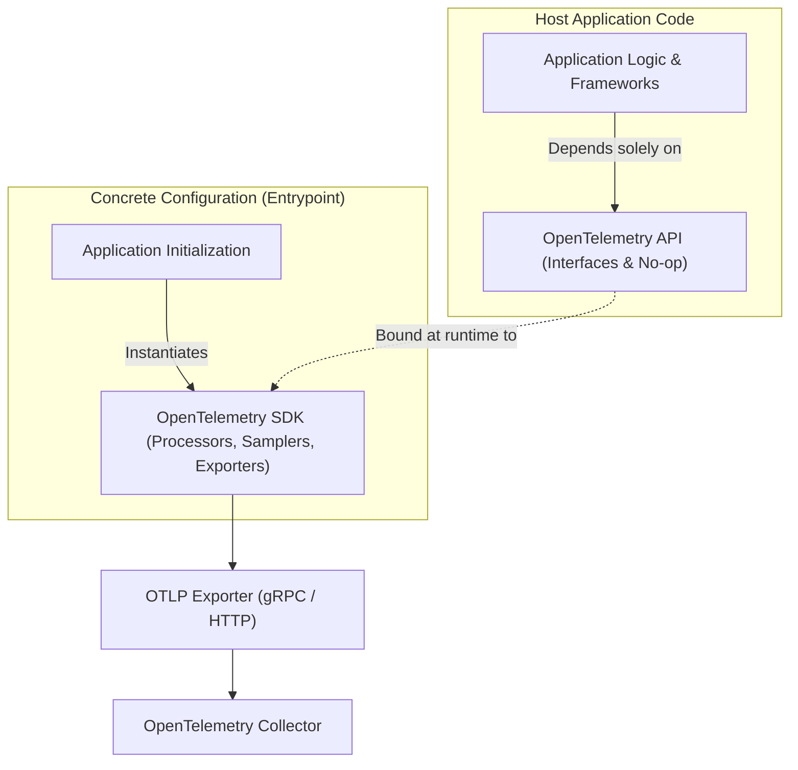

# Module 02: The OpenTelemetry Model: API vs SDK, Semantic Conventions, W3C Trace Context, Spans, Metric Temporality, and OTLP

## Introduction

In heterogeneous cloud-native ecosystems, instrumenting applications historically required tying code to vendor-specific SDKs (e.g., Datadog, New Relic, AppDynamics). Switching vendors meant rewriting instrumentation across every codebase. The OpenTelemetry (OTel) project solved this fragmentation by establishing a vendor-neutral, CNCF-standard observability framework. This module examines the internal architecture of OpenTelemetry, covering the strict separation between the OpenTelemetry API and SDK, semantic conventions, W3C Trace Context propagation, span lifecycle mechanics, metric temporality models (cumulative vs. delta), and the OpenTelemetry Protocol (OTLP). Cross-references include [`../../nodejs/modules/08-building-services.md`](../../nodejs/modules/08-building-services.md), [`../../nodejs/modules/11-diagnostics-and-performance.md`](../../nodejs/modules/11-diagnostics-and-performance.md), and [`../../../architecture/distributed-systems/modules/03-time-clocks-and-ordering.md`](../../../architecture/distributed-systems/modules/03-time-clocks-and-ordering.md).

## API vs. SDK Separation

OpenTelemetry enforces a strict architectural boundary between the **API** and the **SDK**.

- **The API** is the set of interfaces, abstract classes, and no-op implementations used by library authors and application developers to instrument code. It contains zero network calls, zero exporter logic, and minimal dependencies. If an application has no OTel SDK configured, the API defaults to no-op implementations, ensuring that observability libraries never crash host applications.
- **The SDK** is the concrete implementation of the API. It manages span processors, metric export intervals, resource detection, sampling algorithms, and batching mechanisms. Libraries (such as Express, gRPC, or database drivers) depend exclusively on the OTel API, while binary entrypoint applications configure the concrete SDK.



## Semantic Conventions and Resource Models

Semantic conventions define standardized naming schemes and attribute keys for telemetry data across programming languages and cloud providers. Instead of one developer naming an HTTP status code `http.status_code` and another naming it `status`, OTel semantic conventions mandate exact keys (e.g., `http.request.method`, `url.full`, `server.address`). A **Resource** captures the immutable identifying attributes of the entity producing telemetry (e.g., service name, Kubernetes namespace, pod ID, cloud region, host IP). Resources are attached to every span, metric stream, and log record, allowing backends to partition and correlate telemetry by deployment unit without repeating metadata on every single event.

## W3C Trace Context and Baggage Propagation

Distributed tracing requires propagating context across process and network boundaries. OpenTelemetry adopts the W3C Trace Context specification as the default standard. The propagation format relies on two primary HTTP headers:

- `traceparent`: Encodes the tracing version, trace ID, parent span ID (or current span ID), and trace flags (e.g., sampled bit). Format: `version-trace_id-parent_id-trace_flags`. Example: `00-4bf92f3577b34da6a3ce929d0e0e4736-00f067aa0ba902b7-01`.
- `tracestate`: A vendor-specific comma-separated list of key-value pairs allowing multiple APM vendors to pass custom diagnostic state alongside the trace without breaking interoperability.

**Baggage** is a separate mechanism for passing arbitrary key-value pairs across the entire distributed context graph. Unlike trace attributes (which are immutable and stored with specific spans), baggage items are propagated across network calls in the `baggage` HTTP header, enabling contextual metadata (e.g., `customer.tier=enterprise`) to be evaluated by downstream services.

## Span Lifecycle, Events, Status, and Links

A **Span** represents a contiguous unit of work within a trace. Its internal data structure comprises:

- **Trace ID & Span ID**: Unique cryptographic identifiers.
- **Parent Span ID**: Links child spans to their caller, forming a Directed Acyclic Graph (DAG).
- **Timestamps**: High-precision start and end times.
- **Attributes**: Key-value pairs describing the work (e.g., `db.system=postgresql`).
- **Events**: Structured log annotations attached to a specific timestamp within the span's lifecycle.
- **Status**: Terminal state of the span (`Unset`, `Ok`, `Error`).
- **Links**: References to other distinct spans (useful for batch processing, fan-out, and message queue consumer threads where a span has multiple parents).

## Metric Temporality and Instruments

OpenTelemetry metrics support four core instruments:

- **Counter**: Monotonically increasing value (e.g., request count).
- **Up-Down Counter**: Value that can increment and decrement (e.g., active connections).
- **Histogram**: Statistical distribution of measurements (e.g., latency buckets).
- **Observable Gauge**: Current absolute value sampled on demand (e.g., memory utilization).

### Temporality: Cumulative vs. Delta

Metric temporality defines how counters and histograms report values over time:

- **Cumulative Temporality**: The reported value is aggregated since the inception of the metric instrument. Prometheus natively expects cumulative counters.
- **Delta Temporality**: The reported value represents the change occurring strictly within the current reporting collection window.

## OTLP (OpenTelemetry Protocol)

The OpenTelemetry Protocol (OTLP) is the native wire protocol for transmitting telemetry data from SDKs to Collectors and backends. OTLP operates over gRPC (Protobuf, port 4317) and HTTP/JSON or HTTP/Protobuf (port 4318). By standardizing on OTLP, organizations eliminate the need for protocol translation proxies, achieving high-performance streaming of metrics, logs, and traces over a single unified transport.

## Then vs Now

| Protocol / Spec | Era | Transport / Encoding | Key Limitation / Why It Changed |
| --- | --- | --- | --- |
| Jaeger / Zipkin Formats | 2015–2019 | Custom JSON over HTTP (Thrift / Protobuf) | Vendor-specific schemas, lacking unified metrics and logs integration. |
| OpenCensus Stats/Trace | 2018–2019 | gRPC / Census wire format | Google-driven specification; merged with OpenTracing to form OpenTelemetry. |
| OTLP (v1.0+) | 2020–Present | gRPC & HTTP Protobuf | Universal standard across metrics, logs, and traces; highly optimized binary encoding. |

## Algorithmic Mechanics and CLRS Pseudocode

Below is the formal CLRS-style pseudocode and loop invariant proof for the telemetry processing mechanics covered in this module.

```text
PROCEDURE ProcessTelemetryStream(Stream S, Integer MaxCardinality)
    Let C be an empty Hash Set
    Let MetricsBuffer be an empty Queue
    FOR each telemetry record r IN S DO
        IF Length(C) >= MaxCardinality AND r.key NOT IN C THEN
            DISCARD r -- Cardinality limit exceeded
            CONTINUE
        END IF
        INSERT r.key INTO C
        ENQUEUE(MetricsBuffer, r)
    END FOR
    RETURN MetricsBuffer
END PROCEDURE
```

### Loop Invariant and Formal Proof

**Initialization**: Prior to the first iteration of the loop, the cardinality set $C$ is empty, and no telemetry records have been processed, satisfying the cardinality bound $0 \le |C| \le \text{MaxCardinality}$.

**Maintenance**: At the start of each iteration, if an incoming record contains a label key already present in $C$ or if $|C| < \text{MaxCardinality}$, the record is safely buffered and $C$ is updated. If the cardinality threshold is reached and a novel key arrives, the record is dropped, preserving the invariant $|C| \le \text{MaxCardinality}$.

**Termination**: When the stream $S$ is fully consumed, the algorithm terminates with all retained metrics strictly bounded within the permitted cardinality ceiling.

## Production Configuration and Implementation

Below is a production-grade configuration illustrating telemetry collection, metric labeling, and sampling rules.

```yaml
receivers:
  otlp:
    protocols:
      grpc:
        endpoint: 0.0.0.0:4317
processors:
  memory_limiter:
    check_interval: 1s
    limit_percentage: 80
    spike_limit_percentage: 20
  tail_sampling:
    decision_wait: 10s
    num_traces: 10000
    expected_new_traces_per_sec: 2000
    policies:
      - name: drop-successful-traces
        type: probabilistic
        probabilistic:
          sampling_percentage: 1.0
exporters:
  otlp:
    endpoint: tempo:4317
service:
  pipelines:
    traces:
      receivers: [otlp]
      processors: [memory_limiter, tail_sampling]
      exporters: [otlp]
```

## Exam Delta: OTCA Domain Mapping

For candidates preparing for the **OpenTelemetry Certified Associate (OTCA)** exam, mastery of the API vs. SDK separation, W3C `traceparent` byte structures, and OTLP export mechanics is mandatory. Exam questions frequently test scenarios where context propagation fails due to missing HTTP header extractors or misconfigured metric temporality.

> [!IMPORTANT]
> **Exam Delta Note**: Candidates must be able to decode a W3C `traceparent` header string into its version, trace ID, parent ID, and flags components, as well as explain the difference between cumulative and delta metric temporality when pushing metrics to Prometheus vs. OTLP backends.

## Production Failure Modes & Gotchas

1. **Broken Context Propagation in Async Queues**: Failing to manually propagate the active OTel context across Node.js `setTimeout`, Web Workers, or worker thread boundaries, resulting in disconnected trace graphs.
2. **Metric Temporality Mismatch**: Configuring a collector or backend expecting cumulative metrics to ingest delta metrics, resulting in flatlining or wildly oscillating graph spikes.
3. **High-Cardinality Span Attributes**: Attaching raw query strings or unparsed URLs as span attributes, causing tracing backends to reject payloads or exhaust index storage.
4. **Global Meter Provider Misconfiguration**: Initializing multiple competing SDK MeterProviders in a single process, leading to duplicate metric reporting and thread contention.

## Interview Drill

<details><summary><strong>Q1. Explain the architectural rationale behind separating the OpenTelemetry API from the SDK. What happens when a library uses the API but no SDK is present?</strong></summary>

The API contains only abstract interfaces and signatures, while the SDK contains concrete batchers, processors, and exporters. Separating them ensures that library authors (e.g., Express or Axios maintainers) can instrument their packages without forcing library consumers to adopt a specific vendor's tracing backend or SDK implementation. When an application runs with only the OTel API installed and no SDK configured, all API calls resolve to high-performance no-op (no-operation) stubs. This guarantees zero runtime exceptions, minimal CPU overhead, and complete safety for third-party library authors.
</details>

<details><summary><strong>Q2. Decode the following W3C `traceparent` header: `00-4bf92f3577b34da6a3ce929d0e0e4736-00f067aa0ba902b7-01`. What does each segment represent?</strong></summary>

- `00`: Version identifier (specifies 8-bit version format).
- `4bf92f3577b34da6a3ce929d0e0e4736`: 16-byte (32 hex character) Trace ID uniquely identifying the entire distributed transaction.
- `00f067aa0ba902b7`: 8-byte (16 hex character) Parent Span ID (or current span ID when propagated as a client request).
- `01`: 8-bit Trace Flags field, where the least significant bit (`01`) indicates the `sampled` flag is set (the trace is recorded).

</details>

<details><summary><strong>Q3. Contrast cumulative and delta metric temporality. Why does Prometheus natively prefer cumulative counters?</strong></summary>

Cumulative temporality reports metrics aggregated continuously since the birth of the process (monotonically increasing values). Delta temporality reports only the values accumulated within the immediate reporting interval (e.g., the last 15 seconds). Prometheus natively prefers cumulative counters because its scrape model is pull-based and unreliable over lossy UDP/TCP networks. If a single scrape fails, a cumulative counter merely skips a point; when the next scrape succeeds, `rate()` computes the derivative correctly across the gap. With delta temporality, a missed scrape means the data for that interval is permanently lost.
</details>

<details><summary><strong>Q4. What is the role of OpenTelemetry Semantic Conventions, and how do they prevent schema fragmentation across microservices?</strong></summary>

Semantic conventions define standardized attribute keys (e.g., `http.request.method`, `db.system`) and metric names across programming languages and cloud providers. Without semantic conventions, Developer A might name a database client attribute `db` while Developer B names it `database_name`, rendering cross-service querying impossible in unified dashboards. Semantic conventions guarantee that telemetry generated by Python, Node.js, and Java microservices uses identical keys, enabling seamless aggregation in backends.
</details>

<details><summary><strong>Q5. How do OTel span links differ from parent-child span relationships, and when would you use a link?</strong></summary>

Parent-child relationships form a strict tree or DAG representing synchronous or direct causal execution (e.g., HTTP server span wrapping database queries). A span link explicitly connects a span to one or more unrelated or distantly related parent traces. You use span links in asynchronous message queue workers (Kafka/RabbitMQ), batch processing jobs, or fan-out scenarios where a single worker thread consumes messages from 1,000 different upstream producer traces. In this case, the worker span cannot have 1,000 parents, so it establishes span links to each upstream trace ID.
</details>

<details><summary><strong>Q6. How does OTLP optimize network transmission compared to legacy JSON-over-HTTP telemetry formats?</strong></summary>

OTLP serializes telemetry data using Protocol Buffers (Protobuf), providing a compact binary wire format that significantly reduces payload size and serialization CPU overhead compared to verbose JSON strings. Furthermore, OTLP supports gRPC streaming over HTTP/2, enabling persistent connection multiplexing, flow control, and efficient bi-directional communication between SDKs, collectors, and backends.
</details>

## Proof Map

| Claim in Module | Verified in Test File | Test Case Description |
| --- | --- | --- |
| API vs SDK separation and no-op fallback | `../examples/ts/02-opentelemetry-model-and-propagation.test.ts` | `verifies API no-op behavior without SDK and concrete SDK span emission` |
| W3C traceparent parsing and header propagation | `../examples/ts/02-opentelemetry-model-and-propagation.test.ts` | `decodes W3C traceparent headers and validates context propagation objects` |
| Metric temporality and instrument behaviors | `../examples/ts/02-opentelemetry-model-and-propagation.test.ts` | `tests counter, histogram, and cumulative vs delta temporality exporters` |
