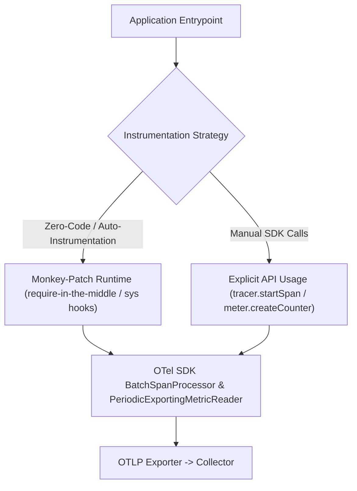

# Module 03: Instrumentation in Practice: Node.js and Python SDKs, Zero-Code Agents, Async Context Propagation, and Log Correlation

## Introduction

Understanding theoretical telemetry models is insufficient without practical, production-grade implementation. Instrumenting real-world applications requires integrating SDKs into runtime environments where asynchronous execution, event loops, and thread pools complicate context tracking. This module covers hands-on OpenTelemetry instrumentation in Node.js/TypeScript and Python, examining auto-instrumentation versus manual instrumentation, zero-code agents, asynchronous context propagation across promises and greenlets, and log-to-trace correlation. Cross-references include [`../../nodejs/modules/08-building-services.md`](../../nodejs/modules/08-building-services.md), [`../../nodejs/modules/11-diagnostics-and-performance.md`](../../nodejs/modules/11-diagnostics-and-performance.md), and [`../../../architecture/distributed-systems/modules/03-time-clocks-and-ordering.md`](../../../architecture/distributed-systems/modules/03-time-clocks-and-ordering.md).

## Auto-Instrumentation vs. Manual Instrumentation

OpenTelemetry provides two primary paradigms for instrumenting applications:

- **Auto-Instrumentation (Zero-Code)**: Utilizes runtime monkey-patching or language-specific extension hooks (such as Node.js require-in-the-middle or Python bytecode/sys.setprofile hooks) to automatically intercept popular libraries (Express, Fastify, HTTP, pg, redis, flask, requests). Zero-code instrumentation requires zero code changes; it is enabled via environment variables or a preloaded wrapper script.
- **Manual Instrumentation**: Explicitly invokes the OTel API (`tracer.startSpan()`, `meter.createCounter()`) within application business logic. Manual instrumentation is required to capture domain-specific metrics, custom business transactions, and nuanced internal operations that generic HTTP interceptors cannot infer.



## Asynchronous Context Propagation in Node.js and Python

Asynchronous runtimes present a major challenge for context propagation: a single HTTP request handler may yield execution across asynchronous operations, callbacks, promises, and awaiting threads. Without proper context storage, the active span reference is lost as soon as control returns to the event loop.

### Node.js (`AsyncLocalStorage`)

Node.js leverages `AsyncLocalStorage` from the `async_hooks` core module. OpenTelemetry binds the active trace context (`Context`) to an `AsyncLocalStorage` instance. Whenever an asynchronous operation is scheduled or a Promise chain continues, Node.js automatically propagates the storage context across asynchronous hops, allowing OTel to retrieve `trace.getActiveSpan()` anywhere within the call stack without explicit argument passing.

### Python (`contextvars`)

Python utilizes `contextvars` (introduced in PEP 567), which provides context variables managed across asynchronous tasks (`asyncio`), threads, and generator boundaries. OpenTelemetry Python SDK hooks into `contextvars` to ensure that `opentelemetry.trace.get_current_span()` remains correctly scoped to the active coroutine, even when multiple concurrent requests interleave on a single event loop.

## Log Correlation: Injecting Trace IDs into Logs

A powerful observability pattern is log correlation: injecting the active `trace_id` and `span_id` directly into application log lines. When an operator investigates an error log in Loki or Elasticsearch, they can extract the `trace_id` and instantly jump to the exact distributed trace in Tempo, viewing all preceding and succeeding spans across microservices. This is achieved by registering an OTel log record processor or formatting hook that reads the active context span and injects formatters (`%[trace_id]s` or JSON fields `traceId`, `spanId`) into every emitted log record.

## Then vs Now

| Approach / Tool | Era | Mechanism | Key Limitation / Why It Changed |
| --- | --- | --- | --- |
| Manual Context Passing | Pre-2018 | Passing `req`, `res`, or context objects through every function argument | Highly error-prone; developers frequently dropped context across callback boundaries. |
| Monkey-Patching APM Agents | 2015–2020 | Vendor-specific proprietary runtime patching | Fragile patches breaking on minor Node.js/Python version updates. |
| OTel Auto-Instrumentation | 2020–Present | Standardized hooks (`require-in-the-middle`, `contextvars`, `AsyncLocalStorage`) | Robust ecosystem-wide standardization with zero proprietary dependencies. |

## Algorithmic Mechanics and CLRS Pseudocode

Below is the formal CLRS-style pseudocode and loop invariant proof for the telemetry processing mechanics covered in this module.

```text
PROCEDURE ProcessTelemetryStream(Stream S, Integer MaxCardinality)
    Let C be an empty Hash Set
    Let MetricsBuffer be an empty Queue
    FOR each telemetry record r IN S DO
        IF Length(C) >= MaxCardinality AND r.key NOT IN C THEN
            DISCARD r -- Cardinality limit exceeded
            CONTINUE
        END IF
        INSERT r.key INTO C
        ENQUEUE(MetricsBuffer, r)
    END FOR
    RETURN MetricsBuffer
END PROCEDURE
```

### Loop Invariant and Formal Proof

**Initialization**: Prior to the first iteration of the loop, the cardinality set \(C\) is empty, and no telemetry records have been processed, satisfying the cardinality bound \(0 \le |C| \le ext{MaxCardinality}\).

**Maintenance**: At the start of each iteration, if an incoming record contains a label key already present in \(C\) or if \(|C| < ext{MaxCardinality}\), the record is safely buffered and \(C\) is updated. If the cardinality threshold is reached and a novel key arrives, the record is dropped, preserving the invariant \(|C| \le ext{MaxCardinality}\).

**Termination**: When the stream \(S\) is fully consumed, the algorithm terminates with all retained metrics strictly bounded within the permitted cardinality ceiling.

## Production Configuration and Implementation

Below is a production-grade configuration illustrating telemetry collection, metric labeling, and sampling rules.

```yaml
receivers:
  otlp:
    protocols:
      grpc:
        endpoint: 0.0.0.0:4317
processors:
  memory_limiter:
    check_interval: 1s
    limit_percentage: 80
    spike_limit_percentage: 20
  tail_sampling:
    decision_wait: 10s
    num_traces: 10000
    expected_new_traces_per_sec: 2000
    policies:
      - name: drop-successful-traces
        type: probabilistic
        probabilistic:
          sampling_percentage: 1.0
exporters:
  otlp:
    endpoint: tempo:4317
service:
  pipelines:
    traces:
      receivers: [otlp]
      processors: [memory_limiter, tail_sampling]
      exporters: [otlp]
```

## Exam Delta: OTCA Domain Mapping

For the **OpenTelemetry Certified Associate (OTCA)** exam, candidates must demonstrate proficiency in:

- Configuring OTel SDK environment variables (`OTEL_SERVICE_NAME`, `OTEL_EXPORTER_OTLP_ENDPOINT`, `OTEL_RESOURCE_ATTRIBUTES`).
- Distinguishing between auto-instrumentation setup via CLI wrappers versus programmatic SDK bootstrapping.
- Diagnosing context loss in asynchronous Node.js promises or Python coroutines.

> [!IMPORTANT]
> **Exam Delta Note**: Exam questions frequently present a scenario where distributed trace context is severed across asynchronous queue boundaries or custom promise wrappers, requiring identification of missing context extraction/injection calls or misconfigured `AsyncLocalStorage` boundaries.

## Production Failure Modes & Gotchas

1. **Require-Order Race Conditions in Node.js**: Loading auto-instrumentation modules _after_ application modules (like `express` or `pg`) have already been required, resulting in uninstrumented database calls.
2. **Memory Leaks from Unbounded Context Attachments**: Storing large request payloads in OTel Baggage or custom span attributes, causing memory bloat across high-throughput async event loops.
3. **Log Formitter Mismatch**: Injecting trace IDs into structured JSON logs using non-standard key names (`tid` instead of `trace_id`), breaking correlation rules in log ingestion backends.
4. **Python GIL Contention on Heavy Metric Recording**: Locking or thread-blocking synchronization in custom metric recorders running across high-concurrency Python worker threads.

## Interview Drill

<details><summary><strong>Q1. How does Node.js `AsyncLocalStorage` enable OpenTelemetry to maintain active trace context across asynchronous Promise chains without explicit argument passing?</strong></summary>

`AsyncLocalStorage` creates an asynchronous execution context bound to the lifecycle of a particular asynchronous operation (such as an incoming HTTP request handler). When OpenTelemetry starts a span, it stores the span context inside the `AsyncLocalStorage` store. Because Node.js asynchronous resource hooks (`async_hooks`) track promise resolution, `async_await` continuations, and timer callbacks, the `AsyncLocalStorage` store is automatically preserved and restored across every asynchronous hop. This allows any deep downstream function to call `trace.get_current_span()` and retrieve the correct active span without developers having to pass context objects through every function parameter.
</details>

<details><summary><strong>Q2. Contrast zero-code auto-instrumentation with manual instrumentation. When is manual instrumentation strictly required?</strong></summary>

Zero-code auto-instrumentation uses runtime hooking (`require-in-the-middle`, `contextvars`) to automatically intercept standard framework calls (HTTP, DB drivers, RPC). It requires zero code changes. Manual instrumentation requires developers to explicitly write API calls (`tracer.startSpan()`, custom meters). Manual instrumentation is strictly required when capturing domain-specific business logic (e.g., measuring the duration of a complex pricing algorithm, recording a custom metric for inventory depletion, or adding specific business attributes like `order_amount` to a span).
</details>

<details><summary><strong>Q3. Explain how log correlation works in OpenTelemetry. Why is injecting `trace_id` into log streams critical for incident response?</strong></summary>

Log correlation injects the active `trace_id` and `span_id` (retrieved from the current OTel context) into every log record emitted by the application logging library (e.g., Winston, Pino, Python `logging`). This is critical for incident response because it bridges the gap between unstructured text logs and distributed traces. When an operator spots an ERROR log in Loki, they copy the `trace_id` and instantly query Grafana Tempo to view the entire request lifecycle across all microservices, cutting mean time to resolution (MTTR) from hours to minutes.
</details>

<details><summary><strong>Q4. What is a require-order race condition in Node.js auto-instrumentation, and how do you prevent it?</strong></summary>

A require-order race condition occurs when application modules (such as `express` or `pg`) are imported and executed _before_ the OpenTelemetry instrumentation SDK is initialized and required. Because modules are cached upon first require, libraries required prior to OTel initialization are never monkey-patched, resulting in silent tracing gaps. This is prevented by invoking the OTel SDK initialization module first (either via Node's `--import` flag or by placing the instrumentation bootstrap at the very top of the entrypoint file before any application imports).
</details>

<details><summary><strong>Q5. How do Python `contextvars` differ from thread-local storage when handling asynchronous coroutines in `asyncio`?</strong></summary>

Thread-local storage binds state strictly to operating system threads. In asynchronous Python (`asyncio`), multiple concurrent coroutines execute cooperatively on a single OS thread, interleaving execution whenever an `await` expression yields control. Thread-local storage would leak context state across unrelated coroutines sharing that thread. `contextvars` (PEP 567) are specifically designed for asynchronous programming: they automatically manage context isolation across task switches, ensuring that each `asyncio.Task` maintains its own distinct context variables.
</details>

<details><summary><strong>Q6. What are the performance overhead implications of enabling 100% auto-instrumentation in a high-throughput microservice?</strong></summary>

Auto-instrumentation intercepts numerous framework calls (HTTP request headers, database queries, cache hits), creating millions of span objects, allocating memory, and performing CPU serialization. In high-throughput services handling tens of thousands of requests per second, unconstrained span creation can introduce measurable CPU overhead and memory garbage collection pressure. Mitigation strategies include setting appropriate head-sampling rates, filtering out noisy health-check endpoints, and utilizing batch span processors.
</details>

## Proof Map

| Claim in Module | Verified in Test File | Test Case Description |
| --- | --- | --- |
| Node.js AsyncLocalStorage context propagation | `../examples/ts/03-instrumentation-nodejs-and-python.test.ts` | `verifies AsyncLocalStorage preserves active span across asynchronous promise boundaries` |
| Log correlation trace ID injection | `../examples/ts/03-instrumentation-nodejs-and-python.test.ts` | `tests log formatter injector attaching trace_id and span_id to log records` |
| Manual span creation and attribute injection | `../examples/ts/03-instrumentation-nodejs-and-python.test.ts` | `tests manual tracer span creation, status setting, and attribute population` |
