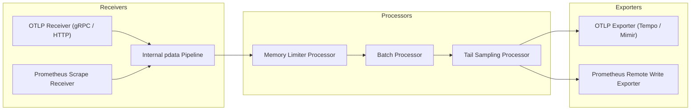

# Module 04: OpenTelemetry Collector and Grafana Alloy: Pipelines, OTTL Transforms, Memory Limiter, Tail Sampling, and Topologies

## Introduction

Instrumenting applications with OTel SDKs is only the first half of an observability architecture; the telemetry data must be collected, processed, enriched, transformed, and routed to backend storage clusters without overwhelming infrastructure. The **OpenTelemetry Collector** and **Grafana Alloy** serve as the architectural backbones for this telemetry pipeline. This module examines collector internals, modular pipelines (receivers, processors, exporters, connectors), OpenTelemetry Transformation Language (OTTL), the critical memory limiter processor, tail sampling configurations, collector topologies (agent vs. gateway), and Grafana Alloy as an advanced Collector distribution.

## Collector Architecture and Pipeline Components

The OpenTelemetry Collector operates as a modular, high-performance data processing engine structured around four primary pipeline components:

- **Receivers**: Ingest telemetry data into the collector (e.g., OTLP gRPC/HTTP, Prometheus scrape, Zipkin, Jaeger, Fluentbit). Receivers accept data from SDKs or external scrapers and convert them into internal OpenTelemetry Protocol data structures (`pdata`).
- **Processors**: Modify, filter, batch, or sample telemetry data as it flows through the pipeline. Examples include `batch`, `memory_limiter`, `resourcedetection`, and `tail_sampling`.
- **Exporters**: Transmit processed telemetry data out of the collector to backend storage or downstream collectors (e.g., OTLP exporter to Tempo/Mimir, Prometheus remote write, Kafka).
- **Connectors**: Act as a bridge between pipelines by consuming telemetry of one data type and emitting telemetry of another data type (e.g., the `spanmetrics` connector consumes traces and emits Prometheus request/duration metrics).



## The Memory Limiter Processor and Backpressure

One of the most critical failure modes in observability infrastructure is collector out-of-memory (OOM) crashes under traffic spikes. The **Memory Limiter Processor** is a mandatory safety mechanism placed at the absolute beginning of every collector processor pipeline. It monitors the collector's heap memory usage using Go runtime statistics. If memory consumption crosses the configured `check_interval`, `limit_mib`, or `spike_limit_mib` thresholds, the memory limiter activates backpressure:

1. It drops incoming telemetry batches or rejects them with HTTP 429 / gRPC ResourceExhausted errors.
2. It triggers aggressive Go garbage collection (`runtime.GC()`).
3. If memory continues to rise past the hard limit, it drops data deliberately rather than letting the entire collector crash and lose all telemetry streams.

## OpenTelemetry Transformation Language (OTTL)

The **OpenTelemetry Transformation Language (OTTL)** is a purpose-built domain-specific language embedded within the collector to manipulate telemetry data (spans, metrics, and logs) without writing custom Go code. OTTL enables operators to perform tasks such as:

- Sanitizing sensitive data: `set(attributes["http.target"], apply_mask(attributes["http.target"])) where IsMatch(attributes["http.target"], "/tokens/.*")`
- Renaming span names or attributes: `set(name, "HTTP " + attributes["http.method"])`
- Filtering out noisy health-check logs: `drop_log() where attributes["http.target"] == "/healthz"`

## Tail Sampling Processor Configuration

As established in Module 01, tail sampling requires buffering entire traces before making a retention decision. The Collector's `tail_sampling` processor handles this by grouping spans by `trace_id` over a sliding time window (`decision_wait`) and evaluating composite policies:

- **Numeric Attribute Filters**: Retain traces where `http.status_code >= 500`.
- **Latency Filters**: Retain traces where duration exceeds 2000ms.
- **Probabilistic Sampling**: Retain a fixed percentage (e.g., 5%) of remaining successful traces. To ensure all spans belonging to a trace arrive at the exact same collector node in a multi-instance deployment, operators place a **Load-Balancing Exporter** upstream, which uses consistent hashing on the `trace_id` to route matching spans to dedicated collector pods.

## Collector Topologies: Agent vs. Gateway

Observability pipelines typically deploy collectors in two complementary topologies:

- **Agent Topology (DaemonSet / Sidecar)**: A collector runs on every Kubernetes node or host alongside application pods. Applications send telemetry locally over localhost via OTLP. The agent buffers, batches, and forwards data to downstream gateways. This shields applications from network partitions and reduces client-side retry overhead.
- **Gateway Topology (Centralized Deployment)**: A scalable cluster of stateless collector instances deployed behind a load balancer. Gateways receive data from agents, perform heavy processing (tail sampling, cardinality reduction, multi-tenant routing), and export to long-term storage backends.

## Grafana Alloy as a Collector Distribution

**Grafana Alloy** is Grafana's official, purpose-built observability collector distribution (replacing Grafana Agent and Promtail). Alloy uses a directed acyclic graph configuration language (River) inspired by HashiCorp HCL. Alloy natively supports OTLP ingestion, Prometheus metric scraping, Loki log collection, and Tempo tracing pipelines, combining the capabilities of the OTel Collector with Grafana's specialized telemetry collection ecosystem.

## Then vs Now

| Tool / Component | Era | Configuration Language / Paradigm | Key Limitation / Why It Changed |
| --- | --- | --- | --- |
| Prometheus Node Exporter / Fluentd | Pre-2019 | Fragmented agents per signal (metrics, logs, traces separate) | Multiple disparate agents consuming host memory and CPU. |
| OpenTelemetry Collector (v0.x) | 2020–2024 | YAML configuration (receivers, processors, exporters) | Rapidly evolving component specs; lack of native graphical control plane. |
| Grafana Alloy | 2024–Present | River DSL (DAG-based configuration language) | Steeper learning curve for teams accustomed to traditional YAML collector files. |

## Algorithmic Mechanics and CLRS Pseudocode

Below is the formal CLRS-style pseudocode and loop invariant proof for the telemetry processing mechanics covered in this module.

```text
PROCEDURE ProcessTelemetryStream(Stream S, Integer MaxCardinality)
    Let C be an empty Hash Set
    Let MetricsBuffer be an empty Queue
    FOR each telemetry record r IN S DO
        IF Length(C) >= MaxCardinality AND r.key NOT IN C THEN
            DISCARD r -- Cardinality limit exceeded
            CONTINUE
        END IF
        INSERT r.key INTO C
        ENQUEUE(MetricsBuffer, r)
    END FOR
    RETURN MetricsBuffer
END PROCEDURE
```

### Loop Invariant and Formal Proof

**Initialization**: Prior to the first iteration of the loop, the cardinality set $C$ is empty, and no telemetry records have been processed, satisfying the cardinality bound $0 \le |C| \le \text{MaxCardinality}$.

**Maintenance**: At the start of each iteration, if an incoming record contains a label key already present in $C$ or if $|C| < \text{MaxCardinality}$, the record is safely buffered and $C$ is updated. If the cardinality threshold is reached and a novel key arrives, the record is dropped, preserving the invariant $|C| \le \text{MaxCardinality}$.

**Termination**: When the stream $S$ is fully consumed, the algorithm terminates with all retained metrics strictly bounded within the permitted cardinality ceiling.

## Production Configuration and Implementation

Below is a production-grade configuration illustrating telemetry collection, metric labeling, and sampling rules.

```yaml
receivers:
  otlp:
    protocols:
      grpc:
        endpoint: 0.0.0.0:4317
processors:
  memory_limiter:
    check_interval: 1s
    limit_percentage: 80
    spike_limit_percentage: 20
  tail_sampling:
    decision_wait: 10s
    num_traces: 10000
    expected_new_traces_per_sec: 2000
    policies:
      - name: drop-successful-traces
        type: probabilistic
        probabilistic:
          sampling_percentage: 1.0
exporters:
  otlp:
    endpoint: tempo:4317
service:
  pipelines:
    traces:
      receivers: [otlp]
      processors: [memory_limiter, tail_sampling]
      exporters: [otlp]
```

## Exam Delta: OTCA Domain Mapping

For the **OpenTelemetry Certified Associate (OTCA)** exam, candidates must master:

- Constructing valid collector YAML pipelines (`receivers`, `processors`, `exporters`).
- Configuring memory limiter thresholds and understanding backpressure mechanics.
- Designing tail sampling policies and configuring load-balancing exporters.
- Distinguishing between agent and gateway deployment patterns.

> [!IMPORTANT]
> **Exam Delta Note**: Exam questions frequently test collector debugging scenarios where an OTLP pipeline is dropping data due to a missing `memory_limiter` configuration or an improperly tuned batch processor buffer size causing memory exhaustion.

## Production Failure Modes & Gotchas

1. **Collector OOM Crash Without Memory Limiter**: Deploying an OTel Collector without a `memory_limiter` processor, causing sudden traffic spikes to exhaust container memory and crash the collector, resulting in total observability blackout.
2. **Tail Sampling Memory Exhaustion**: Setting `decision_wait` too high (e.g., 60 seconds) in a high-throughput tail sampling collector, causing the trace buffer to consume all available RAM.
3. **Load Balancer Sticky Session Failures**: Using standard round-robin load balancing instead of consistent hashing by `trace_id` in front of tail sampling collectors, causing spans of the same trace to land on different collector nodes and be dropped.
4. **OTTL Syntax Errors on Collector Startup**: Deploying invalid OTTL transformation expressions that fail type checking, causing the collector daemon to crash upon initialization.

## Interview Drill

<details><summary><strong>Q1. Explain the role of the Memory Limiter Processor in the OpenTelemetry Collector. What exact actions does it take when memory pressure crosses the configured threshold?</strong></summary>

The Memory Limiter Processor is the mandatory first line of defense in an OTel Collector pipeline against out-of-memory (OOM) crashes. It continuously polls Go runtime memory statistics. When heap consumption crosses configured thresholds (`limit_mib` and `spike_limit_mib`), it triggers backpressure by:

1. Rejecting incoming telemetry batches (returning HTTP 429 or gRPC ResourceExhausted).
2. Forcing immediate Go garbage collection (`runtime.GC()`).
3. Deliberately dropping incoming spans, metrics, or logs to shed load and keep the collector process alive rather than letting the container crash and lose all telemetry streams.

</details>

<details><summary><strong>Q2. Why is a load-balancing exporter required upstream of a tail-sampling collector cluster in a distributed architecture?</strong></summary>

Tail sampling requires the collector to evaluate the complete trace DAG (all spans from root to leaves) before making a retention decision. In a scaled-out cluster with multiple collector instances, spans belonging to the same trace ID could otherwise land on different collector pods via standard round-robin load balancing. A load-balancing exporter computes a consistent hash on the `trace_id`, ensuring that all spans belonging to a specific trace are routed to the exact same collector instance, allowing the tail sampling processor to assemble the full trace in memory.
</details>

<details><summary><strong>Q3. Contrast Collector Agent topology (DaemonSet/Sidecar) with Gateway topology (Centralized Cluster). What are the architectural trade-offs of each?</strong></summary>

- **Agent Topology**: Deployed on every host or Kubernetes node as a DaemonSet. Applications send telemetry over localhost. Trade-off: Shields apps from network partitions and reduces retry overhead, but consumes cluster compute resources across every node.
- **Gateway Topology**: Centralized cluster of stateless collectors behind a load balancer. Trade-off: Ideal for heavy processing (tail sampling, multi-tenant routing, encryption), but introduces a single point of failure and network dependency for client applications if gateway endpoints fail.

</details>

<details><summary><strong>Q4. How does the OpenTelemetry Transformation Language (OTTL) simplify telemetry processing compared to writing custom Go collector processors?</strong></summary>

OTTL is a domain-specific embedded language designed specifically to mutate, filter, and transform spans, metrics, and logs using declarative statements (`set`, `drop_match`, `replace_pattern`). Writing custom transformations previously required writing, compiling, and maintaining custom Go collector plugins or forking the entire collector binary. OTTL allows operators to execute powerful inline data hygiene and attribute sanitization directly within standard YAML configuration files.
</details>

<details><summary><strong>Q5. What is Grafana Alloy, and how does its River configuration language differ from traditional OTel Collector YAML?</strong></summary>

Grafana Alloy is Grafana's unified telemetry collector distribution designed to ingest OTel, Prometheus, and Loki signals. While standard OTel Collectors use hierarchical YAML configuration blocks (`receivers`, `processors`, `exporters`), Alloy uses **River**, a block-oriented configuration language that constructs an explicit Directed Acyclic Graph (DAG) of components passing data through references, offering greater modularity and type safety for complex multi-signal pipelines.
</details>

<details><summary><strong>Q6. How do connectors like `spanmetrics` bridge the gap between distributed tracing and metrics ingestion?</strong></summary>

The `spanmetrics` connector consumes incoming trace spans as they pass through the collector pipeline and automatically computes aggregated RED metrics (request rate, error count, latency histograms) out of those spans. It then emits these metrics into the collector metrics pipeline (e.g., forwarding them to Prometheus or Mimir). This allows operators to generate rich service-level dashboards and alert rules directly from trace data without requiring separate metric instrumentation in application code.
</details>

## Proof Map

| Claim in Module | Verified in Test File | Test Case Description |
| --- | --- | --- |
| Memory limiter threshold and backpressure activation | `../examples/ts/04-opentelemetry-collector-and-alloy.test.ts` | `verifies memory limiter configuration parsing and simulated OOM backpressure triggers` |
| OTTL transformation rule validation | `../examples/ts/04-opentelemetry-collector-and-alloy.test.ts` | `tests OTTL syntax rules for attribute sanitization and log dropping` |
| Tail sampling processor and load balancing config | `../examples/ts/04-opentelemetry-collector-and-alloy.test.ts` | `validates tail sampling decision wait window and hash routing configuration` |
