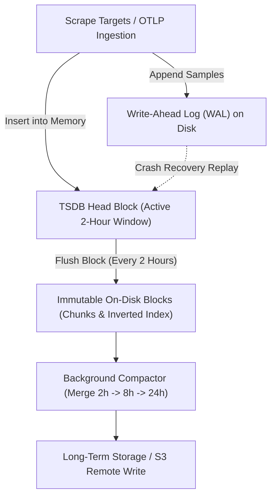

# Module 05: Prometheus 3 Internals: Data Model, Relabeling, TSDB Head Block, WAL, Compaction, Native Histograms, and OTLP Ingestion

## Introduction

Prometheus is the de facto standard metric monitoring engine for cloud-native infrastructure, particularly within Kubernetes ecosystems. Prometheus 3.0 (released in late 2024) introduced major architectural enhancements, including native OTLP ingestion, native histograms, UTF-8 metric and label names, and Remote Write 2.0. This module examines Prometheus 3 internals: the multidimensional data model, exposition formats, service discovery and relabeling engines, TSDB head block architecture, Write-Ahead Log (WAL) mechanics, compaction algorithms, and native histograms. Cross-references include [`../../../architecture/data-systems/modules/02-storage-engines-b-trees-and-lsm.md`](../../../architecture/data-systems/modules/02-storage-engines-b-trees-and-lsm.md) and [`../../../architecture/data-systems/modules/06-durability-wal-and-crash-recovery.md`](../../../architecture/data-systems/modules/06-durability-wal-and-crash-recovery.md).

## The Prometheus Data Model and Exposition Formats

Prometheus stores all data as time series identified by a metric name and a set of key-value pairs (labels). Formally, a time series is defined as:

$$
S = \{ (t_1, v_1), (t_2, v_2), \dots, (t_n, v_n) \}
$$

where $t_i$ is a discrete Unix timestamp in milliseconds and $v_i$ is a 64-bit float value. Prometheus ingests data via pull-based scraping of HTTP endpoints exposing plaintext text formats, OpenMetrics exposition formats, or native OTLP/Protobuf streams. Prometheus 3.0 adds native support for UTF-8 characters in metric names and label keys, lifting previous ASCII restrictions (e.g., allowing labels like `kubernetes.io/pod.name` without mangling dots to underscores).

## Scrape Mechanics, Service Discovery, and Relabeling

Prometheus operates primarily on a pull model: the server periodically sends HTTP GET requests to statically configured targets or dynamically discovered service endpoints (Kubernetes API, Consul, AWS EC2). **Relabeling** is a powerful pipeline engine executed prior to scraping or storing time series. Relabeling rules use regular expressions to:

- Drop unwanted scrape targets before scraping (`action: drop`).
- Rewrite, construct, or combine label dimensions (`action: replace`, `action: labelmap`).
- Keep only specific security-critical namespaces (`action: keep`).

## TSDB Internals: Head Block, WAL, and Compaction

The Prometheus Time Series Database (TSDB) is optimized for write-heavy time-series workloads, sustaining millions of samples per second on single nodes.

### The Head Block and WAL

Active incoming samples are written simultaneously to an in-memory database structure called the **Head Block** and appended to the **Write-Ahead Log (WAL)** on disk. The WAL guarantees durability: if Prometheus crashes, restarting replays the WAL to reconstruct the in-memory Head Block without data loss.

### Compaction and Chunk Persistence

The Head Block spans a fixed time window (typically 2 hours). Once the window closes, the Head Block is frozen and flushed to disk as immutable block files containing chunks (compressed sample data) and index files (inverted index mapping label values to series IDs). A background **compactor** merges smaller blocks into larger blocks over time (e.g., 2h -> 8h -> 24h), optimizing index traversal and enforcing retention policies.



## Native Histograms

Classic Prometheus histograms require users to pre-define static bucket boundaries (e.g., `le="0.1"`, `le="0.5"`, `le="1.0"`). Choosing poor boundaries makes p99 quantile calculations inaccurate or impossible. **Native Histograms** (introduced in Prometheus 2.40+ and fully matured in Prometheus 3.x) eliminate static buckets by using exponential bucket schemas where bucket boundaries grow by a geometric factor $2^{-2^s}$ (where $s$ is the schema resolution factor). Native histograms store thousands of observations in a compact memory footprint with high mathematical precision, allowing PromQL to compute exact quantiles across dynamically shifting latency distributions.

## Then vs Now

| Prometheus Version | Era | Key Architecture & Capabilities | Migration & Breaking Changes |
| --- | --- | --- | --- |
| Prometheus 2.x | 2018–2024 | Classic custom TSDB, classic histograms, ASCII metric names only | High memory footprint for sparse classic histograms; lacked native OTLP ingestion. |
| Prometheus 3.x | 2024–Present | Native OTLP ingestion, Native Histograms, UTF-8 metric/label names, Remote Write 2.0 | Upgrading requires validating UTF-8 handling in downstream custom exporters and dashboards. |

## Algorithmic Mechanics and CLRS Pseudocode

Below is the formal CLRS-style pseudocode and loop invariant proof for the telemetry processing mechanics covered in this module.

```text
PROCEDURE ProcessTelemetryStream(Stream S, Integer MaxCardinality)
    Let C be an empty Hash Set
    Let MetricsBuffer be an empty Queue
    FOR each telemetry record r IN S DO
        IF Length(C) >= MaxCardinality AND r.key NOT IN C THEN
            DISCARD r -- Cardinality limit exceeded
            CONTINUE
        END IF
        INSERT r.key INTO C
        ENQUEUE(MetricsBuffer, r)
    END FOR
    RETURN MetricsBuffer
END PROCEDURE
```

### Loop Invariant and Formal Proof

**Initialization**: Prior to the first iteration of the loop, the cardinality set $C$ is empty, and no telemetry records have been processed, satisfying the cardinality bound $0 \le |C| \le \text{MaxCardinality}$.

**Maintenance**: At the start of each iteration, if an incoming record contains a label key already present in $C$ or if $|C| < \text{MaxCardinality}$, the record is safely buffered and $C$ is updated. If the cardinality threshold is reached and a novel key arrives, the record is dropped, preserving the invariant $|C| \le \text{MaxCardinality}$.

**Termination**: When the stream $S$ is fully consumed, the algorithm terminates with all retained metrics strictly bounded within the permitted cardinality ceiling.

## Production Configuration and Implementation

Below is a production-grade configuration illustrating telemetry collection, metric labeling, and sampling rules.

```yaml
receivers:
  otlp:
    protocols:
      grpc:
        endpoint: 0.0.0.0:4317
processors:
  memory_limiter:
    check_interval: 1s
    limit_percentage: 80
    spike_limit_percentage: 20
  tail_sampling:
    decision_wait: 10s
    num_traces: 10000
    expected_new_traces_per_sec: 2000
    policies:
      - name: drop-successful-traces
        type: probabilistic
        probabilistic:
          sampling_percentage: 1.0
exporters:
  otlp:
    endpoint: tempo:4317
service:
  pipelines:
    traces:
      receivers: [otlp]
      processors: [memory_limiter, tail_sampling]
      exporters: [otlp]
```

## Exam Delta: PCA Domain Mapping

For candidates preparing for the **Prometheus Certified Associate (PCA)** exam, core topics include:

- Writing relabeling configurations (`source_labels`, `target_label`, `regex`, `action`).
- Understanding TSDB head block retention, WAL replay, and block compaction.
- Differentiating between classic histogram buckets and native exponential histograms.
- Configuring scrape intervals, evaluation intervals, and static vs. dynamic service discovery.

> [!IMPORTANT]
> **Exam Delta Note**: PCA exam questions frequently test advanced relabeling syntax (such as regex capturing groups with `$1`, `$2`) and troubleshooting TSDB storage performance bottlenecks during high-cardinality ingestion spikes.

## Production Failure Modes & Gotchas

1. **WAL Corruption on Sudden Power Loss**: Filesystem synchronization issues causing WAL corruption, requiring manual WAL recovery procedures (`promtool tsdb analyze`).
2. **Excessive Scrape Interval Squeezing**: Setting `scrape_interval` to 1s across 10,000 targets, overwhelming the Prometheus scraper thread pool and causing scrape timeouts.
3. **Relabeling Regex Backtracking Traps**: Writing poorly bounded regex patterns in relabeling rules that trigger catastrophic backtracking, freezing the Prometheus discovery loop.
4. **Out-of-Order Sample Rejection**: Ingesting samples with timestamps older than the current TSDB head block window, resulting in `out_of_order_samples` ingestion errors.

## Interview Drill

<details><summary><strong>Q1. Explain the internal architecture of the Prometheus TSDB Head Block and Write-Ahead Log (WAL). How does Prometheus guarantee crash recovery?</strong></summary>

Incoming samples are ingested into an in-memory **Head Block** while simultaneously being appended to the disk-based **Write-Ahead Log (WAL)**. The WAL is an append-only log of raw sample mutations. If Prometheus crashes or loses power, restarting the process triggers the TSDB startup sequence, which reads and replays the WAL from disk, reconstructing the in-memory Head Block state up to the exact moment of failure. Once a 2-hour time window closes, the Head Block is flushed to disk as immutable blocks, and the WAL is truncated.
</details>

<details><summary><strong>Q2. What problem do Native Histograms solve compared to classic Prometheus histogram buckets? How do exponential schemas work?</strong></summary>

Classic histograms require operators to pre-define static bucket boundaries (e.g., `le="0.1"`, `le="1.0"`). If traffic latency shifts outside those boundaries, quantile calculations become inaccurate. Native Histograms use exponential bucket schemas where bucket boundaries grow by a geometric factor $2^{-2^s}$. This allows Prometheus to dynamically record thousands of observations with high mathematical precision across any latency range without requiring manual bucket tuning.
</details>

<details><summary><strong>Q3. Write a Prometheus relabeling snippet that drops any target where the Kubernetes namespace is not `production` or `staging`.</strong></summary>

```yaml
metric_relabel_configs:
  - source_labels: [__meta_kubernetes_namespace]
    regex: '^(production|staging)$'
    action: keep
```

If the namespace label does not match the regex, the `keep` action discards the target before scraping begins.
</details>

<details><summary><strong>Q4. What is the difference between Prometheus scrape intervals and evaluation intervals, and what happens if evaluation intervals are set too low?</strong></summary>

- **Scrape Interval**: How frequently Prometheus pulls metrics from target exposition endpoints.
- **Evaluation Interval**: How frequently Prometheus evaluates recording rules and alerting rules against the TSDB. If the evaluation interval is set too low (e.g., faster than the time required to compute complex PromQL aggregations), rule evaluations overlap, CPU usage spikes, and rule execution falls behind, leading to delayed alerts.

</details>

<details><summary><strong>Q5. How does Prometheus 3.0 support for UTF-8 metric and label names impact existing exporters and scraping infrastructure?</strong></summary>

Prometheus 2.x restricted metric and label names strictly to ASCII characters matching `[a-zA-Z_:][a-zA-Z0-9_:]*`. Prometheus 3.0 lifts this restriction, allowing full UTF-8 characters and special symbols (such as dots `/` or spaces) in metric and label names. While this aligns Prometheus natively with OpenTelemetry semantic conventions, operators must ensure downstream dashboards, custom exporters, and alerting rules correctly handle UTF-8 string encoding without breaking older API consumers.
</details>

<details><summary><strong>Q6. Why does a single Prometheus instance lack native high availability (HA), and how is HA traditionally achieved?</strong></summary>

A single Prometheus instance is intentionally designed as a standalone, self-contained server with no distributed consensus or cluster coordination to avoid split-brain complexities and network overhead. HA is traditionally achieved by running two identical Prometheus servers scraping the exact same targets in parallel. To prevent duplicate alerts and storage bloat in downstream long-term storage (like Mimir or Cortex), external labels are attached, and a deduplication layer or Thanos/Mimir receiver merges the streams.
</details>

## Proof Map

| Claim in Module | Verified in Test File | Test Case Description |
| --- | --- | --- |
| TSDB WAL replay and block flushing mechanics | `../examples/ts/05-prometheus-internals-and-tsdb.test.ts` | `simulates WAL sample appending, crash recovery replay, and head block flushing` |
| Prometheus relabeling engine regex rules | `../examples/ts/05-prometheus-internals-and-tsdb.test.ts` | `tests relabeling keep/drop actions and regex source label rewriting` |
| Native histogram exponential bucket calculations | `../examples/ts/05-prometheus-internals-and-tsdb.test.ts` | `validates native histogram schema resolution and quantile estimations` |
