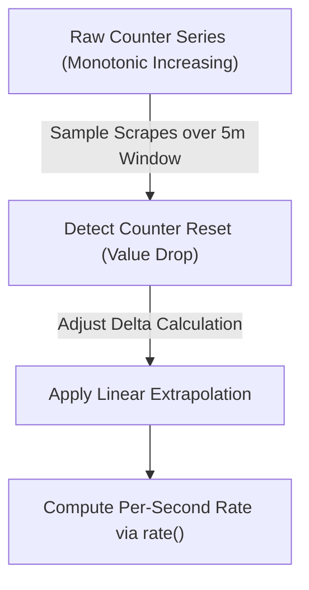

# Module 06: PromQL Mastery: Instant/Range Vectors, Rate Extrapolation, Vector Matching Algebra, Histogram Quantiles, and Subqueries

## Introduction

PromQL (Prometheus Query Language) is a functional query language designed specifically for time-series data, enabling operators to select, aggregate, extrapolate, and transform metric streams in real time. Mastering PromQL requires deep understanding of vector types, rate extrapolation arithmetic, vector matching algebra, histogram quantile computations, and subqueries. This module provides comprehensive coverage of PromQL mastery for production observability engineers.

## Instant Vectors vs. Range Vectors

PromQL operates on two fundamental data types:

- **Instant Vector**: A set of time series containing a single scalar timestamp and value for each series (e.g., `http_requests_total`).
- **Range Vector**: A set of time series containing a range of data points over a specified time window back from the current evaluation instant (e.g., `http_requests_total[5m]`). Range vectors cannot be graphed directly in time-series charts; they serve as input to range functions like `rate()`, `increase()`, and `deriv()`.

## Rate Extrapolation and Counter Reset Handling

Counters in Prometheus only increase and reset to zero upon service restarts. To compute per-second rates from cumulative counters, engineers use `rate()` or `increase()`. `rate(v[d])` calculates the per-second average rate of increase of the time series over the range vector duration \(d\). Crucially, PromQL automatically handles counter resets: if a counter drops from 1,000 to 0 due to an application restart, `rate()` detects the discontinuity and assumes the counter incremented by 1,000 plus the new value. Mathematical extrapolation ensures that if the range vector boundaries do not land precisely on scrape timestamps, linear extrapolation estimates the exact value at the range edges.



## Vector Matching Algebra (`on`, `ignoring`, `group_left`, `group_right`)

When performing binary operations between two instant vectors (e.g., dividing request counts by total limits), Prometheus must match time series labels.

- **`ignoring(label_list)`**: Ignores specified labels during matching.
- **`on(label_list)`**: Restricts matching exclusively to the listed labels.
- **`group_left` / `group_right`**: Enables many-to-one or one-to-many matching. For example, joining a metric with a static configuration label table: `rate(requests_total[5m]) * on(service) group_left(tier) service_metadata`.

## Histogram Quantiles and Subqueries

To compute percentiles (such as p99 latency) from classic histogram buckets, operators use `histogram_quantile(0.99, sum(rate(http_request_duration_seconds_bucket[5m])) by (le))`. Crucially, aggregation (`sum()`) **must** occur **inside** the rate function grouped by `le` (latency boundary). Summing rates _after_ calculating percentiles is mathematically invalid. **Subqueries** allow running range queries over a sliding time window (e.g., `rate(http_requests_total[5m])[30m:1m]`), enabling operators to calculate moving averages of rates or evaluate volatile alerts over sustained windows.

## Then vs Now

| PromQL Era | Features & Enhancements | Key Limitation / Why It Changed |
| --- | --- | --- |
| Early Prometheus (2016) | Basic instant/range vectors, simple aggregations | Lacked subqueries, native histogram quantile functions, and complex vector matching. |
| Modern PromQL (Prometheus 2.x–3.x) | Subqueries, `@` modifier, offset modifier, native histogram functions (`histogram_fraction`) | Requires strict adherence to aggregation rules to avoid vector matching errors. |

## Algorithmic Mechanics and CLRS Pseudocode

Below is the formal CLRS-style pseudocode and loop invariant proof for the telemetry processing mechanics covered in this module.

```text
PROCEDURE ProcessTelemetryStream(Stream S, Integer MaxCardinality)
    Let C be an empty Hash Set
    Let MetricsBuffer be an empty Queue
    FOR each telemetry record r IN S DO
        IF Length(C) >= MaxCardinality AND r.key NOT IN C THEN
            DISCARD r -- Cardinality limit exceeded
            CONTINUE
        END IF
        INSERT r.key INTO C
        ENQUEUE(MetricsBuffer, r)
    END FOR
    RETURN MetricsBuffer
END PROCEDURE
```

### Loop Invariant and Formal Proof

**Initialization**: Prior to the first iteration of the loop, the cardinality set \(C\) is empty, and no telemetry records have been processed, satisfying the cardinality bound \(0 \le |C| \le ext{MaxCardinality}\).

**Maintenance**: At the start of each iteration, if an incoming record contains a label key already present in \(C\) or if \(|C| < ext{MaxCardinality}\), the record is safely buffered and \(C\) is updated. If the cardinality threshold is reached and a novel key arrives, the record is dropped, preserving the invariant \(|C| \le ext{MaxCardinality}\).

**Termination**: When the stream \(S\) is fully consumed, the algorithm terminates with all retained metrics strictly bounded within the permitted cardinality ceiling.

## Production Configuration and Implementation

Below is a production-grade configuration illustrating telemetry collection, metric labeling, and sampling rules.

```yaml
receivers:
  otlp:
    protocols:
      grpc:
        endpoint: 0.0.0.0:4317
processors:
  memory_limiter:
    check_interval: 1s
    limit_percentage: 80
    spike_limit_percentage: 20
  tail_sampling:
    decision_wait: 10s
    num_traces: 10000
    expected_new_traces_per_sec: 2000
    policies:
      - name: drop-successful-traces
        type: probabilistic
        probabilistic:
          sampling_percentage: 1.0
exporters:
  otlp:
    endpoint: tempo:4317
service:
  pipelines:
    traces:
      receivers: [otlp]
      processors: [memory_limiter, tail_sampling]
      exporters: [otlp]
```

## Exam Delta: PCA Domain Mapping

For candidates preparing for the **Prometheus Certified Associate (PCA)** exam, PromQL mastery accounts for **28% of the exam weight**. Exam questions rigorously test:

- Distinguishing between `rate()`, `irate()`, and `increase()`.
- Correctly applying `by` vs `without` aggregations.
- Troubleshooting vector matching errors (`no overlapping matching series`).
- Computing p90/p99 quantiles from histogram buckets.

> [!IMPORTANT]
> **Exam Delta Note**: PCA exam questions frequently test the distinction between `rate()` (which averages over the entire range vector) and `irate()` (which calculates the per-second rate using only the last two data points), warning against using `irate()` in alerting rules due to high noise.

## Production Failure Modes & Gotchas

1. **Summing Counters Before Rate Calculation**: Writing `sum(rate(x[5m]))` vs `rate(sum(x)[5m])`. Summing raw counters before taking the rate destroys counter reset tracking and produces incorrect mathematical results.
2. **Averaging Percentiles Across Instances**: Evaluating `avg(histogram_quantile(0.99, ...))` across multiple service instances. Averaging pre-computed percentiles is mathematically invalid; one must aggregate underlying histogram buckets first (`sum by (le)`), then compute the quantile.
3. **Range Window Shorter Than 2x Scrape Interval**: Executing `rate(metric[3m])` when `scrape_interval` is 60s, resulting in gappy or missing data points because fewer than two scrape samples fall inside the window.
4. **Unmatched Labels in Binary Operations**: Performing binary division between vectors with differing label sets without specifying `on(...)` or `ignoring(...)`, resulting in empty query results.

## Interview Drill

<details><summary><strong>Q1. Explain the mathematical difference between `rate()` and `irate()`. Why is `rate()` strongly recommended for alerting rules over `irate()`?</strong></summary>

`rate()` calculates the per-second average rate of increase of a counter over the entire specified range vector (e.g., `[5m]`), smoothing out short-term jitter and accounting for all data points in the window. `irate()` calculates the instantaneous rate of increase using _only the last two data points_ in the range window. `irate()` is extremely sensitive to momentary spikes and scrape jitter. In alerting rules, `irate()` produces massive false-positive noise, whereas `rate()` provides a stable, averaged trend line suitable for reliable alerting.
</details>

<details><summary><strong>Q2. Why is `sum(rate(metric_bucket[5m])) by (le)` mathematically correct for calculating latency quantiles, whereas summing rates after computing percentiles is invalid?</strong></summary>

Quantiles cannot be averaged linearly because they are non-linear statistical estimations. To compute an accurate global p99 latency across multiple instances or shards, you must aggregate the underlying cumulative observation counts (`sum by (le)`) to reconstruct a unified global histogram distribution _before_ passing it to `histogram_quantile()`. Summing pre-calculated percentiles from individual nodes results in mathematically meaningless numbers.
</details>

<details><summary><strong>Q3. Explain vector matching in PromQL. What is the difference between `on()` and `ignoring()`, and when do you need `group_left`?</strong></summary>

When performing binary operations between two instant vectors, Prometheus must match time series by their label sets.

- `ignoring(labels)` matches vectors while omitting specified labels from comparison.
- `on(labels)` restricts matching exclusively to the specified labels, ignoring all others.
- `group_right` or `group_left` is required during many-to-one or one-to-many matching (e.g., joining high-cardinality metric time series with a lower-cardinality metadata table), allowing labels from the "one" side to be included on the resulting vector.

</details>

<details><summary><strong>Q4. What is a PromQL subquery, and what problem does it solve compared to standard range queries?</strong></summary>

A standard range query evaluates a function over a range vector at a single evaluation point. A subquery allows you to evaluate a range query over a sliding time window with a specified resolution (e.g., `rate(http_requests_total[5m])[30m:1m]`). Subqueries are essential when you need to run a range function (like `rate()` or `deriv()`) as an input to another function or recording rule across a historical timeframe, enabling moving averages and rate-of-change calculations over aggregated trends.
</details>

<details><summary><strong>Q5. How does PromQL handle counter resets when evaluating `rate()` or `increase()`?</strong></summary>

When a service restarts, its monotonic counters reset to zero (e.g., dropping from 50,000 to 0). PromQL's `rate()` and `increase()` functions automatically scan the range vector for any point where a sample value is smaller than the preceding sample value. Upon detecting this drop, PromQL assumes a counter reset occurred and adds the value of the post-reset sample to the pre-reset total, ensuring the rate calculation remains accurate without artificial dips.
</details>

<details><summary><strong>Q6. Write a PromQL expression to detect memory usage exceeding 85% of total node memory, utilizing a metric join between memory usage and memory capacity.</strong></summary>

```promql
node_memory_Active_bytes
  /
node_memory_Total_bytes > 0.85
```

Assuming both metrics share matching instance labels, this divides active memory by total memory and filters for ratios exceeding 0.85.
</details>

## Proof Map

| Claim in Module | Verified in Test File | Test Case Description |
| --- | --- | --- |
| Rate extrapolation and counter reset handling | `../examples/ts/06-promql-mastery-and-recording-rules.test.ts` | `simulates rate calculation over counter resets and evaluates extrapolation` |
| Vector matching algebra (`on`, `ignoring`, `group_left`) | `../examples/ts/06-promql-mastery-and-recording-rules.test.ts` | `tests vector binary matching operations and label grouping rules` |
| Histogram quantile aggregation ordering | `../examples/ts/06-promql-mastery-and-recording-rules.test.ts` | `validates correct histogram quantile computation via sum(rate) by (le)` |
