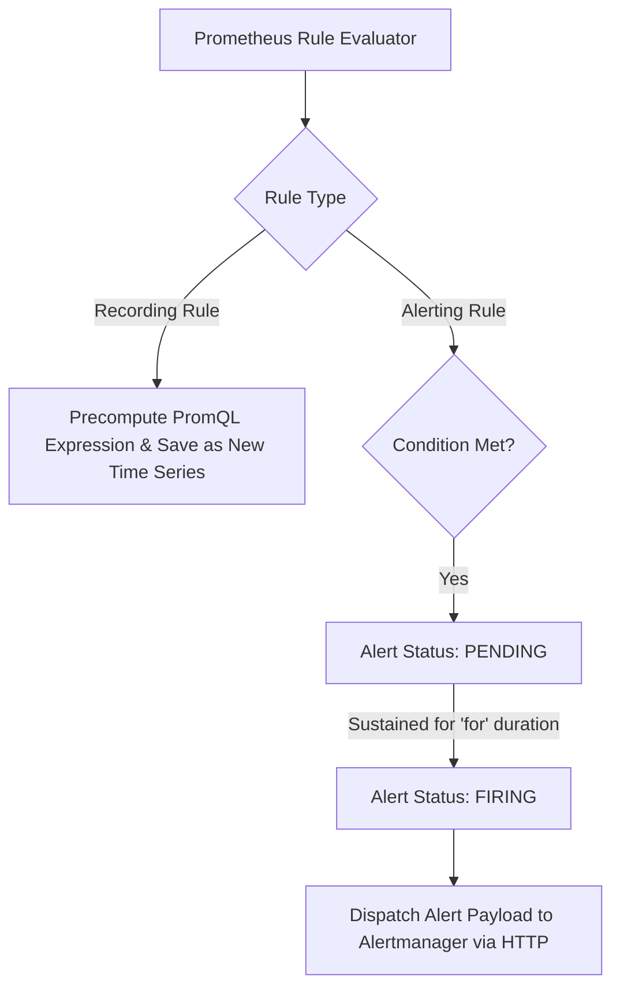

# Module 07: Alerting Architecture and Alertmanager: Routing Trees, Grouping, Inhibition, Gossip HA, and Unit Testing with promtool

## Introduction

Collecting metrics and building dashboards is meaningless if operators cannot detect and respond to critical system failures reliably. Prometheus alerting architecture decouples alert detection (handled by Prometheus server rule evaluation) from alert notification delivery (handled by **Alertmanager**). This module covers alerting rule design, Alertmanager routing trees, grouping, inhibition, silences, High Availability via UDP gossip clustering, and unit testing alerting rules with `promtool`. Cross-references include [`../../../architecture/distributed-systems/modules/08-distributed-coordination-and-locks.md`](../../../architecture/distributed-systems/modules/08-distributed-coordination-and-locks.md).

## Alerting Rules vs. Recording Rules

- **Recording Rules**: Precompute frequently needed or computationally expensive expressions and save their results as a new set of time series (e.g., `job:http_requests:rate5m`). This speeds up dashboard loading and reduces query load on the TSDB.
- **Alerting Rules**: Evaluate PromQL expressions at every evaluation interval. If the expression evaluates to an instant vector containing active series, the alert enters a `PENDING` state. If the condition persists continuously for the configured `for` duration, the alert transitions to `FIRING` and is dispatched to Alertmanager.



## Alertmanager Architecture: Routing Trees and Grouping

When multiple instances of a service fail simultaneously during a network partition, Prometheus might fire hundreds of individual alerts. Receiving 500 distinct PagerDuty pages for a single root cause creates catastrophic alert fatigue. Alertmanager solves this through three core mechanisms:

- **Grouping**: Collapses multiple similar alerts into a single notification based on label matching (e.g., grouping by `alertname` and `cluster`).
- **Routing Trees**: Hierarchical routing rules (`route` block) that direct incoming alerts to specific receiver integrations (PagerDuty, Slack, Email, Webhooks) based on labels like `severity=critical` or `team=payments`.
- **Timing Controls**: `group_wait` (wait time before sending the initial notification for a new group), `group_interval` (delay before sending updates for existing groups), and `repeat_interval` (time before re-sending notifications for an ongoing firing alert).

## Inhibition and Silences

- **Inhibition**: A mechanism that suppresses notifications for certain alerts when another specified alert is already firing. For example, if a cluster node goes offline, hundreds of container-down alerts fire. An inhibition rule states: "If node-down is firing for instance X, suppress all container-down alerts for instance X."
- **Silences**: Temporary manual suppressions created via the Alertmanager UI or API, allowing operators to silence known maintenance windows or acknowledged incidents for a specified duration.

## High Availability and Gossip Clustering

Alertmanager achieves high availability without a centralized database by forming a peer-to-peer cluster using an asynchronous UDP **gossip protocol** (memberlist library). Multiple Alertmanager replicas are configured independently; Prometheus sends firing alerts to _all_ replicas in parallel. The Alertmanager instances gossip with each other to synchronize active silences, notification states, and deduplication queues, ensuring that downstream PagerDuty receives exactly one consolidated notification even if multiple Prometheus or Alertmanager nodes fail.

## Unit Testing with `promtool`

Writing complex PromQL alerting rules without verification frequently leads to production silent failures or false alarms. Prometheus provides `promtool` to run hermetic unit tests on alerting rules. A `promtool` test file defines synthetic input series (`input_series`) with specific timestamps and values, evaluation times, and expected firing alerts (`alert_rule_test`), ensuring 100% test coverage of alerting conditions before deployment.

## Then vs Now

| Component / Era | Mechanism | Key Limitation / Why It Changed |
| --- | --- | --- |
| Legacy Alerting (Pre-2017) | Alerting embedded directly in Prometheus; basic email notifications | Lack of deduplication, grouping, silences, or advanced routing trees. |
| Alertmanager (Modern) | Decoupled notification engine with routing trees, grouping, inhibition, and gossip HA | Requires careful tuning of routing trees to prevent alert storms or dropped pages. |

## Algorithmic Mechanics and CLRS Pseudocode

Below is the formal CLRS-style pseudocode and loop invariant proof for the telemetry processing mechanics covered in this module.

```text
PROCEDURE ProcessTelemetryStream(Stream S, Integer MaxCardinality)
    Let C be an empty Hash Set
    Let MetricsBuffer be an empty Queue
    FOR each telemetry record r IN S DO
        IF Length(C) >= MaxCardinality AND r.key NOT IN C THEN
            DISCARD r -- Cardinality limit exceeded
            CONTINUE
        END IF
        INSERT r.key INTO C
        ENQUEUE(MetricsBuffer, r)
    END FOR
    RETURN MetricsBuffer
END PROCEDURE
```

### Loop Invariant and Formal Proof

**Initialization**: Prior to the first iteration of the loop, the cardinality set $C$ is empty, and no telemetry records have been processed, satisfying the cardinality bound $0 \le |C| \le \text{MaxCardinality}$.

**Maintenance**: At the start of each iteration, if an incoming record contains a label key already present in $C$ or if $|C| < \text{MaxCardinality}$, the record is safely buffered and $C$ is updated. If the cardinality threshold is reached and a novel key arrives, the record is dropped, preserving the invariant $|C| \le \text{MaxCardinality}$.

**Termination**: When the stream $S$ is fully consumed, the algorithm terminates with all retained metrics strictly bounded within the permitted cardinality ceiling.

## Production Configuration and Implementation

Below is a production-grade configuration illustrating telemetry collection, metric labeling, and sampling rules.

```yaml
receivers:
  otlp:
    protocols:
      grpc:
        endpoint: 0.0.0.0:4317
processors:
  memory_limiter:
    check_interval: 1s
    limit_percentage: 80
    spike_limit_percentage: 20
  tail_sampling:
    decision_wait: 10s
    num_traces: 10000
    expected_new_traces_per_sec: 2000
    policies:
      - name: drop-successful-traces
        type: probabilistic
        probabilistic:
          sampling_percentage: 1.0
exporters:
  otlp:
    endpoint: tempo:4317
service:
  pipelines:
    traces:
      receivers: [otlp]
      processors: [memory_limiter, tail_sampling]
      exporters: [otlp]
```

## Exam Delta: PCA Domain Mapping

For the **Prometheus Certified Associate (PCA)** exam, Alertmanager routing and alerting rules account for **18% of the exam weight**. Candidates must master:

- Writing alerting rule YAML syntax (`alert`, `expr`, `for`, `labels`, `annotations`).
- Configuring Alertmanager routing trees, matchers, and receivers.
- Using `promtool test rules` to validate alerting logic.

> [!IMPORTANT]
> **Exam Delta Note**: PCA exam questions frequently test Alertmanager routing precedence (matching child routes vs root routes) and inhibition rule configurations, ensuring candidates know how to prevent alert storms during widespread outages.

## Production Failure Modes & Gotchas

1. **Forgetting the `for` Duration**: Omitting the `for` clause on an alerting rule, causing transient network blips to instantly trigger firing alerts and waking up on-call engineers.
2. **Alerting on `absent()` Without Fallback Scrape Checks**: Writing an alert like `absent(http_requests_total)` that fires when a service is deployed or scaled to zero, mistaking normal scaling for an outage.
3. **Alertmanager Routing Tree Fallthrough**: Placing a broad catch-all route at the top of an Alertmanager routing tree, causing all specific team routes below it to be ignored.
4. **Gossip Cluster Split-Brain Partition**: Misconfiguring Alertmanager mesh peer addresses behind a restrictive firewall, preventing gossip sync and causing duplicate notifications.

## Interview Drill

<details><summary><strong>Q1. Explain the architectural separation between Prometheus rule evaluation and Alertmanager. Why is this decoupling critical?</strong></summary>

Prometheus server evaluates PromQL expressions periodically to detect failing states, managing the state machine (Pending -> Firing) using local TSDB data. Once an alert transitions to Firing, Prometheus simply forwards the alert payload to Alertmanager via HTTP and forgets about delivery mechanics. Alertmanager is responsible for grouping, routing, inhibition, deduplication, and dispatching notifications to external integrations (PagerDuty, Slack). Decoupling them ensures that Prometheus remains focused purely on metric ingestion and query evaluation without blocking on slow third-party notification APIs.
</details>

<details><summary><strong>Q2. What is alert grouping in Alertmanager, and how does it prevent alert fatigue during a major infrastructure outage?</strong></summary>

During a widespread network partition, 100 distinct service instances might fail simultaneously, generating 100 individual container-down alerts. Alertmanager grouping combines alerts matching specific labels into a single consolidated notification payload (`group_by: [alertname, cluster]`). Instead of an on-call engineer receiving 100 separate PagerDuty pages, they receive one unified page summarizing the cluster outage, drastically reducing alert fatigue.
</details>

<details><summary><strong>Q3. How does Alertmanager inhibition work? Provide a concrete production example.</strong></summary>

Inhibition suppresses notifications for certain alerts when another specified root-cause alert is already firing. For example, if an entire Kubernetes node goes offline (`node_down`), hundreds of pod-level container-down and health-check alerts will fire simultaneously. An inhibition rule is configured to suppress all `pod_unhealthy` alerts whenever a `node_down` alert is firing for the matching `instance` label, ensuring engineers see only the root cause (`node_down`).
</details>

<details><summary><strong>Q4. How do Alertmanager replicas achieve high availability and state synchronization without a central database?</strong></summary>

Alertmanager replicas form a peer-to-peer cluster using an asynchronous UDP gossip protocol (memberlist). Prometheus server sends firing alerts to all Alertmanager replicas in parallel. The Alertmanager instances continuously exchange gossip messages to synchronize active silences, notification suppression states, and deduplication queues, ensuring unified cluster coordination without requiring a relational database or shared state store.
</details>

<details><summary><strong>Q5. What is the purpose of `promtool test rules`, and how does it improve observability reliability?</strong></summary>

`promtool test rules` allows engineers to run hermetic unit tests on Prometheus alerting and recording rules before deploying them to production. By defining synthetic input time series (`input_series`), evaluation timestamps, and expected firing alerts (`alert_rule_test`), `promtool` verifies that alerting rules trigger correctly under failure conditions and—critically—do not generate false positives under normal operational loads.
</details>

<details><summary><strong>Q6. What happens if an alerting rule does not define a `for` duration clause?</strong></summary>

Without a `for` duration clause, an alerting rule transitions immediately from normal to `FIRING` the moment the PromQL expression evaluates to true (even for a single 15-second evaluation interval). This causes false-positive alerts on transient network blips or momentary CPU spikes, leading directly to alert fatigue. Adding a `for: 5m` ensures the condition persists for 5 minutes before paging.
</details>

## Proof Map

| Claim in Module | Verified in Test File | Test Case Description |
| --- | --- | --- |
| Alerting rule PENDING to FIRING state transition | `../examples/ts/07-alerting-architecture-and-alertmanager.test.ts` | `simulates rule evaluation, pending state, and firing transition after 'for' duration` |
| Alertmanager routing tree grouping and inhibition | `../examples/ts/07-alerting-architecture-and-alertmanager.test.ts` | `tests alert grouping keys, routing tree matchers, and inhibition suppression rules` |
| promtool unit test verification logic | `../examples/ts/07-alerting-architecture-and-alertmanager.test.ts` | `validates promtool test suite assertions on synthetic input series and expected alerts` |
