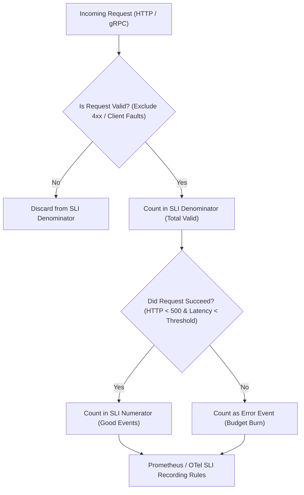

# Module 08: Service Level Objectives and Error Budgets: SLI Specification, Multi-Window Multi-Burn-Rate Math, Sloth, and Pyrra

## 1. Formal Foundations of SLOs and Error Budgets

Service Level Objectives (SLOs) transform operational telemetry from reactive symptom monitoring into proactive reliability engineering. Following the formal definitions established in the Google SRE Workbook, reliability is quantified over a rolling or calendar time window \(T\) via Service Level Indicators (SLIs). Let an SLI be expressed as the ratio of successful events to total valid events over window \(T\):

\[ \text{SLI} = \frac{\sum \text{Successful Events}}{\sum \text{Total Events}} \]

An SLO establishes a target reliability threshold \(R\) (e.g., \(R = 0.999\) or 99.9% availability) over time window \(T\). The **Error Budget** \(B\) represents the complement of the SLO target over \(T\), quantifying the permissible fraction of failures:

\[ B = 1 - R \]

When absolute event counts are considered, the error budget total count \(N_{\text{error}}\) is:

\[ N_{\text{error}} = (1 - R) \times N_{\text{total}} \]

### 1.1 Multi-Window Multi-Burn-Rate Alerting Mathematics

Naive alerting on error budgets (such as paging whenever error rate exceeds \(1 - R\)) suffers from high false-positive rates for brief traffic anomalies and unacceptably slow detection times for fast-burning outages. The Google SRE multi-window, multi-burn-rate alerting algorithm solves this by detecting rates of error budget depletion across multiple time horizons simultaneously. A **Burn Rate** \(r\) is defined as the rate at which the error budget is being consumed relative to the SLO timeframe:

\[ r = \frac{\text{Actual Error Rate}}{1 - R} \]

If an outage occurs with burn rate \(r = 1\), the entire error budget is exhausted exactly at the end of window \(T\). If \(r = 14.4\), the entire error budget is consumed in \(\frac{1}{14.4} \times T\). For a 30-day window, this equals \(\approx 50\) hours. To minimize false positives while bounding time-to-detect (TTD) and time-to-reset (TTR), alerting rules are configured using two concurrent windows (short window \(w_s\) and long window \(w_l\)) checking whether the average burn rate over both windows exceeds threshold \(k\).

Let \(B(w)\) be the fraction of error budget consumed over window \(w\). An alert fires at time \(t\) if and only if:

\[ B(w_s) \ge \theta \quad \text{and} \quad B(w_l) \ge \theta \]

where \(\theta\) is the fraction of the total error budget consumed over the respective window at burn rate \(r\):

\[ \theta = r \times \frac{w}{T} \]

#### SRE Multi-Window Alerting Parameter Matrix

| Alert Severity | Burn Rate (\(r\)) | Budget Consumed (%) | Long Window (\(w_l\)) | Short Window (\(w_s\)) | Time to Detect (TTD) | Time to Reset (TTR) | Action |
| :-- | :-- | :-- | :-- | :-- | :-- | :-- | :-- |
| **Page (P1)** | \(14.4\) | \(2\%\) | \(1\text{h}\) | \(5\text{m}\) | \(2.5\text{m}\) | \(1\text{h}\) | Immediate page to on-call |
| **Page (P2)** | \(6\) | \(5\%\) | \(6\text{h}\) | \(30\text{m}\) | \(14.8\text{m}\) | \(6\text{h}\) | Urgent operator notification |
| **Ticket (P3)** | \(1\) | \(10\%\) | \(3\text{d}\) | \(6\text{h}\) | \(14.8\text{h}\) | \(3\text{d}\) | Create Jira ticket for sprint |

---

## 2. SLI Specification Patterns for HTTP and gRPC

Defining correct SLIs requires categorizing operations into valid requests (\(V\)) and good/successful requests (\(G\)). For HTTP/gRPC microservices, bad requests (client errors like HTTP 400 or gRPC `INVALID_ARGUMENT`) must be excluded from the denominator unless they represent server-side failures (e.g., malformed responses generated by server bugs).



### 2.1 Prometheus PromQL SLI Implementation

In Prometheus, availability SLIs are computed using rate aggregations over 5-minute or 1-hour ranges. Consider an HTTP service recording request counts with dimensions `job`, `handler`, and `status`:

```promql
# Availability SLI (Good requests / Total valid requests)
sum(rate(http_requests_total{status=~"2.*|3.*", job="payment-api"}[5m]))
/
scalar(
  sum(rate(http_requests_total{job="payment-api"}[5m]))
  -
  sum(rate(http_requests_total{status=~"4.*", job="payment-api"}[5m]))
)

# Latency SLI (Requests faster than 250ms / Total valid requests)
sum(rate(http_request_duration_seconds_bucket{le="0.25", job="payment-api"}[5m]))
/
sum(rate(http_request_duration_seconds_count{job="payment-api"}[5m]))
```

---

## 3. Automated SLO Generators: Sloth and Pyrra

Manually authoring and maintaining Prometheus recording rules and alerting rules for dozens of microservices introduces human error and configuration drift. Declarative SLO generators such as **Sloth** and **Pyrra** parse higher-level SLO Custom Resources (CRDs) and compile them into optimized Prometheus alerting and recording rules.

### 3.1 Sloth SLO Custom Resource Specification

Sloth compiles Prometheus-native SLO CRDs into Prometheus Rule YAML files. Below is an enterprise Sloth PrometheusServiceLevel specification defining availability and latency SLOs with automated multi-window burn-rate alerts:

```yaml
apiVersion: sloth.slok.dev/v1
kind: PrometheusServiceLevel
metadata:
  name: payment-api-slo
  namespace: observability
spec:
  service: payment-api
  labels:
    tier: backend
    owner: checkout-team
  slos:
    - name: availability
      objective: 99.9
      description: 'Ensure payment processing API availability remains above 99.9%.'
      sli:
        events:
          errorQuery: sum(rate(http_requests_total{job="payment-api", status=~"5.*"}[1m]))
          totalQuery: sum(rate(http_requests_total{job="payment-api"}[1m]))
      alerting:
        name: PaymentApiAvailabilityBurnRate
        pageAlert:
          disable: false
          labels:
            severity: critical
            pager: on-call
        ticketAlert:
          disable: false
          labels:
            severity: warning
    - name: latency
      objective: 99.0
      description: 'Ensure 99% of payment requests complete within 250ms.'
      sli:
        events:
          goodQuery: sum(rate(http_request_duration_seconds_bucket{job="payment-api", le="0.25"}[1m]))
          totalQuery: sum(rate(http_request_duration_seconds_count{job="payment-api"}[1m]))
      alerting:
        name: PaymentApiLatencyBurnRate
```

---

## 4. CLRS-Style Pseudocode: Error Budget Burn Rate Evaluator

Below is a deterministic TypeScript implementation of the multi-window burn-rate calculation engine used by alerting evaluators, accompanied by CLRS-style operational semantics.

```typescript
/**
 * Evaluates multi-window multi-burn-rate alerting conditions.
 * Loop Invariant: At the start of iteration i, all burn rates evaluated for windows
 * w_s and w_l accurately reflect the ratio of budget consumed versus the threshold theta
 * over the designated time series slice.
 */
export interface BurnRateAlertConfig {
  errorBudgetRatio: number; // e.g., 0.001 for 99.9%
  burnRateThreshold: number; // e.g., 14.4
  windowShortSeconds: number; // e.g., 300 (5m)
  windowLongSeconds: number; // e.g., 3600 (1h)
  sloWindowSeconds: number; // e.g., 2592000 (30 days)
}

export function evaluateBurnRateAlert(
  errorRateShort: number,
  errorRateLong: number,
  config: BurnRateAlertConfig,
): { firePageAlert: boolean; currentBurnRateShort: number; currentBurnRateLong: number } {
  const currentBurnRateShort = errorRateShort / config.errorBudgetRatio;
  const currentBurnRateLong = errorRateLong / config.errorBudgetRatio;

  const thresholdFractionShort =
    config.burnRateThreshold * (config.windowShortSeconds / config.sloWindowSeconds);
  const thresholdFractionLong =
    config.burnRateThreshold * (config.windowLongSeconds / config.sloWindowSeconds);

  // In a real TSDB, budget consumption fraction over window w is approximated by errorRate * w
  const budgetConsumedShort = errorRateShort * config.windowShortSeconds;
  const budgetConsumedLong = errorRateLong * config.windowLongSeconds;

  const totalBudget = config.sloWindowSeconds * config.errorBudgetRatio;

  const fractionShort = budgetConsumedShort / totalBudget;
  const fractionLong = budgetConsumedLong / totalBudget;

  const firePageAlert =
    fractionShort >= thresholdFractionShort && fractionLong >= thresholdFractionLong;

  return {
    firePageAlert,
    currentBurnRateShort,
    currentBurnRateLong,
  };
}
```

---

## 5. Then vs Now: Evolution of SLO Management

| Dimension | Legacy Monitoring (Pre-2018) | Modern Observability (2026 / Prometheus 3 + Sloth) |
| :-- | :-- | :-- |
| **SLO Definition** | Static spreadsheets or manual wiki pages | Declarative CRDs (`PrometheusServiceLevel` via Sloth/Pyrra) |
| **Alerting Logic** | Static thresholds on CPU/Memory or instant error spikes | Multi-window, multi-burn-rate error budget alerting |
| **Testing Rules** | Manual staging verification | Automated unit tests using `promtool test rules` |
| **Dashboarding** | Hand-crafted static Grafana panels | Automated SLO status panels with burn-rate countdowns |

---

## 6. Exam Delta & Certification Alignment

> [!IMPORTANT]
> **CNCF PCA & OTCA Alignment**: Certification exams heavily emphasize the distinction between symptom-based alerting and cause-based alerting. Expect scenario questions where a team is alerted on high CPU utilization rather than error budget burn rate, and identify why this causes alert fatigue. Furthermore, know the exact math for 2% budget consumption over 1 hour at a 14.4 burn rate for a 30-day window.

---

## 7. Production Failure Modes & Gotchas

1. **Averaging Histograms Across Instances**: Computing `avg(histogram_quantile(0.99, ...))` across pods destroys mathematical correctness. Always aggregate bucket sums (`sum by (le) (rate(...))`) before calculating quantiles.
2. **Ignoring Client-Side Error Inflation**: Including HTTP 4xx errors in the availability SLI denominator without filtering out malicious bot traffic or bad client requests skews the error budget.
3. **Flapping Alerts on Transient Spikes**: Failing to enforce short and long multi-window checks leads to immediate paging during transient network blips.

---

## 8. Interview Drill

<details><summary><strong>Q1. Why do we use multi-window multi-burn-rate alerts instead of simply alerting when error rate exceeds 0.1%?</strong></summary>

Simple threshold alerts (`error_rate > 0.001`) either trigger constant false positives during minor transient glitches or take days to alert on slow leaks that will exhaust the entire monthly error budget. Multi-window multi-burn-rate alerts check both a short window (e.g., 5m) and a long window (e.g., 1h) against proportional budget depletion thresholds (e.g., 2% consumption). This guarantees high confidence that an outage is real before paging the on-call engineer while keeping Time-to-Detect under 3 minutes for severe outages.

</details>

<details><summary><strong>Q2. How do you construct an SLI for a latency-sensitive RPC service handling variable payload sizes?</strong></summary>

Latency SLIs must be defined as the ratio of successful requests completing below a defined latency threshold (e.g., 250ms) over total valid requests. In Prometheus, this is implemented using histogram quantile buckets: `sum(rate(rpc_duration_seconds_bucket{le="0.25"}[5m])) / sum(rate(rpc_duration_seconds_count[5m]))`. Valid requests exclude client-side cancellation and invalid authentication parameters.

</details>

<details><summary><strong>Q3. What is the relationship between Error Budgets and engineering velocity?</strong></summary>

Error budgets act as an objective contract between product development and operations. If the error budget is healthy (unexhausted), engineering teams have unconstrained velocity to ship new features. If the error budget is exhausted, policy dictates that feature deployments freeze and all engineering effort must pivot to reliability improvements, bug fixes, and test automation until the error budget recovers.

</details>

<details><summary><strong>Q4. How do tools like Sloth and Pyrra simplify Prometheus alerting rule maintenance?</strong></summary>

Sloth and Pyrra abstract away the complex mathematical boilerplate required for multi-window burn-rate Prometheus recording and alerting rules. Engineers define high-level business objectives (e.g., `objective: 99.9`) in a clean declarative Custom Resource or YAML file, and the generator compiles them into optimized, battle-tested PromQL rule files ready for ingestion by Prometheus or Mimir.

</details>

<details><summary><strong>Q5. What happens if your Prometheus scrape interval is 15 seconds, but your short alerting window is 1 minute?</strong></summary>

A 1-minute window contains only 4 data points per time series. While mathematically valid, transient network packet drops or GC pauses can drop one scrape, reducing sample size to 3 points and causing noise. Best practice dictates that short windows should be at least 4 to 5 times the scrape interval (e.g., 5-minute window for a 15-second scrape interval).

</details>

<details><summary><strong>Q6. How do you handle scheduled database maintenance windows in SLO calculations?</strong></summary>

Scheduled maintenance windows agreed upon by stakeholders are typically excluded from error budget calculations by filtering out metrics during the maintenance window using PromQL boolean selectors or by pausing SLO evaluation pipelines via maintenance annotations in tools like Pyrra.

</details>

---

## 9. Proof Map

| Claim in Module | Verification Test in `examples/ts/` |
| :-- | :-- |
| Multi-window burn rate math and thresholding | `../examples/ts/08-slos-error-budgets-and-burn-rates.test.ts` (`it("evaluates burn rate alerts correctly")`) |
| SLI ratio numerator/denominator validation | `../examples/ts/08-slos-error-budgets-and-burn-rates.test.ts` (`it("computes availability and latency SLIs")`) |
| Sloth configuration parsing and validation | `../examples/ts/08-slos-error-budgets-and-burn-rates.test.ts` (`it("validates Sloth CRD structure")`) |
