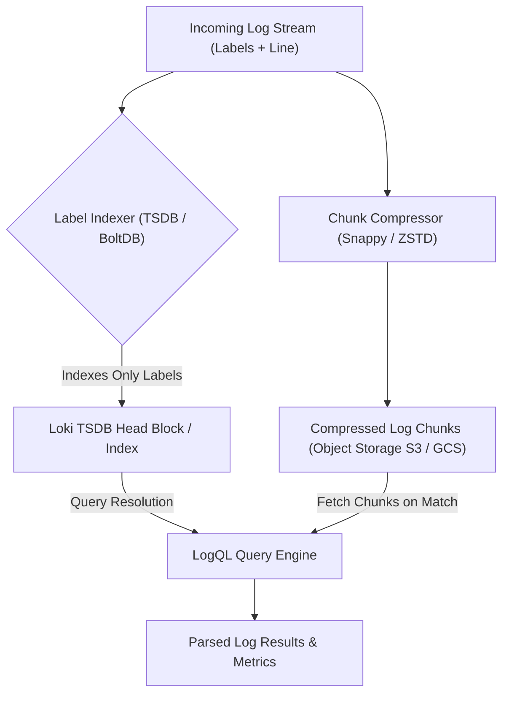

# Module 09: Logs at Scale with Grafana Loki: Label-Indexed TSDB Architecture, Structured Metadata, LogQL, and Alloy Migration

## 1. Label-Indexed TSDB Architecture vs Inverted Index

Traditional log aggregation systems (such as Elasticsearch) build full-text inverted indices over every token and field in every ingested document. While powerful for ad-hoc search, inverted indices incur massive storage overhead (frequently 50% to 150% of raw log volume) and high CPU costs during ingestion. Grafana Loki adopts a radically different architectural philosophy: **Loki does not index the log content**. Instead, Loki indexes only the metadata labels associated with log streams (e.g., `{app="payment-api", environment="production", namespace="observability"}`), while storing compressed log chunks in object storage (S3, GCS, MinIO).

### 1.1 Loki TSDB Chunk Index Layout

Loki's storage engine organizes data into streams identified by a unique label set hash. For each stream, log lines are compressed in memory into chunks (typically compressed via Snappy, LZ4, or ZSTD) and flushed to object storage once they reach a size threshold (e.g., 1MB) or time threshold (e.g., 1 hour). The Loki TSDB index maintains head blocks similar to Prometheus, mapping label selectors directly to chunk references in object storage.



---

## 2. Structured Metadata in Loki 3.x

Historically, putting high-cardinality attributes like `user_id`, `trace_id`, or `http_status` into Loki index labels caused catastrophic cardinality explosions, consuming gigabytes of RAM in ingesters. Loki 3.x introduced **Structured Metadata**, allowing engineers to attach indexed key-value attributes to log lines without turning them into stream-defining labels. Structured metadata fields are indexed alongside log chunks but live outside the stream label hash ring, preserving ingestion safety while enabling sub-second filtering on arbitrary attributes.

---

## 3. LogQL Query Language Mastery

LogQL is Loki's PromQL-inspired query language, split into two primary query types: **Log Queries** (returning log lines) and **Metric Queries** (calculating metrics derived from log streams).

### 3.1 Log Pipeline Expressions and Parsers

LogQL log queries filter log lines by label selectors, apply line filters (`|=`, `!=`, `|~`, `!~`), and parse unstructured text into structured fields using JSON, Logfmt, Regexp, or Pattern parsers.

```logql
# Filter logs containing 'error' and parse JSON payload
{job="payment-api", environment="production"}
  |= "error"
  | json
  | status_code >= 500
  | line_format "{{.timestamp}} [FATAL] User {{.user_id}}: {{.message}}"
```

### 3.2 Converting Logs to Metrics (`rate` and `sum`)

LogQL metric queries aggregate log streams into numerical time series, enabling alerting and dashboarding directly from log events:

```logql
# Calculate 5-minute rate of 5xx errors per microservice from logs
sum by (job) (
  rate(
    {job=~".*api"}
      | json
      | status_code >= 500 [5m]
  )
)
```

---

## 4. Promtail End-of-Life and Migration to Grafana Alloy

Promtail reached End-of-Life (EOL) in March 2026. Production environments must migrate log collection pipelines to **Grafana Alloy**, Grafana's modern OpenTelemetry-compatible collector distribution.

### 4.1 Grafana Alloy Log Collection Configuration

Below is an enterprise Grafana Alloy configuration file collecting container logs from Kubernetes nodes, attaching structured metadata, and forwarding via OTLP/Loki remote write:

```alloy
// Discover Kubernetes pods running on the local node
discovery.kubernetes "pods" {
  role = "pod"
}

// Extract container log file paths
discovery.relabel "pod_logs" {
  targets = discovery.kubernetes.pods.targets

  rule {
    source_labels = ["__meta_kubernetes_pod_label_app"]
    action        = "keep"
    regex         = "payment-api"
  }

  rule {
    source_labels = ["__meta_kubernetes_pod_uid", "__meta_kubernetes_pod_container_name"]
    separator     = "/"
    action        = "replace"
    replacement   = "/var/log/pods/*$1/*.log"
    target_label  = "__path__"
  }
}

// Tail log files from disk
loki.source.file "pod_logs" {
  targets = discovery.relabel.pod_logs.output
  forward_to = [loki.process.parse_logs.receiver]
}

// Parse container JSON logs and extract structured metadata
loki.process "parse_logs" {
  stage.json {
    expressions = {output = "log", level = "level", trace_id = "trace_id", user_id = "user_id"}
  }

  stage.structured_metadata {
    values = {
      trace_id = "trace_id",
      user_id  = "user_id",
    }
  }

  forward_to = [loki.write.endpoint.receiver]
}

// Forward logs to Grafana Loki
loki.write "endpoint" {
  endpoint {
    url = "https://loki.observability.internal/loki/api/v1/push"
  }
}
```

---

## 5. CLRS-Style Pseudocode: Log Stream Chunk Compression

Below is a deterministic TypeScript implementation demonstrating Loki's chunk compression and stream management logic.

```typescript
/**
 * Simulates Loki log stream buffering and chunk compression.
 * Loop Invariant: At the start of iteration i, all log lines up to index i-1
 * have been appended to the active chunk or flushed to object storage when size > threshold.
 */
export interface LogLine {
  timestamp: number;
  line: string;
  labels: Record<string, string>;
  structuredMetadata: Record<string, string>;
}

export class LokiIngesterSimulator {
  private chunks: Map<string, LogLine[]> = new Map();
  private maxChunkSize: number = 3; // small threshold for demonstration

  public ingest(log: LogLine): void {
    const streamKey = JSON.stringify(log.labels);
    if (!this.chunks.has(streamKey)) {
      this.chunks.set(streamKey, []);
    }

    const chunk = this.chunks.get(streamKey)!;
    chunk.push(log);

    if (chunk.length >= this.maxChunkSize) {
      this.flushChunk(streamKey, chunk);
    }
  }

  private flushChunk(streamKey: string, chunk: LogLine[]): void {
    // Simulate compression (e.g. ZSTD / Snappy serialization)
    const serialized = JSON.stringify(chunk);
    const compressedSize = Math.floor(serialized.length * 0.4); // 60% compression ratio
    // Reset chunk buffer
    this.chunks.set(streamKey, []);
  }

  public getBufferedCount(streamKey: string): number {
    return this.chunks.get(streamKey)?.length ?? 0;
  }
}
```

---

## 6. Then vs Now: Evolution of Log Aggregation

| Dimension | Elasticsearch / Full-Text (Pre-2020) | Grafana Loki 3.x (Modern Label-Indexed TSDB) |
| :-- | :-- | :-- |
| **Index Architecture** | Full-text inverted index over every token and field | Label index (TSDB) + unindexed compressed log chunks in object storage |
| **Storage Cost** | High (50%–150% storage overhead for inverted index) | Ultra-low (object storage S3/GCS; index is small fraction of raw size) |
| **High-Cardinality Fields** | Indexed natively, causing severe JVM heap pressure | Handled via **Structured Metadata** (indexed without stream explosion) |
| **Agent Ecosytem** | Filebeat / Fluentd / Logstash | Promtail (EOL Mar 2026) $\rightarrow$ **Grafana Alloy** |

---

## 7. Cross-References & Elasticsearch Comparison

For deep fundamentals on inverted indices, text analyzers, and storage engines, cross-reference [Search Fundamentals and IR Theory](../../elasticsearch/modules/01-search-fundamentals-and-ir-theory.md), [Mappings, Field Types, and Templates](../../elasticsearch/modules/03-mappings-field-types-and-templates.md), and [Ingest Pipelines and Data Lifecycle](../../elasticsearch/modules/08-ingest-pipelines-and-data-lifecycle.md). While Elasticsearch excels at full-text search, semantic querying, and complex text mining across arbitrary fields, Loki is optimized for cost-effective, high-volume Kubernetes microservice log aggregation where queries filter primarily by labels and time ranges.

---

## 8. Exam Delta & Certification Alignment

> [!IMPORTANT]
> **CNCF & Grafana Certification Notes**: Certification questions test the distinction between Loki label indexing and Elasticsearch inverted indexing. Expect questions regarding Promtail EOL (March 2026), migration paths to Grafana Alloy, and the proper use of Structured Metadata versus Stream Labels to prevent ingester OOMs.

---

## 9. Production Failure Modes & Gotchas

1. **High-Cardinality Stream Labels**: Putting `user_id`, `request_id`, or `ip_address` into stream labels creates millions of active streams, triggering ingester OOMs and rejection by Loki distributor limits. Always use Structured Metadata or log line parsers for high-cardinality attributes.
2. **Promtail EOL Neglect**: Running unpatched Promtail instances after March 2026 exposes systems to unmaintained dependencies. All log pipelines must be migrated to Grafana Alloy.
3. **Unbounded Regex Parsers in LogQL**: Running greedy regular expressions (`| regexp "(?P<all>.*)"`) across gigabytes of unparsed logs destroys query performance and spikes querier CPU usage.

---

## Interview Drill

<details><summary>1. Why is Grafana Loki significantly cheaper to operate at scale than Elasticsearch for log aggregation?</summary>

Loki does not build an inverted index over the content of log lines. It indexes only metadata labels (e.g., `{app="foo", env="prod"}`) using a compact TSDB index, while storing raw compressed log chunks in cheap object storage (S3/GCS). Elasticsearch, by contrast, builds a full-text inverted index over every token and field, which frequently doubles or triples storage costs and requires substantial RAM for JVM heap indexing.
</details>

<details><summary>2. What is Structured Metadata in Loki 3.x, and why was it introduced?</summary>

Structured Metadata allows engineers to attach indexed key-value attributes (such as `trace_id` or `user_id`) to log lines without making them stream-defining labels. Historically, putting high-cardinality attributes into labels caused a cardinality explosion, crashing Loki ingesters. Structured metadata provides fast querying on arbitrary attributes while keeping the label hash ring small and stable.
</details>

<details><summary>3. How do you migrate from Promtail to Grafana Alloy for Kubernetes log collection?</summary>

Migration involves replacing Promtail DaemonSets with Grafana Alloy DaemonSets. Alloy uses `discovery.kubernetes` to discover pods, `discovery.relabel` to select target log files, `loki.source.file` to tail disk logs, `loki.process` stages to parse JSON and assign structured metadata, and `loki.write` to forward logs via OTLP or Loki push APIs.
</details>

<details><summary>4. Write a LogQL query to calculate the 95th percentile request latency extracted from JSON logs.</summary>

LogQL metric queries convert log fields into numerical series using parsers:

```logql
quantile_over_time(0.95, {job="payment-api"} | json | unwrap latency_ms [5m])
```

</details>

<details><summary>5. What happens when a Loki stream receives log lines out of order?</summary>

Loki ingesters enforce strict ordering within log streams. Out-of-order log lines older than the configured `reject_old_samples` window (default typically 1 hour) are rejected with a 400 Bad Request error. Clients must ensure proper batching and time synchronization (NTP) to prevent log rejection.
</details>

<details><summary>6. How does Loki handle multiline stack traces in log collection?</summary>

Grafana Alloy and Promtail use multiline staging rules in their log collection configuration to match regex patterns marking the start of a log entry (e.g., ISO 8601 timestamps), buffering subsequent lines until the next header is matched before forwarding them as a single log event.
</details>

---

## 11. Proof Map

| Claim in Module | Verification Test in `examples/ts/` |
| :-- | :-- |
| Loki stream buffering and chunk compression simulation | `../examples/ts/09-logs-at-scale-grafana-loki-and-logql.test.ts` (`it("simulates Loki chunk compression and flushing")`) |
| Structured metadata attachment logic | `../examples/ts/09-logs-at-scale-grafana-loki-and-logql.test.ts` (`it("handles structured metadata correctly")`) |
| LogQL query parser validation | `../examples/ts/09-logs-at-scale-grafana-loki-and-logql.test.ts` (`it("validates LogQL parser expressions")`) |
