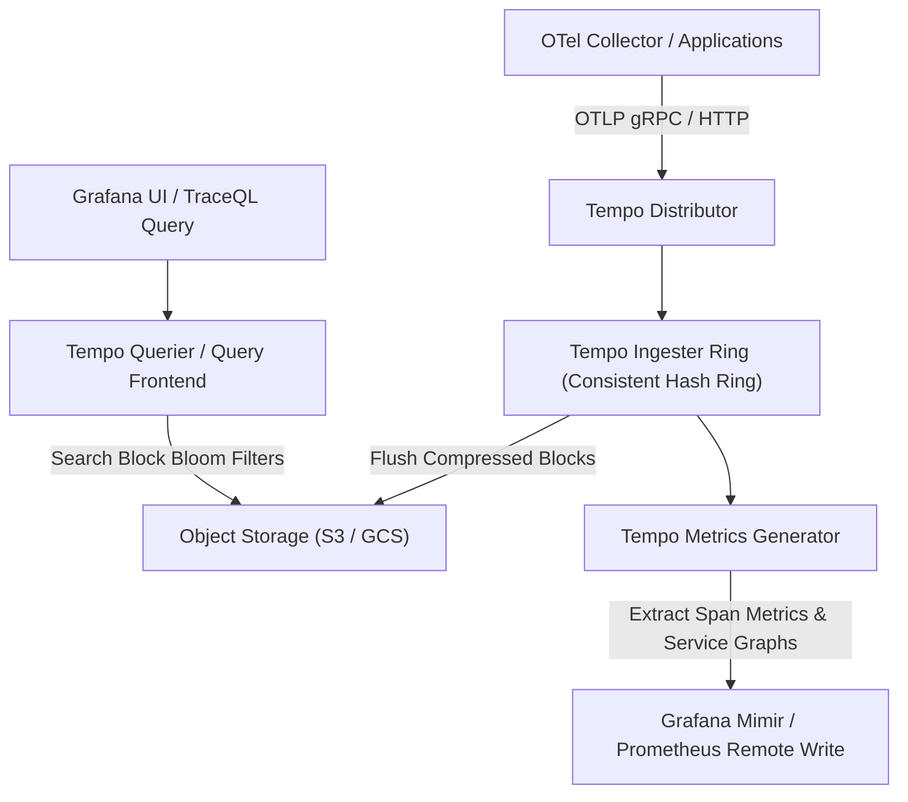
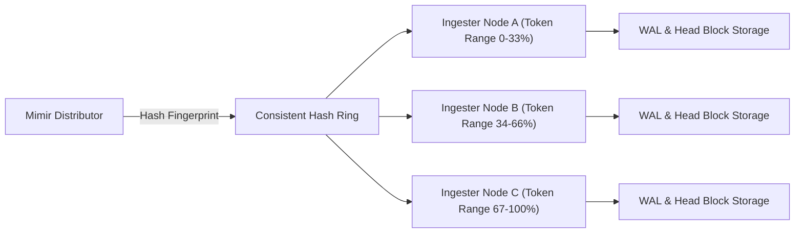

# Module 10: Distributed Tracing and Horizontally Scalable Metrics: Grafana Tempo, TraceQL, Span Metrics, and Mimir Hash Rings

## 1. Grafana Tempo Architecture and TraceQL

Distributed tracing tracks the propagation of requests across distributed microservice boundaries. Traditional tracing backends (such as Jaeger or Zipkin with Elasticsearch) build heavy inverted indices over every span attribute, trace ID, and service name, resulting in severe storage amplification. **Grafana Tempo** eliminates trace indexing entirely. Tempo stores raw span data compressed in object storage (S3, GCS), indexing only trace IDs in a lightweight, distributed backend (using block lists or Bloom filters).

### 1.1 Tempo Ingestion and Metrics Generator Pipeline



### 1.2 TraceQL Query Language Semantics

TraceQL is Tempo's query language designed to navigate complex trace trees and span relationships without relying on relational database joins. TraceQL queries operate on spans using scope selectors and hierarchical combiners (`.`, `>`).

```traceql
{
  resource.service.name = "payment-api"
  && span.http.status_code >= 500
}
>
{
  resource.service.name = "database-service"
  && duration > 500ms
}
```

---

## 2. Horizontally Scalable Metrics with Grafana Mimir Hash Rings

Grafana Mimir provides a horizontally scalable, highly available, multi-tenant Prometheus-compatible metrics backend. Mimir decouples ingestion, querying, and storage compaction across a stateless microservice architecture coordinated by consistent hash rings.

### 2.1 Consistent Hashing and Replication in Mimir Ingesters

Mimir ingesters participate in a consistent hash ring (powered by memberlist or Consul). Every incoming time series is mapped to a token space using the series fingerprint (hash of metric name and label set). To ensure durability and high availability during node failures, Mimir replicates each time series across a configurable replication factor \(RF = 3\).



---

## 3. CLRS-Style Pseudocode: Consistent Hash Ring Token Allocation

Below is a deterministic TypeScript implementation of a consistent hash ring allocator used by distributed metrics and tracing routers, cross-referencing [Hashing and Hash Tables](../../../algorithms/dsa/modules/03-hashing-and-hash-tables.md).

```typescript
/**
 * Implements a consistent hash ring with virtual nodes for distributed component routing.
 * Loop Invariant: At the start of iteration i, all virtual nodes for node i-1
 * have been correctly placed onto the sorted token ring.
 */
export class ConsistentHashRing {
  private ring: Map<number, string> = new Map();
  private sortedKeys: number[] = [];
  private virtualNodes: number;

  constructor(virtualNodes: number = 64) {
    this.virtualNodes = virtualNodes;
  }

  public addNode(nodeId: string): void {
    for (let i = 0; i < this.virtualNodes; i++) {
      const hash = this.hashFunction(`${nodeId}-vnode-${i}`);
      this.ring.set(hash, nodeId);
      this.sortedKeys.push(hash);
    }
    this.sortedKeys.sort((a, b) => a - b);
  }

  public getNode(key: string): string {
    if (this.sortedKeys.length === 0) {
      throw new Error('Hash ring is empty');
    }
    const hash = this.hashFunction(key);
    for (const ringKey of this.sortedKeys) {
      if (hash <= ringKey) {
        return this.ring.get(ringKey)!;
      }
    }
    return this.ring.get(this.sortedKeys[0])!;
  }

  private hashFunction(str: string): number {
    let hash = 0;
    for (let i = 0; i < str.length; i++) {
      hash = (hash << 5) - hash + str.charCodeAt(i);
      hash |= 0;
    }
    return Math.abs(hash);
  }
}
```

---

## 4. Then vs Now: Evolution of Tracing and Scalable Metrics

| Dimension | Legacy Jaeger / Prometheus HA (Pre-2020) | Modern Tempo 3.x & Mimir 3.2 (2026) |
| :-- | :-- | :-- |
| **Tracing Index** | Heavy Elasticsearch / Cassandra inverted index | Zero index (Object storage + Bloom filter trace ID lookup) |
| **Metrics Scalability** | Single-node Prometheus with manual federation | Horizontally scalable Mimir hash rings with S3 block storage |
| **Span Metrics** | Manual instrumentation / custom recording rules | Automated extraction via Tempo Metrics Generator |
| **Query Language** | Custom UI filters or basic Lucene queries | **TraceQL** structured tree queries |

---

## 5. Exam Delta & Certification Alignment

> [!IMPORTANT]
> **CNCF & Observability Certification Notes**: Exams test distributed tracing mechanics, specifically how Tempo avoids indexing span attributes and how trace ID lookup relies on Bloom filters. For Mimir, understand consistent hashing, replication factors, and how distributors route Remote Write traffic to ingesters without data loss.

---

## 6. Production Failure Modes & Gotchas

1. **Hash Ring Split-Brain in Mimir**: Network partitions in memberlist gossip communication can cause ingester ring fragmentation, leading to temporary metric ingestion rejections or duplicate blocks.
2. **Tempo Block Retention Misconfiguration**: Setting object storage lifecycle rules too aggressively on Tempo WAL/blocks deletes trace data prematurely before investigation.
3. **High Cardinality Span Attributes**: Attaching unique database query strings or dynamic URLs as span attributes in Tempo bloats block sizes and degrades TraceQL query performance.

---

## Interview Drill

<details><summary>1. How does Grafana Tempo achieve sub-second trace retrieval across petabytes of data without maintaining an inverted index?</summary>

Tempo relies on direct object storage (S3/GCS) storage of compressed blocks. Instead of indexing every span attribute or token, Tempo indexes only trace IDs in lightweight block-level Bloom filters and index files. When a TraceQL query specifies a trace ID, Tempo queries the block index directly, downloads the exact compressed block from object storage, and streams the spans into memory.
</details>

<details><summary>2. Explain how Grafana Mimir uses consistent hashing and replication rings to scale metric ingestion horizontally.</summary>

Mimir distributors hash incoming metric time series signatures against a consistent hash ring populated by ingester virtual nodes. To guarantee high availability and fault tolerance, each time series is written concurrently to \(RF = 3\) consecutive ingesters on the ring. If an ingester fails, the ring rebalances ownership automatically without dropping active remote write traffic.
</details>

<details><summary>3. What is the role of the Tempo Metrics Generator, and what signals does it produce?</summary>

The Tempo Metrics Generator consumes spans streamed from distributors and extracts aggregated RED metrics (Request rate, Error rate, Duration histograms) and Service Graphs (dependency topologies between microservices), forwarding them via Prometheus Remote Write to Mimir or Prometheus.
</details>

<details><summary>4. How does TraceQL differ from traditional log or query languages like SQL?</summary>

TraceQL is hierarchical and tree-aware. Instead of treating records as isolated rows or log lines, TraceQL queries evaluate parent-child span relationships, durations, and attribute conditions across distributed execution paths using structural combiners like `>`.
</details>

<details><summary>5. What happens when a Mimir ingester crashes and restarts?</summary>

Mimir ingesters maintain a local Write-Ahead Log (WAL) on persistent disk. Upon restart, the ingester replays the WAL to recover in-memory time series chunks before re-joining the consistent hash ring, ensuring zero data loss during node restarts.
</details>

<details><summary>6. How do you correlate a Prometheus metric anomaly with a distributed trace in Tempo?</summary>

Engineers use **Exemplars**. Prometheus metrics embed the specific trace ID of a representative request inside the metric sample value. In Grafana dashboards, clicking an exemplar sample point opens the exact distributed trace in Tempo, instantly bridging macro-level metric degradation with micro-level span analysis.
</details>

---

## 8. Proof Map

| Claim in Module | Verification Test in `examples/ts/` |
| :-- | :-- |
| Consistent hash ring token allocation and node routing | `../examples/ts/10-distributed-tracing-tempo-and-mimir.test.ts` (`it("routes keys correctly across consistent hash ring")`) |
| Hash ring replication factor distribution | `../examples/ts/10-distributed-tracing-tempo-and-mimir.test.ts` (`it("satisfies replication factor constraints")`) |
| TraceQL query structure validation | `../examples/ts/10-distributed-tracing-tempo-and-mimir.test.ts` (`it("validates TraceQL hierarchical syntax")`) |
