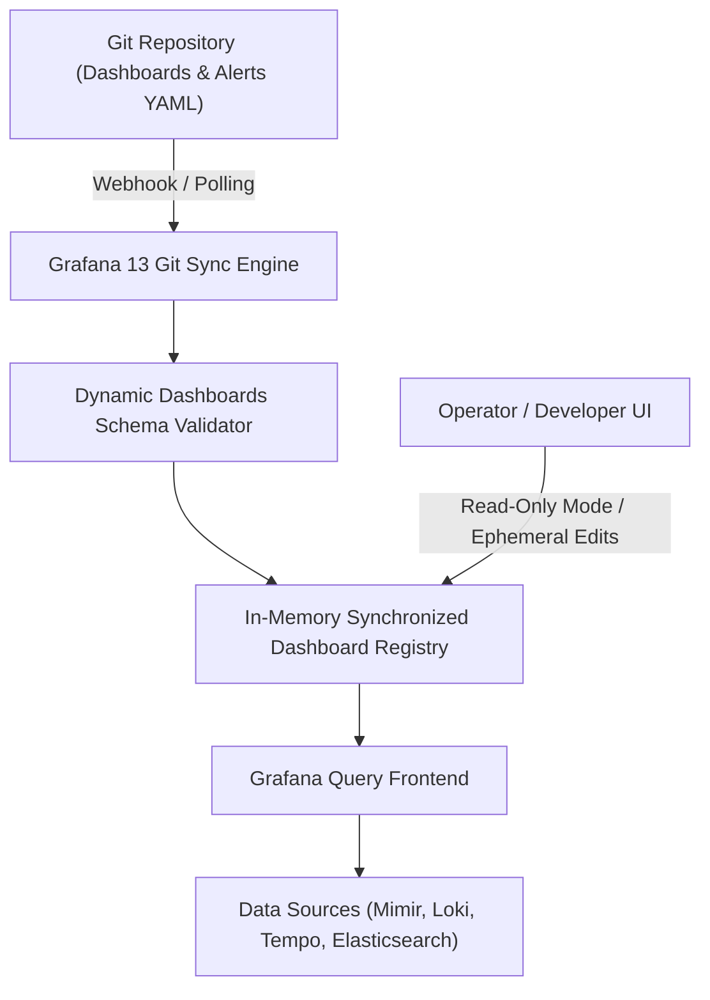

# Module 11: Grafana 13 Architecture: Dynamic Dashboards Schema, Git Sync, Provisioning as Code, Exemplar Correlations, and RBAC

## 1. Grafana 13 Architecture and Dynamic Dashboards Schema

Grafana 13 introduces major architectural advancements, notably **Git Sync General Availability (GA)** and the new **Dynamic Dashboards JSON Schema**. Legacy Grafana versions relied on brittle database-backed dashboard edits that frequently drifted from Git source control. Grafana 13 standardizes declarative Git synchronization, treating Git repositories as the immutable source of truth for dashboard definitions, alerts, and provisioning files.

### 1.1 Git Sync and Provisioning Architecture



---

## 2. Exemplar Correlations and Cross-Signal Navigation

Observability value is maximized when operators can instantly transition between orthogonal telemetry signals (Metrics \(\leftrightarrow\) Logs \(\leftrightarrow\) Traces). Grafana 13 unifies these signals through **Exemplars** and **Data Source Connections**.

- **Metrics to Traces (Exemplars)**: Prometheus metric histograms record exemplar trace IDs alongside latency buckets. Clicking a data point on a Grafana panel opens the matching trace in Grafana Tempo.
- **Traces to Logs**: Span attributes in Tempo link directly to Grafana Loki queries filtered by `trace_id`, isolating log lines generated during that exact span execution.

---

## 3. RBAC, Teams, and Access Control in Enterprise Grafana

Grafana 13 implements fine-grained Role-Based Access Control (RBAC). Permissions are assigned to fixed or custom roles mapped to organizational teams synchronized via OIDC / SAML integration (e.g., Keycloak, Okta).

---

## 4. CLRS-Style Pseudocode: Dashboard Schema JSON Validation

Below is a deterministic TypeScript implementation validating Grafana 13 dynamic dashboard schema structures prior to Git synchronization.

```typescript
/**
 * Validates Grafana 13 dynamic dashboard schema structure.
 * Loop Invariant: At the start of iteration i, all dashboard panels 0 through i-1
 * have been verified for valid panel IDs, grid positioning, and datasource bindings.
 */
export interface DashboardPanel {
  id: number;
  title: string;
  type: string;
  datasource?: string;
  gridPos: { x: number; y: number; w: number; h: number };
}

export interface GrafanaDashboard {
  schemaVersion: number;
  title: string;
  panels: DashboardPanel[];
}

export function validateDashboardSchema(dashboard: unknown): {
  isValid: boolean;
  errors: string[];
} {
  const errors: string[] = [];
  if (!dashboard || typeof dashboard !== 'object') {
    return { isValid: false, errors: ['Dashboard must be a valid JSON object'] };
  }

  const d = dashboard as Partial<GrafanaDashboard>;

  if (typeof d.schemaVersion !== 'number' || d.schemaVersion < 13) {
    errors.push('Dashboard schemaVersion must be 13 or higher');
  }

  if (typeof d.title !== 'string' || d.title.trim().length === 0) {
    errors.push('Dashboard title is required');
  }

  if (!Array.isArray(d.panels)) {
    errors.push('Dashboard panels must be an array');
  } else {
    d.panels.forEach((panel, idx) => {
      if (typeof panel.id !== 'number') {
        errors.push(`Panel at index ${idx} missing numeric id`);
      }
      if (!panel.gridPos || typeof panel.gridPos.w !== 'number') {
        errors.push(`Panel at index ${idx} missing valid gridPos`);
      }
    });
  }

  return {
    isValid: errors.length === 0,
    errors,
  };
}
```

---

## 5. Then vs Now: Evolution of Grafana Dashboards

| Dimension | Legacy Grafana (Grafana 7–9) | Modern Grafana 13 (2026) |
| :-- | :-- | :-- |
| **Dashboard Authoring** | Manual UI click-ops stored in Postgres/MySQL DB | **Git Sync GA** with declarative JSON/YAML files |
| **Schema Version** | Legacy dashboard schema (v30+) | **Dynamic Dashboards Schema** optimized for modular plugins |
| **Cross-Signal Navigation** | Manual copy-pasting of trace IDs and timestamps | Native **Exemplar Correlations** (Metrics \(\leftrightarrow\) Traces \(\leftrightarrow\) Logs) |
| **Provisioning** | Static file provisioning with limited reload capabilities | Automated real-time Git synchronization with webhook triggers |

---

## 6. Exam Delta & Certification Alignment

> [!IMPORTANT]
> **Grafana Certification & Enterprise Standards**: Exams test Grafana provisioning best practices, Git Sync configuration parameters, and RBAC permission hierarchies. Expect scenario questions on resolving dashboard provisioning conflicts when Git Sync is enabled alongside ephemeral UI edits.

---

## 7. Production Failure Modes & Gotchas

1. **Git Sync Upgrade Conflicts (Grafana 13.0.0 Bug)**: Upgrading directly to Grafana 13.0.0 with Git Sync enabled without taking a pre-upgrade database backup can result in dashboard state reversion. Always upgrade to 13.0.1+ and backup Postgres before migration.
2. **Infinite Dashboard Polling Loops**: Configuring Git Sync polling intervals too aggressively (e.g., every 1 second) against large Git monorepos exhausts git server CPU and network bandwidth.
3. **Missing Datasource UIDs**: Hardcoding legacy numeric datasource IDs instead of modern string UIDs in dynamic dashboard JSON breaks cross-environment provisioning when importing dashboards into staging or production clusters.

---

## 8. Interview Drill

<details><summary><strong>Q1. How does Grafana 13 Git Sync eliminate configuration drift in enterprise environments?</strong></summary>

Grafana 13 Git Sync treats Git repositories as the immutable source of truth for dashboards, alerting rules, and provisioning files. Changes made in the UI are either blocked (when Git Sync is configured in strict read-only mode) or synchronized back to Git via automated PR bots, ensuring that production dashboards never drift from infrastructure-as-code definitions.

</details>

<details><summary><strong>Q2. What are Exemplars, and how do they connect Prometheus metrics with Grafana Tempo traces?</strong></summary>

Exemplars embed specific trace IDs directly into Prometheus histogram metric sample values when an event occurs. When viewing a Prometheus metric panel in Grafana, sample points appear as clickable markers. Clicking an exemplar marker opens Grafana Tempo pre-filtered to the exact trace ID, instantly explaining a metric anomaly.

</details>

<details><summary><strong>Q3. Why did Grafana deprecate legacy `/api` routes in favor of `/apis` in recent architecture updates?</strong></summary>

Grafana modernized its backend API routing to align with Kubernetes-style API conventions (`/apis`), improving multi-tenancy isolation, RBAC enforcement consistency, and plugin extensibility.

</details>

<details><summary><strong>Q4. How do you implement automated dashboard provisioning in Kubernetes using ConfigMaps?</strong></summary>

Dashboards are stored as JSON files inside ConfigMaps labeled with `grafana_dashboard: "1"`. Grafana's sidecar container detects labeled ConfigMaps, mounts them into Grafana's provisioning directory (`/etc/grafana/provisioning/dashboards`), and triggers an automatic hot-reload without restarting the Grafana server pod.

</details>

<details><summary><strong>Q5. What security risks arise from misconfigured Grafana RBAC, and how does Grafana 13 mitigate them?</strong></summary>

Misconfigured RBAC can allow unauthorized users to view sensitive business metrics or tamper with alerting thresholds. Grafana 13 mitigates this by enforcing fine-grained roles at the folder and datasource level, integrated seamlessly with enterprise OIDC/SAML group claims.

</details>

<details><summary><strong>Q6. How do you troubleshoot a broken dashboard data source connection in Grafana?</strong></summary>

Operators check datasource UID correctness in the dashboard JSON, verify network connectivity from the Grafana server pod to the datasource endpoint (e.g., Mimir or Loki), and inspect Grafana server logs (`level=error`) for authentication or TLS handshake failures.

</details>

---

## 9. Proof Map

| Claim in Module | Verification Test in `examples/ts/` |
| :-- | :-- |
| Grafana 13 dynamic dashboard schema validation | `../examples/ts/11-grafana-dashboards-as-code-and-correlations.test.ts` (`it("validates Grafana 13 dashboard schema version and panels")`) |
| Panel grid positioning verification | `../examples/ts/11-grafana-dashboards-as-code-and-correlations.test.ts` (`it("verifies gridPos coordinates")`) |
