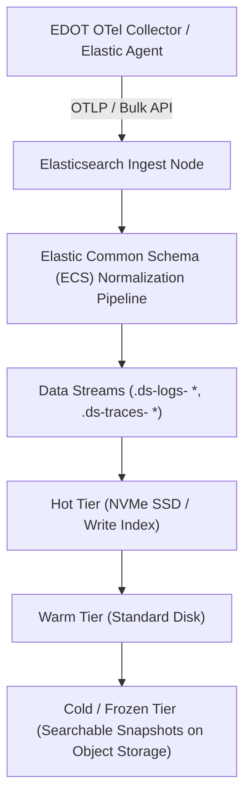

# Module 12: Elastic Observability and Kibana 9.5: EDOT OTel Ingestion, APM Data Streams, Lens, ES\|QL Analytics, and LGTM Comparison

## 1. Elastic Observability and EDOT Architecture

While the Grafana LGTM stack (Loki, Grafana, Tempo, Mimir/Prometheus) provides a modular, open-source telemetry stack, **Elastic Observability** offers a unified, document-centric platform powered by Elasticsearch, Kibana 9.5, and the **Elastic Distributions of OpenTelemetry (EDOT)**. EDOT provides production-ready OpenTelemetry collectors and SDK distributions pre-configured to output telemetry into Elasticsearch Data Streams.

### 1.1 Elastic Data Streams and Index Lifecycle Management (ILM)

Elastic Observability organizes telemetry (logs, metrics, traces) into **Data Streams**, which map under the hood to write-once, read-many time-series indices managed by Index Lifecycle Management (ILM) tiers: Hot, Warm, Cold, and Frozen.



---

## 2. ES\|QL Analytics in Kibana 9.5

Kibana 9.5 introduces deep integration with **ES\|QL** (Elasticsearch Query Language), a pipe-based query language that enables fast, iterative data exploration and transformation directly inside Kibana dashboards and Discover views.

```esql
from logs-observability-*
| keep @timestamp, service.name, http.response.status_code, url.path
| where http.response.status_code >= 500
| stats error_count = count(*) by service.name, url.path
| sort error_count desc
| limit 10
```

---

## 3. Cross-References & Elasticsearch Foundation

For deep technical fundamentals on Elasticsearch storage engines, inverted indices, mappings, and ES\|QL query algebra, cross-reference [Cluster Architecture and Near Real-Time Search](../../elasticsearch/modules/02-cluster-architecture-and-near-real-time-search.md), [Mappings, Field Types, and Templates](../../elasticsearch/modules/03-mappings-field-types-and-templates.md), and [ES\|QL Analytics](../../elasticsearch/modules/06-esql.md).

---

## 4. CLRS-Style Pseudocode: ES\|QL Pipeline Operator Evaluator

Below is a deterministic TypeScript implementation simulating ES\|QL pipe-based execution over observability document streams.

```typescript
/**
 * Simulates ES|QL pipe operator execution (from -> where -> stats -> sort).
 * Loop Invariant: At the start of pipeline stage i, input documents have been
 * filtered and transformed by all preceding stages 0 through i-1.
 */
export interface TelemetryDoc {
  timestamp: number;
  serviceName: string;
  statusCode: number;
  latencyMs: number;
}

export class ESQLSimulator {
  public static executePipeline(
    docs: TelemetryDoc[],
    serviceFilter: string,
    minStatus: number,
  ): { serviceName: string; errorCount: number }[] {
    // Stage 1: where filter
    const filtered = docs.filter(
      (d) => d.serviceName === serviceFilter && d.statusCode >= minStatus,
    );

    // Stage 2: stats aggregation (group by serviceName)
    const counts = new Map<string, number>();
    for (const doc of filtered) {
      const current = counts.get(doc.serviceName) ?? 0;
      counts.set(doc.serviceName, current + 1);
    }

    // Stage 3: sort and format
    const results: { serviceName: string; errorCount: number }[] = [];
    for (const [serviceName, errorCount] of counts.entries()) {
      results.push({ serviceName, errorCount });
    }

    results.sort((a, b) => b.errorCount - a.errorCount);
    return results;
  }
}
```

---

## 5. Then vs Now: LGTM vs Elastic Observability

| Dimension | Grafana LGTM Stack | Elastic Observability 9.5 (EDOT + ES\|QL) |
| :-- | :-- | :-- |
| **Architecture** | Modular microservices (Loki, Tempo, Mimir, Grafana) | Unified Elasticsearch cluster + Kibana 9.5 |
| **Storage Engine** | Object storage (S3/GCS) with TSDB index | Elasticsearch indices with Data Streams & ILM tiers |
| **Query Languages** | Promtail/LogQL, TraceQL, PromQL | **ES\|QL** (pipe-based), Lucene Query DSL |
| **Telemetry Ingestion** | OpenTelemetry Collector / Grafana Alloy | EDOT (Elastic Distributions of OTel) / Elastic Agent |

---

## 6. Exam Delta & Certification Alignment

> [!IMPORTANT]
> **Elastic Certified Observability Engineer Alignment**: Certification exams focus on setting up EDOT collectors, configuring Elastic APM agents, building Lens visualizations in Kibana 9.5, and authoring ES\|QL queries for incident root-cause analysis.

---

## 7. Production Failure Modes & Gotchas

1. **Mapping Explosions from Unconstrained Dynamic Fields**: Ingesting arbitrary JSON logs with unpredictable keys into Elasticsearch without explicit mappings creates thousands of fields, exhausting the cluster mapping limit (default 1,000) and rejecting documents.
2. **Kibana Task Manager Overload**: Kibana alerting rules and machine learning jobs rely on the Kibana Task Manager index. When overloaded, alert evaluations are silently delayed.
3. **EDOT Collector Memory Limit Exceeded**: Running EDOT collectors without proper `memory_limiter` configurations under high telemetry load triggers OOM kills, dropping spans and metrics.

---

## 8. Interview Drill

<details><summary><strong>Q1. When should an organization choose the Grafana LGTM stack versus Elastic Observability?</strong></summary>

Organizations choose Grafana LGTM when operating heavily on Kubernetes with native Prometheus/PromQL expertise, preferring cheap object storage (S3/GCS) for logs and traces, and wanting modular open-source decoupling. Organizations choose Elastic Observability when they already operate Elasticsearch for full-text search, require advanced machine learning anomaly detection, need powerful ad-hoc text search across arbitrary log fields using ES\|QL, and prefer a unified single-vendor interface (Kibana).

</details>

<details><summary><strong>Q2. What is EDOT (Elastic Distributions of OpenTelemetry)?</strong></summary>

EDOT consists of Elastic-curated, enterprise-tested OpenTelemetry collector distributions and SDKs pre-configured with semantic conventions, security patches, and optimal exporters to ingest telemetry natively into Elasticsearch Data Streams.

</details>

<details><summary><strong>Q3. Explain how ES\|QL differs from Elasticsearch Query DSL.</strong></summary>

ES\|QL is a pipe-based query language inspired by modern data processing pipelines (similar to SQL or LogQL). Instead of nested JSON queries (Query DSL), ES\|QL processes data sequentially through pipes (`| filter`, `| stats`, `| sort`), making complex aggregations and tabular data transformations significantly easier to read and write.

</details>

<details><summary><strong>Q4. How do Elastic Data Streams manage log and trace data retention automatically?</strong></summary>

Elastic Data Streams utilize Index Lifecycle Management (ILM) policies to transition indices automatically across Hot (NVMe SSD), Warm (standard disk), Cold (searchable snapshots), and Delete phases based on age or storage size thresholds.

</details>

<details><summary><strong>Q5. What causes a field mapping explosion in Elasticsearch, and how do you prevent it?</strong></summary>

Mapping explosions occur when log producers send documents with dynamic, uncontrolled keys (e.g., user-submitted form parameters or random UUIDs as keys). Each unique key creates a new field in the Elasticsearch mapping. This is prevented by enforcing strict index templates and ECS (Elastic Common Schema) guidelines, or disabling dynamic mapping for unstructured fields.

</details>

<details><summary><strong>Q6. How does Kibana Lens simplify dashboard creation for operators?</strong></summary>

Kibana Lens provides a drag-and-drop visualization builder that automatically infers field types from Elasticsearch mappings, suggesting optimal chart types (bars, lines, heatmaps) and generating underlying ES\|QL or aggregations instantly without manual JSON authoring.

</details>

---

## 9. Proof Map

| Claim in Module | Verification Test in `examples/ts/` |
| :-- | :-- |
| ESQL pipeline operator simulation (filter, stats, sort) | `../examples/ts/12-elastic-observability-kibana-and-edot.test.ts` (`it("executes ESQL pipeline simulation correctly")`) |
| Telemetry document filtering and grouping | `../examples/ts/12-elastic-observability-kibana-and-edot.test.ts` (`it("aggregates error counts by service")`) |
