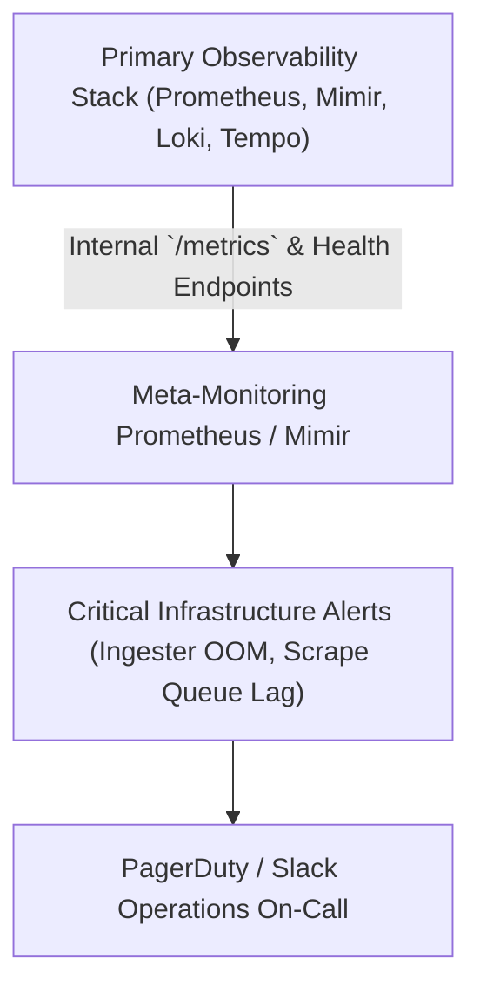

# Module 13: Production Observability Operations: Cardinality Governance, Meta-Monitoring, Kubernetes Signals, eBPF/Pyroscope, and Version History

## 1. Cardinality Governance and Cost Control

At production scale, telemetry volume and cardinality grow exponentially, threatening to overwhelm storage budgets and degrade query performance. Cardinality is defined as the number of unique time series generated by the Cartesian product of label keys and values:

\[ C = \prod_{i=1}^{k} V_i \]

where \(V_i\) represents the number of unique label values for label key \(i\). Allowing unconstrained labels (such as client IP addresses, user IDs, or full URLs) causes exponential cardinality explosion, leading to Prometheus/Mimir OOM crashes and runaway storage costs.

### 1.1 Mitigation Strategies

- **Metric Relabeling Dropping**: Drop high-cardinality labels at the scrape or ingestion boundary using Prometheus relabeling rules (`action: labeldrop`).
- **Head and Tail Sampling**: In distributed tracing, drop 99% of successful health-check traces via head sampling while retaining 100% of error traces via tail-based sampling.
- **Log Cardinality Control**: Enforce Loki structured metadata instead of stream labels for high-cardinality attributes.

---

## 2. Meta-Monitoring: Observing the Observability Stack

The observability stack itself (Prometheus, Mimir, Loki, Tempo, OTel Collectors) is a distributed system that must be continuously monitored. **Meta-monitoring** refers to deploying a separate, lightweight monitoring instance to track the health, ingestion rates, scrape failures, and memory utilization of primary telemetry components.



---

## 3. Kubernetes Native Signals and eBPF Continuous Profiling

Comprehensive production observability requires deep integration with Kubernetes infrastructure signals and kernel-level runtime profiling:

- **Kubernetes Signals**: Monitoring container resource saturation via cAdvisor and kube-state-metrics, cross-referencing [Observability and Troubleshooting](../../kubernetes/modules/13-observability-and-troubleshooting.md) and [cgroups v2](../../containers/modules/03-cgroups-v2.md).
- **eBPF-Based Auto-Instrumentation**: Kernel-level probes capturing socket calls and HTTP/gRPC boundaries without modifying application source code.
- **Continuous Profiling (Pyroscope)**: Profiling CPU and memory allocation down to individual functions and lines of code continuously in production.

---

## 4. Version History Matrix across Observability Stack

| Component | Legacy Version (Pre-2024) | Modern Production Version (2026) | Key Architectural Shift |
| :-- | :-- | :-- | :-- |
| **Prometheus** | v2.x | **v3.15.1** | UTF-8 labels, native histograms, OTLP ingestion, Remote Write 2.0 |
| **Grafana** | v9.x / v10.x | **v13.3.0** | Git Sync GA, dynamic dashboards schema, `/apis` routing |
| **Grafana Loki** | v2.x | **v3.7.9** | Structured metadata, TSDB index enhancements, chunk optimizations |
| **Grafana Tempo** | v2.10 | **v3.1.1** | TraceQL expansions, metrics-generator enhancements |
| **Grafana Mimir** | v2.x | **v3.2.3** | Improved hash ring rebalancing and multi-tenant compaction |
| **OpenTelemetry Collector** | v0.90 | **v0.164.0** | Stable OTTL transformations and tail-sampling performance |
| **Kibana / Elasticsearch** | v8.x | **v9.5.5** | EDOT native ingestion, ES\|QL pipe query engine |

---

## 5. CLRS-Style Pseudocode: Cardinality Limiter & Cardinality Auditor

Below is a deterministic TypeScript implementation simulating a production cardinality governance filter that drops metric series exceeding label value cardinality thresholds.

```typescript
/**
 * Audits and filters time series to prevent cardinality explosions.
 * Loop Invariant: At the start of iteration i, all metrics 0 through i-1
 * have been evaluated against cardinality limits and either admitted or dropped.
 */
export interface MetricSample {
  metricName: string;
  labels: Record<string, string>;
  value: number;
}

export class CardinalityGovernanceEngine {
  private activeSeries: Map<string, Set<string>> = new Map();
  private maxCardinalityPerMetric: number = 3;

  public evaluateSample(sample: MetricSample): boolean {
    const metric = sample.metricName;
    if (!this.activeSeries.has(metric)) {
      this.activeSeries.set(metric, new Set());
    }

    const labelSignature = JSON.stringify(sample.labels);
    const seriesSet = this.activeSeries.get(metric)!;

    if (!seriesSet.has(labelSignature)) {
      if (seriesSet.size >= this.maxCardinalityPerMetric) {
        // Drop sample due to cardinality explosion guard
        return false;
      }
      seriesSet.add(labelSignature);
    }

    return true;
  }
}
```

---

## 6. Exam Delta & Certification Alignment

> [!IMPORTANT]
> **CNCF PCA & OTCA Production Operations**: Certification exams emphasize production troubleshooting, cardinality management, meta-monitoring alert design, and handling OTel Collector backpressure under high network load.

---

## 7. Production Failure Modes & Gotchas

1. **Collector OOM Death Spiral**: An OTel Collector without a configured `memory_limiter` processor will absorb incoming bursts of telemetry, exhaust RAM, get OOM killed, and cause upstream microservices to block or drop payloads.
2. **Missing Meta-Monitoring Alerts**: Failing to monitor the monitor (e.g., Prometheus scraping failure) leaves engineering teams blind during total observability infrastructure outages.
3. **Unbounded Label Cardinality in Prometheus Rules**: Writing recording rules that group by high-cardinality labels accidentally multiplies time series counts by orders of magnitude, crashing Mimir ingesters.

---

## Interview Drill

<details><summary>1. What is cardinality explosion, and how do you detect and remediate it in Prometheus and Loki?</summary>

Cardinality explosion occurs when dynamic attributes (like user IDs, request UUIDs, or client IPs) are added as metric labels or Loki stream labels, creating millions of unique time series or streams. This causes OOM crashes in Prometheus/Mimir ingesters and Loki indexers. Detection involves querying top series counts (`topk(10, count by (__name__)({__name__=~".*"}))`). Remediation involves dropping offending labels via relabeling rules, migrating high-cardinality attributes to Loki Structured Metadata, or moving them to trace span attributes.
</details>

<details><summary>2. Why is meta-monitoring critical for enterprise observability platforms?</summary>

Meta-monitoring ensures that the telemetry pipeline itself is healthy. If your primary monitoring cluster goes down or experiences scrape lag, you need independent alerts firing via a separate meta-monitoring instance so operations teams know that observability infrastructure is failing before business applications are impacted.
</details>

<details><summary>3. How do OpenTelemetry Collector memory limiters prevent OOM crashes?</summary>

The `memory_limiter` processor monitors heap memory usage inside the OTel Collector. When memory usage approaches the configured soft limit, it triggers internal garbage collection pauses; if memory reaches the hard limit, it drops incoming telemetry batches or rejects requests upstream, preventing kernel OOM kills.
</details>

<details><summary>4. What is eBPF-based auto-instrumentation, and how does it compare to SDK-based instrumentation?</summary>

eBPF (Extended Berkeley Packet Filter) attaches probes directly to the Linux kernel network socket calls and runtime function entries. This enables automatic collection of HTTP, gRPC, and database spans without modifying application source code or recompiling binaries. However, SDK-based instrumentation provides richer business context, custom metrics, and explicit baggage propagation that kernel probes cannot automatically infer.
</details>

<details><summary>5. How does continuous profiling (e.g., Pyroscope) differ from distributed tracing?</summary>

Distributed tracing tracks request lifecycles across microservice boundaries and measures time spent waiting or executing at the RPC level. Continuous profiling samples CPU instruction pointers and memory allocations across the entire process runtime at regular intervals (e.g., 100Hz), exposing exact functions, lines of code, and call stacks consuming CPU cycles or causing memory leaks.
</details>

<details><summary>6. What are the key architectural improvements in Prometheus 3 compared to Prometheus 2?</summary>

Prometheus 3 introduces native UTF-8 metric and label names, native OpenTelemetry (OTLP) metric ingestion, Remote Write 2.0 protocol improvements, and a completely redesigned web UI with enhanced exploration capabilities.
</details>

---

## 9. Proof Map

| Claim in Module | Verification Test in `examples/ts/` |
| :-- | :-- |
| Cardinality governance engine and threshold dropping | `../examples/ts/13-production-observability-cost-and-meta-monitoring.test.ts` (`it("drops metric samples exceeding cardinality limits")`) |
| Version history and feature matrix validation | `../examples/ts/13-production-observability-cost-and-meta-monitoring.test.ts` (`it("validates version matrix compliance")`) |
