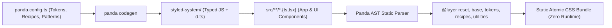

# Panda CSS — Build-Time Zero-Runtime Type-Safe Styling Curriculum

Panda CSS is a build-time, zero-runtime, type-safe CSS-in-JS framework created by the team behind Chakra UI. It parses your TypeScript and JavaScript abstract syntax tree (AST) at build time, extracts style declarations, and emits deduplicated atomic CSS classes, cascade layers, and design token CSS variables.

This track contains the complete, self-paced text and code curriculum modeled after the [Panda Mastery](https://www.pandamastery.com/?ref=course-section) syllabus by Segun "Sage" Adebayo and Esther Adebayo, expanded with runnable reference files, exercises, full solutions, and a 25-rule production best-practices handbook.

## Repository Layout

```text
technologies/panda-css/
├── README.md                                   # Curriculum overview, syllabus, prerequisites, and runnable instructions
├── GLOSSARY.md                                 # Bilingual English ↔ Czech terminology index
├── CHEATSHEET.md                               # Fast-lookup reference covering key syntax, operators, and rules
├── package.json                                # Isolated package manifests, scripts (test, typecheck, codegen)
├── tsconfig.json                               # Strict TypeScript configuration and paths mapping
├── modules/
│   ├── 01-introduction.md                      # Module 01: Introduction to Panda CSS (3 lessons)
│   ├── 02-styling-foundation.md                # Module 02: Styling Foundation (7 lessons)
│   ├── 03-layout-patterns.md                   # Module 03: Layout Patterns (8 lessons)
│   ├── 04-color-mode.md                        # Module 04: Color Mode (5 lessons)
│   ├── 05-recipes.md                           # Module 05: Atomic Recipes / cva (8 lessons)
│   ├── 06-slot-recipes.md                      # Module 06: Slot Recipes / sva (6 lessons)
│   ├── 07-config-recipes.md                    # Module 07: Config Recipes & Analytics (7 lessons)
│   ├── 08-design-tokens.md                     # Module 08: Design Tokens (10 lessons)
│   ├── 09-migration.md                         # Module 09: Migrating Runtime CSS-in-JS (5 lessons)
│   ├── 10-theming.md                           # Module 10: Advanced & Multi-Brand Theming (6 lessons)
│   ├── 11-jsx-style-props.md                   # Module 11: JSX Style Props & Factory (4 lessons)
│   ├── 12-monorepo.md                          # Module 12: Monorepo & Shared UI Libraries (4 lessons)
│   └── 13-compiler-and-best-practices.md       # Module 13: Bonus — Compiler Internals & 25 Best Practices
└── examples/
    ├── panda.config.ts                         # Complete production Panda CSS configuration
    ├── theme/
    │   ├── tokens.ts                           # Core/primitive tokens (defineTokens)
    │   ├── semantic-tokens.ts                  # Condition-aware semantic tokens (defineSemanticTokens)
    │   └── text-and-layer-styles.ts            # Typography, surface layers, and keyframes
    ├── patterns/
    │   └── custom-patterns.ts                  # Custom autoflex and scrollable patterns (definePattern)
    ├── recipes/
    │   ├── badge.recipe.ts                     # Atomic (cva) and Config (defineRecipe) Badge recipes
    │   ├── alert.slot-recipe.ts                # Multi-slot Alert recipe (defineSlotRecipe)
    │   └── tabs.slot-recipe.ts                 # Multi-slot Tabs recipe (defineSlotRecipe)
    └── components/
        ├── create-style-context.tsx            # Reusable React Context factory for slot recipes
        ├── Badge.tsx                           # Production Badge component with css.raw() overrides
        └── Alert.tsx                           # Compound Alert component (Alert.Root, Alert.Icon, etc.)
```

## Full Course Curriculum

| Module | Topic | Lessons | Key Primitives Covered |
| :--- | :--- | :--- | :--- |
| [Module 01](./modules/01-introduction.md) | Introduction to Panda CSS | 3 | Static AST extraction, `@layer` cascade, `css()`, `cva()`, `sva()`, `token()` |
| [Module 02](./modules/02-styling-foundation.md) | Styling Foundation | 7 | `panda init`, shorthands, responsive breakpoints, `_groupHover`, `css.raw()`, `cx()` |
| [Module 03](./modules/03-layout-patterns.md) | Layout Patterns | 8 | `stack`, `hstack`, `vstack`, `grid`, `cq` container queries, `definePattern` (`autoflex`, `scrollable`) |
| [Module 04](./modules/04-color-mode.md) | Color Mode | 5 | `_light`, `_dark`, `_osDark`, `[data-color-mode]`, semantic color tokens, FOUC prevention |
| [Module 05](./modules/05-recipes.md) | Atomic Recipes (`cva`) | 8 | `cva()`, `variants`, `defaultVariants`, `compoundVariants`, `colorPalette` virtual colors |
| [Module 06](./modules/06-slot-recipes.md) | Slot Recipes (`sva`) | 6 | `sva()`, multi-part component anatomy, `alert` and `tabs` recipes, compound JSX components |
| [Module 07](./modules/07-config-recipes.md) | Config Recipes | 7 | `defineRecipe`, `defineSlotRecipe`, `splitVariantProps`, `staticCss`, `panda analyze` |
| [Module 08](./modules/08-design-tokens.md) | Design Tokens | 10 | `defineTokens`, `defineSemanticTokens`, `token.var()`, `/opacity` modifier, `strictTokens`, `panda studio` |
| [Module 09](./modules/09-migration.md) | Migration Guide | 5 | Migrating from Styled Components, Emotion, and Stitches to static build-time CSS |
| [Module 10](./modules/10-theming.md) | Theming & Presets | 6 | `defineTextStyles`, `defineLayerStyles`, `definePreset`, multi-brand `themes`, `defineKeyframes` |
| [Module 11](./modules/11-jsx-style-props.md) | JSX Style Props | 4 | `styled` JSX factory, `jsxStyleProps: 'minimal'`, recipes as JSX, `createStyleContext` |
| [Module 12](./modules/12-monorepo.md) | Monorepo Architecture | 4 | `importMap`, `emitPackage`, `panda ship`, shared UI package + preset architecture |
| [Module 13](./modules/13-compiler-and-best-practices.md) | Compiler & Best Practices | 4 | Static AST evaluator rules, Park UI headless patterns, 25 production best practices |

## Architecture Overview

Panda CSS operates in two phases: **Codegen** (`panda codegen`) and **Extraction** (`panda cssgen` or PostCSS plugin).



## Quick Start for the Reference Project

1. Install dependencies in your project directory:

```bash
npm install
```

2. Run deterministic TypeScript typechecks and verification:

```bash
npm run typecheck
npm test
```

3. Generate the `styled-system` runtime and TypeScript definitions from [`examples/panda.config.ts`](./examples/panda.config.ts):

```bash
npm run codegen
```

4. Inspect your token catalog visually in Panda Studio:

```bash
npm run studio
```

5. Audit token and recipe usage across the codebase:

```bash
npm run analyze
```

## Recommended Study Sequence

- **Track 1 — Application Developers (Modules 01–06):** Master `css()`, `css.raw()`, layout patterns, container queries, dark mode, `cva()`, and `sva()`.
- **Track 2 — Design System Authors (Modules 07–11):** Build `defineRecipe`, `defineSlotRecipe`, 2-tier primitive + semantic token systems with `strictTokens`, `definePreset`, multi-brand `themes`, and `createStyleContext`.
- **Track 3 — Staff & Platform Engineers (Modules 09, 12, 13):** Execute incremental migrations from Styled Components / Emotion / Stitches, architect Turborepo/pnpm monorepos with `importMap` and `panda ship`, and optimize static AST extraction and TypeScript check times.
