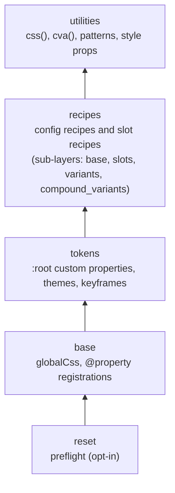
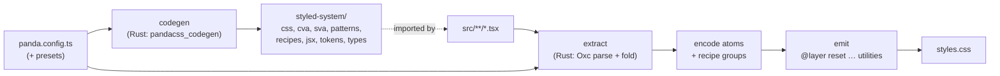

# Module 01 · Static CSS-in-JS Mental Model and the v2 Architecture

> **Verified against** `@pandacss/dev` 2.4.0 (npm, published 2026-10-22) on 2026-10-28.
> **Executable proof:** [`examples/fixtures/positive/01-atomic-dedupe.ts`](../examples/fixtures/positive/01-atomic-dedupe.ts) with its snapshot [`01-atomic-dedupe.css`](../examples/fixtures/__snapshots__/01-atomic-dedupe.css), [`examples/tests/runtime.test.ts`](../examples/tests/runtime.test.ts), and the vanilla source-transform build in [`examples/tests/e2e-computed-style.test.ts`](../examples/tests/e2e-computed-style.test.ts).

Panda CSS is a **build-time styling engine**. You write style objects in TypeScript; a compiler reads your source code without running it, collects every style it can prove statically, and writes one atomic stylesheet. The browser receives plain CSS plus, optionally, a small JavaScript function that turns style objects into class-name strings.

This module builds the mental model the rest of the track depends on: what "static" means, what an atom is, why the stylesheet is layered, and how the v2 Rust compiler (Oxc-based) is organised. Later modules refer back to these definitions.

**What this module does not re-teach.** The cascade algorithm, `@layer` semantics, specificity and the runtime-vs-zero-runtime CSS-in-JS architecture debate belong to [`languages/css`](../../../languages/css/README.md) (module "The cascade, layers & scope" and module "CSS architecture & design tokens at scale"). Here we cover only what Panda adds on top.

---

## 1.1 Three ways to get from a style object to pixels

Every CSS-in-JS system answers one question: *when* does a style object become a CSS rule in the document?

| Approach | When CSS is produced | Who produces it | Examples |
|---|---|---|---|
| Runtime CSS-in-JS | While the app runs, on render | A JS library in the browser (or server) that serialises styles and inserts `<style>` rules | styled-components, Emotion |
| Build-time, file-scoped | At build time, per `.css.ts` file | A bundler plugin that executes the style module | vanilla-extract, Linaria |
| Build-time, static extraction | At build time, from the source text of every file | A compiler that *parses* (does not execute) application code | **Panda**, StyleX |

Panda belongs to the third family. Two consequences follow, and every later module is a refinement of them:

1. **Only statically knowable values produce CSS.** The compiler sees text, so `css({ color: props.tone })` produces nothing. ([Module 10](./10-compiler-internals-and-debugging.md) gives the exact rules.)
2. **The browser does no style computation.** It never parses style objects into rules or inserts `<style>` tags. At most, the generated `css()` function maps an object to class names (a string operation), and with source transforms even that disappears.

### Formal definition: static extraction

Let *S* be the set of source files matched by `include`, and *E(f)* the set of Panda **call sites** in file *f*: calls to `css`, `cva`, `sva`, pattern functions, config recipes, and JSX elements from the generated `jsx` entry point. Each call site *c* has an argument expression *a(c)*.

Define a partial evaluation function `fold : Expr → Literal ∪ {⊥}` that maps an expression to a JSON-like literal (string, number, boolean, null, object, array, or a set of conditional branches), or to ⊥ when the value cannot be known without executing the program. Then the **extracted style set** is:

```
Styles(S) = ⋃_{f ∈ S} ⋃_{c ∈ E(f)} { fold(a(c)) | fold(a(c)) ≠ ⊥ }
```

with one refinement: `fold` is *lenient on objects*. An object literal with some unknowable members keeps its knowable members (`{ color: 'red.500', p: props.p }` folds to `{ color: 'red.500' }`). The full fold rules (identifiers, imports, ternaries, pure helpers) are in [Module 10](./10-compiler-internals-and-debugging.md#103-the-literal-fold-what-the-compiler-can-know).

The emitted CSS is a function of `Styles(S)` and the config only. Runtime state can never add a rule.

### Then vs now: what "static" covers

| | Panda 0.x / 1.x (≤ 1.12.1) | Panda 2.x (2.0.0, 2026-09-29 →) |
|---|---|---|
| Engine | TypeScript program via `ts-morph`, values folded by `ts-evaluator` | Native Rust compiler on [Oxc](https://oxc.rs/): one parse per file, no TypeScript program |
| Imported values | Ignored: a style value imported from another file produced no CSS | Followed: named imports, re-exports, `export *` barrels, tsconfig path aliases, imported pure helpers and imported `css.raw()` results |
| Default / namespace imports | Ignored | Still ignored (documented rule) |
| Template-literal syntax (`` css`color: red` ``) | Supported via `syntax: 'template-literal'` | Removed |

**Migration:** delete `staticCss` entries and inlined copies that existed only because v1 could not follow imports, and convert default/namespace imports of style values to named imports. [Module 12](./12-migration-and-upgrades.md) has the full checklist.

---

## 1.2 Atomic CSS, formally

An **atom** is a triple

```
atom = (property, value, conditions)
```

where `property` is a CSS property (after shorthand expansion: `px` → `padding-inline`), `value` is the resolved value (a token reference becomes `var(--spacing-4)`), and `conditions` is an ordered list of selectors and at-rules (`_hover`, `md`, `_dark`, `@container`).

A style object denotes a **set of atoms**. `css()` returns the space-separated class names of that set, and the stylesheet contains exactly one rule per distinct atom across the whole project:

```
Stylesheet = { rule(a) | a ∈ ⋃_{s ∈ Styles(S)} atoms(s) }
```

Because the stylesheet is a set union, its size grows with the number of **distinct** (property, value, condition) combinations, not with the number of components. Two components that both use `p: '4'` share `.p_4`.

The fixture [`01-atomic-dedupe.ts`](../examples/fixtures/positive/01-atomic-dedupe.ts) has two call sites sharing `p: '4'` and `color: 'brand.600'`. Its snapshot contains each rule once:

```css
@layer utilities {
  .p_4 { padding: var(--spacing-4); }
  .c_brand\.600 { color: var(--colors-brand-600); }
  .bdr_lg { border-radius: var(--radii-lg); }
  .bg_ink\.100 { background: var(--colors-ink-100); }
}
```

(Abridged from the snapshot; the real file also contains the layer-order statement and the tokens actually referenced.)

### Class-name grammar

By default the class name is readable and deterministic:

```
className = [conditions ":"]* shorthand "_" value
```

`css({ _hover: { bg: 'blue.200' } })` yields `hover:bg_blue.200`; the selector escapes the dot and colon (`.hover\:bg_blue\.200:is(:hover, [data-hover])`). With `hash: true` (often `hash: process.env.NODE_ENV === 'production'`), class names and variable names are hashed, which shortens HTML but makes DevTools harder to read.

Because the name is a pure function of the atom, the **same object always yields the same class string**, on the server, in the browser and at build time. That is what makes hydration safe without a style registry.

### Why atomic: the trade-off table

| Property | Atomic (Panda utilities) | Component-scoped classes (Panda config recipes, CSS Modules) |
|---|---|---|
| CSS size growth | Sub-linear: bounded by distinct atoms | Linear in components × variants |
| HTML size | More class names per element | One or two class names |
| Override semantics | Per property, by layer and rule order | Per rule, by specificity and order |
| DevTools readability | Many small rules | One rule per component state |

Panda uses *both*: utilities (`css`, `cva`, patterns, style props) are atomic; config recipes emit named, component-scoped classes into a lower cascade layer ([Module 07](./07-recipes-and-config-recipes.md)).

---

## 1.3 The layered stylesheet

Panda emits every rule into one of five cascade layers, declared up front:

```css
@layer reset, base, tokens, recipes, utilities;
@layer recipes { @layer base, slots, variants, compound_variants; }
@layer recipes.slots { @layer base, variants, compound_variants; }
```

These three lines open every fixture snapshot in [`examples/fixtures/__snapshots__/`](../examples/fixtures/__snapshots__/). Since layer order (not specificity) decides between layered rules (see [`languages/css`](../../../languages/css/README.md) for the cascade sort), Panda gets a precedence ladder for free:



Practical consequences:

- **A `css()` override always beats a config recipe**, whatever the selector specificity, because `utilities` is a later layer. The Playwright test `css prop (utilities layer) beats recipe, variant and compound` checks this on a rendered button.
- **v2 compound variants sit in their own sub-layer** (`recipes.compound_variants`), so they beat the recipe's base and variants but still lose to `css()`. See [Module 07](./07-recipes-and-config-recipes.md#74-compound-variants-then-vs-now).
- **Unlayered CSS beats every Panda rule.** A legacy stylesheet with `.btn { color: red }` wins over all five layers. This is a cascade rule, not a Panda bug. [Module 12](./12-migration-and-upgrades.md) covers coexistence during migration.

Older browsers without `@layer` support can use `polyfill: true` (or `--polyfill`), which rewrites layers into specificity boosts with `:not(#\#)`.

---

## 1.4 Two outputs: the stylesheet and the `styled-system` package

Panda produces two artifacts from one config:

1. **`styled-system/`** (codegen): the TypeScript-typed functions your code imports, `css`, `cva`, `sva`, `cx`, `token`, patterns, recipes and, with `jsxFramework` set, JSX components. It depends only on the **config**.
2. **The stylesheet** (cssgen): the CSS for the styles actually used. It depends on the **config and the source**.



Keep these separate in your head. `panda codegen` never reads `src/`; it can run before any component exists, which is why `"prepare": "panda codegen"` works in a fresh clone. `panda cssgen` needs both.

### What the generated `css()` actually does at runtime

The generated `css` function contains a serialised utility map (property → shorthand class prefix, e.g. `paddingInline:px`) and condition metadata. At runtime it walks the object, normalises shorthands, and concatenates class names. It **does not** inject CSS. If the compiler never saw a given object, the class names it returns point at rules that do not exist, and the element renders unstyled. That is the most common Panda failure mode, and it is silent.

```ts
// examples/tests/runtime.test.ts
assert.equal(css({ color: 'brand.600', p: '4' }), 'c_brand.600 p_4')
assert.equal(css({ paddingInline: '2' }), css({ px: '2' })) // shorthand and longhand -> same atom
```

### Source transforms: removing the runtime entirely

With a bundler plugin and `transform: true`, Panda rewrites each **static** call site to the string it would have returned:

```ts
// examples/vanilla/src/main.ts (you write)
const card = css({ p: '6', bg: 'teal.100', borderRadius: 'xl', _hover: { bg: 'teal.200' } })
// the production bundle ships
const card = `bg_teal.100 bdr_xl p_6 hover:bg_teal.200`
```

The e2e suite builds [`examples/vanilla`](../examples/vanilla/) both ways. Measured on 2026-10-28 with Vite 8.3.5: **19,811 bytes** of JavaScript without the transform, **923 bytes** with it. The `css()` runtime is gone.

The same suite also shows the limit. In the React and Solid apps, the transform rewrites the static calls, but the runtime **still ships** because some call sites are dynamic (`css(badge.raw({ tone }), cssProp)` inside the `Badge` component; the styled factory). The transformed React bundle was in fact ~3 KB *larger*. Measure before you assume a win, as the [official docs](https://panda-css.com/docs/styling/source-transforms) also advise.

| | Default | `transform: true` |
|---|---|---|
| When CSS is generated | Build time | Build time |
| What `css({...})` is in the bundle | A call to the generated runtime | A string literal (static calls only) |
| Runtime shipped | Always | Only if any call site stays dynamic |
| Bundlers | Any (PostCSS works everywhere) | Vite, webpack, Rollup/Rolldown, Bun, Rspack. Not Turbopack (no plugin API) |

---

## 1.5 The v2 compiler: crates and their single direction of data flow

Panda v2 replaced the TypeScript-based extraction path with a Rust workspace (`crates/*` in the [panda repository](https://github.com/chakra-ui/panda)). The crates form a strict tier model in which dependencies point one way only:

| Tier | Crates | Responsibility |
|---|---|---|
| 0 · infrastructure | `pandacss_fs`, `pandacss_shared`, `pandacss_literal`, `pandacss_tracing`, `pandacss_sfc` | Filesystem trait (OS / in-memory, so it compiles to WASM), CSS property list, the `Literal` value tree, tracing, Vue/Svelte/Astro lowering to same-offset JS |
| 1 · data | `pandacss_config`, `pandacss_tokens`, `pandacss_recipes` | Typed config, token dictionary, recipe models |
| 2 · process | `pandacss_extractor`, `pandacss_encoder`, `pandacss_utility`, `pandacss_stylesheet`, `pandacss_codegen` | Parse + extract, atom encoding, utility metadata, CSS emission, `styled-system` generation |
| 3 · compiled config | `pandacss_system` | Config compiled once into matchers, utilities, conditions, recipes |
| 4 · state and rewrite | `pandacss_project`, `pandacss_transform` | Per-file parse state and refcounted atom registry for watch mode; source transforms |
| 5 · orchestration | `pandacss_compiler` | Composes the above; exposed through NAPI (`@pandacss/compiler`) and WASM (`@pandacss/compiler-wasm`) |

The pipeline is one-way: **extract → encode → emit**. The JS host (`@pandacss/cli`, the Vite/PostCSS plugins) loads and bundles the config, watches files, runs plugin hooks and user `transform` callbacks, and writes files. Rust does everything on the hot path. [Module 10](./10-compiler-internals-and-debugging.md) walks through each stage.

Package map you will see in `node_modules` after `npm i -D @pandacss/dev`:

| Package | Role |
|---|---|
| `@pandacss/dev` | What you install: `panda` binary, `defineConfig`/`defineRecipe`/…, subpaths `/postcss`, `/node`, `/define` |
| `@pandacss/cli` | The CLI implementation |
| `@pandacss/compiler` + `@pandacss/compiler-<platform>` | NAPI binding + prebuilt native binary (e.g. `compiler-linux-x64-gnu`, ~11 MB) |
| `@pandacss/compiler-wasm` | Same engine compiled to WASM (browser playground) |
| `@pandacss/config` | Config bundling/serialisation (uses Rolldown) |
| `@pandacss/postcss`, `@pandacss/vite`, `@pandacss/webpack`, `@pandacss/rollup`, `@pandacss/bun` | Integrations |
| `@pandacss/preset-base`, `@pandacss/preset-panda` | Utilities/conditions/patterns, and the default theme. **Not implicit in v2** ([Module 02](./02-installation-and-build-integration.md)) |

All `@pandacss/*` packages are released in lockstep (every one is 2.4.0 today) and must not be mixed across major versions.

---

## 1.6 Server rendering and React Server Components

Panda's server story follows from 1.2: class names are a pure function of the style object, and the stylesheet is a static file.

- `css()`, `cva()`, `sva()`, patterns and config recipe functions are plain functions with no React or Solid dependency. They run unchanged in a Server Component, an SSR render, a Node script or a test.
- There is **no style registry to flush** during streaming SSR, so there is no ordering hazard between streamed HTML and injected `<style>` tags.
- The generated JSX helpers that use context, `createRecipeContext` and `createSlotRecipeContext`, are client code. The official docs mark them as Client Components (`"use client"`).

This is framework-neutral. In Next.js App Router, Remix/React Router, SolidStart or Astro, the CSS file is imported once at the root and every component, server or client, references its classes.

---

## 1.7 Positioning against the alternatives

Interviewers often ask for the comparison. Keep it to mechanics, not taste. The architectural theory is owned by [`languages/css`](../../../languages/css/README.md); Panda's delta is:

| | Panda 2.x | Tailwind CSS 4.x | StyleX 0.x | styled-components / Emotion |
|---|---|---|---|---|
| Authoring | Typed objects, JSX props, recipes | Class strings in markup, `@theme` in CSS | Typed objects (`stylex.create`) | Tagged templates / objects |
| Detection | AST parse + constant folding | Text scan for class-like tokens | Babel/bundler plugin AST compile | Runtime |
| Dynamic values | CSS variables, recipes, `staticCss` | CSS variables, safelist | Dynamic styles via functions compiled to CSS variables | Anything (runtime) |
| Type safety of values | Generated types, `strictTokens` | Editor plugin, no compile-time types | Types from `defineVars` | Library-specific |
| Runtime | Optional (transform removes it) | None | Small (`stylex.props`) | Full serializer + injector |
| Variants / components | `cva`, `sva`, config recipes | Third-party (`tailwind-variants`, CVA) | Composition | `styled()` |

---

## 1.8 Production failure modes introduced by the model

| # | Symptom | Root cause | Where it is proved |
|---|---|---|---|
| 1 | Element renders unstyled, class names present in the DOM | The object was not statically knowable (prop, state, default/namespace import) | [`negative-extraction.test.ts`](../examples/tests/negative-extraction.test.ts) |
| 2 | Override "randomly" loses | Class strings concatenated instead of merged; the winner is whichever atom comes later in the sheet | Playwright test `NEGATIVE: concatenated classes …` |
| 3 | Recipe styles beat by an old global stylesheet | Unlayered CSS beats all layers | [`languages/css`](../../../languages/css/README.md) cascade module |
| 4 | Huge CSS / slow builds | `include` scans `node_modules` or build output | [Module 11](./11-monorepos-and-design-system-libraries.md) |
| 5 | Transform enabled, bundle did not shrink | A dynamic call site keeps the runtime | `transform: static css() calls become string literals` e2e test |

---

## Interview Drill

<details><summary>1. What exactly does "zero-runtime" mean for Panda, and where is it not true?</summary>

CSS is generated at build time from the source text; the browser never serialises style objects into rules or injects `<style>` tags. However, by default the generated `css()`/`cva()` functions still run in the browser to turn objects into class strings. Source transforms (`transform: true` on the Vite/webpack/Rollup/Bun plugin) replace static call sites with string literals; the runtime disappears only if *every* call site is static. Measured in this track: 19.8 KB → 0.9 KB for an all-static app, but no reduction in a React app with dynamic `css()` calls.
</details>

<details><summary>2. Define an atom and explain why atomic CSS scales sub-linearly.</summary>

An atom is `(property, value, conditions)` after shorthand expansion and token resolution. The stylesheet is the set union of atoms over all extracted style objects, so its size is bounded by the number of distinct triples, not by the number of components; common values (`p: 4`, `display: flex`) are shared. The cost moves to HTML (more class names per element) and to override semantics (per property instead of per rule).
</details>

<details><summary>3. Why can't Panda generate CSS for `css({ color: props.color })`? What do you do instead?</summary>

Extraction parses source; it never executes it. `props.color` folds to ⊥ (unknown), so no atom exists. Options: write a static style that reads a CSS variable and set the variable inline (`css({ color: 'var(--tone)' })` + `style={{ '--tone': value }}`); model the finite set as recipe variants; or pre-generate with `staticCss`. Since v2 the value may also come from an imported constant or pure helper, as long as it is static.
</details>

<details><summary>4. Why does `css({ bg: 'red.500' })` win over a config recipe's `bg`, even if the recipe selector is more specific?</summary>

Utilities are emitted into `@layer utilities`, recipes into `@layer recipes`, and the layer order is declared as `reset, base, tokens, recipes, utilities`. In the cascade, layer order is compared before specificity, so any normal declaration in a later layer wins. (The cascade itself is taught in `languages/css`.)
</details>

<details><summary>5. What changed architecturally between Panda 1.x and 2.x, and what is user-visible?</summary>

v1 used `ts-morph` and `ts-evaluator` in Node to build a TypeScript program and fold values. v2 uses a Rust compiler on Oxc: one parse per file, no type program, shipped as a NAPI binary (`@pandacss/compiler`) plus a WASM build. User-visible changes include: imports of static values are followed (except default/namespace imports), ESM-only packages and Node ≥ 22, presets are not implicit, compound variants get their own class and sub-layer, `createStyleContext` is replaced by recipe contexts, `panda ship`/`emit-pkg`/`studio` CLI changes, and root `hooks` move into `plugins`.
</details>

<details><summary>6. Is Panda safe to use in React Server Components? What is not?</summary>

Yes for `css`, `cva`, `sva`, patterns and recipe functions: they are pure string functions with no framework dependency, and the stylesheet is static so there is nothing to flush during streaming. The JSX recipe-context helpers (`createRecipeContext`, `createSlotRecipeContext`) use React context and are Client Components.
</details>

<details><summary>7. Two engineers argue whether to turn on `transform: true` with Next.js 16. What do you check?</summary>

Next.js 16 defaults to Turbopack, which has no plugin API, so there is no first-party transform there; you would need the webpack builder (`next build --webpack`). Then measure: if the codebase has dynamic `css()` calls the runtime stays, and the bundle may not shrink. CSS generation is identical either way.
</details>

<details><summary>8. What is in `styled-system/` and why is it usually gitignored?</summary>

The codegen output: typed runtime functions (`css`, `cva`, `sva`, `cx`), token helpers, pattern functions, config recipe functions, JSX components and the `.d.ts` types derived from the config. It is a pure function of the config, so it is regenerated in `prepare` (and by the Vite plugin) instead of being committed; `panda codegen --check` fails CI when it is stale.
</details>

## References

- Why Panda: https://panda-css.com/docs/get-started/why-panda
- Cascade layers: https://panda-css.com/docs/styling/cascade-layers
- Source transforms: https://panda-css.com/docs/styling/source-transforms
- Upgrading to v2: https://panda-css.com/docs/get-started/upgrading-to-v2
- Panda repository design notes (`design-notes/crate-layering.md`, `extraction-pipeline.md`): https://github.com/chakra-ui/panda
- Oxc: https://oxc.rs/
