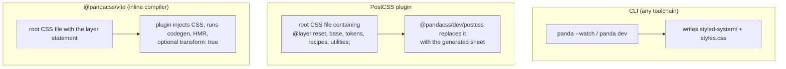

# Module 02 · Installation and Build Integration

> **Verified against** `@pandacss/dev` 2.4.0, `@pandacss/vite` 2.4.0, `postcss` 8.5.32, Vite 8.3.5, TypeScript 7.0.2, Node 26.12.1 on 2026-10-29.
> **Executable proof:** [`examples/react/panda.config.ts`](../examples/react/panda.config.ts), [`examples/react/vite.config.ts`](../examples/react/vite.config.ts), [`examples/tests/integration-postcss.test.ts`](../examples/tests/integration-postcss.test.ts), [`examples/tests/cli.test.ts`](../examples/tests/cli.test.ts), and the misconfiguration fixtures in [`examples/fixtures/configs/`](../examples/fixtures/configs/).

This module gets Panda into a build correctly the first time. The v2 release changed several defaults that used to be implicit (presets, CommonJS, cleanup of old output), so most "Panda generates nothing" reports after an upgrade trace back to this module.

---

## 2.1 Requirements and packages

| Requirement | Value in 2.4.0 | Why it matters |
|---|---|---|
| Node.js | `>= 22` (`engines` of `@pandacss/dev`) | The CLI and config loader use modern ESM loading. This track pins Node 26 via [`.mise.toml`](../.mise.toml). |
| Module system | ESM-only: `@pandacss/dev` is `"type": "module"`, and its main entry has no `require` condition | `require('@pandacss/dev')` fails. Write `panda.config.ts` with `import`/`export`, and set `"type": "module"` (or name it `.mts`/`.mjs`). The PostCSS entry `@pandacss/dev/postcss` still ships a CJS build, so `postcss.config.cjs` works. |
| Native binary | `@pandacss/compiler-<platform>` optional dependency | npm installs one prebuilt binary (`linux-x64-gnu`, `darwin-arm64`, `win32-x64-msvc`, …). If your package manager skips optional dependencies (`--omit=optional`, some CI caches), the compiler cannot load. |

Install:

```bash
npm install -D @pandacss/dev
npx panda init            # writes panda.config.ts, installs the two default presets, runs codegen
npx panda init --postcss  # also writes postcss.config.cjs
```

`panda init` flags worth knowing: `--jsx-framework react|solid|preact|vue`, `--jsx-style-props all|minimal|none`, `--strict-tokens`, `--out-extension ts|js|mjs`, `--skip-presets`, `--no-gitignore`, `--no-codegen`.

### Then vs now: installation

| | 0.x / 1.x | 2.x |
|---|---|---|
| Module format | CJS + ESM builds | ESM only |
| Node | `>=20.12.0` (1.12.1 `engines`; 0.51 declared none) | `>=22` |
| Generated runtime extension | `.mjs` by default | `.js` (configurable with `outExtension: 'ts' \| 'js' \| 'mjs'`) |
| `panda init --syntax template-literal` | Supported | Removed (object syntax only) |
| Integrations | Separate packages could be on different versions | All `@pandacss/*` share one version; never mix v1 and v2 packages |

---

## 2.2 The minimal correct config

```ts
// examples/react/panda.config.ts (abridged)
import { defineConfig } from '@pandacss/dev'
import { acmePreset } from '../system/preset.ts'

export default defineConfig({
  presets: ['@pandacss/preset-base', '@pandacss/preset-panda', acmePreset],
  preflight: true,
  jsxFramework: 'react',
  strictTokens: true,
  include: ['./src/**/*.{ts,tsx}'],
  exclude: [],
  outdir: 'styled-system',
})
```

### `presets` is no longer implicit

**Formal rule (2.x):** the resolved config is `merge(presets[0], …, presets[n-1], userConfig)`, left to right, with your config last. Nothing is prepended.

| Preset | Contributes | Without it |
|---|---|---|
| `@pandacss/preset-base` | Utilities and shorthands (`p`, `bg`, `color` → `colors` tokens), conditions (`_hover`, `_dark`, `_groupHover`, …), built-in patterns (`stack`, `flex`, …) | No `Flex`/`Stack`, `unknown_condition` warnings, token paths leak into CSS as invalid values |
| `@pandacss/preset-panda` | Default theme: color palettes, spacing, sizes, radii, fonts, **breakpoints**, keyframes, text styles | No default tokens or breakpoints |

The fixture [`configs/no-preset-base.config.ts`](../examples/fixtures/configs/no-preset-base.config.ts) lists only `preset-panda`. The negative test `without @pandacss/preset-base` proves the result: a `warning unknown_condition … _hover` diagnostic, and this CSS:

```css
@layer utilities {
  .color_red\.500 { color: red.500; }   /* token path leaked: invalid value, dropped by the browser */
  .p_2 { p: 2px; }                       /* shorthand unknown: invalid property */
  @card/wide { … }                       /* container condition unknown: invalid at-rule */
}
```

Breakpoints still work in that fixture because they come from `preset-panda`'s theme, not from `preset-base`. That detail is useful when you debug a half-broken setup.

**Then vs now.** v1 added `@pandacss/preset-base` automatically unless `eject: true` was set, and added `preset-panda` when you listed no presets. v2 removed `eject` and adds nothing. A v1 config with `presets: ['@acme/preset']` silently loses every utility after upgrading. Fix: list `@pandacss/preset-base` (and `@pandacss/preset-panda` if you relied on the default theme) before your own presets.

`presets` accepts package-name strings or imported objects. If a preset module exports a function, call it (`presets: [myPreset()]`).

### `include`, `exclude`, `outdir`

- `include` is the **scan set**. It must cover every file that calls Panda, including design-system packages in a monorepo ([Module 11](./11-monorepos-and-design-system-libraries.md)), and nothing else. Never let it reach `node_modules`, `dist` or `styled-system`.
- Paths are resolved against `cwd` (the config's project root; the CLI takes `--cwd`).
- `outdir` is where codegen writes. `importMap` (default `styled-system/css` etc.) tells the extractor which import specifiers are Panda imports. The match is a **substring** match, so `../styled-system/css` and `@acme/styled-system/css` both match `styled-system/css`.

### `preflight`

`preflight: true` emits a modern reset into `@layer reset`. It accepts `{ scope: '.panda-root' }` to scope the reset under a selector (useful when embedding into a page you do not own), plus `level: 'element'` (default `'parent'`) to reset only the elements that carry the scope class. The PostCSS test asserts `@layer reset {` is emitted for the React app.

---

## 2.3 Three integration paths



### 2.3.1 CLI

`panda` (= `panda build`) generates the system and the CSS once; `panda dev` (= `build --watch`) keeps both up to date. Use `--outfile`/`-o` for the CSS path and import that file from your app. This works with any bundler, or none.

### 2.3.2 PostCSS

```js
// postcss.config.cjs
module.exports = { plugins: { '@pandacss/dev/postcss': {} } }
```

```css
/* src/index.css: the "root" file */
@layer reset, base, tokens, recipes, utilities;
```

The plugin treats **any CSS file containing the layer-order statement as the root** and replaces it with the full stylesheet. Other CSS files pass through untouched. [`integration-postcss.test.ts`](../examples/tests/integration-postcss.test.ts) runs PostCSS programmatically against [`examples/react`](../examples/react/) and checks both behaviours: the root file becomes >10 KB of CSS with `.button`, `.button--compound__size_lg__visual_outline` and `.alert__title`; a file with `.legacy { color: red; }` is returned byte-for-byte.

Plugin options: `cwd`, `configPath`, `outdir`, and `allow` (regexes that let selected `node_modules` CSS files through its processing guard).

### 2.3.3 Vite: `@pandacss/vite`

```ts
// examples/react/vite.config.ts
import pandacss from '@pandacss/vite'
import react from '@vitejs/plugin-react'
export default defineConfig({
  plugins: [pandacss({ transform: process.env.PANDA_TRANSFORM === '1' }), react()],
})
```

New in v2. The plugin embeds the compiler: it runs codegen, replaces the root CSS file (the one with the layer statement) with the generated CSS, and handles HMR without a separate watcher. Options: `cwd` (defaults to Vite's `root`), `configPath`, `outdir`, `transform` (source transforms, [Module 01](./01-mental-model-and-v2-architecture.md#14-two-outputs-the-stylesheet-and-the-styled-system-package)). Put it **before** the framework plugin.

The e2e suite builds both apps with this plugin, four times (React/Solid × transform off/on), and asserts the rendered styles in Chromium.

Vite reports every Panda diagnostic as a warning and never fails the build. Gate CI separately with `panda --max-warnings 0` ([2.6](#26-ci-gates)).

### Choosing

| Situation | Use |
|---|---|
| Vite app (React, Solid, Vue, Svelte) | `@pandacss/vite` |
| Next.js, Remix/React Router, Astro, Storybook, anything already on PostCSS | PostCSS plugin |
| webpack / Rollup / Rolldown / Bun / Rspack and you want `transform: true` | `@pandacss/webpack`, `@pandacss/rollup`, `@pandacss/bun` |
| A library, a non-JS host, or you want a CSS file on disk | CLI |

---

## 2.4 Codegen in the development loop

The generated `styled-system/` is a pure function of the config, so treat it like `node_modules`: gitignore it and regenerate it.

```json
{ "scripts": { "prepare": "panda codegen" } }
```

`prepare` runs after `npm install`, so `tsc` and the editor have types before Vite or PostCSS ever starts. This track's [`package.json`](../package.json) runs `prepare → codegen` for the four example projects.

TypeScript also has to *see* the folder. If it lives outside `src`, add it to `tsconfig.json` `include`.

### TypeScript 7 and the CSS import

TypeScript 7 turns on `noUncheckedSideEffectImports` by default, so `import './index.css'` is an error (`TS2882`) unless a declaration exists. We hit exactly that while building the examples. Fix with `vite/client` types or a one-line declaration, as in [`examples/react/src/env.d.ts`](../examples/react/src/env.d.ts):

```ts
declare module '*.css'
```

### After any upgrade: `--clean`

v2 writes `.js` where v1 wrote `.mjs`, and it **does not delete files it no longer generates**. Vite resolves `index.mjs` before `index.js`, so a leftover v1 `styled-system/css/index.mjs` shadows the new output and you run v1 runtime code against v2 CSS. Run once:

```bash
npx panda codegen --clean   # or: panda build --clean
```

---

## 2.5 Inspecting the setup: `panda doctor`, `check`, `debug`

| Command | What it answers | Machine output |
|---|---|---|
| `panda doctor` | Does the config load? How many sources, conditions, utilities, which artifacts? | `--json` (`ok`, `errors`, `artifactIds`, `diagnostics`) |
| `panda codegen --check` / `panda check` | Is `styled-system/` (and the CSS file) up to date? Exit 1 if missing/stale | exit code + `missing: n`, `stale: n` |
| `panda debug` | Resolved config and per-file extraction dumps (`<file>.extract.json`) | `--json`, `--dry`, `--zip`, `--onlyConfig` |
| `panda analyze` | Token/recipe/utility/pattern usage | `--json`, `--scope`, `--unused` |

[`cli.test.ts`](../examples/tests/cli.test.ts) asserts on each: `doctor --json` reports `ok: true` and lists `jsx-create-slot-recipe-context` but no `*style-context*` artifact; deleting one generated file makes `codegen --check` exit 1 with `missing: 1` (checked manually while writing the test).

---

## 2.6 CI gates

```bash
npx panda codegen --check            # generated code matches the config
npx panda --max-warnings 0           # any extraction/config warning fails the job
npx panda --format github            # inline PR annotations
```

Warnings never change the exit code by themselves; `--max-warnings <n>` does. `--log-level error` only hides output and does not change the exit code. The config option `validation: 'none' | 'warn' | 'error'` controls only the `config_*` codes ([Module 10](./10-compiler-internals-and-debugging.md) lists the extraction codes).

### Then vs now: CLI surface

| v1 | v2 |
|---|---|
| `panda cssgen "src/**/*.tsx"` (positional globs) | `--include <glob>` (repeatable); positional globs no longer restrict the scan |
| `-o <dir>` for output dir | `--outdir <dir>`; on the full build `-o` means `--outfile` (CSS path) |
| `--silent` | `--log-level silent` |
| `--cpu-prof` | `--profile` (writes `trace.json` + `timings.json`) |
| `panda cssgen tokens` (single artifact) | full sheet, or `cssgen --splitting` and import the layers you need |
| `cssgen --clean` | `build --clean` or `codegen --clean` |
| `--minify`, `--hash`, `--preflight`, `--exclude` flags | config options (except `cssgen --minify`) |
| `--poll`, `--lightningcss`, `--emitTokensOnly` | removed |
| camelCase flags | kebab-case flags (`--max-warnings`, `--watch-debounce`) |
| `panda studio` local Astro server | `panda studio` (re-added in 2.4.0) opens the **hosted** Studio, live-connected to the project |
| `panda mcp`, `panda init-mcp` | `npx -y @pandacss/mcp` |

---

## 2.7 Config options removed in v2

`studio`, `eject`, `emitTokensOnly`, `gitignore`, `clean`, `watch`, `poll`, `lightningcss`, `browserslist` were removed. `forceConsistentTypeExtension` was replaced by `forceImportExtension`, which behaves differently: it adds the runtime extension to generated import specifiers. The fixture config in this track sets `forceImportExtension: true` so Node can import the generated runtime directly in [`runtime.test.ts`](../examples/tests/runtime.test.ts).

Type imports also moved: `@pandacss/dev` exports only `Config`, `Preset` and `UserConfig` types; import the rest from `@pandacss/types`.

---

## 2.8 Production failure modes

| Failure | Cause | Fix | Proof |
|---|---|---|---|
| No utilities, `unknown_condition` everywhere | `preset-base` missing after v1 → v2 | List it explicitly | `no-preset-base` negative test |
| Old behaviour after upgrade, types and CSS disagree | Stale `.mjs` files shadow new `.js` | `panda codegen --clean` once | (documented upgrade note) |
| Styles from a workspace package missing | `include` does not cover it | Add its source globs | [Module 11](./11-monorepos-and-design-system-libraries.md) |
| Build takes minutes, CSS is megabytes | `include` matches `node_modules`/`dist` | Narrow globs, keep `exclude` | — |
| `ERR_REQUIRE_ESM` loading the config or plugin | CJS config importing ESM-only `@pandacss/dev` | ESM config; `postcss.config.cjs` is fine | — |
| CI passes with broken styles | Vite reports diagnostics as warnings only | `panda --max-warnings 0` step | — |
| `TS2882` on `import './index.css'` | TS 7 `noUncheckedSideEffectImports` | `declare module '*.css'` / `vite/client` | `npm run typecheck` |

---

## Interview Drill

<details><summary>1. A team upgrades from Panda 1.x to 2.x. The build succeeds but most styles are gone. What are the first three things you check?</summary>

(1) `presets` includes `@pandacss/preset-base` (v2 adds no presets implicitly; missing base removes utilities and conditions and produces `unknown_condition` warnings). (2) Stale v1 `.mjs` files in `styled-system` shadowing the new `.js`: run `panda codegen --clean`. (3) All `@pandacss/*` packages are on the same 2.x version (an old `@pandacss/postcss` mixed with v2 codegen breaks subtly). Then run `panda doctor` and look at diagnostics.
</details>

<details><summary>2. How does the PostCSS plugin know which CSS file to replace?</summary>

Any file it processes whose content contains the Panda layer-order statement `@layer reset, base, tokens, recipes, utilities;` is treated as the root and replaced with the generated stylesheet. Other files pass through unchanged (tested in `integration-postcss.test.ts`).
</details>

<details><summary>3. Why is `styled-system/` gitignored, and how do you keep `tsc` working on a fresh clone?</summary>

It is derived from the config alone, so committing it creates merge noise and drift. A `"prepare": "panda codegen"` script regenerates it after `npm install`, before `tsc` or the editor need the types. CI can run `panda codegen --check` to detect drift if it is committed anyway.
</details>

<details><summary>4. When would you pick the CLI over `@pandacss/vite`?</summary>

When there is no Vite (or no bundler), when you are building a library that should ship a CSS file, when a non-JS host serves the CSS, or when you want one artifact on disk for inspection/CDN. The Vite plugin is best for Vite apps: inline compiler, HMR, optional source transforms.
</details>

<details><summary>5. Your CI uses Vite and never fails on Panda problems. Why, and what do you add?</summary>

`@pandacss/vite` reports all diagnostics as warnings and never fails the build. Add a separate `panda --max-warnings 0` (optionally `--format github`) step and `panda codegen --check`.
</details>

<details><summary>6. What does `importMap` control, and what is the subtle matching rule?</summary>

Which import specifiers the extractor treats as Panda's `css`, `recipes`, `patterns`, `jsx` (and tokens) entry points. Matching is by substring, so `styled-system/css` matches both `../styled-system/css` and `@acme/styled-system/css`. A too-short specifier would over-match.
</details>

<details><summary>7. What changed about `panda studio` across versions?</summary>

v1 shipped a local Astro-based Studio (`panda studio`, `--build`, `--preview`). v2.0 removed it in favour of the hosted Studio. 2.4.0 re-added a `panda studio` command that opens the hosted Studio in the browser, live-connected to the local project (default `http://localhost:6420`, `--no-open` prints the link).
</details>

## References

- Using PostCSS: https://panda-css.com/docs/get-started/postcss
- Using Vite: https://panda-css.com/docs/get-started/vite
- CLI reference: https://panda-css.com/docs/reference/cli
- Config reference: https://panda-css.com/docs/reference/config
- Diagnostics: https://panda-css.com/docs/reference/diagnostics
- Upgrading to v2: https://panda-css.com/docs/get-started/upgrading-to-v2
- `@pandacss/dev` 2.4.0 changelog (`panda studio`): https://github.com/chakra-ui/panda/blob/main/CHANGELOG.md
