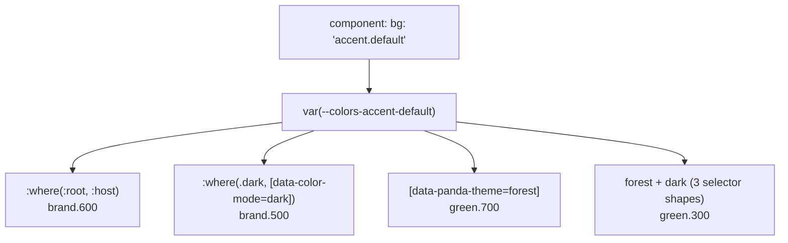

# Module 06 · Color Mode and Theming

> **Verified against** `@pandacss/dev` 2.4.0, `@pandacss/preset-base` 2.4.0 on 2026-10-29.
> **Executable proof:** [`examples/system/semantic-tokens.ts`](../examples/system/semantic-tokens.ts), [`examples/system/preset.ts`](../examples/system/preset.ts) (the `dark` condition), [`text-styles.ts`](../examples/system/text-styles.ts); fixture [`06-theming.ts`](../examples/fixtures/positive/06-theming.ts) + snapshot; [`configs/themes.config.ts`](../examples/fixtures/configs/themes.config.ts); the `themes:` test in [`e2e-fixtures.test.ts`](../examples/tests/e2e-fixtures.test.ts); the `semantic token switches under the .dark condition` test in [`e2e-computed-style.test.ts`](../examples/tests/e2e-computed-style.test.ts) (React and Solid).

Color spaces, `color-scheme`, `light-dark()`, `prefers-color-scheme` and theming with custom properties in plain CSS are owned by [`languages/css`](../../../languages/css/README.md) (module "Color, theming & typography"). Here we cover how Panda compiles modes and themes into that machinery, and the compositions (text, layer and animation styles) that sit next to them.

---

## 6.1 Mode versus theme

| Concept | Varies | Selected by | Panda construct |
|---|---|---|---|
| **Color mode** | The shade of the same palette (light/dark, high contrast) | A class or attribute (`.dark`), or the OS (`prefers-color-scheme`) | Conditions on semantic tokens (`_dark`, `_osDark`) |
| **Theme** | The palette, radii, fonts: the brand | `data-panda-theme="<name>"` on any element | `themes` config + `staticCss.themes` or `styled-system/themes` |

Both compile to **redeclarations of the same custom properties** under different selectors. Components only read semantic tokens (`bg: 'bg.canvas'`) and never know either exists. Two orthogonal selectors compose because custom properties inherit: the theme picks the palette, the mode picks the shade.



---

## 6.2 Color mode

### The `_dark` condition

`preset-base` defines `_dark` as a parent-selector condition (`.dark &`, i.e. "inside an element with class `dark`"). Our preset overrides it so both a class and an attribute work:

```ts
// examples/system/preset.ts
conditions: { extend: { dark: '.dark &, [data-color-mode=dark] &' } }
```

Semantic tokens with `_dark` values compile to the `:where(...)` redeclaration (zero specificity, so a theme block can override it):

```css
/* 06-theming snapshot */
:where(:root, :host) { --colors-bg-canvas: var(--colors-white); }
:where(.dark, [data-color-mode=dark]) { --colors-bg-canvas: var(--colors-ink-950); }
```

The React and Solid apps put `class="dark"` on the page wrapper when a button is clicked. Playwright reads the button background before and after: `rgb(79, 70, 229)` (`brand.600`) → `rgb(99, 102, 241)` (`brand.500`). The test polls, because the recipe sets `transition-duration`, and an immediate read returns an intermediate color (`rgb(82, 75, 231)` was observed on the first run).

### Following the OS

`_osDark` / `_osLight` compile to `@media (prefers-color-scheme: dark|light)`. Three strategies:

| Strategy | Token values | Trade-off |
|---|---|---|
| OS only | `{ base, _osDark }` | No user override, no flash, zero JS |
| User choice only | `{ base, _dark }` + class toggle | Needs persistence and an early script |
| OS default + user override | Redefine `dark` to cover both, e.g. a block condition, plus `.light` to opt out | Most flexible; most complex selectors |

Also set the CSS `color-scheme` property (e.g. `globalCss: { ':root': { colorScheme: 'light' }, '.dark': { colorScheme: 'dark' } }`) so form controls and scrollbars follow the mode.

### Flash of incorrect theme (FOUC) on server rendering

With a user-chosen mode stored client-side, the server renders HTML without `class="dark"`, the browser paints light, then hydration adds the class. Fix: a tiny **blocking** script in `<head>`, before any stylesheet-dependent paint, that sets the class from storage or the OS preference:

```html
<script>
  try {
    const stored = localStorage.getItem('color-mode')
    const dark = stored ? stored === 'dark' : matchMedia('(prefers-color-scheme: dark)').matches
    document.documentElement.classList.toggle('dark', dark)
  } catch {}
</script>
```

A cookie read on the server is the alternative that also works without JS. Panda is not involved at runtime in either case, which is the point: the mode is a class, and the CSS is already loaded. (This pattern is not covered by an automated test in this track; the class-toggle mechanics are.)

---

## 6.3 Multi-brand themes

```ts
// examples/fixtures/configs/themes.config.ts (abridged)
const defineTheme = defineThemeContract({
  semanticTokens: { colors: { accent: { default: { value: '' } } } },
})
export default defineConfig({
  themes: {
    forest: defineTheme({
      semanticTokens: { colors: { accent: { default: { value: { base: '{colors.green.700}', _dark: '{colors.green.300}' } } } } },
    }),
    contrast: defineTheme({ /* … black / white */ }),
  },
  staticCss: { themes: ['forest'] },
})
```

### Shipping: static versus on demand

Panda emits **nothing** for `themes` until you choose:

- `staticCss.themes: ['forest']` → a `[data-panda-theme=forest]` block in `@layer tokens` of the main sheet, containing only the overridden variables, plus the dark-composition block:

  ```css
  [data-panda-theme=forest] { --colors-accent-default: var(--colors-green-700); }
  :where(.dark, [data-color-mode=dark]) [data-panda-theme=forest],
  [data-panda-theme=forest]:where(.dark, [data-color-mode=dark]),
  [data-panda-theme=forest] :where(.dark, [data-color-mode=dark]) { --colors-accent-default: var(--colors-green-300); }
  ```

  The three selector shapes let `.dark` sit above, on, or inside the themed element.

- On demand: codegen always writes `styled-system/themes/theme-<name>.json` (`{ name, id, css }`) and `index.js` with `getTheme(name)` (a dynamic `import()` of the JSON, so it needs a bundler that understands JSON imports) and `injectTheme(el, theme)` (sets `data-panda-theme`, appends or updates a `<style id=…>`). Use it for many themes or user-picked themes. On the server, read the choice (cookie), inline `theme.css` in `<head>` and set the attribute before first paint.

### The theme condition

Every theme gets `_theme<Name>` for structural, non-token differences: `_themeForest: { textTransform: 'uppercase' }` → `.themeForest\:tt_uppercase:where([data-panda-theme=forest], [data-panda-theme=forest] *)`. Prefer tokens; a theme that is only token overrides stays swappable.

### Theme contract

`defineThemeContract` makes a theme that omits a contracted token a **type error** instead of a silent fallback to the default value.

### What the e2e test proves

[`e2e-fixtures.test.ts`](../examples/tests/e2e-fixtures.test.ts) compiles the themes config, loads it in Chromium and checks: default `brand.600`; inside `forest` `green.700` (`oklch(0.527 …)`); inside `forest` + `.dark` `green.300`; `_themeForest` uppercase; `contrast` (not in `staticCss.themes`) has **no** effect until its JSON CSS is injected.

It also caught a real production trap: **`optimize.removeUnusedTokens` prunes tokens that only on-demand themes reference.** `contrast` uses `{colors.black}`; nothing static did, so `--colors-black` was not emitted, and after injection the background computed to `rgba(0, 0, 0, 0)` (a `var()` of an undefined variable makes the declaration invalid at computed-value time). Adding the variable fixed it. Mitigations: list all themes in `staticCss.themes`, keep `removeUnusedTokens` off when using on-demand themes, or reference the needed primitives from scanned code.

### Then vs now: overriding theme keys

| | v1 | v2 |
|---|---|---|
| `theme.tokens.colors` without `extend` | Replaced the **whole** `theme.tokens` of the presets: `spacing`, `fonts`, `radii`… disappeared too | Replaces only the named entry (`colors`); other categories stay |
| Same for recipes | Whole `recipes` map replaced | Only the named recipe |
| `theme.breakpoints` without `extend` | Replaced | **Still replaces the whole set** (exception) |

The fixture [`breakpoints-replace.config.ts`](../examples/fixtures/configs/breakpoints-replace.config.ts) defines only `sm`; the test proves `md` styles vanish (no `(width >= 48rem)` query, plus a `nested_property` warning). Rule of thumb: always use `extend` unless you deliberately want replacement.

---

## 6.4 Compositions: text styles, layer styles, animation styles

Compositions are named bundles of properties, referenced with a utility:

```ts
// examples/system/text-styles.ts
export const textStyles = defineTextStyles({
  heading: { value: { fontSize: '2xl', fontWeight: 'bold', lineHeight: 'tight', letterSpacing: 'tight' } },
})
export const layerStyles = defineLayerStyles({
  card: { value: { background: 'bg.canvas', borderWidth: '1px', borderColor: 'bg.subtle', borderRadius: 'lg' } },
})
// usage: css({ textStyle: 'heading' }), css({ layerStyle: 'card' })
```

| | Text styles | Layer styles | Animation styles |
|---|---|---|---|
| Purpose | Typography bundles | Visual surfaces (bg, border, shadow) | Animation orchestration (name, duration, origin, per-placement selectors) |
| Allowed properties | Typography properties | A fixed visual list, **longhand CSS names only** (`background`, not `bg`; the type rejects shorthands, as we hit while writing the example) | Animation properties and selectors |
| Usage | `textStyle: 'heading'` | `layerStyle: 'card'` | `animationStyle: 'slide-fade-in'` |
| Defined with | `defineTextStyles` | `defineLayerStyles` | `defineAnimationStyles` |

**Where they land in the cascade.** Compositions are emitted into a nested layer `@layer utilities { @layer compositions { … } }` (see the snapshot). In CSS, declarations directly in a layer beat those in its sub-layers, so `css({ textStyle: 'heading', fontSize: 'sm' })` gets `font-size: sm`: a plain utility always overrides a composition, regardless of order.

### Keyframes

`theme.keyframes` (or `theme.extend.keyframes`) defines `@keyframes` emitted in `@layer tokens`; with `optimize.removeUnusedKeyframes` only referenced ones ship (`fadeIn` in the snapshot, referenced from `animation: 'fadeIn 200ms ease-out'`). v2 also has a `keyframes()` function in the css barrel for inline, object-form keyframes. Respect motion preferences with `_motionReduce: { animation: 'none' }`; scroll-driven animations and view transitions are covered in `languages/css` (Panda's `viewTransition()` helper returns a stable class for `view-transition-class`).

---

## 6.5 Production failure modes

| Symptom | Cause | Fix / proof |
|---|---|---|
| Light flash before dark | Mode applied after hydration | Blocking head script or server cookie |
| Injected theme partly transparent | `removeUnusedTokens` pruned primitives used only by on-demand themes | Keep tokens or ship statically; themes e2e test |
| A theme silently shows default colors | Theme missed a token | `defineThemeContract` |
| `md` styles gone after adding one breakpoint | `breakpoints` without `extend` replaces the set | `theme.extend.breakpoints`; negative test |
| Form controls stay light in dark mode | No `color-scheme` | Set `colorScheme` per mode |
| `textStyle` "ignores" a value | A plain utility overrides compositions by layer | Expected; override deliberately |
| Mid-transition colors in tests | Transitions | Poll computed style |

---

## Interview Drill

<details><summary>1. How does Panda implement dark mode without JavaScript at runtime?</summary>

Semantic tokens with `_dark` values compile to a second declaration of the same custom property under the dark selector (`:where(.dark, …)`). Utilities read the variable; switching the class switches the declaration that applies through inheritance. The only JS is whatever sets the class.
</details>

<details><summary>2. Mode vs theme: why can they compose freely?</summary>

Both are custom-property redeclarations scoped by independent ancestor selectors (`.dark` vs `[data-panda-theme]`). Panda emits combined selectors for "theme + dark" in all three nesting shapes, and inheritance resolves the nearest declaration, so any element subtree can have its own theme and mode.
</details>

<details><summary>3. Static themes vs on-demand themes: when do you use which?</summary>

Static (`staticCss.themes`) for a few themes needed everywhere: no runtime, but every page pays for every theme's variables. On-demand (`getTheme`/`injectTheme`, JSON per theme) for many or user-selected themes: smaller main CSS, but a fetch/inline step, and beware tokens pruned by `removeUnusedTokens`.
</details>

<details><summary>4. How do you avoid a dark-mode flash in SSR?</summary>

Set the mode before first paint: a blocking inline `<head>` script reading storage or `prefers-color-scheme`, or render the class on the server from a cookie. Use `_osDark` tokens if OS-only behaviour is acceptable.
</details>

<details><summary>5. What changed in v2 when you set `theme.tokens` without `extend`?</summary>

In v1 it replaced the whole token tree from presets. In v2 it replaces only the named entry (e.g. `colors`), leaving other categories; recipes behave the same. `breakpoints` is the exception and still replaces the entire set.
</details>

<details><summary>6. Why does `css({ textStyle: 'heading', fontSize: 'sm' })` render small text?</summary>

Compositions live in `@layer utilities.compositions`, a nested layer. Declarations placed directly in `utilities` beat those in its nested layers, so the plain `fontSize` utility wins regardless of order.
</details>

<details><summary>7. What is `defineThemeContract` for?</summary>

It declares the set of tokens every theme must provide, turning an omitted token into a TypeScript error instead of a silent fallback to the default theme's value.
</details>

## References

- Multiple themes: https://panda-css.com/docs/theming/multiple-themes
- Conditional styles (`_dark`, `_osDark`): https://panda-css.com/docs/styling/conditional-styles#color-scheme
- Text styles: https://panda-css.com/docs/theming/text-styles
- Layer styles: https://panda-css.com/docs/theming/layer-styles
- Animation styles: https://panda-css.com/docs/theming/animation-styles
- Customize theme / presets (`extend` semantics): https://panda-css.com/docs/theming/presets
- Upgrading to v2 (theme keys without `extend`): https://panda-css.com/docs/get-started/upgrading-to-v2
