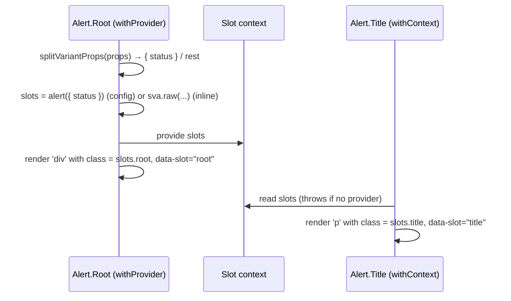

# Module 08 · Slot Recipes and Recipe Contexts

> **Verified against** `@pandacss/dev` 2.4.0, React 19.3.1, Solid 1.9.17 on 2026-10-29.
> **Executable proof:** [`examples/system/recipes/alert.slot-recipe.ts`](../examples/system/recipes/alert.slot-recipe.ts); [`examples/react/src/Alert.tsx`](../examples/react/src/Alert.tsx), [`examples/solid/src/Alert.tsx`](../examples/solid/src/Alert.tsx); fixture [`08-slot-recipes.ts`](../examples/fixtures/positive/08-slot-recipes.ts) + snapshot; [`recipe-context.test.ts`](../examples/tests/recipe-context.test.ts) (React and Solid server rendering); slot tests in [`runtime.test.ts`](../examples/tests/runtime.test.ts); the alert assertions in [`e2e-computed-style.test.ts`](../examples/tests/e2e-computed-style.test.ts).

Most real components have parts: an alert has a root, a title and a description; a tabs widget has a list, triggers, an indicator and panels. A **slot recipe** styles all parts from one variant selection. A **recipe context** distributes that selection through the component tree so that `<Alert.Root status="danger">` styles its children without prop drilling.

Typing compound components (generic props, polymorphism, context typing) is owned by [`languages/typescript`](../../../languages/typescript/README.md) (module "Typing UI frameworks: React & Solid"). React context and Solid context semantics are owned by the [`react`](../../react/README.md) and [`solidjs`](../../solidjs/README.md) tracks.

---

## 8.1 Slot recipe model

A slot recipe is a recipe whose style objects are indexed by slot:

```
SR = (S, B, V, C, D)   with   B : S → StyleObject,   V : key → value → (S → StyleObject),   C.css : S → StyleObject
apply(SR, p) : S → classString
```

The result is a **map from slot name to class string**, one entry per slot, computed from the same resolved variant props. All slots therefore agree on `status`, `size` etc. by construction.

| | Inline `sva()` | Config `defineSlotRecipe()` |
|---|---|---|
| Lives in | Component code | Config / preset (`theme.slotRecipes`) |
| CSS | Atomic utilities per slot | Named classes `alert__root`, `alert__root--status_danger` in `@layer recipes.slots` |
| Emission | Every variant, eagerly | JIT: literal variant values seen at `Alert`, `Alert.Root`, `AlertRoot` (or `jsx`) |
| Compounds | Merged per slot at call time | Named classes in `recipes.slots.compound_variants` |

```ts
// examples/tests/runtime.test.ts
alert({ status: 'danger' })
// { root: 'alert__root alert__root--status_danger',
//   title: 'alert__title alert__title--status_danger',
//   description: 'alert__description alert__description--status_danger' }

sva({ slots: ['root', 'label'], base: {…}, variants: { invalid: { true: { label: { color: 'red.600' } } } } })({ invalid: true })
// { root: 'd_grid', label: 'fw_medium c_red.600' }
```

Note that every slot gets a variant class, even if the variant has no style for it (`alert__title--status_danger` is in the runtime output but no rule exists for it). That is harmless and makes attribute selectors and debugging consistent.

### Emitted CSS layering

Config slot recipes have their own nested ladder inside `recipes`:

```css
@layer recipes { @layer base, slots, variants, compound_variants; }
@layer recipes.slots { @layer base, variants, compound_variants; }
```

So, from lowest to highest: plain recipe base → **slot recipes (base, variants, compounds)** → plain recipe variants → plain recipe compounds → utilities. A slot recipe's own variants beat its base; anything in `utilities` (including a `css` prop on a part) beats all of it.

`colorPalette` in a slot variant emits every palette variable the theme has for that color family (the `08-slot-recipes` snapshot declares all eleven `--colors-color-palette-*` for `red`). That is the price of virtual colors: the recipe cannot know which shades a child will read.

---

## 8.2 Recipe contexts: compound components

### `createSlotRecipeContext`

```tsx
// examples/react/src/Alert.tsx (the Solid file is identical)
import { createSlotRecipeContext } from '../styled-system/jsx'
import { alert } from '../styled-system/recipes'

const { withProvider, withContext } = createSlotRecipeContext(alert)

export const Alert = {
  Root: withProvider('div', 'root', { defaultProps: { role: 'status' } }),
  Title: withContext('p', 'title'),
  Description: withContext('p', 'description'),
}
```

```tsx
<Alert.Root status="danger">
  <Alert.Title>Payment failed</Alert.Title>
  <Alert.Description>Check the card details.</Alert.Description>
</Alert.Root>
```

Mechanics of the generated helper:



| Helper | Use | Accepts variant props | Renders a DOM element |
|---|---|---|---|
| `withProvider(component, slot, options?)` | Usual root | Yes (split off, not forwarded unless `forwardProps`) | Yes, with the slot class + `data-slot` |
| `withRootProvider(component, options?)` | Root of a headless library that renders **no** element (e.g. a `Dialog.Root` that is context only) | Yes | No slot class; only `defaultProps` option |
| `withContext(component, slot, options?)` | Each part | No (reads context) | Yes, with the slot class + `data-slot` |
| `PropsProvider` | Group component sharing variant props with several roots | — | — |

Options mirror `styled()`: `defaultProps` (HTML/component props; **not** variant keys, which belong in the recipe's `defaultVariants`), `forwardProps` (pass a variant like `orientation` through to the wrapped component, e.g. to mirror it as `aria-orientation`), `shouldForwardProp`, and per-element `unstyled`.

[`recipe-context.test.ts`](../examples/tests/recipe-context.test.ts) renders these components on the server with `react-dom/server` and with Solid's `renderToString`, using the generated runtime directly. It asserts:

- the root has `alert__root alert__root--status_danger`, `data-slot="root"`, `role="status"` from `defaultProps`, and **no** `status` attribute in the HTML;
- the title receives `alert__title alert__title--status_danger` from context;
- `unstyled` on the root empties only the root's class; the title keeps its slot styles;
- a `withContext` part rendered alone throws `… cannot access createSlotRecipeContext("alert") because it's missing its Provider.` (React and Solid);
- with `createRecipeContext(button)`, a `PropsProvider value={{ size: 'lg' }}` gives the first button `button--size_lg`, while the second overrides with `size="sm"` and adds a `css` utility class.

The Solid build of the helper uses `splitProps`, `mergeProps`, `createMemo` and Solid context, so variant changes stay reactive without re-rendering the tree. Solid's SSR output appended a trailing space in `class`, which the test trims.

### `createRecipeContext` for single-element recipes

`createRecipeContext(recipe)` returns `withContext(component, options?)` and `PropsProvider`. It is `styled()` plus a provider: one recipe can back `Button` (`'button'`) and `LinkButton` (`'a'`), and a `ButtonGroup` can set `size` for all buttons below it with `PropsProvider`.

Both helpers are client components (they use context). The recipe functions themselves stay server-safe ([Module 01](./01-mental-model-and-v2-architecture.md#16-server-rendering-and-react-server-components)).

### Then vs now

| v1 (≤ 1.12) | v2 |
|---|---|
| Hand-written or generated `createStyleContext(recipe)` returning `withProvider` / `withContext` (this track's old `create-style-context.tsx`) | **Removed** from `styled-system/jsx`. Use `createSlotRecipeContext(slotRecipe)` (`withRootProvider`, `withProvider`, `withContext`, `PropsProvider`) or `createRecipeContext(recipe)` (`withContext`, `PropsProvider`) |
| No way to provide slots without rendering a slot element | `withRootProvider` |
| `defineParts(anatomy)` mapped part names to `[data-part]` selectors | **Removed**. Write the selector as a key (`'& [data-part="control"]': {…}`), copy the helper into your config, or use `defineSlotRecipe` for a class per part |

`panda doctor --json` in [`cli.test.ts`](../examples/tests/cli.test.ts) asserts that `jsx-create-slot-recipe-context` and `jsx-create-recipe-context` are generated and that no `*style-context*` artifact exists.

**Migration steps.** Replace `import { createStyleContext } from '…'` with `createSlotRecipeContext` from `styled-system/jsx`; root components that rendered nothing move to `withRootProvider`; move variant keys out of `defaultProps` into `defaultVariants`; re-run `panda codegen --clean`.

---

## 8.3 Extraction for compound components

Config slot recipes are tracked by tag name: an `alert` slot recipe matches `Alert`, `Alert.Root` and `AlertRoot` by default (our recipe sets `jsx: ['Alert', 'Alert.Root']` explicitly). Variant props are read **only from the root**, because that is where callers put them. Rules:

- `jsx` replaces the default *root* names. If you export `Panel.Root` for an `alert` recipe, list `Panel.Root`.
- A group component that forwards variants via `PropsProvider` (e.g. `<CardGroup size="lg">`) must be listed in `jsx`, or its literal `size="lg"` is invisible.
- `sva` needs none of this: it emits every variant eagerly.

The same JIT failure modes as [Module 07](./07-recipes-and-config-recipes.md#jit-emission-and-its-three-failure-modes) apply, one level up.

---

## 8.4 Wrapping headless libraries (Ark UI, Park UI, Radix)

Headless libraries render accessible behaviour without styles and expose state as `data-*` attributes (`data-state="open"`, `data-part`). Match the helper to the library's tree:

```tsx
import { Accordion as Ark } from '@ark-ui/react/accordion'
const { withProvider, withContext } = createSlotRecipeContext(accordion)
export const Accordion = {
  Root: withProvider(Ark.Root, 'root'),
  Item: withContext(Ark.Item, 'item'),
  ItemTrigger: withContext(Ark.ItemTrigger, 'itemTrigger'),
  ItemContent: withContext(Ark.ItemContent, 'itemContent'),
}
```

Write the recipe's state styles with Panda conditions that already include the data-attribute twin (`_open`, `_expanded`, `_disabled` match `[data-state=open]`, `[data-expanded]`, `[data-disabled]`; see [Module 03](./03-styling-api-and-conditions.md#32-conditions)). For a root that only provides context (`Dialog.Root`), use `withRootProvider`.

**Park UI.** `@park-ui/panda-preset` 0.43.1 (published 2024-11-22, still `latest` on 2026-10-29) declares `peerDependencies: { "@pandacss/dev": ">0.22.0" }`, nests `presets: ['@pandacss/preset-base']`, and a grep of its build found no `containerSizes` or `defineParts`. Its compatibility with Panda 2.x is **not verified by a test in this track**; treat it as untested and pin it behind your own smoke test before adopting.

---

## 8.5 Production failure modes

| Symptom | Cause | Fix / proof |
|---|---|---|
| "Cannot access createSlotRecipeContext… missing its Provider" | Part rendered outside its root (portals, story of one part) | Render under the root; negative tests |
| Variant attribute (`status="danger"`) in the DOM | Hand-rolled root forwarding all props | Use `withProvider` (splits variants) |
| Variant ignored on a wrapped headless component | Library needs the value (e.g. `orientation`) | `forwardProps` |
| `defaultProps: { size: 'sm' }` does not pick a variant | Variant keys are split from incoming props only | Use `defaultVariants` |
| Variant CSS missing for a renamed export | Root name not in `jsx` | List it |
| Build fails after upgrade: `createStyleContext` not exported | Removed in v2 | `createSlotRecipeContext` |

---

## Interview Drill

<details><summary>1. Why is a slot recipe better than one `cva` per part for a compound component?</summary>

One variant resolution produces classes for all parts, so the parts cannot disagree, and the API is one recipe with one set of types. Config slot recipes also give named classes per part and state (`alert__title--status_danger`) and JIT emission.
</details>

<details><summary>2. Walk through what `withProvider` and `withContext` do at render time.</summary>

`withProvider` splits variant props from the rest, computes the slot map from the recipe, provides it through context, and renders its element with the root slot class and `data-slot`. `withContext` reads the slot map and renders its element with its slot class; it throws if there is no provider.
</details>

<details><summary>3. When do you need `withRootProvider`?</summary>

When the library's root component renders no DOM element (context-only roots like a dialog root). It provides the slot map without applying a slot class; its only option is `defaultProps`.
</details>

<details><summary>4. Your team upgrades to v2 and `createStyleContext` is gone. What is the migration?</summary>

Replace it with `createSlotRecipeContext` (slot recipes) or `createRecipeContext` (single-element recipes) from `styled-system/jsx`; use `withRootProvider` for element-less roots; move variant defaults to `defaultVariants`; regenerate with `--clean`. Replace `defineParts` with explicit `[data-part]` selectors or a slot recipe.
</details>

<details><summary>5. A `<CardGroup size="lg">` sets sizes for nested cards through `PropsProvider`, but `lg` styles are missing in production. Why?</summary>

With a config slot recipe, extraction reads variant literals only on tags it tracks (the root names). `CardGroup` is not in the recipe's `jsx`, so `size="lg"` is invisible. Add `CardGroup` to `jsx` or pre-generate with `staticCss`.
</details>

<details><summary>6. How do Panda recipes integrate with headless libraries' state?</summary>

Built-in state conditions emit `:is(:pseudo, [data-*])` selectors, matching the data attributes headless libraries set (`data-state`, `data-expanded`, `data-disabled`). Wrap each headless part with `withContext`/`withProvider` so it receives its slot class.
</details>

<details><summary>7. Why are recipe contexts client components even in an RSC app?</summary>

They use framework context to pass the slot map down the tree, which needs the client runtime. The recipe functions (`alert()`, `sva()`) are pure and can be called in Server Components to produce class strings directly.
</details>

## References

- Slot recipes: https://panda-css.com/docs/recipes/slot-recipes
- Slot recipe context: https://panda-css.com/docs/recipes/slot-recipe-context
- Recipe context: https://panda-css.com/docs/recipes/recipe-context
- Wrap headless libraries: https://panda-css.com/docs/design-systems/wrap-headless-libraries
- Upgrading to v2 (`createStyleContext`, `defineParts`): https://panda-css.com/docs/get-started/upgrading-to-v2
- Ark UI: https://ark-ui.com/
