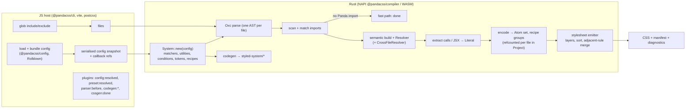
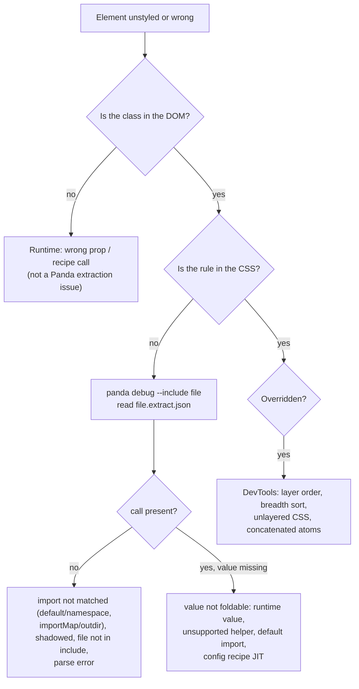

# Module 10 · Compiler Internals and Static-Analysis Debugging

> **Verified against** `@pandacss/dev` 2.4.0 and the [chakra-ui/panda](https://github.com/chakra-ui/panda) `main` branch design notes (`design-notes/*.md`, read on 2026-10-29).
> **Executable proof:** [`compiler.test.ts`](../examples/tests/compiler.test.ts) (conditional folding, parse-error recovery, plugins, `--splitting`, `--profile` spans); [`negative-extraction.test.ts`](../examples/tests/negative-extraction.test.ts) (default/namespace imports, shadowing, unsupported helpers, dynamic values); [`cli.test.ts`](../examples/tests/cli.test.ts) (`panda debug` extract dumps); fixtures [`10-cross-file.ts`](../examples/fixtures/positive/10-cross-file.ts), [`10-conditional-values.ts`](../examples/fixtures/positive/10-conditional-values.ts), [`negative/`](../examples/fixtures/negative/); configs [`plugins.config.ts`](../examples/fixtures/configs/plugins.config.ts), [`hooks-removed.config.ts`](../examples/fixtures/configs/hooks-removed.config.ts).

Every "my styles are missing" bug is a question about what the compiler can see. This module describes the v2 Rust compiler stage by stage, gives the exact folding rules, and shows how to inspect each stage. The JavaScript semantics it emulates (scopes, bindings, `ToString`/`ToNumber`) are owned by [`languages/javascript`](../../../languages/javascript/README.md).

---

## 10.1 The pipeline



| Stage | Crate | What it does | How to observe |
|---|---|---|---|
| Construction | `pandacss_config`, `pandacss_system` | Compile the config once into matchers, utility metadata, conditions, token dictionary, recipe registry | `panda doctor`, `panda debug --onlyConfig` |
| Parse | `pandacss_extractor` (Oxc), `pandacss_sfc` | One Oxc parse per file. `.vue`, `.svelte`, `.astro` (and MDX) are lowered to a same-offset JS program first | `js_parse_error` diagnostics |
| Import matching | `pandacss_extractor` | Collect imports; match them against the import map by **substring** in fixed category order (css → tokens → recipe → pattern → jsx). Default and side-effect imports never match; type-only imports are skipped | `panda debug` (`matched` in tooling dumps) |
| Fast path | — | If nothing matched, stop: no semantic analysis, no walk | `match_imports` span |
| Resolution | `Resolver` over `oxc_semantic`, `CrossFileResolver` over `oxc_resolver` | Bind identifiers; follow named imports, re-exports, `export *`, tsconfig `paths`, `package.json` `exports`/`imports`, `.js` → `.ts` aliasing | `resolve_scopes`, `scan_exports` spans |
| Extraction | `pandacss_extractor` | Visit calls and JSX once; fold argument expressions to `Literal` | `panda debug` → `<file>.extract.json` |
| Encoding | `pandacss_encoder`, `pandacss_utility` | Normalise shorthands, apply utility transforms, expand conditional branches, produce `Atom(prop, value, conditions)` and recipe groups | `encode_atoms` span |
| Project state | `pandacss_project` | Per-file refcounted atom/recipe registry: watch mode replaces one file's contribution | — |
| Emission | `pandacss_stylesheet` | Layers, breadth sort, media grouping, adjacent-rule merging, writer minification | `--splitting`, `stylesheet` span |
| Codegen | `pandacss_codegen` | `styled-system/*` runtime and types | `panda codegen --check` |

The JS host owns everything that must run arbitrary user code: config bundling, plugin hooks, and utility/pattern `transform` callbacks (invoked from Rust through the binding and memoised). The `--profile` test reads exactly these span names from Rust's tracing output: `compile_config`, `oxc_parse`, `match_imports`, `extract_calls`, `encode_atoms`, `stylesheet`, `emit_css`.

### Two notable non-features

- **No CSS optimiser.** v2 removed the `lightningcss` and `browserslist` options. The emitter merges adjacent identical rules and can minify whitespace, but does not prefix, fold shorthands or minify values. Let your bundler's CSS minifier (Lightning CSS in Vite) do that.
- **No persistent cache yet.** `cacheDir` is a reserved API shape; each cold build re-parses. Watch mode is incremental through the per-file registry; `compile()` still sorts and emits the whole atom set.

---

## 10.2 Import matching rules

```ts
import { css } from '../styled-system/css'   // named: matched (substring "styled-system/css")
import * as p from '../styled-system/css'    // namespace call p.css(...) — not a style helper import
import css2 from '../styled-system/css'      // default: never matched
import type { SystemStyleObject } from '../styled-system/types'  // type-only: skipped
```

Consequences:

- `importMap` is derived from `outdir`. Change `outdir` to `styled-system-themes` and imports from `../styled-system/css` are **not** Panda imports. We hit this while writing [`themes-usage.ts`](../examples/fixtures/configs/themes-usage.ts): the debug dump showed `"calls": []`.
- Matching is by substring, so a too-short specifier (`'css'`) would over-match anything containing `css`.
- **Shadowing is respected.** The resolver checks whether `css` at a call site is bound to the import. In [`shadowed-css.ts`](../examples/fixtures/negative/shadowed-css.ts), `function local(css) { css({ color: 'pink.300' }) }` produces no CSS, while the real import's `pink.700` does.

---

## 10.3 The literal fold: what the compiler can know

`fold(expr)` returns a `Literal` (`String | Number | Bool | Null | Object | Array | Conditional`) or nothing. The rules (from `design-notes/literal-evaluator.md`, matching v1 `ts-evaluator` semantics):

**Folds:**

- primitives, template literals (including tagged), object and array literals;
- syntactic no-ops: parentheses, `as`, `satisfies`, `!`, type assertions;
- unary `+ - ! ~`, binary arithmetic/comparison/equality (JS coercion rules encoded: `+` keeps the string/number split, division by zero is dropped rather than emitting `Infinity`);
- `a ? b : c`: a foldable test picks a branch; an **open** test produces `Conditional([b, c])` and the encoder emits **both** branches;
- `a && b`, `a || b`, `a ?? b`: with an unknown left side, style extraction takes the right operand;
- same-file `const`/`let`/`var` with a literal initializer that is never mutated; member access on folded objects; computed keys that fold; destructuring with renames and defaults;
- `token('…')` → raw value, `token.var('…')` → `var(--…)` (needs a Panda `tokens` import);
- `css.raw`, `cva.raw`, pattern `.raw` calls;
- **pure callables**: an arrow/function whose body is one expression, or `const`/`let` declarations then one `return`, called with foldable arguments; same-file or imported;
- TS enums, and parameters annotated with a type literal (`function f(x: { color: 'red' })`);
- **imported named bindings** through the `CrossFileResolver` (new in v2).

**Does not fold:**

- free variables, function parameters without a literal type, mutated `let`/`var`;
- runtime values: props, state, `Math.random()`, `Date`, `fetch` results;
- **default and namespace imports**;
- impure or unsupported helpers: async/generators, rest parameters, `if`/loops, `this`, assignments, unknown calls (including `String(n)`), member calls like `.map()`;
- bare function values (`css({ color: getColor })` without a call).

**Partial objects.** Folding is lenient per member: `{ color: 'red.500', p: props.p }` keeps `color`. An object is dropped only when *every* member is unknown, which is why the default-import fixture's debug dump is `"calls": []`.

The proofs, all in the test suite:

| Fixture | Code | Result |
|---|---|---|
| [`10-cross-file.ts`](../examples/fixtures/positive/10-cross-file.ts) | `css(surface, pad(8), { borderWidth: ring, _focusVisible: focusRing })` with all four from other files (barrel `export *`, renamed re-export, pure helper, `css.raw`) | All atoms emitted; `panda debug` shows `{ p: '8' }` folded from `pad(8)` |
| [`10-conditional-values.ts`](../examples/fixtures/positive/10-conditional-values.ts) | `active ? 'green.700' : 'gray.500'`, `active && 'semibold'`, `tone ?? 'tight'` | `c_green.700`, `c_gray.500`, `fw_semibold`, `ls_tight` |
| [`helper-unsupported.ts`](../examples/fixtures/negative/helper-unsupported.ts) | `({ m: String(n) })` | Nothing, **and no diagnostic** |
| [`default-import.ts`](../examples/fixtures/negative/default-import.ts), [`namespace-import.ts`](../examples/fixtures/negative/namespace-import.ts) | `defaults.color`, `values.sentinelColor` | Nothing |
| [`dynamic-value.ts`](../examples/fixtures/negative/dynamic-value.ts) | `props.tone`, `Math.random()` | Nothing; only the `var(--badge-tone)` alternative |

### Diagnostics you will see (and one you will not)

| Code | Meaning |
|---|---|
| `panda_call_unextractable` | A style call got an unreadable value (`css(props.styles)`). **Turned off when `jsxFramework` is set**, which is why our fixtures (React) report `diagnostics: 0` for dynamic values |
| `pure_helper_unevaluated` | A helper with static arguments has a body Panda cannot evaluate (an `if`, `.map`). In our `String(n)` fixture it did **not** fire: unsupported helpers "stay unresolved without a warning" when lowering fails early |
| `imported_recipe_raw_dynamic` | `button.raw({ size })` with a dynamic `size` on a `cva` from another file |
| `js_parse_error` | Oxc recovered from a syntax error; extraction ran on the partial AST |
| `nested_property`, `unknown_condition` | Style object shape problems ([Module 03](./03-styling-api-and-conditions.md)) |

**Parse errors.** Oxc returns a partial AST and diagnostics; Panda extracts from what remains and warns `js_parse_error`. How much remains depends on the error: in [`parse-error.ts`](../examples/fixtures/negative/parse-error.ts) an unclosed object at end of file lost **everything**, including a valid earlier call. Treat `js_parse_error` as fatal in CI.

### Then vs now: the extraction engine

| | v0.x / 1.x | 2.x |
|---|---|---|
| Parser | TypeScript via `ts-morph` (a full TS program, project-wide) | Oxc, one parse per file, no type program |
| Evaluator | `ts-evaluator` interpreting expressions, plus a "box" model (literal / map / conditional boxes) that turned evaluated nodes into style objects | `pandacss_literal::Literal` fold with an explicit rule list, a closed pure-function descriptor instead of a JS interpreter |
| Cross-file | Not followed (imported values were invisible) | `CrossFileResolver` with a hash-validated export cache |
| Hooks | Root `hooks` incl. engine hooks (`parser:after`, `tokens:created`, `utility:created`, `context:created`…) | `plugins: [{ name, hooks }]` with `config:resolved`, `preset:resolved`, `parser:before`, `codegen:prepare`, `codegen:done`, `cssgen:done` (observe-only) |
| Framework files | `@pandacss/plugin-vue` / `plugin-svelte` | Read natively (`pandacss_sfc`); remove those plugins |
| Distribution | Node packages (`@pandacss/core`, `extractor`, `parser`, `generator`, `node`, …) | Native binary + WASM; internal packages folded into the compiler (do not import them) |

The earlier version of this course taught the v1 "box evaluation algorithm" and a sequence of lowering passes over a `ts-morph` AST as current material. That engine no longer exists; the history is kept here only to explain why v1 could not see imported values and why some v1 workarounds (`staticCss` for imported constants, inlined values) can be deleted.

---

## 10.4 Encoding and emission details worth knowing

- **Atom identity.** `Atom { prop: Box<str>, value, conditions: SmallVec<[…; 2]> }` in a hash set. Numbers are stored in their JS string form so atoms can be hashed. Whitespace in values is normalised identically for the CSS value and the class name, so the runtime `css()` and the compiler agree (2.4.0 fixed a mismatch for values with extra spaces inside quotes, e.g. `gridTemplateAreas`).
- **Ordering inside `utilities`.** Sorted by property breadth, then grouped by conditions (plain rules first, then one block per `@media`/`@supports`, breakpoints ascending). See [Module 03](./03-styling-api-and-conditions.md#property-breadth-ordering-and-the-v2-border-change).
- **Adjacent-rule merging.** Consecutive rules with identical declaration blocks are merged into one selector list, except selectors that are compatibility-sensitive (`:has()`, pseudo-elements, vendor pseudos), because one unsupported selector invalidates the entire list.
- **Recipe groups.** Config recipes encode to named groups (`class_name` + entries), emitted into the recipe sub-layers ([Module 07](./07-recipes-and-config-recipes.md)).
- **Static + dynamic.** The stylesheet is static CSS (reset, `globalCss`, tokens, `staticCss`) plus dynamic CSS (extracted atoms and recipes). It is therefore not a pure function of the extraction registry alone.

---

## 10.5 Plugins: extending without forking

```ts
// examples/fixtures/configs/plugins.config.ts
const report = definePlugin({
  name: 'report',
  hooks: {
    'config:resolved': ({ config, utils }) => utils.omit(config, ['patterns.spacer']),
    'parser:before': {
      filter: { id: /plugins-usage\.ts$/ },            // evaluated in Rust: no JS call per file
      handler: ({ content }) => content.replaceAll("tone: 'alarm'", "color: 'red.700'"),
    },
    'cssgen:done': ({ content }) => { /* observe only */ },
  },
})
export default defineConfig({ plugins: [report] /* … */ })
```

| Hook | Class | When | May |
|---|---|---|---|
| `preset:resolved` | config | Once per preset, before merge | Replace the preset (async OK) |
| `config:resolved` | config | After merge, before defaults | Replace the config (async OK); the only way to **remove** preset entries |
| `parser:before` | per-file, hot path | After read, before parse | Return replacement source; use `filter` so Rust skips non-matching files |
| `codegen:prepare` | output | Before writing `styled-system` | Return a modified artifact list (sync) |
| `codegen:done` | output | After writing | Observe |
| `cssgen:done` | output | After final CSS (CLI, Vite, PostCSS) | **Observe only** in v2 (v1 could rewrite CSS). Use `optimize.removeUnusedTokens`/`removeUnusedKeyframes` for the common v1 cleanup hooks |

Plugins run in array order (presets' plugins first, then yours); there is no `enforce`. [`compiler.test.ts`](../examples/tests/compiler.test.ts) proves the three active hooks: `tone: 'alarm'` becomes `.c_red\.700`, `cssgen:done` receives the CSS, and the generated `patterns/` folder has `stack.js` but no `spacer.js`. A v1 root `hooks` object exits with code 1 and `error config_hooks_removed … Use plugins: [{ name: "local", hooks: { ... } }]`, although the config still type-checks.

---

## 10.6 Debugging playbook



| Tool | Use |
|---|---|
| `panda debug --include <glob>` | Writes `config.json`, `system-info.json`, per-file `*.extract.json` and `styles.css` to `<outdir>/debug` (`--outdir`, `--dry`, `--zip`, `--onlyConfig`) |
| `panda analyze [--scope recipes] [--unused] [--json]` | Usage across sources: unused tokens/recipes, which files use what |
| `panda --profile` | `.panda/trace.json` (Chrome trace format: open in Perfetto/`chrome://tracing`) and `.panda/timings.json` (per-span totals, slowest files) |
| `--trace --trace-output chrome-json --trace-file …` | Fine-grained tracing |
| `panda cssgen --splitting` | One file per layer and per recipe (`styles/tokens.css`, `styles/recipes/button.css`, `styles/utilities.css`, …): inspect or load per route |
| `--format json|github`, `--max-warnings` | Diagnostics for scripts and CI |

`panda analyze` and `panda debug` no longer take positional globs in v2; they scan the config `include` (or `--include`).

---

## Interview Drill

<details><summary>1. Describe the v2 extraction pipeline for one file.</summary>

Oxc parses the file once; imports are scanned and matched against the import map (substring, category order). If none match, the file is skipped. Otherwise a semantic model and resolver are built, call sites and JSX are visited once, and argument expressions are folded into `Literal` values (following named imports through the cross-file resolver). The encoder turns literals into atoms and recipe groups, stored per file in the project registry; the emitter sorts and writes layered CSS.
</details>

<details><summary>2. List four things the fold cannot see and the fix for each.</summary>

Runtime values (use CSS variables or recipes/variants), default and namespace imports (use named imports), helpers with statements/unknown calls (rewrite as single-expression pure helpers or inline), and config-recipe variants passed as props (literal call somewhere, `jsx`, or `staticCss`).
</details>

<details><summary>3. Why does `css({ color: cond ? 'red.500' : 'blue.500' })` work even though `cond` is unknown?</summary>

An open ternary folds to a `Conditional` with both branches; the encoder emits atoms for both, and at runtime `css()` returns the class for whichever branch is taken.
</details>

<details><summary>4. A teammate shadows `css` with a local parameter in a utility function. What happens?</summary>

The resolver checks the binding at the call site; a parameter named `css` is not the imported binding, so the call is not extracted (no CSS). This avoids false positives but means wrappers must call the real imported `css`.
</details>

<details><summary>5. What can a v2 plugin do that a v1 hook could, and what can't it?</summary>

It can rewrite config and presets, preprocess sources (`parser:before` with Rust-side filters), and rewrite generated artifacts. It cannot hook engine internals (`tokens:created`, `utility:created`, `parser:after` are gone), and `cssgen:done` is observe-only, so CSS post-processing moves to `optimize` flags or the bundler.
</details>

<details><summary>6. Why did v2 drop `lightningcss` and what does that mean for prefixes?</summary>

The Rust emitter deliberately is not a CSS optimiser: it emits, sorts, merges adjacent rules and can minify whitespace. Prefixing, value minification and shorthand folding belong to a CSS-aware tool downstream, typically the bundler's CSS minifier (Lightning CSS in Vite) with browser targets.
</details>

<details><summary>7. A build is slow. How do you find out where the time goes?</summary>

Run with `--profile` and open `.panda/trace.json` in a trace viewer; `timings.json` lists per-span totals and the slowest files (`file_parse`, `oxc_parse`, `extract_calls`, `encode_atoms`, `emit_css`). Typical culprits: `include` matching `node_modules` or build output, huge generated files, expensive user `transform` callbacks.
</details>

<details><summary>8. Why might changing `outdir` silently break extraction?</summary>

The default import map is derived from `outdir`. Imports must contain `<outdir>/css` (etc.) as a substring to be matched; code importing from the old path is no longer recognised as Panda code, so nothing is extracted.
</details>

## References

- Extraction rules: https://panda-css.com/docs/styling/extraction-rules
- Dynamic styling (unsupported expressions): https://panda-css.com/docs/styling/dynamic-styling
- Plugins reference: https://panda-css.com/docs/reference/plugins
- Debugging: https://panda-css.com/docs/reference/debugging
- Diagnostics: https://panda-css.com/docs/reference/diagnostics
- Design notes (crate layering, extraction pipeline, literal evaluator, cross-file resolution, hooks, stylesheet): https://github.com/chakra-ui/panda/tree/main/design-notes
- Oxc: https://oxc.rs/
