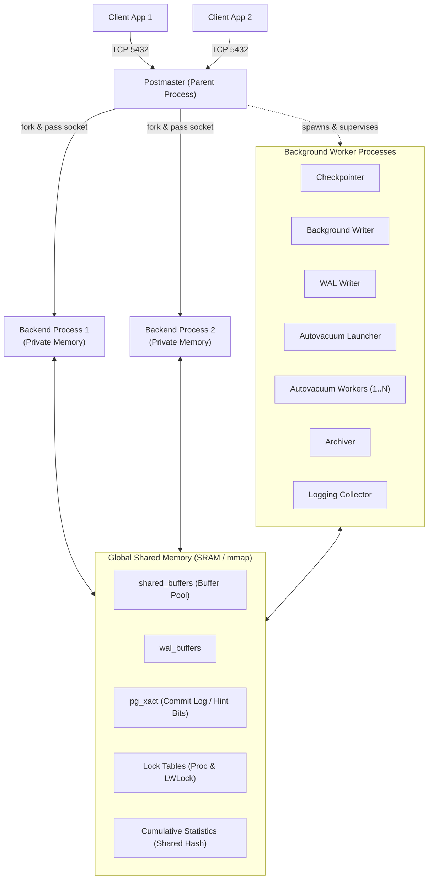
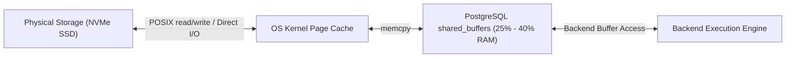
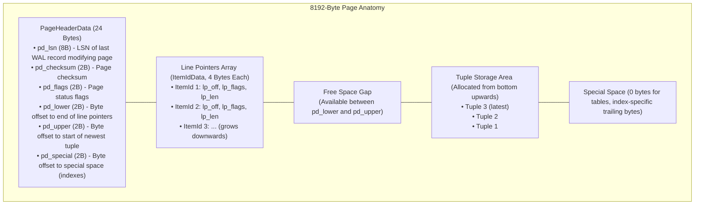

# Module 01 — Architecture, Process Model, Memory & Storage Anatomy

Welcome to **Module 01** of the PostgreSQL curriculum. This module provides a rigorous, academically grounded, and production-tested exploration of the PostgreSQL server architecture. We examine the multi-process execution engine, dissect shared memory structures and operating system interactions, analyze the exact on-disk filesystem layout of `$PGDATA`, decode the physical byte layout of the 8KB storage page using `pageinspect`, establish `psql` fluency, and trace PostgreSQL 18/19 I/O subsystem evolutions.

---

## 1. Core Terminology & Concept Definitions

- **Postmaster (Supervisor Daemon)**: The parent supervisor process that listens on configured TCP/IP ports and Unix domain sockets, authenticates client connections, allocates shared memory segments, forks per-client backend processes, and monitors auxiliary background workers.
- **Backend Process (Dedicated Server Process)**: A dedicated OS process forked by the postmaster to execute queries, maintain session state, and evaluate transactions on behalf of a single client connection.
- **`shared_buffers`**: The primary shared-memory buffer pool allocated via System V or POSIX shared memory (`mmap`) where PostgreSQL caches 8KB table and index data pages.
- **Double Buffering**: The operational reality where database blocks reside simultaneously in PostgreSQL's `shared_buffers` and in the operating system kernel's page cache.
- **Page / Block (`BLCKSZ = 8192`)**: The fundamental unit of disk storage and memory caching in PostgreSQL, partitioned into header metadata, line pointers, free space, and tuple payloads.
- **Line Pointer (`ItemIdData`)**: A 4-byte array entry located immediately after the page header pointing to the physical byte offset and length of a tuple version on that page.
- **`$PGDATA`**: The root filesystem directory containing all cluster databases, configuration files, write-ahead logs, transaction status logs, and tablespace symlinks.
- **Cumulative Statistics System**: The shared-memory statistics subsystem introduced in PostgreSQL 15, replacing the legacy UDP-based stats collector daemon with shared memory dshash tables.

---

## 2. Process Architecture & The Multi-Process Model

PostgreSQL employs a multi-process architecture rather than a multi-threaded architecture. Each client connection communicates directly with an isolated backend operating system process.



### The Postmaster & Per-Connection Backends
When a client initiates a connection, the Postmaster performs TLS negotiation, processes `pg_hba.conf` authentication rules, forks a child backend process, transfers the open client socket, and steps out of the communication loop.

Each backend process allocates dedicated private memory regions:
1. **`work_mem`**: Private workspace allocated per sorting operation (`ORDER BY`, `DISTINCT`, window functions) and hash operation (Hash Join, Hash Aggregate). A single complex query with multiple joins and sorts can allocate multiple multiples of `work_mem`.
2. **`maintenance_work_mem`**: Private workspace used by administrative commands such as `VACUUM`, `CREATE INDEX`, and `ALTER TABLE ADD FOREIGN KEY`.
3. **`temp_buffers`**: Session-private buffer pool used exclusively for temporary tables, avoiding shared buffer eviction and lock contention.

### Auxiliary Background Processes
PostgreSQL offloads asynchronous system tasks to specialized background workers:
- **Checkpointer**: Periodically flushes dirty `shared_buffers` pages to kernel storage, generates a WAL Checkpoint record, and updates `pg_control`.
- **Background Writer (`bgwriter`)**: Continuously scans `shared_buffers` using a clock sweep algorithm and asynchronously flushes dirty pages so client backends rarely have to write dirty pages during page allocation.
- **WAL Writer**: Periodically flushes the `wal_buffers` ring buffer to disk ahead of transaction commits to minimize commit latency.
- **Autovacuum Launcher & Workers**: Supervises and executes background `VACUUM` and `ANALYZE` tasks to reclaim dead tuples, freeze transaction IDs, and refresh optimizer statistics.
- **Archiver (`archiver`)**: Copies completed 16MB WAL segments from `pg_wal` to external archive storage when `archive_mode = on`.

---

## 3. Shared Memory & Double Buffering Mechanics

PostgreSQL relies heavily on the operating system's page cache. When reading or writing database blocks, data passes through two cache layers:



### The Double Buffering Tradeoff
1. **Cache Sizing**: Sizing `shared_buffers` to 75% or 90% of system RAM wastes memory because cached pages are duplicated in the OS page cache. Standard industry practice allocates **25% to 40% of physical RAM** to `shared_buffers`, leaving the remaining memory for the kernel page cache and connection-level `work_mem`.
2. **Buffer Replacement (Clock Sweep)**: PostgreSQL manages `shared_buffers` using a generalized 2Q/Clock Sweep algorithm. Each buffer header contains a usage counter (0 to 5). When a free buffer is needed, a sweep hand checks pages, decrementing non-zero usage counters. Pages with a zero counter are evicted.
3. **Writeback Throttling (`backend_flush_after`)**: Prevents large checkpoints or bulk writes from flooding the OS page cache with dirty pages and stalling subsequent read I/O.

---

## 4. The `$PGDATA` Directory Layout

The cluster data directory (`$PGDATA`) adheres to a deterministic filesystem layout:

```text
$PGDATA/
├── PG_VERSION                # Major version string (e.g., "18")
├── base/                      # Default tablespace containing subdirectories per database OID
│   ├── 1/                     # Template 1 database files
│   └── 16384/                 # User database directory (relation files named by filenode)
├── global/                    # Cluster-wide shared system catalogs (pg_database, pg_authid)
│   └── pg_control             # Checkpoint LSN, cluster state, catalog version, system identifier
├── pg_wal/                    # Write-Ahead Log segments (16MB files: 000000010000000000000001)
├── pg_xact/                   # Commit status log (CLOG) 2-bit state records per transaction ID
├── pg_tblspc/                 # Symlinks to external tablespace mount paths
├── pg_stat/                   # Non-shared statistical snapshots
├── pg_stat_tmp/               # Temporary runtime statistics directory
├── postgresql.conf            # Main server configuration parameters
├── pg_hba.conf                # Host-Based Authentication policy configuration
└── postmaster.pid             # PID of postmaster, data directory lock, and socket metadata
```

### Relation Physical Storage Forks
Every relation (table or index) on disk is divided into 1GB segment files (`<filenode>`, `<filenode>.1`, `<filenode>.2`) to avoid 32-bit filesystem file size limits. A relation comprises up to four distinct forks:
1. **Main Fork (`<filenode>`)**: The raw 8KB database data blocks.
2. **Free Space Map (`<filenode>_fsm`)**: Tracks available free space across each 8KB block to accelerate `INSERT` placement.
3. **Visibility Map (`<filenode>_vm`)**: Tracks two bits per 8KB block:
   - Bit 0: All tuples on page are visible to all current and future transactions (skips heap fetches in Index-Only Scans).
   - Bit 1: All tuples on page are frozen (skips page during freeze vacuuming).
4. **Initialization Fork (`<filenode>_init`)**: Present only for unlogged tables. On crash recovery, PostgreSQL resets the main fork by copying `_init`.

---

## 5. Physical Anatomy of an 8KB Storage Page

Every block in `shared_buffers` and on disk has an identical 8192-byte structure defined in `src/include/storage/bufpage.h`.



### Proving Page Anatomy with `pageinspect`
PostgreSQL provides the `pageinspect` extension to inspect the raw binary contents of storage pages:

```sql
CREATE EXTENSION IF NOT EXISTS pageinspect;

-- Create sample table and insert rows
CREATE TABLE page_demo (id INT PRIMARY KEY, payload TEXT);
INSERT INTO page_demo VALUES (1, 'Alpha'), (2, 'Beta');

-- Inspect page header
SELECT lsn, checksum, flags, lower, upper, special, pagesize
FROM page_header(get_raw_page('page_demo', 0));

-- Inspect line pointers and tuple offsets
SELECT lp, lp_off, lp_flags, lp_len, t_xmin, t_xmax, t_ctid
FROM heap_page_items(get_raw_page('page_demo', 0));
```

The output confirms:
- `lower` points to the end of the line pointer array (growing downwards from byte 24).
- `upper` points to the byte offset of the most recently allocated tuple (growing upwards from byte 8192).
- When `lower >= upper`, the page is physically full.

---

## 6. PostgreSQL 18 & 19 I/O Evolution

Modern database architectures must sustain millions of IOPS on NVMe storage. PostgreSQL's traditional reliance on synchronous `read()`/`write()` calls executed by individual backend processes causes high context switching and thread blocking.

### Asynchronous I/O (AIO) Architecture
PostgreSQL 18 introduces the integrated AIO subsystem framework:
- **`io_method = worker` (Default across platforms)**: Spawns specialized background I/O workers that dequeue asynchronous I/O requests submitted by backend query executors.
- **`io_method = io_uring` (Linux kernel $\ge$ 5.1)**: Uses zero-copy Linux `io_uring` ring buffers shared between user space and kernel space, submitting batch I/O without system call overhead.
- **PG19 Forward Evolution**: PostgreSQL 19 introduces automatic scaling of I/O worker threads via `io_min_workers` and `io_max_workers`, dynamically adjusting worker concurrency to match storage queue depth.

### Default Data Checksums
Starting with PostgreSQL 18, `initdb` enables **data checksums by default** (`data_checksums = on`). Every 8KB block calculates an internal checksum stored in `pd_checksum`. If silent disk bit-rot alters bytes, PostgreSQL rejects the block with error code `XX001` rather than silently returning corrupted data.

---

## 7. Then vs. Now: Architecture & Storage

| Architectural Dimension | PostgreSQL $\le$ 14 | PostgreSQL 15–17 | PostgreSQL 18 & 19 (Current) |
| :--- | :--- | :--- | :--- |
| **Cumulative Statistics** | UDP socket daemon (`pgstat.c`); high packet drop risk under load | In-memory shared hash tables (`dshash`); zero packet drop | Shared memory stats with lock-free atomics and extended session telemetry |
| **Data Block Checksums** | Disabled by default; required manual `initdb -k` | Disabled by default in standard distributions | **Enabled by default** in `initdb`; automatic bit-rot defense |
| **Disk I/O Dispatch** | Synchronous POSIX calls (`pread`/`pwrite`) blocking backend workers | Pre-fetching via `posix_fadvise`; synchronous reads | Native **Asynchronous I/O (AIO)** engine (`io_method = worker / io_uring`); PG19 dynamic worker scaling |
| **Default Password Auth** | MD5 allowed by default | SCRAM-SHA-256 recommended | **MD5 deprecated with server warnings**; SCRAM-SHA-256 mandated; OAuth 2.0 native support |

---

## 8. Interview Drill

<details>
<summary>1. Why does PostgreSQL utilize a multi-process architecture instead of a multi-threaded architecture?</summary>

**Answer**: PostgreSQL was originally architected at UC Berkeley (Ingres/POSTGRES project) when operating system thread implementations were unstable and non-standard. The multi-process model provides total address space isolation: a segmentation fault or memory corruption in one client backend cannot crash the server or corrupt other connections. However, processes introduce memory overhead per connection (typically 5–10MB per backend) and high context switching costs, which necessitates dedicated connection pooling (e.g., PgBouncer) in high-concurrency environments.
- Ref: [PostgreSQL Internals (Suzuki)](https://www.interdb.jp/pg/)
</details>

<details>
<summary>2. Explain the phenomenon of "double buffering" in PostgreSQL. Why is setting `shared_buffers` to 90% of RAM an anti-pattern?</summary>

**Answer**: PostgreSQL utilizes standard buffered operating system read and write calls (unless Direct I/O is enabled). When a page is read from storage, the OS kernel caches it in the OS page cache before copying it into PostgreSQL's `shared_buffers`. If `shared_buffers` is allocated 90% of system RAM, nearly all cached pages are duplicated across both caches, wasting memory. Furthermore, memory starvation for private backend structures (`work_mem`, connection stacks) triggers OS kernel Out-Of-Memory (OOM) kills. The standard recommended allocation is 25% to 40% of physical RAM for `shared_buffers`, leaving the remainder for the OS cache and query work memory.
- Ref: [PostgreSQL Documentation: Resource Consumption](https://www.postgresql.org/docs/18/runtime-config-resource.html)
</details>

<details>
<summary>3. What is the purpose of the line pointer (`ItemIdData`) array in the 8KB page? Why don't indexes point directly to byte offsets?</summary>

**Answer**: The line pointer array decouples logical tuple addressing from physical byte locations. An item pointer (`ctid = (block_number, offset_number)`) points to line pointer `offset_number` in the page header, not to raw byte coordinates. When tuples are updated in-place via Heap-Only Tuples (HOT) or defragmented within the page, only the internal byte offsets in `ItemIdData` are adjusted. Secondary indexes do not require updates because their target `(block, offset)` remains unchanged.
- Ref: [PostgreSQL Source: src/include/storage/bufpage.h](https://git.postgresql.org/gitweb/?p=postgresql.git;a=blob;f=src/include/storage/bufpage.h)
</details>

<details>
<summary>4. What are the four forks of a PostgreSQL relation and what is the function of each?</summary>

**Answer**:
1. **Main Fork**: The actual data blocks containing physical rows or index nodes.
2. **Free Space Map (`_fsm`)**: A binary tree tracking free space per page to rapidly locate blocks with room for new inserts.
3. **Visibility Map (`_vm`)**: Tracks all-visible (all tuples visible to all transactions, enabling Index-Only Scans) and all-frozen bits per page.
4. **Initialization Fork (`_init`)**: Exists only on unlogged tables; used to reset the table to empty during crash recovery without reading WAL.
- Ref: [PostgreSQL Documentation: Database Physical Storage](https://www.postgresql.org/docs/18/storage-file-layout.html)
</details>

<details>
<summary>5. What changes occurred in PostgreSQL 18 regarding data checksums and I/O architecture?</summary>

**Answer**: PostgreSQL 18 enables cluster data checksums by default during `initdb` to protect against undetected bit-rot on storage devices. It also integrates an Asynchronous I/O (AIO) framework (`io_method = worker / io_uring`) allowing asynchronous batch operations across read and write pathways, moving towards auto-scaling I/O workers in PostgreSQL 19.
- Ref: [PostgreSQL 18 Release Notes](https://www.postgresql.org/docs/18/release-18.html)
</details>
