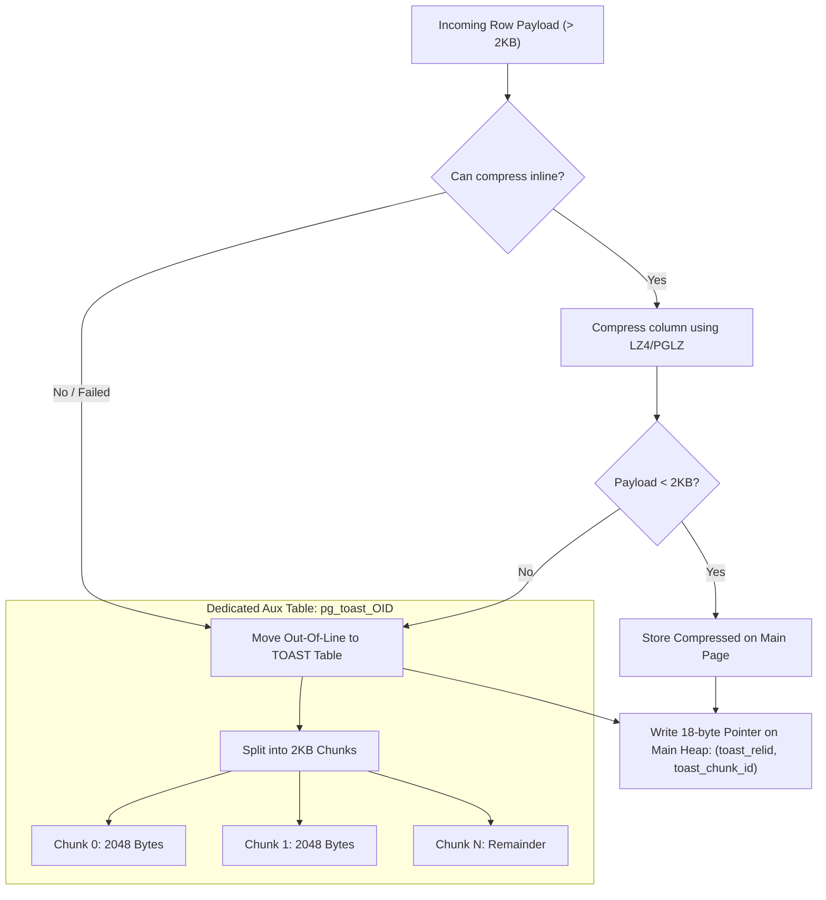
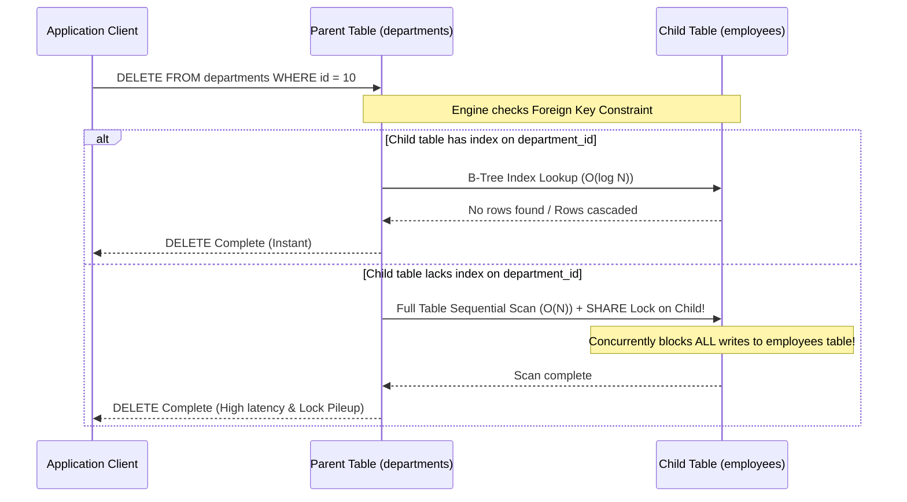

# Module 02 — Relational Modeling, Data Types & Integrity Constraints

Welcome to **Module 02** of the PostgreSQL curriculum. This module provides an in-depth, production-hardened examination of physical schema design, relational data types, and declarative integrity constraints in PostgreSQL 18. We analyze numerical representation tradeoffs (`numeric` vs `float8`), timezone handling mechanics with `timestamptz`, native `uuidv7()` generation, TOAST internal storage strategies and compression algorithms, generated columns (`STORED` vs `VIRTUAL`), constraint lifecycle management (`NOT VALID` / `VALIDATE`), deferrable constraints, exclusion constraints with temporal `WITHOUT OVERLAPS`, and modern identity column semantics.

> [!NOTE]
> For abstract relational algebra foundations, normal forms (1NF through BCNF), and theoretical schema normalization proofs, consult the foundational track [architecture/data-systems](../../architecture/data-systems/modules/01-data-models-and-relational-algebra.md). This module focuses on PostgreSQL's concrete physical realization, storage trade-offs, and operational mechanics.

---

## 1. Core Terminology & Concept Definitions

- **Arbitrary-Precision Arithmetic (`numeric`)**: A variable-length numeric representation implemented using Base-10,000 arithmetic digits that guarantees exact decimal precision with no binary rounding errors, up to 131,072 digits before the decimal point.
- **`timestamptz` (`timestamp with time zone`)**: An 8-byte integer tracking microsecond elapsed time from the PostgreSQL epoch (`2000-01-01 00:00:00 UTC`). It stores all values normalized to UTC internally and converts to the client session's `TimeZone` during output formatting.
- **UUIDv7**: A 128-bit Universally Unique Identifier specified in RFC 9562, encoding a 48-bit millisecond Unix timestamp followed by random entropy, providing monotonic sortability and cache-friendly B-tree index locality.
- **TOAST (The Oversized-Attribute Storage Technique)**: An automatic storage subsystem that compresses large attribute values exceeding approximately 2KB and moves them into a dedicated auxiliary table (`pg_toast_<oid>`), slicing payloads into chunks to preserve the 8KB primary page constraint.
- **`VIRTUAL` Generated Column**: A generated column introduced in PostgreSQL 18 that computes its value on-the-fly during query evaluation without consuming physical disk storage, contrasted with `STORED` generated columns which persist on disk.
- **Unindexed Foreign Key Hazard**: A severe performance bottleneck where deleting or updating a parent primary key forces the database engine to perform a full sequential scan across the child referencing table while acquiring table-level share locks.
- **Exclusion Constraint (`EXCLUDE USING gist`)**: A generalized constraint enforcing that no two rows satisfy a given operator comparison across specified columns (e.g., preventing overlapping time intervals or intersecting bounding boxes).
- **`WITHOUT OVERLAPS`**: A native SQL:2011 temporal constraint clause introduced in PostgreSQL 18 enforcing non-overlapping time ranges within primary or unique keys when combined with the `btree_gist` extension.

---

## 2. Advanced Data Types: Representation & Storage Mechanics

### Financial Accuracy: `numeric` vs. Floating Point (`float8` / `double precision`)
Binary floating point formats (IEEE 754) represent numbers as fractional powers of two ($2^{-1}, 2^{-2}, \dots$). Decimal fractions such as $0.1$ cannot be represented exactly in binary floating point, leading to silent rounding accumulation in financial calculations:

```sql
-- Inexact IEEE 754 floating point arithmetic:
SELECT (0.1::float8 + 0.2::float8) = 0.3::float8 AS is_equal;
-- Result: false (Actual value: 0.30000000000000004)

-- Exact arbitrary-precision numeric arithmetic:
SELECT (0.1::numeric + 0.2::numeric) = 0.3::numeric AS is_equal;
-- Result: true
```

#### Under the Hood: `numeric` Memory Layout
`numeric` stores values in an internal header followed by an array of 16-bit integers (`NumericDigit`), where each digit represents a base-10,000 value ($0000$ to $9999$). While `numeric` guarantees mathematical correctness, its CPU overhead is approximately 10x to 20x higher than native CPU hardware floating point operations. Use `numeric` for monetary values, account balances, and legal metrics; use `float8` for scientific measurements, geospatial coordinates, and vector embeddings.

### Timezone Mechanics: `timestamptz` vs. Naive `timestamp`
A common production failure mode is storing datetime values in naive `timestamp without time zone`. 

| Property | `timestamp` (without time zone) | `timestamptz` (with time zone) |
| :--- | :--- | :--- |
| **Storage Size** | 8 bytes | 8 bytes |
| **Internal Representation** | Microseconds since 2000-01-01 (naive) | Microseconds since 2000-01-01 **UTC** |
| **Timezone Preserved?** | No timezone stored | No timezone stored (normalized to UTC) |
| **Display Formatting** | Disregards client timezone | Formats string relative to client `SET TimeZone` |
| **Comparison Semantics** | Compares raw local clock values | Compares absolute points in global time |

```sql
-- Demonstrate timestamptz normalization
SET TimeZone = 'UTC';
SELECT '2026-10-30 14:00:00+02'::timestamptz;
-- Output: 2026-10-30 12:00:00+00

SET TimeZone = 'America/New_York';
SELECT '2026-10-30 14:00:00+02'::timestamptz;
-- Output: 2026-10-30 08:00:00-04
```

### Native UUIDv7 vs. UUIDv4
Random UUIDv4 identifiers cause catastrophic B-tree write amplification: because new IDs are distributed randomly across the key space, every `INSERT` touches a random 8KB B-tree leaf page. When index sizes exceed `shared_buffers`, this forces high random disk I/O.

PostgreSQL 18 introduces native RFC 9562 `uuidv7()`:
- **Timestamp Prefix (48 bits)**: Monotonically increasing milliseconds since Unix epoch.
- **Sub-millisecond & Random Bits (80 bits)**: High-entropy randomness ensuring global uniqueness.
- **Index Impact**: New keys append sequentially to the rightmost leaf page of the B-tree, keeping active insertions pinned in memory and reducing page splits by over 90%.

```sql
-- Generating UUIDv7 natively in PostgreSQL 18:
SELECT uuidv7();
-- Result: 0192e21b-87a4-7123-89b1-5d918237fa41
```

---

## 3. TOAST: Physical Storage & Compression Strategies

PostgreSQL uses a fixed 8KB page size and never allows a single row to span across multiple physical pages. If a row exceeds approximately 2KB (`TOAST_TUPLE_THRESHOLD = 2040 bytes`), the engine engages **TOAST**:



### Storage Strategies per Column
Columns can be configured with specific TOAST strategies via `ALTER TABLE ... ALTER COLUMN ... SET STORAGE`:
1. **`PLAIN`**: Disables compression and out-of-line storage. Used for fixed-width types (integers, booleans). If a row exceeds 8KB, `INSERT` fails.
2. **`EXTENDED` (Default for variable types)**: Allows both inline compression and out-of-line storage in the TOAST table.
3. **`EXTERNAL`**: Allows out-of-line storage but **disables compression**. Ideal for pre-compressed payloads (JPEG images, PDF files, encrypted strings) to save CPU cycles.
4. **`MAIN`**: Compresses the attribute inline, only moving it out-of-line if all other attributes have been moved and the row still exceeds the page threshold.

### Compression Algorithms: `lz4` vs `pglz`
- **`pglz`**: PostgreSQL's legacy internal LZ-variant algorithm. High compression ratio, but relatively slow CPU throughput.
- **`lz4`**: Modern high-throughput compression algorithm. Provides 2x to 4x faster decompression and compression speeds. Configured via `default_toast_compression = 'lz4'` or per-column via `COMPRESSION lz4`.
- **PostgreSQL 19 Evolution**: PostgreSQL 19 switches the default TOAST compression engine cluster-wide from `pglz` to `lz4`.

---

## 4. Generated Columns: `STORED` vs `VIRTUAL`

PostgreSQL 18 introduces `VIRTUAL` generated columns alongside traditional `STORED` generated columns:

```sql
CREATE TABLE inventory_items (
    id SERIAL PRIMARY KEY,
    unit_price NUMERIC(10,2) NOT NULL,
    quantity INT NOT NULL,
    discount_pct NUMERIC(4,2) DEFAULT 0.0,
    -- STORED: evaluated on INSERT/UPDATE, consumes disk storage
    total_stored NUMERIC(10,2) GENERATED ALWAYS AS (unit_price * quantity * (1 - discount_pct/100)) STORED,
    -- VIRTUAL (PG18): evaluated dynamically on query SELECT, zero disk footprint
    total_virtual NUMERIC(10,2) GENERATED ALWAYS AS (unit_price * quantity * (1 - discount_pct/100)) VIRTUAL
);
```

### Tradeoff Matrix
- **`STORED`**: Consumes storage on disk and in `shared_buffers`. Requires CPU on every `INSERT` or `UPDATE`. Can be indexed directly using standard B-tree indexes.
- **`VIRTUAL` (PG18+)**: Consumes zero disk and buffer cache space. Re-evaluated during query execution. Can be indexed via expression indexes (`CREATE INDEX ON inventory_items ((total_virtual));`).

---

## 5. Constraint Architecture & Production Safety

### The Unindexed Foreign Key Trap
Foreign key constraints validate parent existence during child inserts. However, when a row in the **parent** table is deleted or its primary key updated, PostgreSQL must scan the **child** table to verify no referencing rows exist (or to apply `ON DELETE CASCADE` / `ON DELETE SET NULL`).



> [!CAUTION]
> Creating a foreign key constraint does **not** automatically create an index on the child referencing column. Always index foreign key columns unless child table rows are strictly static and parent keys are never deleted or modified.

### Zero-Downtime Constraint Creation (`NOT VALID` & `VALIDATE`)
Executing `ALTER TABLE orders ADD CONSTRAINT fk_customer FOREIGN KEY (customer_id) REFERENCES customers(id);` acquires an `ACCESS EXCLUSIVE` lock on `orders` for the duration of a full table validation scan, blocking all reads and writes.

To add constraints safely on production tables with millions of rows, execute the operation in two phases:

```sql
-- Phase 1: Instantaneous catalog update (enforces rule on all new writes only)
ALTER TABLE orders 
ADD CONSTRAINT fk_customer 
FOREIGN KEY (customer_id) REFERENCES customers(id) 
NOT VALID;

-- Phase 2: Online background validation (takes only a SHARE UPDATE EXCLUSIVE lock; allows concurrent reads and writes!)
ALTER TABLE orders 
VALIDATE CONSTRAINT fk_customer;
```

### Deferrable Constraints
By default, constraints are checked immediately at statement execution. Circular relationships (e.g., a company requires a primary contact employee, and an employee belongs to a company) cannot be inserted in a single statement without deferrable constraints:

```sql
CREATE TABLE accounts (
    account_id INT PRIMARY KEY,
    owner_id INT NOT NULL DEFERRABLE INITIALLY DEFERRED
);

CREATE TABLE account_owners (
    owner_id INT PRIMARY KEY,
    account_id INT NOT NULL REFERENCES accounts(account_id) DEFERRABLE INITIALLY DEFERRED
);

ALTER TABLE accounts 
ADD CONSTRAINT fk_owner 
FOREIGN KEY (owner_id) REFERENCES account_owners(owner_id);

-- Both rows can now be inserted inside an atomic transaction:
BEGIN;
  INSERT INTO accounts VALUES (101, 501);
  INSERT INTO account_owners VALUES (501, 101);
COMMIT; -- Constraints validated here at commit boundary!
```

---

## 6. Exclusion & Temporal Constraints (`WITHOUT OVERLAPS`)

Exclusion constraints generalize uniqueness to non-equality operators using GiST index structures:

```sql
CREATE EXTENSION IF NOT EXISTS btree_gist;

-- Enforce no room booking overlaps for the same room
CREATE TABLE room_reservations (
    room_id INT NOT NULL,
    during TSRANGE NOT NULL,
    EXCLUDE USING gist (room_id WITH =, during WITH &&)
);
```

### PostgreSQL 18 Temporal Constraints: `WITHOUT OVERLAPS`
PostgreSQL 18 natively implements the SQL:2011 temporal constraint standard:

```sql
CREATE TABLE employee_contracts (
    employee_id INT NOT NULL,
    valid_period TSRANGE NOT NULL,
    role_title TEXT NOT NULL,
    CONSTRAINT pk_employee_contract PRIMARY KEY (employee_id, valid_period WITHOUT OVERLAPS)
);
```
Any attempt to insert a contract spanning a time range that intersects an existing contract for that `employee_id` is rejected at the storage layer.

---

## 7. Identity Columns vs. Sequences

PostgreSQL historically used pseudo-type sequences (`id SERIAL PRIMARY KEY`). Modern schema designs mandate SQL-standard identity columns:

```sql
-- Legacy: SERIAL
CREATE TABLE legacy_items (id SERIAL PRIMARY KEY);

-- Modern Standard: IDENTITY
CREATE TABLE modern_items (
    id BIGINT GENERATED ALWAYS AS IDENTITY PRIMARY KEY
);
```

### Sequence Gaps & Transaction Rollbacks
PostgreSQL sequences allocate numbers via lock-free shared memory atomic increments (`nextval()`) to avoid serialization bottlenecks between concurrent transactions.
- **Sequence Gaps Are Inevitable**: If Transaction A requests `nextval()` (yielding `101`) and subsequently aborts, the value `101` is never reclaimed or reused.
- **Operational Rule**: Never rely on database sequences or auto-incrementing identity columns for strictly gapless numerical sequences (such as legal invoicing or accounting ledger sequences). Gapless sequences require explicit serialization locking (`SELECT next_val FROM sequence_table FOR UPDATE;`).

---

## 8. Then vs. Now: Data Types & Constraints

| Feature / Standard | PostgreSQL $\le$ 16 | PostgreSQL 17 | PostgreSQL 18 & 19 (Current) |
| :--- | :--- | :--- | :--- |
| **UUID Generation** | External extension (`uuid-ossp` / `pgcrypto`) for UUIDv4 | `uuidv4()` builtin | Native **`uuidv7()`** (RFC 9562 time-ordered, B-tree friendly) |
| **Generated Columns** | `STORED` only (persisted on disk) | `STORED` only | **`VIRTUAL`** (dynamic on-read, zero disk overhead) |
| **Temporal Keys** | Manual `EXCLUDE USING gist` with range types | Manual `EXCLUDE USING gist` | Native SQL:2011 **`WITHOUT OVERLAPS`** on primary & unique keys |
| **TOAST Default Compression** | `pglz` | `pglz` | `pglz` (PG18) $\rightarrow$ **`lz4` default in PG19** |
| **Sequence Sync** | Manual catalog manipulation | Manual `ALTER SEQUENCE` | Logical replication of sequence states (PG19) |

---

## 9. Interview Drill

<details>
<summary>1. Why does an unindexed foreign key column represent a severe availability risk on high-throughput database clusters?</summary>

**Answer**: When a row in the parent table is deleted or has its primary key updated, PostgreSQL must ensure referential integrity by checking whether referencing child rows exist. Without an index on the child table's foreign key column, the planner must execute a full sequential scan over the entire child table. Crucially, during this scan, the engine acquires a `SHARE` row-level or table-level lock on the child table. On a table with millions of rows, this scan takes seconds or minutes, stalling all concurrent `INSERT`, `UPDATE`, and `DELETE` transactions on the child table and precipitating connection pool exhaustion.
- Ref: [PostgreSQL Documentation: Foreign Keys](https://www.postgresql.org/docs/18/ddl-constraints.html#DDL-CONSTRAINTS-FK)
</details>

<details>
<summary>2. Explain how UUIDv7 eliminates the index fragmentation and write amplification caused by UUIDv4.</summary>

**Answer**: UUIDv4 is 128 bits of pseudo-random data. In a B-tree index, randomly distributed keys are inserted uniformly across all existing leaf pages. Once an index exceeds `shared_buffers`, almost every insert requires loading a different 8KB leaf page from disk, causing massive random I/O and frequent B-tree page splits. In contrast, UUIDv7 encodes a 48-bit millisecond Unix timestamp in its most significant bits. New keys are monotonically increasing, meaning new index entries consistently append to the rightmost leaf page of the B-tree. This preserves spatial and temporal cache locality, eliminates random disk reads, and drastically reduces page splitting.
- Ref: [RFC 9562: Universally Unique IDentifiers](https://datatracker.ietf.org/doc/rfc9562/)
</details>

<details>
<summary>3. What is the two-step pattern for adding a foreign key or check constraint to a multi-million-row production table without downtime?</summary>

**Answer**:
1. Execute `ALTER TABLE ... ADD CONSTRAINT ... NOT VALID;`. This acquires an `ACCESS EXCLUSIVE` lock only for milliseconds to update the catalog; it immediately enforces referential integrity on all subsequent writes without checking existing rows.
2. Execute `ALTER TABLE ... VALIDATE CONSTRAINT ...;`. This scans the table to verify existing rows against the constraint, but only acquires a `SHARE UPDATE EXCLUSIVE` lock. This lock allows concurrent `SELECT`, `INSERT`, `UPDATE`, and `DELETE` operations, preventing production service disruptions.
- Ref: [PostgreSQL Documentation: ALTER TABLE](https://www.postgresql.org/docs/18/sql-altertable.html)
</details>

<details>
<summary>4. What are the four TOAST storage strategies and how do you configure them?</summary>

**Answer**:
1. `PLAIN`: Disables compression and out-of-line storage; data must fit on the 8KB page.
2. `EXTENDED`: Enables compression and out-of-line storage in the TOAST table (default for variable types like `text` and `jsonb`).
3. `EXTERNAL`: Enables out-of-line storage but disables compression (ideal for pre-compressed assets like images or encrypted blobs).
4. `MAIN`: Compresses inline, moving out-of-line only as a last resort.
Strategies are configured per column via `ALTER TABLE tbl ALTER COLUMN col SET STORAGE <STRATEGY>;`.
- Ref: [PostgreSQL Documentation: TOAST](https://www.postgresql.org/docs/18/storage-toast.html)
</details>

<details>
<summary>5. Why can you not guarantee a gapless sequence using PostgreSQL sequences or identity columns?</summary>

**Answer**: PostgreSQL sequences optimize for high concurrency by allocating sequence values (`nextval()`) in shared memory without transaction-level locking. If Transaction A calls `nextval()`, receives ID `100`, and subsequently rolls back, that value is permanently discarded and cannot be recycled without blocking other transactions. Sequences also cache allocations in memory per session if `CACHE` is specified. If the server crashes or restarts, cached unused sequence values are lost. True gapless sequences require explicit serialization locking via `SELECT current_number FROM sequence_table FOR UPDATE`, which forces serial single-threaded execution.
- Ref: [PostgreSQL Documentation: Sequence Manipulation Functions](https://www.postgresql.org/docs/18/functions-sequence.html)
</details>
