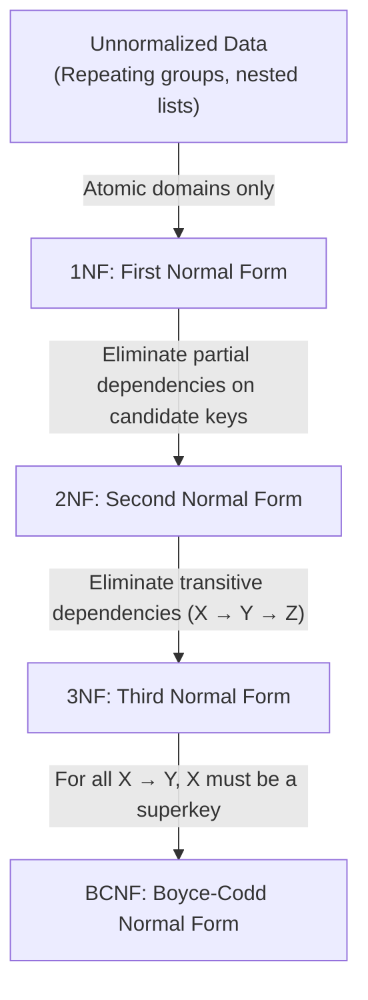
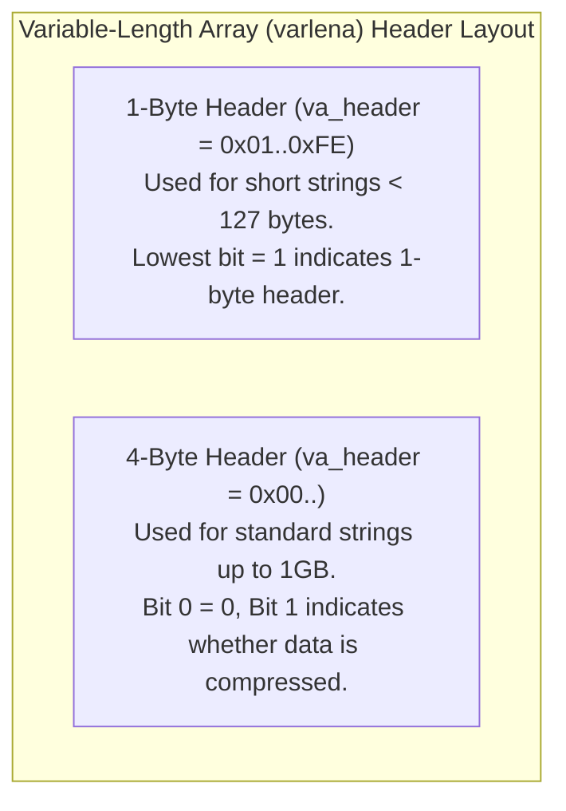
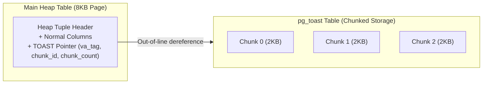
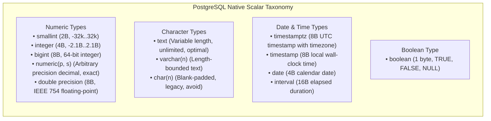
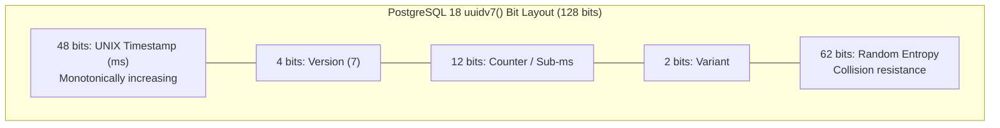
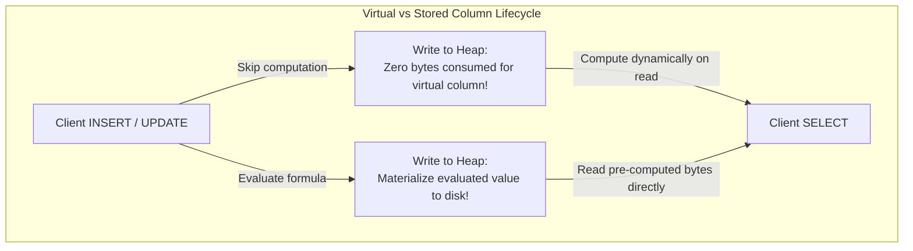
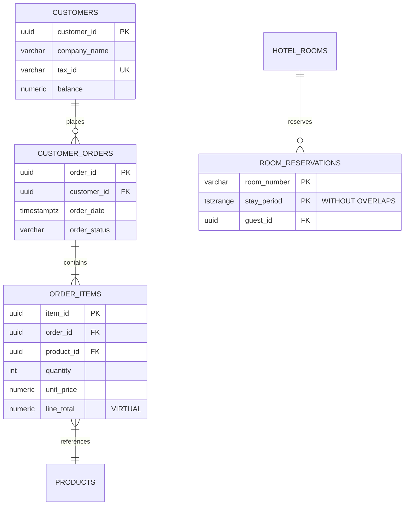

# Module 02 — Relational Modeling, Types & Constraints

Welcome to **Module 02** of the PostgreSQL 18 Curriculum. This module provides a rigorous, academically grounded, and production-tested exploration of relational schema design and the PostgreSQL type system. We examine formal relational normalization theory (1NF through BCNF), dissect the low-level physical storage representation of data types and the TOAST subsystem, evaluate surrogate key strategies including PostgreSQL 18's native **`uuidv7()`**, contrast **Virtual vs. Stored Generated Columns**, analyze foreign key locking hazards, and implement ANSI SQL:2016 **Temporal Constraints** with **`WITHOUT OVERLAPS`**.

---

## 1. Core Terminology & Concept Definitions

To establish absolute clarity across this curriculum, the following relational modeling terms are formally defined:

- **Functional Dependency ($X \to Y$)**: A mathematical constraint between two sets of attributes in a relation $R$, stating that if two tuples agree on attributes $X$, they must identically agree on attributes $Y$:
  $$\forall t_1, t_2 \in R, \quad t_1[X] = t_2[X] \implies t_1[Y] = t_2[Y]$$
- **Candidate Key**: A minimal superkey—a set of attributes $K \subseteq Sch(R)$ such that $K \to Sch(R)$ and no proper subset of $K$ functionally determines $Sch(R)$.
- **Prime Attribute**: An attribute that belongs to at least one candidate key of the relation schema.
- **Relational Normalization**: The systematic decomposition of relational schemas into progressively higher normal forms (1NF, 2NF, 3NF, BCNF) to eliminate data redundancy, update anomalies, insertion anomalies, and deletion anomalies.
- **Universally Unique Identifier Version 7 (`uuidv7`)**: A 128-bit identifier standardized in RFC 9562 and natively implemented in PostgreSQL 18 that embeds a 48-bit UNIX millisecond timestamp prefix, guaranteeing monotonic index locality and eliminating B-Tree leaf fragmentation.
- **TOAST (The Oversized-Attribute Storage Technique)**: PostgreSQL's transparent disk paging mechanism that compresses and moves wide attributes exceeding ~2KB out-of-line into a dedicated secondary table (`pg_toast_<relfilenode>`) to maintain compact 8KB heap tuples.
- **Virtual Generated Column**: A column defined by a deterministic SQL expression whose value is computed dynamically upon read operations without consuming physical storage in 8KB disk blocks (the default in PostgreSQL 18).
- **Stored Generated Column**: A column defined by a deterministic SQL expression evaluated during write operations (`INSERT` or `UPDATE`) and serialized permanently into the physical heap tuple.
- **Temporal Constraint (`WITHOUT OVERLAPS`)**: An ANSI SQL:2016 relational integrity constraint supported in PostgreSQL 18 enforcing that primary keys or unique keys covering range or period attributes never overlap in time for the same entity.
- **Referential Integrity**: The constraint rule ensuring foreign key references point to existing, valid rows in the parent relation, managed via referential actions (`RESTRICT`, `CASCADE`, `SET NULL`, `NO ACTION`).

---

## 2. Relational Normalization & Schema Decomposition Theory

Relational database design relies on formal decomposition theory to eliminate anomalies:



### The Normal Forms Defined Formally:

1. **First Normal Form (1NF)**:
   - Every attribute domain contains only atomic (indivisible) values.
   - No tuple contains repeating groups, nested relation tables, or multi-valued attribute arrays (when modeling strict relational core entities).
2. **Second Normal Form (2NF)**:
   - The relation is in 1NF.
   - Every non-prime attribute is fully functionally dependent on every candidate key. No non-prime attribute depends on a proper subset of a composite candidate key (no partial dependencies).
3. **Third Normal Form (3NF)**:
   - The relation is in 2NF.
   - No non-prime attribute is transitively dependent on a candidate key. That is, for every functional dependency $X \to Y$, either $X$ is a superkey, or $Y$ is a prime attribute.
4. **Boyce-Codd Normal Form (BCNF)**:
   - A stricter formulation of 3NF eliminating all anomalies resulting from overlapping composite candidate keys.
   - For every non-trivial functional dependency $X \to Y$, $X$ must be a strict superkey.

### Strategic Denormalization in PostgreSQL
While OLTP core transactional models should adhere strictly to 3NF/BCNF, PostgreSQL provides native semi-structured primitives (`jsonb`, arrays) and virtual generated columns that permit controlled denormalization for high-throughput read workloads without breaking transactional invariants.

---

## 3. Physical Type Architecture & TOAST Subsystem

PostgreSQL manages scalar types through fixed-length structures or variable-length byte arrays (`varlena`).



### The TOAST Storage Architecture
PostgreSQL pages are fixed at 8192 bytes (8KB). To prevent wide tuples (e.g. large text descriptions, JSON documents, binary images) from overflowing a single page, PostgreSQL employs **TOAST**:

1. **Activation Threshold**: When a tuple exceeds `TOAST_TUPLE_THRESHOLD` (typically 2048 bytes / 2KB), PostgreSQL attempts to compress and out-of-line wide attributes until the tuple fits within `TOAST_TUPLE_TARGET` (default 2048 bytes).
2. **Chunking**: Out-of-line data is sliced into 2KB chunks and stored in a hidden companion relation named `pg_toast.pg_toast_<relfilenode>`.



### TOAST Column Storage Strategies
PostgreSQL supports four distinct storage strategies configured per column:

| Strategy | Compression Allowed? | Out-of-Line Storage Allowed? | Typical Use Case |
| :--- | :--- | :--- | :--- |
| **`PLAIN`** | No | No | Fixed-width types (`int4`, `uuid`, `timestamptz`). Never TOASTed. |
| **`EXTENDED`** | Yes (LZ4 or pglz) | Yes | Default for `text`, `varchar`, `jsonb`, `bytea`. Compresses inline first, then moves out-of-line. |
| **`EXTERNAL`** | No | Yes | Prevents compression overhead on already-compressed data (e.g. JPEG, MP4, pre-gzipped blobs). |
| **`MAIN`** | Yes | Yes (As last resort) | Attempts compression inline; only moves out-of-line if page cannot accommodate row otherwise. |

```sql
-- Explicitly configure column storage strategies
ALTER TABLE documents ALTER COLUMN raw_payload SET STORAGE EXTERNAL;
ALTER TABLE documents ALTER COLUMN compression_algorithm SET STORAGE PLAIN;
```

---

## 4. PostgreSQL Core Scalar Types



### Exact Precision (`numeric`) vs Floating-Point (`double precision`)
- **`numeric(precision, scale)`**: Encoded as variable-length base-10,000 binary-coded decimal digits. Operations use arbitrary-precision arithmetic without rounding errors. **Mandatory for monetary balances, financial transactions, and billing ledgers.**
- **`double precision`**: Hardware-accelerated IEEE 754 binary floating point. Susceptible to base-2 representation inaccuracies (e.g. $0.1 + 0.2 \neq 0.3$). Recommended only for scientific measurements, geospatial coordinates, and physical simulations.

### Time Zones: `timestamptz` vs `timestamp`
Always standardize on **`timestamptz`** (`timestamp with time zone`) for application timestamps:
1. When receiving a timestamp string with an offset (e.g. `'2026-10-28 14:00:00+02'`), PostgreSQL converts it and stores the integer value normalized to **UTC** in 8 bytes.
2. When querying `timestamptz`, PostgreSQL rotates the UTC value into the client session's active `TimeZone` setting.
3. Plain `timestamp` (without time zone) discards timezone context, making daylight saving shifts and global distributed multi-region tracking hazardous.

---

## 5. Timestamp-Ordered UUIDs with PostgreSQL 18 `uuidv7()`

### The UUIDv4 B-Tree Fragmentation Hazard
Random UUIDv4 identifiers (`gen_random_uuid()`) distribute keys uniformly across the 128-bit hash space. When inserted into a B-Tree index:
- Every insert lands on a random leaf page.
- When the index working set exceeds `shared_buffers`, every insertion causes a cache miss, reading a disk block, causing a 50/50 page split, and dirtying random blocks.
- B-Tree page utilization drops to ~50% (50% internal fragmentation), halving query throughput.

### How PostgreSQL 18 `uuidv7()` Solves This
RFC 9562 defines UUIDv7, which PostgreSQL 18 implements natively via `uuidv7()`:
- **Bits 0..47 (48 bits)**: High-resolution UNIX timestamp in milliseconds.
- **Bits 48..51 (4 bits)**: UUID version (`0111` for version 7).
- **Bits 52..63 (12 bits)**: Sub-millisecond fraction or monotonic counter.
- **Bits 64..65 (2 bits)**: UUID variant (`10`).
- **Bits 66..127 (62 bits)**: Cryptographically secure random entropy.



Because the leading 48 bits increase monotonically with real time, new tuples are appended exclusively to the right-most leaf page of the B-Tree index:
- Page splits are eliminated during steady-state ingestion.
- B-Tree leaf pages achieve 90%–100% packing density.
- Cache locality is preserved: only the current right-edge leaf page must remain resident in `shared_buffers`.

```sql
CREATE TABLE transaction_records (
    -- Native PostgreSQL 18 monotonic identifier
    transaction_id UUID PRIMARY KEY DEFAULT uuidv7(),
    amount NUMERIC(12, 2) NOT NULL,
    created_at TIMESTAMPTZ NOT NULL DEFAULT clock_timestamp()
);

-- Inspect generated UUIDv7 values
SELECT uuidv7();
-- Result: '0192d3b4-7e89-7f31-92b4-c1e4d89a1200'
```

---

## 6. PostgreSQL 18 Virtual vs Stored Generated Columns

Generated columns are computed from other columns in the same relation. PostgreSQL 18 introduces **Virtual Generated Columns** (`GENERATED ALWAYS AS (...) VIRTUAL`):

| Evaluation Dimension | Virtual Generated Column (`VIRTUAL`) | Stored Generated Column (`STORED`) |
| :--- | :--- | :--- |
| **Default in PG 18** | Yes (Default when modifier omitted) | No (Requires explicit `STORED` keyword) |
| **Computation Timing** | Evaluated on demand during `SELECT` | Evaluated at `INSERT` and `UPDATE` |
| **Disk Storage** | 0 bytes in heap tuple | Full byte width stored in 8KB disk block |
| **Write Performance** | Faster (no evaluation or storage cost) | Slower (computation + larger tuple size) |
| **Read Performance** | Mild CPU cost per row during query | Instant read directly from tuple |
| **Indexing** | Fully indexable via Expression Indexes | Fully indexable via standard B-tree |



### Syntax & Practical Implementation
```sql
CREATE TABLE invoices (
    invoice_id UUID PRIMARY KEY DEFAULT uuidv7(),
    subtotal NUMERIC(12, 2) NOT NULL,
    tax_rate NUMERIC(4, 2) NOT NULL DEFAULT 0.21,
    
    -- Virtual Generated Column (PostgreSQL 18 default: 0 disk bytes consumed)
    tax_amount NUMERIC(12, 2) GENERATED ALWAYS AS (subtotal * tax_rate) VIRTUAL,
    
    -- Stored Generated Column (materialized on disk)
    grand_total NUMERIC(12, 2) GENERATED ALWAYS AS (subtotal * (1 + tax_rate)) STORED
);
```

---

## 7. Foreign Keys & The Unindexed Foreign Key Locking Hazard

A foreign key constraint enforces referential integrity between child and parent tables:

```sql
CREATE TABLE customers (
    customer_id UUID PRIMARY KEY DEFAULT uuidv7(),
    company_name VARCHAR(120) NOT NULL
);

CREATE TABLE orders (
    order_id UUID PRIMARY KEY DEFAULT uuidv7(),
    customer_id UUID NOT NULL,
    order_date DATE NOT NULL DEFAULT CURRENT_DATE,
    
    CONSTRAINT fk_orders_customer FOREIGN KEY (customer_id)
        REFERENCES customers (customer_id)
        ON DELETE RESTRICT
        ON UPDATE CASCADE
);
```

### The Unindexed Foreign Key Hazard
> [!CRITICAL]
> **PostgreSQL does NOT automatically create an index on the referencing foreign key column (`orders.customer_id`)!**

If `orders.customer_id` is not explicitly indexed:
1. When a row in `customers` is deleted or its primary key is updated, PostgreSQL must verify whether referencing child rows exist.
2. Without an index on `orders(customer_id)`, the engine performs a **sequential scan** of the entire child table `orders`.
3. In earlier versions, or when modifying parent rows concurrently, this triggered high-level table locks or extensive row-level locks, causing widespread transaction deadlocks in high-concurrency systems.
4. **Mandatory Rule**: Always create an explicit B-Tree index on every foreign key referencing column:
   ```sql
   CREATE INDEX idx_orders_customer_id ON orders (customer_id);
   ```

---

## 8. PostgreSQL 18 Temporal Constraints with `WITHOUT OVERLAPS`

Enforcing non-overlapping time spans for the same resource (e.g. hotel room reservations, rental fleets, employee shift assignments) historically required complex GiST exclusion constraints (`CREATE EXTENSION btree_gist; ALTER TABLE ... ADD CONSTRAINT ... EXCLUDE USING gist (...)`).

PostgreSQL 18 natively implements the ANSI SQL:2016 **`WITHOUT OVERLAPS`** temporal constraint directly on `PRIMARY KEY` and `UNIQUE` declarations:

```sql
CREATE TABLE room_reservations (
    reservation_id UUID DEFAULT uuidv7(),
    room_number VARCHAR(16) NOT NULL,
    guest_id UUID NOT NULL,
    stay_period TSTZRANGE NOT NULL,
    
    -- PostgreSQL 18 Temporal Primary Key: Prevents double-booking collisions!
    CONSTRAINT pk_room_reservations PRIMARY KEY (room_number, stay_period WITHOUT OVERLAPS)
);

-- First reservation succeeds: Oct 10 to Oct 15
INSERT INTO room_reservations (room_number, guest_id, stay_period)
VALUES (
    'Suite-101', 
    uuidv7(), 
    tstzrange('2026-10-10 14:00:00+00', '2026-10-15 11:00:00+00')
);

-- Overlapping reservation fails immediately: Oct 12 to Oct 18 (COLLISION!)
INSERT INTO room_reservations (room_number, guest_id, stay_period)
VALUES (
    'Suite-101', 
    uuidv7(), 
    tstzrange('2026-10-12 14:00:00+00', '2026-10-18 11:00:00+00')
);
-- ERROR: conflicting key value violates exclusion or temporal constraint "pk_room_reservations"
-- DETAIL: Key (room_number, stay_period)=(Suite-101, ["2026-10-12 14:00:00+00","2026-10-18 11:00:00+00")) conflicts with existing key.
```

---

## 9. Comprehensive Multi-Entity Domain Architecture

The following schema unifies normalization, native types, UUIDv7 keys, virtual columns, and temporal constraints into a production-grade architecture:



```sql
-- Production Domain DDL
CREATE TABLE products (
    product_id UUID PRIMARY KEY DEFAULT uuidv7(),
    sku VARCHAR(64) NOT NULL UNIQUE,
    product_name TEXT NOT NULL,
    unit_price NUMERIC(10, 2) NOT NULL CHECK (unit_price >= 0.00),
    tags TEXT[] DEFAULT ARRAY[]::TEXT[]
);

CREATE TABLE customer_orders (
    order_id UUID PRIMARY KEY DEFAULT uuidv7(),
    customer_id UUID NOT NULL REFERENCES customers (customer_id) ON DELETE RESTRICT,
    order_date TIMESTAMPTZ NOT NULL DEFAULT clock_timestamp(),
    order_status VARCHAR(32) NOT NULL DEFAULT 'PENDING'
);
CREATE INDEX idx_customer_orders_customer_id ON customer_orders (customer_id);

CREATE TABLE order_items (
    item_id UUID PRIMARY KEY DEFAULT uuidv7(),
    order_id UUID NOT NULL REFERENCES customer_orders (order_id) ON DELETE CASCADE,
    product_id UUID NOT NULL REFERENCES products (product_id) ON DELETE RESTRICT,
    quantity INT NOT NULL CHECK (quantity > 0),
    unit_price NUMERIC(10, 2) NOT NULL,
    -- PostgreSQL 18 Virtual Generated Column: computes on read, 0 bytes stored
    line_total NUMERIC(12, 2) GENERATED ALWAYS AS (quantity * unit_price) VIRTUAL
);
CREATE INDEX idx_order_items_order_id ON order_items (order_id);
CREATE INDEX idx_order_items_product_id ON order_items (product_id);
```

---

## 10. Summary & Module Progression

In this module, we examined:
- Formal normalization theory (1NF, 2NF, 3NF, BCNF) and functional dependency mathematics.
- Physical storage representations: `varlena` headers, the 2KB TOAST threshold, and `PLAIN`/`EXTENDED`/`EXTERNAL`/`MAIN` strategies.
- Precision mechanics: arbitrary-precision `numeric` vs IEEE 754 `double precision`, and UTC-normalized `timestamptz`.
- Monotonic B-Tree indexing dynamics with PostgreSQL 18 `uuidv7()`.
- Virtual vs. Stored Generated Columns in PostgreSQL 18.
- Foreign key referential actions and the critical necessity of indexing foreign key columns.
- Native ANSI SQL:2016 Temporal Constraints with `WITHOUT OVERLAPS`.

Proceed to **[Module 03 — Modern SQL Querying, Filtering & Joins](./03-sql-querying-filtering-and-joins.md)** to explore relational algebra operators, Three-Valued Logic truth tables, physical join engines, and PostgreSQL 18 `RETURNING OLD / NEW`.
