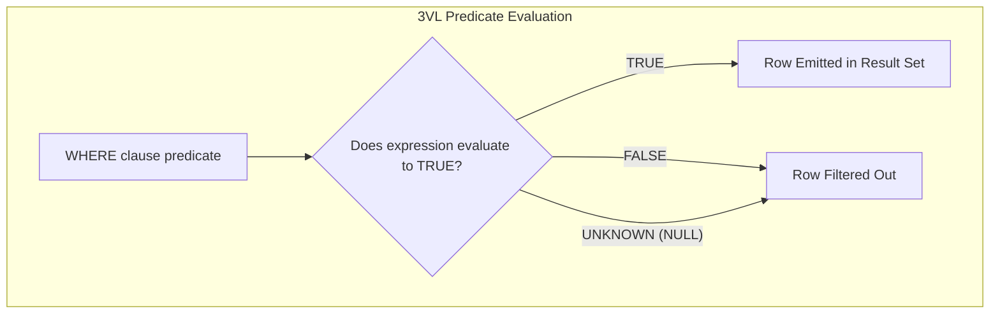
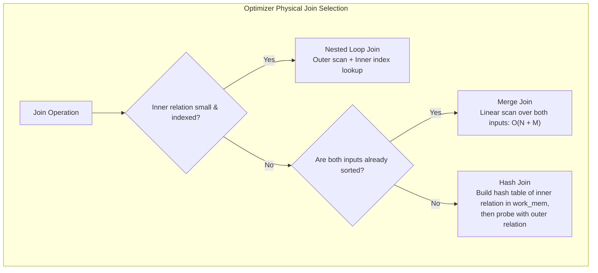
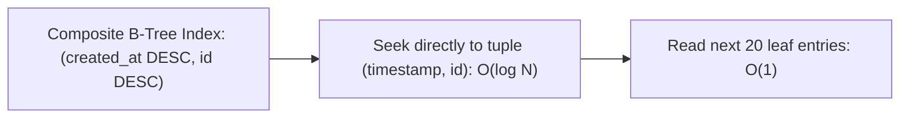

# Module 03 — SQL Querying, Filtering, Joins & Mutations

Welcome to **Module 03** of the PostgreSQL curriculum. This module provides an advanced, academically grounded analysis of relational querying, data filtering, and high-performance mutations in PostgreSQL 18. We dissect Three-Valued Logic (3VL) and NULL hazards, compare physical join execution algorithms (Nested Loop, Hash, Merge), harness `LATERAL` joins, implement deterministic Keyset Pagination, evaluate high-concurrency Upsert strategies (`ON CONFLICT` vs `MERGE`), investigate PostgreSQL 18's `RETURNING OLD/NEW` capabilities, and anticipate PostgreSQL 19 query advancements.

---

## 1. Core Terminology & Concept Definitions

- **Three-Valued Logic (3VL)**: The formal boolean algebraic system implemented by SQL where truth values evaluate to `TRUE`, `FALSE`, or `UNKNOWN` (representing unassigned or missing values).
- **Null-Safe Equality (`IS DISTINCT FROM`)**: A comparison operator that treats two `NULL` values as identical and a `NULL` and non-`NULL` value as distinct, evaluating deterministically to `TRUE` or `FALSE` without ever returning `UNKNOWN`.
- **Nested Loop Join**: A join algorithm that iterates through an outer relation row by row and searches an inner relation for matching keys (highly efficient when the inner relation has an index).
- **Hash Join**: A join algorithm that reads an inner relation into an in-memory hash table and probes it with rows from an outer relation (optimal for large unsorted datasets when the hash table fits in `work_mem`).
- **Merge Join**: A join algorithm that simultaneously steps through two pre-sorted relations, matching keys in linear time ($O(N + M)$).
- **`LATERAL` Join**: A correlated `FROM`-clause subquery or function invocation evaluated repeatedly for each row emitted by preceding relations in the `FROM` list.
- **Keyset Pagination (Seek Method)**: A pagination pattern that fetches subsequent result pages using strict range predicates on indexed sorting columns (`WHERE (created_at, id) < ($last_time, $last_id)`), achieving $O(1)$ constant execution time regardless of page depth.
- **`RETURNING OLD / NEW`**: A PostgreSQL 18 DML capability that exposes both the pre-mutation tuple state (`OLD`) and post-mutation tuple state (`NEW`) within an `UPDATE` or `DELETE` statement.

---

## 2. Three-Valued Logic (3VL) & The NULL Pitfall

In SQL's Three-Valued Logic, any standard comparison against `NULL` evaluates to `UNKNOWN`:

$$\text{UNKNOWN} \land \text{FALSE} = \text{FALSE}, \quad \text{UNKNOWN} \land \text{TRUE} = \text{UNKNOWN}, \quad \neg(\text{UNKNOWN}) = \text{UNKNOWN}$$

A `WHERE` clause filters out any row whose predicate does not evaluate strictly to `TRUE`. Consequently, predicates evaluating to `UNKNOWN` are silently discarded.



### The `NOT IN (Subquery)` Catastrophe
Consider finding all customers who have not placed an order:

```sql
-- DANGEROUS: If orders.customer_id contains even ONE NULL value:
SELECT customer_id FROM customers 
WHERE customer_id NOT IN (SELECT customer_id FROM orders);
```

#### Why This Returns Zero Rows
If `orders` contains IDs `(1, 2, NULL)`:
1. The condition expands to: `customer_id <> 1 AND customer_id <> 2 AND customer_id <> NULL`.
2. Any comparison `<> NULL` yields `UNKNOWN`.
3. `TRUE AND TRUE AND UNKNOWN` yields `UNKNOWN`.
4. The entire query returns **zero rows**, regardless of how many customers exist!

#### The Fix: `NOT EXISTS` or Anti-Join
```sql
-- Safe & Highly Optimized by Planner into Anti-Join:
SELECT c.customer_id 
FROM customers c 
WHERE NOT EXISTS (
    SELECT 1 FROM orders o WHERE o.customer_id = c.customer_id
);
```

> [!NOTE]
> **PostgreSQL 19 Forward-Look**: PostgreSQL 19 automatically rewrites `NOT IN (subquery)` into an anti-join when the planner can formally prove the inner subquery projection cannot contain `NULL` values.

---

## 3. Physical Join Algorithms

The PostgreSQL optimizer translates logical SQL joins into one of three physical algorithms:



### Join Mechanics Comparison

| Join Method | Prerequisites | Time Complexity | Memory Consumption | Spill Behavior |
| :--- | :--- | :--- | :--- | :--- |
| **Nested Loop** | Highly selective outer query; indexed inner relation | $O(N \log M)$ with index | $O(1)$ negligible private memory | Never spills to disk |
| **Hash Join** | Equality operator (`=`) | $O(N + M)$ | $O(\text{Inner Relation Size})$ | Spills to multi-batch disk temp files if exceeds `work_mem` |
| **Merge Join** | Equality operator; pre-sorted inputs | $O(N \log N + M \log M)$ (or $O(N+M)$ if pre-indexed) | $O(1)$ streaming | Spills sort runs to disk if sorting required |

---

## 4. `LATERAL` Joins & Correlated Subqueries

A standard SQL `JOIN` cannot reference columns from preceding tables within the same `FROM` clause. The `LATERAL` keyword removes this restriction, enabling correlated execution per outer row.

### Solving the Top-N Per Category Problem
Fetch the three most recent transactions for every account in a single query:

```sql
SELECT 
    a.account_id, 
    a.account_name, 
    t.transaction_id, 
    t.amount, 
    t.created_at
FROM accounts a
CROSS JOIN LATERAL (
    SELECT transaction_id, amount, created_at
    FROM transactions tx
    WHERE tx.account_id = a.account_id
    ORDER BY tx.created_at DESC
    LIMIT 3
) t;
```
When backed by a composite index on `transactions (account_id, created_at DESC)`, the planner executes an Index Scan per account, retrieving the top 3 rows in sub-millisecond time.

---

## 5. Keyset Pagination vs. `OFFSET` Pagination

Traditional web applications implement pagination using `LIMIT` and `OFFSET`:

```sql
-- ANTI-PATTERN for deep pages:
SELECT * FROM activity_feed 
ORDER BY created_at DESC, id DESC 
LIMIT 20 OFFSET 1000000;
```

### Why `OFFSET` Degrades Linearly ($O(N)$)
1. **Wasted I/O**: PostgreSQL must physically scan 1,000,020 rows, sort them, count to 1,000,000, discard the first million rows, and return the trailing 20.
2. **Page Drift**: If a new row is inserted while a user navigates from Page 1 to Page 2, existing rows shift down by one offset, causing the user to observe duplicate rows across consecutive page loads.

### The Keyset Pagination Pattern ($O(1)$)
Keyset pagination replaces `OFFSET` with a deterministic boundary filter:

```sql
-- O(1) Keyset Seek Query:
SELECT id, payload, created_at
FROM activity_feed
WHERE (created_at, id) < ('2026-10-30 11:45:00+00'::timestamptz, 948271)
ORDER BY created_at DESC, id DESC
LIMIT 20;
```



---

## 6. High-Concurrency Mutations: `ON CONFLICT` vs `MERGE`

### `INSERT ... ON CONFLICT` (PostgreSQL Upsert)
The `ON CONFLICT` clause guarantees atomic upserts at the tuple lock level:

```sql
INSERT INTO account_metrics (account_id, login_count, last_login)
VALUES (101, 1, NOW())
ON CONFLICT (account_id) DO UPDATE SET
    login_count = account_metrics.login_count + EXCLUDED.login_count,
    last_login = EXCLUDED.last_login;
```
The target constraint must match a unique or primary key index.

### SQL-Standard `MERGE`
PostgreSQL supports the SQL:2016 standard `MERGE` statement:

```sql
MERGE INTO inventory_levels target
USING incoming_shipments source
ON target.sku = source.sku
WHEN MATCHED AND target.quantity + source.quantity = 0 THEN
    DELETE
WHEN MATCHED THEN
    UPDATE SET quantity = target.quantity + source.quantity, updated_at = NOW()
WHEN NOT MATCHED THEN
    INSERT (sku, quantity, updated_at) VALUES (source.sku, source.quantity, NOW());
```

#### Behavioral Distinction:
- `ON CONFLICT` is an atomic, low-level tuple-locking primitive designed for high-concurrency single-table OLTP upserts.
- `MERGE` is a relational set-matching statement designed for bulk synchronization and multi-action data warehouse loading.

---

## 7. PostgreSQL 18 `RETURNING OLD/NEW` Mechanics

In PostgreSQL 18, `UPDATE` statements can access both the state of the tuple prior to modification (`OLD`) and the state following modification (`NEW`):

```sql
UPDATE user_profiles
SET status = 'active', tier = 'premium'
WHERE id = 42
RETURNING 
    old.status AS old_status, 
    new.status AS new_status,
    old.tier AS old_tier, 
    new.tier AS new_tier;
```

### Client Driver Gotcha: Duplicate Column Names
If you write `RETURNING old.status, new.status` without column aliases, both columns are named `status` in the protocol result stream. In JavaScript/TypeScript (`node-postgres` or `pglite`):

```javascript
// WRONG: Duplicate keys collapse in JS object instantiation:
const res = await db.query('UPDATE ... RETURNING old.status, new.status');
console.log(res.rows[0]); 
// Output: { status: 'active' } -> The "old" status was silently overwritten by "new"!

// CORRECT: Always assign distinct aliases:
const res = await db.query('UPDATE ... RETURNING old.status AS old_status, new.status AS new_status');
console.log(res.rows[0]);
// Output: { old_status: 'pending', new_status: 'active' }
```

---

## 8. Then vs. Now: Querying & Mutations

| Capability | PostgreSQL $\le$ 14 | PostgreSQL 15–17 | PostgreSQL 18 & 19 (Current) |
| :--- | :--- | :--- | :--- |
| **`MERGE` Support** | Unsupported (required `ON CONFLICT` or PL/pgSQL loops) | Added in PG15; basic matching | Full standard support, `DO NOTHING` clauses, and returning expressions |
| **Mutation Auditing** | `RETURNING` returned only new mutated state | `RETURNING` returned only new state | **`RETURNING OLD / NEW`** returns before-and-after states in a single statement |
| **Anti-Join Optimization** | Manual `NOT EXISTS` needed for NULL safety | Manual `NOT EXISTS` recommended | PG19 automatically converts safe `NOT IN` to Anti-Join |
| **Conflict Actions** | `DO NOTHING` or `DO UPDATE` | `DO NOTHING` or `DO UPDATE` | PG19 adds **`DO SELECT ... RETURNING`** |

---

## 9. Interview Drill

<details>
<summary>1. Explain why `SELECT * FROM tbl WHERE col NOT IN (SELECT other_col FROM other_tbl)` returns zero rows if `other_col` contains a single NULL.</summary>

**Answer**: In SQL's Three-Valued Logic, `val NOT IN (subquery)` expands to a series of inequalities joined by `AND`: `val <> x1 AND val <> x2 AND val <> NULL`. Any comparison against `NULL` evaluates to `UNKNOWN`. In boolean logic, `TRUE AND UNKNOWN` yields `UNKNOWN`, and `FALSE AND UNKNOWN` yields `FALSE`. Because a `WHERE` filter only admits rows that evaluate strictly to `TRUE`, the entire condition fails for every row in the outer table, returning an empty result set. The safe production idiom is `WHERE NOT EXISTS (SELECT 1 FROM other_tbl WHERE other_col = tbl.col)`.
- Ref: [PostgreSQL Documentation: Subquery Expressions](https://www.postgresql.org/docs/18/functions-subquery.html)
</details>

<details>
<summary>2. Compare Hash Join and Nested Loop Join algorithms in terms of resource consumption and ideal workloads.</summary>

**Answer**: 
- **Nested Loop Join** runs in $O(N \log M)$ time when the inner relation has an index on the join key. It consumes virtually zero memory ($O(1)$) and streams rows immediately without startup cost, making it ideal for low-latency OLTP queries with small outer result sets.
- **Hash Join** runs in $O(N + M)$ time. It must first read the entire inner relation into an in-memory hash table in `work_mem` before probing can begin. If the inner relation exceeds `work_mem`, it spills into multi-batch temporary disk files, causing high I/O latency. It is ideal for large, unsorted datasets where indexes are absent.
- Ref: [PostgreSQL Internals: Query Processing](https://www.interdb.jp/pg/tutorial.html)
</details>

<details>
<summary>3. Why does `OFFSET 5000000 LIMIT 20` cause database server performance degradation, and how does Keyset Pagination solve it?</summary>

**Answer**: `OFFSET 5000000` forces the database engine to perform $O(N)$ work: it must scan, read, and evaluate 5,000,020 rows through the index or heap, discard the first 5,000,000 rows, and return the final 20. This causes massive buffer cache churn and CPU utilization. Keyset pagination replaces `OFFSET` with a seek predicate: `WHERE (sort_col, id) < ($last_val, $last_id) ORDER BY sort_col DESC, id DESC LIMIT 20`. This allows the B-tree index to seek directly to the target leaf node in $O(\log N)$ time and stream the subsequent 20 rows in $O(1)$ constant time.
- Ref: [Use The Index, Luke: Paging Through Results](https://use-the-index-luke.com/sql/partial-results/fetch-next-page)
</details>

<details>
<summary>4. What client-side JavaScript/Node.js bug occurs when using PostgreSQL 18's `RETURNING old.col, new.col` without aliasing?</summary>

**Answer**: Node.js PostgreSQL drivers (`pg`, `@electric-sql/pglite`) instantiate query result rows as standard JavaScript objects where property keys correspond to the returned column names. If a query requests `RETURNING old.status, new.status`, both columns in the wire protocol carry the name `status`. The JavaScript engine creates an object `{ status: ... }` and overwrites the first property with the second. As a result, `old.status` is lost. The mandatory fix is explicit column aliasing: `RETURNING old.status AS old_status, new.status AS new_status`.
- Ref: [PostgreSQL 18 Release Notes](https://www.postgresql.org/docs/18/release-18.html)
</details>

<details>
<summary>5. How does a `LATERAL` join differ from an ordinary inner or left join?</summary>

**Answer**: In an ordinary join, the right-hand relation is independent and cannot reference attributes from the left-hand relation within the `FROM` clause. A `LATERAL` join acts like a correlated subquery in the `FROM` list: the subquery is evaluated dynamically for each row emitted by the preceding table. This allows combining per-row set calculations (e.g. top-N recent records per customer) or expanding array/JSON attributes per row while maintaining push-down index scan efficiencies.
- Ref: [PostgreSQL Documentation: Queries: LATERAL](https://www.postgresql.org/docs/18/queries-table-expressions.html#QUERIES-LATERAL)
</details>
