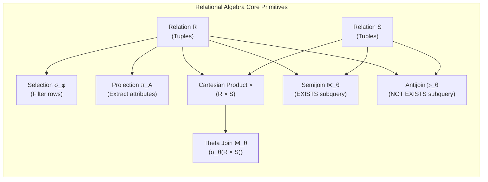
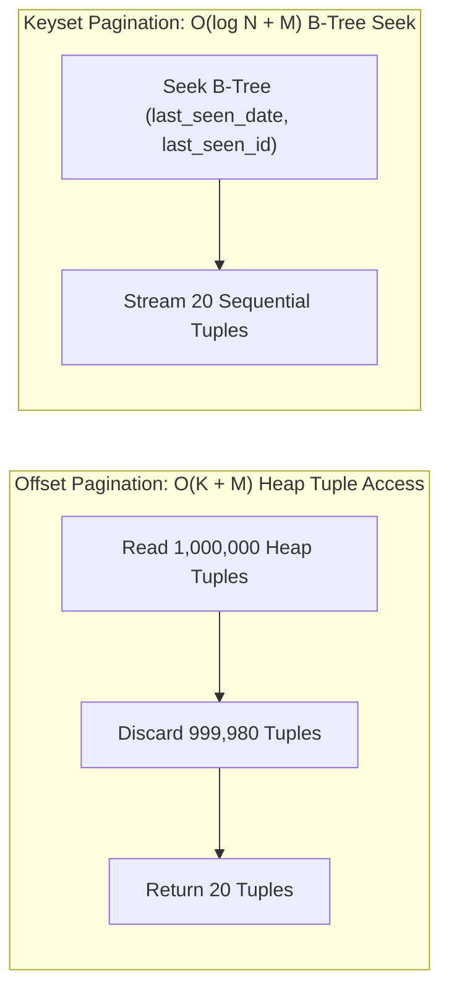
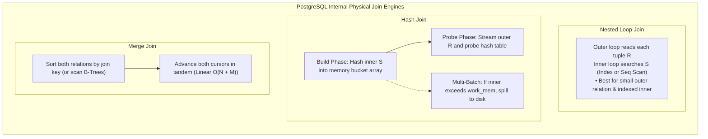

# Module 03 — Modern SQL Querying, Filtering & Joins

Welcome to **Module 03** of the PostgreSQL 18 Curriculum. This module provides an in-depth, academically grounded, and production-tested exploration of relational query processing. We establish the formal relational algebra foundations of SQL, examine the mathematical mechanics and subtle hazards of Three-Valued Logic (3VL) through comprehensive truth tables, dissect internal physical join algorithms (Nested Loop, Hash Join, Merge Join), explore advanced correlation techniques such as `LATERAL` joins, and examine modern data modification patterns including atomic upserts and PostgreSQL 18's dual **`RETURNING OLD / NEW`** capability.

---

## 1. Formal Relational Algebra Foundations

SQL is a declarative language derived from Edgar F. Codd's Relational Model of Data (1970). Every SQL query is translated by the PostgreSQL query planner into an expression tree composed of relational algebra operators:

- **Relation ($R$)**: A mathematical set of $n$-tuples conforming to a relation schema $Sch(R) = (A_1: D_1, A_2: D_2, \dots, A_n: D_n)$, where each $A_i$ is an attribute name and $D_i$ is its scalar domain.
- **Selection ($\sigma_\phi(R)$)**: Extracts the subset of tuples $t \in R$ that satisfy the propositional formula $\phi$:
  $$\sigma_\phi(R) = \{t \in R \mid \phi(t) = \text{TRUE}\}$$
- **Projection ($\pi_{A_1, \dots, A_k}(R)$)**: Maps each tuple $t \in R$ to a narrower tuple containing only attributes $A_1, \dots, A_k$, discarding all omitted attributes:
  $$\pi_{A_1, \dots, A_k}(R) = \{t[A_1, \dots, A_k] \mid t \in R\}$$
- **Cartesian Product ($R \times S$)**: Combines every tuple of relation $R$ with every tuple of relation $S$:
  $$R \times S = \{t_1 \circ t_2 \mid t_1 \in R \land t_2 \in S\}, \quad |R \times S| = |R| \times |S|$$
- **Theta Join ($R \bowtie_\theta S$)**: The conditional combination of two relations under join condition $\theta$:
  $$R \bowtie_\theta S = \sigma_\theta(R \times S)$$
- **Semijoin ($R \ltimes_\theta S$)**: Returns only those tuples from $R$ for which there exists at least one matching tuple in $S$ satisfying $\theta$, without duplicating $R$ tuples or projecting $S$ attributes:
  $$R \ltimes_\theta S = \pi_{Sch(R)}(R \bowtie_\theta S)$$
- **Antijoin ($R \rhd_\theta S$)**: Returns tuples from $R$ for which *no* matching tuple exists in $S$ under predicate $\theta$:
  $$R \rhd_\theta S = R - (R \ltimes_\theta S)$$
- **Relational Division ($R \div S$)**: Formulates queries involving universal quantification ("find entities associated with *all* elements of $S$").



---

## 2. Modern Projections, Expressions & `DISTINCT ON`

### Scalar Expressions & Type Coercion
SQL projections allow dynamic scalar computation, conditional expressions, and type transformations within the projection list:

```sql
SELECT 
    order_id,
    customer_id,
    quantity,
    unit_price,
    quantity * unit_price AS line_gross_amount,
    -- Deterministic decimal rounding using fixed-point numeric arithmetic
    ROUND((quantity * unit_price * 0.21)::numeric, 2) AS estimated_vat_amount,
    -- Conditional CASE expression evaluated per-tuple
    CASE 
        WHEN quantity >= 100 THEN 'BULK_TIER_1'
        WHEN quantity >= 50  THEN 'BULK_TIER_2'
        ELSE 'STANDARD'
    END AS discount_tier
FROM order_items;
```

### Deduplication: ANSI `DISTINCT` vs PostgreSQL `DISTINCT ON`
Standard SQL `DISTINCT` evaluates all selected attributes and eliminates duplicate rows across the entire projected tuple:
$$\text{DISTINCT}(Q) = \sigma_{\text{first}}(Q)$$

PostgreSQL provides an expressive extension: `DISTINCT ON (expressions)`. It partitions the result set by the supplied expressions and keeps strictly the first tuple of each partition, ordered by the surrounding `ORDER BY` clause:

```sql
-- Find the most recent order for each individual customer
SELECT DISTINCT ON (customer_id)
    customer_id,
    order_id,
    order_date,
    total_amount,
    order_status
FROM orders
ORDER BY customer_id ASC, order_date DESC, order_id DESC;
```

> [!IMPORTANT]
> When executing `DISTINCT ON (expr1, expr2)`, the leading sort columns in the `ORDER BY` clause **must match** `expr1, expr2` exactly. Secondary `ORDER BY` columns then define the deterministic tie-breaker for which physical tuple in each partition is preserved.

---

## 3. Predicate Filtering & Three-Valued Logic (3VL)

Relational databases represent missing, inapplicable, or unknown information through the special marker `NULL`. Consequently, SQL evaluates Boolean predicates using **Three-Valued Logic (3VL)**, formalized by Stephen Cole Kleene as the strong logic of indeterminacy ($K_3$).

The truth domain consists of three states:
$$\mathbb{T}_{3VL} = \{\text{TRUE}, \text{FALSE}, \text{UNKNOWN}\}$$

In PostgreSQL, `NULL` serves as the runtime representation of `UNKNOWN`.

### Truth Tables for Boolean Connectives

#### 1. Logical Conjunction (`AND`)
An `AND` operation resolves to `FALSE` if any operand is `FALSE`, regardless of whether the other operand is known. If an operand is `NULL` and neither operand is `FALSE`, the result remains `NULL`.

| Operand $A$ | Operand $B$ | $A \text{ AND } B$ | Mathematical Justification |
| :--- | :--- | :--- | :--- |
| `TRUE` | `TRUE` | `TRUE` | Both predicates established true |
| `TRUE` | `FALSE` | `FALSE` | $B$ refutes conjunction |
| `TRUE` | `NULL` | `NULL` | Dependent on unknown state of $B$ |
| `FALSE` | `TRUE` | `FALSE` | $A$ refutes conjunction |
| `FALSE` | `FALSE` | `FALSE` | Both refuting |
| `FALSE` | `NULL` | `FALSE` | **$A$ guarantees false regardless of $B$** |
| `NULL` | `TRUE` | `NULL` | Dependent on unknown state of $A$ |
| `NULL` | `FALSE` | `FALSE` | **$B$ guarantees false regardless of $A$** |
| `NULL` | `NULL` | `NULL` | Indeterminate |

#### 2. Logical Disjunction (`OR`)
An `OR` operation resolves to `TRUE` if any operand is `TRUE`, regardless of whether the other operand is known. If an operand is `NULL` and neither operand is `TRUE`, the result remains `NULL`.

| Operand $A$ | Operand $B$ | $A \text{ OR } B$ | Mathematical Justification |
| :--- | :--- | :--- | :--- |
| `TRUE` | `TRUE` | `TRUE` | Both satisfied |
| `TRUE` | `FALSE` | `TRUE` | $A$ satisfies disjunction |
| `TRUE` | `NULL` | `TRUE` | **$A$ guarantees true regardless of $B$** |
| `FALSE` | `TRUE` | `TRUE` | $B$ satisfies disjunction |
| `FALSE` | `FALSE` | `FALSE` | Neither satisfied |
| `FALSE` | `NULL` | `NULL` | Dependent on unknown state of $B$ |
| `NULL` | `TRUE` | `TRUE` | **$B$ guarantees true regardless of $A$** |
| `NULL` | `FALSE` | `NULL` | Dependent on unknown state of $A$ |
| `NULL` | `NULL` | `NULL` | Indeterminate |

#### 3. Logical Negation (`NOT`)
Negation flips truth values between `TRUE` and `FALSE`, while `NULL` remains invariant under inversion.

| Operand $A$ | $\text{NOT } A$ |
| :--- | :--- |
| `TRUE` | `FALSE` |
| `FALSE` | `TRUE` |
| `NULL` | `NULL` |

---

### Truth Tables for Relational Comparisons

In standard SQL, comparing any value against `NULL` using binary comparison operators (`=`, `<>`, `<`, `<=`, `>`, `>=`) yields `NULL`, because an unknown value cannot be affirmed equal or unequal to any other value:

| Expression | Left Operand | Right Operand | Result |
| :--- | :--- | :--- | :--- |
| $A = B$ | `5` | `5` | `TRUE` |
| $A = B$ | `5` | `10` | `FALSE` |
| $A = B$ | `5` | `NULL` | `NULL` |
| $A = B$ | `NULL` | `5` | `NULL` |
| $A = B$ | `NULL` | `NULL` | **`NULL` (Never `TRUE`!)** |
| $A \neq B$ ($A <> B$) | `5` | `10` | `TRUE` |
| $A \neq B$ ($A <> B$) | `5` | `NULL` | `NULL` |
| $A \neq B$ ($A <> B$) | `NULL` | `NULL` | **`NULL` (Never `FALSE`!)** |
| $A < B$ | `5` | `NULL` | `NULL` |

### NULL-Safe Comparisons: `IS DISTINCT FROM`

To test equality while treating `NULL` as a distinct value equal only to other `NULL`s, SQL:1999 introduced the `IS DISTINCT FROM` and `IS NOT DISTINCT FROM` operators. These operators never return `NULL`; they evaluate strictly to a 2-valued Boolean (`TRUE` or `FALSE`):

| Expression | Left Operand | Right Operand | Result |
| :--- | :--- | :--- | :--- |
| `A IS DISTINCT FROM B` | `5` | `5` | `FALSE` |
| `A IS DISTINCT FROM B` | `5` | `10` | `TRUE` |
| `A IS DISTINCT FROM B` | `5` | `NULL` | `TRUE` |
| `A IS DISTINCT FROM B` | `NULL` | `5` | `TRUE` |
| `A IS DISTINCT FROM B` | `NULL` | `NULL` | **`FALSE`** |
| `A IS NOT DISTINCT FROM B` | `5` | `5` | `TRUE` |
| `A IS NOT DISTINCT FROM B` | `5` | `10` | `FALSE` |
| `A IS NOT DISTINCT FROM B` | `5` | `NULL` | `FALSE` |
| `A IS NOT DISTINCT FROM B` | `NULL` | `NULL` | **`TRUE`** |

### Boolean Predicate Tests

SQL provides explicit unary postfix predicates to test the truth state directly:

| Input Expression $P$ | $P \text{ IS TRUE}$ | $P \text{ IS NOT TRUE}$ | $P \text{ IS FALSE}$ | $P \text{ IS NOT FALSE}$ | $P \text{ IS UNKNOWN}$ | $P \text{ IS NOT UNKNOWN}$ |
| :--- | :--- | :--- | :--- | :--- | :--- | :--- |
| `TRUE` | `TRUE` | `FALSE` | `FALSE` | `TRUE` | `FALSE` | `TRUE` |
| `FALSE` | `FALSE` | `TRUE` | `TRUE` | `FALSE` | `FALSE` | `TRUE` |
| `NULL` | `FALSE` | **`TRUE`** | `FALSE` | **`TRUE`** | **`TRUE`** | `FALSE` |

---

### Failure of Classical Logic Tautologies in SQL

In classical Boolean logic ($\mathbb{B} = \{\text{TRUE}, \text{FALSE}\}$), several foundational laws are universal tautologies. Under 3VL, these laws fail whenever predicates involve `NULL`:

1. **Law of Excluded Middle ($P \lor \neg P \equiv \text{TRUE}$)**:
   If $P$ is `NULL`, then:
   $$\text{NULL} \lor \neg\text{NULL} \iff \text{NULL} \lor \text{NULL} \iff \text{NULL} \neq \text{TRUE}$$
   Consequently, the query:
   ```sql
   SELECT * FROM employees WHERE status = 'ACTIVE' OR status <> 'ACTIVE';
   ```
   **Omits every employee where `status IS NULL`!**
2. **Principle of Non-Contradiction ($P \land \neg P \equiv \text{FALSE}$)**:
   If $P$ is `NULL`, then:
   $$\text{NULL} \land \neg\text{NULL} \iff \text{NULL} \land \text{NULL} \iff \text{NULL} \neq \text{FALSE}$$

### Acceptance Discrepancy: `WHERE` Clauses vs `CHECK` Constraints

A critical architectural distinction exists in how PostgreSQL evaluates 3VL in queries versus table integrity constraints:

- **Query `WHERE` Filter**: A tuple is accepted if and only if the predicate evaluates strictly to `TRUE`:
  $$\text{Filter Acceptance} = \{t \mid \text{eval}(\text{WHERE}(t)) = \text{TRUE}\}$$
  Tuples evaluating to `FALSE` **or** `NULL` are rejected and discarded.
- **Table `CHECK` Constraint**: A tuple insert or update is permitted if and only if the constraint does *not* evaluate to `FALSE`:
  $$\text{Constraint Valid} \iff \text{eval}(\text{CHECK}(t)) \in \{\text{TRUE}, \text{NULL}\}$$

```sql
-- DDL Constraint Definition
CREATE TABLE accounts (
    id bigint PRIMARY KEY,
    balance numeric(12, 2),
    CHECK (balance >= 0.00)
);

-- An INSERT with balance = NULL SUCCEEDS!
-- Because (NULL >= 0.00) evaluates to NULL, which is NOT FALSE.
INSERT INTO accounts (id, balance) VALUES (1, NULL); -- Permitted!

-- To prevent NULL balances, you MUST combine CHECK with NOT NULL:
-- balance numeric(12, 2) NOT NULL CHECK (balance >= 0.00)
```

---

### Critical Production Hazards with 3VL

#### The `NOT IN (Subquery)` Catastrophe
Consider searching for customers who have not placed any orders:

```sql
-- DANGEROUS PATTERN:
SELECT customer_id, company_name 
FROM customers 
WHERE customer_id NOT IN (SELECT customer_id FROM orders);
```

If the subquery returns `{101, 102, NULL}`, the `NOT IN` clause expands logically to:
$$\text{customer\_id} \neq 101 \land \text{customer\_id} \neq 102 \land \text{customer\_id} \neq \text{NULL}$$

Because $\text{customer\_id} \neq \text{NULL}$ evaluates to `NULL` for every candidate row:
- If `customer_id` is 101: $\text{FALSE} \land \text{TRUE} \land \text{NULL} \implies \text{FALSE}$
- If `customer_id` is 999: $\text{TRUE} \land \text{TRUE} \land \text{NULL} \implies \text{NULL}$

Since `WHERE` rejects both `FALSE` and `NULL`, **the query returns zero rows**, even if there are thousands of active customers without orders!

**Safe Production Alternatives:**
```sql
-- Alternative 1: NOT EXISTS (Antijoin semantics, NULL-immune)
SELECT c.customer_id, c.company_name
FROM customers c
WHERE NOT EXISTS (
    SELECT 1 FROM orders o WHERE o.customer_id = c.customer_id
);

-- Alternative 2: Explicit IS NOT NULL guard in subquery
SELECT customer_id, company_name
FROM customers
WHERE customer_id NOT IN (
    SELECT customer_id FROM orders WHERE customer_id IS NOT NULL
);
```

#### Unique Constraints & PostgreSQL 15+ `UNIQUE NULLS NOT DISTINCT`
Under standard ANSI SQL, `NULL` values are treated as distinct from one another. By default, a `UNIQUE (email)` constraint permits an unbounded number of rows containing `NULL`:

```sql
-- Default behavior: Multiple NULLs allowed
CREATE TABLE users_legacy (
    id bigint PRIMARY KEY,
    email text UNIQUE -- Multiple rows with email = NULL are permitted
);

-- PostgreSQL 15+ standard enhancement: UNIQUE NULLS NOT DISTINCT
CREATE TABLE users_modern (
    id bigint PRIMARY KEY,
    email text UNIQUE NULLS NOT DISTINCT -- Strictly AT MOST ONE NULL permitted!
);
```

---

## 4. Sorting, Keyset Pagination & Physical Page Costs

### Sort Ordering with Relational `NULL`
By default, PostgreSQL sorts `NULL` values as if they are larger than any non-null value:
- `ASC` ordering: `NULLS LAST` (values lowest to highest, followed by `NULL`s).
- `DESC` ordering: `NULLS FIRST` (`NULL`s first, followed by values highest to lowest).

```sql
-- Explicitly force NULL values to the bottom regardless of sort direction:
SELECT id, full_name, performance_score
FROM employees
ORDER BY performance_score DESC NULLS LAST, full_name ASC;
```

### Keyset (Cursor) Pagination vs Offset Pagination
Deep pagination with `OFFSET` incurs an $O(N)$ scanning penalty, reading and discarding heap tuples:

$$\text{Cost}(\text{OFFSET } K \text{ LIMIT } M) \propto K + M$$



```sql
-- Offset Pagination (High CPU and Buffer Overhead on deep pages)
SELECT id, created_at, total_amount
FROM orders
ORDER BY created_at DESC, id DESC
OFFSET 1000000 ROWS FETCH NEXT 20 ROWS ONLY;

-- Keyset (Seek) Pagination (Constant-time B-Tree index seek)
SELECT id, created_at, total_amount
FROM orders
WHERE (created_at, id) < ('2026-10-25 14:32:00+00', 987654)
ORDER BY created_at DESC, id DESC
LIMIT 20;
```

---

## 5. Physical Join Algorithms & Optimizer Execution Mechanics

The query optimizer selects from three core physical join algorithms depending on catalog statistics, available indexes, memory configuration (`work_mem`), and join predicate types.



### 1. Nested Loop Join
- **Computational Complexity**: $O(|R| \times \text{Cost}(S))$
- **Optimal Conditions**: One relation is small (outer loop), and the other relation has a highly selective index on the join key (inner loop).
- **Batching & Vectorization**: In PostgreSQL 18, nested loop joins leverage streaming asynchronous prefetch (AIO) to request disk blocks for inner index lookups ahead of execution.

### 2. Hash Join
- **Computational Complexity**: $O(|R| + |S|)$
- **Optimal Conditions**: Equi-joins (`R.id = S.r_id`) without supporting sorted indexes on large relations.
- **Memory Management**:
  - **In-Memory Hash Join**: Inner relation fits entirely within `work_mem`.
  - **Hybrid / Grace Multi-Batch Hash Join**: When the inner relation exceeds `work_mem`, PostgreSQL partitions the hash table into $2^k$ batches on disk, partitioning the outer relation concurrently into corresponding batches, and joins batch pairs sequentially.
  - **Bloom Filters**: During the build phase, PostgreSQL constructs a compact bit-vector Bloom filter to prune non-matching outer relation tuples before performing expensive hash bucket probes.

### 3. Merge Join
- **Computational Complexity**: $O(|R| \log |R| + |S| \log |S|)$ for sorting, plus $O(|R| + |S|)$ for linear scanning. If inputs are already presorted via B-Tree index scans, total cost drops to $O(|R| + |S|)$.
- **Optimal Conditions**: Large relations joining on equality where both inputs are already sorted, or when the query output requires an `ORDER BY` matching the join keys.
- **Mark & Restore**: Handles duplicate join keys ($M \times N$ matches) by saving the inner relation scan position (Mark) and rewinding (Restore) for subsequent matching outer tuples.

---

## 6. Advanced Join Topologies: `LATERAL` Joins

A standard `JOIN` evaluates each table expression independently; an inner subquery cannot reference columns from preceding tables in the `FROM` list. The `LATERAL` keyword transforms an inner subquery or table-valued function into a **correlated subquery within the `FROM` clause**, evaluated once for each row of the outer table:

```sql
-- Top-3 highest-spending orders per customer (Top-N per group)
SELECT 
    c.customer_id,
    c.company_name,
    top_orders.order_id,
    top_orders.total_amount,
    top_orders.order_date
FROM customers c
CROSS JOIN LATERAL (
    SELECT o.order_id, o.total_amount, o.order_date
    FROM orders o
    WHERE o.customer_id = c.customer_id
    ORDER BY o.total_amount DESC
    LIMIT 3
) AS top_orders;
```

```sql
-- Unnesting JSON arrays into relational rows per parent tuple
SELECT 
    p.product_id,
    p.product_name,
    tag.tag_name
FROM products p
CROSS JOIN LATERAL jsonb_array_elements_text(p.metadata->'tags') AS tag(tag_name);
```

---

## 7. Set Operations: Set vs Multiset (Bag) Semantics

SQL supports mathematical set operations combining tuples across queries with matching projection signatures:

| Operation | Set Semantics (Deduplicated) | Bag / Multiset Semantics (Preserved) | Execution Operator |
| :--- | :--- | :--- | :--- |
| **Union** | `UNION` | `UNION ALL` | `Append` + `HashSetOp` (or `Sort` + `Unique`) vs pure `Append` |
| **Intersection** | `INTERSECT` | `INTERSECT ALL` | `HashSetOp` (Intersect) vs `HashSetOp` with tuple occurrence counters |
| **Difference** | `EXCEPT` | `EXCEPT ALL` | `HashSetOp` (Difference) vs `HashSetOp` with subtraction counters |

```sql
-- High-throughput consolidation without deduplication overhead:
SELECT employee_id, email, 'CORPORATE' AS source FROM corporate_staff
UNION ALL
SELECT contractor_id, email, 'CONTRACTOR' AS source FROM contractor_roster;
```

> [!TIP]
> Always prefer `UNION ALL` over `UNION` unless explicit deduplication across queries is strictly required. `UNION` forces the database to sort or hash the combined dataset to eliminate duplicates, consuming substantial memory and CPU.

---

## 8. Correlated Subqueries & Query Optimization Mechanics

### Subquery Flattening & Inlining
When parsing subqueries in `WHERE` clauses, the query planner evaluates whether subqueries can be flattened into physical joins:
- **`EXISTS` & `IN` Subqueries**: Converted into physical **Semijoins** ($\ltimes$) whenever possible.
- **`NOT EXISTS` Subqueries**: Converted into physical **Antijoins** ($\rhd$).

```sql
-- Planner flattens this correlated EXISTS query into an in-memory Hash Semijoin:
SELECT c.customer_id, c.company_name
FROM customers c
WHERE EXISTS (
    SELECT 1 
    FROM orders o 
    WHERE o.customer_id = c.customer_id 
      AND o.order_date >= '2026-01-01'
);
```

---

## 9. Modern DML: Upserts & PostgreSQL 18 Dual `RETURNING`

### Atomic Upserts (`INSERT ... ON CONFLICT`)
Handling concurrent inserts safely without race conditions requires atomic upsert semantics:

```sql
INSERT INTO inventory_balances (sku, warehouse_id, quantity, updated_at)
VALUES ('TECH-9821-X', 4, 100, clock_timestamp())
ON CONFLICT (sku, warehouse_id) 
DO UPDATE SET 
    quantity = inventory_balances.quantity + EXCLUDED.quantity,
    updated_at = EXCLUDED.updated_at
WHERE inventory_balances.is_frozen = FALSE;
```

### PostgreSQL 18 Dual `RETURNING OLD / NEW`
Prior to PostgreSQL 18, `RETURNING` only exposed the newly committed tuple state (`NEW` values on `UPDATE` and `INSERT`), forcing audit triggers or secondary queries to capture prior state. 

PostgreSQL 18 introduces native simultaneous access to both **`OLD`** and **`NEW`** tuple states directly within the DML statement:

```sql
-- Atomically transition an account status and capture before/after metrics
UPDATE user_accounts
SET 
    account_status = 'SUSPENDED',
    failed_login_count = 0,
    status_updated_at = clock_timestamp()
WHERE id = '0192d3b4-7000-7000-8000-000000000001'
RETURNING 
    id,
    OLD.account_status AS previous_status,
    NEW.account_status AS current_status,
    OLD.failed_login_count AS prior_failed_attempts,
    NEW.status_updated_at AS transitioned_at;
```

---

## 10. Summary & Module Progression

In this module, we examined:
- Formal relational algebra primitives: Selection ($\sigma$), Projection ($\pi$), Cartesian Product ($\times$), Joins ($\bowtie$), Semijoins ($\ltimes$), and Antijoins ($\rhd$).
- Complete 3VL truth tables for Boolean connectives (`AND`, `OR`, `NOT`), relational comparisons, and null-safe operators (`IS DISTINCT FROM`).
- Failures of classical logic tautologies (Excluded Middle, Non-Contradiction) in SQL.
- Crucial semantic discrepancies between `WHERE` acceptance and `CHECK` constraint validation.
- Real-world production hazards including the `NOT IN (subquery)` NULL trap and `UNIQUE NULLS NOT DISTINCT`.
- Physical join engines (Nested Loop, Hash Join with multi-batch spill and Bloom filters, Merge Join with mark/restore).
- Keyset cursor pagination and `LATERAL` correlated table joins.
- Modern transactional DML, atomic upserts, and PostgreSQL 18 dual `RETURNING OLD / NEW`.

Proceed to **[Module 04 — Advanced SQL: CTEs & Window Functions](./04-advanced-sql-ctes-and-window-functions.md)** to explore relational fixpoint semantics in recursive CTEs, optimizer optimization fences (`MATERIALIZED`), and advanced window frame physics.
