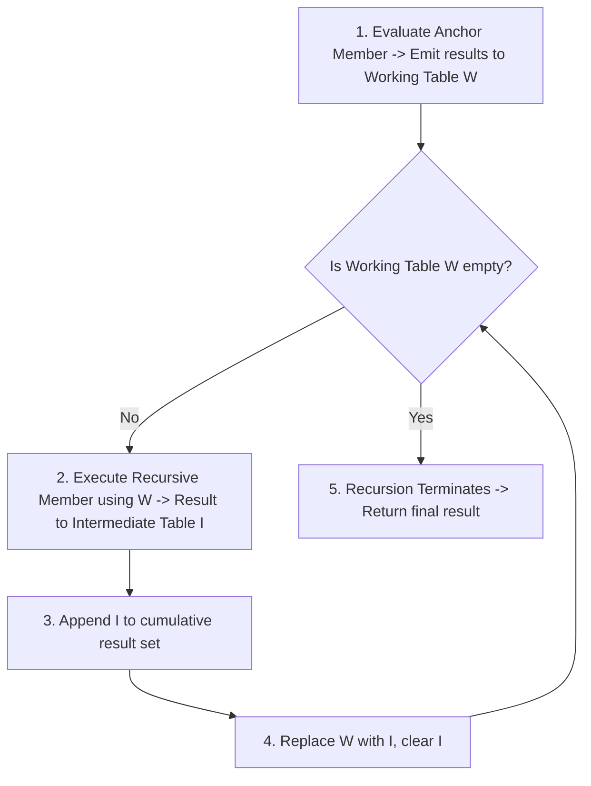
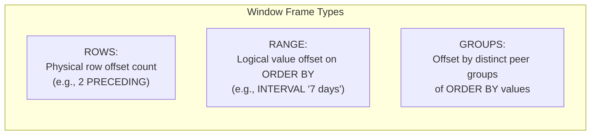

# Module 04 — Advanced SQL, CTEs, Window Functions & Analytics

Welcome to **Module 04** of the PostgreSQL curriculum. This module delivers an academically rigorous and production-tested exploration of analytical SQL in PostgreSQL 18. We analyze Common Table Expression (CTE) inlining and the `MATERIALIZED` optimization fence, construct writable data pipelines, trace recursive graph evaluation with SQL:2016 `CYCLE` detection, dissect window frame mechanics (`ROWS`, `RANGE`, `GROUPS`), evaluate multi-dimensional aggregation (`GROUPING SETS`, `ROLLUP`, `CUBE`), and investigate analytical evolutions including PostgreSQL 19's `IGNORE NULLS`.

---

## 1. Core Terminology & Concept Definitions

- **Common Table Expression (CTE)**: A named temporary result set defined using the `WITH` clause that exists only within the execution scope of a single query.
- **CTE Inlining**: An optimizer behavior (default since PostgreSQL 12) where the planner flattens non-recursive, side-effect-free CTEs directly into the parent query, allowing joint cost estimation and predicate pushdown.
- **Optimization Fence (`AS MATERIALIZED`)**: An explicit hint instructing the query planner to evaluate a CTE independently into a temporary in-memory or on-disk worktable, preventing predicate pushdown across the CTE boundary.
- **Writable CTE**: A data-modifying statement (`INSERT`, `UPDATE`, `DELETE`) enclosed inside a `WITH` clause using `RETURNING`, enabling atomic multi-table state pipelines.
- **Recursive CTE**: An iterative query comprising an **Anchor Member** and a **Recursive Member** joined by `UNION` or `UNION ALL`, executed repeatedly over a dynamic working table until an empty set is produced.
- **`CYCLE` Clause (SQL:2016)**: A declarative standard clause that tracks visited node identifiers during recursive evaluation, setting a boolean flag and terminating recursion when an infinite loop or graph cycle is detected.
- **Window Frame**: The dynamic subset of rows within a window partition over which aggregate and ranking functions are calculated, bounded by `ROWS`, `RANGE`, or `GROUPS`.
- **RunCondition Optimization**: An executor optimization that short-circuits window function processing once a bounding filter condition (e.g., `row_number() <= 10`) is satisfied.

---

## 2. Common Table Expressions: Inlining vs. `AS MATERIALIZED`

Prior to PostgreSQL 12, all CTEs acted as rigid optimization fences: they were materialized into temporary structures, preventing the planner from pushing outer `WHERE` filters down into the CTE.

### Modern CTE Inlining
In PostgreSQL 18, standard CTEs are automatically inlined:

```sql
WITH customer_orders AS (
    SELECT o.id, o.customer_id, o.total_amount, o.order_date
    FROM orders o
    JOIN customers c ON c.id = o.customer_id
)
SELECT * FROM customer_orders 
WHERE order_date >= '2026-01-01';
```
The optimizer inlines `customer_orders` into the main query, pushing `order_date >= '2026-01-01'` directly into the scan on `orders`, taking advantage of available indexes.

### When to Force Materialization (`AS MATERIALIZED`)
Sometimes inlining produces sub-optimal plans (e.g., when a computationally intensive CTE is referenced multiple times in the outer query, causing duplicate evaluation). The `AS MATERIALIZED` modifier forces independent evaluation:

```sql
WITH expensive_calculation AS MATERIALIZED (
    -- Evaluated exactly once, cached, and reused:
    SELECT department_id, AVG(salary) AS avg_sal
    FROM payroll_ledger
    GROUP BY department_id
)
SELECT e.name, e.salary, c.avg_sal
FROM employees e
JOIN expensive_calculation c ON c.department_id = e.department_id
WHERE e.salary > c.avg_sal;
```

---

## 3. Writable CTEs: Atomic Multi-Table Pipelines

PostgreSQL allows `INSERT`, `UPDATE`, and `DELETE` statements inside CTEs, provided they include a `RETURNING` clause. All statements within a single query execute under the same snapshot and commit atomically.

### Moving Records Between Tables Without Intermediary App Logic
```sql
WITH archived_events AS (
    -- Atomic DELETE and capture of rows
    DELETE FROM live_event_stream
    WHERE created_at < NOW() - INTERVAL '30 days'
    RETURNING event_id, payload, created_at
)
-- Atomic INSERT into cold archive table
INSERT INTO cold_event_archive (event_id, payload, archived_at)
SELECT event_id, payload, created_at
FROM archived_events;
```

---

## 4. Recursive CTEs & SQL:2016 `CYCLE` Detection

A recursive CTE executes using an internal **Working Table** ($W$) and an **Intermediate Table** ($I$):



### Hierarchical Tree Traversal
```sql
CREATE TABLE organization_nodes (
    node_id INT PRIMARY KEY,
    parent_id INT REFERENCES organization_nodes(node_id),
    title TEXT NOT NULL
);

WITH RECURSIVE org_hierarchy AS (
    -- Anchor Member: Root node
    SELECT node_id, parent_id, title, 1 AS depth
    FROM organization_nodes
    WHERE parent_id IS NULL
    
    UNION ALL
    
    -- Recursive Member: Traverse child nodes
    SELECT c.node_id, c.parent_id, c.title, p.depth + 1
    FROM organization_nodes c
    JOIN org_hierarchy p ON p.node_id = c.parent_id
)
SELECT * FROM org_hierarchy ORDER BY depth, node_id;
```

### Graph Cycles & The Declarative `CYCLE` Clause
In cyclic graphs (e.g., social networks or bad data where $A \rightarrow B \rightarrow A$), standard recursion runs infinitely until out-of-memory or stack overflow occurs.

PostgreSQL natively supports the SQL:2016 standard `CYCLE` clause:

```sql
WITH RECURSIVE graph_traverse AS (
    SELECT node_id, neighbor_id, 1 AS path_length
    FROM network_edges
    WHERE node_id = 1
    
    UNION ALL
    
    SELECT e.node_id, e.neighbor_id, g.path_length + 1
    FROM network_edges e
    JOIN graph_traverse g ON g.neighbor_id = e.node_id
)
CYCLE neighbor_id SET is_cycle USING path_trace
SELECT node_id, neighbor_id, path_length, is_cycle, path_trace
FROM graph_traverse;
```
When `neighbor_id` has already been visited along the path, `is_cycle` evaluates to `true`, and the engine stops following that branch.

---

## 5. Window Frames in Depth: `ROWS`, `RANGE` & `GROUPS`

A window function operates on a partition of rows without collapsing them into a single row. The exact rows evaluated are governed by the **Window Frame**:

$$\{ \text{ROWS} \mid \text{RANGE} \mid \text{GROUPS} \} \quad \text{BETWEEN} \quad \text{frame\_start} \quad \text{AND} \quad \text{frame\_end}$$



### The Default Window Frame Pitfall
When an `ORDER BY` clause is present inside `OVER ()`, SQL mandates a default frame:
$$\text{RANGE BETWEEN UNBOUNDED PRECEDING AND CURRENT ROW}$$

This evaluates from the start of the partition through all **peers** of the current row (rows with identical `ORDER BY` values).

```sql
-- DANGEROUS: If multiple transactions share the exact same timestamp,
-- RANGE evaluates the sum across ALL peer rows simultaneously!
SELECT 
    id, created_at, amount,
    SUM(amount) OVER (
        ORDER BY created_at
        -- Implicit: RANGE BETWEEN UNBOUNDED PRECEDING AND CURRENT ROW
    ) AS running_total_range,
    SUM(amount) OVER (
        ORDER BY created_at
        ROWS BETWEEN UNBOUNDED PRECEDING AND CURRENT ROW
    ) AS running_total_rows
FROM financial_ledger;
```

### Frame Exclusion Clauses
You can selectively omit rows from the calculation frame:
- **`EXCLUDE CURRENT ROW`**: Omit the current row, keeping its peers.
- **`EXCLUDE GROUP`**: Omit the current row and all its peer rows.
- **`EXCLUDE TIES`**: Keep the current row, but omit any peers sharing its sort key.

---

## 6. Analytical Navigation & PostgreSQL 19 `IGNORE NULLS`

Window navigation functions inspect neighboring rows within the partition:
- `LAG(col, offset, default)`: Value from $N$ rows prior.
- `LEAD(col, offset, default)`: Value from $N$ rows ahead.
- `FIRST_VALUE(col)` / `LAST_VALUE(col)`: Boundary values of the current frame.

### The Problem of Sparse Sensor Data
In IoT and financial series, data streams often contain `NULL`s for missing ticks. Finding the "last known non-null value" historically required complex self-joins or array aggregates.

### PostgreSQL 19 Forward-Look: `IGNORE NULLS`
PostgreSQL 19 adds the SQL-standard `IGNORE NULLS` clause:

```sql
-- PostgreSQL 19 Native Non-Null Lookback:
SELECT 
    device_id, recorded_at, temperature,
    LAG(temperature) IGNORE NULLS OVER (
        PARTITION BY device_id 
        ORDER BY recorded_at
    ) AS last_known_temperature
FROM sensor_telemetry;
```

---

## 7. Multi-Dimensional Aggregation: `GROUPING SETS`, `ROLLUP` & `CUBE`

Calculating aggregates across multiple dimensional hierarchies in a single query avoids executing multiple separate `GROUP BY` queries and `UNION ALL` scans.

```sql
SELECT 
    region, 
    product_category, 
    SUM(sales_amount) AS total_sales,
    GROUPING(region) AS is_region_subtotal,
    GROUPING(product_category) AS is_category_subtotal
FROM regional_sales
GROUP BY GROUPING SETS (
    (region, product_category), -- Detailed breakdown
    (region),                   -- Subtotal per region
    ()                          -- Grand total across all regions
);
```

### Hierarchy Helpers: `ROLLUP` and `CUBE`
- **`ROLLUP (year, quarter, month)`**: Generates hierarchical subtotals ($N+1$ groupings):
  1. `(year, quarter, month)`
  2. `(year, quarter)`
  3. `(year)`
  4. `()`
- **`CUBE (region, category)`**: Generates all $2^N$ combinatorial groupings:
  1. `(region, category)`
  2. `(region)`
  3. `(category)`
  4. `()`

### The `FILTER (WHERE ...)` Clause
Modern PostgreSQL supports the SQL standard `FILTER` clause directly on aggregate functions, avoiding inefficient `CASE WHEN` constructs:

```sql
SELECT 
    account_id,
    COUNT(*) AS total_tx,
    COUNT(*) FILTER (WHERE status = 'settled') AS settled_tx,
    SUM(amount) FILTER (WHERE amount > 1000) AS large_volume_sum
FROM transactions
GROUP BY account_id;
```

---

## 8. Then vs. Now: Advanced SQL & Analytics

| Feature | PostgreSQL $\le$ 11 | PostgreSQL 12–17 | PostgreSQL 18 & 19 (Current) |
| :--- | :--- | :--- | :--- |
| **CTE Optimization** | Rigid optimization fence (always materialized) | Inlined by default; `AS [NOT] MATERIALIZED` syntax | Inlined with cost model pushdown |
| **Cycle Detection** | Manual path array tracking (`path || id`) | SQL:2016 **`CYCLE`** clause | Standard `CYCLE` with path verification |
| **Window Pushdown** | Full partition evaluated before filtering | RunCondition optimization in executor | Enhanced incremental sorting for window aggregates |
| **Null Navigation** | Required custom aggregates / PL/pgSQL | Required custom subqueries | PG19 native **`IGNORE NULLS`** clause |

---

## 9. Interview Drill

<details>
<summary>1. How did PostgreSQL 12 change CTE optimization, and when must you use `AS MATERIALIZED`?</summary>

**Answer**: Prior to PostgreSQL 12, all CTEs were optimization fences: the engine materialized the CTE into a temporary worktable, preventing the planner from pushing outer `WHERE` predicates into the CTE. In PostgreSQL 12+, non-recursive side-effect-free CTEs are automatically inlined and flattened into the parent query, allowing joint join reordering and index predicate pushdown. You should explicitly declare a CTE `AS MATERIALIZED` when the CTE is referenced multiple times in the outer query (preventing the engine from computing it more than once) or when you deliberately want to prevent the optimizer from generating a complex combined plan.
- Ref: [PostgreSQL Documentation: Queries: WITH](https://www.postgresql.org/docs/18/queries-with.html)
</details>

<details>
<summary>2. Explain the fundamental difference between `ROWS BETWEEN`, `RANGE BETWEEN`, and `GROUPS BETWEEN` in a window frame.</summary>

**Answer**:
- `ROWS BETWEEN` specifies frame boundaries as a physical count of rows before or after the current row (e.g., `ROWS BETWEEN 1 PRECEDING AND 1 FOLLOWING`).
- `RANGE BETWEEN` specifies boundaries as a logical offset relative to the value of the `ORDER BY` expression (e.g., `RANGE BETWEEN INTERVAL '1 day' PRECEDING AND CURRENT ROW`). Identical values of the `ORDER BY` key are treated as peers.
- `GROUPS BETWEEN` specifies boundaries as an offset of distinct peer groups of `ORDER BY` values (e.g., `GROUPS BETWEEN 2 PRECEDING AND CURRENT ROW` includes all rows belonging to the current group and the preceding two distinct groups of sort keys).
- Ref: [PostgreSQL Documentation: Window Function Calls](https://www.postgresql.org/docs/18/sql-expressions.html#SYNTAX-WINDOW-FUNCTIONS)
</details>

<details>
<summary>3. Why is `RANGE BETWEEN UNBOUNDED PRECEDING AND CURRENT ROW` dangerous for running totals when timestamps are not unique?</summary>

**Answer**: Because `RANGE` treats rows with identical values of the sorting key as peers. If five transactions share the exact same timestamp, the window frame extends through the end of the peer group. As a result, all five rows will display the identical cumulative total (the sum including all five rows) rather than an incremental row-by-row running balance. To guarantee strictly progressive running totals, you must specify `ROWS BETWEEN UNBOUNDED PRECEDING AND CURRENT ROW` and include a secondary unique tiebreaker in the `ORDER BY` clause.
- Ref: [PostgreSQL Documentation: Window Functions](https://www.postgresql.org/docs/18/tutorial-window.html)
</details>

<details>
<summary>4. How does a recursive CTE prevent infinite loops using the SQL:2016 `CYCLE` clause?</summary>

**Answer**: In cyclic graphs (e.g., $A \rightarrow B \rightarrow A$), recursion continues indefinitely unless terminated. The `CYCLE column SET is_cycle USING path` clause directs the engine to maintain an array of visited values for `column`. If a newly produced row contains a value already present in the path array, the engine sets the boolean column `is_cycle` to `true` and suppresses further recursive evaluation on that branch, allowing the query to terminate safely without application-level loop guards.
- Ref: [PostgreSQL Documentation: WITH Queries: Cycle Detection](https://www.postgresql.org/docs/18/queries-with.html#QUERIES-WITH-CYCLE)
</details>

<details>
<summary>5. What is the operational advantage of `FILTER (WHERE ...)` over `CASE WHEN` inside aggregate functions?</summary>

**Answer**: The `FILTER (WHERE condition)` clause is SQL-standard and directly instructs the aggregation node to discard non-matching tuples before feeding them into the accumulator. With `CASE WHEN condition THEN val ELSE NULL END`, the expression must still be evaluated for every tuple and passed to the aggregate function, which checks for `NULL`. The `FILTER` syntax is more concise, less error-prone with count functions (`COUNT(val)` vs `COUNT(*)`), and optimizes execution speed in the executor.
- Ref: [PostgreSQL Documentation: Aggregate Expressions](https://www.postgresql.org/docs/18/sql-expressions.html#SYNTAX-AGGREGATES)
</details>
