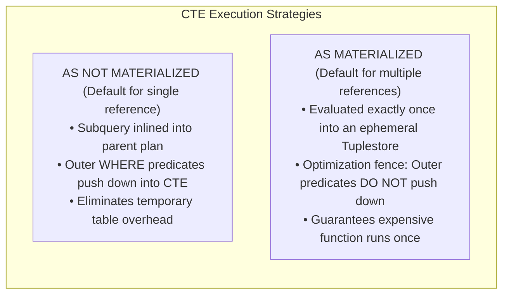
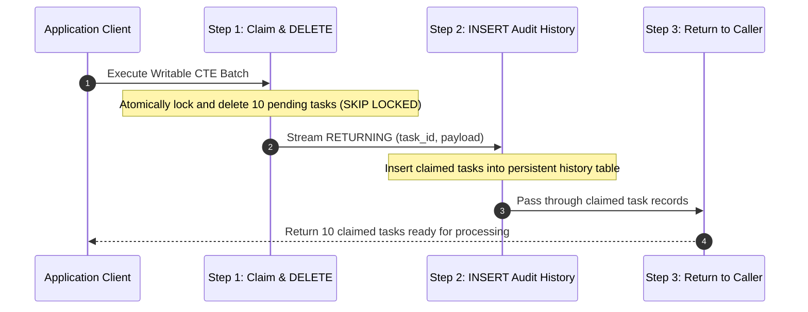
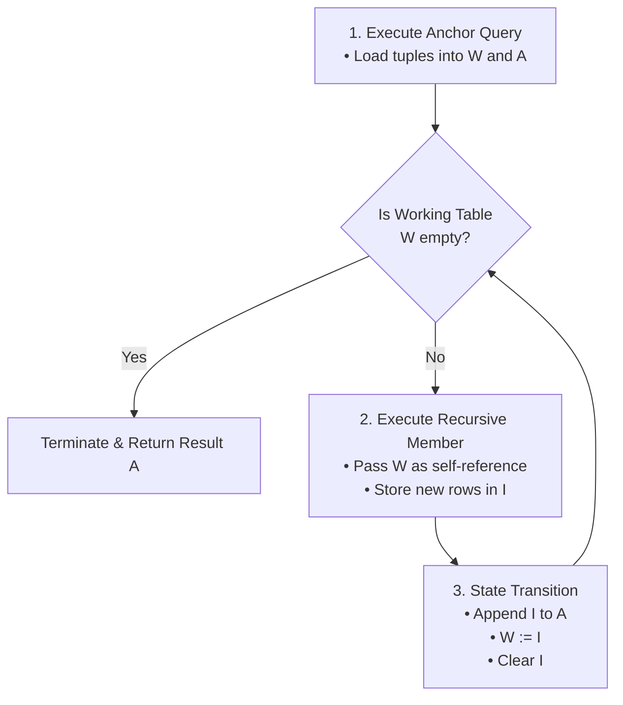
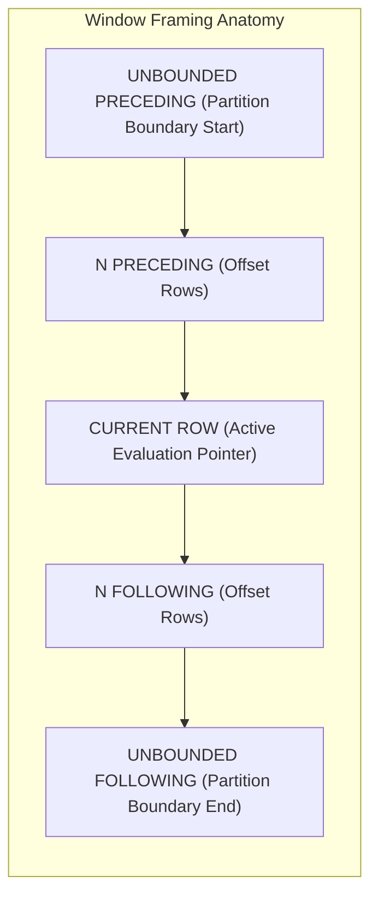
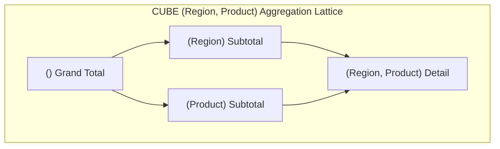

# Module 04 — Advanced SQL: CTEs & Window Functions

Welcome to **Module 04** of the PostgreSQL 18 Curriculum. This module provides a rigorous, academically grounded, and production-tested exploration of advanced analytical SQL in PostgreSQL. We examine the formal fixpoint semantics of recursive Common Table Expressions (CTEs), optimization fence controls (`MATERIALIZED` vs. `NOT MATERIALIZED`), atomic multi-statement data mutations via writable CTEs, directed graph cycle detection, and the internal executor mechanics of the **`WindowAgg`** subsystem, including tuplestore memory spilling, deep frame specifications, and multi-dimensional OLAP aggregation lattices.

---

## 1. Core Terminology & Concept Definitions

To establish exact precision across this curriculum, the following analytical SQL terms are formally defined:

- **Common Table Expression (CTE)**: A named auxiliary statement defined in a query-scoped `WITH` clause that acts as a modular relational expression. CTEs improve readability and can be referenced multiple times within the outer query.
- **Optimization Fence**: A planner boundary that prevents the query optimizer from pushing down predicates or inlining subqueries across expression boundaries. In PostgreSQL, `AS MATERIALIZED` establishes an explicit optimization fence, whereas `AS NOT MATERIALIZED` instructs the optimizer to inline the CTE.
- **Data-Modifying CTE (Writable CTE)**: A CTE containing `INSERT`, `UPDATE`, or `DELETE` statements paired with a `RETURNING` clause, piping mutated tuples into downstream CTE steps or outer queries within a single atomic transaction.
- **Recursive CTE**: A self-referential query evaluated iteratively according to relational least fixpoint semantics. It begins with an anchor expression, repeatedly applies a recursive member query via `UNION ALL`, and terminates when an iteration returns an empty tuple set.
- **Cycle Detection (`CYCLE`)**: An ANSI SQL standard clause supported natively in PostgreSQL that tracks visited primary keys in an internal array, terminating execution and setting a boolean indicator when a circular path is encountered.
- **Window Function**: A scalar function evaluated across a designated subset of relation tuples (the "window frame") associated with the current row, returning a calculated value for each input tuple without collapsing the relation into aggregate summary rows.
- **Window Frame**: The dynamic boundary specification within an ordered partition (`ROWS`, `RANGE`, or `GROUPS`) that defines which neighboring tuples participate in the calculation relative to the current row.
- **Tuplestore**: The internal PostgreSQL executor storage abstraction used by `WindowAgg` and `Materialize` nodes to hold intermediate tuple sets in memory, spilling to temporary disk files when partition size exceeds `work_mem`.

---

## 2. Common Table Expressions (CTEs) & Optimization Fences

### Planner Mechanics: Inlining vs. Materialization
PostgreSQL evaluates CTEs through two fundamentally different strategies:



### Strategic Materialization Control

```sql
-- 1. AS NOT MATERIALIZED: Forces inlining and predicate pushdown
WITH high_volume_events AS NOT MATERIALIZED (
    SELECT tenant_id, event_type, payload, created_at
    FROM telemetry_events
)
SELECT * 
FROM high_volume_events
WHERE tenant_id = 'TENANT-9901' 
  AND created_at >= clock_timestamp() - INTERVAL '15 minutes';
-- The planner pushes 'tenant_id = TENANT-9901' directly into the index scan of telemetry_events!

-- 2. AS MATERIALIZED: Acts as an optimization fence
WITH heavy_ml_scoring AS MATERIALIZED (
    SELECT candidate_id, compute_deep_risk_score(feature_vector) AS risk_score
    FROM loan_applications
)
SELECT c.full_name, s.risk_score
FROM candidates c
JOIN heavy_ml_scoring s ON c.id = s.candidate_id
WHERE s.risk_score > 0.85;
-- compute_deep_risk_score is evaluated strictly once per application row, never repeatedly.
```

---

## 3. Atomic Multi-Mutation Writable CTEs

Writable CTEs execute state-modifying DML statements (`INSERT`, `UPDATE`, `DELETE`) with `RETURNING`, allowing complex multi-stage mutations to commit atomically within a single statement without requiring application-level distributed transactions.



### Atomic Concurrent Queue Drain Pattern
```sql
WITH claimed_tasks AS (
    -- Step 1: Claim and delete pending work items without lock contention
    DELETE FROM task_queue
    WHERE task_id IN (
        SELECT task_id 
        FROM task_queue
        WHERE task_status = 'PENDING'
        ORDER BY priority_score DESC, created_at ASC
        FOR UPDATE SKIP LOCKED
        LIMIT 25
    )
    RETURNING task_id, task_type, payload, priority_score, created_at
),
audit_log AS (
    -- Step 2: Archive claimed items into audit history
    INSERT INTO task_processing_history (task_id, task_type, payload, started_at)
    SELECT task_id, task_type, payload, clock_timestamp()
    FROM claimed_tasks
    RETURNING history_id
)
-- Step 3: Deliver the batch of claimed tasks directly to the caller
SELECT task_id, task_type, payload, priority_score
FROM claimed_tasks;
```

---

## 4. Recursive CTEs & Relational Fixpoint Semantics

### Theoretical Foundations: The Least Fixpoint (LFP)
In formal database theory (Datalog), a recursive query evaluates the **Least Fixpoint (LFP)** of a monotonic relational transformation operator $T$. By the Knaster-Tarski Theorem, because relational algebra expressions with union are monotonic, iterating the operator from an empty base set converges to a unique minimal fixpoint:

$$T(R) = \text{AnchorQuery} \cup \text{RecursiveQuery}(R)$$
$$R_0 = \emptyset, \quad R_1 = T(R_0) = \text{Anchor}, \quad R_{k+1} = T(R_k)$$
$$\text{LFP} = \bigcup_{i=0}^{\infty} R_i$$

### Execution State Machine of `RecursiveUnion`
The PostgreSQL executor evaluates recursive CTEs using two working tables in memory:
1. **Working Table ($W$)**: Contains tuples produced in iteration $i$, which serve as input to the recursive query in iteration $i+1$.
2. **Intermediate Table ($I$)**: Accumulates the output tuples produced during iteration $i+1$.
3. **Result Table ($A$)**: Collects all generated tuples across all iterations.



> [!WARNING]
> Because recursive evaluation requires monotonicity to ensure convergence, SQL standards and PostgreSQL prohibit non-monotonic operations inside the recursive member query:
> - No `DISTINCT` or `GROUP BY`
> - No aggregate functions (`COUNT`, `SUM`, `AVG`)
> - No outer joins where the recursive CTE is on the right/inner side
> - No subqueries referencing the recursive working table

---

### Hierarchical Tree Traversal
```sql
WITH RECURSIVE org_chart AS (
    -- Anchor Member: Identify top-level executives (nodes with no parent)
    SELECT 
        employee_id,
        manager_id,
        full_name,
        job_title,
        1 AS depth_level,
        full_name::text AS reporting_hierarchy
    FROM company_employees
    WHERE manager_id IS NULL

    UNION ALL

    -- Recursive Member: Join current working generation with base table
    SELECT 
        e.employee_id,
        e.manager_id,
        e.full_name,
        e.job_title,
        c.depth_level + 1,
        c.reporting_hierarchy || ' -> ' || e.full_name
    FROM company_employees e
    INNER JOIN org_chart c ON e.manager_id = c.employee_id
)
SELECT depth_level, reporting_hierarchy, job_title
FROM org_chart
ORDER BY reporting_hierarchy;
```

---

### Directed Graphs & PostgreSQL `CYCLE` Clause
In directed cyclic graphs (e.g. logistics networks, dependency trees, financial transactions), recursive queries will loop infinitely unless cycles are trapped.

PostgreSQL natively supports the ANSI SQL `CYCLE` clause:
```sql
WITH RECURSIVE flight_routes AS (
    -- Anchor Member: Direct outbound departures from PRG
    SELECT 
        origin_airport,
        destination_airport,
        ARRAY[origin_airport, destination_airport] AS path_segments,
        1 AS total_legs
    FROM flight_schedules
    WHERE origin_airport = 'PRG'

    UNION ALL

    -- Recursive Member: Connect arrival airport to next departure
    SELECT 
        f.origin_airport,
        f.destination_airport,
        r.path_segments || f.destination_airport,
        r.total_legs + 1
    FROM flight_schedules f
    INNER JOIN flight_routes r ON f.origin_airport = r.destination_airport
)
CYCLE destination_airport SET has_cycle USING cycle_path
SELECT 
    origin_airport,
    destination_airport,
    total_legs,
    path_segments,
    has_cycle
FROM flight_routes
WHERE has_cycle = FALSE;
```
The `CYCLE` clause tracks visited node identifiers in an internal array (`cycle_path`), marks duplicate visits by asserting `has_cycle = TRUE`, and immediately prunes further recursive descent from that branch.

---

## 5. Continuous Series Synthesis with `generate_series`

`generate_series(start, stop, step)` is PostgreSQL's built-in set-returning generator function. It is indispensable for zero-filling sparse time series and calendar reporting:

```sql
-- Zero-filled daily revenue report across an entire month
SELECT 
    calendar.day::date AS reporting_date,
    COALESCE(SUM(o.total_amount), 0.00) AS total_revenue,
    COUNT(o.order_id) AS order_count
FROM generate_series(
    '2026-10-01'::timestamp, 
    '2026-10-31'::timestamp, 
    '1 day'::interval
) AS calendar(day)
LEFT JOIN customer_orders o ON o.order_date::date = calendar.day::date
GROUP BY calendar.day::date
ORDER BY reporting_date ASC;
```

---

## 6. Window Function Architecture & `WindowAgg` Mechanics

Unlike aggregate functions with `GROUP BY` that collapse rows into a single partition summary, **window functions** preserve every individual tuple while computing scalar values over a sliding or fixed frame of peer tuples.



### 1. The `WindowAgg` Executor Node & Memory Bounds
In the PostgreSQL query execution pipeline:
1. Input tuples are presorted by `PARTITION BY` and `ORDER BY` keys.
2. The `WindowAgg` execution node reads tuples into an internal **Tuplestore**.
3. If the partition exceeds `work_mem`, the `Tuplestore` spills tuples to temporary files on disk (`$PGDATA/base/pgsql_tmp/`).
4. To optimize performance, ensure `work_mem` is sized sufficiently to retain complete partitions in memory.

### 2. Physical vs. Logical Framing: `ROWS`, `RANGE`, and `GROUPS`

| Frame Mode | Unit of Offset | Semantic Behavior | Performance Impact |
| :--- | :--- | :--- | :--- |
| **`ROWS`** | Physical Tuples | Strict physical count of rows before/after current row. | **Fastest**: Simple pointer arithmetic in the Tuplestore. |
| **`RANGE`** | Logical Values | Based on value difference from current row's `ORDER BY` expression. | **Slower**: Must inspect tuple values to detect duplicates/boundaries. |
| **`GROUPS`** | Peer Groups | Counts sets of rows possessing identical `ORDER BY` values. | **Moderate**: Requires tracking peer-group transitions. |

> [!CRITICAL]
> **The Hidden Performance Trap of Default Window Framing:**
> When an `ORDER BY` is provided inside an `OVER (...)` clause without an explicit frame, the ANSI standard defaults to:
> ```sql
> RANGE BETWEEN UNBOUNDED PRECEDING AND CURRENT ROW
> ```
> Under `RANGE`, PostgreSQL must verify whether following rows have identical sort keys (peer duplicates) before completing the aggregate, preventing streaming optimizations. 
> Whenever calculating running totals where physical rows suffice, explicitly specify `ROWS`:
> ```sql
> ROWS BETWEEN UNBOUNDED PRECEDING AND CURRENT ROW
> ```

---

### 3. Ranking & Statistical Distribution Functions
```sql
SELECT 
    department_id,
    full_name,
    salary,
    -- Strictly sequential integers without ties (1, 2, 3, 4, 5)
    ROW_NUMBER() OVER w AS seq_num,
    -- Leaves gaps on ties (1, 2, 2, 4)
    RANK() OVER w AS rank_position,
    -- No gaps on ties (1, 2, 2, 3)
    DENSE_RANK() OVER w AS dense_position,
    -- Equi-depth buckets (e.g. quartiles 1, 2, 3, 4)
    NTILE(4) OVER w AS compensation_quartile,
    -- Relative rank from 0.0 to 1.0: (rank - 1) / (total_rows - 1)
    PERCENT_RANK() OVER w AS relative_rank
FROM employee_salaries
WINDOW w AS (PARTITION BY department_id ORDER BY salary DESC);
```

### 4. Inter-Row Value Offset Functions
```sql
SELECT 
    customer_id,
    order_date,
    total_amount,
    -- Value from exactly 1 row prior (defaults to 0.00 if first row)
    LAG(total_amount, 1, 0.00) OVER w AS prior_order_amount,
    -- Velocity of purchase: difference from prior transaction
    total_amount - LAG(total_amount, 1, total_amount) OVER w AS purchase_delta,
    -- Value from 1 row ahead
    LEAD(total_amount, 1, 0.00) OVER w AS subsequent_order_amount,
    -- Highest value within the partition
    FIRST_VALUE(total_amount) OVER (
        w ROWS BETWEEN UNBOUNDED PRECEDING AND UNBOUNDED FOLLOWING
    ) AS historical_peak_amount
FROM customer_orders
WINDOW w AS (PARTITION BY customer_id ORDER BY order_date ASC);
```

### 5. Moving Averages & Frame Exclusion Clauses
```sql
SELECT 
    device_id,
    recorded_at,
    temperature_celsius,
    -- Centered 5-point moving average: 2 preceding, current row, 2 following
    ROUND(AVG(temperature_celsius) OVER (
        PARTITION BY device_id 
        ORDER BY recorded_at ASC
        ROWS BETWEEN 2 PRECEDING AND 2 FOLLOWING
    )::numeric, 2) AS smoothed_temperature,
    -- Moving average excluding the current row's reading (outlier detection)
    ROUND(AVG(temperature_celsius) OVER (
        PARTITION BY device_id 
        ORDER BY recorded_at ASC
        ROWS BETWEEN 2 PRECEDING AND 2 FOLLOWING EXCLUDE CURRENT ROW
    )::numeric, 2) AS neighbor_baseline_avg
FROM sensor_telemetry;
```

---

## 7. Multi-Dimensional OLAP Aggregations: `GROUPING SETS`, `ROLLUP` & `CUBE`

To avoid executing multiple `UNION ALL` queries for subtotal and grand total reporting, PostgreSQL evaluates multidimensional aggregation lattices in a single sequential scan:



```sql
SELECT 
    COALESCE(region, '[All Regions]') AS region,
    COALESCE(product_category, '[All Categories]') AS product_category,
    GROUPING(region, product_category) AS grouping_bitmask,
    SUM(sale_amount) AS total_sales,
    COUNT(sale_id) AS transaction_count
FROM sales_records
GROUP BY CUBE (region, product_category)
ORDER BY region, product_category;
```

### Demystifying the `GROUPING()` Bitmask
The `GROUPING(col1, col2, ...)` function returns an integer bitmask indicating which columns are aggregated in the current row:
- Bit value `0`: The column is a grouping key for this row.
- Bit value `1`: The column is aggregated (subtotaled/grand totaled).
- This allows programmatic distinction between a genuine `NULL` stored in the database versus a synthetic `NULL` generated by `ROLLUP` or `CUBE`.

---

## 8. Summary & Module Progression

In this module, we examined:
- Optimization fences and materialization dynamics (`AS MATERIALIZED` vs. `AS NOT MATERIALIZED`).
- Multi-step atomic mutations via writable CTEs (`DELETE ... RETURNING` into `INSERT`).
- Formal least fixpoint (LFP) semantics and the `RecursiveUnion` executor state machine.
- Cycle trapping in cyclic directed graphs using the ANSI `CYCLE` clause.
- Gap-free time series generation with `generate_series`.
- The `WindowAgg` execution engine, partition tuplestores, and `work_mem` bounds.
- Physical (`ROWS`) vs. logical (`RANGE`, `GROUPS`) window framing and the `EXCLUDE` clause.
- OLAP multidimensional aggregation lattices (`GROUPING SETS`, `ROLLUP`, `CUBE`) and the `GROUPING()` bitmask.

Proceed to **[Module 05 — Semi-Structured Data: JSON/JSONB & Full-Text Search](./05-json-jsonb-and-full-text-search.md)** to explore binary JSON decomposition, JSON Path expressions, GIN indexing internals, and lexical full-text search dictionaries.
